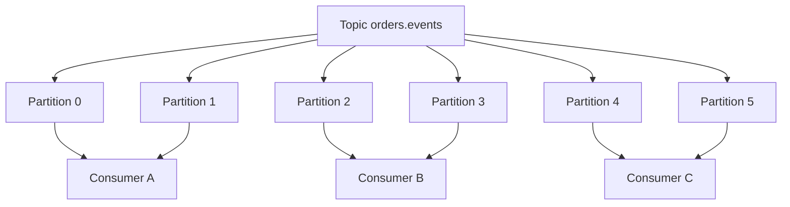
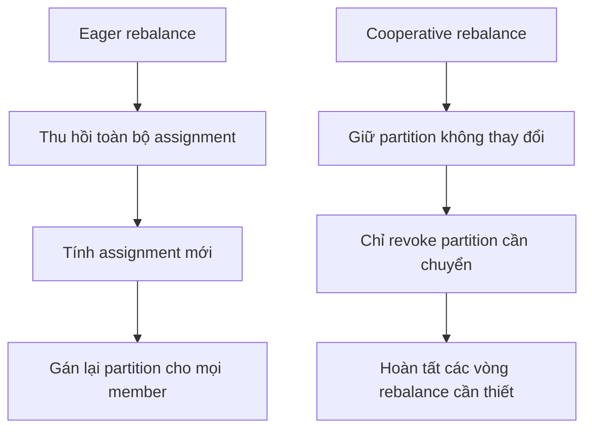

# Partition assignment strategy

Khi một consumer group có nhiều consumer cùng đăng ký một topic, Kafka cần quyết định partition nào được giao cho consumer nào. Cơ chế thực hiện việc phân phối đó được gọi là **partition assignment strategy**. Strategy ảnh hưởng đến mức cân bằng tải, số partition phải di chuyển khi group thay đổi thành viên và thời gian consumer bị gián đoạn trong một lần rebalance.

Kafka cung cấp các assignor phổ biến như `RangeAssignor`, `RoundRobinAssignor`, `StickyAssignor` và `CooperativeStickyAssignor`. Chúng đều phân phối partition cho các consumer đủ điều kiện trong cùng group, nhưng cách phân phối và cách xử lý rebalance khác nhau. Hiểu sự khác biệt giúp chọn cấu hình phù hợp với số topic, subscription, concurrency và yêu cầu sẵn sàng của ứng dụng Spring Kafka.

## 1. Partition assignor làm nhiệm vụ gì?

Một consumer group có thể gồm nhiều consumer instance. Mỗi consumer đăng ký một hoặc nhiều topic. Kafka group coordinator quản lý thành viên và quá trình rebalance; partition assignor xác định cách phân phối các partition của những topic được đăng ký cho các member.

Ví dụ, topic `orders.events` có sáu partition và group `order-projection` có ba consumer:



Đây là một assignment minh họa. Trong cùng group, mỗi partition được gán cho tối đa một consumer member tại một thời điểm. Một consumer có thể nhận nhiều partition; nếu số consumer lớn hơn số partition có thể gán, một số consumer sẽ không nhận partition của topic đó.

Partition assignor cần xét:

- Danh sách topic và partition hiện có.
- Subscription của từng consumer member.
- Các member thuộc cùng consumer group.
- Assignment trước đó, với những strategy có mục tiêu giữ assignment ổn định.

Assignment strategy không quyết định record nào thuộc về consumer group. Nó chỉ quyết định **partition nào được giao cho member nào**. Offset đã commit và vị trí đọc vẫn được quản lý riêng theo group và partition.

## 2. RangeAssignor

`RangeAssignor` phân phối partition theo từng topic. Với mỗi topic, assignor sắp xếp partition theo số thứ tự và chia thành các dải liên tiếp cho consumer đã đăng ký topic đó.

Giả sử một topic có 6 partition và 3 consumer cùng subscribe:

| Consumer | Partition được gán |
|---|---|
| Consumer A | P0, P1 |
| Consumer B | P2, P3 |
| Consumer C | P4, P5 |

Với một topic có partition count chia đều cho số consumer, Range thường tạo assignment cân bằng và dễ dự đoán. Mỗi consumer nhận một dải partition liên tiếp.

### Điểm cần lưu ý khi subscribe nhiều topic

Range chia riêng từng topic. Vì vậy, nếu nhiều topic có số partition không chia hết cho số consumer, phần dư có thể luôn rơi vào những consumer đầu danh sách cho từng topic. Khi cộng assignment của nhiều topic, tổng số partition trên các consumer có thể lệch đáng kể.

Ví dụ hai topic `orders.events` và `payments.events`, mỗi topic có 3 partition, cùng được 2 consumer subscribe:

| Consumer | `orders.events` | `payments.events` | Tổng |
|---|---|---|---:|
| Consumer A | P0, P1 | P0, P1 | 4 |
| Consumer B | P2 | P2 | 2 |

Range vẫn chia đúng theo từng topic, nhưng tổng tải partition giữa A và B không đều. Đây là trường hợp RoundRobin hoặc Sticky có thể phù hợp hơn.

## 3. RoundRobinAssignor

`RoundRobinAssignor` sắp xếp các partition của các topic được subscribe rồi phân phối luân phiên qua danh sách consumer. Nếu các consumer có subscription giống nhau, strategy thường tạo assignment cân bằng hơn khi group subscribe nhiều topic.

Với hai topic, mỗi topic có ba partition và hai consumer cùng subscribe:

| Consumer | Assignment minh họa |
|---|---|
| Consumer A | `orders.events-0`, `orders.events-2`, `payments.events-1` |
| Consumer B | `orders.events-1`, `payments.events-0`, `payments.events-2` |

Các partition được xen kẽ giữa các consumer thay vì chia thành từng dải riêng theo topic. Khi consumer có subscription khác nhau, RoundRobin chỉ gán partition cho member có subscribe topic tương ứng; vì vậy assignment không nhất thiết chia đều tuyệt đối trong mọi cấu hình.

RoundRobin phù hợp khi:

- Một group subscribe nhiều topic.
- Các member có subscription tương tự nhau.
- Muốn phân phối partition xen kẽ để tránh phần dư của từng topic dồn vào cùng một member.

## 4. StickyAssignor

`StickyAssignor` hướng đến hai mục tiêu cùng lúc:

1. Phân phối partition tương đối cân bằng giữa các consumer.
2. Giữ assignment cũ nhiều nhất có thể khi group rebalance, hạn chế số partition phải chuyển sang consumer khác.

Ví dụ, group ban đầu có ba consumer và sáu partition. Nếu một consumer rời group, Sticky cố gắng giữ nguyên các partition của hai consumer còn lại, sau đó phân phối lại partition của member đã rời đi. Việc giảm di chuyển partition giúp giảm chi phí khởi tạo lại state, cache hoặc tài nguyên gắn với partition.

Sticky vẫn dùng cơ chế eager rebalance trong giao thức classic: các consumer thu hồi assignment hiện tại trước khi nhận assignment mới. Vì vậy, dù số partition di chuyển được tối ưu, group vẫn có thể tạm dừng xử lý trong lúc rebalance.

Sticky phù hợp với hệ thống có stateful processing hoặc muốn giảm số partition đổi chủ sau khi thành viên thay đổi, nhưng vẫn chấp nhận thời gian dừng ngắn của eager rebalance.

## 5. CooperativeStickyAssignor

`CooperativeStickyAssignor` kết hợp mục tiêu giữ assignment ổn định của Sticky với **cooperative/incremental rebalance**. Thay vì thu hồi toàn bộ partition khỏi tất cả consumer, Kafka chỉ thu hồi những partition cần chuyển. Những partition không đổi có thể tiếp tục được consumer hiện tại xử lý.

Ví dụ, group có ba consumer đang sở hữu sáu partition. Khi consumer C rời group, assignment mới chỉ cần chuyển các partition C đang giữ sang A và B. Với cooperative rebalance, A và B giữ các partition vốn đã thuộc về mình, chỉ những partition phải di chuyển mới trải qua quá trình revoke rồi assign lại.



Cooperative không có nghĩa là không còn rebalance hoặc không có gián đoạn. Khi một partition cần chuyển chủ, consumer cũ phải nhả partition trước khi consumer mới nhận nó. Một thay đổi có thể cần hơn một vòng rebalance để hoàn tất an toàn. Tuy nhiên, các partition không liên quan không phải dừng xử lý chỉ vì group có thay đổi thành viên.

`CooperativeStickyAssignor` phù hợp với consumer group có tải liên tục, nhiều partition hoặc stateful workload, nơi việc thu hồi toàn bộ partition gây gián đoạn đáng kể.

## 6. So sánh các strategy phổ biến

| Strategy | Cách phân phối | Mức giữ assignment cũ | Kiểu rebalance |
|---|---|---|---|
| `RangeAssignor` | Chia dải liên tiếp theo từng topic. | Không tối ưu giữ assignment cũ. | Eager |
| `RoundRobinAssignor` | Phân phối luân phiên trên các partition của topic đã subscribe. | Không tối ưu giữ assignment cũ. | Eager |
| `StickyAssignor` | Cân bằng và cố gắng giữ partition ở consumer cũ. | Cao | Eager |
| `CooperativeStickyAssignor` | Cân bằng, giữ assignment và chỉ chuyển partition cần thiết theo từng bước. | Cao | Cooperative/incremental |

Không có strategy nào đảm bảo tải CPU hoặc thời gian xử lý bằng nhau tuyệt đối. Assignor chủ yếu cân bằng số partition. Nếu một partition có lưu lượng lớn hơn nhiều partition khác, consumer nhận partition đó vẫn có thể quá tải dù số partition được chia đều.

## 7. Cấu hình partition.assignment.strategy trong Spring Boot

Kafka consumer nhận cấu hình `partition.assignment.strategy` để xác định các assignor được phép dùng. Với Spring Boot, có thể khai báo trong `application.yml`:

```yaml
spring:
  kafka:
    bootstrap-servers: localhost:9092
    consumer:
      group-id: order-projection
      properties:
        "[partition.assignment.strategy]": org.apache.kafka.clients.consumer.CooperativeStickyAssignor
```

Để dùng RoundRobin:

```yaml
spring:
  kafka:
    consumer:
      properties:
        "[partition.assignment.strategy]": org.apache.kafka.clients.consumer.RoundRobinAssignor
```

Các class assignor nằm trong Kafka client. Nếu cần khai báo nhiều assignor trong danh sách, có thể cấu hình danh sách class theo định dạng mà Kafka client hỗ trợ, ví dụ chuỗi phân tách bằng dấu phẩy trong property map:

```yaml
spring:
  kafka:
    consumer:
      properties:
        "[partition.assignment.strategy]": >-
          org.apache.kafka.clients.consumer.RangeAssignor,
          org.apache.kafka.clients.consumer.CooperativeStickyAssignor
```

Danh sách này hữu ích khi chuyển đổi strategy theo từng đợt. Kafka chọn assignor chung mà các member trong group cùng hỗ trợ; nếu các consumer không có assignor tương thích, group có thể không hoàn tất rebalance. Khi chuyển sang cooperative, cần triển khai theo quy trình rolling migration được kiểm soát và chỉ chuyển hẳn sau khi mọi member hỗ trợ strategy mới.

Các ví dụ trên áp dụng cho **classic consumer group protocol**. `CooperativeStickyAssignor` được hỗ trợ từ Kafka client 2.4. Ở các phiên bản Kafka mới có thêm consumer group protocol (`group.protocol=consumer`), cơ chế assignment được điều phối phía broker và cấu hình assignor từ xa có quy tắc riêng; `partition.assignment.strategy` không còn là lựa chọn điều khiển assignment cho protocol mới. Hãy kiểm tra protocol mà cluster và client đang sử dụng trước khi áp dụng cấu hình.

## 8. Kết hợp với @KafkaListener và concurrency

Trong Spring Kafka, `@KafkaListener` tạo listener container. Thuộc tính `concurrency` xác định số consumer thread/container con cho listener đó. Mỗi consumer con tham gia group và được assignor phân phối partition.

```java
import org.springframework.kafka.annotation.KafkaListener;
import org.springframework.stereotype.Component;

@Component
public class OrderEventListener {

    @KafkaListener(
            topics = "orders.events",
            groupId = "order-projection",
            concurrency = "3"
    )
    public void onOrderEvent(OrderCreatedEvent event) {
        // Xử lý event và cập nhật projection.
    }
}
```

Giả sử topic có sáu partition và listener có `concurrency=3`, tối đa ba consumer con của listener nhận partition; mỗi consumer có thể nhận hai partition. Nếu tăng concurrency lên tám, vẫn chỉ có tối đa sáu consumer con nhận partition của topic này; hai consumer còn lại không có partition được gán.

Khi có nhiều `@KafkaListener` dùng cùng group ID, chúng cùng tham gia group và assignment phụ thuộc subscription của từng consumer. Cấu hình assignor được đặt ở consumer factory, nên cần bảo đảm mọi member trong cùng group có cấu hình tương thích. Không nên thay đổi group ID chỉ để đổi assignor vì group mới sẽ có committed offset riêng.

## 9. Rebalance callback không phải partition assignor

`ConsumerRebalanceListener` là callback vòng đời để ứng dụng phản ứng khi partition bị thu hồi hoặc được giao. Nó không quyết định partition nào thuộc về consumer; việc đó là nhiệm vụ của assignor.

Các tình huống thường dùng callback:

- Trước khi partition bị thu hồi: flush state store hoặc lưu checkpoint cần thiết.
- Sau khi partition được gán: khôi phục state tương ứng hoặc khởi tạo tài nguyên cho partition.
- Khi partition bị mất quyền sở hữu ngoài quy trình revoke bình thường: tránh tiếp tục ghi state như thể consumer vẫn sở hữu partition.

Spring Kafka có `ConsumerAwareRebalanceListener` để tích hợp callback với listener container. Với ứng dụng dùng `@KafkaListener`, hãy cấu hình callback qua `ContainerProperties`/listener container factory thay vì tự gọi `subscribe()` trên consumer do Spring quản lý.

Đặc biệt, không thực hiện công việc I/O kéo dài trong callback rebalance. Callback cần hoàn tất trong giới hạn thời gian của group; nếu xử lý quá lâu, consumer có thể bị xem là không hoạt động và gây thêm rebalance.

## 10. Eager và cooperative rebalance

### Eager rebalance

Với eager rebalance, tất cả consumer member thu hồi toàn bộ partition đang sở hữu. Sau khi coordinator hoàn tất việc xác định thành viên và assignment, partition được giao lại. Cách này đơn giản và được dùng bởi Range, RoundRobin và Sticky trong giao thức classic.

Ưu điểm là mô hình revoke/assign dễ hiểu và tương thích rộng. Hạn chế là các partition không thay đổi cũng phải trải qua quá trình thu hồi và gán lại, làm tăng thời gian ngừng tiêu thụ khi group thay đổi.

### Cooperative rebalance

Với cooperative rebalance, consumer giữ các partition không cần chuyển. Partition cần đổi chủ được revoke trước, sau đó được assign cho member mới trong vòng rebalance tiếp theo. Cách này giảm phạm vi gián đoạn và phù hợp với hệ thống xử lý liên tục.

Để dùng `CooperativeStickyAssignor`, tất cả consumer member trong group cần có phiên bản Kafka client hỗ trợ và cấu hình tương thích. Trong triển khai rolling, cần thực hiện các bước chuyển đổi theo hướng dẫn của phiên bản Kafka đang chạy; không trộn các client không có assignor chung.

## 11. Các yếu tố khác ảnh hưởng đến rebalance

Assignment strategy là một phần của bài toán consumer group. Các yếu tố sau cũng ảnh hưởng đến tần suất và thời gian rebalance:

| Yếu tố | Ảnh hưởng |
|---|---|
| Consumer khởi động hoặc dừng | Thành viên group thay đổi, có thể kích hoạt rebalance. |
| `session.timeout.ms` | Nếu coordinator không nhận heartbeat trong khoảng timeout, member có thể bị loại khỏi group. |
| `heartbeat.interval.ms` | Điều chỉnh tần suất heartbeat trong giao thức classic; thường cần nhỏ hơn `session.timeout.ms`. |
| `max.poll.interval.ms` | Nếu ứng dụng không gọi `poll()` kịp thời, consumer có thể bị xem là không còn tiến triển và rời group. |
| `concurrency` | Tạo số consumer con trong Spring listener container; thay đổi concurrency có thể thay đổi membership. |
| Partition count | Tăng partition làm thay đổi tập partition cần assignment và có thể làm key mapping thay đổi. |
| Static membership (`group.instance.id`) | Có thể giảm rebalance không cần thiết khi một instance khởi động lại trong thời gian phù hợp; cần ID duy nhất và xử lý timeout thận trọng. |

Static membership không phải partition assignment strategy. Nó giúp coordinator nhận diện member ổn định qua restart, trong khi assignor vẫn quyết định phân phối partition.

## 12. Chọn strategy theo tình huống

| Tình huống | Strategy gợi ý | Lý do |
|---|---|---|
| Một topic, subscription giống nhau, cần cấu hình đơn giản | `RangeAssignor` | Assignment theo dải dễ dự đoán. |
| Một group subscribe nhiều topic, muốn chia xen kẽ | `RoundRobinAssignor` | Tránh phần dư của từng topic dồn về cùng consumer trong nhiều trường hợp. |
| Muốn giữ partition ở consumer cũ khi group thay đổi | `StickyAssignor` | Giảm số partition di chuyển nhưng vẫn eager. |
| Workload liên tục, muốn giảm gián đoạn khi rebalance | `CooperativeStickyAssignor` | Giữ partition không đổi và chỉ revoke phần cần chuyển. |

Hãy benchmark bằng workload thực tế. Nếu partition có lưu lượng hoặc chi phí xử lý khác nhau đáng kể, cân bằng số partition chưa chắc cân bằng tài nguyên. Có thể cần điều chỉnh partitioning theo key, tăng partition cho các luồng nóng hoặc tách topic theo nhóm tải.

## 13. Ghi nhớ

- Partition assignor quyết định cách phân phối partition cho consumer member trong cùng group.
- `RangeAssignor` chia dải partition riêng theo từng topic; nhiều topic có thể tạo assignment tổng thể lệch.
- `RoundRobinAssignor` phân phối luân phiên trên các partition đã subscribe.
- `StickyAssignor` cố gắng cân bằng và giữ assignment cũ nhưng vẫn dùng eager rebalance.
- `CooperativeStickyAssignor` giữ partition không đổi và chỉ chuyển partition cần thiết qua incremental rebalance.
- Cấu hình Kafka client bằng `partition.assignment.strategy`; trong Spring Boot đặt tại `spring.kafka.consumer.properties`.
- `@KafkaListener(concurrency=...)` tạo consumer con; concurrency hiệu quả bị giới hạn bởi số partition được gán.
- `ConsumerRebalanceListener` xử lý sự kiện revoke/assign, không thay thế assignor.
- Static membership và timeout ảnh hưởng membership/rebalance nhưng không phải assignment strategy.

Khi chọn partition assignment strategy, hãy nhìn vào số topic mà group subscribe, mức cân bằng mong muốn, chi phí di chuyển partition và khả năng chấp nhận gián đoạn khi rebalance. Với hệ thống Spring Kafka chạy liên tục, `CooperativeStickyAssignor` thường là lựa chọn đáng cân nhắc nếu toàn bộ consumer member hỗ trợ và có thể triển khai chuyển đổi đồng bộ.

## Tài liệu tham khảo

- [Apache Kafka — Consumer Configurations](https://kafka.apache.org/documentation/#consumerconfigs)
- [Apache Kafka — ConsumerRebalanceListener API](https://kafka.apache.org/40/javadoc/org/apache/kafka/clients/consumer/ConsumerRebalanceListener.html)
- [Spring for Apache Kafka — Message Listener Containers](https://docs.spring.io/spring-kafka/reference/kafka/receiving-messages/message-listener-container.html)
