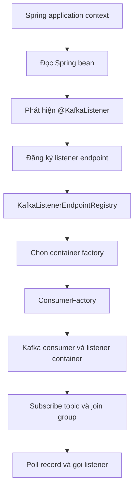

# Bật @EnableKafka và đăng ký listener

Spring Kafka dùng `@KafkaListener` để đánh dấu phương thức xử lý record, còn listener container chịu trách nhiệm tạo và quản lý Kafka consumer ở phía sau. Để annotation này hoạt động, ứng dụng cần bật hạ tầng xử lý listener và cung cấp một `KafkaListenerContainerFactory` phù hợp.

Trong ứng dụng Spring thuần, `@EnableKafka` kích hoạt hạ tầng annotation-driven của Spring Kafka. Với Spring Boot, auto-configuration thường đã đăng ký hạ tầng này và tạo listener container factory mặc định, vì vậy không cần thêm `@EnableKafka` chỉ để dùng `@KafkaListener`.

## 1. Các thành phần tham gia đăng ký listener

Một listener không trực tiếp tạo Kafka consumer chỉ bằng cách gọi phương thức có annotation. Spring Kafka đọc metadata của annotation, đăng ký endpoint và dùng container factory để tạo listener container.

Các thành phần chính:

| Thành phần | Vai trò |
|---|---|
| `@EnableKafka` | Bật cơ chế phát hiện và đăng ký `@KafkaListener` trong ứng dụng Spring không dựa vào auto-configuration của Boot |
| `@KafkaListener` | Khai báo endpoint nhận record, gồm topic subscription, group, container factory và các tùy chọn listener |
| `KafkaListenerAnnotationBeanPostProcessor` | Phát hiện annotation trên các Spring bean và chuyển chúng thành listener endpoint |
| `KafkaListenerEndpointRegistry` | Quản lý các listener container được đăng ký từ endpoint |
| `KafkaListenerContainerFactory` | Tạo container để chạy listener; thường dùng `ConcurrentKafkaListenerContainerFactory` |
| `ConsumerFactory` | Tạo Kafka consumer với bootstrap server, deserializer và consumer properties |
| Listener container | Quản lý consumer, poll, gọi listener và phối hợp acknowledgment/commit |

Luồng khởi tạo có thể hình dung như sau:



`@KafkaListener` mô tả nơi nhận sự kiện. Container factory mô tả cách listener được vận hành, chẳng hạn consumer factory, concurrency, acknowledgment mode và error handler. Tách hai vai trò này giúp nhiều listener có thể dùng chung một factory hoặc chọn factory riêng theo yêu cầu.

## 2. Khi nào cần @EnableKafka?

### Ứng dụng Spring Framework không dùng Spring Boot

Với cấu hình Java thuần, thêm `@EnableKafka` vào một lớp `@Configuration` để kích hoạt xử lý annotation:

```java
import org.springframework.context.annotation.Configuration;
import org.springframework.kafka.annotation.EnableKafka;

@Configuration
@EnableKafka
public class KafkaListenerConfiguration {
}
```

Annotation này đăng ký các thành phần cần thiết để Spring phát hiện `@KafkaListener` và tạo endpoint. Ứng dụng vẫn phải cung cấp `ConsumerFactory` và một bean `KafkaListenerContainerFactory` để endpoint có thể chạy.

### Ứng dụng Spring Boot

Với Spring Boot và Spring Kafka starter, auto-configuration tự thiết lập hạ tầng listener annotation cùng container factory mặc định khi các điều kiện cấu hình phù hợp. Do đó, có thể dùng trực tiếp:

```java
@Component
public class OrderListener {

    @KafkaListener(topics = "orders", groupId = "orders-service")
    public void onOrder(OrderCreated event) {
        // Xử lý sự kiện.
    }
}
```

Không cần thêm `@EnableKafka` chỉ để làm cho listener hoạt động trong trường hợp Spring Boot thông thường. Nếu ứng dụng đã có cấu hình listener tùy chỉnh, hãy kiểm tra auto-configuration và bean hiện có trước khi đăng ký thêm hạ tầng trùng lặp.

## 3. Đăng ký listener tối thiểu với Spring Boot

Ví dụ cấu hình broker, group ID và deserializer trong `application.yml`:

```yaml
spring:
  kafka:
    bootstrap-servers: ${KAFKA_BOOTSTRAP_SERVERS:localhost:9092}
    consumer:
      group-id: orders-service
      enable-auto-commit: false
      auto-offset-reset: earliest
      key-deserializer: org.apache.kafka.common.serialization.StringDeserializer
      value-deserializer: org.springframework.kafka.support.serializer.JsonDeserializer
      properties:
        spring.json.value.default.type: com.example.orders.OrderCreated
        spring.json.trusted.packages: com.example.orders

app:
  kafka:
    topics:
      orders: orders.v1
```

Tạo một Spring bean chứa listener:

```java
import org.springframework.kafka.annotation.KafkaListener;
import org.springframework.stereotype.Component;

@Component
public class OrderCreatedListener {

    @KafkaListener(
            id = "order-created-listener",
            topics = "${app.kafka.topics.orders}"
    )
    public void onOrderCreated(OrderCreated event) {
        // Cập nhật read model hoặc gọi application service.
    }
}
```

Spring Boot tạo container factory mặc định với tên `kafkaListenerContainerFactory`. Nếu listener không chỉ định `containerFactory`, Spring Kafka sử dụng factory mặc định này. Cấu hình `spring.kafka.*` được Boot bind vào các factory do auto-configuration tạo ra.

Trong ví dụ, `id` định danh listener endpoint trong Spring; `group-id` xác định consumer group. Đây là hai khái niệm khác nhau. Nếu không chỉ định `groupId` trong annotation, listener dùng group ID từ consumer factory.

## 4. Đăng ký listener trong Spring thuần

Nếu không dùng Spring Boot, ứng dụng cần khai báo đầy đủ các bean. Ví dụ dưới đây giả định `ConsumerFactory` đã được tạo với bootstrap server và deserializer tương ứng:

```java
import org.springframework.context.annotation.Bean;
import org.springframework.context.annotation.Configuration;
import org.springframework.kafka.annotation.EnableKafka;
import org.springframework.kafka.config.ConcurrentKafkaListenerContainerFactory;
import org.springframework.kafka.core.ConsumerFactory;

@Configuration
@EnableKafka
public class KafkaListenerConfiguration {

    @Bean
    public ConcurrentKafkaListenerContainerFactory<String, OrderCreated>
            kafkaListenerContainerFactory(
                    ConsumerFactory<String, OrderCreated> consumerFactory) {

        var factory = new ConcurrentKafkaListenerContainerFactory<String, OrderCreated>();
        factory.setConsumerFactory(consumerFactory);
        factory.setConcurrency(3);
        return factory;
    }
}
```

Factory mặc định theo quy ước tên `kafkaListenerContainerFactory` được dùng cho listener không khai báo `containerFactory`. Có thể đặt tên bean khác, nhưng khi đó listener cần tham chiếu đúng tên factory.

Ví dụ bean listener:

```java
import org.springframework.kafka.annotation.KafkaListener;
import org.springframework.stereotype.Component;

@Component
public class OrderListener {

    @KafkaListener(
            id = "orders-listener",
            topics = "orders",
            groupId = "orders-service"
    )
    public void listen(OrderCreated event) {
        // Xử lý event.
    }
}
```

Các bean phải nằm trong Spring application context. Nếu lớp listener không được component scan hoặc không được khai báo bằng `@Bean`, Spring không có bean để phát hiện annotation.

## 5. Container factory và cách chọn factory

`ConcurrentKafkaListenerContainerFactory<K,V>` là factory thường dùng để tạo listener container. Factory kết hợp `ConsumerFactory` với các tùy chọn vận hành như concurrency, acknowledgment mode, record/batch listener, error handler và converter.

Với Spring Boot, factory mặc định thường đủ cho listener cơ bản. Khi cần một cấu hình riêng, có thể tạo bean factory khác:

```java
@Configuration
public class KafkaContainerConfiguration {

    @Bean
    public ConcurrentKafkaListenerContainerFactory<String, OrderCreated>
            ordersListenerContainerFactory(
                    ConsumerFactory<String, OrderCreated> consumerFactory) {

        var factory = new ConcurrentKafkaListenerContainerFactory<String, OrderCreated>();
        factory.setConsumerFactory(consumerFactory);
        factory.setConcurrency(2);
        return factory;
    }
}
```

Listener chọn factory qua thuộc tính `containerFactory`:

```java
@KafkaListener(
        topics = "orders",
        groupId = "orders-service",
        containerFactory = "ordersListenerContainerFactory"
)
public void onOrder(OrderCreated event) {
    // Listener chạy bằng cấu hình của ordersListenerContainerFactory.
}
```

Một ứng dụng có thể có nhiều factory khi cần xử lý khác nhau, ví dụ một factory cho JSON record, một factory cho batch listener hoặc một factory có error handler riêng. Không cần tạo factory mới cho mỗi listener nếu chúng có cùng yêu cầu vận hành.

Tên bean trong `containerFactory` phải khớp chính xác với bean đã đăng ký. Nếu tên sai hoặc factory không có trong context, listener endpoint không thể được khởi tạo đúng.

## 6. Các thuộc tính thường dùng trên @KafkaListener

Một số thuộc tính quan trọng:

| Thuộc tính | Ý nghĩa |
|---|---|
| `id` | Định danh listener endpoint; có thể dùng để tra cứu container trong registry |
| `topics` | Một hoặc nhiều tên topic cụ thể |
| `topicPattern` | Regex để đăng ký các topic có tên khớp mẫu |
| `topicPartitions` | Chỉ định topic và partition cụ thể |
| `groupId` | Consumer group dùng cho listener |
| `containerFactory` | Tên bean factory tạo container cho listener |
| `autoStartup` | Điều khiển container có tự khởi động cùng application context hay không |
| `concurrency` | Ghi đè concurrency cho listener nếu factory hỗ trợ cấu hình này |
| `clientIdPrefix` | Tiền tố client ID cho các consumer do listener tạo |
| `properties` | Consumer properties bổ sung hoặc ghi đè theo listener, tùy phiên bản |

Ví dụ kết hợp các thuộc tính:

```java
@KafkaListener(
        id = "orders-listener",
        topics = "${app.kafka.topics.orders}",
        groupId = "orders-service",
        containerFactory = "ordersListenerContainerFactory",
        autoStartup = "${app.kafka.listener.auto-startup:true}",
        concurrency = "2",
        clientIdPrefix = "orders-consumer"
)
public void onOrder(OrderCreated event) {
    // Xử lý event.
}
```

Các giá trị annotation có thể dùng placeholder hoặc SpEL theo hỗ trợ của Spring Kafka. Với thuộc tính dạng chuỗi như `autoStartup` và `concurrency`, cần dùng cú pháp phù hợp với kiểu của annotation trong phiên bản thư viện đang dùng.

Không khai báo đồng thời `topics`, `topicPattern` và `topicPartitions` trên cùng một endpoint. Chọn một cách subscription tương ứng với nhu cầu.

## 7. Listener method và kiểu tham số

Phương thức được đánh dấu `@KafkaListener` có thể nhận payload đã deserialize:

```java
@KafkaListener(topics = "orders", groupId = "orders-service")
public void handle(OrderCreated event) {
    // Chỉ cần dữ liệu nghiệp vụ.
}
```

Nếu cần metadata Kafka, có thể nhận `ConsumerRecord`:

```java
@KafkaListener(topics = "orders", groupId = "orders-service")
public void handle(ConsumerRecord<String, OrderCreated> record) {
    String topic = record.topic();
    int partition = record.partition();
    long offset = record.offset();
    OrderCreated event = record.value();

    // Xử lý event và tọa độ record.
}
```

Hoặc nhận payload cùng header cụ thể:

```java
@KafkaListener(topics = "orders", groupId = "orders-service")
public void handle(
        @Payload OrderCreated event,
        @Header(KafkaHeaders.RECEIVED_TOPIC) String topic,
        @Header(KafkaHeaders.RECEIVED_PARTITION) int partition,
        @Header(KafkaHeaders.OFFSET) long offset) {

    // Xử lý event với metadata cần thiết.
}
```

Kiểu tham số phải tương thích với deserializer và message converter. Nếu deserializer trả `String` mà listener yêu cầu `OrderCreated`, ứng dụng cần cấu hình JSON deserializer hoặc converter thích hợp; annotation không tự biến mọi chuỗi thành POJO.

## 8. Đăng ký nhiều listener trong cùng một ứng dụng

Có thể khai báo nhiều endpoint trong cùng một bean hoặc ở các bean riêng:

```java
@Component
public class OrderEventListeners {

    @KafkaListener(
            id = "order-projection",
            topics = "orders",
            groupId = "order-projection"
    )
    public void project(OrderCreated event) {
        // Cập nhật read model.
    }

    @KafkaListener(
            id = "order-audit",
            topics = "orders",
            groupId = "order-audit"
    )
    public void audit(OrderCreated event) {
        // Ghi audit độc lập.
    }
}
```

Hai endpoint đăng ký cùng topic nhưng dùng group ID khác nhau. Vì thế, mỗi group có tiến độ đọc độc lập và có thể nhận toàn bộ sự kiện. `id` giúp quản lý container trong Spring; `groupId` xác định consumer group ở Kafka.

Nếu nhiều listener cùng group ID, Kafka phân chia partition giữa các consumer trong group theo subscription. Khi cần các chức năng nghiệp vụ đều nhận đủ mọi event, hãy dùng group ID riêng cho từng chức năng.

## 9. Quản lý vòng đời listener bằng registry

Spring Kafka đăng ký các listener container trong `KafkaListenerEndpointRegistry`. Nếu khai báo `id` trên `@KafkaListener`, ứng dụng có thể tìm container theo ID để kiểm tra trạng thái hoặc điều khiển vòng đời.

Ví dụ dừng và khởi động lại listener:

```java
import org.springframework.kafka.config.KafkaListenerEndpointRegistry;
import org.springframework.kafka.listener.MessageListenerContainer;
import org.springframework.stereotype.Service;

@Service
public class ListenerLifecycleService {

    private final KafkaListenerEndpointRegistry registry;

    public ListenerLifecycleService(KafkaListenerEndpointRegistry registry) {
        this.registry = registry;
    }

    public void stopOrdersListener() {
        MessageListenerContainer container =
                registry.getListenerContainer("orders-listener");
        if (container != null) {
            container.stop();
        }
    }

    public void startOrdersListener() {
        MessageListenerContainer container =
                registry.getListenerContainer("orders-listener");
        if (container != null) {
            container.start();
        }
    }
}
```

`stop()` yêu cầu container dừng tiêu thụ theo lifecycle của Spring Kafka; `start()` khởi động lại container. Cần xử lý trường hợp ID không tồn tại và tránh để API quản trị bất kỳ có thể tùy ý dừng listener production.

Registry chỉ quản lý các container được đăng ký bởi annotation infrastructure. Nếu ứng dụng tự tạo container bằng code và không đăng ký endpoint tương ứng, không nên mặc định rằng container đó xuất hiện trong registry.

### Khởi động listener có điều kiện

Có thể trì hoãn việc khởi động container bằng `autoStartup`:

```java
@KafkaListener(
        id = "orders-listener",
        topics = "orders",
        groupId = "orders-service",
        autoStartup = "false"
)
public void onOrder(OrderCreated event) {
    // Chỉ bắt đầu tiêu thụ sau khi ứng dụng gọi container.start().
}
```

Container vẫn được đăng ký trong registry nhưng không tự chạy khi application context khởi động. Ứng dụng có thể gọi `start()` sau khi hoàn tất bước khởi tạo phụ thuộc. Nếu dùng placeholder, hãy cấu hình giá trị startup rõ ràng theo môi trường.

## 10. Phân biệt id, groupId và clientIdPrefix

Ba thuộc tính này thường bị nhầm:

| Thuộc tính | Phạm vi | Mục đích |
|---|---|---|
| `id` | Spring application context | Định danh endpoint/container để quản lý trong registry |
| `groupId` | Kafka cluster | Xác định consumer group và tiến độ offset được chia sẻ |
| `clientIdPrefix` | Kafka client | Tạo client ID dễ nhận diện cho consumer của listener |

Ví dụ:

```java
@KafkaListener(
        id = "billing-orders-listener",
        topics = "orders",
        groupId = "billing-service",
        clientIdPrefix = "billing-orders"
)
public void handle(OrderCreated event) {
    // Xử lý dữ liệu cho billing.
}
```

Đổi `id` không tạo consumer group mới nếu `groupId` vẫn giữ nguyên. Đổi `groupId` làm consumer tham gia group khác và có thể bắt đầu từ offset riêng của group đó. `clientIdPrefix` giúp nhận diện consumer trong log và metric của broker.

## 11. Cấu hình concurrency ở listener container

Factory có thể đặt concurrency chung cho các listener sử dụng nó:

```java
factory.setConcurrency(3);
```

Hoặc listener có thể ghi đè bằng thuộc tính `concurrency` nếu phiên bản Spring Kafka hỗ trợ. Concurrency là số consumer/container con mà listener container tạo trong một instance. Tổng consumer tăng theo số instance ứng dụng.

Số consumer có partition để xử lý bị giới hạn bởi tổng partition trong subscription của group. Ví dụ topic có bốn partition và listener chạy concurrency bằng sáu, tối đa bốn consumer có partition trong trạng thái ổn định; hai consumer còn lại không có partition được giao.

Không tăng concurrency chỉ vì muốn tăng throughput. Hãy xem số partition, thời gian xử lý, CPU, I/O, lag và số instance để chọn giá trị phù hợp. Khi thành viên group thay đổi, Kafka có thể rebalance và phân công lại partition.

## 12. Điều kiện để listener được đăng ký thành công

Trước khi listener có thể xử lý record, cần thỏa mãn các điều kiện sau:

1. Annotation infrastructure đã được kích hoạt: `@EnableKafka` trong Spring thuần hoặc auto-configuration phù hợp trong Spring Boot.
2. Lớp chứa listener đã trở thành Spring bean.
3. Có listener container factory hợp lệ, thường là `kafkaListenerContainerFactory` hoặc factory được chỉ định rõ.
4. Factory có `ConsumerFactory` với bootstrap server, key/value deserializer và consumer properties phù hợp.
5. Topic subscription, group ID và quyền truy cập Kafka hợp lệ.
6. Kiểu payload của phương thức tương thích với kết quả deserialize/conversion.
7. Container được phép khởi động và không bị giữ ở trạng thái stopped bởi cấu hình lifecycle.

Nếu thiếu một điều kiện, endpoint có thể không được đăng ký, container không khởi động hoặc listener không nhận được record. Nên kiểm tra log lúc application context khởi động và trạng thái container trước khi điều tra logic nghiệp vụ.

## 13. Kiểm thử đăng ký listener

Integration test có thể dùng `@EmbeddedKafka` hoặc Testcontainers Kafka để khởi động broker dành riêng cho test. Mục tiêu là xác minh Spring context đăng ký endpoint, consumer subscribe đúng topic và phương thức listener được gọi khi có record.

Ví dụ minh họa với Spring Kafka test support:

```java
@SpringBootTest
@EmbeddedKafka(partitions = 1, topics = "orders")
class OrderListenerIntegrationTest {

    @Autowired
    private KafkaTemplate<String, OrderCreated> kafkaTemplate;

    @Autowired
    private KafkaListenerEndpointRegistry registry;

    @Test
    void shouldRegisterOrdersListener() {
        MessageListenerContainer container =
                registry.getListenerContainer("orders-listener");

        assertThat(container).isNotNull();
        assertThat(container.isRunning()).isTrue();
    }
}
```

Test cần cấu hình listener có `id = "orders-listener"` và bảo đảm broker embedded được dùng bởi Spring Boot context. Nếu test xác minh listener xử lý event, hãy dùng latch hoặc Awaitility với timeout thay vì `Thread.sleep` cố định.

Unit test có thể kiểm tra riêng service được listener gọi. Tuy nhiên, mock phương thức listener không xác minh được annotation infrastructure hoặc partition assignment. Integration test mới xác minh được quá trình đăng ký với Spring context và Kafka broker.

## 14. Lỗi thường gặp khi bật và đăng ký listener

**Quên `@EnableKafka` trong Spring thuần:** annotation không được xử lý vì chưa bật listener infrastructure. Thêm `@EnableKafka` vào lớp cấu hình.

**Thêm `@EnableKafka` nhưng thiếu container factory:** endpoint không có factory phù hợp để tạo listener container. Khai báo `ConcurrentKafkaListenerContainerFactory` và `ConsumerFactory`.

**Dùng Spring Boot nhưng tạo thêm cấu hình trùng:** có thể làm ứng dụng khó xác định factory hoặc ghi đè auto-configuration không chủ đích. Kiểm tra bean mặc định trước khi tạo factory riêng.

**Lớp listener không phải Spring bean:** annotation không được phát hiện. Đảm bảo component scan hoặc khai báo lớp bằng `@Bean`.

**Sai tên `containerFactory`:** endpoint tham chiếu tới bean không tồn tại. Kiểm tra tên bean và thuộc tính annotation.

**Nhầm `id` với `groupId`:** registry ID không thay thế Kafka consumer group. Khai báo group ID đúng mục đích.

**Container không tự chạy:** kiểm tra `autoStartup`, trạng thái container và lệnh lifecycle được gọi trong ứng dụng.

**Listener được gọi nhưng deserialize lỗi:** kiểm tra key/value deserializer, schema và kiểu tham số listener.

**Listener không có record:** kiểm tra topic, group ID, offset, partition assignment, ACL và trạng thái consumer lag.

**Concurrency vượt số partition:** một số consumer không được giao partition; tăng số consumer không tự tạo thêm partition.

## 15. Checklist trước khi đưa listener vào production

- Đã xác định ứng dụng dùng Spring Boot auto-configuration hay Spring thuần cần `@EnableKafka`.
- Listener class đã là Spring bean trong application context.
- Có đúng container factory và consumer factory cho listener.
- `containerFactory` trong annotation trỏ tới bean có thật nếu không dùng factory mặc định.
- `id`, `groupId` và `clientIdPrefix` được dùng đúng vai trò.
- Topic, deserializer và kiểu payload đã tương thích.
- `autoStartup` phù hợp với thứ tự khởi tạo các dependency.
- Concurrency phù hợp với số partition và năng lực xử lý.
- Có thể kiểm tra trạng thái listener qua registry hoặc metric phù hợp.
- Integration test xác minh endpoint được đăng ký và xử lý được record.

`@EnableKafka` bật cơ chế đăng ký annotation trong ứng dụng Spring thuần; `@KafkaListener` mô tả endpoint; container factory quyết định cách endpoint vận hành. Khi ba thành phần này được cấu hình đúng và listener là Spring bean hợp lệ, Spring Kafka có thể tạo, khởi động và quản lý consumer theo vòng đời ứng dụng.
