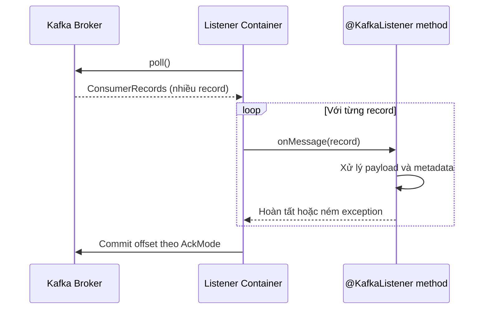

# Listener method dạng record

Trong Spring Kafka, một **record listener** là listener method được gọi cho từng Kafka record. Listener container poll một batch từ broker, sau đó chuyển từng record đến phương thức được đánh dấu `@KafkaListener`. Phương thức thường nhận payload đã deserialize, hoặc nhận trực tiếp `ConsumerRecord` nếu cần truy cập đầy đủ metadata của Kafka.

Kiểu listener này phù hợp với phần lớn xử lý nghiệp vụ: mỗi sự kiện đơn hàng, thanh toán hoặc tồn kho được chuyển thành một lần gọi method. Lập trình viên có thể đọc key, topic, partition, offset, timestamp và headers để xử lý, ghi log hoặc trace sự kiện.

## 1. Record listener hoạt động như thế nào?

Kafka consumer sử dụng `poll()` để lấy các record từ partition được gán cho consumer. Với cấu hình listener dạng record (mặc định của Spring Kafka), container gọi listener method một lần cho mỗi record. Nếu một lần poll trả về 20 record, listener method có thể được gọi 20 lần.



Điểm cần phân biệt là số lần gọi method và số lần poll không giống nhau. Consumer có thể poll nhiều record trong một request, nhưng record listener vẫn xử lý từng record qua từng invocation. Việc commit offset được quyết định bởi `AckMode`, không phải chỉ bởi việc method đã được gọi.

### Record listener và batch listener

| Đặc điểm | Record listener | Batch listener |
| --- | --- | --- |
| Đầu vào method | Một payload hoặc một `ConsumerRecord` | Một danh sách record hoặc danh sách payload |
| Số lần gọi | Một lần cho mỗi record | Thường một lần cho một batch poll |
| Xử lý lỗi | Có thể xác định lỗi ở từng record | Cần chú ý record nào trong batch đã xử lý thành công |
| Phù hợp | Nghiệp vụ xử lý từng sự kiện, validation và retry theo record | Ghi database theo lô, bulk API hoặc tối ưu xử lý batch |
| Cấu hình container | `batchListener=false` (mặc định) | `batchListener=true` |

Bài này tập trung vào record listener. Không cần tự tạo vòng lặp `poll()` trong ứng dụng; Spring Kafka listener container quản lý consumer và gọi method.

## 2. Cấu hình listener cơ bản

Ví dụ ứng dụng nhận sự kiện `OrderCreated` từ topic `orders.events`. Cấu hình consumer trong `application.yml`:

```yaml
spring:
  kafka:
    bootstrap-servers: ${KAFKA_BOOTSTRAP_SERVERS:localhost:9092}
    consumer:
      group-id: billing-service
      enable-auto-commit: false
      auto-offset-reset: earliest
      key-deserializer: org.apache.kafka.common.serialization.StringDeserializer
      value-deserializer: org.springframework.kafka.support.serializer.JsonDeserializer
      properties:
        spring.json.trusted.packages: com.example.messaging.event
        spring.json.value.default.type: com.example.messaging.event.OrderCreated
    listener:
      ack-mode: record

app:
  kafka:
    topic:
      orders: orders.events
```

Trong ví dụ:

- `group-id` xác định consumer group của listener.
- `key-deserializer` chuyển key dạng byte thành `String`.
- `value-deserializer` chuyển JSON thành object `OrderCreated`.
- `trusted.packages` giới hạn package mà JSON deserializer được phép tạo object.
- `ack-mode: record` yêu cầu container commit offset sau khi từng record được listener xử lý thành công.
- `enable-auto-commit: false` để Spring Kafka quản lý commit thay cho auto commit của Kafka client.

`auto-offset-reset: earliest` chỉ áp dụng khi group chưa có offset hợp lệ hoặc offset cũ không còn trong log. Nó không làm một group đang có offset hợp lệ tự đọc lại từ đầu.

Với `JsonDeserializer`, producer và consumer cần thống nhất JSON schema và cách xác định kiểu Java. Nếu producer gửi type header, Spring Kafka có thể dùng header đó để xác định kiểu; nếu muốn cố định kiểu đích cho topic này, có thể cấu hình `spring.json.value.default.type` và kiểm soát việc sử dụng type header theo phiên bản Spring Kafka đang dùng. Không mở `trusted.packages=*` nếu không có lý do rõ ràng.

## 3. Nhận một payload đã deserialize

Cách đơn giản nhất là khai báo tham số method theo kiểu event. Spring Kafka chuyển payload đã deserialize vào tham số đó:

```java
package com.example.messaging.consumer;

import com.example.messaging.event.OrderCreated;
import org.slf4j.Logger;
import org.slf4j.LoggerFactory;
import org.springframework.kafka.annotation.KafkaListener;
import org.springframework.stereotype.Component;

@Component
public class OrderCreatedListener {

    private static final Logger log =
            LoggerFactory.getLogger(OrderCreatedListener.class);

    @KafkaListener(topics = "${app.kafka.topic.orders}")
    public void onOrderCreated(OrderCreated event) {
        log.info("Received order event: eventId={}, orderId={}",
                event.eventId(), event.orderId());

        // Gọi nghiệp vụ xử lý đơn hàng.
    }
}
```

Ở đây method chỉ quan tâm dữ liệu nghiệp vụ. Nó không cần biết record đến từ partition nào hoặc offset bao nhiêu. Đây là lựa chọn phù hợp khi metadata không ảnh hưởng đến logic xử lý.

Payload method parameter không phải là một Kafka `ConsumerRecord`; nó là value sau khi deserializer xử lý. Nếu cần metadata hoặc headers, hãy bổ sung tham số `@Header` hoặc nhận trực tiếp `ConsumerRecord`.

Các class listener ở những mục tiếp theo minh họa **các cách khai báo thay thế**. Không nên bật đồng thời tất cả các class này với cùng topic và cùng group ID nếu mục tiêu là mỗi class đều nhận mọi event: khi cùng group, chúng là các consumer member chia partition và chia record cho nhau. Nếu nhiều ứng dụng cần nhận độc lập toàn bộ sự kiện, mỗi ứng dụng phải dùng group ID riêng.

## 4. Nhận trực tiếp ConsumerRecord

`ConsumerRecord<K,V>` là kiểu của Kafka client, chứa key, value và metadata của record. Dùng kiểu này khi cần quan sát chính xác vị trí record, đọc headers hoặc ghi log phục vụ truy vết.

```java
package com.example.messaging.consumer;

import com.example.messaging.event.OrderCreated;
import java.nio.charset.StandardCharsets;
import org.apache.kafka.clients.consumer.ConsumerRecord;
import org.apache.kafka.common.header.Header;
import org.slf4j.Logger;
import org.slf4j.LoggerFactory;
import org.springframework.kafka.annotation.KafkaListener;
import org.springframework.stereotype.Component;

@Component
public class OrderRecordListener {

    private static final Logger log =
            LoggerFactory.getLogger(OrderRecordListener.class);

    @KafkaListener(
            topics = "${app.kafka.topic.orders}",
            groupId = "billing-service"
    )
    public void onRecord(ConsumerRecord<String, OrderCreated> record) {
        OrderCreated event = record.value();

        Header traceHeader = record.headers().lastHeader("trace-id");
        String traceId = traceHeader == null
                ? null
                : new String(traceHeader.value(), StandardCharsets.UTF_8);

        log.info(
                "topic={}, partition={}, offset={}, key={}, traceId={}, eventId={}",
                record.topic(),
                record.partition(),
                record.offset(),
                record.key(),
                traceId,
                event == null ? null : event.eventId()
        );

        if (event == null) {
            // Xử lý tombstone hoặc payload null theo quy ước của topic.
            return;
        }

        // Xử lý nghiệp vụ với event.
    }
}
```

Đoạn code giả định ứng dụng có logger `log` được khai báo trong class. Có thể dùng `@Slf4j` của Lombok hoặc khai báo `Logger` theo SLF4J như ví dụ ở phần trước.

Các thông tin quan trọng trên `ConsumerRecord`:

| Method | Giá trị |
| --- | --- |
| `topic()` | Tên topic chứa record |
| `partition()` | Partition chứa record |
| `offset()` | Offset của record trong partition đó |
| `key()` | Key đã deserialize |
| `value()` | Payload đã deserialize |
| `timestamp()` | Timestamp của record |
| `timestampType()` | Loại timestamp, ví dụ create time hoặc log append time |
| `headers()` | Tập headers dạng key/value byte array |
| `serializedKeySize()` | Kích thước key đã serialize |
| `serializedValueSize()` | Kích thước value đã serialize |

Offset chỉ có ý nghĩa trong phạm vi một partition. Khi ghi log hoặc lưu dấu xử lý, nên kết hợp topic, partition và offset; chỉ ghi offset có thể gây nhầm lẫn giữa các partition.

## 5. Lấy metadata bằng @Header

Nếu chỉ cần một vài metadata, không cần nhận toàn bộ `ConsumerRecord`. Spring Kafka ánh xạ metadata thành message headers để method lấy bằng `@Header`:

```java
package com.example.messaging.consumer;

import com.example.messaging.event.OrderCreated;
import org.springframework.kafka.annotation.KafkaListener;
import org.springframework.kafka.support.KafkaHeaders;
import org.springframework.messaging.handler.annotation.Header;
import org.springframework.messaging.handler.annotation.Payload;
import org.springframework.stereotype.Component;

@Component
public class OrderMetadataListener {

    @KafkaListener(topics = "${app.kafka.topic.orders}")
    public void onOrderCreated(
            @Payload OrderCreated event,
            @Header(KafkaHeaders.RECEIVED_TOPIC) String topic,
            @Header(KafkaHeaders.RECEIVED_PARTITION) int partition,
            @Header(KafkaHeaders.OFFSET) long offset,
            @Header(value = KafkaHeaders.RECEIVED_KEY, required = false) String key
    ) {
        System.out.printf(
                "Received topic=%s partition=%d offset=%d key=%s eventId=%s%n",
                topic, partition, offset, key, event.eventId()
        );
    }
}
```

`@Payload` đánh dấu tham số chứa dữ liệu chính; có thể bỏ annotation nếu method signature đã rõ. `KafkaHeaders` cung cấp các tên header chuẩn để tránh tự gõ chuỗi. `RECEIVED_KEY` được khai báo optional vì Kafka cho phép record không có key.

Một số header thường dùng:

| Header constant | Ý nghĩa |
| --- | --- |
| `KafkaHeaders.RECEIVED_TOPIC` | Topic nhận record |
| `KafkaHeaders.RECEIVED_PARTITION` | Partition nhận record |
| `KafkaHeaders.OFFSET` | Offset của record |
| `KafkaHeaders.RECEIVED_KEY` | Key nhận được |
| `KafkaHeaders.RECEIVED_TIMESTAMP` | Timestamp nhận được |
| `KafkaHeaders.ACKNOWLEDGMENT` | Acknowledgment object khi container dùng chế độ manual phù hợp |

Header timestamp có thể lấy dưới dạng `long` nếu cần ghi nhận thời điểm record. Hãy kiểm tra nullability khi làm việc với key hoặc header do producer tự thêm.

## 6. Nhận Spring Message thay cho ConsumerRecord

Một lựa chọn khác là nhận `Message<T>` của Spring Messaging. Payload nằm trong `getPayload()`, metadata nằm trong `getHeaders()`:

```java
package com.example.messaging.consumer;

import com.example.messaging.event.OrderCreated;
import org.springframework.kafka.annotation.KafkaListener;
import org.springframework.kafka.support.KafkaHeaders;
import org.springframework.messaging.Message;
import org.springframework.stereotype.Component;

@Component
public class OrderMessageListener {

    @KafkaListener(topics = "${app.kafka.topic.orders}")
    public void onMessage(Message<OrderCreated> message) {
        OrderCreated event = message.getPayload();

        String topic = message.getHeaders()
                .get(KafkaHeaders.RECEIVED_TOPIC, String.class);
        Integer partition = message.getHeaders()
                .get(KafkaHeaders.RECEIVED_PARTITION, Integer.class);
        Long offset = message.getHeaders()
                .get(KafkaHeaders.OFFSET, Long.class);

        System.out.printf(
                "topic=%s partition=%s offset=%s eventId=%s%n",
                topic, partition, offset, event.eventId()
        );
    }
}
```

Dạng `Message<T>` hữu ích khi tầng xử lý đã dùng Spring Messaging hoặc cần truyền payload cùng metadata trong một object. Nếu cần toàn bộ API của Kafka record, `ConsumerRecord<K,V>` trực tiếp sẽ rõ ràng hơn.

Không nên khai báo đồng thời nhiều tham số đại diện cho cùng payload, ví dụ vừa nhận `ConsumerRecord` vừa nhận `@Payload` trong cùng method, trừ khi chữ ký method được Spring Kafka hỗ trợ rõ ràng ở phiên bản đang dùng. Hãy chọn một dạng đầu vào chính để tránh mơ hồ khi argument resolver ánh xạ tham số.

## 7. Headers tùy chỉnh và trace sự kiện

Producer có thể gắn headers để truyền thông tin phụ như trace ID, event type hoặc schema version. Consumer đọc các header đó từ `ConsumerRecord.headers()`.

Ví dụ producer gửi record với trace header:

```java
import java.nio.charset.StandardCharsets;
import org.apache.kafka.clients.producer.ProducerRecord;
import org.springframework.kafka.core.KafkaTemplate;

ProducerRecord<String, OrderCreated> record = new ProducerRecord<>(
        "orders.events",
        event.orderId(),
        event
);
record.headers().add(
        "trace-id",
        traceId.getBytes(StandardCharsets.UTF_8)
);

kafkaTemplate.send(record);
```

Consumer lấy header bằng:

```java
Header header = record.headers().lastHeader("trace-id");
String traceId = header == null
        ? null
        : new String(header.value(), StandardCharsets.UTF_8);
```

Headers là byte array, vì vậy producer và consumer cần thống nhất encoding. Kafka cho phép nhiều header cùng tên; `lastHeader(name)` trả về header cuối cùng có tên đó. Nếu hợp đồng yêu cầu chỉ có một header, hãy kiểm tra và xử lý trường hợp lặp thay vì giả định luôn chỉ có một giá trị.

Không nên đưa payload lớn hoặc thông tin nhạy cảm vào headers. Header nên chứa metadata nhỏ, không thay thế schema của value và không nên chứa token xác thực hoặc bí mật.

## 8. Xử lý key, partition và thứ tự

Một record listener thường xử lý event theo thứ tự consumer nhận được từ partition. Kafka bảo đảm thứ tự trong một partition, không bảo đảm thứ tự tổng thể giữa nhiều partition.

Ví dụ producer dùng `orderId` làm key:

```java
kafkaTemplate.send("orders.events", event.orderId(), event);
```

Các sự kiện cùng key thường được đưa vào cùng partition theo partitioner mặc định. Nếu `OrderCreated`, `OrderPaid` và `OrderCancelled` của một đơn hàng cần xử lý theo thứ tự, việc dùng `orderId` làm key là một lựa chọn phù hợp.

Tuy nhiên, thứ tự có thể bị ảnh hưởng nếu:

- Producer gửi event cùng entity từ nhiều luồng hoặc nhiều instance mà không kiểm soát thứ tự phát.
- Ứng dụng chuyển công việc từ listener sang thread pool và xử lý bất đồng bộ không có cơ chế tuần tự theo key.
- Thay đổi số partition làm key được ánh xạ sang partition khác theo partitioner.
- Nghiệp vụ xử lý song song nhiều record từ các partition khác nhau và giả định chúng có thứ tự toàn cục.

Nếu thứ tự theo entity là yêu cầu bắt buộc, hãy kết hợp key ổn định, chiến lược producer phù hợp và xử lý consumer tuần tự trong phạm vi partition/key cần thiết.

## 9. Acknowledgment và commit offset trong record listener

Khi listener method hoàn tất thành công, container quyết định commit offset theo `AckMode`. Trong Spring Kafka, một số mode thường gặp:

| AckMode | Hành vi |
| --- | --- |
| `RECORD` | Commit offset sau khi từng record listener xử lý thành công |
| `BATCH` | Commit offset sau khi tất cả record trong batch poll được xử lý thành công |
| `MANUAL` | Listener gọi `acknowledge()`; container gom acknowledgment và commit theo ranh giới batch poll |
| `MANUAL_IMMEDIATE` | Commit ngay khi listener gọi `acknowledge()` trên consumer thread; nếu gọi từ thread khác, hành vi được xử lý theo quy tắc container |

Với record listener, `RECORD` thường dễ hiểu vì offset được commit sau mỗi lần xử lý record thành công. `BATCH` có thể giảm số lần commit nhưng nếu một record trong batch lỗi, tiến độ commit có thể bị giữ lại tùy error handling.

### 9.1. Manual acknowledgment

Chỉ dùng `Acknowledgment` khi container được cấu hình `MANUAL` hoặc `MANUAL_IMMEDIATE`. Ví dụ:

```yaml
spring:
  kafka:
    consumer:
      enable-auto-commit: false
    listener:
      ack-mode: manual
```

```java
import org.springframework.kafka.support.Acknowledgment;

@KafkaListener(topics = "${app.kafka.topic.orders}")
public void onOrderCreated(
        OrderCreated event,
        Acknowledgment acknowledgment
) {
    billingService.handle(event);
    acknowledgment.acknowledge();
}
```

Chỉ gọi `acknowledge()` sau khi nghiệp vụ đạt điều kiện xem là đã xử lý. Nếu gọi trước khi database commit hoặc trước khi tác động nghiệp vụ hoàn tất, consumer có thể mất cơ hội xử lý lại record khi gặp lỗi sau đó.

Manual acknowledgment không tự tạo transaction chung giữa Kafka và database. Nếu database commit thành công nhưng ứng dụng lỗi trước khi commit offset, record có thể được giao lại; consumer vẫn cần idempotency hoặc một chiến lược đồng bộ trạng thái phù hợp.

## 10. Xử lý payload null và tombstone

Kafka cho phép record có key nhưng value bằng `null`. Trong topic compacted, record này thường là tombstone để biểu thị xóa trạng thái của key. Vì vậy, không nên mặc định `record.value()` luôn khác null.

Ví dụ:

```java
@KafkaListener(topics = "customer.current-state")
public void onCustomerState(ConsumerRecord<String, CustomerState> record) {
    String customerId = record.key();
    CustomerState state = record.value();

    if (state == null) {
        customerStateService.remove(customerId);
        return;
    }

    customerStateService.upsert(customerId, state);
}
```

Nếu topic không dùng tombstone, payload null vẫn có thể xuất hiện do producer gửi null hoặc do quy ước dữ liệu. Hãy định nghĩa rõ cách xử lý null trong hợp đồng event. Cần phân biệt payload null hợp lệ với lỗi deserialize; lỗi deserialize có thể xảy ra trước khi listener method được gọi.

## 11. Lỗi trong listener method

Nếu listener method ném exception, Spring Kafka chuyển lỗi đến error handler của listener container. Tùy cấu hình, record có thể được retry, seek để đọc lại hoặc chuyển sang dead-letter topic sau khi hết số lần thử.

Một số nguyên tắc:

- Không bắt rồi bỏ qua exception nếu nghiệp vụ chưa thực sự xử lý được record. Container sẽ tưởng listener đã hoàn tất và có thể commit offset.
- Phân loại lỗi tạm thời (timeout database, lỗi mạng) và lỗi không thể phục hồi (payload sai schema, dữ liệu không hợp lệ).
- Dùng retry có giới hạn và backoff cho lỗi tạm thời.
- Dùng dead-letter topic hoặc cơ chế quarantine để giữ record không thể xử lý, kèm metadata gốc như topic, partition, offset và exception.
- Bảo đảm xử lý idempotent vì retry hoặc restart có thể khiến cùng record được gọi lại.

Lỗi xảy ra trong deserializer khác với lỗi xảy ra bên trong method. Khi deserializer ném exception, listener method chưa nhận được payload; cần cấu hình `ErrorHandlingDeserializer` hoặc cơ chế xử lý lỗi deserialize tương ứng để container error handler có thể xử lý record lỗi.

## 12. Concurrency và giới hạn song song

Có thể tăng số consumer của một listener bằng thuộc tính `concurrency`:

```java
@KafkaListener(
        topics = "${app.kafka.topic.orders}",
        groupId = "billing-service",
        concurrency = "3"
)
public void onOrderCreated(OrderCreated event) {
    billingService.handle(event);
}
```

`concurrency = 3` yêu cầu listener container tạo ba consumer member trong cùng group. Mỗi consumer nhận các partition được group coordinator phân phối. Nếu topic có hai partition, tối đa hai consumer được gán partition tại một thời điểm; consumer còn lại không làm tăng mức song song của topic đó.

Trong một group, một partition chỉ được gán cho tối đa một consumer member tại một thời điểm. Vì vậy, partition count đặt giới hạn song song ở cấp partition. Nếu tăng concurrency hoặc chạy nhiều replica, hãy theo dõi assignment, consumer lag và thời gian rebalance.

Listener method chạy trên luồng xử lý của consumer/container. Nếu method gửi công việc sang executor rồi trả về ngay, container có thể xem record đã xử lý xong và commit offset trước khi công việc bất đồng bộ hoàn tất. Muốn xử lý async, phải thiết kế acknowledgment, backpressure, thứ tự và quản lý lỗi rõ ràng; không chỉ đơn giản gọi `executor.submit()` rồi kết thúc method.

## 13. Kiểm thử record listener

Nên kiểm tra ít nhất các trường hợp:

1. Payload JSON hợp lệ được deserialize thành đúng event type.
2. Method nhận đúng key, topic, partition, offset và headers.
3. Event có cùng key được đọc từ partition phù hợp theo cấu hình producer.
4. Payload null/tombstone được xử lý theo hợp đồng topic.
5. Listener ném exception thì error handler retry hoặc recover đúng chính sách.
6. Offset chỉ được commit sau khi đạt điều kiện xử lý theo AckMode.
7. Nhiều consumer member chia partition đúng theo group assignment.

Với integration test, `spring-kafka-test` cung cấp `@EmbeddedKafka` để chạy broker nhúng. Có thể gửi event bằng `KafkaTemplate`, dùng listener test có `CountDownLatch` hoặc `BlockingQueue` để chờ invocation, rồi assert payload và metadata. Dùng group ID riêng cho test để tránh phụ thuộc offset của môi trường khác. Nếu kiểm thử listener chạy trong Spring context, cần chờ listener container được gán partition trước khi gửi record hoặc dùng helper của Spring Kafka Test để tránh race condition.

Không nên dùng `Thread.sleep()` cố định làm đồng bộ duy nhất. Hãy dùng latch, queue hoặc polling assertion có timeout để test ổn định và báo lỗi rõ khi listener không nhận được record.

## 14. Những lỗi thường gặp

| Hiện tượng | Nguyên nhân thường gặp | Cách kiểm tra |
| --- | --- | --- |
| Listener không nhận được object mong muốn | Deserializer không khớp kiểu value hoặc JSON type mapping sai | Kiểm tra `value-deserializer`, type header và default type |
| Method không được gọi | Listener chưa subscribe topic, group chưa có assignment hoặc broker không kết nối | Kiểm tra log container, group assignment và consumer lag |
| `@Header` báo thiếu header | Producer không gửi key/header đó hoặc header không có trong record | Dùng `required=false` khi header có thể vắng mặt |
| Cùng record được xử lý lại | Consumer lỗi trước commit hoặc retry/rebalance | Dùng event ID và xử lý idempotent |
| Record bị bỏ qua sau exception | Method bắt exception nhưng không ném lại, container coi là thành công | Chỉ bắt lỗi khi đã xử lý hoặc chủ động chuyển lỗi theo chính sách |
| Tombstone gây NullPointerException | Listener giả định payload luôn khác null | Kiểm tra null và xử lý tombstone theo nghiệp vụ |
| Tăng concurrency nhưng không tăng throughput | Số partition thấp hoặc bottleneck nằm ở hệ thống đích | Kiểm tra assignment, partition count, lag và thời gian xử lý |
| Thứ tự event bị đảo | Xử lý bất đồng bộ hoặc producer gửi từ nhiều luồng không có thứ tự | Kiểm tra key, partition và cách dispatch công việc |

## 15. Quy trình thiết kế listener method dạng record

Khi tạo một listener mới, hãy quyết định lần lượt:

1. Xác định listener xử lý một event mỗi lần hay cần xử lý theo batch.
2. Chọn tham số đầu vào: payload type khi chỉ cần dữ liệu nghiệp vụ; `ConsumerRecord<K,V>` khi cần toàn bộ metadata; `Message<T>` khi muốn dùng Spring Messaging headers.
3. Chọn deserializer và xác định hợp đồng payload, schema, type header và cách xử lý dữ liệu null.
4. Chọn group ID, topic subscription, partition count và concurrency theo nhu cầu mở rộng.
5. Chọn `AckMode` phù hợp với ranh giới xử lý nghiệp vụ.
6. Cấu hình retry, error handler và dead-letter topic cho lỗi không thể xử lý ngay.
7. Thiết kế idempotency và thứ tự xử lý nếu record có thể được giao lại hoặc xử lý song song.
8. Ghi log/trace với event ID, topic, partition và offset để hỗ trợ điều tra.
9. Kiểm thử payload hợp lệ, null/tombstone, lỗi deserialize, lỗi nghiệp vụ, retry và commit.

Record listener giúp ánh xạ trực tiếp một Kafka record thành một lần gọi method Java. Khi chọn đúng kiểu tham số và hiểu metadata, acknowledgment cùng error handling, listener có thể xử lý từng sự kiện rõ ràng mà vẫn tận dụng được poll, partition assignment và cơ chế commit của Kafka.

## 16. Tự kiểm tra

1. Nếu một lần `poll()` trả về 10 record, record listener được gọi mấy lần?
2. Khi nào nên nhận `OrderCreated`, khi nào nên nhận `ConsumerRecord<String, OrderCreated>`?
3. Vì sao offset cần được ghi cùng topic và partition?
4. `@Header(KafkaHeaders.RECEIVED_KEY)` có thể vắng mặt trong trường hợp nào?
5. `AckMode.RECORD` khác `AckMode.BATCH` như thế nào?
6. Vì sao method bắt exception rồi không ném lại có thể làm record được commit?
7. Tombstone là gì và tại sao listener phải kiểm tra payload null?
8. Vì sao gửi công việc sang executor rồi trả về ngay có thể gây commit offset quá sớm?
