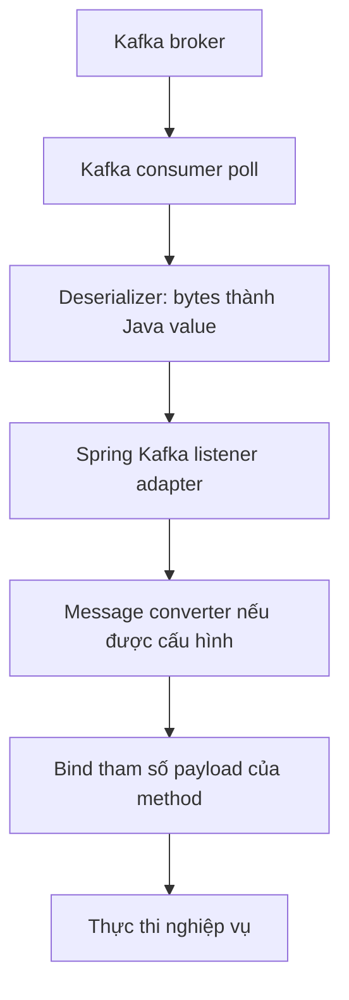

# Listener method dạng payload

Với Spring Kafka, một phương thức `@KafkaListener` có thể nhận trực tiếp payload của Kafka record làm tham số. Cách viết này giúp listener tập trung vào dữ liệu nghiệp vụ, không cần xử lý `ConsumerRecord` nếu không cần partition, offset hoặc metadata kỹ thuật.

Ví dụ:

```java
import org.springframework.kafka.annotation.KafkaListener;
import org.springframework.stereotype.Component;

@Component
public class OrderEventListener {

    @KafkaListener(
        topics = "order-events",
        groupId = "billing-service"
    )
    public void onOrderCreated(OrderCreated event) {
        // Xử lý event đơn hàng.
    }
}
```

Spring Kafka nhận record từ consumer, chuyển value thành kiểu dữ liệu phù hợp và gọi phương thức listener. Để dùng cách này an toàn, cần hiểu rõ ranh giới giữa Kafka deserializer, Spring message converter và kiểu tham số của method.

## 1. Payload method hoạt động như thế nào?

Một Kafka record có key, value và metadata như topic, partition, offset, timestamp, headers. Với listener dạng payload, tham số method nhận phần value đã được chuyển đổi.

Luồng xử lý ở mức khái quát:



Có hai bước chuyển đổi cần phân biệt:

1. **Kafka deserializer** chuyển byte array trên wire thành kiểu Java, ví dụ `String`, `byte[]` hoặc `OrderCreated`.
2. **Spring message converter** chuyển record/payload thành kiểu tham số method khi cấu hình converter phù hợp, ví dụ từ JSON String thành DTO.

Nếu deserializer đã trả về đúng object `OrderCreated`, listener có thể nhận trực tiếp object đó. Nếu deserializer trả về String, method không tự động biến String JSON thành DTO trừ khi có message converter hỗ trợ hoặc ứng dụng tự parse.

## 2. Nhận trực tiếp DTO

Đây là lựa chọn phù hợp khi ứng dụng dùng JSON event và consumer có thể deserialize trực tiếp sang kiểu DTO.

Ví dụ event:

```java
import java.math.BigDecimal;
import java.time.Instant;

public record OrderCreated(
    String orderId,
    String customerId,
    BigDecimal amount,
    Instant occurredAt
) {
}
```

Listener:

```java
import org.springframework.kafka.annotation.KafkaListener;
import org.springframework.stereotype.Component;

@Component
public class BillingListener {

    @KafkaListener(
        topics = "order-events",
        groupId = "billing-service"
    )
    public void handle(OrderCreated event) {
        // Chuyển payload đã deserialize cho tầng xử lý nghiệp vụ.
    }
}
```

Cấu hình consumer có thể dùng `JsonDeserializer`:

```yaml
spring:
  kafka:
    consumer:
      group-id: billing-service
      key-deserializer: org.apache.kafka.common.serialization.StringDeserializer
      value-deserializer: org.springframework.kafka.support.serializer.JsonDeserializer
      properties:
        spring.json.value.default.type: com.example.messaging.event.OrderCreated
        spring.json.trusted.packages: com.example.messaging.event
```

Trong ví dụ này, Kafka consumer deserializer tạo object `OrderCreated` trước khi listener method được gọi. `spring.json.value.default.type` chỉ định kiểu mặc định khi deserializer cần xác định target type mà không lấy được type phù hợp từ header. Tên package phải khớp với package thật của event trong ứng dụng.

Đoạn YAML trên minh họa các class `JsonSerializer`/`JsonDeserializer` thường dùng với Spring Kafka 3.x. Spring Kafka 4.x có các class `JacksonJsonSerializer`/`JacksonJsonDeserializer`; chọn cặp serializer/deserializer đúng với version Spring Kafka và Jackson major version của dự án.

Producer cần serialize value tương thích, ví dụ dùng Spring Kafka `JsonSerializer`. Nếu producer gửi type headers, consumer có thể sử dụng thông tin đó để xác định kiểu. Khi nhiều service dùng các class/package khác nhau, hãy thống nhất schema và type mapping; không nên tin cậy mọi package chỉ để tránh lỗi deserialize.

### Khi nào nên dùng default type?

Dùng default type khi một topic có một kiểu value chính và consumer biết trước kiểu đó. Nếu topic chứa nhiều loại event, cần thiết kế type mapping rõ ràng hoặc dùng envelope chung có trường event type/version. Tránh để một consumer tự suy đoán kiểu từ tên class không đáng tin cậy trong message header.

## 3. Nhận String rồi chuyển JSON thành DTO

Một cách khác là để Kafka deserializer trả về String, sau đó Spring Kafka message converter chuyển JSON thành kiểu tham số của listener.

Cấu hình consumer:

```yaml
spring:
  kafka:
    consumer:
      key-deserializer: org.apache.kafka.common.serialization.StringDeserializer
      value-deserializer: org.apache.kafka.common.serialization.StringDeserializer
```

Với Spring Boot, có thể đăng ký `RecordMessageConverter` thành bean để auto-configuration gắn nó vào listener container factory mặc định:

```java
import org.springframework.context.annotation.Bean;
import org.springframework.context.annotation.Configuration;
import org.springframework.kafka.support.converter.JacksonJsonMessageConverter;
import org.springframework.kafka.support.converter.RecordMessageConverter;

@Configuration
public class KafkaMessageConverterConfiguration {

    @Bean
    RecordMessageConverter recordMessageConverter() {
        return new JacksonJsonMessageConverter();
    }
}
```

Ví dụ dùng tên converter của Spring Kafka 4.x. Với Spring Kafka 3.3.x dùng `StringJsonMessageConverter`; chọn converter tương ứng với version và Jackson major version của dự án. Nếu tự tạo listener container factory thay vì dùng factory auto-configured của Spring Boot, hãy gọi `setRecordMessageConverter(...)` trên đúng factory đó.

Listener vẫn có thể nhận DTO:

```java
@KafkaListener(
    topics = "order-events",
    groupId = "billing-service"
)
public void handle(OrderCreated event) {
    // Payload đã được message converter chuyển thành DTO.
}
```

Cách này hữu ích khi muốn kiểm soát việc chuyển JSON sang DTO ở tầng Spring Messaging, hoặc khi consumer nhận dữ liệu dạng String từ Kafka. Cấu hình converter cần được gắn vào đúng listener container factory mà listener sử dụng.

Với listener khai báo ở cấp method, Spring Kafka cung cấp kiểu tham số method cho converter để hỗ trợ suy luận target type. Nếu dùng `@KafkaListener` ở cấp class kết hợp nhiều method `@KafkaHandler`, payload phải được chuyển đổi trước khi framework chọn method; khi đó cần cấu hình type headers/type mapping hoặc deserializer để xác định kiểu trước.

Không nên cấu hình `JsonDeserializer` để deserialize thành DTO rồi lại thiết kế converter như thể payload vẫn là JSON String. Hãy chọn một nơi chịu trách nhiệm chuyển JSON thành object để tránh chuyển đổi lặp hoặc mismatch kiểu dữ liệu.

## 4. Nhận String và tự parse

Nếu muốn kiểm soát hoàn toàn việc parse, listener có thể nhận String và dùng `ObjectMapper`:

```java
import com.fasterxml.jackson.core.JsonProcessingException;
import com.fasterxml.jackson.databind.ObjectMapper;
import org.springframework.kafka.annotation.KafkaListener;
import org.springframework.stereotype.Component;

@Component
public class RawOrderListener {

    private final ObjectMapper objectMapper;
    private final OrderApplicationService orderService;

    public RawOrderListener(
            ObjectMapper objectMapper,
            OrderApplicationService orderService) {
        this.objectMapper = objectMapper;
        this.orderService = orderService;
    }

    @KafkaListener(
        topics = "order-events",
        groupId = "billing-raw-service"
    )
    public void handle(String payload) throws JsonProcessingException {
        OrderCreated event =
            objectMapper.readValue(payload, OrderCreated.class);

        orderService.process(event);
    }
}
```

Cách này dễ hiểu và hữu ích khi định dạng payload có quy tắc riêng. Tuy nhiên, mỗi listener có thể lặp lại logic parse, xử lý lỗi và schema mapping. Nếu nhiều listener cùng nhận một loại event, nên gom phần chuyển đổi vào deserializer hoặc message converter dùng chung.

Lỗi parse phát sinh trong method sẽ được xem là lỗi listener và đi qua error handler của container. Nó khác lỗi deserialize xảy ra trước khi method được gọi.

## 5. Chọn kiểu tham số payload

Kiểu tham số nên phản ánh dữ liệu mà consumer thực sự nhận:

| Kiểu tham số | Khi sử dụng |
|---|---|
| `String` | Payload văn bản hoặc JSON chưa chuyển thành DTO |
| `byte[]` | Cần tự giải mã định dạng nhị phân |
| DTO như `OrderCreated` | Consumer đã deserialize hoặc convert sang object |
| `JsonNode` | Cần đọc JSON linh hoạt trước khi chọn kiểu cụ thể |
| `Message<OrderCreated>` | Cần cả payload và Spring message headers |
| `ConsumerRecord<K, V>` | Cần truy cập đầy đủ record metadata ở API Kafka |

Ví dụ nhận JSON tree:

```java
@KafkaListener(topics = "external-events")
public void handle(JsonNode payload) {
    String eventType = payload.path("eventType").asText();

    // Chọn xử lý theo eventType.
}
```

Để nhận `JsonNode`, deserializer/converter phải được cấu hình để tạo kiểu này. Kiểu tham số method không thể thay đổi việc Kafka client đã deserialize byte array thành kiểu gì trước đó.

Nếu method nhận `List<OrderCreated>`, hãy xác định listener có đang chạy ở chế độ batch hay không. Với batch listener, `List<T>` thường biểu diễn các record trong một lần poll; nó không mặc nhiên có nghĩa value JSON của một record là mảng JSON.

Với topic compacted, record có value `null` (tombstone) biểu thị việc xóa trạng thái của key. Listener muốn nhận tombstone phải đánh dấu payload là không bắt buộc và thường lấy thêm key để biết thực thể nào bị xóa:

```java
import org.springframework.kafka.annotation.KafkaListener;
import org.springframework.kafka.support.KafkaHeaders;
import org.springframework.messaging.handler.annotation.Header;
import org.springframework.messaging.handler.annotation.Payload;

@KafkaListener(topics = "account-state")
public void handle(
        @Payload(required = false) AccountState state,
        @Header(value = KafkaHeaders.RECEIVED_KEY, required = false) String accountId) {

    if (state == null) {
        // Xóa trạng thái của accountId.
        return;
    }

    // Cập nhật trạng thái accountId.
}
```

Với listener mặc định, Spring Kafka cung cấp resolver hỗ trợ payload null. Nếu tự thay thế `MessageHandlerMethodFactory`, cần thêm `KafkaNullAwarePayloadArgumentResolver` vào danh sách resolver để tombstone được bind đúng.

## 6. Kết hợp payload với @Payload và @Header

Khi method chỉ có một tham số payload, Spring Kafka thường có thể suy ra tham số đó là payload. Có thể thêm `@Payload` để thể hiện rõ ý định, nhất là khi method có nhiều tham số:

```java
import org.springframework.kafka.annotation.KafkaListener;
import org.springframework.kafka.support.KafkaHeaders;
import org.springframework.messaging.handler.annotation.Header;
import org.springframework.messaging.handler.annotation.Payload;

@KafkaListener(topics = "order-events")
public void handle(
        @Payload OrderCreated event,
        @Header(KafkaHeaders.RECEIVED_KEY) String orderKey,
        @Header(KafkaHeaders.RECEIVED_PARTITION) int partition,
        @Header(KafkaHeaders.OFFSET) long offset) {

    // Dùng key, partition, offset khi cần truy vết; xử lý event.
}
```

Các header thường dùng:

- `KafkaHeaders.RECEIVED_KEY`: key của record.
- `KafkaHeaders.RECEIVED_PARTITION`: partition đã nhận.
- `KafkaHeaders.OFFSET`: offset của record.
- `KafkaHeaders.RECEIVED_TOPIC`: topic đã nhận.
- `KafkaHeaders.RECEIVED_TIMESTAMP`: timestamp của record.

Nếu key có thể là null, khai báo header không bắt buộc:

```java
@KafkaListener(topics = "order-events")
public void handle(
        @Payload OrderCreated event,
        @Header(value = KafkaHeaders.RECEIVED_KEY, required = false) String key) {
    // Xử lý event; key có thể null nếu producer không gửi key.
}
```

Kiểu Java của tham số header cần tương thích với giá trị header được ánh xạ. Ví dụ offset có thể nhận vào `long` hoặc `Long`; header không tồn tại cần được xử lý theo thuộc tính `required` hoặc giá trị mặc định.

## 7. Dùng Message<T> để nhận payload và headers

Nếu muốn giữ payload và metadata trong cùng một tham số, listener có thể nhận Spring `Message<T>`:

```java
import org.springframework.messaging.Message;
import org.springframework.kafka.support.KafkaHeaders;
import org.springframework.kafka.annotation.KafkaListener;

@KafkaListener(
    topics = "order-events",
    groupId = "billing-service"
)
public void handle(Message<OrderCreated> message) {
    OrderCreated event = message.getPayload();

    String topic = message.getHeaders()
        .get(KafkaHeaders.RECEIVED_TOPIC, String.class);

    Integer partition = message.getHeaders()
        .get(KafkaHeaders.RECEIVED_PARTITION, Integer.class);

    Long offset = message.getHeaders()
        .get(KafkaHeaders.OFFSET, Long.class);

    // Chuyển payload cùng metadata cần thiết cho tầng xử lý.
}
```

Cách này tiện khi muốn truyền message qua nhiều lớp xử lý mà vẫn giữ metadata cần thiết. Nếu chỉ cần payload, tham số DTO đơn giản sẽ dễ đọc hơn.

Một lựa chọn khác là nhận map header:

```java
import java.util.Map;

import org.springframework.kafka.annotation.KafkaListener;
import org.springframework.kafka.support.KafkaHeaders;
import org.springframework.messaging.handler.annotation.Headers;
import org.springframework.messaging.handler.annotation.Payload;

@KafkaListener(topics = "order-events")
public void handle(
        @Payload OrderCreated event,
        @Headers Map<String, Object> headers) {

    Object topic = headers.get(KafkaHeaders.RECEIVED_TOPIC);
    // Lấy thêm header cần thiết rồi xử lý event.
}
```

Không nên đưa toàn bộ headers vào log hoặc business database một cách mặc định. Chỉ lấy các giá trị cần thiết, vì header có thể chứa dữ liệu nhạy cảm hoặc metadata nội bộ.

## 8. Xác thực payload trước khi xử lý

Payload DTO nên được kiểm tra trước khi chạy nghiệp vụ. Có thể dùng Bean Validation với `@Valid`:

```java
import java.math.BigDecimal;

import jakarta.validation.constraints.NotBlank;
import jakarta.validation.constraints.Positive;

public record OrderCreated(
    @NotBlank String orderId,
    @NotBlank String customerId,
    @Positive BigDecimal amount
) {
}
```

Listener:

```java
import jakarta.validation.Valid;
import org.springframework.kafka.annotation.KafkaListener;
import org.springframework.messaging.handler.annotation.Payload;

@KafkaListener(topics = "order-events")
public void handle(@Payload @Valid OrderCreated event) {
    // Payload đã được validate trước khi vào thân method.
}
```

Đăng ký validator với listener endpoint registrar. Khi có `spring-boot-starter-validation`, Spring Boot tự cấu hình `LocalValidatorFactoryBean` để có thể inject vào cấu hình:

```java
import org.springframework.context.annotation.Configuration;
import org.springframework.kafka.annotation.KafkaListenerConfigurer;
import org.springframework.kafka.config.KafkaListenerEndpointRegistrar;
import org.springframework.validation.Validator;

@Configuration
public class KafkaValidationConfiguration implements KafkaListenerConfigurer {

    private final Validator validator;

    public KafkaValidationConfiguration(Validator validator) {
        this.validator = validator;
    }

    @Override
    public void configureKafkaListeners(KafkaListenerEndpointRegistrar registrar) {
        registrar.setValidator(validator);
    }
}
```

Dự án cần có Bean Validation provider, ví dụ `spring-boot-starter-validation`, và các annotation constraint thuộc `jakarta.validation` với Spring Boot 3/4. Nếu validation thất bại, Spring Kafka ném lỗi validation ở bước xử lý method; lỗi sẽ được chuyển tới error handler của listener container.

Validation cấu trúc payload không thay thế kiểm tra nghiệp vụ. Ví dụ `amount` dương vẫn có thể không hợp lệ nếu đơn hàng đã bị hủy hoặc khách hàng không được phép thanh toán.

## 9. Phân biệt lỗi deserialize và lỗi xử lý payload

Hai lỗi này xảy ra ở hai thời điểm khác nhau:

| Loại lỗi | Thời điểm | Ví dụ | Method listener được gọi? |
|---|---|---|---|
| Deserialization | Kafka client chuyển bytes thành Java value | JSON sai định dạng, không khớp kiểu DTO | Thường không |
| Message conversion | Spring converter chuyển payload sang kiểu method | Không thể chuyển String thành DTO | Không vào thân method |
| Argument validation | Kiểm tra tham số sau khi bind | Thiếu orderId hoặc amount không hợp lệ | Không chạy thân method |
| Business processing | Sau khi method bắt đầu | Không tìm thấy đơn hàng hoặc lỗi database | Có |

Với lỗi deserialize, có thể dùng `ErrorHandlingDeserializer` bọc deserializer thật để đưa thông tin lỗi vào cơ chế xử lý của Spring Kafka:

```yaml
spring:
  kafka:
    consumer:
      key-deserializer: org.springframework.kafka.support.serializer.ErrorHandlingDeserializer
      value-deserializer: org.springframework.kafka.support.serializer.ErrorHandlingDeserializer
      properties:
        spring.deserializer.key.delegate.class: org.apache.kafka.common.serialization.StringDeserializer
        spring.deserializer.value.delegate.class: org.springframework.kafka.support.serializer.JsonDeserializer
        spring.json.value.default.type: com.example.messaging.event.OrderCreated
        spring.json.trusted.packages: com.example.messaging.event
```

Đoạn cấu hình delegate ở trên dùng `JsonDeserializer` của Spring Kafka 3.x. Với Spring Kafka 4.x, thay delegate bằng `JacksonJsonDeserializer` tương ứng.

`ErrorHandlingDeserializer` lưu thông tin lỗi deserialize để container error handler có thể xử lý. Có thể kết hợp `DefaultErrorHandler`, recoverer hoặc Dead Letter Topic để đưa record lỗi sang luồng điều tra. Cấu hình cụ thể cần khớp kiểu key/value và version Spring Kafka.

Với lỗi conversion hoặc validation xảy ra trong listener adapter, error handler của container cũng có thể nhận exception. Cần phân loại exception để quyết định retry hay chuyển DLT; lỗi dữ liệu sai vĩnh viễn thường không nên retry vô hạn.

## 10. Cách chọn giữa payload method và ConsumerRecord

Dùng payload method khi logic chỉ cần dữ liệu nghiệp vụ:

```java
@KafkaListener(topics = "order-events")
public void handle(OrderCreated event) {
    // Xử lý payload nghiệp vụ.
}
```

Dùng `ConsumerRecord` khi cần thao tác với metadata cấp Kafka:

```java
import org.apache.kafka.clients.consumer.ConsumerRecord;
import org.springframework.kafka.annotation.KafkaListener;

@KafkaListener(topics = "order-events")
public void handle(ConsumerRecord<String, OrderCreated> record) {
    OrderCreated event = record.value();
    int partition = record.partition();
    long offset = record.offset();

    // Dùng metadata khi cần truy vết hoặc xử lý đặc thù.
}
```

Hai cách đều hợp lệ. Không cần nhận `ConsumerRecord` chỉ để lấy payload; cũng không nên bỏ metadata nếu nghiệp vụ cần trace, kiểm soát partition hoặc xử lý offset đặc thù.

## 11. Kiểm thử listener dạng payload

Integration test với Embedded Kafka có thể xác minh JSON được deserialize và bind vào tham số DTO đúng cách.

Một listener đơn giản có thể đưa payload nhận được vào queue để test lấy ra:

```java
import java.util.concurrent.BlockingQueue;
import java.util.concurrent.LinkedBlockingQueue;
import java.util.concurrent.TimeUnit;

import com.example.messaging.event.OrderCreated;
import org.springframework.kafka.annotation.KafkaListener;
import org.springframework.stereotype.Component;

@Component
public class OrderEventCapture {

    private final BlockingQueue<OrderCreated> received =
        new LinkedBlockingQueue<>();

    @KafkaListener(
        id = "order-capture-test-listener",
        topics = "order-events",
        groupId = "order-capture-test"
    )
    public void capture(OrderCreated event) {
        received.add(event);
    }

    public OrderCreated poll(long timeout, TimeUnit unit)
            throws InterruptedException {
        return received.poll(timeout, unit);
    }
}
```

Test:

```java
import java.math.BigDecimal;
import java.time.Instant;
import java.util.concurrent.TimeUnit;

import com.example.messaging.event.OrderCreated;
import org.junit.jupiter.api.BeforeEach;
import org.junit.jupiter.api.Test;
import org.springframework.beans.factory.annotation.Autowired;
import org.springframework.boot.test.context.SpringBootTest;
import org.springframework.kafka.config.KafkaListenerEndpointRegistry;
import org.springframework.kafka.core.KafkaTemplate;
import org.springframework.kafka.listener.MessageListenerContainer;
import org.springframework.kafka.test.context.EmbeddedKafka;
import org.springframework.kafka.test.utils.ContainerTestUtils;

import static org.assertj.core.api.Assertions.assertThat;

@SpringBootTest(properties = {
    "spring.kafka.producer.key-serializer=org.apache.kafka.common.serialization.StringSerializer",
    "spring.kafka.producer.value-serializer=org.springframework.kafka.support.serializer.JsonSerializer",
    "spring.kafka.consumer.key-deserializer=org.apache.kafka.common.serialization.StringDeserializer",
    "spring.kafka.consumer.value-deserializer=org.springframework.kafka.support.serializer.JsonDeserializer",
    "spring.kafka.consumer.properties.spring.json.value.default.type=com.example.messaging.event.OrderCreated",
    "spring.kafka.consumer.properties.spring.json.trusted.packages=com.example.messaging.event",
    "spring.kafka.consumer.auto-offset-reset=earliest"
})
@EmbeddedKafka(
    partitions = 1,
    topics = "order-events",
    bootstrapServersProperty = "spring.kafka.bootstrap-servers"
)
class OrderPayloadListenerTest {

    @Autowired
    private KafkaTemplate<String, OrderCreated> kafkaTemplate;

    @Autowired
    private OrderEventCapture capture;

    @Autowired
    private KafkaListenerEndpointRegistry registry;

    @BeforeEach
    void waitForListenerAssignment() {
        MessageListenerContainer container =
            registry.getListenerContainer("order-capture-test-listener");
        ContainerTestUtils.waitForAssignment(container, 1);
    }

    @Test
    void bindsJsonRecordToPayloadArgument() throws Exception {
        OrderCreated event = new OrderCreated(
            "order-42",
            "customer-9",
            new BigDecimal("125000"),
            Instant.now()
        );

        kafkaTemplate.send("order-events", event.orderId(), event)
            .get(10, TimeUnit.SECONDS);

        OrderCreated received = capture.poll(10, TimeUnit.SECONDS);

        assertThat(received).isNotNull();
        assertThat(received.orderId()).isEqualTo("order-42");
        assertThat(received.customerId()).isEqualTo("customer-9");
    }
}
```

Đoạn test properties này dùng `JsonSerializer`/`JsonDeserializer` của Spring Kafka 3.x. Với Spring Kafka 4.x, thay bằng `JacksonJsonSerializer`/`JacksonJsonDeserializer` tương ứng với Jackson 3.

Để test chạy ổn định, producer và consumer test phải dùng serializer/deserializer tương thích. Test nên dùng group ID riêng, timeout hữu hạn và queue hoặc Awaitility để chờ record. Tránh dùng `Thread.sleep()` cố định.

`com.example.messaging.event.OrderCreated` trong test properties là tên lớp minh họa; thay bằng fully qualified class name của DTO trong dự án.

Các trường hợp nên kiểm tra thêm:

- JSON hợp lệ được bind vào đúng DTO.
- JSON thiếu field bắt buộc bị validation từ chối.
- JSON sai cấu trúc đi vào error handler/DLT theo cấu hình.
- Header key, topic, partition và offset được bind đúng khi method yêu cầu.
- Consumer không vô tình dùng type header hoặc default type không tương thích.

## 12. Lỗi thường gặp

| Hiện tượng | Nguyên nhân có thể | Cách xử lý |
|---|---|---|
| Listener nhận String thay vì DTO | Consumer dùng StringDeserializer và chưa có JSON message converter | Cấu hình JsonDeserializer hoặc JacksonJsonMessageConverter |
| Không deserialize được DTO | Type header, default type, package hoặc schema không khớp | Kiểm tra JsonDeserializer và type mapping |
| Listener method không được gọi | Lỗi deserialize xảy ra trước khi adapter gọi method | Dùng ErrorHandlingDeserializer và kiểm tra container error handler |
| Lỗi conversion dù JSON hợp lệ | Converter không được gắn vào listener factory đang dùng | Kiểm tra factory và RecordMessageConverter |
| Header key bị thiếu | Producer gửi record không có key | Đặt `required=false` nếu key được phép null |
| Validation không chạy | Chưa đăng ký Validator hoặc thiếu validation provider | Cấu hình `KafkaListenerConfigurer.setValidator(...)` và starter validation |
| Consumer nhận DTO sai kiểu | Topic chứa nhiều event nhưng chỉ khai báo một default type | Dùng type mapping hoặc envelope có event type/version |

## 13. Checklist thiết kế listener payload

- Chọn kiểu tham số phản ánh đúng value mà consumer thực sự deserialize.
- Phân biệt rõ Kafka deserializer với Spring message converter.
- Chỉ cấu hình một đường chuyển JSON thành DTO có trách nhiệm rõ ràng.
- Dùng DTO/schema ổn định và có chiến lược versioning.
- Dùng `@Payload`, `@Header` hoặc `Message<T>` khi cần metadata.
- Đặt `required=false` cho header có thể không tồn tại.
- Validate payload trước khi xử lý nghiệp vụ.
- Phân biệt lỗi deserialize, conversion, validation và business.
- Cấu hình error handler và DLT cho record không thể xử lý.
- Kiểm thử cả payload hợp lệ lẫn payload sai định dạng.

## 14. Ghi nhớ

- Listener method dạng payload nhận trực tiếp value của record, thường là DTO.
- Kafka deserializer chuyển bytes thành Java value trước khi method được gọi.
- Message converter có thể chuyển payload đã deserialize sang kiểu tham số method.
- `@Payload` đánh dấu payload; `@Header` và `@Headers` lấy metadata.
- `Message<T>` chứa cả payload và Spring message headers.
- Lỗi deserialize có thể xảy ra trước khi listener method được gọi.
- Payload DTO gọn giúp business logic dễ đọc, nhưng vẫn cần validation, schema compatibility và error handling.

Khi chọn đúng kiểu payload và cấu hình đúng tầng chuyển đổi, `@KafkaListener` có thể tập trung vào xử lý event nghiệp vụ, trong khi Spring Kafka đảm nhiệm việc nhận record, bind dữ liệu và chuyển lỗi tới cơ chế phục hồi.

