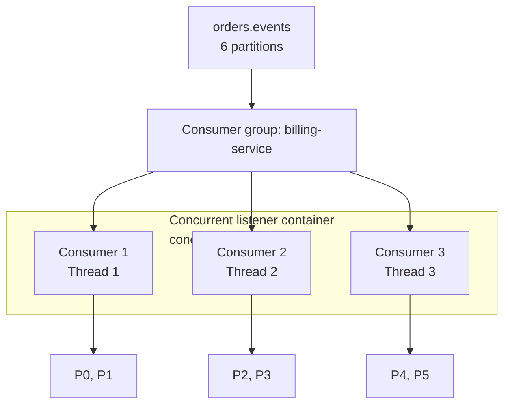

# Thiết lập concurrency trên annotation

Trong Spring Kafka, thuộc tính `concurrency` của `@KafkaListener` quy định số consumer được tạo cho listener container đó. Mỗi consumer chạy vòng lặp poll riêng và tham gia consumer group để nhận partition. Nhờ vậy, một listener có thể xử lý nhiều partition song song mà không phải tự tạo thread hoặc tự quản lý Kafka consumer.

Ví dụ, một listener có `concurrency = "3"` sẽ có tối đa ba consumer member trong group. Nếu topic có đủ partition và broker phân phối được cho cả ba member, ba luồng xử lý có thể hoạt động đồng thời. Nếu topic chỉ có một partition, chỉ một consumer được gán partition; hai consumer còn lại không tăng throughput.

`concurrency` cần được chọn cùng số partition, số replica ứng dụng, tốc độ xử lý và giới hạn của hệ thống đích. Tăng giá trị annotation không tự động làm một partition được xử lý đồng thời bởi nhiều consumer.

## 1. Concurrency của @KafkaListener là gì?

Khi Spring Kafka đăng ký một method có `@KafkaListener`, framework tạo listener container để quản lý Kafka consumer. Với `ConcurrentKafkaListenerContainerFactory`, container có thể tạo nhiều child container; mỗi child quản lý một Kafka consumer và một luồng poll riêng.



Mỗi consumer là một member của cùng consumer group nếu listener dùng chung `group.id`. Group coordinator phân phối partition cho các member. Một partition chỉ được gán cho tối đa một consumer member trong group tại một thời điểm.

Điều này tạo ra hai mức song song khác nhau:

- **Song song giữa partition:** các consumer khác nhau xử lý các partition khác nhau cùng lúc.
- **Tuần tự trong một partition:** một consumer đọc record theo thứ tự offset của partition đó; record listener được gọi cho từng record trên luồng xử lý tương ứng.

`concurrency` không biến một partition thành nhiều luồng xử lý song song. Nó tạo thêm consumer để có thể sử dụng các partition khác nhau.

## 2. Thiết lập concurrency trực tiếp trên annotation

Ví dụ listener nhận event `OrderCreated` và tạo ba consumer:

```java
package com.example.messaging.consumer;

import com.example.messaging.event.OrderCreated;
import org.springframework.kafka.annotation.KafkaListener;
import org.springframework.stereotype.Component;

@Component
public class OrderCreatedListener {

    private final BillingService billingService;

    public OrderCreatedListener(BillingService billingService) {
        this.billingService = billingService;
    }

    @KafkaListener(
            id = "ordersBillingListener",
            topics = "orders.events",
            groupId = "billing-service",
            concurrency = "3"
    )
    public void onOrderCreated(OrderCreated event) {
        billingService.handle(event);
    }
}
```

Các thuộc tính đáng chú ý:

| Thuộc tính | Ý nghĩa |
| --- | --- |
| `id` | ID của listener endpoint do Spring Kafka quản lý; có thể dùng để tìm container qua `KafkaListenerEndpointRegistry` |
| `topics` | Các topic mà listener subscribe |
| `groupId` | Consumer group mà các consumer của listener tham gia |
| `concurrency` | Số consumer member mà concurrent listener container tạo cho listener |

Giá trị `concurrency` trong annotation có kiểu chuỗi. Có thể ghi trực tiếp như `"3"`; Spring Kafka phân giải giá trị thành số consumer khi tạo endpoint/container.

Nếu không khai báo `concurrency` trên annotation, listener sử dụng concurrency mặc định của `KafkaListenerContainerFactory`. Vì vậy, hãy kiểm tra cả annotation lẫn factory khi cần biết số consumer thực tế.

Với concurrent container factory không cấu hình concurrency riêng, giá trị mặc định là một consumer cho listener. Nói cách khác, bỏ thuộc tính `concurrency` không có nghĩa listener tự chạy song song theo số partition.

## 3. Dùng property để thay đổi concurrency theo môi trường

Không nên phải sửa source code mỗi khi muốn thay đổi số consumer giữa local, staging và production. Có thể dùng placeholder trong annotation:

```java
@KafkaListener(
        id = "ordersBillingListener",
        topics = "${app.kafka.topic.orders:orders.events}",
        groupId = "${app.kafka.consumer.group-id:billing-service}",
        concurrency = "${app.kafka.listener.orders.concurrency:3}"
)
public void onOrderCreated(OrderCreated event) {
    billingService.handle(event);
}
```

Khai báo giá trị mặc định trong `application.yml`:

```yaml
app:
  kafka:
    topic:
      orders: orders.events
    consumer:
      group-id: billing-service
    listener:
      orders:
        concurrency: 3
```

Mỗi môi trường có thể ghi đè bằng biến môi trường hoặc cấu hình triển khai. Ví dụ:

```text
APP_KAFKA_LISTENER_ORDERS_CONCURRENCY=6
```

Khi Spring tạo listener endpoint, placeholder được phân giải thành giá trị concurrency. Giá trị phải là số nguyên dương hợp lệ. Đặt `0`, số âm hoặc chuỗi không phải số sẽ khiến cấu hình listener không hợp lệ hoặc không thể khởi động.

Concurrency được áp dụng khi container được tạo. Nếu muốn đổi giá trị, cách đơn giản và dễ kiểm soát nhất là cập nhật cấu hình rồi triển khai/restart instance theo quy trình vận hành. Không nên cho rằng thay biến môi trường của một process đang chạy sẽ tự thay đổi số consumer hiện tại.

## 4. Quan hệ giữa annotation và ConcurrentKafkaListenerContainerFactory

Spring Kafka dùng `ConcurrentKafkaListenerContainerFactory` để tạo concurrent listener container. Factory có thể thiết lập concurrency mặc định dùng chung cho các listener.

### 4.1. Thiết lập mặc định ở factory

Ví dụ tạo factory với concurrency mặc định bằng hai:

```java
package com.example.messaging.config;

import com.example.messaging.event.OrderCreated;
import org.springframework.context.annotation.Bean;
import org.springframework.context.annotation.Configuration;
import org.springframework.kafka.config.ConcurrentKafkaListenerContainerFactory;
import org.springframework.kafka.core.ConsumerFactory;

@Configuration
public class KafkaListenerConfiguration {

    @Bean
    public ConcurrentKafkaListenerContainerFactory<String, OrderCreated>
            kafkaListenerContainerFactory(
                    ConsumerFactory<String, OrderCreated> consumerFactory
            ) {
        var factory =
                new ConcurrentKafkaListenerContainerFactory<String, OrderCreated>();
        factory.setConsumerFactory(consumerFactory);
        factory.setConcurrency(2);
        return factory;
    }
}
```

Nếu listener dùng factory mặc định này và không khai báo `concurrency`, nó nhận giá trị hai từ factory:

```java
@KafkaListener(topics = "orders.events", groupId = "billing-service")
public void onOrderCreated(OrderCreated event) {
    billingService.handle(event);
}
```

### 4.2. Annotation ghi đè concurrency mặc định

Một listener có thể cần nhiều consumer hơn listener khác. Khi khai báo `concurrency` trên `@KafkaListener`, giá trị ở annotation ghi đè concurrency mặc định của factory cho endpoint đó:

```java
@KafkaListener(
        topics = "orders.events",
        groupId = "billing-service",
        concurrency = "4"
)
public void handleOrders(OrderCreated event) {
    billingService.handle(event);
}

@KafkaListener(
        topics = "payments.events",
        groupId = "payment-audit"
)
public void auditPayments(PaymentEvent event) {
    paymentAuditService.handle(event);
}
```

Với factory mặc định có concurrency bằng hai, listener `handleOrders` tạo bốn consumer; listener `auditPayments` dùng hai consumer. Mỗi listener có container riêng và concurrency riêng.

Các method trên là ví dụ cho hai listener độc lập. Nếu đăng ký đồng thời nhiều listener cùng subscribe một topic và dùng chung group ID, các consumer thuộc các container đó cùng tham gia một group và chia partition/record cho nhau. Chúng không tự động nhận mỗi listener một bản sao đầy đủ của mọi record; muốn fan-out độc lập, mỗi nghiệp vụ cần group ID riêng.

### 4.3. Chọn factory riêng cho listener

Ứng dụng có thể có nhiều container factory với cấu hình consumer khác nhau. Dùng `containerFactory` để chọn factory cần thiết:

```java
@KafkaListener(
        id = "highVolumeOrders",
        topics = "orders.events",
        groupId = "billing-service",
        containerFactory = "ordersKafkaListenerContainerFactory",
        concurrency = "6"
)
public void handleHighVolumeOrders(OrderCreated event) {
    billingService.handle(event);
}
```

Factory được tham chiếu phải là `ConcurrentKafkaListenerContainerFactory` nếu muốn sử dụng concurrency. Factory riêng cũng là nơi cấu hình consumer factory, acknowledgment mode, error handler và các thuộc tính container phù hợp với listener.

## 5. Concurrency và số partition

Số partition là giới hạn quan trọng của khả năng xử lý song song trong một consumer group. Giả sử topic `orders.events` có sáu partition:

| Concurrency | Số consumer được tạo | Consumer có partition (tối đa) | Consumer có thể nhàn rỗi |
| ---: | ---: | ---: | ---: |
| 1 | 1 | 1 | 0 |
| 2 | 2 | 2 | 0 |
| 3 | 3 | 3 | 0 |
| 6 | 6 | 6 | 0 |
| 8 | 8 | 6 | 2 |

Đây là ví dụ với một topic sáu partition và một group. Assignment thực tế phụ thuộc partition assignor, subscription và trạng thái group. Khi số consumer lớn hơn số partition có thể được phân phối, một số consumer không nhận partition.

Ví dụ:

- Topic có 3 partition, concurrency bằng 1: một consumer xử lý cả ba partition.
- Topic có 3 partition, concurrency bằng 3: ba consumer có thể xử lý ba partition song song.
- Topic có 3 partition, concurrency bằng 6: chỉ tối đa ba consumer được gán partition; ba consumer còn lại không làm tăng mức song song.

Nếu listener subscribe nhiều topic, số partition và assignment của tất cả topic tham gia vào group. Không nên chỉ cộng partition rồi mặc định mỗi consumer nhận số lượng bằng nhau; partition assignor có thể phân phối không đều giữa các member hoặc topic.

## 6. Concurrency khi chạy nhiều replica ứng dụng

Concurrency trong annotation áp dụng cho mỗi listener container trong mỗi instance ứng dụng. Nếu triển khai nhiều replica, tổng số consumer member của group có thể tăng theo cả hai chiều:

\[
\text{Tổng consumer được tạo} =
\text{Số replica} \times \text{Concurrency mỗi replica}
\]

Ví dụ triển khai Billing thành hai pod, mỗi pod dùng `concurrency = 3`:

| Thành phần | Số lượng |
| --- | ---: |
| Replica ứng dụng | 2 |
| Consumer mỗi replica | 3 |
| Tổng consumer member trong group | 6 |
| Partition topic `orders.events` | 6 |

Group `billing-service` có thể phân phối sáu partition cho sáu consumer member. Nếu topic chỉ có bốn partition, tối đa bốn consumer được gán partition; hai consumer còn lại nhàn rỗi.

Các replica phải dùng cùng `group.id` nếu mục tiêu là chia tải một nghiệp vụ. Nếu mỗi replica dùng group ID riêng, chúng trở thành các thuê bao độc lập và mỗi group có thể đọc toàn bộ topic. Đây không phải cách scale một consumer group.

## 7. Concurrency không phá vỡ thứ tự trong partition

Kafka duy trì thứ tự record trong từng partition. Với record listener thông thường, một consumer xử lý record của partition theo thứ tự mà consumer nhận được. Khi tăng concurrency, các partition khác nhau có thể được xử lý đồng thời, nhưng record trong cùng một partition vẫn đi qua consumer được gán cho partition đó.

Ví dụ producer dùng `orderId` làm key:

```java
kafkaTemplate.send("orders.events", event.orderId(), event);
```

Các event cùng key thường được định tuyến vào cùng partition theo partitioner mặc định. Điều này giúp `OrderCreated`, `OrderPaid` và `OrderCancelled` của một đơn hàng được đọc theo thứ tự trong partition đó.

Tuy nhiên, concurrency không bảo đảm thứ tự toàn cục giữa các partition. Ngoài ra, nếu listener đẩy event sang executor rồi trả về ngay, các tác vụ bất đồng bộ có thể hoàn tất không theo thứ tự nhận. Nếu thứ tự nghiệp vụ quan trọng, cần giữ xử lý đồng bộ trong listener hoặc xây dựng cơ chế tuần tự theo key ở tầng xử lý bất đồng bộ.

## 8. Tác động đến rebalance và thời gian xử lý

Khi số consumer member thay đổi, Kafka có thể rebalance group để phân phối lại partition. Những tình huống phổ biến gồm:

- Ứng dụng khởi động thêm replica hoặc thêm consumer do tăng concurrency.
- Một pod dừng, restart hoặc bị lỗi.
- Consumer không heartbeat hoặc không poll đúng giới hạn thời gian.
- Subscription hoặc số partition của topic thay đổi.

Tăng concurrency có thể làm tăng số member cần tham gia group và tăng số lần assignment thay đổi trong lúc triển khai. Rebalance có thể tạm thời làm giảm throughput. Cần theo dõi log group, thời gian rebalance và consumer lag sau khi thay đổi cấu hình.

Nếu listener xử lý một record quá lâu, consumer có thể vượt `max.poll.interval.ms`. Khi đó broker xem consumer không còn tiến triển, loại member khỏi group và kích hoạt rebalance. Có thể điều chỉnh `max.poll.interval.ms` theo thời gian xử lý tối đa dự kiến, nhưng cần kiểm tra cả timeout, retry và khả năng treo của nghiệp vụ.

`max.poll.records` giới hạn số record tối đa consumer nhận trong một lần poll. Nó không phải concurrency. `concurrency` là số consumer member; `max.poll.records` là số record tối đa mỗi consumer có thể nhận trong một lần poll. Hai giá trị này tác động đến lượng công việc đang chờ và thời gian xử lý batch poll.

## 9. Chọn concurrency theo tải thực tế

Không nên đặt concurrency bằng số CPU hoặc tăng càng cao càng tốt. Hãy cân nhắc các yếu tố:

- **Số partition:** số consumer có thể thực sự nhận partition trong cùng group.
- **Thời gian xử lý record:** listener xử lý càng lâu, càng cần tính đến lag và `max.poll.interval.ms`.
- **Tài nguyên CPU và memory:** mỗi consumer cần socket, buffer, heartbeat và luồng poll riêng.
- **Broker và network:** thêm consumer làm tăng request, fetch và kết nối tới broker.
- **Hệ thống đích:** database, HTTP API hoặc dịch vụ downstream có thể trở thành bottleneck khi tăng song song.
- **Retry và error handling:** retry blocking có thể giữ partition lâu; tăng consumer không nhất thiết giải quyết được record lỗi.

Một quy trình thử nghiệm thực tế:

1. Bắt đầu với concurrency nhỏ, ví dụ 1 hoặc 2.
2. Đo throughput, consumer lag, thời gian xử lý record và lỗi ở hệ thống đích.
3. Tăng concurrency trong phạm vi partition có thể sử dụng.
4. Đo lại cùng workload và so sánh throughput/latency.
5. Dừng tăng khi throughput không cải thiện, lag không giảm hoặc hệ thống đích bắt đầu quá tải.

Nếu topic có ít partition nhưng cần throughput cao hơn, có thể phải thiết kế lại số partition. Tăng partition có tác động đến phân phối key, thứ tự dài hạn và tài nguyên broker, nên cần đánh giá trước khi thay đổi.

## 10. Kiểm tra và quan sát concurrency

Sau khi cấu hình concurrency, hãy xác minh số consumer member thực tế thay vì chỉ nhìn giá trị trong annotation.

Có thể xem consumer group bằng Kafka CLI:

```bash
kafka-consumer-groups.sh \
  --bootstrap-server localhost:9092 \
  --describe \
  --group billing-service
```

Kết quả giúp kiểm tra partition được gán cho consumer nào, offset hiện tại và lag của từng partition. Tên consumer/client ID thường giúp phân biệt các member trong group.

Các chỉ số nên theo dõi:

| Chỉ số | Ý nghĩa |
| --- | --- |
| Số member trong group | Số consumer thực tế đã tham gia group |
| Partition assignment | Consumer nào đang nhận partition nào |
| Consumer lag | Khoảng cách giữa vị trí group đã đọc và log end offset |
| Records consumed rate | Tốc độ record được consumer đọc |
| Listener processing time | Thời gian xử lý một record hoặc một lần gọi listener |
| Rebalance count/duration | Tần suất và thời gian group phân phối lại partition |
| Error/retry/DLT rate | Mức độ lỗi trong quá trình xử lý |

Nếu concurrency tăng nhưng số member trong group không đổi, kiểm tra listener container có dùng đúng factory hay không, annotation có được phân giải đúng không và listener có khởi động thành công không. Nếu số member tăng nhưng throughput không tăng, kiểm tra partition count, lag, thời gian xử lý và hệ thống đích.

## 11. Kiểm thử listener có concurrency

Integration test với `@EmbeddedKafka` có thể xác nhận listener nhận record từ nhiều partition. Để kiểm tra xử lý song song, cần tạo topic có ít nhất hai partition, cấu hình listener concurrency tối thiểu hai và gửi record vào các partition khác nhau.

Một cách kiểm thử đáng tin cậy:

1. Khởi tạo embedded broker với topic có hai hoặc nhiều partition.
2. Khởi chạy listener với `concurrency = "2"` và group ID riêng cho test.
3. Chờ container tham gia group và nhận assignment cho cả hai partition.
4. Gửi hai record vào hai partition khác nhau, ví dụ chỉ định partition 0 và partition 1 trong `ProducerRecord`.
5. Trong listener test, ghi nhận thời điểm bắt đầu xử lý bằng `CountDownLatch` hoặc đồng hồ đồng bộ.
6. Xác nhận hai invocation có thể bắt đầu trước khi invocation đầu tiên được nhả khỏi barrier.
7. Dùng timeout cho mọi latch để test không treo khi assignment hoặc listener bị lỗi.

Không nên chỉ gửi hai record cùng key rồi kỳ vọng chúng được xử lý đồng thời; cùng key thường được định tuyến vào cùng partition và một consumer sẽ xử lý chúng tuần tự. Cũng không nên dùng `Thread.sleep()` cố định để giả lập concurrency vì kết quả dễ phụ thuộc tốc độ máy và lịch chạy thread.

## 12. Lỗi thường gặp khi thiết lập concurrency

| Hiện tượng | Nguyên nhân thường gặp | Cách kiểm tra |
| --- | --- | --- |
| Annotation đặt `concurrency = "4"` nhưng chỉ có một consumer hoạt động | Topic chỉ có một partition hoặc assignment hiện tại chỉ cấp một partition | Kiểm tra partition count và group assignment |
| Tăng concurrency nhưng không tăng throughput | Hệ thống đích bị nghẽn hoặc số partition không đủ | Đo thời gian xử lý, lag và tải database/downstream |
| Một số consumer không nhận partition | Số consumer lớn hơn số partition có thể gán | Giảm concurrency hoặc đánh giá tăng partition |
| Listener không khởi động | Placeholder concurrency sai định dạng hoặc container factory không phù hợp | Kiểm tra giá trị property và loại factory |
| Group rebalance liên tục | Consumer xử lý lâu, restart liên tục hoặc heartbeat/poll timeout | Kiểm tra `max.poll.interval.ms`, log member và thời gian xử lý |
| Event cùng entity bị xử lý không đúng thứ tự | Producer không giữ thứ tự phát hoặc listener dispatch async | Kiểm tra key, partition và cách xử lý song song |
| Nhiều pod cùng xử lý toàn bộ event | Mỗi pod dùng group ID khác nhau | Bảo đảm các replica dùng chung group ID |
| Downstream bị quá tải sau khi tăng concurrency | Tốc độ xử lý song song vượt khả năng database/API | Giảm concurrency, giới hạn tải và bổ sung backpressure |

## 13. Quy trình cấu hình concurrency cho listener mới

1. Xác định topic và số partition đang có.
2. Xác định group ID; các replica của cùng nghiệp vụ phải dùng chung group ID.
3. Chọn concurrency khởi điểm dựa trên partition và năng lực xử lý.
4. Đặt concurrency trực tiếp trên `@KafkaListener` hoặc dùng property placeholder theo môi trường.
5. Kiểm tra container factory được listener sử dụng là `ConcurrentKafkaListenerContainerFactory`.
6. Xác minh số member và partition assignment bằng Kafka CLI hoặc metric.
7. Đo lag, throughput, processing time, rebalance và tải hệ thống đích.
8. Điều chỉnh concurrency hoặc partition count sau khi có số liệu, rồi kiểm thử lại.

Concurrency trên `@KafkaListener` là cách ngắn gọn để cấu hình số consumer cho từng listener. Khi phối hợp đúng với partition count, group ID, factory và khả năng xử lý của ứng dụng, nó giúp mở rộng luồng tiêu thụ sự kiện mà vẫn giữ thứ tự trong từng partition và kiểm soát được tải hệ thống.

## 14. Tự kiểm tra

1. `concurrency = "3"` trên `@KafkaListener` tạo ra bao nhiêu consumer member trong một instance?
2. Nếu topic có hai partition nhưng concurrency bằng năm, có bao nhiêu consumer tối đa được gán partition?
3. Nếu hai pod cùng chạy listener concurrency bằng ba và cùng group ID, tổng số consumer được tạo là bao nhiêu?
4. Nếu bỏ thuộc tính `concurrency` khỏi annotation, giá trị nào được sử dụng?
5. Annotation concurrency khác `max.poll.records` như thế nào?
6. Vì sao tăng concurrency không làm một partition được xử lý bởi nhiều consumer cùng lúc?
7. Những yếu tố nào có thể khiến tăng concurrency làm throughput giảm?
8. Cần quan sát chỉ số nào để biết concurrency đã cải thiện khả năng tiêu thụ event?
