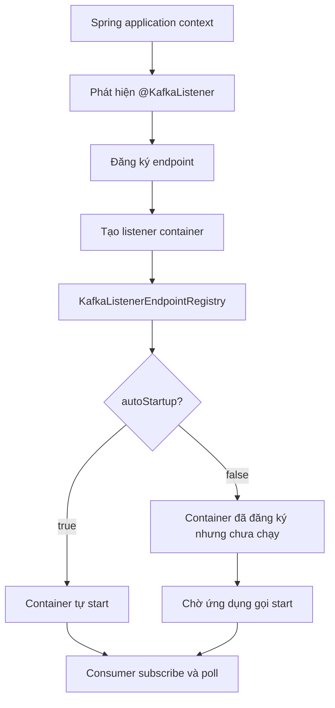

# Thiết lập autoStartup trên annotation

Thuộc tính `autoStartup` của `@KafkaListener` quyết định listener container có tự khởi động cùng Spring application context hay không. Đây là cách kiểm soát thời điểm bắt đầu tiêu thụ record: ứng dụng vẫn đăng ký endpoint, nhưng có thể trì hoãn consumer cho tới khi một dependency sẵn sàng hoặc khi một bước khởi tạo đã hoàn tất.

`autoStartup` điều khiển vòng đời listener container. Nó không bật/tắt annotation processing, không tạo hoặc xóa topic, không reset offset và cũng không thay thế cấu hình commit của consumer. Muốn điều khiển một listener sau khi ứng dụng đã chạy, có thể kết hợp `autoStartup` với `KafkaListenerEndpointRegistry`.

## 1. autoStartup hoạt động ở đâu?

Spring Kafka phát hiện `@KafkaListener`, tạo endpoint và đăng ký container vào `KafkaListenerEndpointRegistry`. Khi application context đi vào giai đoạn lifecycle start, registry khởi động các container được cấu hình tự động khởi động.



Có ba trạng thái cần phân biệt:

- **Endpoint đã đăng ký:** Spring đã đọc annotation và tạo container tương ứng.
- **Container đang chạy:** container đã khởi động consumer và thực hiện subscription/poll theo cấu hình.
- **Container đã dừng:** container vẫn được registry quản lý, nhưng không tiếp tục tiêu thụ cho tới khi được start lại.

Vì vậy, `autoStartup = "false"` không làm Spring bỏ qua listener. Nó chỉ bỏ qua bước tự động start container trong lifecycle startup.

## 2. Khai báo autoStartup trực tiếp trên @KafkaListener

Ví dụ listener không tự chạy khi ứng dụng khởi động:

```java
@Component
public class OrderListener {

    @KafkaListener(
            id = "orders-listener",
            topics = "orders",
            groupId = "orders-service",
            autoStartup = "false"
    )
    public void onOrder(OrderCreated event) {
        // Xử lý sự kiện đơn hàng.
    }
}
```

`id` đặt tên endpoint để ứng dụng có thể tìm container qua registry. `topics` và `groupId` xác định subscription và consumer group. `autoStartup = "false"` yêu cầu container chờ lệnh start tường minh.

Nếu bỏ `autoStartup`, listener dùng chính sách auto-start của container factory. Với factory mặc định, hành vi thường là tự khởi động. Khi một ứng dụng có nhiều listener, chỉ đặt `false` ở listener cần trì hoãn để những listener khác vẫn có thể chạy bình thường.

## 3. Dùng property placeholder để cấu hình theo môi trường

Giá trị `autoStartup` có thể lấy từ Spring Environment:

```yaml
app:
  kafka:
    listeners:
      orders:
        auto-startup: false
```

```java
@KafkaListener(
        id = "orders-listener",
        topics = "orders",
        groupId = "orders-service",
        autoStartup = "${app.kafka.listeners.orders.auto-startup:true}"
)
public void onOrder(OrderCreated event) {
    // Xử lý sự kiện.
}
```

Trong ví dụ, listener mặc định tự khởi động nếu property không được khai báo; cấu hình `false` sẽ trì hoãn listener. Có thể đặt giá trị khác nhau theo profile:

```yaml
# application-local.yml
app:
  kafka:
    listeners:
      orders:
        auto-startup: true

---
# application-maintenance.yml
app:
  kafka:
    listeners:
      orders:
        auto-startup: false
```

Annotation được resolve khi Spring tạo endpoint. Thay file cấu hình sau khi ứng dụng đã khởi động không tự động thay đổi trạng thái container hiện tại. Với thay đổi cấu hình thông thường, triển khai lại ứng dụng theo profile mong muốn; nếu cần điều khiển lúc runtime, dùng registry.

## 4. Cấu hình auto-start mặc định cho nhiều listener

Nếu dùng Spring Boot, có thể đặt chính sách mặc định cho listener container factory do Boot tạo:

```yaml
spring:
  kafka:
    listener:
      auto-startup: false
```

Thuộc tính này phù hợp khi muốn các listener dùng factory mặc định đều chờ start tường minh. Sau đó có thể chọn listener cần tự khởi động bằng thuộc tính `autoStartup` trên annotation nếu muốn ghi đè chính sách mặc định.

Nếu ứng dụng tự khai báo một `ConcurrentKafkaListenerContainerFactory`, hãy kiểm tra cấu hình của factory đó. Factory tùy chỉnh có thể đặt chính sách riêng:

```java
@Bean
public ConcurrentKafkaListenerContainerFactory<String, OrderCreated>
        ordersListenerContainerFactory(
                ConsumerFactory<String, OrderCreated> consumerFactory) {

    var factory = new ConcurrentKafkaListenerContainerFactory<String, OrderCreated>();
    factory.setConsumerFactory(consumerFactory);
    factory.setAutoStartup(false);
    return factory;
}
```

Chính sách trên áp dụng cho container được tạo từ factory đó khi annotation không cung cấp giá trị ghi đè. Không nên cấu hình global `auto-startup: false` nếu ứng dụng không có cơ chế start các listener cần chạy; nếu không, listener có thể được đăng ký nhưng không bao giờ tiêu thụ record.

## 5. Khởi động listener bằng KafkaListenerEndpointRegistry

`KafkaListenerEndpointRegistry` quản lý các container được tạo từ `@KafkaListener`. Khi đặt `id` rõ ràng, có thể tra cứu container và gọi `start()` hoặc `stop()`:

```java
import org.springframework.kafka.config.KafkaListenerEndpointRegistry;
import org.springframework.kafka.listener.MessageListenerContainer;
import org.springframework.stereotype.Service;

@Service
public class OrderListenerControl {

    private final KafkaListenerEndpointRegistry registry;

    public OrderListenerControl(KafkaListenerEndpointRegistry registry) {
        this.registry = registry;
    }

    public void startOrdersListener() {
        MessageListenerContainer container =
                registry.getListenerContainer("orders-listener");

        if (container == null) {
            throw new IllegalStateException("Listener orders-listener was not registered");
        }

        if (!container.isRunning()) {
            container.start();
        }
    }

    public void stopOrdersListener() {
        MessageListenerContainer container =
                registry.getListenerContainer("orders-listener");

        if (container != null && container.isRunning()) {
            container.stop();
        }
    }
}
```

`getListenerContainer(id)` trả container tương ứng hoặc `null` nếu không tìm thấy ID. Vì vậy, nên kiểm tra kết quả trước khi gọi lifecycle method. `isRunning()` giúp tránh gọi start/stop lặp lại không cần thiết; với nhiều luồng quản trị đồng thời, vẫn cần đồng bộ hóa thao tác nếu nghiệp vụ yêu cầu trạng thái chuyển đổi nghiêm ngặt.

Registry chỉ quản lý container của các endpoint được đăng ký qua annotation infrastructure. Container được tạo thủ công ở nơi khác không tự động xuất hiện trong registry trừ khi được đăng ký theo cơ chế tương ứng.

## 6. Chỉ start sau khi ứng dụng sẵn sàng

Một lý do phổ biến để đặt `autoStartup = "false"` là listener phụ thuộc vào dữ liệu khởi tạo hoặc dịch vụ bên ngoài. Có thể start listener sau khi ứng dụng hoàn tất bước chuẩn bị.

Ví dụ start khi nhận `ApplicationReadyEvent`:

```java
import org.springframework.boot.context.event.ApplicationReadyEvent;
import org.springframework.context.event.EventListener;
import org.springframework.kafka.config.KafkaListenerEndpointRegistry;
import org.springframework.kafka.listener.MessageListenerContainer;
import org.springframework.stereotype.Component;

@Component
public class OrderListenerStartup {

    private final KafkaListenerEndpointRegistry registry;

    public OrderListenerStartup(KafkaListenerEndpointRegistry registry) {
        this.registry = registry;
    }

    @EventListener(ApplicationReadyEvent.class)
    public void startListenerWhenReady() {
        MessageListenerContainer container =
                registry.getListenerContainer("orders-listener");

        if (container != null && !container.isRunning()) {
            container.start();
        }
    }
}
```

Trong ví dụ, listener đã được đăng ký nhưng chưa tự chạy. Sau khi Spring Boot phát `ApplicationReadyEvent`, ứng dụng mới start container. Đây là cách phù hợp nếu logic khởi tạo cần hoàn tất trước khi consumer nhận sự kiện.

Nếu listener phụ thuộc vào một quy trình bootstrap cụ thể, hãy start ngay sau khi quy trình đó báo thành công thay vì chỉ dựa vào thời điểm ứng dụng ready. `ApplicationReadyEvent` chỉ cho biết Spring Boot đã hoàn tất startup; nó không chứng minh mọi hệ thống ngoài Kafka đều đang khỏe hoặc mọi dữ liệu nghiệp vụ đã được đồng bộ.

## 7. Dừng listener có kiểm soát

Có thể dừng listener để bảo trì, chuyển đổi dữ liệu hoặc tạm ngưng nhận record:

```java
MessageListenerContainer container =
        registry.getListenerContainer("orders-listener");

if (container != null && container.isRunning()) {
    container.stop(() -> log.info("Orders listener stopped"));
}
```

Callback của `stop(Runnable)` được gọi khi quá trình dừng container hoàn tất theo lifecycle của container. Có thể dùng callback để ghi nhận trạng thái hoặc tiếp tục một bước bảo trì sau khi container đã dừng.

Dừng listener không xóa topic, không xóa consumer group và không reset offset đã commit. Consumer rời group và partition có thể được phân công cho consumer khác. Khi start lại cùng group, consumer tiếp tục từ offset đã commit của group đó.

Nếu record đang được xử lý khi container dừng, kết quả cuối cùng phụ thuộc thời điểm xử lý, acknowledgment mode và commit. Record đã xử lý nhưng chưa commit có thể được giao lại sau khi khởi động lại. Vì vậy, handler vẫn cần idempotent và quy trình dừng cần được kiểm thử với workload thực tế.

## 8. autoStartup không phải auto commit hoặc auto topic creation

Các thuộc tính sau điều khiển những phần khác nhau:

| Thuộc tính | Điều khiển | Không điều khiển |
|---|---|---|
| `@KafkaListener.autoStartup` | Container có tự chạy cùng application context hay không | Commit offset, tạo topic hoặc reset offset |
| `spring.kafka.listener.auto-startup` | Chính sách auto-start mặc định của listener factory do Boot cấu hình | Trạng thái nghiệp vụ của record |
| `enable.auto.commit` | Kafka client tự commit offset theo chu kỳ hay không | Việc listener container có khởi động hay không |
| `auto-offset-reset` | Vị trí bắt đầu khi group không có offset hợp lệ | Tác vụ tua lại group đang có offset hợp lệ |
| `auto.create.topics.enable` | Broker có cho phép tự tạo topic khi client tham chiếu topic chưa tồn tại hay không | Lifecycle của listener container |

Ví dụ, `autoStartup = "false"` chỉ giữ container ở trạng thái chưa chạy. Nó không đặt `enable.auto.commit=false` và cũng không đảm bảo offset sẽ được reset khi container start.

## 9. Ảnh hưởng tới consumer group và offset

Khi container chưa start, consumer chưa thực hiện subscription/poll cho endpoint đó. Khi container start, consumer tham gia group và nhận partition assignment theo trạng thái group lúc đó.

Nếu các instance khác cùng group đang chạy, chúng có thể tiếp tục xử lý partition của group trong lúc listener bị giữ ở trạng thái stopped. Khi listener start, group có thể rebalance để phân chia lại partition. Việc này là hành vi bình thường của consumer group.

Khi dừng rồi start lại:

1. Consumer đang chạy được dừng theo lifecycle của container.
2. Kafka group cập nhật thành viên và có thể phân công lại partition.
3. Container được start tạo/khởi động consumer theo cấu hình.
4. Consumer đọc tiếp từ offset đã commit của group, hoặc áp dụng `auto-offset-reset` nếu không có offset hợp lệ.

Nếu cần đảm bảo không mất xử lý, hãy chọn acknowledgment mode phù hợp, commit sau khi xử lý thành công và làm handler idempotent. `autoStartup` không cung cấp bảo đảm exactly-once cho nghiệp vụ.

## 10. Nhiều listener có thể có chính sách autoStartup khác nhau

Một ứng dụng có thể cho listener quan trọng tự chạy, trong khi listener phục vụ báo cáo chỉ chạy khi được yêu cầu:

```java
@Component
public class ApplicationListeners {

    @KafkaListener(
            id = "payments-listener",
            topics = "payments",
            groupId = "payment-service",
            autoStartup = "true"
    )
    public void onPayment(PaymentEvent event) {
        // Luồng chính, tự khởi động.
    }

    @KafkaListener(
            id = "analytics-listener",
            topics = "orders",
            groupId = "analytics-service",
            autoStartup = "false"
    )
    public void onOrderForAnalytics(OrderEvent event) {
        // Chỉ chạy khi ứng dụng chủ động start.
    }
}
```

Nếu hai listener cần chính sách lifecycle khác nhau, đặt `autoStartup` riêng giúp thể hiện ý định ngay tại annotation. Cần đảm bảo có cơ chế start listener đang để `false`, chẳng hạn ApplicationReadyEvent, thao tác quản trị hoặc một scheduler có điều kiện.

Không dùng `autoStartup=false` như một cách giới hạn số consumer trong toàn cụm. Thuộc tính này áp dụng cho từng container trong từng instance ứng dụng. Khi có nhiều replica của ứng dụng, tất cả instance cùng cấu hình `true` vẫn sẽ start listener và tham gia group bình thường.

Nếu yêu cầu chỉ một instance được phép chạy listener, cần cơ chế leader election hoặc distributed lock phù hợp. `autoStartup` không phải distributed lock và không phối hợp quyết định giữa các pod.

## 11. Cấu hình autoStartup với factory riêng

Một factory có thể đặt auto-start mặc định cho các listener sử dụng nó:

```java
@Configuration
public class KafkaListenerConfiguration {

    @Bean
    public ConcurrentKafkaListenerContainerFactory<String, OrderEvent>
            controlledListenerFactory(
                    ConsumerFactory<String, OrderEvent> consumerFactory) {

        var factory = new ConcurrentKafkaListenerContainerFactory<String, OrderEvent>();
        factory.setConsumerFactory(consumerFactory);
        factory.setAutoStartup(false);
        factory.setConcurrency(2);
        return factory;
    }
}
```

Listener dùng factory:

```java
@KafkaListener(
        id = "controlled-orders-listener",
        topics = "orders",
        groupId = "orders-service",
        containerFactory = "controlledListenerFactory"
)
public void onOrder(OrderEvent event) {
    // Chờ được start qua registry.
}
```

Nếu annotation không chỉ định `autoStartup`, container dùng chính sách của factory. Khi annotation có giá trị rõ ràng, giá trị đó điều khiển endpoint tương ứng. Đây là cách kết hợp một mặc định chung với ngoại lệ cho từng listener.

## 12. Theo dõi trạng thái listener

Ứng dụng có thể lấy container từ registry và kiểm tra `isRunning()`:

```java
public boolean isOrdersListenerRunning() {
    MessageListenerContainer container =
            registry.getListenerContainer("orders-listener");

    return container != null && container.isRunning();
}
```

Trạng thái `isRunning()` phản ánh lifecycle của container. Nó không đồng nghĩa consumer đang có partition, đang nhận record hoặc không có lỗi xử lý. Một container có thể running nhưng group chưa được gán partition, topic chưa có record hoặc consumer đang gặp lỗi kết nối.

Khi vận hành, nên kết hợp trạng thái container với các tín hiệu khác:

- Consumer group có thành viên và partition assignment hay không.
- Consumer lag theo topic/partition.
- Số record xử lý thành công và thất bại.
- Số lần rebalance và lỗi kết nối/deserialization.
- Thời gian xử lý listener và tình trạng dependency downstream.

Nếu ứng dụng cần readiness phản ánh khả năng tiêu thụ Kafka, hãy xây dựng health/readiness indicator phù hợp với yêu cầu. Không suy ra ứng dụng đã sẵn sàng chỉ từ việc container đã start.

## 13. Kiểm thử autoStartup

Integration test nên xác minh cả hai trường hợp: container tự chạy và container chờ start tường minh. Có thể dùng `@EmbeddedKafka` hoặc Testcontainers Kafka cùng Spring test context.

Ví dụ kiểm tra listener có `autoStartup="false"`:

```java
@SpringBootTest
@EmbeddedKafka(partitions = 1, topics = "orders")
class OrderListenerStartupTest {

    @Autowired
    private KafkaListenerEndpointRegistry registry;

    @Test
    void listenerShouldRemainStoppedUntilStarted() {
        MessageListenerContainer container =
                registry.getListenerContainer("orders-listener");

        assertThat(container).isNotNull();
        assertThat(container.isRunning()).isFalse();

        container.start();

        await().atMost(Duration.ofSeconds(10))
                .until(container::isRunning);
    }
}
```

Test cần listener có `id = "orders-listener"`, cấu hình `autoStartup="false"` và các dependency Kafka tương ứng. Tùy phiên bản Spring Kafka và test lifecycle, nên dùng Awaitility hoặc điều kiện chờ có timeout để đợi trạng thái container thay đổi thay vì `Thread.sleep` cố định.

Các tình huống nên kiểm tra:

- Listener mặc định tự khởi động khi context start.
- `autoStartup=false` giữ container không chạy sau startup.
- Gọi `registry.getListenerContainer(id).start()` làm container bắt đầu chạy.
- Gọi stop làm container dừng và start lại được.
- Placeholder thay đổi theo profile tạo trạng thái startup đúng mong đợi.
- Listener bị trì hoãn không làm ảnh hưởng các listener khác dùng factory hoặc group khác.
- Record chưa commit có thể được giao lại sau stop/restart; handler xử lý lặp an toàn.

## 14. Lỗi thường gặp khi dùng autoStartup

**Đặt `false` nhưng không có lệnh start:** endpoint đã đăng ký nhưng container không bao giờ tiêu thụ. Cần có startup hook hoặc cơ chế quản trị rõ ràng.

**Nhầm `autoStartup` với `enable.auto.commit`:** một thuộc tính điều khiển lifecycle, thuộc tính kia điều khiển cơ chế commit của Kafka client.

**Không đặt listener `id`:** ứng dụng khó tra cứu container cụ thể qua registry. Đặt ID duy nhất cho listener cần điều khiển.

**Dùng nhầm ID:** `getListenerContainer` trả `null` hoặc điều khiển sai endpoint. Đồng bộ ID giữa annotation, cấu hình và code quản trị.

**Global auto-start bị tắt:** tất cả listener dùng factory mặc định có thể không tự chạy. Kiểm tra `spring.kafka.listener.auto-startup` và kế hoạch start.

**Factory tùy chỉnh có chính sách khác:** cấu hình global của Boot không nhất thiết phản ánh factory do ứng dụng tự tạo. Kiểm tra `setAutoStartup` và `containerFactory` của endpoint.

**Cho rằng container running nghĩa là đang xử lý record:** cần kiểm tra assignment, lag, lỗi consumer và topic.

**Dừng listener để mong reset offset:** stop không reset offset. Muốn tua lại cần quy trình quản trị offset riêng.

**Dùng autoStartup để chọn một pod duy nhất:** mọi instance có cùng cấu hình đều tự quyết định start. Dùng leader election hoặc coordination phân tán nếu cần một consumer owner.

**Start trước khi dependency sẵn sàng:** listener có thể nhận record khi database hoặc service downstream chưa sẵn sàng. Chỉ start sau tín hiệu readiness thực tế của dependency.

## 15. Checklist triển khai

- Listener cần tự chạy hay phải chờ một điều kiện khởi tạo?
- Giá trị `autoStartup` được đặt trực tiếp hay lấy từ property theo môi trường?
- Chính sách mặc định của container factory có đúng với các listener sử dụng nó không?
- Listener cần điều khiển có `id` duy nhất và có thể tra cứu trong registry không?
- Có startup hook hoặc quy trình quản trị để start container đang bị trì hoãn không?
- Có cách dừng container có kiểm soát và quan sát khi dừng hoàn tất không?
- Đã đánh giá tác động tới group rebalance, offset commit và xử lý lặp chưa?
- Handler có idempotent khi record được giao lại sau restart không?
- Nếu chỉ một instance được chạy, đã có leader election/distributed coordination chưa?
- Metric và readiness có phân biệt container running với consumer thực sự khỏe không?
- Integration test xác minh trạng thái trước/sau start và stop chưa?

`autoStartup` giúp kiểm soát thời điểm listener container bắt đầu tiêu thụ. Kết hợp cấu hình ở annotation hoặc factory với `KafkaListenerEndpointRegistry`, ứng dụng có thể trì hoãn, khởi động và dừng listener theo vòng đời dependency. Để vận hành an toàn, cần quản lý offset, rebalance, trạng thái container và xử lý lặp cùng với chính sách lifecycle này.
