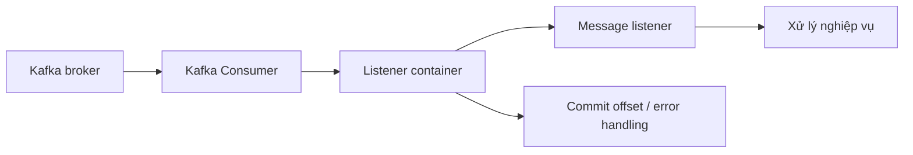
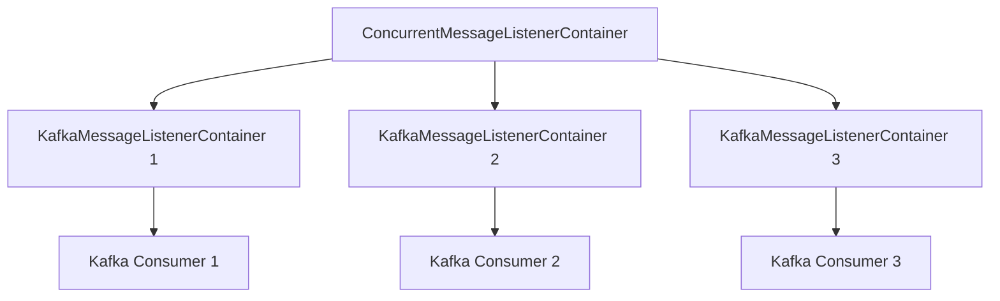

# KafkaMessageListenerContainer và container factory

Spring Kafka cung cấp listener container để quản lý vòng đời Kafka consumer, gọi `poll()`, chuyển record đến listener và phối hợp với consumer group. Hai thành phần thường gặp là **`KafkaMessageListenerContainer`** và **`ConcurrentKafkaListenerContainerFactory`**. Container trực tiếp thực hiện việc tiêu thụ dữ liệu; factory tạo và cấu hình container cho các endpoint, đặc biệt là endpoint khai báo bằng `@KafkaListener`.

Khi cần một consumer đơn giản, có thể tạo `KafkaMessageListenerContainer` trực tiếp. Khi cần nhiều consumer chạy song song hoặc muốn dùng `@KafkaListener` theo cấu hình thống nhất, thường dùng `ConcurrentKafkaListenerContainerFactory`. Hiểu vai trò của từng lớp giúp chọn đúng mức trừu tượng và tránh tự quản lý consumer không cần thiết.

## 1. Listener container là gì?

Listener container là thành phần của Spring Kafka đứng giữa Kafka consumer và mã xử lý nghiệp vụ. Container tạo consumer từ `ConsumerFactory`, thực hiện vòng lặp nhận record, gọi listener theo kiểu record hoặc batch, xử lý acknowledgement, error handler và lifecycle.

Luồng tổng quát:



Ứng dụng không cần tự viết vòng `poll()` khi sử dụng listener container. Spring Kafka quản lý consumer thread và điều phối lời gọi listener theo cấu hình container.

Các thành phần liên quan:

| Thành phần | Trách nhiệm |
|---|---|
| `ConsumerFactory<K, V>` | Tạo Kafka consumer với bootstrap server, group ID, deserializer và các consumer properties. |
| `ContainerProperties` | Cấu hình topic/partition subscription, listener, acknowledgement, poll timeout và các thuộc tính vận hành. |
| `KafkaMessageListenerContainer<K, V>` | Chạy một Kafka consumer trong một consumer thread. |
| `ConcurrentMessageListenerContainer<K, V>` | Quản lý nhiều `KafkaMessageListenerContainer` con để tăng concurrency. |
| `ConcurrentKafkaListenerContainerFactory<K, V>` | Factory tạo `ConcurrentMessageListenerContainer` và áp dụng cấu hình chung cho endpoint. |
| `KafkaListenerEndpointRegistry` | Quản lý các container được tạo từ `@KafkaListener`, hỗ trợ tra cứu và điều khiển lifecycle. |

## 2. KafkaMessageListenerContainer

`KafkaMessageListenerContainer<K, V>` là container cấp thấp quản lý một Kafka consumer. Nó chạy consumer trên một thread và gọi listener tuần tự theo thứ tự record được poll từ các partition mà consumer đang sở hữu.

Container này phù hợp khi:

- Ứng dụng chỉ cần một consumer instance cho luồng dữ liệu.
- Muốn tạo và quản lý container bằng code thay vì annotation.
- Cần kiểm soát rõ `ContainerProperties`, listener và lifecycle.
- Đang xây dựng một thành phần tích hợp hoặc công cụ có vòng đời consumer riêng.

Ví dụ tạo container trực tiếp:

```java
import org.apache.kafka.clients.consumer.ConsumerRecord;
import org.springframework.kafka.listener.ContainerProperties;
import org.springframework.kafka.listener.KafkaMessageListenerContainer;
import org.springframework.kafka.listener.MessageListener;
import org.springframework.kafka.core.ConsumerFactory;

public class OrderConsumerRunner {

    private final KafkaMessageListenerContainer<String, OrderCreatedEvent> container;

    public OrderConsumerRunner(
            ConsumerFactory<String, OrderCreatedEvent> consumerFactory) {

        ContainerProperties properties =
                new ContainerProperties("orders.events");

        properties.setMessageListener(
                (MessageListener<String, OrderCreatedEvent>) this::onRecord
        );

        this.container = new KafkaMessageListenerContainer<>(
                consumerFactory,
                properties
        );
    }

    private void onRecord(
            ConsumerRecord<String, OrderCreatedEvent> record) {
        OrderCreatedEvent event = record.value();
        // Xử lý nghiệp vụ của event.
    }

    public void start() {
        container.start();
    }

    public void stop() {
        container.stop();
    }
}
```

`ConsumerFactory` trong ví dụ phải được cấu hình đúng group ID, bootstrap server, key deserializer và value deserializer. `ContainerProperties("orders.events")` đăng ký container với topic; `setMessageListener(...)` cung cấp callback xử lý từng `ConsumerRecord`.

Container trực tiếp tạo consumer khi được start và phải được dừng khi ứng dụng không còn sử dụng. Nếu tạo container trong Spring application, hãy tích hợp nó vào lifecycle của bean hoặc một service quản lý rõ ràng để tránh bỏ quên việc đóng consumer.

## 3. ConcurrentMessageListenerContainer

`ConcurrentMessageListenerContainer<K, V>` là container điều phối nhiều `KafkaMessageListenerContainer` con. Mỗi child container có Kafka consumer riêng và consumer thread riêng. Thuộc tính `concurrency` quyết định số child container được tạo.

Ví dụ, concurrency bằng 3:



Ba consumer con cùng tham gia consumer group. Kafka assignor phân phối partition cho chúng. Mỗi partition được gán cho tối đa một consumer member trong cùng group tại một thời điểm; một consumer có thể nhận nhiều partition.

Nếu topic có 6 partition và concurrency bằng 3, trong trường hợp subscription và assignment phù hợp, mỗi consumer có thể nhận 2 partition. Nếu topic chỉ có 2 partition nhưng concurrency bằng 5, tối đa 2 consumer con có thể nhận partition; các consumer còn lại không có partition để xử lý topic đó.

Concurrency là mức song song của consumer, không phải số thread xử lý bất kỳ nào trong ứng dụng. Nếu listener đẩy record sang executor riêng, ứng dụng còn phải tự bảo vệ thứ tự side effect và việc commit offset.

## 4. Container factory làm nhiệm vụ gì?

`ConcurrentKafkaListenerContainerFactory<K, V>` là factory thường dùng để tạo `ConcurrentMessageListenerContainer`. Nó tập trung cấu hình `ConsumerFactory`, concurrency và `ContainerProperties`, sau đó được Spring Kafka dùng để tạo container cho các endpoint.

Trong ứng dụng Spring Boot, factory mặc định thường có bean tên `kafkaListenerContainerFactory`. Các `@KafkaListener` không chỉ định `containerFactory` sẽ sử dụng factory mặc định này.

Factory hữu ích vì các listener có thể chia sẻ một bộ cấu hình nhất quán:

- Consumer factory và deserializer.
- Số consumer con/concurrency.
- Ack mode và cách commit offset.
- Error handler và retry policy.
- Batch listener hoặc record listener.
- Poll timeout, shutdown timeout và các thuộc tính container khác.

Factory không phải một Kafka consumer đang chạy. Nó là cấu hình và cơ chế tạo container; consumer chỉ được tạo khi container tương ứng được khởi động.

## 5. Khai báo container factory trong Spring Boot

Ví dụ tạo factory riêng cho topic đơn hàng:

```java
import org.springframework.context.annotation.Bean;
import org.springframework.context.annotation.Configuration;
import org.springframework.kafka.config.ConcurrentKafkaListenerContainerFactory;
import org.springframework.kafka.core.ConsumerFactory;
import org.springframework.kafka.listener.ContainerProperties;

@Configuration
public class KafkaListenerConfiguration {

    @Bean
    ConcurrentKafkaListenerContainerFactory<String, OrderCreatedEvent>
    orderListenerContainerFactory(
            ConsumerFactory<String, OrderCreatedEvent> consumerFactory) {

        var factory =
                new ConcurrentKafkaListenerContainerFactory<String, OrderCreatedEvent>();

        factory.setConsumerFactory(consumerFactory);
        factory.setConcurrency(3);
        factory.getContainerProperties()
                .setAckMode(ContainerProperties.AckMode.RECORD);

        return factory;
    }
}
```

Trong ví dụ:

- `setConsumerFactory(...)` cung cấp cách tạo consumer và cấu hình kết nối.
- `setConcurrency(3)` tạo tối đa ba consumer con cho mỗi endpoint dùng factory này.
- `AckMode.RECORD` yêu cầu commit offset sau khi từng record được listener xử lý thành công theo cơ chế acknowledgement của container.

`AckMode` cần được chọn theo yêu cầu xử lý và error handling. Với `RECORD`, mỗi record được xác nhận riêng; với `BATCH`, offset được commit sau khi xử lý batch poll; các chế độ manual cho phép listener chủ động acknowledge theo hợp đồng tương ứng. Không nên chọn ack mode chỉ để tăng throughput mà không xem xét hậu quả khi xử lý lỗi hoặc restart.

## 6. Sử dụng factory với @KafkaListener

Sau khi khai báo factory, chỉ định tên bean trong `containerFactory`:

```java
import org.springframework.kafka.annotation.KafkaListener;
import org.springframework.stereotype.Component;

@Component
public class OrderEventListener {

    @KafkaListener(
            id = "orderCreatedListener",
            topics = "orders.events",
            groupId = "order-projection",
            containerFactory = "orderListenerContainerFactory"
    )
    public void onOrderCreated(OrderCreatedEvent event) {
        // Cập nhật projection hoặc kích hoạt xử lý tiếp theo.
    }
}
```

Spring Kafka đăng ký endpoint, lấy factory theo tên, tạo container và quản lý container qua `KafkaListenerEndpointRegistry`. Ứng dụng không cần tự khởi tạo `KafkaMessageListenerContainer` cho endpoint này.

Nếu không khai báo `containerFactory`, Spring Kafka tìm factory mặc định tên `kafkaListenerContainerFactory`. Có thể tạo nhiều factory để các nhóm listener dùng cấu hình khác nhau, ví dụ một factory concurrency cao cho topic event và một factory concurrency thấp cho topic cần xử lý tuần tự hơn.

## 7. ContainerProperties và các cấu hình thường dùng

`ContainerProperties` là nơi cấu hình hành vi của listener container. Một số thuộc tính quan trọng:

| Thuộc tính | Ý nghĩa |
|---|---|
| `topics` / `topicPattern` / `topicPartitions` | Chọn cách container subscribe topic theo tên, pattern hoặc partition cụ thể. |
| `messageListener` | Callback xử lý record hoặc batch. |
| `ackMode` | Quy định thời điểm container commit offset. |
| `pollTimeout` | Thời gian chờ tối đa của một lần poll theo cấu hình container. |
| `shutdownTimeout` | Thời gian chờ khi container dừng để hoàn tất xử lý và đóng consumer. |
| `idleEventInterval` | Chu kỳ phát sự kiện idle khi không nhận record, nếu được cấu hình. |
| `syncCommits` | Chọn commit đồng bộ hay bất đồng bộ trong những chế độ commit tương ứng. |

Ví dụ cấu hình một số thuộc tính:

```java
factory.getContainerProperties().setPollTimeout(1_500);
factory.getContainerProperties().setShutdownTimeout(10_000);
factory.getContainerProperties().setSyncCommits(true);
```

Các giá trị trên chỉ là ví dụ. `pollTimeout` cần phù hợp với nhịp xử lý và event phát sinh; `shutdownTimeout` nên đủ cho listener đang xử lý hoàn tất trong giới hạn vận hành; commit đồng bộ có thể tăng độ trễ nhưng giúp container biết kết quả commit trước khi tiếp tục theo luồng tương ứng.

## 8. Record listener và batch listener

Container có thể gọi listener theo từng record hoặc theo batch. Đây là lựa chọn độc lập với việc dùng container đơn hay concurrent container.

### Record listener

Record listener nhận từng payload hoặc `ConsumerRecord`:

```java
@KafkaListener(
        topics = "orders.events",
        groupId = "order-projection",
        containerFactory = "orderListenerContainerFactory"
)
public void onOrderEvent(OrderCreatedEvent event) {
    // Xử lý một event.
}
```

Kiểu này dễ viết và phù hợp khi mỗi record cần xử lý độc lập hoặc cần kiểm soát lỗi theo từng record.

### Batch listener

Để listener nhận nhiều record trong một lần poll, cấu hình factory bằng `setBatchListener(true)` và khai báo tham số dạng danh sách:

```java
import org.springframework.context.annotation.Bean;
import org.springframework.kafka.config.ConcurrentKafkaListenerContainerFactory;
import org.springframework.kafka.core.ConsumerFactory;

@Bean
ConcurrentKafkaListenerContainerFactory<String, OrderCreatedEvent>
batchOrderListenerFactory(
        ConsumerFactory<String, OrderCreatedEvent> consumerFactory) {

    var factory =
            new ConcurrentKafkaListenerContainerFactory<String, OrderCreatedEvent>();
    factory.setConsumerFactory(consumerFactory);
    factory.setBatchListener(true);
    factory.setConcurrency(3);
    return factory;
}
```

```java
import java.util.List;

@KafkaListener(
        topics = "orders.events",
        groupId = "order-batch-projection",
        containerFactory = "batchOrderListenerFactory"
)
public void onOrderEvents(List<OrderCreatedEvent> events) {
    for (OrderCreatedEvent event : events) {
        // Xử lý từng event trong batch.
    }
}
```

Batch listener có thể giảm overhead gọi listener và phù hợp với xử lý theo lô. Tuy nhiên, cần thiết kế rõ cách xử lý khi một record trong batch lỗi, cách xác định record lỗi và cách commit offset. Batch listener cũng không có nghĩa một partition được nhiều consumer trong cùng group đọc đồng thời.

## 9. Chọn container đơn hay concurrent container?

| Tiêu chí | `KafkaMessageListenerContainer` | `ConcurrentMessageListenerContainer` |
|---|---|---|
| Số consumer | Một consumer. | Nhiều consumer con theo concurrency. |
| Số consumer thread | Một. | Một thread cho mỗi child container. |
| Khả năng song song | Theo partition được consumer đơn nhận; listener chạy tuần tự trong consumer thread. | Nhiều partition có thể được xử lý song song bởi nhiều consumer con. |
| Cách tạo | Khởi tạo trực tiếp bằng `ConsumerFactory` và `ContainerProperties`. | Thường tạo qua `ConcurrentKafkaListenerContainerFactory`. |
| Trường hợp phù hợp | Consumer đơn, tích hợp tùy chỉnh hoặc cần quản lý thủ công. | Ứng dụng service cần scale consumer bằng concurrency và dùng `@KafkaListener`. |

Không phải lúc nào concurrent container cũng nhanh hơn. Nếu topic chỉ có một partition, tăng concurrency lên nhiều không làm tăng số consumer có thể nhận partition đó. Nếu xử lý nghiệp vụ bị giới hạn bởi database hoặc API downstream, tăng consumer có thể làm dependency quá tải.

## 10. Lifecycle và quản lý container

Container triển khai lifecycle của Spring. Khi dùng `@KafkaListener`, `KafkaListenerEndpointRegistry` quản lý container và cho phép tìm theo listener ID để start/stop hoặc kiểm tra trạng thái.

```java
import org.springframework.kafka.config.KafkaListenerEndpointRegistry;
import org.springframework.kafka.listener.MessageListenerContainer;

MessageListenerContainer container =
        registry.getListenerContainer("orderCreatedListener");

if (container != null && !container.isRunning()) {
    container.start();
}
```

Với container tạo trực tiếp bằng `new KafkaMessageListenerContainer<>(...)`, ứng dụng phải tự quản lý việc start và stop, hoặc đăng ký container như một bean lifecycle phù hợp. Tránh tạo consumer trong constructor rồi không có quy trình đóng khi application context dừng.

Khi container stop, consumer đóng và rời group; partition có thể được rebalance sang member khác. Nếu chỉ muốn tạm ngừng nhận record trong lúc giữ membership, cân nhắc pause/resume thay vì stop/start.

## 11. Những lưu ý khi chọn concurrency và factory

- Số consumer con đang hoạt động hiệu quả bị giới hạn bởi số partition được gán trong group.
- Tất cả consumer trong cùng group cần cấu hình tương thích về group ID, subscription và assignment strategy.
- Nhiều listener có thể dùng chung factory nếu cùng yêu cầu cấu hình; tạo factory riêng khi cần khác biệt rõ ràng về ack mode, concurrency, batch mode hoặc error handler.
- Nếu listener xử lý chậm, kiểm tra `max.poll.interval.ms`, `max.poll.records` và thời gian xử lý batch để tránh consumer rời group ngoài ý muốn.
- Không dùng chung một `KafkaMessageListenerContainer` như thể nó là nhiều consumer độc lập; cần concurrent container hoặc nhiều container riêng nếu cần nhiều consumer.
- Khi tăng concurrency, đo consumer lag, throughput, CPU, database connection pool và độ trễ downstream để xác định điểm tối ưu.

## 12. Lỗi thường gặp

| Biểu hiện | Nguyên nhân | Cách xử lý |
|---|---|---|
| `@KafkaListener` không tìm thấy container factory | Tên `containerFactory` không khớp tên bean. | Kiểm tra tên bean hoặc dùng factory mặc định `kafkaListenerContainerFactory`. |
| Container không nhận được record | Sai topic, group ID, deserializer hoặc consumer chưa được start. | Kiểm tra consumer properties, topic subscription, lifecycle và log container. |
| Tăng concurrency nhưng throughput không đổi | Số partition ít hoặc downstream là bottleneck. | Đối chiếu partition count và đo end-to-end throughput. |
| Nhiều consumer con không nhận partition | Concurrency lớn hơn số partition có thể gán. | Giảm concurrency hoặc tăng partition sau khi đánh giá ordering và tài nguyên. |
| Listener nhận kiểu dữ liệu không mong muốn | Value deserializer/converter không khớp payload. | Đồng bộ serializer, deserializer và schema. |
| Offset commit không như mong đợi | Ack mode hoặc error handler chưa phù hợp. | Kiểm tra `ContainerProperties.AckMode`, acknowledgement và cơ chế xử lý lỗi. |
| Consumer bị rebalance liên tục | Listener xử lý lâu, poll không kịp hoặc consumer thường xuyên restart. | Kiểm tra `max.poll.interval.ms`, thời gian xử lý và log rebalance. |
| Container tạo thủ công không dừng khi app shutdown | Lifecycle không được tích hợp với Spring. | Đăng ký bean lifecycle hoặc gọi stop trong quy trình đóng ứng dụng. |

## 13. Ghi nhớ

- `KafkaMessageListenerContainer` quản lý một Kafka consumer và một consumer thread.
- `ConcurrentMessageListenerContainer` quản lý nhiều container con để tăng concurrency.
- `ConcurrentKafkaListenerContainerFactory` tạo và cấu hình concurrent container cho `@KafkaListener`.
- `ContainerProperties` chứa subscription, listener, ack mode, poll timeout và các thiết lập vận hành.
- `@KafkaListener(containerFactory = "...")` chọn factory; nếu bỏ qua, Spring Kafka dùng factory mặc định `kafkaListenerContainerFactory`.
- Concurrency không thể vượt qua giới hạn số partition được gán cho consumer group.
- Record listener và batch listener là cách giao payload cho listener, độc lập với container đơn hay concurrent container.
- Container tạo trực tiếp cần được quản lý lifecycle và đóng đúng cách.

Khi xây dựng consumer bằng Spring Kafka, hãy chọn container đơn cho luồng cần một consumer được kiểm soát trực tiếp; dùng container factory và `@KafkaListener` khi muốn chuẩn hóa cấu hình và mở rộng concurrency. Sau đó điều chỉnh `ContainerProperties`, ack mode và error handling theo yêu cầu xử lý thực tế.

## Tài liệu tham khảo

- [Spring for Apache Kafka — Message Listener Containers](https://docs.spring.io/spring-kafka/reference/kafka/receiving-messages/message-listener-container.html)
- [Spring for Apache Kafka — @KafkaListener Annotation](https://docs.spring.io/spring-kafka/reference/kafka/receiving-messages/listener-annotation.html)
- [Spring Kafka — ConcurrentKafkaListenerContainerFactory API](https://docs.spring.io/spring-kafka/api/org/springframework/kafka/config/ConcurrentKafkaListenerContainerFactory.html)
- [Spring Kafka — KafkaMessageListenerContainer API](https://docs.spring.io/spring-kafka/api/org/springframework/kafka/listener/KafkaMessageListenerContainer.html)
