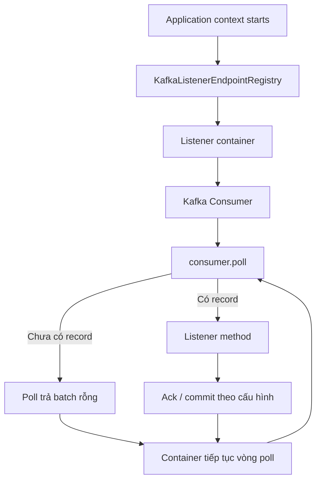

# ContainerProperties và poll timeout

Trong Spring Kafka, listener container quản lý vòng đời của Kafka consumer và gọi method được đánh dấu bằng `@KafkaListener`. Container quyết định consumer poll khi nào, giao record cho listener ra sao, xác nhận offset theo acknowledgement mode nào và dừng consumer như thế nào khi ứng dụng shutdown.

`ContainerProperties` là nơi cấu hình nhiều hành vi ở cấp listener container. Một thuộc tính quan trọng là `pollTimeout`: thời gian tối đa mà một lần gọi `consumer.poll()` chờ record khi hiện chưa có dữ liệu sẵn sàng. Hiểu đúng poll timeout và phân biệt nó với `max.poll.interval.ms` giúp cân bằng độ phản hồi, tải xử lý và tính ổn định của consumer group.

## 1. Listener container làm gì?

`@KafkaListener` không tự gọi Kafka consumer trực tiếp. Spring Kafka đăng ký endpoint của listener và tạo listener container để quản lý consumer ở phía dưới.

Luồng xử lý cơ bản:



Container đảm nhận các công việc chính:

- Tạo và quản lý Kafka consumer từ `ConsumerFactory`.
- Subscribe topic hoặc gán partition theo cấu hình.
- Gọi `poll()` để lấy record từ broker.
- Chuyển record đến listener theo record mode hoặc batch mode.
- Điều phối acknowledgement, commit offset và error handler.
- Quản lý pause/resume, rebalance và shutdown.
- Phát các application event phục vụ quan sát trạng thái container.

Vì vậy, cấu hình consumer và cấu hình container là hai lớp liên quan nhưng khác nhau. `spring.kafka.consumer.*` cấu hình Kafka client; `ContainerProperties` điều khiển cách Spring Kafka container vận hành client đó.

## 2. Hai loại listener container

Spring Kafka có hai loại container thường gặp:

| Loại | Vai trò | Cách dùng |
|---|---|---|
| `KafkaMessageListenerContainer` | Một container quản lý một Kafka consumer trên một thread | Phù hợp khi cần một consumer hoặc tự tạo container |
| `ConcurrentMessageListenerContainer` | Container cha tạo và quản lý nhiều child container, mỗi child có consumer riêng | Thường được dùng bởi `ConcurrentKafkaListenerContainerFactory` cho `@KafkaListener` |

Khi dùng `@KafkaListener`, Spring Boot thường cung cấp một `ConcurrentKafkaListenerContainerFactory` mặc định. Factory tạo container cho từng listener endpoint. Có thể cấu hình concurrency để một listener có nhiều consumer thread.

Ví dụ listener:

```java
import org.springframework.kafka.annotation.KafkaListener;
import org.springframework.stereotype.Component;

@Component
class OrderListener {

    @KafkaListener(
            id = "ordersListener",
            topics = "orders",
            groupId = "orders-service"
    )
    public void onOrder(OrderCreated event) {
        orderService.process(event);
    }
}
```

Khi application context khởi động, endpoint được đăng ký và container bắt đầu chạy theo lifecycle của ứng dụng. Listener method được gọi khi container poll được record và chuyển record qua message conversion/deserialization phù hợp.

## 3. ContainerProperties là gì?

`ContainerProperties` chứa các thiết lập áp dụng cho listener container. Có thể cấu hình nó trực tiếp hoặc thông qua container factory.

Một số nhóm thiết lập quan trọng:

| Nhóm | Ví dụ thuộc tính | Tác dụng |
|---|---|---|
| Polling | `pollTimeout` | Thời gian chờ tối đa trong một lần poll |
| Acknowledgement | `ackMode`, `ackCount`, `ackTime` | Xác định khi nào container commit offset |
| Commit | `syncCommits`, `syncCommitTimeout` | Điều khiển cách commit và timeout của synchronous commit |
| Idle | `idleEventInterval`, `idleBetweenPolls` | Theo dõi hoặc điều tiết khoảng nghỉ khi không có record |
| Lifecycle | `shutdownTimeout` | Điều khiển thời gian chờ khi shutdown |
| Topic/partition | Topic, pattern hoặc partition assignment | Xác định nguồn record container đọc |
| Transaction/error | Transaction manager, error handling liên quan | Phối hợp xử lý lỗi và giao dịch theo cấu hình |

Không phải mọi thuộc tính đều cần thay đổi. Nên giữ mặc định khi chúng đáp ứng yêu cầu, sau đó chỉ điều chỉnh điểm có mục tiêu vận hành cụ thể.

`ContainerProperties` không phải nơi thay thế toàn bộ Kafka consumer properties. Ví dụ:

- `pollTimeout` là cấu hình của Spring Kafka container.
- `max.poll.interval.ms` và `max.poll.records` là cấu hình Kafka consumer.
- `group.id` xác định consumer group.
- `enable.auto.commit` là cấu hình consumer client; Spring Kafka thường quản lý commit qua container và khuyến nghị tắt auto commit.

## 4. Poll timeout là gì?

Kafka consumer lấy dữ liệu bằng phương thức `poll(Duration)`. Container gọi phương thức này trong vòng lặp đọc dữ liệu. `pollTimeout` đặt thời gian tối đa cho một lần poll chờ dữ liệu khi hiện không có record sẵn sàng.

Ví dụ đặt poll timeout bằng 2 giây:

```java
containerProperties.setPollTimeout(2_000L);
```

Đơn vị của API `ContainerProperties.setPollTimeout(long)` là milliseconds. Trong nhiều phiên bản Spring Kafka, giá trị mặc định là 5 giây nếu ứng dụng không cấu hình khác.

Cần hiểu ba điểm:

1. Nếu record đã sẵn sàng, `poll()` có thể trả về trước khi hết timeout.
2. Nếu không có record, poll có thể chờ đến hết khoảng thời gian cấu hình rồi trả về batch rỗng.
3. Timeout này chỉ giới hạn thời gian chờ của một lần poll; nó không giới hạn thời gian listener xử lý record.

`pollTimeout` không phải lịch chạy cố định kiểu “cứ mỗi 2 giây mới đọc một lần”. Container liên tục lặp lại poll sau khi hoàn tất xử lý batch hiện tại. Khi có dữ liệu, consumer có thể nhận dữ liệu sớm hơn timeout.

## 5. Điều chỉnh poll timeout ảnh hưởng điều gì?

Giá trị timeout ảnh hưởng đến vòng lặp poll khi không có dữ liệu:

| Giá trị | Hành vi khi topic đang rỗng | Điểm cần cân nhắc |
|---|---|---|
| Ngắn, ví dụ 100–300 ms | Poll kết thúc thường xuyên hơn khi không có record | Tăng số lần poll rỗng và overhead vòng lặp |
| Vừa, ví dụ 1–3 giây | Chờ một khoảng vừa phải trước khi poll tiếp | Thường là điểm bắt đầu hợp lý để thử nghiệm |
| Dài, ví dụ 5–10 giây | Một lần poll rỗng có thể chờ lâu hơn | Ít vòng poll rỗng hơn; cần đánh giá mục tiêu phản hồi và các khoảng chờ khác |

Không nên kết luận timeout dài sẽ luôn làm record mới đến listener chậm đúng bằng timeout. Khi dữ liệu đến, Kafka consumer có thể được đánh thức và poll trả dữ liệu trước khi hết thời gian chờ. Độ trễ thực tế còn phụ thuộc broker fetch, mạng, consumer processing, scheduling và các cấu hình Kafka khác.

Một timeout rất ngắn thường không làm consumer xử lý record nhanh hơn một cách đáng kể nếu bottleneck nằm ở database, network hoặc listener. Ngược lại, nó có thể tạo nhiều poll rỗng hơn khi không có dữ liệu.

Hãy chọn giá trị dựa trên phép đo: tốc độ xử lý, độ trễ nhận record, số lần poll rỗng, consumer lag và tải broker.

## 6. Cấu hình poll timeout bằng Spring Boot

Nếu dùng listener container factory mặc định do Spring Boot auto-configuration tạo, có thể đặt poll timeout trong `application.yml`:

```yaml
spring:
  kafka:
    bootstrap-servers: localhost:9092
    consumer:
      group-id: orders-service
      enable-auto-commit: false
      max-poll-records: 100
      properties:
        "[max.poll.interval.ms]": 300000
    listener:
      poll-timeout: 2s
      ack-mode: record
      concurrency: 3
```

Ý nghĩa:

- `spring.kafka.listener.poll-timeout` đặt thời gian chờ của container cho mỗi lần poll.
- `ack-mode: record` yêu cầu container xác nhận theo từng record sau khi listener xử lý xong.
- `concurrency: 3` yêu cầu container tạo tối đa ba consumer child cho listener tương ứng.
- `spring.kafka.consumer.properties["max.poll.interval.ms"]` đặt giới hạn thời gian giữa các lần gọi poll theo cấu hình Kafka consumer.
- `max-poll-records` giới hạn số record tối đa trả về trong một lần poll.

Tên thuộc tính Boot được bind theo phiên bản Spring Boot đang dùng. Nếu ứng dụng khai báo factory tùy chỉnh, hãy kiểm tra factory đó có nhận các thuộc tính từ Boot hay chưa.

## 7. Cấu hình ContainerProperties trong custom factory

Khi cần cấu hình riêng cho một nhóm listener, có thể tạo container factory riêng. Dùng configurer của Spring Boot để kế thừa các thuộc tính chung trước, sau đó ghi đè những thiết lập riêng của factory:

```java
import org.springframework.boot.autoconfigure.kafka.ConcurrentKafkaListenerContainerFactoryConfigurer;
import org.springframework.context.annotation.Bean;
import org.springframework.context.annotation.Configuration;
import org.springframework.kafka.config.ConcurrentKafkaListenerContainerFactory;
import org.springframework.kafka.listener.ContainerProperties;
import org.springframework.kafka.core.ConsumerFactory;

@Configuration
class OrderListenerConfiguration {

    @Bean("ordersListenerFactory")
    ConcurrentKafkaListenerContainerFactory<String, OrderCreated>
    ordersListenerFactory(
            ConcurrentKafkaListenerContainerFactoryConfigurer configurer,
            ConsumerFactory<String, OrderCreated> consumerFactory) {

        var factory =
                new ConcurrentKafkaListenerContainerFactory<String, OrderCreated>();

        configurer.configure(factory, consumerFactory);

        factory.setConcurrency(3);
        factory.getContainerProperties()
                .setPollTimeout(2_000L);
        factory.getContainerProperties()
                .setAckMode(ContainerProperties.AckMode.RECORD);

        return factory;
    }
}
```

Listener chọn factory bằng tên:

```java
@KafkaListener(
        id = "ordersListener",
        topics = "orders",
        groupId = "orders-service",
        containerFactory = "ordersListenerFactory"
)
public void onOrder(OrderCreated event) {
    orderService.process(event);
}
```

`configurer.configure(factory, consumerFactory)` áp dụng cấu hình Boot cho factory. Những thiết lập gọi sau đó như `setPollTimeout()` hoặc `setAckMode()` sẽ ghi đè giá trị tương ứng cho factory này. Nhờ đó, các listener khác vẫn có thể dùng factory mặc định với timeout khác.

Nếu tự tạo factory mà không dùng configurer, ứng dụng phải tự cấu hình consumer factory, converter, error handler, acknowledgement mode và các thành phần cần thiết khác. Tránh bỏ sót cấu hình chung về bảo mật hoặc deserializer.

## 8. Cấu hình ContainerProperties trực tiếp

Ngoài factory, có thể tạo `ContainerProperties` trực tiếp khi tự quản lý container:

```java
import org.springframework.kafka.listener.ContainerProperties;
import org.springframework.kafka.listener.KafkaMessageListenerContainer;
import org.springframework.kafka.listener.MessageListener;
import org.springframework.kafka.core.ConsumerFactory;

ContainerProperties properties =
        new ContainerProperties("orders");

properties.setPollTimeout(2_000L);
properties.setAckMode(ContainerProperties.AckMode.RECORD);

properties.setMessageListener(
        (MessageListener<String, OrderCreated>)
                record -> orderService.process(record.value())
);

KafkaMessageListenerContainer<String, OrderCreated> container =
        new KafkaMessageListenerContainer<>(consumerFactory, properties);
container.start();
```

Constructor trên tạo container cho topic `orders`. Ví dụ đăng ký listener rồi start container; ứng dụng phải tự quản lý việc dừng container khi lifecycle kết thúc. Với ứng dụng dùng `@KafkaListener`, cấu hình qua factory thường tự nhiên hơn vì Spring quản lý endpoint và lifecycle.

`ContainerProperties` cũng có thể nhận topic pattern hoặc danh sách `TopicPartitionOffset` nếu ứng dụng cần subscription/assignment tường minh. Khi tự chỉ định partition, cần hiểu tác động đến consumer group và cơ chế rebalance; không nên trộn subscribe và assign theo cách không phù hợp với thiết kế.

## 9. Phân biệt pollTimeout với max.poll.interval.ms

Đây là hai cấu hình rất dễ nhầm:

| Thuộc tính | Nằm ở đâu? | Ý nghĩa |
|---|---|---|
| `pollTimeout` | Spring Kafka `ContainerProperties` | Thời gian tối đa một lần poll chờ dữ liệu |
| `max.poll.interval.ms` | Kafka consumer config | Thời gian tối đa giữa hai lần gọi `poll()` trước khi consumer bị xem là không còn tiến triển |
| `max.poll.records` | Kafka consumer config | Số record tối đa trả về trong một lần poll |
| `fetch.max.wait.ms` | Kafka consumer config | Thời gian broker có thể chờ để đáp ứng fetch request theo các điều kiện fetch |

Ví dụ consumer poll được 100 record và listener mất 4 phút để xử lý toàn bộ batch. Nếu `max.poll.interval.ms` chỉ là 3 phút, consumer có thể vượt quá khoảng thời gian cho phép giữa hai lần poll, rời group và gây rebalance.

Tăng hoặc giảm `pollTimeout` không giải quyết được listener xử lý quá lâu. Cần xem xét:

- Giảm số record mỗi poll bằng `max.poll.records` nếu batch quá lớn.
- Tăng `max.poll.interval.ms` khi thời gian xử lý dài là yêu cầu hợp lệ và đã được đo.
- Tối ưu database/network hoặc chia nhỏ công việc xử lý.
- Dùng mô hình xử lý bất đồng bộ có kiểm soát, bảo đảm không commit offset trước khi công việc hoàn tất.
- Tách topic/partition hoặc consumer group theo nhu cầu throughput.

Nguyên tắc vận hành là tổng thời gian xử lý batch và các khoảng chờ giữa hai lần poll phải nằm trong giới hạn poll interval với biên an toàn. Không đặt `max.poll.interval.ms` tùy tiện quá lớn để che giấu listener bị treo.

## 10. Poll timeout không phải thời gian xử lý listener

Một chu kỳ có thể diễn ra như sau:

```text
poll(2 seconds)
    -> nhận 20 records
listener xử lý 20 records
    -> mất 8 seconds
container commit offset theo ack mode
poll(2 seconds)
    -> chờ dữ liệu tiếp theo nếu topic đang rỗng
```

Trong ví dụ, listener mất 8 giây xử lý batch. `pollTimeout=2s` không hủy hoặc giới hạn 8 giây xử lý đó. Khoảng xử lý nằm giữa hai lần poll và được tính vào thời gian mà consumer không gọi poll tiếp theo.

Nếu xử lý kéo dài, hãy kiểm tra `max.poll.interval.ms` và kích thước batch. Nếu cần giới hạn thời gian gọi database hoặc HTTP, hãy cấu hình timeout ở chính client hoặc service tương ứng, không dùng poll timeout.

## 11. Acknowledgement mode là thiết lập riêng

`ContainerProperties` còn quản lý cách xác nhận offset. Poll timeout không quyết định khi nào commit.

Các mode thường gặp:

| Ack mode | Thời điểm commit | Phù hợp với |
|---|---|---|
| `RECORD` | Sau khi listener xử lý xong từng record | Xử lý từng record, muốn commit theo record |
| `BATCH` | Sau khi toàn bộ batch từ poll được xử lý | Batch listener hoặc xử lý theo poll |
| `TIME` | Khi đủ khoảng thời gian cấu hình và điều kiện xử lý | Commit theo thời gian |
| `COUNT` | Khi đủ số record được xử lý | Commit theo số lượng |
| `COUNT_TIME` | Khi đạt ngưỡng thời gian hoặc số lượng | Cân bằng tần suất commit |
| `MANUAL` | Listener gọi `Acknowledgment.acknowledge()`; container commit theo semantics của mode | Ứng dụng cần chủ động xác nhận |
| `MANUAL_IMMEDIATE` | Xác nhận ngay khi listener gọi acknowledge trên consumer thread | Cần kiểm soát thời điểm commit sát với xử lý |

`BATCH` thường là mode mặc định của listener container. Với listener xử lý từng record, có thể chọn `RECORD` để commit sau từng lần listener thành công. Với manual mode, listener phải chỉ gọi acknowledge sau khi công việc tương ứng đã hoàn tất.

Ví dụ:

```java
import org.springframework.kafka.annotation.KafkaListener;
import org.springframework.kafka.support.Acknowledgment;

@KafkaListener(
        topics = "orders",
        groupId = "orders-service",
        containerFactory = "manualOrdersListenerFactory"
)
public void onOrder(
        OrderCreated event,
        Acknowledgment acknowledgment) {

    orderService.process(event);
    acknowledgment.acknowledge();
}
```

Listener trên phải dùng container factory được cấu hình ở mode `MANUAL`. Ví dụ factory riêng:

```java
import org.springframework.boot.autoconfigure.kafka.ConcurrentKafkaListenerContainerFactoryConfigurer;
import org.springframework.context.annotation.Bean;
import org.springframework.kafka.config.ConcurrentKafkaListenerContainerFactory;
import org.springframework.kafka.core.ConsumerFactory;
import org.springframework.kafka.listener.ContainerProperties;

@Bean("manualOrdersListenerFactory")
ConcurrentKafkaListenerContainerFactory<String, OrderCreated>
manualOrdersListenerFactory(
        ConcurrentKafkaListenerContainerFactoryConfigurer configurer,
        ConsumerFactory<String, OrderCreated> consumerFactory) {

    var factory =
            new ConcurrentKafkaListenerContainerFactory<String, OrderCreated>();
    configurer.configure(factory, consumerFactory);
    factory.getContainerProperties()
            .setAckMode(ContainerProperties.AckMode.MANUAL);
    return factory;
}
```

Listener đã chọn `manualOrdersListenerFactory`, được cấu hình ở mode `MANUAL`. Không dùng factory ở ví dụ trước nếu factory đó đang cấu hình `AckMode.RECORD`.

Nếu `process()` thất bại trước khi acknowledge, offset chưa được xác nhận qua đoạn code này; container/error handler có thể retry hoặc phục hồi theo cấu hình. Thiết kế xử lý vẫn cần idempotency vì record chưa commit có thể được giao lại.

Với các mode `TIME`, `COUNT` và `COUNT_TIME`, có thể dùng `ackTime` và `ackCount` để đặt ngưỡng tương ứng. Những ngưỡng này điều khiển commit, không điều khiển thời gian chờ poll.

## 12. Concurrency và số partition

`ConcurrentMessageListenerContainer` tạo nhiều child container. Mỗi child có consumer riêng và thực thi listener trên consumer thread của nó.

Ví dụ cấu hình concurrency bằng 3:

```java
factory.setConcurrency(3);
```

Nếu topic có 6 partition, ba consumer trong cùng group có thể được gán khoảng hai partition mỗi consumer tùy assignor và trạng thái group. Nếu topic chỉ có 2 partition, tối đa hai consumer có thể nhận partition trong cùng group tại một thời điểm; consumer dư có thể không được gán partition.

Concurrency ảnh hưởng đến số luồng xử lý song song, không thay đổi thời gian chờ của mỗi lần poll. Khi tăng concurrency, hãy kiểm tra:

- Số partition và cách partition được phân bổ.
- Năng lực xử lý của database và downstream service.
- Số producer/consumer connection đến broker.
- Consumer lag theo từng partition.
- Rebalance khi instance khởi động hoặc dừng.

Đừng tăng concurrency chỉ để giảm poll timeout. Hai thiết lập giải quyết hai khía cạnh khác nhau.

## 13. Idle, pause/resume và shutdown

Khi topic không có record, container vẫn tiếp tục poll theo vòng lặp. Có một số thiết lập khác hỗ trợ vận hành:

- `idleEventInterval` có thể phát sự kiện idle khi container không nhận record trong khoảng thời gian cấu hình; ứng dụng dùng event để quan sát listener đang rảnh.
- `idleBetweenPolls` tạo khoảng nghỉ giữa các lần poll trong một số cấu hình; khoảng nghỉ này cũng cần được tính khi xem xét `max.poll.interval.ms`.
- Container hỗ trợ pause/resume để tạm ngừng nhận record trong khi vẫn duy trì quản lý consumer group theo cơ chế của Kafka.
- `shutdownTimeout` điều khiển thời gian container chờ hoàn tất khi dừng, giúp ứng dụng shutdown có trật tự.

Có thể điều khiển container bằng `KafkaListenerEndpointRegistry` nếu listener có ID:

```java
import org.springframework.kafka.config.KafkaListenerEndpointRegistry;
import org.springframework.stereotype.Service;

@Service
class ListenerControlService {

    private final KafkaListenerEndpointRegistry registry;

    ListenerControlService(KafkaListenerEndpointRegistry registry) {
        this.registry = registry;
    }

    void pauseOrders() {
        var container = registry.getListenerContainer("ordersListener");
        if (container != null) {
            container.pause();
        }
    }

    void resumeOrders() {
        var container = registry.getListenerContainer("ordersListener");
        if (container != null) {
            container.resume();
        }
    }
}
```

Pause/resume là điều khiển container, không phải thay đổi committed offset. Khi pause, cần quan sát trạng thái và lag để tránh hiểu nhầm rằng consumer đã mất kết nối hoặc bị lỗi.

## 14. Theo dõi container và poll behavior

Khi điều tra listener không nhận record hoặc xử lý chậm, hãy quan sát nhiều lớp:

| Dấu hiệu | Cần kiểm tra |
|---|---|
| Listener không được gọi | Topic, partition assignment, ACL, consumer group và trạng thái pause |
| Poll thường xuyên trả batch rỗng | Producer rate, topic có thực sự có dữ liệu, poll timeout và fetch behavior |
| Consumer lag tăng | Thời gian xử lý listener, số record mỗi poll, concurrency và downstream |
| Group liên tục rebalance | `max.poll.interval.ms`, listener processing time, network và membership |
| Shutdown mất nhiều thời gian | Listener đang xử lý, shutdown timeout và cách dừng container |
| Không có idle event | `idleEventInterval`, subscription và cấu hình event listener |

Có thể lắng nghe sự kiện idle của Spring Kafka để biết listener không nhận record trong một khoảng thời gian:

```java
import org.springframework.context.event.EventListener;
import org.springframework.kafka.event.ListenerContainerIdleEvent;
import org.springframework.stereotype.Component;

@Component
class ListenerIdleMonitor {

    @EventListener
    public void onIdle(ListenerContainerIdleEvent event) {
        log.info(
                "Listener idle: listenerId={}, idleTime={}ms, topicPartitions={}",
                event.getListenerId(),
                event.getIdleTime(),
                event.getTopicPartitions()
        );
    }
}
```

Sự kiện idle không nhất thiết có nghĩa consumer lỗi. Có thể topic đơn giản là chưa có dữ liệu. Hãy kết hợp idle event với producer rate, lag, assignment và broker health để đưa ra kết luận.

## 15. Những lỗi thường gặp

| Hiện tượng | Nguyên nhân có thể | Cách xử lý |
|---|---|---|
| Giảm poll timeout nhưng listener vẫn xử lý chậm | Bottleneck nằm ở listener hoặc downstream | Đo thời gian xử lý, tối ưu dependency và batch size |
| Consumer rời group dù poll timeout ngắn | Listener xử lý lâu vượt `max.poll.interval.ms` | Kiểm tra poll interval, max poll records và processing time |
| Topic rỗng tạo nhiều poll rỗng | Poll timeout quá ngắn hoặc không cần thiết | Tăng timeout vừa phải và theo dõi idle behavior |
| Tăng timeout làm tưởng rằng consumer bị treo | Poll đang chờ dữ liệu, listener chưa được gọi | Kiểm tra topic rate, assignment và idle event |
| Custom factory không nhận cấu hình Boot | Factory được tạo nhưng không dùng configurer hoặc không bind thuộc tính | Dùng `ConcurrentKafkaListenerContainerFactoryConfigurer` hoặc cấu hình đầy đủ |
| Offset commit không như mong muốn | Ack mode khác kỳ vọng hoặc listener xác nhận sai thời điểm | Kiểm tra `ContainerProperties.AckMode` và luồng acknowledge |
| Consumer không tăng throughput khi tăng concurrency | Số partition thấp hoặc downstream đã bão hòa | Kiểm tra partition assignment và bottleneck |
| Shutdown chậm | Listener đang xử lý hoặc shutdown timeout quá lớn | Đo thời gian xử lý, cấu hình graceful shutdown phù hợp |

## 16. Checklist cấu hình listener container

1. Xác định listener cần record mode hay batch mode.
2. Bắt đầu với poll timeout phù hợp; không xem nó là processing timeout.
3. Cấu hình `max.poll.interval.ms` dựa trên thời gian xử lý batch có đo lường.
4. Chọn `max.poll.records` để giới hạn lượng công việc mỗi poll.
5. Chọn ack mode theo yêu cầu commit và khả năng xử lý lặp.
6. Đặt concurrency dựa trên số partition và năng lực downstream.
7. Dùng custom container factory khi một nhóm listener cần cấu hình riêng.
8. Dùng `KafkaListenerEndpointRegistry` để quản lý pause/resume khi có nhu cầu vận hành.
9. Theo dõi idle event, lag, rebalance và thời gian xử lý listener.
10. Kiểm tra shutdown behavior để tránh dừng ứng dụng khi còn công việc chưa hoàn tất.

`ContainerProperties` điều khiển hành vi của Spring Kafka listener container; `pollTimeout` là thời gian chờ tối đa cho một lần poll. Khi cấu hình nó cùng acknowledgement mode, concurrency và các giới hạn của Kafka consumer như `max.poll.interval.ms`, ứng dụng có thể vận hành listener ổn định và giải thích rõ vì sao consumer đang chờ dữ liệu, xử lý chậm hoặc bị rebalance.
