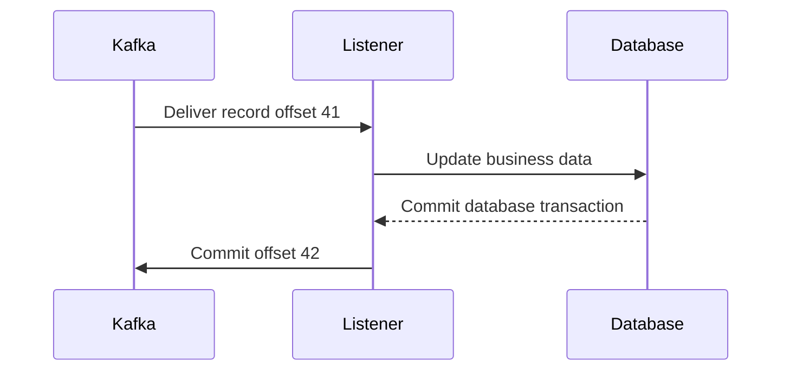

# AckMode MANUAL

Trong Spring Kafka, listener container quản lý việc commit offset của consumer. Với `AckMode.MANUAL`, ứng dụng chủ động xác nhận một record đã được xử lý bằng cách gọi `Acknowledgment.acknowledge()` trong phương thức listener. Container nhận tín hiệu này và commit offset theo quy tắc của chế độ manual.

Chế độ này phù hợp khi ứng dụng chỉ muốn tiến độ consumer được ghi nhận sau khi một bước xử lý nghiệp vụ cụ thể hoàn tất, ví dụ lưu dữ liệu vào database hoặc hoàn thành một thao tác quan trọng. Tuy nhiên, manual acknowledgment không tự tạo giao dịch nguyên tử giữa Kafka và database, cũng không tự bảo đảm xử lý đúng một lần. Cần hiểu chính xác thời điểm commit và thiết kế xử lý lặp an toàn.

Các ví dụ trong bài dùng một event và application service đơn giản:

```java
import java.math.BigDecimal;
import java.time.Instant;

public record OrderCreatedEvent(
        String eventId,
        String orderId,
        BigDecimal total,
        Instant occurredAt
) {}

public interface OrderApplicationService {
    void apply(OrderCreatedEvent event);
}
```

## 1. Offset và acknowledgment trong Kafka

Kafka consumer đọc record theo offset trong từng partition. Sau khi xử lý, consumer commit offset để ghi nhận vị trí tiếp tục đọc cho consumer group.

Một điểm dễ nhầm: consumer commit **offset kế tiếp cần đọc**, không phải offset của record vừa xử lý. Ví dụ, nếu record có offset `41` đã xử lý thành công, offset commit thường là `42`.

```text
Partition orders-0

offset:       40       41       42       43
record:     event-A  event-B  event-C  event-D
                       |
                       +-- xử lý thành công
                           commit offset 42

Lần đọc tiếp theo bắt đầu từ offset 42
```

Acknowledgment trong Spring Kafka là tín hiệu từ listener đến container rằng tiến độ xử lý đã đạt tới một điểm có thể commit. Nó không phải một ACK message riêng được gửi về broker cho từng record, và cũng không xóa record khỏi topic. Kafka vẫn giữ record theo retention hoặc cleanup policy của topic.

## 2. `AckMode.MANUAL` hoạt động như thế nào?

Spring Kafka có nhiều chế độ acknowledgment. Một số chế độ thường gặp:

| AckMode | Thời điểm commit |
|---|---|
| `RECORD` | Sau khi listener xử lý xong từng record |
| `BATCH` | Sau khi listener xử lý xong tất cả record nhận trong một lần poll |
| `MANUAL` | Listener gọi `acknowledge()`; offset được đưa vào hàng đợi và commit sau khi tất cả record của poll đã được xử lý |
| `MANUAL_IMMEDIATE` | Commit ngay khi `acknowledge()` được gọi trên consumer thread; nếu gọi từ thread khác, việc commit được xử lý theo cơ chế của container |

Điểm quan trọng của `MANUAL` là lời gọi `acknowledge()` chưa nhất thiết làm broker nhận commit ngay tại dòng code đó. Container gom các acknowledgment và commit theo ranh giới poll sau khi các record tương ứng đã được xử lý.

`MANUAL_IMMEDIATE` phù hợp khi cần yêu cầu commit ngay tại thời điểm listener xác nhận, nhưng cần gọi trên consumer thread để có semantics tức thời. Nếu gọi acknowledgment từ thread khác, không nên giả định commit đã xảy ra ngay khi phương thức đó trả về.

Chọn `MANUAL` khi muốn listener quyết định record nào đủ điều kiện xác nhận nhưng vẫn để container quản lý commit theo poll. Chọn `MANUAL_IMMEDIATE` khi cần semantics commit tức thời tại callback và hiểu rõ ràng buộc thread.

## 3. Cấu hình listener container dùng `MANUAL`

Có thể cấu hình acknowledgment mode trong `ConcurrentKafkaListenerContainerFactory`:

```java
import org.springframework.context.annotation.Bean;
import org.springframework.context.annotation.Configuration;
import org.springframework.kafka.config.ConcurrentKafkaListenerContainerFactory;
import org.springframework.kafka.listener.ContainerProperties;
import org.springframework.kafka.listener.CommonErrorHandler;
import org.springframework.kafka.core.ConsumerFactory;

@Configuration
public class ManualAckKafkaConfiguration {

    @Bean
    public ConcurrentKafkaListenerContainerFactory<String, OrderCreatedEvent>
            manualAckKafkaListenerContainerFactory(
                    ConsumerFactory<String, OrderCreatedEvent> consumerFactory,
                    CommonErrorHandler errorHandler) {

        var factory = new ConcurrentKafkaListenerContainerFactory<
                String, OrderCreatedEvent>();
        factory.setConsumerFactory(consumerFactory);
        factory.getContainerProperties().setAckMode(
                ContainerProperties.AckMode.MANUAL
        );
        factory.setCommonErrorHandler(errorHandler);
        return factory;
    }
}
```

Sau đó chỉ định factory cho listener cần manual acknowledgment:

```java
import org.springframework.kafka.annotation.KafkaListener;
import org.springframework.kafka.support.Acknowledgment;
import org.springframework.stereotype.Component;

@Component
public class OrderCreatedListener {

    private final OrderApplicationService orderService;

    public OrderCreatedListener(OrderApplicationService orderService) {
        this.orderService = orderService;
    }

    @KafkaListener(
            id = "ordersManualListener",
            topics = "orders.created",
            groupId = "orders-projection",
            containerFactory = "manualAckKafkaListenerContainerFactory"
    )
    public void onMessage(
            OrderCreatedEvent event,
            Acknowledgment acknowledgment) {

        orderService.apply(event);
        acknowledgment.acknowledge();
    }
}
```

Thứ tự thực hiện có chủ đích: gọi application service trước, chỉ gọi `acknowledge()` sau khi xử lý hoàn tất. Nếu `orderService.apply(event)` ném exception, dòng xác nhận không được chạy và lỗi được chuyển cho error handler của listener container.

## 4. Cấu hình qua Spring Boot

Với cấu hình mặc định của Spring Boot, có thể đặt acknowledgment mode trong `application.yml`:

```yaml
spring:
  kafka:
    bootstrap-servers: ${KAFKA_BOOTSTRAP_SERVERS:localhost:9092}
    consumer:
      group-id: orders-projection
      enable-auto-commit: false
      auto-offset-reset: earliest
    listener:
      ack-mode: manual
```

`enable-auto-commit` nên để `false` khi muốn Spring Kafka container quản lý commit dựa trên acknowledgment mode. Spring Kafka mặc định tắt auto commit nếu ứng dụng không cấu hình bật nó; khai báo rõ trong cấu hình giúp ý định dễ đọc hơn.

Nếu ứng dụng tạo listener container factory riêng, hãy đặt `AckMode` trên đúng factory mà listener sử dụng. Cấu hình `spring.kafka.listener.ack-mode` không tự động ghi đè mọi factory tùy chỉnh do ứng dụng tự tạo.

## 5. Điều gì xảy ra khi xử lý thành công hoặc thất bại?

### Xử lý thành công

Luồng thông thường:

1. Container poll record từ Kafka.
2. Spring Kafka deserialize record và gọi listener.
3. Listener chuyển event cho application service xử lý.
4. Khi nghiệp vụ hoàn tất, listener gọi `acknowledgment.acknowledge()`.
5. Container ghi nhận acknowledgment và commit offset theo semantics của `MANUAL`.

### Xử lý thất bại

Nếu nghiệp vụ ném exception trước khi gọi `acknowledge()`, record chưa được listener xác nhận. Exception được chuyển đến error handler của container. Tùy cấu hình retry, backoff, recovery và commit recovered offset, record có thể được xử lý lại hoặc chuyển sang dead-letter topic.

Không nên bắt exception rồi vẫn gọi `acknowledge()` trong khối `finally`. Cách đó có thể commit offset ngay cả khi nghiệp vụ thất bại, làm record bị bỏ qua ở lần đọc tiếp theo.

Ví dụ xử lý lỗi có chủ đích:

```java
@KafkaListener(
        topics = "orders.created",
        groupId = "orders-projection",
        containerFactory = "manualAckKafkaListenerContainerFactory"
)
public void onMessage(
        OrderCreatedEvent event,
        Acknowledgment acknowledgment) {

    try {
        orderService.apply(event);
        acknowledgment.acknowledge();
    } catch (RuntimeException exception) {
        // Không acknowledge; để container error handler xử lý retry/recovery.
        throw exception;
    }
}
```

Khối `catch` trong ví dụ chỉ minh họa việc truyền lỗi trở lại container; nếu không cần ghi log hoặc bổ sung context, có thể bỏ `try/catch` và để exception tự truyền ra ngoài.

## 6. Manual acknowledgment không đồng nghĩa exactly-once

Giả sử listener xử lý một event bằng cách cập nhật database rồi commit Kafka offset. Có một khoảng thời gian giữa hai thao tác:



Nếu ứng dụng dừng sau khi database commit nhưng trước khi Kafka offset commit, Kafka có thể giao lại record `41` sau khi consumer khởi động lại. Database khi đó có thể nhận cùng event lần thứ hai.

Vì vậy, `AckMode.MANUAL` thường hỗ trợ at-least-once processing khi được cấu hình phù hợp; nó không tự bảo đảm exactly-once cho side effect bên ngoài Kafka. Các cách giảm tác động xử lý lặp gồm:

- Thiết kế handler idempotent, ví dụ lưu `eventId` đã xử lý với unique constraint.
- Dùng transaction ở database để cập nhật dữ liệu và bảng inbox/idempotency trong cùng giao dịch.
- Với luồng Kafka-to-Kafka, cân nhắc Kafka transaction và cấu hình transaction-aware listener container để commit output records cùng consumer offsets trong một Kafka transaction.
- Nếu phải đồng bộ database và Kafka, đánh giá transactional outbox/inbox thay vì giả định hai commit độc lập là nguyên tử.

Manual acknowledgment quyết định thời điểm container được phép commit offset; nó không thay thế thiết kế transaction hoặc idempotency của nghiệp vụ.

## 7. Poll batch, nhiều record và concurrency

Với `AckMode.MANUAL`, cần nhớ rằng container quản lý acknowledgment theo các record được poll. Nếu một lần poll trả về nhiều record, listener có thể được gọi nhiều lần trước khi container hoàn tất chu kỳ poll. Các acknowledgment được ghi nhận và commit theo quy tắc manual sau khi các record của poll đã được xử lý.

Nếu listener chạy concurrency lớn hơn một, mỗi consumer thread có consumer và tiến độ riêng. Acknowledgment cần gắn với record được xử lý bởi listener tương ứng; không chia sẻ đối tượng `Acknowledgment` tùy tiện giữa các thread.

Với xử lý bất đồng bộ, không gọi `acknowledge()` từ executor tùy ý rồi giả định container đã commit theo cùng thứ tự. Nếu cần xác nhận ngoài consumer thread hoặc xử lý kết quả out-of-order, hãy tìm hiểu `asyncAcks` và giới hạn của phiên bản Spring Kafka đang dùng; cấu hình này có thể khiến container pause việc nhận record cho đến khi các acknowledgment còn thiếu được hoàn tất.

Không tăng `max.poll.records` hoặc thời gian xử lý mà bỏ qua `max.poll.interval.ms`. Nếu xử lý một batch quá lâu, consumer có thể bị xem là không poll đúng hạn và rời group, dẫn đến rebalance. Manual ack không loại bỏ giới hạn thời gian poll.

## 8. Kết hợp retry và dead-letter

Manual acknowledgment và error handling giải quyết hai phần khác nhau:

- Acknowledgment cho biết listener đã xử lý đến đâu và container có thể commit offset nào.
- Error handler quyết định cách xử lý khi listener ném exception: retry, backoff, bỏ qua hoặc chuyển record sang dead-letter topic.

Ví dụ minh họa khai báo `DefaultErrorHandler` với backoff:

```java
import org.springframework.context.annotation.Bean;
import org.springframework.context.annotation.Configuration;
import org.springframework.kafka.listener.DefaultErrorHandler;
import org.springframework.util.backoff.FixedBackOff;

@Configuration
public class KafkaErrorConfiguration {

    @Bean
    public DefaultErrorHandler kafkaErrorHandler() {
        return new DefaultErrorHandler(
                new FixedBackOff(1_000L, 2L)
        );
    }
}
```

Ví dụ trên minh họa retry với khoảng nghỉ 1 giây và tối đa hai lần retry sau lần xử lý đầu tiên. Chính sách thực tế cần phân loại lỗi retryable/non-retryable và cấu hình recovery phù hợp. Nếu dùng `DeadLetterPublishingRecoverer`, cần bảo đảm producer factory/template có thể serialize record sang DLT và topic DLT có partition/config phù hợp.

Không tự acknowledge một record thất bại chỉ để tránh retry. Hãy để error handler quyết định kết quả recovery; khi recovery thành công và offset được commit, điều đó phải phù hợp với chính sách dữ liệu của ứng dụng.

## 9. `MANUAL` và `MANUAL_IMMEDIATE`: chọn chế độ nào?

| Tiêu chí | `MANUAL` | `MANUAL_IMMEDIATE` |
|---|---|---|
| Ai gọi acknowledgment? | Listener | Listener |
| Commit | Offset được xếp hàng, commit sau khi xử lý các record của poll | Commit ngay nếu acknowledgment được gọi trên consumer thread |
| Độ trễ commit | Có thể đợi đến cuối poll | Có thể thấp hơn |
| Phù hợp | Muốn kiểm soát record được xác nhận và để container gom commit | Cần yêu cầu commit ngay tại callback |
| Lưu ý | Không đồng nghĩa commit ngay tại dòng `acknowledge()` | Gọi từ thread khác không có semantics tức thời như gọi trên consumer thread |

Nếu không có yêu cầu rõ về commit ngay lập tức, `MANUAL` thường là lựa chọn dễ quản lý. Việc chọn `MANUAL_IMMEDIATE` không làm database và Kafka trở thành một giao dịch chung, cũng không tự ngăn duplicate processing khi ứng dụng dừng đột ngột.

## 10. Kiểm thử listener với `AckMode.MANUAL`

Kiểm thử nên xác minh cả thứ tự xử lý và hành vi commit:

- **Unit test listener:** mock application service và `Acknowledgment`; xác minh `acknowledge()` được gọi sau khi service xử lý thành công.
- **Failure test:** làm application service ném exception; xác minh listener không gọi acknowledgment.
- **Integration test:** dùng Embedded Kafka hoặc Testcontainers để gửi record, khởi động listener với `MANUAL`, rồi kiểm tra committed offset.
- **Restart test:** dừng consumer sau khi xử lý nhưng trước commit (nếu có thể mô phỏng), khởi động lại và xác minh record có thể được giao lại.
- **Retry/DLT test:** xác minh lỗi được retry đúng số lần và record được recovery theo chính sách.
- **Concurrency test:** xác minh mỗi consumer thread xử lý và acknowledgment đúng partition/record.

Trong unit test, ví dụ logic cơ bản:

```java
import static org.mockito.Mockito.inOrder;

import java.math.BigDecimal;
import java.time.Instant;

import org.junit.jupiter.api.Test;
import org.springframework.kafka.support.Acknowledgment;

class OrderCreatedListenerTest {

    @Test
    void acknowledgesAfterSuccessfulProcessing() {
        OrderApplicationService service = org.mockito.Mockito.mock(
                OrderApplicationService.class);
        Acknowledgment acknowledgment = org.mockito.Mockito.mock(
                Acknowledgment.class);
        OrderCreatedListener listener = new OrderCreatedListener(service);
        OrderCreatedEvent event = new OrderCreatedEvent(
                "evt-1",
                "order-1",
                new BigDecimal("1250000"),
                Instant.parse("2026-11-17T03:00:00Z")
        );

        listener.onMessage(event, acknowledgment);

        var inOrder = inOrder(service, acknowledgment);
        inOrder.verify(service).apply(event);
        inOrder.verify(acknowledgment).acknowledge();
    }
}
```

Đây là ví dụ kiểm tra thứ tự lời gọi ở cấp unit; integration test vẫn cần thiết để xác minh commit offset thực tế của container.

## 11. Những lỗi thường gặp

- **Gọi `acknowledge()` trước khi nghiệp vụ hoàn tất:** record có thể bị commit dù side effect thất bại.
- **Gọi acknowledgment trong `finally`:** vô tình xác nhận cả trường hợp xử lý lỗi.
- **Nhầm `MANUAL` với commit ngay lập tức:** `MANUAL` gom acknowledgment và commit theo poll; dùng `MANUAL_IMMEDIATE` nếu cần semantics tức thời.
- **Bật `enable.auto.commit`:** làm commit tự động của Kafka consumer xung đột với ý định để container quản lý acknowledgment.
- **Cho rằng acknowledgment xóa record khỏi topic:** record vẫn được giữ theo retention/compaction.
- **Cho rằng manual ack bảo đảm exactly-once:** database commit và Kafka offset commit có thể tách rời; cần idempotency hoặc transaction phù hợp.
- **Bắt exception rồi không rethrow nhưng cũng không có recovery:** container có thể xem listener đã hoàn tất tùy cách exception được xử lý; phải định nghĩa rõ retry/recovery.
- **Dùng `Acknowledgment` trên thread khác mà không cấu hình phù hợp:** có thể sai thứ tự hoặc hiểu nhầm thời điểm commit.
- **Không kiểm tra consumer lag và poll interval:** xử lý lâu vẫn có thể gây rebalance dù listener dùng manual ack.

## 12. Checklist khi sử dụng `AckMode.MANUAL`

- [ ] Listener dùng đúng container factory có `AckMode.MANUAL`.
- [ ] `enable.auto.commit` được tắt để container quản lý offset.
- [ ] Listener chỉ gọi `acknowledge()` sau khi xử lý nghiệp vụ thành công.
- [ ] Exception được chuyển đến error handler khi xử lý thất bại.
- [ ] Retry, backoff và dead-letter recovery được cấu hình theo loại lỗi.
- [ ] Handler idempotent hoặc có cơ chế chống xử lý lặp.
- [ ] Hiểu commit offset là offset kế tiếp cần đọc.
- [ ] Không chia sẻ `Acknowledgment` tùy tiện giữa các thread.
- [ ] Đánh giá `max.poll.interval.ms` và thời gian xử lý batch.
- [ ] Integration test xác minh committed offset và hành vi restart/retry.

`AckMode.MANUAL` trao cho listener quyền quyết định khi nào một record được xác nhận, trong khi container vẫn quản lý việc commit offset theo chu kỳ poll. Đặt lời gọi acknowledgment sau bước xử lý thành công, kết hợp error handler và idempotency, giúp consumer có tiến độ rõ ràng và giảm nguy cơ mất dữ liệu khi xử lý event.
