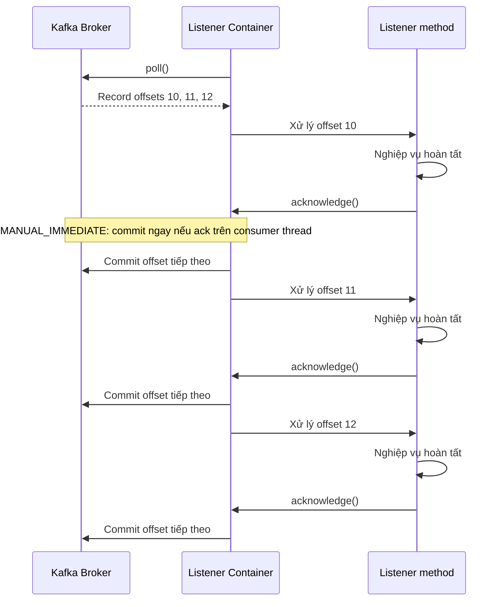

# AckMode MANUAL_IMMEDIATE

Spring Kafka listener container quản lý thời điểm commit offset cho consumer. Với `AckMode.MANUAL_IMMEDIATE`, ứng dụng chủ động xác nhận một record bằng cách gọi `Acknowledgment.acknowledge()`. Khi lời gọi này diễn ra trên consumer thread, container yêu cầu commit offset ngay tại thời điểm xác nhận, thay vì chờ đến cuối batch poll như `MANUAL`.

Chế độ này phù hợp khi ứng dụng cần quyết định rõ thời điểm một record được xem là đã xử lý xong, chẳng hạn chỉ xác nhận sau khi cập nhật database hoặc gọi dịch vụ đích thành công. Tuy nhiên, commit offset và transaction của hệ thống bên ngoài Kafka là hai việc riêng biệt. Nếu ứng dụng commit offset quá sớm, record có thể bị bỏ qua dù nghiệp vụ chưa hoàn tất; nếu xử lý thành công nhưng chưa commit, record có thể được giao lại và cần xử lý idempotent.

## 1. AckMode điều khiển điều gì?

Kafka consumer đọc record theo offset. Sau khi xử lý, consumer group cần commit offset để lưu vị trí tiếp tục đọc. Spring Kafka cung cấp nhiều `AckMode` để xác định khi nào listener container thực hiện commit.

| AckMode | Cách commit |
| --- | --- |
| `RECORD` | Commit sau khi từng record listener xử lý thành công |
| `BATCH` | Commit sau khi tất cả record trả về trong một lần poll được xử lý thành công |
| `TIME` | Commit khi đủ khoảng thời gian cấu hình và các record của poll đã được xử lý |
| `COUNT` | Commit khi đạt số record cấu hình và các record của poll đã được xử lý |
| `COUNT_TIME` | Kết hợp điều kiện số lượng và thời gian |
| `MANUAL` | Listener gọi `acknowledge()`; container gom acknowledgment và commit theo ranh giới batch poll |
| `MANUAL_IMMEDIATE` | Listener gọi `acknowledge()`; nếu gọi trên consumer thread, container thực hiện commit ngay |

Điểm khác biệt chính giữa `MANUAL` và `MANUAL_IMMEDIATE` là thời điểm commit. Cả hai đều yêu cầu listener chủ động xác nhận, nhưng `MANUAL` thường chờ xử lý xong các record thuộc poll hiện tại trước khi commit; `MANUAL_IMMEDIATE` có thể commit ngay khi listener xác nhận trên consumer thread.

`MANUAL_IMMEDIATE` không có nghĩa Kafka tự biết nghiệp vụ đã hoàn tất. Chính listener quyết định thời điểm gọi `acknowledge()`. Vì vậy, vị trí của lời gọi này trong method là một phần của thiết kế độ tin cậy.

## 2. Cấu hình MANUAL_IMMEDIATE bằng Spring Boot

Với Spring Boot, có thể đặt acknowledgment mode trong `application.yml`:

```yaml
spring:
  kafka:
    bootstrap-servers: ${KAFKA_BOOTSTRAP_SERVERS:localhost:9092}
    consumer:
      group-id: billing-service
      enable-auto-commit: false
      auto-offset-reset: earliest
      key-deserializer: org.apache.kafka.common.serialization.StringDeserializer
      value-deserializer: org.springframework.kafka.support.serializer.JsonDeserializer
      properties:
        spring.json.trusted.packages: com.example.messaging.event
        spring.json.value.default.type: com.example.messaging.event.OrderCreated
    listener:
      ack-mode: manual_immediate
```

Các thuộc tính quan trọng:

- `group-id` xác định consumer group lưu offset.
- `enable-auto-commit: false` để container quản lý commit theo acknowledgment mode.
- `ack-mode: manual_immediate` chọn chế độ xác nhận thủ công và commit ngay khi `acknowledge()` được gọi trên consumer thread.
- Deserializer chuyển key/value thành kiểu Java mà listener nhận.

Spring Kafka thường tự đặt `enable.auto.commit=false` khi container quản lý offset. Khai báo tường minh trong ví dụ giúp người đọc thấy rõ ứng dụng đang dùng cơ chế commit của container. Không bật Kafka auto commit cùng lúc với ý định kiểm soát offset thủ công.

`auto-offset-reset: earliest` chỉ được áp dụng khi group chưa có offset hợp lệ hoặc offset đã commit nằm ngoài phạm vi log còn giữ. Nó không làm group đang hoạt động tự đọc lại từ đầu.

## 3. Cấu hình bằng ConcurrentKafkaListenerContainerFactory

Nếu ứng dụng tự tạo listener container factory, có thể đặt `AckMode.MANUAL_IMMEDIATE` trực tiếp trên `ContainerProperties`:

```java
package com.example.messaging.config;

import com.example.messaging.event.OrderCreated;
import org.springframework.context.annotation.Bean;
import org.springframework.context.annotation.Configuration;
import org.springframework.kafka.config.ConcurrentKafkaListenerContainerFactory;
import org.springframework.kafka.core.ConsumerFactory;
import org.springframework.kafka.listener.ContainerProperties;

@Configuration
public class KafkaListenerConfiguration {

    @Bean
    public ConcurrentKafkaListenerContainerFactory<String, OrderCreated>
            kafkaListenerContainerFactory(
                    ConsumerFactory<String, OrderCreated> consumerFactory
            ) {
        var factory =
                new ConcurrentKafkaListenerContainerFactory<String, OrderCreated>();
        factory.setConsumerFactory(consumerFactory);
        factory.getContainerProperties().setAckMode(
                ContainerProperties.AckMode.MANUAL_IMMEDIATE
        );
        factory.getContainerProperties().setSyncCommits(true);
        return factory;
    }
}
```

`setSyncCommits(true)` yêu cầu container dùng commit đồng bộ khi commit offset. Đây là mặc định phổ biến của `ContainerProperties`, nhưng khai báo tường minh có thể giúp cấu hình dễ đọc hơn. Với commit đồng bộ, consumer thread chờ phản hồi commit từ broker; với commit bất đồng bộ, ứng dụng cần theo dõi callback/lỗi commit theo cấu hình container.

Nếu chỉ cần cấu hình một listener, có thể dùng factory mặc định của Spring Boot và đặt `spring.kafka.listener.ack-mode`. Nếu có nhiều listener với chính sách commit khác nhau, có thể tạo nhiều factory rồi chọn bằng thuộc tính `containerFactory` trong `@KafkaListener`.

## 4. Nhận Acknowledgment trong listener method

Khi dùng `MANUAL_IMMEDIATE`, listener method cần nhận tham số `Acknowledgment` và gọi `acknowledge()` sau khi xử lý xong:

```java
package com.example.messaging.consumer;

import com.example.messaging.event.OrderCreated;
import org.springframework.kafka.annotation.KafkaListener;
import org.springframework.kafka.support.Acknowledgment;
import org.springframework.stereotype.Component;

@Component
public class OrderCreatedListener {

    private final BillingService billingService;

    public OrderCreatedListener(BillingService billingService) {
        this.billingService = billingService;
    }

    @KafkaListener(
            topics = "orders.events",
            groupId = "billing-service"
    )
    public void onOrderCreated(
            OrderCreated event,
            Acknowledgment acknowledgment
    ) {
        billingService.handle(event);

        // Chỉ xác nhận sau khi xử lý nghiệp vụ hoàn tất.
        acknowledgment.acknowledge();
    }
}
```

Ví dụ giả định `billingService.handle(event)` chỉ trả về sau khi công việc cần thiết đã hoàn tất, bao gồm commit transaction database nếu có. Nếu method này chỉ đưa công việc vào queue nội bộ rồi trả về, acknowledgment ở đây sẽ quá sớm so với thời điểm công việc thực sự hoàn tất.

Khi listener trả về mà chưa gọi `acknowledge()`, container không nhận được xác nhận thủ công từ method. Nếu method ném exception, lỗi được chuyển tới error handler của container. Cách retry, recover hoặc chuyển dead-letter phụ thuộc error handler đang cấu hình.

## 5. MANUAL và MANUAL_IMMEDIATE khác nhau ở thời điểm nào?

Giả sử một lần poll nhận được ba record trên một partition: offset 10, 11 và 12. Listener xử lý từng record và gọi acknowledgment sau khi xong.



Với `MANUAL_IMMEDIATE`, mỗi acknowledgment trên consumer thread có thể dẫn đến một lần commit ngay. Với `MANUAL`, acknowledgment được container ghi nhận và commit theo ranh giới batch poll sau khi các record của poll đã được xử lý.

Điều này tạo ra trade-off:

- `MANUAL_IMMEDIATE` giúp giảm khoảng thời gian giữa lúc xử lý xong và lúc gửi commit request.
- `MANUAL` có thể gom nhiều acknowledgment thành ít lần commit hơn, giảm số request commit.
- `MANUAL_IMMEDIATE` có thể tăng số lần commit khi listener xác nhận từng record, làm tăng overhead nếu throughput cao.

Commit offset của một record thường lưu vị trí tiếp theo cần đọc. Ví dụ, sau khi xử lý record offset 10, offset commit là 11. Khi xem consumer group, không nên nhầm giá trị offset commit với offset của record cuối cùng vừa xử lý.

## 6. Ack phải được gọi trên consumer thread

Hành vi của `MANUAL_IMMEDIATE` phụ thuộc thread gọi `acknowledge()`:

- **Gọi trên consumer thread:** container thực hiện commit ngay tại thời điểm acknowledgment được gọi.
- **Gọi từ thread khác:** acknowledgment được đưa vào hàng đợi và được xử lý sau khi các record từ poll trước đó đã được xử lý. Nó không có cùng thời điểm commit tức thì như khi gọi trên consumer thread.

Không nên lúc thì gọi acknowledgment trên consumer thread, lúc lại gọi từ thread khác trong cùng một listener. Trộn hai cách gọi có thể làm semantics commit khó dự đoán. `Acknowledgment` cũng không phải đối tượng để lưu trữ và sử dụng tùy ý sau khi listener kết thúc.

Ví dụ dưới đây không phù hợp nếu kỳ vọng commit ngay:

```java
@KafkaListener(topics = "orders.events")
public void onOrderCreated(
        OrderCreated event,
        Acknowledgment acknowledgment
) {
    executor.execute(() -> {
        billingService.handle(event);
        acknowledgment.acknowledge();
    });
}
```

Đoạn code chuyển acknowledgment sang thread của executor. Khi đó container xử lý acknowledgment theo nhánh gọi từ thread khác; method listener đã kết thúc trong khi công việc nghiệp vụ vẫn chạy. Điều này làm việc kiểm soát lỗi, thứ tự và commit phức tạp hơn.

Nếu cần xử lý bất đồng bộ, hãy thiết kế riêng mô hình acknowledgment và backpressure. Có thể giữ listener method chờ kết quả hoàn tất rồi acknowledgment trên consumer thread, hoặc sử dụng cơ chế async listener được Spring Kafka hỗ trợ ở phiên bản đang dùng. Không dùng executor tùy ý rồi giả định offset sẽ chỉ commit sau khi mọi tác vụ hoàn tất.

## 7. Đặt acknowledgment sau ranh giới nghiệp vụ

Vị trí gọi `acknowledge()` quyết định thời điểm group tiến offset. Hãy đặt nó sau khi tất cả công việc mà ứng dụng xem là điều kiện hoàn thành đã thành công.

Ví dụ xử lý có database:

```java
@KafkaListener(topics = "orders.events", groupId = "billing-service")
public void onOrderCreated(
        OrderCreated event,
        Acknowledgment acknowledgment
) {
    billingService.processAndCommit(event);
    acknowledgment.acknowledge();
}
```

Giả sử `processAndCommit` là một service transaction và chỉ trả về sau khi database transaction commit. Khi method trả về bình thường, listener mới xác nhận offset. Cần tránh gọi acknowledgment trước khi transaction database hoàn tất.

### 7.1. Ack quá sớm có thể làm mất cơ hội xử lý

```java
// Không nên: xác nhận offset trước khi xử lý nghiệp vụ.
acknowledgment.acknowledge();
billingService.processAndCommit(event);
```

Nếu ứng dụng commit offset rồi database update thất bại, Kafka group đã tiến qua record. Khi consumer khởi động lại, group có thể tiếp tục từ offset mới và không tự nhận lại record đó.

### 7.2. Xử lý xong nhưng chưa ack có thể dẫn đến giao lại

Giả sử database commit thành công nhưng process dừng trước dòng `acknowledge()`. Kafka chưa nhận commit offset mới, vì vậy record có thể được giao lại sau khi consumer phục hồi hoặc group rebalance.

Đây là hành vi thường gặp của mô hình at-least-once. Consumer cần idempotent, ví dụ dùng `eventId` có unique constraint hoặc bảng inbox để phát hiện event đã xử lý. `MANUAL_IMMEDIATE` rút ngắn cửa sổ chờ commit sau acknowledgment nhưng không loại bỏ khoảng lỗi giữa transaction database và commit offset Kafka.

## 8. Kết hợp với xử lý lỗi và retry

Nếu listener ném exception trước khi gọi `acknowledge()`, container chuyển lỗi đến error handler. Tùy chính sách, record có thể được retry, seek để đọc lại hoặc recover sang dead-letter topic.

```java
@KafkaListener(topics = "orders.events", groupId = "billing-service")
public void onOrderCreated(
        OrderCreated event,
        Acknowledgment acknowledgment
) {
    try {
        billingService.processAndCommit(event);
        acknowledgment.acknowledge();
    } catch (TemporaryBillingException ex) {
        // Ném lỗi để error handler thực hiện retry theo cấu hình.
        throw ex;
    }
}
```

Không nên bắt exception rồi chỉ ghi log và kết thúc method khi record chưa được xử lý. Nếu method trả về bình thường mà không có chính sách retry/recover rõ ràng, ứng dụng có thể giữ offset chưa commit, hoặc behavior sau đó phụ thuộc container/error handler; hãy để exception đi tới error handler khi muốn retry.

Nếu đã gọi `acknowledge()` rồi mới phát sinh exception, commit đã được yêu cầu và không thể được rollback chỉ bằng cách ném exception. Vì vậy, mọi thao tác có thể thất bại cần được thực hiện trước acknowledgment.

Khi cấu hình dead-letter, hãy xác định rõ điều kiện một record được xem là recovered. Error handler/recoverer có thể commit offset sau khi recover thành công theo cấu hình; đây là quyết định khác với việc listener tự gọi `acknowledge()`.

## 9. Chọn MANUAL_IMMEDIATE hay MANUAL?

| Tiêu chí | `MANUAL_IMMEDIATE` | `MANUAL` |
| --- | --- | --- |
| Thời điểm commit khi ack trên consumer thread | Ngay khi gọi `acknowledge()` | Sau khi xử lý xong các record của poll theo cơ chế container |
| Khả năng chủ động xác nhận | Có | Có |
| Số lần commit | Có thể nhiều hơn nếu ack từng record | Có thể gom acknowledgment theo poll |
| Độ trễ commit | Thường thấp hơn sau khi listener ack | Có thể chờ đến ranh giới batch poll |
| Phù hợp | Muốn commit ngay sau từng record đã hoàn tất | Muốn chủ động ack nhưng ưu tiên gom commit |

Hãy chọn `MANUAL_IMMEDIATE` khi thời điểm commit sau từng record có ý nghĩa vận hành và chi phí commit bổ sung chấp nhận được. Chọn `MANUAL` nếu muốn listener quyết định record nào hoàn tất nhưng không cần commit ngay từng lần acknowledgment.

Nếu không cần acknowledgment thủ công, `RECORD` thường đơn giản hơn: container tự commit sau khi record listener hoàn tất thành công. Không nên dùng `MANUAL_IMMEDIATE` chỉ vì tên gọi có chữ “immediate”; hãy chọn theo semantics cần có.

## 10. Kiểm tra trạng thái commit và consumer group

Có thể quan sát offset đã commit bằng Kafka CLI:

```bash
kafka-consumer-groups.sh \
  --bootstrap-server localhost:9092 \
  --describe \
  --group billing-service
```

Lệnh hiển thị partition, current offset, log end offset và lag. Để kiểm tra `MANUAL_IMMEDIATE`, hãy gửi từng record và quan sát current offset sau khi listener đã xử lý và gọi acknowledgment.

Một quy trình kiểm tra hữu ích:

1. Dùng topic thử nghiệm có một partition để dễ theo dõi offset.
2. Dùng group ID mới để không bị ảnh hưởng bởi offset cũ.
3. Gửi một record và chờ listener hoàn tất nghiệp vụ.
4. Xác nhận listener đã gọi `acknowledge()` trên consumer thread.
5. Describe group và kiểm tra offset commit đã tiến đến vị trí tiếp theo.
6. Gửi record tiếp theo, chủ động tạo exception trước acknowledgment và quan sát retry/re-delivery theo error handler.
7. Kiểm tra trường hợp process dừng sau database commit nhưng trước acknowledgment để xác minh idempotency.

Trong integration test, dùng `@EmbeddedKafka`, `CountDownLatch` hoặc `BlockingQueue` để đồng bộ với listener. Có thể dùng một consumer quản trị riêng để đọc offset đã commit hoặc `AdminClient` để truy vấn `listConsumerGroupOffsets`. Tránh dùng `Thread.sleep()` cố định làm bằng chứng commit đã hoàn tất; hãy poll trạng thái với timeout.

## 11. Các lưu ý vận hành

- **Commit đồng bộ hay bất đồng bộ:** `ContainerProperties` hỗ trợ cấu hình `syncCommits`. Commit đồng bộ chờ broker phản hồi; commit bất đồng bộ cần theo dõi lỗi qua callback. Chọn theo yêu cầu latency và độ quan sát lỗi.
- **Thời gian commit:** commit request cũng có thể lỗi do coordinator đổi, mạng gián đoạn hoặc group rebalance. Log và metric commit failure cần được theo dõi.
- **Concurrency:** mỗi consumer member có luồng poll riêng. Acknowledgment nên diễn ra trên đúng consumer thread để giữ semantics immediate; không chia sẻ acknowledgment tùy tiện giữa thread.
- **Thứ tự:** trong một partition, Kafka giữ thứ tự record. Không xác nhận offset của record sau khi record trước đó cùng partition chưa được xử lý theo đúng thứ tự yêu cầu.
- **Idempotency:** redelivery vẫn có thể xảy ra sau khi nghiệp vụ thành công nhưng commit chưa hoàn tất.
- **Database transaction:** Kafka offset commit và database commit không tự động trở thành một transaction nguyên tử chung.

## 12. Lỗi thường gặp khi dùng MANUAL_IMMEDIATE

| Hiện tượng | Nguyên nhân thường gặp | Cách xử lý |
| --- | --- | --- |
| Listener báo không có Acknowledgment | Container chưa cấu hình `MANUAL` hoặc `MANUAL_IMMEDIATE` | Kiểm tra `spring.kafka.listener.ack-mode` hoặc factory config |
| Record bị bỏ qua sau khi database lỗi | Gọi `acknowledge()` trước khi nghiệp vụ hoàn tất | Chuyển acknowledgment xuống sau transaction thành công |
| Record được xử lý lặp | Process dừng sau nghiệp vụ nhưng trước commit offset | Dùng `eventId`, unique constraint hoặc inbox/idempotency |
| Commit không xảy ra ngay như mong đợi | Ack được gọi từ thread khác consumer thread | Gọi ack trên consumer thread hoặc thiết kế async semantics có chủ đích |
| Commit request tăng mạnh | Mỗi record đều tạo commit ngay | Đánh giá `MANUAL`, `BATCH` hoặc `RECORD` nếu phù hợp yêu cầu |
| Lỗi listener không được retry | Exception bị bắt và không được ném lại, hoặc error handler đã recover | Kiểm tra luồng exception và cấu hình error handler/recoverer |
| Group offset không như mong đợi | Nhầm offset commit với offset record cuối đã xử lý hoặc xem sai group/partition | Kiểm tra đúng group, topic, partition và next offset |
| Commit lỗi khi rebalance | Group coordinator hoặc assignment thay đổi trong lúc commit | Theo dõi rebalance và commit failure; để container/error policy xử lý phù hợp |

## 13. Quy trình triển khai MANUAL_IMMEDIATE

1. Xác định chính xác thao tác nghiệp vụ nào phải hoàn tất trước khi xác nhận record.
2. Tắt Kafka auto commit và cấu hình `AckMode.MANUAL_IMMEDIATE` trên listener container.
3. Thêm tham số `Acknowledgment` vào listener method.
4. Đặt `acknowledge()` sau khi database/service transaction hoàn tất.
5. Để exception chưa xử lý đi tới error handler; cấu hình retry/backoff và dead-letter phù hợp.
6. Thiết kế consumer idempotent để chịu được record giao lại.
7. Xác nhận acknowledgment được gọi trên consumer thread; tránh trộn cách gọi trên nhiều thread.
8. Kiểm thử offset commit, lỗi trước ack, lỗi sau nghiệp vụ và restart/rebalance.
9. Theo dõi commit latency/failure, consumer lag, retry và dead-letter rate khi chạy production.

`MANUAL_IMMEDIATE` trao quyền quyết định thời điểm xác nhận record cho listener và cho phép container commit ngay khi acknowledgment được gọi trên consumer thread. Giá trị của chế độ này nằm ở việc đặt ranh giới commit sát với thời điểm nghiệp vụ thực sự hoàn tất. Để luồng messaging tin cậy, cần kết hợp nó với xử lý lỗi, idempotency và quan sát commit; bản thân acknowledgment không thay thế transaction xuyên hệ thống.

## 14. Tự kiểm tra

1. `MANUAL_IMMEDIATE` khác `MANUAL` ở thời điểm commit nào?
2. Vì sao cần cấu hình `enable.auto.commit=false` khi muốn kiểm soát offset thủ công?
3. Điều gì xảy ra nếu gọi `acknowledge()` trước khi database transaction commit?
4. Nếu nghiệp vụ thành công nhưng process dừng trước acknowledgment, record có thể được xử lý như thế nào khi consumer khởi động lại?
5. Vì sao gọi acknowledgment từ executor thread không có cùng semantics với gọi trên consumer thread?
6. Khi dùng `MANUAL_IMMEDIATE`, tại sao commit từng record có thể làm tăng overhead?
7. `MANUAL_IMMEDIATE` có tạo transaction nguyên tử giữa Kafka và database không?
8. Cần kiểm tra những chỉ số và tình huống lỗi nào trước khi triển khai chế độ này?
