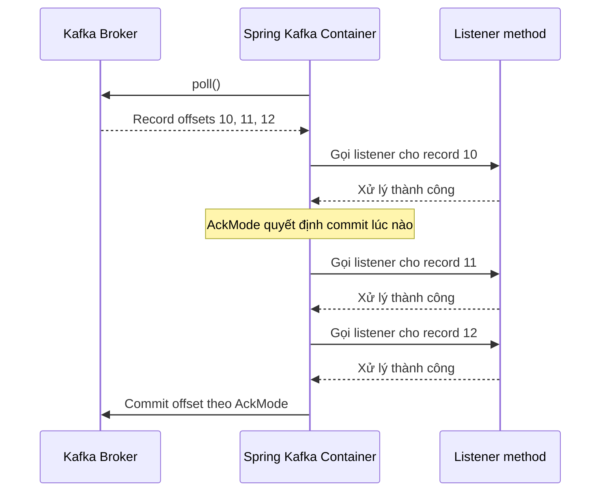
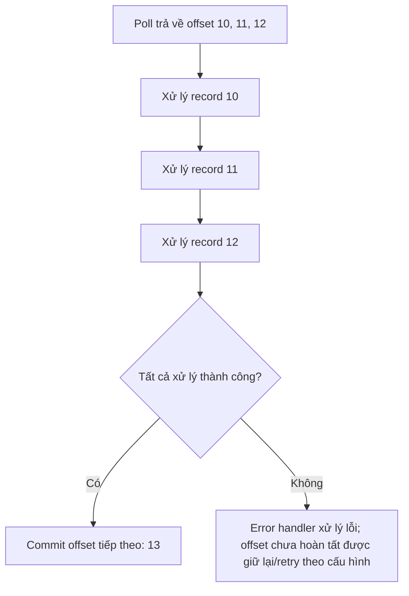

# AckMode ảnh hưởng đến commit thế nào

Kafka consumer đọc record từ partition theo offset. Sau khi xử lý, consumer group cần lưu lại vị trí tiếp tục đọc bằng cách **commit offset**. Trong Spring Kafka, `AckMode` quyết định listener container commit offset vào thời điểm nào và theo ranh giới nào.

Chọn `AckMode` ảnh hưởng trực tiếp đến khả năng giao lại record, nguy cơ bỏ sót dữ liệu, số request commit và độ trễ của consumer. Ví dụ, commit sau mỗi record giúp tiến độ được ghi nhận sát với kết quả xử lý; commit theo batch giảm số lần gọi broker nhưng có thể khiến nhiều record được đọc lại nếu consumer lỗi giữa batch.

## 1. Offset commit là vị trí tiếp theo cần đọc

Mỗi record trong một partition có một offset tăng dần. Khi consumer xử lý xong record có offset `10`, giá trị offset được commit thông thường là `11`, tức vị trí tiếp theo cần đọc. Offset commit không phải số offset của record cuối vừa xử lý.

Ví dụ:

| Record đã xử lý | Offset của record | Offset commit |
| --- | ---: | ---: |
| Record thứ nhất | 10 | 11 |
| Record thứ hai | 11 | 12 |
| Record thứ ba | 12 | 13 |

Offset được lưu theo cặp consumer group và partition. `billing-service` có thể commit partition 0 đến offset 120 trong khi `analytics-service` mới commit đến offset 95. Hai group có tiến độ độc lập.

Commit offset giúp Kafka biết group đã xử lý đến đâu để tiếp tục sau restart hoặc rebalance. Commit không xóa record khỏi topic; record vẫn tồn tại theo chính sách retention hoặc compaction.

## 2. AckMode nằm ở đâu trong luồng xử lý?

Khi dùng Spring Kafka, listener container quản lý consumer và vòng lặp `poll()`. Container chuyển record đến listener method, theo dõi kết quả xử lý và thực hiện commit theo `AckMode` đã cấu hình.



`AckMode` là cấu hình của Spring Kafka listener container. Nó không phải một thuộc tính của topic và cũng không phải cách producer xác nhận record đã được ghi. Producer acknowledgment (`acks`) và consumer acknowledgment (`AckMode`) giải quyết hai việc khác nhau:

- Producer `acks` quyết định producer cần broker xác nhận việc ghi record ở mức nào.
- Consumer `AckMode` quyết định khi nào listener container ghi nhận tiến độ đọc của consumer group.

## 3. Các AckMode phổ biến

Spring Kafka cung cấp các chế độ sau:

| AckMode | Thời điểm commit | Khi nào phù hợp |
| --- | --- | --- |
| `RECORD` | Sau khi từng record listener xử lý thành công | Cần ghi nhận tiến độ sát với từng record |
| `BATCH` | Sau khi tất cả record của một lần poll được xử lý thành công | Muốn giảm số lần commit; đây là chế độ mặc định phổ biến |
| `TIME` | Khi khoảng thời gian cấu hình đã trôi qua và container đến điểm commit an toàn | Muốn giới hạn thời gian giữa các lần commit |
| `COUNT` | Khi số record đã xử lý đạt ngưỡng cấu hình và container đến điểm commit | Muốn commit theo số lượng record |
| `COUNT_TIME` | Khi đạt ngưỡng số lượng hoặc thời gian | Muốn kết hợp hai điều kiện |
| `MANUAL` | Listener gọi `acknowledge()`; container xử lý commit theo semantics của `BATCH` | Listener tự quyết định record nào hoàn tất nhưng không cần commit ngay từng lần gọi |
| `MANUAL_IMMEDIATE` | Listener gọi `acknowledge()`; nếu gọi trên consumer thread, container commit ngay | Cần chủ động xác nhận và commit ngay sau xử lý |

Với record listener, `RECORD` commit sau mỗi lần gọi listener thành công. Với batch listener, listener nhận nhiều record trong một invocation; `RECORD` không phải lựa chọn phù hợp cho kiểu listener này. Hãy chọn chế độ dựa trên kiểu listener và phiên bản Spring Kafka của ứng dụng.

`BATCH` thường là mặc định khi dùng listener container. Nếu cần hành vi khác, nên khai báo rõ `spring.kafka.listener.ack-mode` hoặc cấu hình `ContainerProperties` để tránh phụ thuộc vào mặc định.

## 4. RECORD: commit sau từng record

Với `AckMode.RECORD`, container commit offset sau khi listener method xử lý thành công từng record. Ví dụ:

```yaml
spring:
  kafka:
    consumer:
      enable-auto-commit: false
    listener:
      ack-mode: record
```

Listener có thể là một method xử lý payload:

```java
@KafkaListener(topics = "orders.events", groupId = "billing-service")
public void onOrderCreated(OrderCreated event) {
    billingService.processAndCommit(event);
}
```

Giả sử một lần poll trả về ba record có offset 10, 11 và 12. Container gọi method cho từng record. Nếu cả ba record đều được xử lý thành công, offset tiến lần lượt qua 11, 12 và 13 theo quá trình commit.

Nếu xử lý record offset 10 và 11 thành công nhưng record 12 thất bại, các offset đã commit trước đó vẫn được giữ. Khi lỗi được xử lý và consumer đọc lại, record thất bại có thể được giao lại theo chính sách error handler. Đây là một trong những lý do `RECORD` hữu ích khi muốn giới hạn phạm vi đọc lại.

Ưu điểm của `RECORD` là tiến độ được ghi nhận gần với từng record. Đổi lại, số lần commit có thể cao hơn `BATCH`, làm tăng request và overhead khi throughput lớn. Nó cũng không tạo exactly-once cho thao tác database bên ngoài Kafka.

## 5. BATCH: commit sau một lần poll

Với `AckMode.BATCH`, container xử lý các record nhận được trong một lần `poll()` rồi commit offset sau khi batch đó được xử lý thành công.

```yaml
spring:
  kafka:
    listener:
      ack-mode: batch
```

Ví dụ một lần poll trả về ba record offset 10, 11 và 12:



Ưu điểm của `BATCH` là giảm số lần commit khi một poll trả về nhiều record. Nhược điểm là nếu consumer dừng trước khi commit, những record đã xử lý thành công trong poll đó có thể được giao lại cùng các record chưa xử lý xong.

Ví dụ, record offset 10 và 11 đã cập nhật database thành công, nhưng record 12 gây lỗi trước khi batch được commit. Sau khi consumer phục hồi, offset commit có thể vẫn ở 10. Các record 10 và 11 có thể được đọc lại. Vì vậy, consumer nên có tính idempotent để tránh ghi nhận tác động nghiệp vụ hai lần.

## 6. TIME, COUNT và COUNT_TIME

Ba chế độ này cho phép container commit theo ngưỡng thời gian hoặc số record thay vì chỉ theo từng record hay từng batch poll.

### 6.1. TIME

`TIME` dùng khoảng thời gian kể từ lần commit gần nhất làm điều kiện. Khi thời gian đã đạt ngưỡng, container commit các offset đang chờ tại điểm xử lý an toàn.

Ví dụ cấu hình bằng Java:

```java
factory.getContainerProperties().setAckMode(ContainerProperties.AckMode.TIME);
factory.getContainerProperties().setAckTime(5_000); // 5 giây
```

Chế độ này hữu ích khi muốn giới hạn khoảng thời gian giữa các lần commit. Tuy nhiên, đây không phải TTL chính xác cho từng record và không có nghĩa cứ đúng 5 giây broker sẽ nhận một commit bất kể listener đang xử lý ở trạng thái nào.

### 6.2. COUNT

`COUNT` dùng số record đã xử lý kể từ lần commit gần nhất làm ngưỡng:

```java
factory.getContainerProperties().setAckMode(ContainerProperties.AckMode.COUNT);
factory.getContainerProperties().setAckCount(100);
```

Khi số lượng đạt 100, container commit offset đang chờ tại ranh giới xử lý phù hợp. Đây là cách giảm số lần commit khi hệ thống có lưu lượng ổn định.

### 6.3. COUNT_TIME

`COUNT_TIME` kết hợp hai điều kiện. Container commit khi đạt ngưỡng số record hoặc ngưỡng thời gian:

```java
factory.getContainerProperties().setAckMode(ContainerProperties.AckMode.COUNT_TIME);
factory.getContainerProperties().setAckCount(100);
factory.getContainerProperties().setAckTime(5_000);
```

Ví dụ, nếu 100 record đến trong một giây, điều kiện count có thể đạt trước; nếu lưu lượng thấp và chưa đủ 100 record, điều kiện thời gian có thể đạt trước. Cách chọn này cân bằng giữa số lượng commit và thời gian lưu tiến độ.

Các ngưỡng `ackCount` và `ackTime` là cấu hình của container. Nếu dùng Spring Boot auto-configuration, cần kiểm tra khả năng bind của phiên bản Boot đang dùng; có thể đặt trực tiếp trên `ContainerProperties` như các ví dụ trên để thể hiện rõ giá trị.

## 7. MANUAL: listener chủ động xác nhận

Với `AckMode.MANUAL`, listener nhận `Acknowledgment` và gọi `acknowledge()` sau khi record được xử lý. Container ghi nhận acknowledgment và commit theo semantics của `BATCH`, tức thường đợi xử lý xong các record trong poll trước khi commit.

```yaml
spring:
  kafka:
    consumer:
      enable-auto-commit: false
    listener:
      ack-mode: manual
```

```java
@KafkaListener(topics = "orders.events", groupId = "billing-service")
public void onOrderCreated(
        OrderCreated event,
        Acknowledgment acknowledgment
) {
    billingService.processAndCommit(event);
    acknowledgment.acknowledge();
}
```

Trong ví dụ, listener chỉ xác nhận sau khi `processAndCommit` hoàn tất. Nếu xử lý database thất bại và method ném exception, acknowledgment không được gọi; error handler có thể retry hoặc recover record theo cấu hình.

`MANUAL` phù hợp khi ứng dụng cần quyết định record nào đã hoàn tất, nhưng vẫn chấp nhận container gom commit theo poll. Nó không đảm bảo commit ngay tại dòng `acknowledge()`.

## 8. MANUAL_IMMEDIATE: xác nhận và commit ngay

`AckMode.MANUAL_IMMEDIATE` cũng yêu cầu listener gọi `Acknowledgment.acknowledge()`, nhưng nếu lời gọi xảy ra trên consumer thread, container thực hiện commit ngay tại thời điểm đó.

```yaml
spring:
  kafka:
    consumer:
      enable-auto-commit: false
    listener:
      ack-mode: manual_immediate
```

```java
@KafkaListener(topics = "orders.events", groupId = "billing-service")
public void onOrderCreated(
        OrderCreated event,
        Acknowledgment acknowledgment
) {
    billingService.processAndCommit(event);
    acknowledgment.acknowledge();
}
```

Các điểm cần nhớ:

- Ack trên consumer thread cho phép commit ngay.
- Ack từ thread khác được đưa vào hàng đợi và xử lý sau khi các record từ poll trước đó đã được xử lý; không có cùng semantics commit tức thì.
- Trộn lúc ack trên consumer thread, lúc ack từ thread khác có thể làm hành vi commit khó dự đoán.
- Commit từng record có thể tăng overhead so với gom commit.

`MANUAL_IMMEDIATE` không làm transaction database và Kafka trở thành một transaction nguyên tử chung. Nếu database commit thành công nhưng process dừng trước khi offset commit, record có thể được giao lại. Consumer vẫn cần idempotency.

## 9. So sánh thời điểm commit bằng ví dụ

Giả sử consumer poll ba record trên cùng partition: offset 20, 21 và 22. Listener xử lý từng record tuần tự.

| Tình huống | `RECORD` | `BATCH` | `MANUAL` | `MANUAL_IMMEDIATE` |
| --- | --- | --- | --- | --- |
| Record 20 xử lý thành công | Commit tiến qua 21 | Chưa commit cho đến khi batch hoàn tất | Ack được ghi nhận; commit theo ranh giới batch | Ack trên consumer thread có thể commit ngay qua 21 |
| Record 21 xử lý thành công | Commit tiến qua 22 | Chưa commit cho đến khi batch hoàn tất | Ack được ghi nhận; commit theo ranh giới batch | Ack trên consumer thread có thể commit ngay qua 22 |
| Record 22 thất bại | Offset 20 và 21 đã được commit | Batch chưa hoàn tất nên offset batch chưa commit | Batch chưa hoàn tất nên acknowledgment đang chờ chưa được commit theo batch | Offset của 20 và 21 đã commit nếu ack từng record trước đó; record 22 chưa được ack |

Bảng giả định mỗi record được xác nhận/commit đúng thứ tự trên cùng partition, không có transaction container và error handler chưa recover record lỗi. Hành vi thực tế sau exception còn phụ thuộc `DefaultErrorHandler`, retry, seek và cấu hình commit recovered record.

## 10. Tắt auto commit để container kiểm soát offset

Kafka consumer client có cơ chế auto commit nếu `enable.auto.commit=true`. Cơ chế này có thể commit offset theo timer mà không biết listener đã hoàn tất nghiệp vụ hay chưa.

Khi dùng Spring Kafka listener container, container cần quản lý commit theo `AckMode`. Vì vậy, auto commit thường phải tắt:

```yaml
spring:
  kafka:
    consumer:
      enable-auto-commit: false
```

Spring Kafka thường tự đặt `enable.auto.commit=false` nếu người dùng không cấu hình, nhưng khai báo rõ giúp tránh hiểu nhầm và thể hiện ý định kiểm soát offset. Không nên bật auto commit rồi đồng thời kỳ vọng `RECORD`, `BATCH` hoặc manual acknowledgment quyết định chính xác thời điểm commit.

## 11. Commit đồng bộ và bất đồng bộ

Sau khi AckMode quyết định **khi nào** commit, container còn cần chọn cách gửi yêu cầu commit tới broker:

- **Synchronous commit (`commitSync`)**: consumer thread chờ broker phản hồi. Nếu commit lỗi, lỗi có thể được trả về trong luồng thực thi và container có thể xử lý theo cơ chế của nó.
- **Asynchronous commit (`commitAsync`)**: gửi yêu cầu commit mà không chờ phản hồi ngay. Cần dùng callback để quan sát lỗi commit.

Spring Kafka container hỗ trợ cấu hình `syncCommits` trên `ContainerProperties`. Mặc định phổ biến là `true`, tức dùng synchronous commit.

```java
factory.getContainerProperties().setSyncCommits(true);
```

Nếu chọn async commit:

```java
factory.getContainerProperties().setSyncCommits(false);
factory.getContainerProperties().setCommitCallback((offsets, exception) -> {
    if (exception != null) {
        log.error("Commit offset failed: {}", offsets, exception);
    }
});
```

Callback cần được cấu hình theo API của phiên bản Spring Kafka đang dùng. Không nên bỏ qua lỗi callback vì ứng dụng có thể tưởng offset đã được lưu trong khi broker chưa xác nhận. Việc chọn sync hay async là quyết định về cách thực hiện commit; nó không thay đổi ranh giới nghiệp vụ mà AckMode đã chọn.

## 12. AckMode, retry và khả năng giao lại record

AckMode quyết định tiến độ nào đã được commit khi xảy ra lỗi. Nếu listener xử lý thành công nhưng offset chưa được commit, record có thể được giao lại sau restart hoặc rebalance. Nếu offset đã commit trước khi xử lý xong, record có thể bị bỏ qua khi consumer tiếp tục.

Hai tình huống quan trọng:

| Thứ tự thao tác | Rủi ro |
| --- | --- |
| Commit offset trước, xử lý nghiệp vụ sau | Nếu nghiệp vụ thất bại, consumer có thể không đọc lại record: nguy cơ mất tác động nghiệp vụ |
| Xử lý nghiệp vụ trước, commit offset sau | Nếu process dừng giữa hai bước, record có thể được giao lại: nguy cơ xử lý trùng |

Với nhiều ứng dụng nghiệp vụ, cách thứ hai thường được chọn để đạt at-least-once delivery. Khi đó, consumer phải xử lý idempotent. Ví dụ, lưu `eventId` với unique constraint hoặc dùng inbox table để bảo đảm cùng một event không tạo tác động lặp.

Nếu listener ném exception, error handler có thể retry record, seek offset hoặc chuyển record sang dead-letter topic. Sau khi recover thành công, error handler có thể được cấu hình để commit offset tương ứng. Hãy xác định rõ error handler có commit recovered record hay không để không nhầm với acknowledgment do listener gọi.

## 13. AckMode và transaction

Kafka transaction cho phép phối hợp gửi record và offset trong cùng transaction Kafka ở các luồng consume-transform-produce được cấu hình phù hợp. Khi listener container tham gia Kafka transaction, offset có thể được gửi vào transaction bằng cơ chế `sendOffsetsToTransaction`; offset chỉ được commit cùng transaction nếu transaction commit thành công.

Điều này khác với việc listener cập nhật database bên ngoài Kafka. Kafka transaction không tự động bao trùm JDBC transaction hoặc HTTP request. Nếu cần nhất quán giữa database và Kafka, hãy cân nhắc transactional outbox/inbox hoặc cơ chế idempotency.

Khi dùng transaction manager cho listener container, cần đọc hướng dẫn của phiên bản Spring Kafka đang dùng về cách container xử lý acknowledgment, transaction boundary và offset. Không nên áp dụng máy móc bảng AckMode non-transactional ở trên cho container transactional mà không kiểm tra cấu hình.

## 14. Chọn AckMode theo yêu cầu hệ thống

| Nhu cầu | Lựa chọn thường cân nhắc | Lý do |
| --- | --- | --- |
| Xử lý từng event và ghi nhận offset sát từng lần thành công | `RECORD` | Container commit sau từng record listener |
| Throughput cao, chấp nhận khả năng đọc lại các record đã xử lý trong cùng poll | `BATCH` | Giảm số lần commit |
| Listener muốn chủ động xác nhận sau khi nghiệp vụ hoàn tất, commit theo poll | `MANUAL` | Listener quyết định lúc ack, container gom commit |
| Listener muốn commit ngay sau ack trên consumer thread | `MANUAL_IMMEDIATE` | Giảm độ trễ giữa ack và commit request |
| Lưu lượng ổn định, muốn commit theo số record | `COUNT` | Điều khiển số lượng giữa các lần commit |
| Lưu lượng biến động, cần cả ngưỡng số lượng và thời gian | `COUNT_TIME` | Commit khi một trong hai ngưỡng đạt |
| Cần giới hạn khoảng thời gian giữa các lần commit | `TIME` | Dựa vào thời gian đã trôi qua |

Không có một AckMode tối ưu cho mọi ứng dụng. Cần cân bằng giữa throughput, latency, khả năng giao lại, độ phức tạp nghiệp vụ và chi phí commit.

## 15. Kiểm thử hành vi commit

Để kiểm tra AckMode, cần kiểm tra cả kết quả nghiệp vụ và offset đã commit. Một test chỉ xác nhận listener được gọi chưa đủ chứng minh commit đúng thời điểm.

Quy trình integration test gợi ý:

1. Khởi tạo broker thử nghiệm bằng `@EmbeddedKafka` hoặc Testcontainers.
2. Tạo topic có partition count phù hợp và dùng group ID riêng cho test.
3. Cấu hình listener với AckMode cần kiểm tra.
4. Gửi record bằng `KafkaTemplate` và chờ listener hoàn tất bằng `CountDownLatch` hoặc `BlockingQueue`.
5. Truy vấn offset của group bằng `AdminClient.listConsumerGroupOffsets()` hoặc Kafka CLI.
6. Tạo lỗi trước khi listener hoàn tất để kiểm tra retry và offset có tiến hay không.
7. Tạo tình huống process dừng sau nghiệp vụ nhưng trước commit để kiểm tra redelivery và idempotency.
8. So sánh số lần commit, consumer lag và throughput nếu đang đánh giá `RECORD` với `BATCH`.

Hãy dùng timeout cho latch và truy vấn trạng thái theo điều kiện. Tránh dùng `Thread.sleep()` cố định vì test có thể chạy khác nhau trên các máy hoặc trong CI.

## 16. Lỗi thường gặp khi cấu hình AckMode

| Hiện tượng | Nguyên nhân có thể | Cách kiểm tra |
| --- | --- | --- |
| Offset tiến trước khi nghiệp vụ hoàn tất | Kafka auto commit đang bật hoặc listener ack quá sớm | Kiểm tra `enable.auto.commit` và vị trí `acknowledge()` |
| Record được xử lý lặp sau restart | Nghiệp vụ thành công nhưng offset chưa commit | Kiểm tra AckMode, commit failure và idempotency |
| `RECORD` không hoạt động như mong muốn với batch listener | `RECORD` dành cho record listener | Kiểm tra listener type và container factory |
| `MANUAL` không commit ngay sau mỗi ack | `MANUAL` gom ack và commit theo semantics của `BATCH` | Dùng `MANUAL_IMMEDIATE` nếu thực sự cần commit ngay trên consumer thread |
| `MANUAL_IMMEDIATE` commit trễ | Ack được gọi từ thread khác hoặc container đang xử lý các record của poll trước | Kiểm tra thread gọi acknowledgment và listener design |
| Commit async lỗi nhưng ứng dụng không biết | Không cấu hình hoặc không quan sát commit callback | Ghi log/metric callback exception |
| Count/time không kích hoạt như dự kiến | Ngưỡng chưa đạt hoặc nhầm đơn vị thời gian | Kiểm tra `ackCount`, `ackTime` và đơn vị mili giây |
| Retry nhưng offset vẫn tiến | Exception bị nuốt hoặc error handler đã recover/commit | Kiểm tra luồng exception và cấu hình recoverer |

## 17. Quy trình chọn và cấu hình AckMode

1. Xác định listener là record listener hay batch listener.
2. Xác định điều kiện nghiệp vụ được xem là xử lý thành công.
3. Chọn thời điểm commit cần có: từng record, cuối poll, theo count/time hay do listener chủ động.
4. Tắt auto commit để listener container quản lý offset.
5. Cấu hình `AckMode` bằng `spring.kafka.listener.ack-mode` hoặc `ContainerProperties`.
6. Nếu dùng manual mode, đặt `acknowledge()` sau ranh giới nghiệp vụ và chú ý thread gọi.
7. Chọn sync/async commit và theo dõi commit failure.
8. Thiết kế retry, dead-letter và idempotency để xử lý record giao lại.
9. Kiểm thử offset đã commit trong các tình huống thành công, lỗi, restart và rebalance.
10. Theo dõi consumer lag, commit latency, retry rate và throughput khi vận hành.

AckMode là cầu nối giữa kết quả xử lý record trong ứng dụng và tiến độ đọc được lưu trong Kafka. Chọn đúng chế độ giúp kiểm soát thời điểm commit, nhưng độ tin cậy cuối cùng còn phụ thuộc vào ranh giới transaction, xử lý lỗi, idempotency và cách quan sát consumer group.

## 18. Tự kiểm tra

1. Offset commit sau khi xử lý record offset 25 thường là giá trị nào?
2. `RECORD` khác `BATCH` ở thời điểm commit và khả năng đọc lại ra sao?
3. Vì sao `BATCH` có thể làm một số record đã xử lý thành công bị giao lại?
4. `TIME`, `COUNT` và `COUNT_TIME` dùng điều kiện nào để quyết định commit?
5. `MANUAL` khác `MANUAL_IMMEDIATE` như thế nào?
6. Vì sao nên tắt `enable.auto.commit` khi dùng listener container?
7. `syncCommits` điều khiển điều gì? Khi dùng async commit cần theo dõi gì?
8. Vì sao commit offset và commit database không tự động tạo exactly-once cho nghiệp vụ?
9. Cần thiết kế consumer ra sao để chịu được record giao lại sau khi database commit nhưng offset chưa commit?
