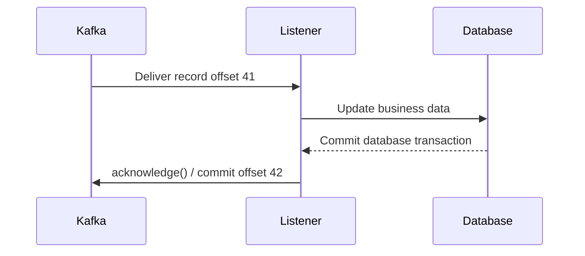

# Acknowledgment trong listener

Trong Spring Kafka, listener container quản lý consumer và tiến độ offset của consumer group. Nếu listener cần tự quyết định thời điểm xác nhận một record đã xử lý xong, Spring Kafka có thể truyền đối tượng `Acknowledgment` vào phương thức `@KafkaListener`. Listener gọi `acknowledge()` sau khi hoàn tất công việc; container tiếp nhận tín hiệu đó và commit offset theo `AckMode` đã cấu hình.

Acknowledgment hữu ích khi ứng dụng cần kiểm soát rõ ràng ranh giới giữa xử lý nghiệp vụ và ghi nhận tiến độ Kafka, chẳng hạn chỉ xác nhận sau khi lưu đơn hàng vào database. Cơ chế này phải được cấu hình ở listener container và cần phối hợp với error handler, retry, idempotency. Việc gọi `acknowledge()` không tự tạo giao dịch nguyên tử giữa Kafka và database, cũng không đồng nghĩa Kafka gửi một ACK message riêng cho producer.

Các ví dụ trong bài sử dụng event và application service đơn giản:

```java
import java.math.BigDecimal;
import java.time.Instant;
import java.util.List;

public record OrderCreatedEvent(
        String eventId,
        String orderId,
        BigDecimal total,
        Instant occurredAt
) {}

public interface OrderApplicationService {
    void apply(OrderCreatedEvent event);
    void applyBatch(List<OrderCreatedEvent> events);
}
```

## 1. Acknowledgment là gì?

`Acknowledgment` là interface của Spring Kafka (`org.springframework.kafka.support.Acknowledgment`). Container cung cấp một đối tượng cho listener khi listener chạy với chế độ acknowledgment thủ công. Phương thức cơ bản:

```java
acknowledgment.acknowledge();
```

Lời gọi này thông báo với container rằng record (hoặc batch, tùy loại listener) đã được xử lý đến điểm ứng dụng chấp nhận xác nhận. Container chịu trách nhiệm ghi nhận và commit offset theo semantics của `AckMode`.

Phân biệt ba khái niệm:

| Khái niệm | Ý nghĩa |
|---|---|
| `Acknowledgment` của Spring Kafka | Handle mà listener dùng để báo container rằng xử lý đã đạt điểm có thể xác nhận |
| Consumer offset commit | Ghi lại vị trí tiếp theo consumer group sẽ đọc trong một partition |
| Producer acknowledgment (`acks`) | Chính sách producer chờ broker xác nhận record đã được ghi |

`Acknowledgment` thuộc phía consumer. Nó không xóa record khỏi topic và không tác động đến `acks` của producer. Record vẫn được lưu theo retention hoặc cleanup policy của topic.

## 2. Truyền `Acknowledgment` vào `@KafkaListener`

Listener có thể nhận payload cùng tham số `Acknowledgment`:

```java
import org.springframework.kafka.annotation.KafkaListener;
import org.springframework.kafka.support.Acknowledgment;
import org.springframework.stereotype.Component;

@Component
public class OrderCreatedListener {

    private final OrderApplicationService orderService;

    public OrderCreatedListener(OrderApplicationService orderService) {
        this.orderService = orderService;
    }

    @KafkaListener(
            id = "ordersManualListener",
            topics = "orders.created",
            groupId = "orders-projection",
            containerFactory = "manualAckKafkaListenerContainerFactory"
    )
    public void onMessage(
            OrderCreatedEvent event,
            Acknowledgment acknowledgment) {

        orderService.apply(event);
        acknowledgment.acknowledge();
    }
}
```

Thứ tự trong ví dụ là điểm cốt lõi: application service xử lý event trước, sau đó listener mới gọi `acknowledge()`. Nếu `orderService.apply(event)` ném exception, dòng xác nhận không được thực hiện và exception được chuyển đến error handler của container.

`Acknowledgment` chỉ có ý nghĩa khi listener container được cấu hình `AckMode.MANUAL` hoặc `AckMode.MANUAL_IMMEDIATE`. Chỉ thêm tham số này vào chữ ký method không tự bật chế độ manual. Hãy cấu hình đúng container factory mà listener đang sử dụng.

## 3. Cấu hình `AckMode.MANUAL` trên listener container

Có thể tạo một `ConcurrentKafkaListenerContainerFactory` riêng cho listener cần manual acknowledgment:

```java
import org.springframework.context.annotation.Bean;
import org.springframework.context.annotation.Configuration;
import org.springframework.kafka.config.ConcurrentKafkaListenerContainerFactory;
import org.springframework.kafka.core.ConsumerFactory;
import org.springframework.kafka.listener.CommonErrorHandler;
import org.springframework.kafka.listener.ContainerProperties;

@Configuration
public class KafkaListenerConfiguration {

    @Bean
    public ConcurrentKafkaListenerContainerFactory<String, OrderCreatedEvent>
            manualAckKafkaListenerContainerFactory(
                    ConsumerFactory<String, OrderCreatedEvent> consumerFactory,
                    CommonErrorHandler errorHandler) {

        var factory = new ConcurrentKafkaListenerContainerFactory<
                String, OrderCreatedEvent>();
        factory.setConsumerFactory(consumerFactory);
        factory.getContainerProperties().setAckMode(
                ContainerProperties.AckMode.MANUAL
        );
        factory.setCommonErrorHandler(errorHandler);
        return factory;
    }
}
```

Sau đó gắn factory bằng thuộc tính `containerFactory` trong `@KafkaListener`. Cách này giúp mỗi listener dùng đúng chính sách commit của nó. Nếu ứng dụng chỉ có một chính sách chung, có thể cấu hình factory mặc định thay vì tạo nhiều factory.

Khi dùng factory tùy chỉnh, hãy bảo đảm `ConsumerFactory` có key/value deserializer tương thích với event. Nếu ứng dụng có error handler dùng chung, có thể gắn `CommonErrorHandler` vào factory đó để xác định cách xử lý exception.

## 4. Cấu hình bằng Spring Boot

Với listener container factory mặc định do Spring Boot cấu hình, có thể đặt acknowledgment mode trong `application.yml`:

```yaml
spring:
  kafka:
    bootstrap-servers: ${KAFKA_BOOTSTRAP_SERVERS:localhost:9092}
    consumer:
      group-id: orders-projection
      enable-auto-commit: false
      auto-offset-reset: earliest
    listener:
      ack-mode: manual
```

`enable-auto-commit: false` để Spring Kafka container quản lý việc commit theo `AckMode`. Spring Kafka thường tắt auto commit khi không được bật tường minh; khai báo rõ trong cấu hình giúp tránh hiểu nhầm về việc ai đang commit offset.

Nếu ứng dụng tự tạo `ConcurrentKafkaListenerContainerFactory`, hãy đặt `AckMode` trên đúng factory đó. Thuộc tính `spring.kafka.listener.ack-mode` của Boot không tự động thay đổi mọi factory tùy chỉnh do ứng dụng tạo.

## 5. Offset được commit như thế nào?

Kafka commit offset kế tiếp cần đọc, không phải offset của record vừa xử lý. Ví dụ, sau khi xử lý record offset `41`, vị trí commit thường là `42`.

```text
Partition orders-0

offset:       40       41       42       43
record:     event-A  event-B  event-C  event-D
                       |
                       +-- listener xử lý xong và acknowledge()
                           commit offset 42

Lần đọc tiếp theo bắt đầu từ offset 42
```

Đối với `AckMode.MANUAL`, lời gọi `acknowledge()` đánh dấu record đã được xác nhận. Container gom các acknowledgment và commit theo quy tắc manual sau khi các record được trả về trong poll đã được xử lý. Vì vậy, không nên hiểu rằng broker chắc chắn nhận commit ngay tại dòng `acknowledge()`.

Đối với `AckMode.MANUAL_IMMEDIATE`, container yêu cầu commit ngay khi `acknowledge()` được gọi trên consumer thread. Nếu gọi từ thread khác, acknowledgment được xử lý theo cơ chế của container và không có cùng semantics tức thời. Tránh trộn lẫn cách gọi trên consumer thread và thread ngoài trong cùng một listener vì thứ tự commit có thể khó dự đoán.

## 6. Phân biệt `MANUAL` và `MANUAL_IMMEDIATE`

| Tiêu chí | `MANUAL` | `MANUAL_IMMEDIATE` |
|---|---|---|
| Listener gọi `acknowledge()` | Có | Có |
| Thời điểm commit | Container gom acknowledgment và commit theo poll | Commit ngay nếu gọi trên consumer thread |
| Độ trễ commit | Có thể đợi đến cuối poll | Có thể thấp hơn |
| Phù hợp | Muốn listener quyết định record được xác nhận, container quản lý commit | Cần commit ngay tại callback và hiểu ràng buộc thread |
| Lưu ý | Không phải commit tức thời tại dòng gọi | Gọi từ thread khác không có bảo đảm commit tức thời |

Nếu không có yêu cầu rõ ràng về commit ngay lập tức, `MANUAL` thường dễ vận hành hơn. Chọn `MANUAL_IMMEDIATE` khi độ trễ commit là yêu cầu thực tế và listener thực hiện acknowledgment trên consumer thread.

## 7. Chỉ acknowledge sau khi xử lý thành công

Không gọi acknowledgment trước khi nghiệp vụ hoàn tất. Ví dụ sau thể hiện rõ đường xử lý thành công và thất bại:

```java
@KafkaListener(
        topics = "orders.created",
        groupId = "orders-projection",
        containerFactory = "manualAckKafkaListenerContainerFactory"
)
public void onMessage(
        OrderCreatedEvent event,
        Acknowledgment acknowledgment) {

    try {
        orderService.apply(event);
        acknowledgment.acknowledge();
    } catch (RuntimeException exception) {
        // Không acknowledge; để error handler xử lý retry/recovery.
        throw exception;
    }
}
```

Nếu xử lý thất bại, listener ném exception để error handler quyết định retry, backoff hoặc recovery. Không bắt exception rồi vẫn gọi `acknowledge()` trong `finally`; làm vậy có thể commit offset dù side effect chưa hoàn thành.

Nếu không cần bổ sung log hoặc context cho exception, có thể bỏ `try/catch` và để exception tự truyền ra ngoài. Điều quan trọng là không nuốt lỗi theo cách khiến container hiểu nhầm listener đã xử lý thành công.

## 8. Kết hợp acknowledgment với retry và dead-letter

Acknowledgment quyết định listener đã xác nhận tiến độ đến đâu. Error handler quyết định hành động khi listener ném exception. Hai cơ chế phối hợp nhưng không thay thế nhau.

Ví dụ cấu hình retry bằng `DefaultErrorHandler`:

```java
import org.springframework.context.annotation.Bean;
import org.springframework.context.annotation.Configuration;
import org.springframework.kafka.listener.DefaultErrorHandler;
import org.springframework.util.backoff.FixedBackOff;

@Configuration
public class KafkaErrorConfiguration {

    @Bean
    public DefaultErrorHandler kafkaErrorHandler() {
        return new DefaultErrorHandler(
                new FixedBackOff(1_000L, 2L)
        );
    }
}
```

Ví dụ trên minh họa khoảng nghỉ một giây và tối đa hai lần retry sau lần xử lý đầu tiên. Trong ứng dụng thật, cần phân loại lỗi retryable và non-retryable, chọn backoff phù hợp, rồi cấu hình recoverer nếu cần chuyển record lỗi sang dead-letter topic. Nếu dùng `DeadLetterPublishingRecoverer`, producer template phải serialize được record và DLT phải có partition/configuration phù hợp.

Không tự acknowledge record lỗi chỉ để ngăn retry. Hãy để error handler quyết định kết quả recovery; việc commit sau recovery cần phù hợp với chính sách dữ liệu của ứng dụng.

## 9. Batch listener và acknowledgment

Với record listener, mỗi lần gọi method thường tương ứng một record. Với batch listener, method nhận một collection hoặc `ConsumerRecords` từ một lần poll; `Acknowledgment` khi được gọi xác nhận batch theo semantics của container.

Ví dụ batch listener:

```java
import java.util.List;

import org.springframework.kafka.annotation.KafkaListener;
import org.springframework.kafka.support.Acknowledgment;
import org.springframework.stereotype.Component;

@Component
public class OrderBatchListener {

    private final OrderApplicationService orderService;

    public OrderBatchListener(OrderApplicationService orderService) {
        this.orderService = orderService;
    }

    @KafkaListener(
            id = "ordersBatchListener",
            topics = "orders.created",
            groupId = "orders-batch",
            containerFactory = "manualAckBatchListenerContainerFactory"
    )
    public void onMessages(
            List<OrderCreatedEvent> events,
            Acknowledgment acknowledgment) {

        orderService.applyBatch(events);
        acknowledgment.acknowledge();
    }
}
```

Factory dùng batch listener phải được cấu hình `setBatchListener(true)` và `AckMode.MANUAL`. Chỉ acknowledge sau khi cả batch đã được xử lý thành công theo quy tắc nghiệp vụ. Nếu một phần batch thất bại, hãy thiết kế retry/recovery hoặc batch-specific nack/partial acknowledgment theo API của phiên bản Spring Kafka; không commit cả batch khi còn record chưa xử lý an toàn.

## 10. Acknowledgment và xử lý bất đồng bộ

Thông thường, listener xử lý đồng bộ trên consumer thread rồi gọi `acknowledge()` trước khi trả về. Nếu chuyển công việc sang executor khác, cần xem xét cẩn thận thứ tự hoàn tất và commit.

Spring Kafka hỗ trợ `asyncAcks` cho một số trường hợp acknowledgment hoàn tất không theo thứ tự của các record được poll. Khi bật, container có thể tạm dừng nhận thêm dữ liệu cho đến khi các acknowledgment còn thiếu được hoàn tất. Điều này giúp xử lý song song nhưng làm tăng độ phức tạp và có thể gây giao lại record sau sự cố trước khi offset được commit.

Chỉ dùng acknowledgment từ thread khác khi đã cấu hình và hiểu semantics của phiên bản Spring Kafka đang sử dụng. Không lưu `Acknowledgment` vào database hoặc hàng đợi lâu dài như một token có thể sử dụng bất kỳ lúc nào. Đây là handle gắn với lần giao record hiện tại, không phải cơ chế commit bền vững độc lập.

## 11. Manual acknowledgment không bảo đảm exactly-once

Giả sử listener cập nhật database rồi gọi `acknowledge()`. Có một khoảng thời gian giữa commit database và commit offset Kafka:



Nếu ứng dụng dừng sau khi database commit nhưng trước khi Kafka commit offset, record có thể được giao lại sau khi consumer khởi động lại. Database có thể nhận cùng event lần thứ hai.

Vì vậy, manual acknowledgment thường được dùng trong mô hình at-least-once khi cấu hình phù hợp; nó không tự bảo đảm exactly-once cho side effect bên ngoài Kafka. Hãy kết hợp với:

- Handler idempotent, ví dụ dùng `eventId` cùng unique constraint để phát hiện event đã xử lý.
- Inbox/idempotency table cập nhật cùng database transaction với dữ liệu nghiệp vụ.
- Kafka transaction cho luồng Kafka-to-Kafka khi cần commit output records và consumer offsets trong cùng transaction.
- Transactional outbox/inbox khi cần phối hợp database với Kafka mà không giả định hai hệ thống commit nguyên tử.

## 12. Kiểm thử listener có acknowledgment

Kiểm thử nên xác minh cả thứ tự xử lý và tiến độ offset:

- **Unit test:** mock application service và `Acknowledgment`; xác minh service chạy trước và acknowledgment chỉ được gọi sau khi service thành công.
- **Failure test:** làm service ném exception; xác minh listener không gọi acknowledgment.
- **Integration test:** dùng Embedded Kafka hoặc Testcontainers, gửi record và kiểm tra committed offset của consumer group.
- **Restart test:** mô phỏng ứng dụng dừng sau khi side effect hoàn tất nhưng trước commit offset; xác minh khả năng giao lại và idempotency.
- **Retry/DLT test:** xác minh số lần retry, backoff và hành vi recovery.
- **Batch test:** xác minh batch chỉ được acknowledge sau khi xử lý đầy đủ theo quy ước.
- **Async test:** nếu bật `asyncAcks`, xác minh container xử lý acknowledgment out-of-order và tạm dừng poll khi còn gap.

Ví dụ unit test kiểm tra thứ tự lời gọi:

```java
import static org.mockito.Mockito.inOrder;

import java.math.BigDecimal;
import java.time.Instant;

import org.junit.jupiter.api.Test;
import org.springframework.kafka.support.Acknowledgment;

class OrderCreatedListenerTest {

    @Test
    void acknowledgesOnlyAfterSuccessfulProcessing() {
        OrderApplicationService service = org.mockito.Mockito.mock(
                OrderApplicationService.class);
        Acknowledgment acknowledgment = org.mockito.Mockito.mock(
                Acknowledgment.class);
        OrderCreatedListener listener = new OrderCreatedListener(service);
        OrderCreatedEvent event = new OrderCreatedEvent(
                "evt-1",
                "order-1",
                new BigDecimal("1250000"),
                Instant.parse("2026-11-17T03:00:00Z")
        );

        listener.onMessage(event, acknowledgment);

        var inOrder = inOrder(service, acknowledgment);
        inOrder.verify(service).apply(event);
        inOrder.verify(acknowledgment).acknowledge();
    }
}
```

Unit test xác minh thứ tự lời gọi trong listener; integration test vẫn cần thiết để xác minh container thực sự commit offset như cấu hình.

## 13. Những lỗi thường gặp

- **Chỉ thêm tham số `Acknowledgment` mà không bật manual AckMode:** listener container chưa được cấu hình để cung cấp manual acknowledgment.
- **Gọi `acknowledge()` trước khi nghiệp vụ hoàn tất:** offset có thể được commit dù side effect thất bại.
- **Gọi acknowledgment trong `finally`:** vô tình xác nhận cả trường hợp xử lý lỗi.
- **Nhầm `MANUAL` với commit ngay lập tức:** `MANUAL` gom acknowledgment và commit theo poll; `MANUAL_IMMEDIATE` có semantics tức thời khi gọi trên consumer thread.
- **Bật `enable.auto.commit`:** làm commit tự động của Kafka consumer xung đột với ý định để container quản lý offset.
- **Cho rằng acknowledgment xóa record khỏi topic:** record vẫn được giữ theo retention hoặc compaction.
- **Cho rằng manual ack bảo đảm exactly-once:** database và Kafka có thể commit tách rời; cần idempotency hoặc transaction phù hợp.
- **Nuốt exception mà không có recovery:** container có thể coi listener đã hoàn tất; hãy định nghĩa rõ retry và recovery.
- **Gọi acknowledgment từ thread khác mà không hiểu `asyncAcks`:** có thể sai thứ tự hoặc hiểu nhầm thời điểm commit.
- **Không kiểm tra consumer lag và poll interval:** xử lý lâu vẫn có thể gây rebalance dù dùng manual acknowledgment.

## 14. Checklist khi dùng `Acknowledgment`

- [ ] Listener dùng đúng container factory có `AckMode.MANUAL` hoặc `MANUAL_IMMEDIATE`.
- [ ] `enable.auto.commit` được tắt để container quản lý offset.
- [ ] Listener gọi `acknowledge()` sau khi nghiệp vụ xử lý thành công.
- [ ] Exception được chuyển đến error handler khi xử lý thất bại.
- [ ] Retry, backoff và dead-letter recovery phù hợp với loại lỗi.
- [ ] Handler idempotent hoặc có cơ chế chống xử lý lặp.
- [ ] Hiểu commit offset là offset kế tiếp cần đọc.
- [ ] Phân biệt `MANUAL` và `MANUAL_IMMEDIATE` theo thread và poll boundary.
- [ ] Với batch listener, chỉ xác nhận sau khi batch đạt điều kiện xử lý.
- [ ] Với xử lý bất đồng bộ, đã đánh giá `asyncAcks` và giới hạn phiên bản.
- [ ] Integration test xác minh committed offset và hành vi restart/retry.

`Acknowledgment` cho phép listener chủ động báo container khi nào tiến độ xử lý đã sẵn sàng để commit. Khi cấu hình đúng manual AckMode, chỉ xác nhận sau khi xử lý thành công và kết hợp retry cùng idempotency, consumer có thể kiểm soát offset rõ ràng và giảm nguy cơ mất dữ liệu trong luồng messaging.
