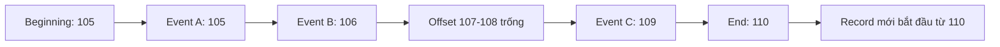

# Seek về đầu hoặc cuối partition

Kafka consumer có thể thay đổi vị trí đọc trong một partition thay vì luôn tiếp tục từ offset đã commit. Thao tác đó gọi là **seek**. Trong Spring Kafka, ứng dụng thường dùng **ConsumerSeekAware** và **ConsumerSeekCallback** để seek về đầu, cuối hoặc một offset cụ thể.

Seek hữu ích khi cần phát lại dữ liệu để dựng lại trạng thái, hoặc bỏ qua backlog để chỉ nhận sự kiện mới. Trước khi dùng, cần phân biệt **position** trong consumer đang chạy với **committed offset** đã lưu cho consumer group.

## 1. Beginning offset và end offset

Mỗi partition là một log độc lập. Consumer position biểu thị offset tiếp theo mà consumer sẽ đọc.

- **Beginning offset** là offset nhỏ nhất còn được đọc trong partition ở thời điểm truy vấn. Nó có thể lớn hơn 0 vì Kafka đã xóa dữ liệu cũ theo retention.
- **End offset** là vị trí ngay sau record cuối cùng hiện có. Đây là offset tiếp theo mà record mới sẽ được ghi, không phải offset của record cuối cùng.

Ví dụ:

| Record | Offset |
|---|---:|
| Event A | 105 |
| Event B | 106 |
| Event C | 109 |
| End offset | 110 |

Offset 107 và 108 có thể không còn record do compaction hoặc xóa dữ liệu. Beginning offset là 105, end offset là 110.



Do đó, không giả định beginning offset luôn bằng 0 hoặc offset trong log luôn liên tục.

## 2. Seek về đầu partition

Seek về đầu đưa position của consumer tới beginning offset hiện có. Consumer sẽ đọc lại các record còn được Kafka giữ trong partition.

Spring Kafka cung cấp các overload để seek một partition:

```java
callback.seekToBeginning("order-events", 0);
```

Hoặc toàn bộ partition đang được gán cho consumer:

```java
callback.seekToBeginning(assignments.keySet());
```

Ví dụ partition có beginning offset 105 và consumer đang ở position 110. Sau khi seek về đầu, consumer đọc lại Event A ở offset 105 và tiếp tục các record còn lại.

Các trường hợp phù hợp:

- Phát lại lịch sử còn được lưu để dựng lại read model.
- Nạp lại cache hoặc trạng thái cục bộ từ event log.
- Chạy lại luồng xử lý sau khi sửa logic.
- Kiểm tra hoặc tái xử lý dữ liệu trong môi trường kiểm soát.

Seek về đầu có thể làm nghiệp vụ chạy lại nhiều event. Consumer cần idempotency hoặc cơ chế chống xử lý trùng, đặc biệt khi event tạo side effect trong database hay dịch vụ bên ngoài.

## 3. Seek về cuối partition

Seek về cuối đưa position tới end offset mà Kafka xác định khi thao tác seek được áp dụng. Consumer bỏ qua backlog trước vị trí đó và chờ record ở các offset tiếp theo.

```java
callback.seekToEnd("order-events", 0);
```

Hoặc seek tất cả partition đang được gán:

```java
callback.seekToEnd(assignments.keySet());
```

Ví dụ end offset hiện là 110. Sau khi seek, consumer chờ record ở offset 110 trở đi. Các record có offset nhỏ hơn 110 sẽ không được consumer này đọc trong lượt chạy hiện tại.

Các trường hợp phù hợp:

- Consumer giám sát chỉ cần sự kiện mới phát sinh từ lúc bắt đầu.
- Tác vụ tạm thời chỉ theo dõi thay đổi mới.
- Luồng mới đã có snapshot và chỉ cần tiếp tục từ dữ liệu phát sinh sau snapshot.

Không seek về cuối nếu consumer cần xử lý đầy đủ các event chưa được xử lý. Thao tác này có thể bỏ qua dữ liệu đang chờ trong partition.

## 4. Dùng ConsumerSeekAware trong Spring Kafka

**ConsumerSeekAware** cho phép listener nhận callback để điều khiển position của consumer. Spring Kafka đăng ký callback theo consumer thread; khi partition được gán, listener có thể chọn seek tới đầu hoặc cuối.

Ví dụ listener luôn seek về đầu mỗi khi được gán partition:

```java
import java.util.Map;

import org.apache.kafka.common.TopicPartition;
import org.springframework.kafka.annotation.KafkaListener;
import org.springframework.kafka.listener.ConsumerSeekAware;
import org.springframework.kafka.listener.ConsumerSeekAware.ConsumerSeekCallback;
import org.springframework.stereotype.Component;

@Component
public class ReplayFromBeginningListener implements ConsumerSeekAware {

    @Override
    public void registerSeekCallback(ConsumerSeekCallback callback) {
        // Ví dụ này chỉ seek trong onPartitionsAssigned.
    }

    @Override
    public void onPartitionsAssigned(
            Map<TopicPartition, Long> assignments,
            ConsumerSeekCallback callback) {

        callback.seekToBeginning(assignments.keySet());
    }

    @KafkaListener(
        topics = "order-events",
        groupId = "replay-service"
    )
    public void listen(OrderCreated event) {
        // Xử lý event được phát lại từ đầu partition.
    }
}
```

Phương thức **onPartitionsAssigned** được gọi khi consumer nhận partition, gồm lần gán ban đầu và các lần rebalance sau đó. Map **assignments** chứa các partition vừa được gán cùng position hiện tại trước khi callback seek được áp dụng.

Muốn bỏ qua backlog và bắt đầu từ cuối, thay lời gọi trong callback bằng:

```java
@Override
public void onPartitionsAssigned(
        Map<TopicPartition, Long> assignments,
        ConsumerSeekCallback callback) {

    callback.seekToEnd(assignments.keySet());
}
```

Đây là chính sách áp dụng trên mỗi lần assignment. Khi rebalance xảy ra, listener sẽ seek lại các partition vừa nhận. Chỉ dùng cách này nếu phát lại hoặc bỏ qua backlog sau mỗi rebalance đúng với yêu cầu nghiệp vụ.

Nếu chỉ muốn reset một lần khi consumer khởi động, cần quản lý trạng thái lần assignment đầu tiên theo từng consumer thread. Nếu cần reset bền vững qua các lần restart, hãy thay committed offset của consumer group bằng quy trình quản trị ở phần 8.

## 5. Seek tới một offset cụ thể

Khi cần bắt đầu từ một vị trí xác định, dùng phương thức **seek(topic, partition, offset)**:

```java
@Override
public void onPartitionsAssigned(
        Map<TopicPartition, Long> assignments,
        ConsumerSeekCallback callback) {

    callback.seek("order-events", 0, 105L);
}
```

Ví dụ yêu cầu consumer đọc partition 0 từ offset 105. Offset phải nằm trong phạm vi Kafka còn phục vụ. Nếu offset nhỏ hơn beginning offset vì dữ liệu đã hết hạn, Kafka không thể khôi phục record đã bị xóa; hành vi tiếp theo phụ thuộc cấu hình offset reset và trạng thái consumer.

Offset phải được xác định riêng cho từng partition. Offset 105 của partition 0 không đại diện cho vị trí tương ứng ở partition 1.

Có thể giới hạn seek vào một partition vừa được gán:

```java
@Override
public void onPartitionsAssigned(
        Map<TopicPartition, Long> assignments,
        ConsumerSeekCallback callback) {

    TopicPartition target = new TopicPartition("order-events", 0);

    if (assignments.containsKey(target)) {
        callback.seek(target.topic(), target.partition(), 105L);
    }
}
```

Hard-code offset vào mã ứng dụng thường khó vận hành. Nếu vị trí thay đổi theo môi trường, hãy lấy offset từ cấu hình, checkpoint hoặc công cụ quản trị.

## 6. Phân biệt seek với auto.offset.reset

**auto.offset.reset** là cấu hình Kafka consumer:

```yaml
spring:
  kafka:
    consumer:
      auto-offset-reset: earliest
```

Các giá trị thường dùng:

| Giá trị | Hành vi khi không có committed offset hợp lệ |
|---|---|
| **earliest** | Bắt đầu từ beginning offset còn được lưu |
| **latest** | Bắt đầu từ end offset hiện tại |
| **none** | Ném lỗi nếu không tìm được committed offset hợp lệ |

**auto.offset.reset** chỉ áp dụng khi group không có committed offset hợp lệ hoặc offset đã commit nằm ngoài phạm vi broker còn lưu. Nó không ép một group đang có committed offset hợp lệ quay về đầu hoặc nhảy tới cuối.

Ví dụ:

- Group **billing-service** đã commit offset 500.
- Ứng dụng đổi **auto-offset-reset** từ **latest** sang **earliest**.
- Khi khởi động lại, consumer vẫn tiếp tục từ offset 500 vì committed offset còn hợp lệ.
- Muốn đọc lại từ beginning offset, cần seek hoặc reset committed offset.

Đổi **auto.offset.reset** không phải cách đáng tin cậy để replay dữ liệu cho consumer group đã hoạt động.

## 7. Seek không tự cập nhật committed offset

Đây là điểm dễ nhầm lẫn nhất. Khi gọi **seekToBeginning** hoặc **seekToEnd**, consumer thay đổi position trong bộ nhớ. Thao tác này không tự ghi committed offset mới lên Kafka.

Ví dụ:

1. Group đã commit offset 500.
2. Consumer được gán partition và seek về beginning offset 100.
3. Consumer đọc lại từ offset 100.
4. Nếu ứng dụng dừng trước khi có committed offset mới, lần chạy tiếp theo vẫn có thể bắt đầu từ offset 500.
5. Nếu listener xử lý record và container commit offset mới theo ack mode, lần chạy tiếp theo tiếp tục từ committed offset mới đó.

Với seek về cuối cũng tương tự. Nếu consumer seek tới end offset 900 nhưng chưa xử lý record nào và chưa có commit mới, committed offset cũ vẫn còn. Sau restart, group có thể quay lại offset cũ và đọc backlog.

Spring Kafka quản lý commit theo cấu hình container và ack mode. Không gọi trực tiếp **consumer.commitSync()** từ một thread tùy ý để làm seek bền vững; Kafka consumer không thread-safe và commit phải tuân theo quyền sở hữu consumer thread cùng chính sách của container.

Nếu mục tiêu là thay đổi vị trí khởi động lâu dài của consumer group, hãy reset committed offset bằng công cụ quản trị trong khi group đã dừng.

## 8. Reset committed offset bằng kafka-consumer-groups

Khi cần thay đổi vị trí đọc có hiệu lực sau restart, có thể dùng **kafka-consumer-groups.sh**.

Trước hết, kiểm tra trạng thái group:

```bash
bin/kafka-consumer-groups.sh \
  --bootstrap-server localhost:9092 \
  --group billing-service \
  --describe
```

Xem trước thao tác reset về đầu:

```bash
bin/kafka-consumer-groups.sh \
  --bootstrap-server localhost:9092 \
  --group billing-service \
  --topic order-events \
  --reset-offsets \
  --to-earliest \
  --dry-run
```

Nếu kết quả đúng, dừng consumer group và thực hiện:

```bash
bin/kafka-consumer-groups.sh \
  --bootstrap-server localhost:9092 \
  --group billing-service \
  --topic order-events \
  --reset-offsets \
  --to-earliest \
  --execute
```

Để reset về cuối, thay **--to-earliest** bằng **--to-latest**:

```bash
bin/kafka-consumer-groups.sh \
  --bootstrap-server localhost:9092 \
  --group billing-service \
  --topic order-events \
  --reset-offsets \
  --to-latest \
  --dry-run
```

Sau khi kiểm tra kết quả dry-run, chạy lại lệnh với **--execute**. Có thể chỉ định một partition bằng cú pháp topic-partition phù hợp với Kafka CLI, ví dụ **--topic order-events:0**.

Lưu ý vận hành:

- Consumer group phải không có consumer đang hoạt động khi reset offset.
- Luôn chạy **--dry-run** và kiểm tra offset dự kiến trước khi **--execute**.
- Reset offset ảnh hưởng tới lần đọc tiếp theo của group/partition được chỉ định.
- Seek về đầu có thể tạo lượng lớn record phải xử lý lại; seek về cuối có thể bỏ qua backlog.
- Nếu chỉ reset một số partition, hãy chỉ định rõ partition để tránh thay đổi ngoài dự kiến.

Có thể dùng Kafka Admin API **alterConsumerGroupOffsets** để quản trị committed offset từ ứng dụng quản trị. Cần kiểm tra trạng thái group và bảo đảm consumer không hoạt động trong thời gian thay đổi. Không dùng API quản trị offset thay cho callback seek trong listener đang chạy.

## 9. Seek khi rebalance và xử lý concurrency

Consumer group có thể rebalance khi instance tăng/giảm, consumer mất heartbeat hoặc partition assignment thay đổi. Partition được thu hồi rồi gán lại cho consumer khác.

**onPartitionsAssigned** được gọi sau khi partition được gán. Đây là thời điểm phù hợp để áp dụng chính sách seek cho partition vừa nhận.

Ba điều cần chú ý:

1. **Seek trên mỗi lần assignment** có thể lặp lại sau rebalance. Nếu luôn seek về đầu, consumer có thể phát lại dữ liệu đã xử lý.
2. **Seek về cuối trên mỗi lần assignment** có thể bỏ qua backlog vừa được giao cho consumer sau rebalance.
3. **Concurrency** tạo nhiều consumer thread. Mỗi thread có callback riêng; không lưu tất cả callback vào một biến instance đơn lẻ rồi giả định callback đó đại diện cho toàn bộ consumer.

Nếu cần lưu callback để seek từ một luồng khác, hãy lưu callback theo consumer thread hoặc partition assignment và cập nhật khi thread/assignment thay đổi. **ConsumerSeekCallback** điều phối thao tác seek về consumer thread; khi được gọi từ thread khác, yêu cầu seek được thực thi trên consumer thread ở chu kỳ poll phù hợp. Không gọi trực tiếp Kafka **Consumer.seek** từ thread bên ngoài.

Khi seek từ một luồng khác, cần xử lý trường hợp callback đã được thay thế khi container khởi động lại hoặc concurrency thay đổi. Hãy quản lý vòng đời callback thay vì giữ một tham chiếu cũ vô thời hạn.

## 10. Kiểm thử seek callback

Có thể unit test chính sách seek bằng cách mock **ConsumerSeekCallback**. Không cần khởi động broker để xác minh listener yêu cầu seek đúng partition.

Ví dụ listener seek về đầu partition:

```java
import java.util.Map;

import org.apache.kafka.common.TopicPartition;
import org.junit.jupiter.api.Test;
import org.springframework.kafka.listener.ConsumerSeekAware.ConsumerSeekCallback;

import static org.mockito.Mockito.mock;
import static org.mockito.Mockito.verify;

class ReplayFromBeginningListenerTest {

    @Test
    void seeksAllAssignedPartitionsToBeginning() {
        ConsumerSeekCallback callback = mock(ConsumerSeekCallback.class);

        Map<TopicPartition, Long> assignments = Map.of(
            new TopicPartition("order-events", 0), 120L,
            new TopicPartition("order-events", 1), 450L
        );

        ReplayFromBeginningListener listener =
            new ReplayFromBeginningListener();

        listener.onPartitionsAssigned(assignments, callback);

        verify(callback).seekToBeginning(assignments.keySet());
    }
}
```

Đặt test cùng package với listener để dùng trực tiếp kiểu **ReplayFromBeginningListener**. Constructor của listener trong ví dụ không nhận dependency nào khác. Có thể viết test tương tự cho seek cuối bằng cách xác minh lời gọi **seekToEnd(assignments.keySet())**.

Unit test xác minh listener gửi đúng lệnh seek tới callback, chưa chứng minh consumer thực sự đọc record ở offset mong muốn. Với integration test dùng Embedded Kafka, nên:

1. Tạo topic có một hoặc nhiều partition.
2. Gửi một số record có key/value xác định.
3. Khởi động listener có chính sách seek về đầu hoặc cuối.
4. Đợi container được gán partition bằng **ContainerTestUtils.waitForAssignment**.
5. Gửi record kiểm chứng hoặc quan sát record được nhận qua queue.
6. Dùng timeout hữu hạn và group ID riêng để tránh phụ thuộc trạng thái từ lần test trước.

Khi test seek về đầu, bảo đảm record kiểm thử vẫn còn trong log. Khi test seek về cuối, gửi record mới sau khi listener hoàn tất assignment và seek; record mới phải được nhận, còn backlog trước seek phải bị bỏ qua trong lượt chạy đó.

## 11. Lỗi thường gặp

| Hiện tượng | Nguyên nhân có thể | Cách xử lý |
|---|---|---|
| Đổi auto.offset.reset=earliest nhưng consumer vẫn đọc từ offset cũ | Group còn committed offset hợp lệ | Dùng ConsumerSeekAware hoặc reset group offset |
| Seek về đầu nhưng không đọc từ offset 0 | Beginning offset đã tăng do retention hoặc compaction | Kiểm tra beginning offset thực tế |
| Seek về cuối nhưng vẫn đọc backlog | Seek gọi quá muộn hoặc chưa áp dụng cho partition cần thiết | Seek trong onPartitionsAssigned và kiểm tra assignment |
| Restart xong lại đọc từ committed offset cũ | Seek chỉ đổi position trong bộ nhớ, chưa có commit mới | Reset committed offset nếu cần thay đổi bền vững |
| Rebalance làm record bị xử lý lại | Chính sách seek đầu được áp dụng lại khi assignment thay đổi | Thiết kế seek theo lần assignment và dùng idempotency |
| Consumer bỏ qua dữ liệu sau rebalance | Listener luôn seek về cuối trên mỗi assignment | Chỉ dùng seek cuối khi chủ động bỏ backlog |
| Một số partition không được seek | Chỉ định sai topic/partition hoặc partition chưa thuộc assignment | Kiểm tra assignments.keySet() |
| Callback seek không hoạt động sau restart | Ứng dụng giữ callback cũ của consumer thread trước | Nhận callback mới qua registerSeekCallback |
| Xử lý trùng sau replay | Nghiệp vụ không idempotent | Dùng event ID, deduplication hoặc replay an toàn |

## 12. Checklist trước khi seek

- Xác định rõ cần replay dữ liệu cũ hay bỏ qua backlog.
- Kiểm tra beginning/end offset thực tế của từng partition.
- Chọn ConsumerSeekAware khi cần seek trong vòng đời listener.
- Dùng onPartitionsAssigned để seek partition vừa được giao.
- Hiểu rằng callback assignment có thể chạy lại sau rebalance.
- Không nhầm seek với committed offset.
- Nếu cần reset lâu dài, dừng consumer group và dùng công cụ reset offset.
- Dùng --dry-run trước --execute.
- Chuẩn bị idempotency khi phát lại dữ liệu.
- Kiểm thử cả lệnh seek lẫn hành vi đọc record thực tế.

## 13. Ghi nhớ

- Beginning offset là offset nhỏ nhất còn được lưu, không nhất thiết bằng 0.
- End offset là vị trí tiếp theo sau record cuối hiện có.
- seekToBeginning đọc lại dữ liệu còn lưu; seekToEnd bỏ qua backlog và chờ dữ liệu mới.
- Spring Kafka cung cấp ConsumerSeekAware và ConsumerSeekCallback để điều khiển vị trí đọc.
- onPartitionsAssigned phù hợp để seek partition vừa được giao.
- auto.offset.reset chỉ có tác dụng khi không có committed offset hợp lệ.
- Seek thay đổi position trong consumer đang chạy, không tự commit vị trí mới.
- Muốn thay đổi committed offset bền vững, hãy reset consumer group khi group đã dừng.
- Rebalance có thể khiến chính sách seek được áp dụng lại; hãy thiết kế replay và side effect an toàn.

Seek là công cụ điều khiển vị trí đọc của consumer. Khi hiểu rõ beginning offset, end offset, committed offset và vòng đời partition assignment, ứng dụng Spring Kafka có thể phát lại lịch sử hoặc chuyển sang chỉ nhận sự kiện mới mà không nhầm lẫn trạng thái đọc trong bộ nhớ với trạng thái đã lưu của consumer group.

