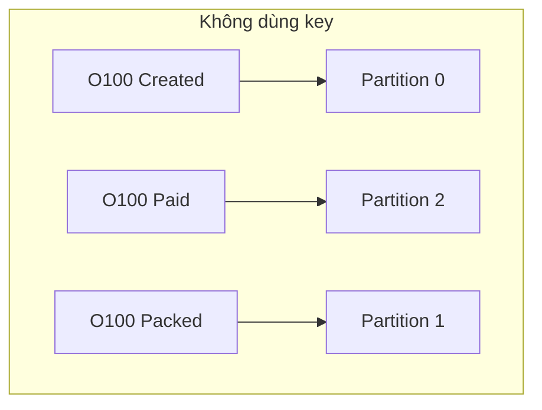
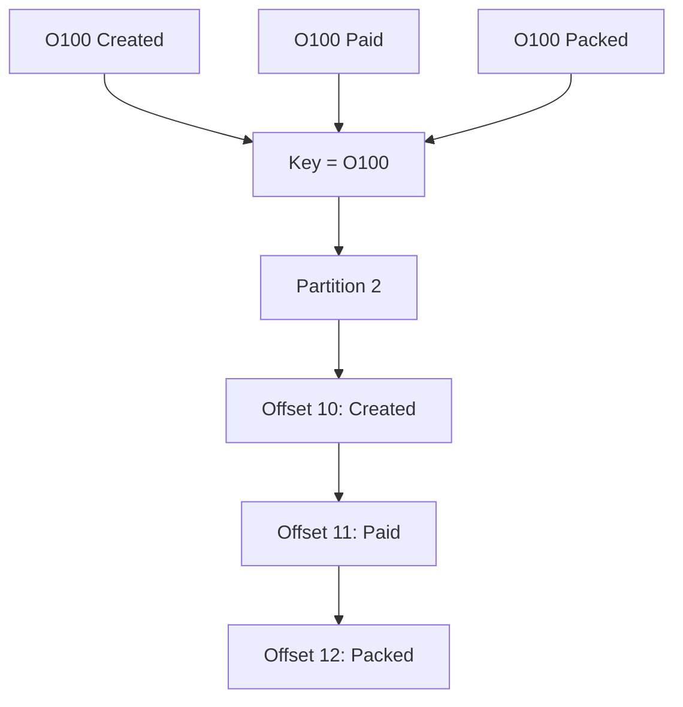

# Bảo toàn thứ tự bằng record key

Kafka chỉ bảo đảm thứ tự record trong **một partition**. Nếu các thay đổi của cùng một đơn hàng, tài khoản hoặc thiết bị bị ghi vào nhiều partition, consumer không có một thứ tự chung để biết thay đổi nào phải được áp dụng trước. Cách phổ biến để giữ các record liên quan cùng partition là dùng **record key** đại diện cho thực thể nghiệp vụ.

Ví dụ, tất cả event của đơn hàng `O100` đều dùng `orderId = O100` làm key. Với partitioner mặc định và số partition không đổi, Kafka định tuyến các record có cùng key vào cùng partition. Consumer đọc partition theo thứ tự offset, nhờ đó có thể xử lý chuỗi `OrderCreated`, `OrderPaid`, `OrderPacked` theo thứ tự record được append.

Record key tạo ra điều kiện để bảo toàn thứ tự theo thực thể. Nó không tự sắp xếp event theo thời gian nghiệp vụ, không tạo thứ tự toàn cục giữa partition và không giải quyết việc nhiều producer phát event sai thứ tự. Bài viết này làm rõ các điều kiện cần thiết từ producer đến consumer.

## 1. Vì sao record key giúp giữ thứ tự?

Mỗi Kafka partition là một log độc lập. Broker append record vào cuối log và gán offset tăng dần. Consumer đọc record theo thứ tự offset trong partition đó.

Giả sử topic `orders.events` có bốn partition. Nếu producer gửi event của `O100` mà không có key, các record có thể được phân phối sang những partition khác nhau. Khi đó, không có bảo đảm về thứ tự giữa chúng:



Consumer group có thể xử lý ba partition song song. `OrderPacked` thậm chí có thể được xử lý trước `OrderPaid`, dù ứng dụng gửi event theo trình tự mong muốn.

Nếu dùng `orderId` làm key, các record của cùng đơn hàng được định tuyến về cùng partition:



Lúc này, Kafka giữ thứ tự append của ba record trong partition 2. Consumer đọc offset 10, 11, 12 theo thứ tự đó. Các đơn hàng khác có key khác vẫn có thể được phân phối sang partition khác và xử lý song song.

## 2. Chọn key theo aggregate hoặc thực thể nghiệp vụ

Key nên đại diện cho đối tượng mà các thay đổi cần được tuần tự hóa. Một số lựa chọn thường gặp:

| Luồng dữ liệu | Key gợi ý | Lý do |
|---|---|---|
| Vòng đời đơn hàng | `orderId` | Các thay đổi trạng thái của một đơn hàng cần theo thứ tự. |
| Giao dịch tài khoản | `accountId` | Các thay đổi số dư của một tài khoản cần được áp dụng tuần tự. |
| Trạng thái thiết bị | `deviceId` | Các lần cập nhật của một thiết bị cần đi theo trình tự. |
| Hồ sơ khách hàng | `customerId` | Các thay đổi cùng khách hàng được xử lý trên một luồng. |
| Changelog cấu hình | `configId` | Record mới nhất của cùng cấu hình nằm trong cùng partition, phù hợp cả với compaction. |

Ví dụ, một event có thể chứa cả `eventId` và `orderId`:

```java
import java.time.Instant;
import java.math.BigDecimal;

public record OrderEvent(
        String eventId,
        String orderId,
        long sequence,
        String type,
        Instant occurredAt,
        BigDecimal amount
) {}
```

Hai trường định danh phục vụ hai mục đích khác nhau:

- `eventId` nhận diện duy nhất một lần phát sinh event, hữu ích cho deduplication và idempotency.
- `orderId` là key để gom các event của cùng aggregate vào một partition.
- `sequence` biểu thị thứ tự nghiệp vụ trong aggregate, giúp consumer phát hiện event thiếu, lặp hoặc đến không đúng trình tự.

Không nên dùng `eventId` làm key nếu mục tiêu là gom mọi event của một đơn hàng. Vì mỗi event có `eventId` khác nhau, chúng có thể được định tuyến sang các partition khác nhau.

## 3. Cơ chế partitioning theo key

Khi producer không chỉ định partition trực tiếp và key khác `null`, partitioner mặc định của Kafka Java producer sử dụng byte key đã serialize để tính partition. Về khái niệm, nó băm key rồi ánh xạ kết quả vào số partition hiện có.

Với cùng byte key và cùng số partition, partitioner mặc định cho kết quả partition ổn định. Do đó, nếu mọi producer serialize `O100` giống nhau và topic không thay đổi số partition, các record có key `O100` sẽ được đưa vào cùng partition.

Điều kiện để mapping giữ ổn định:

1. **Key phải giống nhau:** mọi event của cùng aggregate dùng cùng giá trị key.
2. **Serialization phải nhất quán:** các producer dùng cùng kiểu dữ liệu và cách serialize key. Ví dụ chuỗi `O100` phải tạo ra cùng byte sequence.
3. **Partitioner phải tương thích:** custom partitioner phải thực hiện cùng quy tắc định tuyến trên tất cả producer.
4. **Partition count phải ổn định:** thay đổi số partition có thể làm kết quả băm ánh xạ sang partition khác.
5. **Không ghi đè partition thủ công:** nếu producer chỉ định partition, partition đó được ưu tiên thay vì phép định tuyến theo key.

Ví dụ, hai producer dùng `StringSerializer` và gửi key `O100` vào topic có 8 partition sẽ cùng tính ra một partition theo partitioner mặc định. Nếu một producer dùng key `O100`, producer khác dùng key `o100`, hai byte key khác nhau và có thể vào hai partition khác nhau.

### Key null thì sao?

Kafka vẫn cho phép gửi record có key `null`. Khi đó producer không thể dùng hash key để gom record theo thực thể. Kafka client hiện đại thường dùng cơ chế sticky partitioning cho record không key để tận dụng batching; chi tiết phụ thuộc phiên bản và partitioner. Không nên dựa vào cách phân phối record không key để bảo đảm thứ tự theo aggregate.

Nếu nghiệp vụ yêu cầu ordering hoặc topic dùng log compaction theo thực thể, hãy cung cấp key khác `null` cho record.

## 4. Gửi event có key bằng Spring Kafka

Trong Spring Kafka, overload `KafkaTemplate.send(topic, key, data)` là cách trực tiếp để gửi record theo key:

```java
import java.util.concurrent.CompletableFuture;

import org.springframework.kafka.core.KafkaTemplate;
import org.springframework.kafka.support.SendResult;
import org.springframework.stereotype.Service;

@Service
public class OrderEventPublisher {

    private static final String TOPIC = "orders.events";

    private final KafkaTemplate<String, OrderEvent> kafkaTemplate;

    public OrderEventPublisher(KafkaTemplate<String, OrderEvent> kafkaTemplate) {
        this.kafkaTemplate = kafkaTemplate;
    }

    public CompletableFuture<SendResult<String, OrderEvent>> publish(
            OrderEvent event) {
        // Mọi event của cùng đơn hàng dùng chung orderId làm record key.
        return kafkaTemplate.send(TOPIC, event.orderId(), event);
    }
}
```

Trong ví dụ:

- `TOPIC` là luồng event đích.
- `event.orderId()` là key dùng để chọn partition.
- `event` là value được serialize và lưu trong record.
- `CompletableFuture` cho phép caller theo dõi kết quả gửi bất đồng bộ.

Ví dụ dùng kiểu trả về của Spring Kafka 3.x trở lên. Spring Kafka 2.x dùng `ListenableFuture` cho các phương thức `send`; hãy đối chiếu phiên bản dependency của dự án khi khai báo kiểu trả về.

Cấu hình serializer cần tương thích với generic type của template:

```yaml
spring:
  kafka:
    bootstrap-servers: localhost:9092
    producer:
      key-serializer: org.apache.kafka.common.serialization.StringSerializer
      value-serializer: org.springframework.kafka.support.serializer.JsonSerializer
      acks: all
      properties:
        enable.idempotence: true
```

`StringSerializer` bảo đảm `orderId` được chuyển thành byte key nhất quán. `JsonSerializer` serialize event thành JSON value. Consumer phải dùng deserializer hoặc message converter tương thích với hợp đồng event.

Không cần tự tính partition bằng `hashCode()` trong ứng dụng. Hãy để Kafka producer partitioner thực hiện việc định tuyến, trừ khi có yêu cầu đặc biệt và custom partitioner đã được kiểm thử kỹ.

## 5. Key không tự sắp xếp event theo thứ tự nghiệp vụ

Đây là giới hạn quan trọng nhất cần hiểu: Kafka append record theo thứ tự producer gửi đến broker. Key chỉ quyết định partition đích; key không nói rằng `OrderCreated` phải đứng trước `OrderPaid`.

Ví dụ, hai thread cùng gửi event của `O100`:

- Thread A tạo `OrderCreated` trước.
- Thread B tạo `OrderPaid` sau.
- Nhưng Thread B gọi `send()` trước do lịch thực thi hoặc queue bất đồng bộ.

Kafka có thể append `OrderPaid` trước `OrderCreated`. Cả hai record vẫn nằm trong cùng partition, nhưng thứ tự trong partition phản ánh thứ tự broker nhận được chứ không tự khôi phục thứ tự nghiệp vụ mong muốn.

Để tránh tình huống này:

- Tuần tự hóa việc phát event theo aggregate nếu một aggregate có nhiều luồng cập nhật đồng thời.
- Dùng một publisher/outbox dispatcher có thứ tự cho mỗi aggregate hoặc partition.
- Gắn `sequence`/version tăng dần vào event để consumer phát hiện sai thứ tự.
- Áp dụng optimistic locking hoặc transaction ở nguồn dữ liệu để xác định thứ tự thay đổi hợp lệ trước khi publish.

Nếu nhiều service hoặc nhiều instance producer cùng phát event cho một key, Kafka không cung cấp một thứ tự nhân quả toàn cục giữa các producer đó. Thứ tự append phụ thuộc vào thời điểm broker nhận record. Khi yêu cầu nghiệp vụ nghiêm ngặt, cần có cơ chế điều phối writer hoặc sequence được cấp ở nguồn dữ liệu.

## 6. Producer retry và idempotence

Producer gửi bất đồng bộ và có thể retry khi gặp lỗi tạm thời. Nếu cấu hình không phù hợp, retry của batch trước có thể khiến batch sau được append trước, làm sai thứ tự gửi.

Với Kafka producer hiện đại, nên bật idempotence để broker nhận diện retry bằng sequence number của producer và tránh ghi trùng do retry trong phạm vi producer session. Cấu hình minh họa:

```yaml
spring:
  kafka:
    producer:
      acks: all
      retries: 2147483647
      properties:
        enable.idempotence: true
        max.in.flight.requests.per.connection: 5
```

Idempotence yêu cầu các cấu hình tương thích. Với Kafka client hiện đại, `acks=all`, `retries` lớn hơn 0 và `max.in.flight.requests.per.connection` không vượt quá 5 là cấu hình phù hợp cho idempotent producer. Khi idempotence bật, producer có thể giữ thứ tự batch trong các request đang bay theo cơ chế sequence của Kafka.

Nếu tắt idempotence và cho phép nhiều request đồng thời, retry có thể làm đảo thứ tự batch. Đặt `max.in.flight.requests.per.connection=1` có thể tránh việc batch sau vượt batch trước trong cấu hình không idempotent, nhưng làm giảm throughput. Ưu tiên bật idempotence thay vì dựa vào giới hạn một request nếu client và broker hỗ trợ.

Idempotence của producer không thay thế `eventId` và không chống trùng ở cấp nghiệp vụ khi ứng dụng chủ động gọi `send()` lại cùng event, dùng producer instance khác hoặc khởi động lại sau kết quả gửi không rõ ràng. Consumer vẫn nên có cơ chế idempotent/deduplication khi side effect không được phép lặp.

## 7. Consumer xử lý theo thứ tự partition

Trong một consumer group, mỗi partition được gán cho tối đa một consumer member tại một thời điểm. Consumer đọc record của partition theo thứ tự offset. Vì các event cùng key nằm trong cùng partition, chúng có thể được xử lý tuần tự trên consumer đó.

Ví dụ listener nhận `ConsumerRecord` để quan sát key, partition và offset:

```java
import org.apache.kafka.clients.consumer.ConsumerRecord;
import org.springframework.kafka.annotation.KafkaListener;
import org.springframework.stereotype.Component;

@Component
public class OrderEventListener {

    @KafkaListener(
            topics = "orders.events",
            groupId = "order-projection"
    )
    public void onOrderEvent(ConsumerRecord<String, OrderEvent> record) {
        OrderEvent event = record.value();

        System.out.printf(
                "orderId=%s, type=%s, partition=%d, offset=%d, sequence=%d%n",
                record.key(),
                event.type(),
                record.partition(),
                record.offset(),
                event.sequence()
        );

        // Cập nhật trạng thái đơn hàng theo thứ tự record.
    }
}
```

Với listener xử lý đồng bộ, container gọi listener trên consumer thread theo thứ tự record được đọc từ partition. Một consumer có thể sở hữu nhiều partition; các record giữa những partition đó không có thứ tự tổng thể.

### Đừng phá thứ tự sau khi nhận record

Nếu listener nhận A rồi B nhưng đẩy từng record vào một thread pool dùng chung, B có thể hoàn tất trước A. Kafka vẫn giao record đúng thứ tự offset; chính phần xử lý bất đồng bộ ở ứng dụng đã làm đảo thứ tự side effect.

Nếu cần xử lý bất đồng bộ, hãy tuần tự hóa công việc theo partition hoặc key, hoặc dùng sequence/version để ngăn cập nhật cũ ghi đè trạng thái mới. Việc commit offset cũng phải chờ các record trước đó hoàn tất; không commit vượt qua một record chưa xử lý thành công.

## 8. Dùng sequence/version để kiểm tra thứ tự nghiệp vụ

Trong hệ thống có nhiều producer hoặc xử lý bất đồng bộ, nên đưa sequence/version vào event. Ví dụ, aggregate `O100` phát các version 1, 2, 3. Consumer lưu version cuối đã áp dụng và chỉ chấp nhận version kế tiếp theo quy tắc nghiệp vụ.

Pseudocode xử lý:

```java
public void apply(OrderEvent event) {
    long currentVersion = orderRepository.findVersion(event.orderId());

    if (event.sequence() <= currentVersion) {
        // Event cũ hoặc đã được xử lý: bỏ qua theo chính sách idempotency.
        return;
    }

    if (event.sequence() != currentVersion + 1) {
        // Có khoảng trống sequence: chờ, retry hoặc đưa vào quy trình phục hồi.
        throw new OutOfOrderEventException(event.orderId(), event.sequence());
    }

    orderRepository.applyAndAdvanceVersion(event);
}
```

Đây là pseudocode minh họa. Trong ứng dụng thực tế, kiểm tra version và cập nhật trạng thái cần nằm trong cùng transaction hoặc dùng optimistic locking/conditional update để tránh hai consumer thread cùng áp dụng một version. Chính sách xử lý khoảng trống sequence cần được xác định rõ: retry có giới hạn, lưu event chờ, phát lại từ nguồn hoặc đưa vào luồng xử lý lỗi.

Sequence không làm Kafka sắp xếp lại record. Nó giúp ứng dụng phát hiện và xử lý trường hợp event đến sai thứ tự hoặc bị thiếu.

## 9. Tăng partition có thể làm thay đổi mapping key

Với partitioner mặc định, partition được tính từ key và số partition hiện tại. Khi tăng số partition, kết quả ánh xạ của cùng key có thể thay đổi.

Ví dụ:

| Giai đoạn | Số partition | Key `O100` được ánh xạ |
|---|---:|---|
| Trước khi mở rộng | 4 | Partition 2 |
| Sau khi mở rộng | 8 | Partition 6 |

Các số partition trên chỉ minh họa. Điều quan trọng là record cũ của `O100` vẫn nằm ở partition 2, còn record mới có thể vào partition 6. Hai partition được consumer xử lý độc lập nên không có thứ tự chung giữa event cũ và event mới.

Trước khi tăng partition cho topic yêu cầu ordering theo key, cần:

- Đánh giá liệu có thể chấp nhận ranh giới thứ tự giữa dữ liệu cũ và mới hay không.
- Dùng sequence/version để phát hiện event cũ đến sau event mới.
- Cân nhắc tạo topic mới và migration có kiểm soát nếu cần bảo toàn chuỗi xử lý.
- Lập kế hoạch cutover để không có hai luồng ghi đồng thời làm mất thứ tự của aggregate.

Không thể giảm partition count trực tiếp trên topic Kafka. Nếu cần thay đổi topology theo hướng giảm hoặc thiết kế lại mapping, thường phải tạo topic mới và chuyển dữ liệu theo quy trình riêng.

## 10. Timestamp không thay thế record key

Timestamp biểu thị thời điểm gắn với record, còn key phục vụ định tuyến partition. Không dùng timestamp để thay thế key khi cần bảo toàn thứ tự.

Một số lý do:

- Đồng hồ của nhiều producer có thể lệch nhau.
- Nhiều event có thể cùng timestamp.
- `CreateTime` phản ánh timestamp producer cung cấp; `LogAppendTime` phản ánh thời điểm broker append, nhưng cả hai không tạo thứ tự tổng thể giữa partition.
- Consumer vẫn phải xử lý theo offset của từng partition, không thể so sánh offset giữa các partition để xác định event nào trước.

Hãy dùng key để gom event liên quan, offset để xác định thứ tự record trong partition và sequence/version để kiểm tra thứ tự nghiệp vụ khi cần.

## 11. Kiểm thử ordering theo key

Một integration test nên xác minh cả hai điều kiện:

1. Các record cùng aggregate có cùng key được ghi vào cùng partition.
2. Khi producer gửi chúng theo thứ tự, consumer đọc được chúng theo thứ tự offset.

Ví dụ pseudocode kiểm thử với Embedded Kafka:

```java
String orderId = "O100";

publisher.publish(new OrderEvent("E1", orderId, 1, "Created", now, total));
publisher.publish(new OrderEvent("E2", orderId, 2, "Paid", now, total));
publisher.publish(new OrderEvent("E3", orderId, 3, "Packed", now, total));

// Consumer test nhận ba record và kiểm tra:
// - record.get(0).key() == "O100" và record.get(1), record.get(2) cùng key
// - partition của cả ba record giống nhau
// - offset tăng dần
// - sequence lần lượt là 1, 2, 3
```

Đây là khung minh họa; test hoàn chỉnh cần chờ future gửi thành công hoặc poll consumer test với timeout hữu hạn, dùng group ID riêng và cấu hình `auto.offset.reset=earliest` khi group chưa có committed offset. Không dùng `Thread.sleep` cố định để đoán thời điểm record đã sẵn sàng.

Nên bổ sung test khi có nhiều producer instance hoặc khi thay đổi partition count nếu hệ thống phụ thuộc vào ordering theo aggregate. Những test này giúp phát hiện giả định sai về key mapping và thứ tự phát event.

## 12. Lỗi thường gặp

| Lỗi | Hệ quả | Cách xử lý |
|---|---|---|
| Gửi record không có key | Các event cùng thực thể có thể vào nhiều partition. | Dùng aggregate ID làm key. |
| Dùng `eventId` làm key | Mỗi event có thể vào partition khác nhau. | Dùng `orderId`, `accountId` hoặc ID thực thể cần tuần tự hóa. |
| Các producer serialize key khác nhau | Cùng thực thể có thể có byte key khác nhau. | Chuẩn hóa kiểu key và serializer. |
| Chỉ định partition thủ công không nhất quán | Cùng key có thể bị gửi vào nhiều partition. | Để partitioner chọn hoặc dùng một custom partitioner thống nhất. |
| Nhiều thread phát event cho cùng aggregate | Broker có thể nhận event sai thứ tự nghiệp vụ. | Tuần tự hóa publish hoặc dùng sequence/version. |
| Producer retry không có idempotence | Retry batch có thể ảnh hưởng thứ tự khi nhiều request đang bay. | Bật idempotence và cấu hình producer tương thích. |
| Consumer xử lý bất đồng bộ không kiểm soát | Side effect hoàn tất sai thứ tự dù record được giao đúng thứ tự. | Tuần tự hóa xử lý theo partition/key và commit đúng thứ tự. |
| Tăng partition mà không đánh giá key mapping | Event cũ và mới của cùng key có thể nằm ở partition khác nhau. | Migration có kiểm soát và kiểm tra sequence/version. |
| Dùng timestamp làm thứ tự chính | Timestamp có thể lệch hoặc trùng, không có thứ tự toàn cục. | Dựa vào offset trong partition và sequence nghiệp vụ. |

## 13. Ghi nhớ

- Kafka chỉ bảo đảm thứ tự trong một partition.
- Record key giúp partitioner định tuyến các event của cùng thực thể vào cùng partition.
- Chọn aggregate ID như `orderId`, `accountId` hoặc `deviceId` làm key; dùng `eventId` riêng để deduplicate.
- Key mapping cần key serialization và partitioning strategy nhất quán, cùng partition count ổn định.
- Key không tự sắp xếp event theo thời gian nghiệp vụ; broker append theo thứ tự nhận record.
- Producer idempotence giúp retry không làm đảo thứ tự batch trong phạm vi producer, nhưng không điều phối nhiều producer độc lập.
- Consumer xử lý đồng bộ theo partition sẽ giữ thứ tự offset; xử lý bất đồng bộ cần tuần tự hóa side effect và commit.
- Sequence/version giúp phát hiện event thiếu, lặp hoặc đến sai thứ tự.
- Tăng partition có thể thay đổi mapping key và làm gián đoạn chuỗi ordering của aggregate.

Khi thiết kế topic cần bảo toàn thứ tự, hãy chọn key theo aggregate, giữ quy tắc serialize/partitioning ổn định, cấu hình producer idempotent và xử lý consumer theo thứ tự partition. Nếu nhiều producer hoặc thay đổi topology có thể làm event đến sai thứ tự nghiệp vụ, bổ sung sequence/version và cơ chế điều phối ở tầng ứng dụng.

## Tài liệu tham khảo

- [Apache Kafka — Producer Configurations](https://kafka.apache.org/documentation/#producerconfigs)
- [Apache Kafka — ProducerRecord API](https://kafka.apache.org/40/javadoc/org/apache/kafka/clients/producer/ProducerRecord.html)
- [Apache Kafka — KafkaProducer API](https://kafka.apache.org/40/javadoc/org/apache/kafka/clients/producer/KafkaProducer.html)
- [Spring for Apache Kafka — Sending Messages](https://docs.spring.io/spring-kafka/reference/kafka/sending-messages.html)
