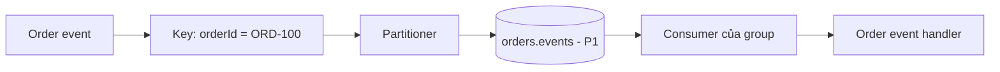

# Thiết kế key cho aggregate hoặc entity

Kafka key quyết định record được định tuyến vào partition nào khi producer dùng partitioner dựa trên key. Nếu các sự kiện của cùng một đối tượng nghiệp vụ cần được đọc theo thứ tự, hãy chọn một key ổn định đại diện cho đối tượng đó. Trong nhiều hệ thống event-driven, key phù hợp là ID của **aggregate root**; với luồng dữ liệu không dùng mô hình aggregate, có thể dùng ID của entity mà thứ tự xử lý cần được bảo toàn.

Ví dụ, các sự kiện `OrderCreated`, `OrderPaid` và `OrderCancelled` của cùng một đơn hàng thường dùng `orderId` làm key. Khi số partition và partitioner không đổi, các event cùng key được đưa vào cùng partition; Kafka giữ thứ tự append trong partition đó. Consumer group có thể xử lý các partition khác nhau song song, trong khi các event của một đơn hàng vẫn nằm trên cùng luồng tuần tự.

Chọn key là quyết định về ranh giới thứ tự, phân phối tải và khả năng mở rộng. Key quá rộng có thể gom quá nhiều event vào một partition; key quá nhỏ có thể chia sự kiện của cùng nghiệp vụ sang nhiều partition và làm mất thứ tự cần thiết.

## 1. Kafka key làm nhiệm vụ gì?

Một Kafka record có thể gồm key, value, timestamp và headers. Key là dữ liệu định tuyến và nhận diện record trong một số chính sách xử lý của Kafka. Với partitioner mặc định, khi record có key, producer tính toán partition dựa trên key đã serialize và metadata partition của topic.



Key thường được dùng cho ba mục đích:

- **Routing:** đưa các record cùng key vào cùng partition theo partitioner và partition count hiện tại.
- **Ordering:** tạo một luồng record có thứ tự cho cùng key vì Kafka bảo đảm thứ tự trong một partition.
- **Compaction:** với topic có `cleanup.policy=compact`, Kafka dùng key để giữ lại trạng thái mới nhất theo key trong từng partition.

Key không phải một cơ chế khóa phân tán. Nó không ngăn hai producer đồng thời phát event cho cùng entity, không tự xác định thứ tự nghiệp vụ và không bảo đảm consumer chỉ xử lý một lần. Nó chỉ giúp các record được định tuyến vào một partition theo quy tắc đã chọn.

## 2. Aggregate và entity trong thiết kế key

Trong Domain-Driven Design, aggregate là ranh giới nhất quán của một nhóm object nghiệp vụ. Aggregate root là điểm vào để thay đổi trạng thái aggregate và là nơi bảo vệ các invariant của aggregate. Nếu event mô tả thay đổi trạng thái của aggregate, ID của aggregate root thường là key tự nhiên.

Ví dụ:

| Aggregate hoặc entity | Event | Key thường dùng | Lý do |
| --- | --- | --- | --- |
| Order | `OrderCreated`, `OrderPaid`, `OrderCancelled` | `orderId` | Các thay đổi trạng thái của đơn hàng cần được xử lý theo thứ tự |
| Account | `MoneyDeposited`, `MoneyWithdrawn` | `accountId` | Cập nhật số dư của cùng tài khoản cần theo thứ tự |
| Shopping cart | `ItemAdded`, `ItemRemoved`, `CartCheckedOut` | `cartId` | Trạng thái giỏ hàng là một luồng theo cart |
| Inventory item | `StockReserved`, `StockReleased` | `sku` hoặc `inventoryId` | Các thay đổi tồn kho của cùng mặt hàng cần được phối hợp |
| Customer profile | `CustomerUpdated`, `CustomerAddressChanged` | `customerId` | Các cập nhật hồ sơ của cùng khách hàng cần có thứ tự |

Không phải lúc nào entity ID cũng là aggregate ID. Nếu một entity nằm trong aggregate và các thay đổi của nó phải nhất quán với aggregate root, dùng ID của aggregate root thường hợp lý hơn. Ví dụ, `OrderLine` thuộc aggregate `Order`; nếu thay đổi một dòng hàng có thể ảnh hưởng tổng tiền và trạng thái đơn, key nên là `orderId` để toàn bộ event của đơn hàng cùng đi qua một partition.

### 2.1. Chọn theo ranh giới invariant

Hãy bắt đầu bằng câu hỏi: những thay đổi nào cần được quan sát theo một thứ tự duy nhất để giữ đúng quy tắc nghiệp vụ?

- Nếu invariant nằm trong một `Order`, chọn `orderId`.
- Nếu invariant nằm trong một `Account`, chọn `accountId`.
- Nếu một aggregate có nhiều entity con nhưng các thay đổi của chúng phải tuần tự, chọn ID của aggregate root.
- Nếu hai aggregate độc lập có thể thay đổi riêng, không gộp chúng vào một key chỉ vì chúng có quan hệ tham chiếu.

Key quá rộng làm giảm khả năng song song. Ví dụ dùng `tenantId` làm key cho mọi event của tenant sẽ đưa tất cả hoạt động của tenant vào một partition. Trong khi đó, dùng `orderId` cho event đơn hàng cho phép các đơn hàng khác nhau được phân phối qua nhiều partition.

## 3. Vì sao không nên dùng eventId làm key?

Mỗi event thường có một `eventId` duy nhất để nhận diện lần phát sinh sự kiện. Nếu dùng `eventId` làm Kafka key, mỗi event thường có key khác nhau và có thể được phân phối sang nhiều partition. Điều đó hữu ích cho phân phối tải ngẫu nhiên, nhưng không gom các event của cùng aggregate vào một partition.

Ví dụ không phù hợp nếu cần thứ tự theo đơn hàng:

```java
// Không phù hợp cho ordering theo orderId:
kafkaTemplate.send("orders.events", event.eventId(), event);
```

Ví dụ phù hợp hơn:

```java
// Các event của cùng đơn hàng dùng cùng key:
kafkaTemplate.send("orders.events", event.orderId(), event);
```

Hai trường có vai trò khác nhau:

| Trường | Vai trò |
| --- | --- |
| `eventId` | Nhận diện duy nhất một event; hỗ trợ deduplication, tracing và idempotency |
| `aggregateId` | Nhận diện aggregate phát sinh event; thường dùng làm Kafka key để routing và ordering |
| `correlationId` | Liên kết nhiều event/command trong cùng một luồng nghiệp vụ |
| `causationId` | Chỉ ra event hoặc command đã gây ra event hiện tại |

Không cần các ID này có cùng giá trị. Mỗi ID nên có một ý nghĩa ổn định và được dùng đúng mục đích.

## 4. Ví dụ thiết kế event theo aggregate

Giả sử hệ thống Order phát ba loại event:

```java
public record OrderCreated(
        String eventId,
        String orderId,
        String customerId,
        long aggregateVersion,
        Instant occurredAt
) {}

public record OrderPaid(
        String eventId,
        String orderId,
        long aggregateVersion,
        BigDecimal amount,
        Instant occurredAt
) {}

public record OrderCancelled(
        String eventId,
        String orderId,
        long aggregateVersion,
        String reason,
        Instant occurredAt
) {}
```

Mỗi record type trên được đặt trong một file Java riêng; các khai báo được trình bày liền nhau để dễ so sánh cấu trúc event.

Các event có cùng `orderId`, nhưng mỗi event có `eventId` riêng và có thể có `aggregateVersion` tăng dần. Producer gửi tất cả event với `orderId` làm key:

```java
@Service
public class OrderEventPublisher {

    private final KafkaTemplate<String, Object> kafkaTemplate;

    public OrderEventPublisher(KafkaTemplate<String, Object> kafkaTemplate) {
        this.kafkaTemplate = kafkaTemplate;
    }

    public CompletableFuture<SendResult<String, Object>> publish(
            String orderId,
            Object event
    ) {
        return kafkaTemplate.send("orders.events", orderId, event);
    }
}
```

Đoạn code minh họa generic chung cho nhiều loại event; trong ứng dụng thực tế nên cân nhắc một event envelope hoặc kiểu value rõ ràng cùng serializer tương ứng. Các imports như `Instant`, `BigDecimal`, `KafkaTemplate`, `SendResult` và `CompletableFuture` được lược bỏ để tập trung vào key.

Ví dụ record được gửi:

| Event | Key | Value chứa |
| --- | --- | --- |
| `OrderCreated` | `ORD-100` | eventId, orderId, version 1, customerId |
| `OrderPaid` | `ORD-100` | eventId, orderId, version 2, amount |
| `OrderCancelled` | `ORD-100` | eventId, orderId, version 3, reason |

Với cùng topic, partition count và partitioner, ba event được định tuyến về cùng partition. Consumer đọc chúng theo thứ tự offset của partition đó.

## 5. Chọn key cho các quan hệ nhiều entity

Một thao tác nghiệp vụ có thể liên quan đến nhiều aggregate. Ví dụ chuyển tiền từ tài khoản A sang tài khoản B. Một transfer có thể tạo ra hai tác động: ghi nợ A và ghi có B.

Không có một Kafka key duy nhất nào vừa đặt event của tài khoản A vào partition của A, vừa đặt event của tài khoản B vào partition của B, đồng thời bảo đảm một thứ tự toàn cục giữa hai partition. Thông thường, mỗi event được phát theo aggregate bị thay đổi:

| Event | Aggregate thay đổi | Key |
| --- | --- | --- |
| `MoneyWithdrawn` | Account A | `account-A` |
| `MoneyDeposited` | Account B | `account-B` |

Nếu hai event cần liên kết, dùng `transferId` làm `correlationId` hoặc metadata trong value/header. Không đổi key của cả hai thành `transferId` trừ khi ranh giới thứ tự mong muốn thực sự là transfer và chấp nhận rằng các tài khoản khác nhau có thể bị gom vào cùng partition theo transfer.

Với quy trình nhiều aggregate, hãy dùng saga hoặc workflow orchestration để quản lý tiến trình và bù trừ. Kafka key cung cấp thứ tự trong phạm vi partition; nó không tạo transaction nguyên tử hay thứ tự toàn cục giữa nhiều aggregate.

## 6. Thiết kế composite key

Trong hệ thống đa tenant, ID có thể chỉ duy nhất trong phạm vi tenant. Khi đó có thể tạo key kết hợp tenant và aggregate:

```text
tenant-42:order-100
tenant-42:order-101
tenant-77:order-100
```

Key composite giúp phân biệt cùng một `orderId` ở các tenant khác nhau. Hãy chuẩn hóa cách tạo key và dùng cùng quy tắc ở tất cả producer.

Ví dụ:

```java
public record OrderKey(String tenantId, String orderId) {

    public String asKafkaKey() {
        return tenantId + ":" + orderId;
    }
}

String key = new OrderKey(tenantId, orderId).asKafkaKey();
kafkaTemplate.send("orders.events", key, event);
```

Nếu thành phần ID có thể chứa ký tự phân cách, hãy dùng encoding không mơ hồ, chẳng hạn length-prefix, escaping có quy ước hoặc một dạng serialization canonical. Không nối chuỗi tùy tiện nếu có thể tạo hai cặp ID khác nhau nhưng cùng chuỗi kết quả.

### 6.1. Không dùng tenantId làm key nếu cần scale theo aggregate

Nếu dùng `tenantId` làm key, tất cả record của tenant sẽ đi vào một partition. Với tenant có lưu lượng lớn, partition đó có thể trở thành hot partition trong khi các partition khác ít tải.

Nếu mục tiêu là thứ tự theo đơn hàng trong tenant, dùng composite key `tenantId + orderId`. Cách này cho phép các đơn hàng khác nhau trong cùng tenant phân phối qua nhiều partition, nhưng vẫn gom event của cùng đơn hàng vào một partition.

## 7. Yêu cầu đối với key: ổn định và xác định

Một key tốt cần đáp ứng các thuộc tính sau:

- **Ổn định:** mọi event của cùng aggregate sử dụng cùng key trong suốt vòng đời cần bảo toàn thứ tự.
- **Xác định:** cùng một aggregate ID phải tạo ra cùng chuỗi byte key ở mọi producer instance.
- **Có đủ cardinality:** key phân phối được workload qua nhiều partition thay vì dồn vào một vài partition.
- **Không chứa dữ liệu nhạy cảm:** key thường xuất hiện trong log, metric, công cụ quản trị và có thể bị quan sát bởi người có quyền đọc topic.
- **Có hợp đồng rõ ràng:** producer và consumer thống nhất encoding, normalization và cách xử lý null.

Không nên dùng `hashCode()` của một Java object tùy biến làm key nếu không có serialization ổn định. `hashCode()` có thể không đại diện cho cùng một byte sequence giữa các ngôn ngữ hoặc phiên bản triển khai. Hãy dùng một ID chuẩn hóa như UUID dạng chuỗi, số định danh có encoding cố định hoặc composite key theo schema rõ ràng.

### 7.1. Serialization của key phải nhất quán

Kafka partitioner làm việc với key sau khi serialize. Nếu producer A serialize ID thành UTF-8 còn producer B dùng một encoding khác hoặc cách viết khác, cùng ID logic có thể thành byte sequence khác và được định tuyến khác.

Với key chuỗi, `StringSerializer` là lựa chọn đơn giản:

```yaml
spring:
  kafka:
    producer:
      key-serializer: org.apache.kafka.common.serialization.StringSerializer
      value-serializer: org.springframework.kafka.support.serializer.JsonSerializer
```

Hãy thống nhất chuẩn hóa ID. Ví dụ UUID nên dùng một định dạng chữ thường/hoa thống nhất; không thêm khoảng trắng hoặc thay đổi dấu phân cách ở các producer khác nhau.

### 7.2. Tránh thay đổi key giữa vòng đời aggregate

Nếu một aggregate đổi key từ `orderId` sang `customerId`, event cũ và event mới có thể nằm ở partition khác nhau. Việc đổi key có thể phá vỡ thứ tự, làm thay đổi partition affinity và ảnh hưởng compaction.

Nếu cần thay đổi hợp đồng key, hãy xem đó là một thay đổi routing có migration plan. Có thể tạo topic version mới, phát event theo cutover có kiểm soát hoặc bổ sung version/sequence để consumer phát hiện event đến lệch thứ tự.

## 8. Key distribution và hot partition

Key cần đủ đa dạng để record được phân phối tương đối đều. Nếu hàng triệu event chỉ có một key, chúng sẽ cùng đi vào một partition theo partitioner dựa trên key. Partition đó có thể trở thành bottleneck dù topic có hàng chục partition.

Ví dụ:

| Cách chọn key | Hệ quả |
| --- | --- |
| `orderId` | Thường phân phối tốt nếu số đơn hàng lớn và lưu lượng tương đối đều |
| `tenantId` | Một tenant lớn có thể dồn toàn bộ tải vào một partition |
| Hằng số `orders` | Toàn bộ event vào một partition; gần như không có song song theo partition |
| `eventId` | Phân phối có thể đều hơn nhưng event của cùng aggregate bị tách partition |
| `customerId` | Phù hợp nếu thứ tự cần bảo đảm theo khách hàng; có thể hot nếu một khách hàng tạo lượng event lớn |

Có một trade-off cơ bản: key càng gom nhiều event vào cùng một luồng thì ordering càng dễ quản lý, nhưng mức song song càng bị giới hạn bởi số key độc lập và phân phối tải.

### 8.1. Hot key không thể giải quyết chỉ bằng tăng partition

Tăng partition count có thể giúp nhiều key khác nhau được phân phối rộng hơn. Nhưng cùng một key vẫn phải được định tuyến nhất quán về một partition nếu muốn giữ thứ tự đơn giản. Nếu một aggregate phát event với tốc độ vượt khả năng của một partition, tăng partition không tự chia aggregate đó thành nhiều luồng song song.

Các lựa chọn cần cân nhắc:

- Tối ưu xử lý consumer cho aggregate nóng.
- Giảm số event không cần thiết hoặc gộp thay đổi theo batch.
- Xem lại ranh giới aggregate nếu mô hình domain cho phép tách invariant một cách đúng đắn.
- Nếu chấp nhận mất thứ tự tuyệt đối, chia workload thành shard có version/sequence và cơ chế hợp nhất rõ ràng.

Không chia key bằng random suffix chỉ để tăng throughput nếu nghiệp vụ vẫn cần thứ tự giữa các event của cùng aggregate. Cách đó tạo nhiều partition nhưng đồng thời phá vỡ ordering mà key ban đầu đang bảo vệ.

## 9. Key, partition count và partition expansion

Với partitioner mặc định, partition được chọn từ hash key và số partition hiện tại. Khi tăng partition count, phép ánh xạ có thể đổi:

\[
\text{partition} = \text{positiveHash}(keyBytes) \bmod N
\]

Nếu `N` thay đổi, một key có thể chuyển sang partition khác. Kafka không di chuyển record cũ; do đó lịch sử aggregate có thể nằm ở partition cũ trong khi event mới nằm ở partition mới.

Ví dụ:

| Giai đoạn | Số partition | Key | Partition minh họa |
| --- | ---: | --- | ---: |
| Trước expansion | 4 | `tenant-42:order-100` | 1 |
| Sau expansion | 6 | `tenant-42:order-100` | 5 |

Nếu thứ tự theo aggregate quan trọng, hãy dự trù partition count từ đầu hoặc có chiến lược routing/migration để giữ mapping cho aggregate đang hoạt động. Không nên coi việc tăng partition là thao tác thuần túy về hạ tầng.

## 10. Key và compacted topic

Với `cleanup.policy=compact`, Kafka giữ lại giá trị mới nhất theo key trong từng partition. Vì vậy, key phải đại diện cho đúng đối tượng có trạng thái cần compact.

Ví dụ topic `customer.current-state` chứa trạng thái mới nhất của từng khách hàng:

```java
kafkaTemplate.send("customer.current-state", customerId, customerState);
```

Các phiên bản trạng thái của cùng `customerId` cần được gửi với cùng key và được route vào cùng partition. Nếu key thay đổi hoặc partition mapping thay đổi sau expansion, các phiên bản của cùng khách hàng có thể bị chia giữa nhiều partition. Log cleaner compact từng partition, không hợp nhất các key trùng nhau giữa partition.

Record có key nhưng value `null` có thể là tombstone để biểu thị xóa trạng thái. Khi dùng compacted topic, hãy thống nhất key encoding và xử lý tombstone ở consumer.

## 11. Ví dụ producer với key aggregate trong Spring Kafka

Một publisher nên nhận aggregate ID rõ ràng và dùng nó làm key ở một nơi duy nhất, tránh mỗi service tự ghép key theo quy ước khác nhau:

```java
package com.example.orders.messaging;

import java.util.Map;

// OrderEvent.java
public record OrderEvent(
        String eventId,
        String orderId,
        long aggregateVersion,
        String eventType,
        Map<String, Object> payload
) {}
```

```java
// OrderEventPublisher.java
package com.example.orders.messaging;

import java.util.concurrent.CompletableFuture;
import org.springframework.kafka.core.KafkaTemplate;
import org.springframework.kafka.support.SendResult;
import org.springframework.stereotype.Service;

@Service
public class OrderEventPublisher {

    private static final String TOPIC = "orders.events";

    private final KafkaTemplate<String, OrderEvent> kafkaTemplate;

    public OrderEventPublisher(KafkaTemplate<String, OrderEvent> kafkaTemplate) {
        this.kafkaTemplate = kafkaTemplate;
    }

    public CompletableFuture<SendResult<String, OrderEvent>> publish(
            OrderEvent event
    ) {
        String key = event.orderId();
        return kafkaTemplate.send(TOPIC, key, event);
    }
}
```

`OrderEvent` là envelope chung của ví dụ; có thể dùng sealed interface hoặc schema riêng cho từng event type. Đoạn code tập trung vào việc lấy `orderId` làm key; serializer phải được cấu hình tương thích với envelope này.

Nên kiểm tra metadata trả về từ send result để xác nhận record đã vào partition dự kiến trong môi trường test:

```java
publisher.publish(event).whenComplete((result, error) -> {
    if (error != null) {
        log.error("Cannot publish order event {}", event.eventId(), error);
        return;
    }

    var metadata = result.getRecordMetadata();
    log.info("Published orderId={} partition={} offset={}",
            event.orderId(), metadata.partition(), metadata.offset());
});
```

Đoạn callback giả định `log` là SLF4J logger của service đang chứa đoạn code.

Trong production, hãy log event ID và metadata ở mức phù hợp, tránh log payload nhạy cảm. Kết quả gửi thành công chỉ xác nhận producer đã nhận acknowledgment theo cấu hình `acks`; nó không chứng minh consumer đã xử lý event.

## 12. Kiểm tra key ở consumer

Consumer có thể nhận key trực tiếp từ `ConsumerRecord`:

```java
@KafkaListener(topics = "orders.events", groupId = "order-projection")
public void onOrderEvent(ConsumerRecord<String, OrderEvent> record) {
    String orderId = record.key();
    OrderEvent event = record.value();

    orderProjection.apply(orderId, event);
}
```

Nếu key là bắt buộc, hãy validate null và giá trị rỗng. Nếu key có thể null theo hợp đồng topic, consumer phải có nhánh xử lý rõ ràng. Không suy ra aggregate ID từ value rồi bỏ qua key nếu producer/consumer cần dùng cùng routing contract.

Consumer có thể ghi lại tuple `(topic, partition, offset, key, eventId)` để điều tra. Offset chỉ có ý nghĩa trong partition, còn `eventId` giúp deduplicate và key giúp liên kết record với aggregate.

## 13. Nhiều producer và thứ tự phát event

Key ổn định đưa event của cùng aggregate vào cùng partition, nhưng nếu nhiều producer cùng phát event cho một aggregate, thứ tự trong log là thứ tự broker append nhận được, không nhất thiết là thứ tự nghiệp vụ mong muốn.

Ví dụ hai instance cùng phát `OrderPaid` và `OrderCancelled` cho `ORD-100`. Cả hai dùng cùng key, nên record vào cùng partition; tuy nhiên, nếu hai request chạy đồng thời, broker có thể append `OrderCancelled` trước `OrderPaid`.

Để bảo vệ thứ tự nghiệp vụ:

- Chỉ một nơi có quyền thay đổi aggregate và phát event cho aggregate đó, hoặc dùng cơ chế serialize command theo aggregate.
- Gắn `aggregateVersion` tăng đơn điệu vào event.
- Consumer kiểm tra version trước khi áp dụng; phát hiện event thiếu hoặc đến sai thứ tự.
- Dùng idempotency để xử lý duplicate do retry hoặc redelivery.
- Nếu dùng transactional outbox, ghi event cùng transaction với cập nhật aggregate rồi relay theo thứ tự cần thiết.

Producer idempotence giúp tránh duplicate do retry ở producer trong phạm vi Kafka hỗ trợ, nhưng không tự sắp xếp event theo version nghiệp vụ từ nhiều instance.

## 14. Thay đổi key contract cần migration

Thay đổi key từ `orderId` sang `customerId`, thêm `tenantId` hoặc đổi encoding có thể làm record mới được định tuyến khác. Hãy xem đây là thay đổi hợp đồng của topic.

Một kế hoạch migration có thể gồm:

1. Xác định lý do đổi key và ranh giới ordering mới.
2. Đánh giá key cũ/key mới có làm gom nhiều aggregate vào cùng partition hay chia một aggregate ra nhiều partition không.
3. Kiểm tra tác động đến consumer, compaction, retention và partition count.
4. Nếu cần giữ lịch sử và thứ tự, tạo topic version mới hoặc migration có cutover rõ ràng.
5. Đồng bộ producer/consumer theo một phiên bản hợp đồng xác định.
6. Kiểm tra record metadata và phân phối key sau migration.
7. Theo dõi duplicate, event đến sai thứ tự và consumer lag trước khi ngừng hợp đồng cũ.

Không nên thay key lặng lẽ trong một lần deploy nếu consumer đang dựa vào thứ tự hoặc compacted state của key cũ.

## 15. Các lỗi thường gặp khi chọn key

| Lựa chọn hoặc triệu chứng | Vấn đề | Cách xử lý |
| --- | --- | --- |
| Dùng `eventId` làm key cho event aggregate | Các event cùng aggregate có thể vào nhiều partition | Dùng aggregate/entity ID làm key, giữ `eventId` trong value |
| Dùng hằng số làm key | Mọi record dồn vào một partition | Chọn key có cardinality phù hợp với ranh giới ordering |
| Dùng `tenantId` làm key cho mọi đơn hàng | Tenant lớn tạo hot partition | Dùng composite key tenant + aggregate ID nếu thứ tự cần theo aggregate |
| Dùng random suffix để chia tải | Các event cùng aggregate bị tách partition | Chỉ shard khi có sequence và cơ chế hợp nhất thứ tự rõ ràng |
| Producer serialize cùng ID khác nhau | Cùng entity có thể được route khác nhau | Chuẩn hóa key encoding và serializer giữa producer |
| Thay đổi key khi aggregate đang hoạt động | Lịch sử và event mới có thể nằm ở partition khác | Migration contract có version và cutover |
| Tăng partition rồi thấy event cùng key ở partition khác | Hash/modulo thay đổi theo partition count | Đánh giá expansion và chiến lược giữ routing |
| Nhiều producer phát event sai thứ tự | Key chỉ bảo đảm cùng partition, không quyết định thứ tự nghiệp vụ | Serialize command hoặc dùng aggregate version/outbox |
| Compacted topic còn nhiều giá trị cho cùng entity | Key hoặc partition mapping không ổn định | Giữ key và routing ổn định; migration nếu cần đổi |

## 16. Quy trình chọn Kafka key cho aggregate/entity

Khi thiết kế topic mới, có thể thực hiện theo các bước:

1. **Xác định luồng event:** topic chứa event của một loại aggregate hay nhiều loại entity?
2. **Xác định invariant:** những event nào phải được xử lý theo thứ tự để bảo vệ trạng thái nghiệp vụ?
3. **Chọn ID:** dùng aggregate root ID hoặc entity ID tương ứng với ranh giới ordering đó.
4. **Thiết kế composite key:** nếu ID chỉ duy nhất trong tenant, kết hợp tenant ID và aggregate ID bằng encoding không mơ hồ.
5. **Chuẩn hóa serialization:** mọi producer dùng cùng encoding, serializer và cách biểu diễn ID.
6. **Đánh giá phân phối tải:** xem cardinality, key frequency, hot key và partition count dự kiến.
7. **Kiểm tra mở rộng:** đánh giá key mapping khi partition count thay đổi và tác động đến ordering/compaction.
8. **Định nghĩa event metadata:** giữ `eventId`, `aggregateVersion`, `correlationId` riêng với Kafka key.
9. **Kiểm thử:** gửi nhiều event cùng aggregate và xác nhận key/partition; thử nhiều aggregate để xem phân phối; kiểm tra null key và migration.
10. **Theo dõi production:** đo records per partition, bytes in, consumer lag, key skew và lỗi xử lý.

Một Kafka key tốt biểu diễn đúng ranh giới mà ứng dụng cần giữ thứ tự, đồng thời phân phối các ranh giới độc lập qua nhiều partition. Khi key phản ánh đúng aggregate hoặc entity, producer routing, consumer ordering và compaction có thể dựa trên cùng một hợp đồng rõ ràng.

## 17. Tự kiểm tra

1. Vì sao `aggregateId` thường phù hợp làm Kafka key hơn `eventId`?
2. Khi nào nên dùng ID của aggregate root thay cho ID của entity con?
3. Nếu dùng `tenantId` làm key cho mọi event, vấn đề phân phối tải nào có thể xuất hiện?
4. Vì sao hai event của cùng aggregate dùng cùng key vẫn có thể được append sai thứ tự nghiệp vụ khi có nhiều producer?
5. Làm thế nào để tạo composite key không mơ hồ trong hệ thống đa tenant?
6. Vì sao `hashCode()` của Java object không phải hợp đồng key ổn định giữa nhiều producer?
7. Key ảnh hưởng thế nào đến compacted topic và tombstone?
8. Vì sao tăng partition hoặc thay đổi key contract có thể làm event của cùng aggregate nằm ở hai partition?
9. Khi một thao tác thay đổi hai aggregate, vì sao một Kafka key không thể tạo thứ tự toàn cục cho cả hai?
10. Những metric nào giúp phát hiện hot key và partition skew?
