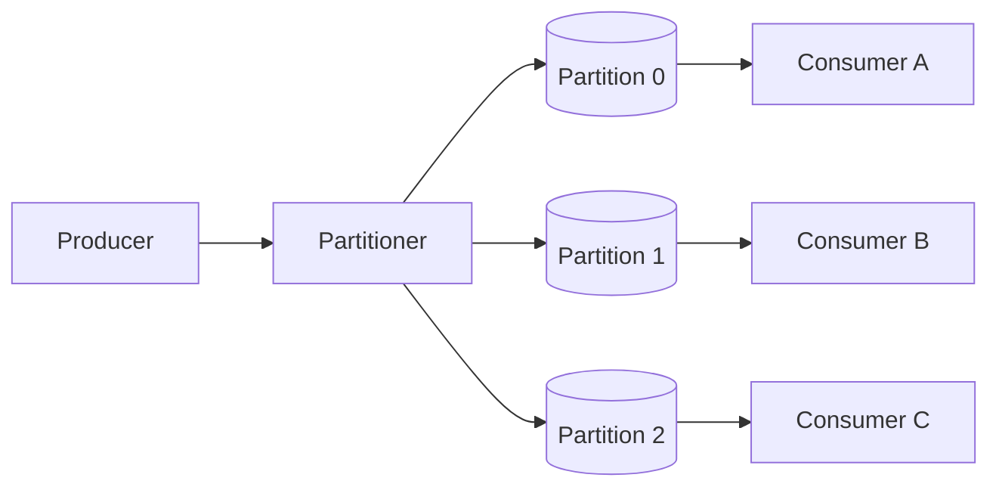
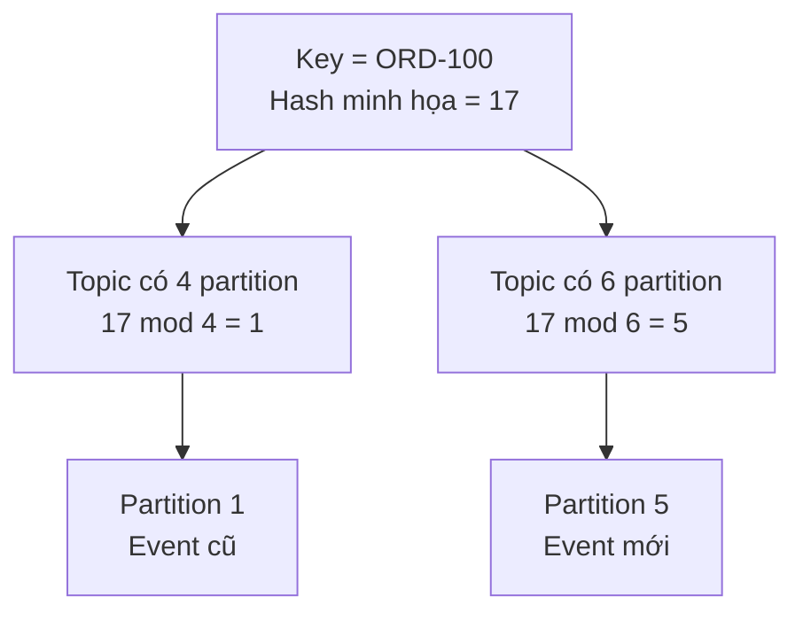

# Partition expansion ảnh hưởng routing ra sao

Tăng số partition của một Kafka topic có thể mở rộng khả năng ghi và đọc song song. Tuy nhiên, thay đổi này còn ảnh hưởng đến cách producer định tuyến record theo key. Với partitioner mặc định, partition được chọn dựa trên hash của key và số partition hiện tại. Khi số partition thay đổi, cùng một key có thể được ánh xạ sang partition khác.

Đây là điểm cần đặc biệt chú ý nếu ứng dụng dựa vào thứ tự sự kiện theo entity, chẳng hạn các event `OrderCreated`, `OrderPaid` và `OrderCancelled` của cùng một đơn hàng. Record cũ vẫn nằm trong partition ban đầu, trong khi record mới có thể đi vào partition mới. Consumer group có thể xử lý hai partition độc lập, vì vậy thứ tự giữa các event cũ và mới của cùng key không còn được bảo đảm.

## 1. Partition quyết định nơi lưu record và mức song song

Một topic được chia thành các partition. Mỗi partition là một log có thứ tự riêng, được Kafka lưu trữ và replication trên các broker. Producer gửi record đến một partition; consumer group phân phối các partition cho các consumer member.



Partition có ba vai trò quan trọng:

- **Lưu trữ:** record được append vào log của một partition; offset chỉ có ý nghĩa trong partition đó.
- **Thứ tự:** Kafka giữ thứ tự record trong một partition. Kafka không tạo thứ tự tổng thể giữa nhiều partition.
- **Song song:** trong cùng một consumer group, một partition được gán cho tối đa một consumer member tại một thời điểm. Số partition giới hạn mức song song tối đa của group đối với topic đó.

Tăng partition có thể tạo thêm đơn vị lưu trữ và xử lý song song. Nhưng nó cũng làm thay đổi đầu vào của thuật toán routing, nên cần đánh giá cả throughput lẫn ordering trước khi thực hiện.

## 2. Producer chọn partition theo key như thế nào?

Khi gửi record, producer có thể xác định partition theo một trong các cách:

1. **Chỉ định partition trực tiếp:** ứng dụng gửi record với partition number cụ thể.
2. **Gửi key:** partitioner chọn partition dựa trên key; đây là cách phổ biến khi cần giữ các event cùng entity ở cùng partition.
3. **Không có key:** partitioner mặc định thường dùng chiến lược sticky để gom record vào partition trong một khoảng gửi/batch, thay vì bảo đảm routing ổn định theo entity.
4. **Custom partitioner:** ứng dụng cung cấp thuật toán định tuyến riêng.

Với Kafka default partitioner và record có key khác `null`, partition được chọn từ hash của key đã serialize và số partition hiện tại. Có thể hình dung đơn giản:

\[
\text{partition} = \text{positiveHash}(\text{serializedKey}) \bmod N
\]

Trong đó `N` là tổng số partition của topic tại thời điểm producer định tuyến record. Thuật toán cụ thể phụ thuộc Kafka client và partitioner đang cấu hình; không nên tự tính hash trong nghiệp vụ rồi mặc định nó luôn giống mọi serializer/partitioner.

Ví dụ producer gửi event đơn hàng:

```java
kafkaTemplate.send("orders.events", event.orderId(), event);
```

`orderId` là key. Các event có cùng key thường được định tuyến vào cùng partition khi số partition và cấu hình partitioner ổn định. Consumer đọc các record của partition đó theo thứ tự offset.

Nếu gửi record không có key:

```java
kafkaTemplate.send("orders.events", null, event);
```

Kafka không có định danh entity để duy trì affinity. Default partitioner có thể chọn partition theo chiến lược sticky/batching; ứng dụng không nên dựa vào cách này để giữ thứ tự các event của cùng một đơn hàng.

## 3. Tăng partition làm thay đổi phép ánh xạ key

Giả sử topic `orders.events` ban đầu có bốn partition. Một key có giá trị hash dương minh họa là `17`:

\[
17 \bmod 4 = 1
\]

Record của key đó được gửi vào partition 1. Sau khi tăng topic lên sáu partition:

\[
17 \bmod 6 = 5
\]

Cùng key đó giờ có thể được gửi vào partition 5. Đây là ví dụ minh họa phép modulo; hash thực tế do serializer và partitioner của Kafka client quyết định.



Điểm quan trọng: Kafka chỉ thêm partition mới. Nó không tự di chuyển các record cũ từ partition 1 sang partition 5. Vì vậy, lịch sử của cùng key có thể bị chia thành hai log:

| Thời điểm | Partition count | Key | Partition được chọn | Nội dung |
| --- | ---: | --- | ---: | --- |
| Trước expansion | 4 | `ORD-100` | 1 | `OrderCreated` |
| Trước expansion | 4 | `ORD-100` | 1 | `OrderPaid` |
| Sau expansion | 6 | `ORD-100` | 5 | `OrderShipped` |

Consumer có thể đọc partition 5 trước khi xử lý xong partition 1, hoặc ngược lại. Kafka không bảo đảm `OrderShipped` luôn được xử lý sau `OrderPaid` chỉ vì producer gửi nó muộn hơn. Nếu nghiệp vụ yêu cầu thứ tự theo đơn hàng, đây là thay đổi có thể làm sai logic.

Không phải mọi key đều chắc chắn đổi partition sau khi tăng số partition. Một số hash có thể cho cùng phần dư với số partition mới; nhưng không thể dựa vào điều đó để bảo đảm ordering cho toàn bộ keyspace.

## 4. Expansion không phân phối lại dữ liệu cũ

Khi số partition tăng từ `N` lên `M` với `M > N`:

- Các partition cũ tiếp tục tồn tại với dữ liệu và offset hiện có.
- Kafka tạo thêm partition mới; các partition mới ban đầu chưa có lịch sử record của topic.
- Record mới được producer định tuyến theo metadata và partitioner hiện hành.
- Kafka không tự copy hoặc repartition record cũ sang partition mới.
- Consumer group dùng subscription tự động có thể được rebalance để nhận assignment mới.

Producer cần metadata về partition count để định tuyến. Kafka client tự làm mới metadata theo cơ chế của client, nên trong khoảng chuyển đổi ngắn có thể có producer instance chưa quan sát cùng một metadata tại cùng thời điểm. Hãy để client cập nhật metadata, theo dõi lỗi gửi và xác minh partition thực tế trong record metadata; không giả định mọi producer chuyển sang routing mới đúng cùng một thời điểm tuyệt đối.

Ví dụ topic tăng từ ba lên năm partition:

```text
Trước expansion                 Sau expansion
orders.events                   orders.events
  P0: records cũ                  P0: records cũ
  P1: records cũ                  P1: records cũ
  P2: records cũ                  P2: records cũ
                                  P3: partition mới
                                  P4: partition mới
```

Tăng partition không đồng nghĩa cân bằng lại dung lượng dữ liệu đang có. Nếu P0 đang chứa nhiều dữ liệu hơn P1 và P2, P3/P4 không tự nhận lại một phần log cũ. Chúng chỉ có thể nhận record mới nếu partitioner định tuyến record vào đó.

## 5. Ảnh hưởng đến thứ tự theo entity

Kafka chỉ bảo đảm thứ tự trong phạm vi một partition. Nhiều ứng dụng sử dụng key như `orderId`, `customerId` hoặc `accountId` để các event của cùng entity đi vào cùng partition.

Trước expansion, giả sử các event của `ORD-100` đều ở P1:

```text
P1: OrderCreated -> OrderPaid -> OrderShipped
```

Sau expansion, key có thể được ánh xạ sang P4. Các event trước đó vẫn ở P1, event mới ở P4:

```text
P1: OrderCreated -> OrderPaid
P4: OrderShipped
```

Hai partition có tiến độ độc lập. Consumer group không có cơ chế tự ghép hai log này thành một thứ tự theo `orderId`. Vì vậy, expansion có thể phá vỡ giả định “cùng key luôn được xử lý tuần tự trong một partition” đối với chuỗi event đi qua thời điểm thay đổi.

### 5.1. Những trường hợp ordering đặc biệt nhạy cảm

- **Trạng thái đơn hàng:** `Created` phải đến trước `Paid`, `Cancelled` hoặc `Shipped`.
- **Số dư tài khoản:** các giao dịch ghi nợ/ghi có của một `accountId` cần áp dụng đúng thứ tự.
- **Tồn kho:** các event reserve, release và ship cần giữ thứ tự theo `sku` hoặc kho.
- **Compacted topic:** nhiều phiên bản của cùng key phải cùng partition để compaction có thể giữ trạng thái mới nhất theo key một cách đúng nghĩa.

Với compacted topic, việc cùng key bị route sang nhiều partition có thể khiến mỗi partition giữ lại một giá trị cuối cùng riêng. Log cleaner compact theo partition, không hợp nhất các key trùng giữa nhiều partition. Do đó, consumer có thể thấy nhiều giá trị còn tồn tại cho cùng key.

### 5.2. Producer ordering vẫn cần được thiết kế

Ngay cả khi partition count không đổi, cùng key ở cùng partition vẫn chưa đủ để bảo đảm thứ tự nghiệp vụ trong mọi trường hợp. Ứng dụng cần xem xét:

- Nhiều producer instance có thể phát event cùng entity đồng thời.
- Nhiều thread gửi event có thể gọi `send()` theo thứ tự khác với thứ tự nghiệp vụ.
- Consumer có thể dispatch công việc sang executor và làm tác vụ hoàn tất không theo thứ tự nhận.
- Retry và error handler có thể làm một record bị xử lý lại trước khi tiến độ được tiếp tục.

Nếu thứ tự quan trọng, hãy phối hợp key ổn định, thứ tự phát từ producer, xử lý tuần tự theo partition và idempotency ở consumer.

## 6. Ảnh hưởng đến consumer group, assignment và offset

Khi topic có thêm partition, consumer group đăng ký bằng `subscribe()` sẽ phát hiện metadata mới và có thể rebalance để phân phối partition mới cho member. Một số member có thể nhận thêm partition; nếu số partition tăng đủ lớn, group có thể sử dụng thêm consumer member đang nhàn rỗi.

Số consumer hoạt động song song trong một group bị giới hạn bởi số partition có thể gán. Ví dụ:

| Partition count | Consumer member | Member tối đa có partition |
| ---: | ---: | ---: |
| 3 | 2 | 2 |
| 3 | 5 | 3 |
| 6 | 5 | 5 |
| 6 | 8 | 6 |

Sau expansion, group có thể tăng mức song song, nhưng hiệu quả còn phụ thuộc workload và hệ thống đích. Nếu database chỉ chịu được hai worker, tăng partition và concurrency lên 20 có thể chỉ làm tăng tải và contention.

### 6.1. Partition mới và offset mới

Offset được quản lý theo group và partition. Partition mới không có offset đã commit từ group trước đó. Khi consumer group nhận assignment partition mới, `auto.offset.reset` được áp dụng nếu group chưa có offset hợp lệ cho partition đó:

- `earliest`: bắt đầu từ record sớm nhất còn tồn tại trong partition mới.
- `latest`: bắt đầu từ cuối log của partition mới, tức nhận record được ghi sau đó.
- `none`: báo lỗi nếu không có offset hợp lệ.

Vì partition mới thường chưa có record, `earliest` và `latest` ban đầu có thể cho cùng vị trí. Tuy nhiên, cần hiểu chính sách này khi consumer group có thể được tạo trước khi producer bắt đầu ghi vào partition mới hoặc khi topic được mở rộng trong lúc đang chạy.

### 6.2. Consumer dùng assign() thủ công

Consumer dùng `subscribe()` tham gia group management và được Kafka phân phối partition tự động. Consumer dùng `assign()` tự chỉ định partition; nó không tham gia cơ chế automatic partition assignment theo cách đó. Khi topic tăng partition, ứng dụng tự gán partition cần cập nhật danh sách assignment.

Nếu Spring Kafka listener dùng `topicPartitions` để chỉ định partition cụ thể, hãy kiểm tra cấu hình listener khi topic expansion. Listener không tự động được bảo đảm nhận partition mới nếu danh sách partition được khai báo cố định.

## 7. Tăng partition bằng Kafka CLI

Có thể tăng partition của topic đang tồn tại bằng `kafka-topics.sh`:

```bash
kafka-topics.sh \
  --bootstrap-server localhost:9092 \
  --alter \
  --topic orders.events \
  --partitions 12
```

Lệnh trên yêu cầu topic có tổng cộng 12 partition sau thay đổi, không phải thêm 12 partition. Nếu topic hiện có 6 partition thì tăng lên 12; nếu topic đã có 12 thì không thay đổi. Kafka cho phép tăng partition nhưng không hỗ trợ giảm số partition của topic hiện có bằng thao tác alter thông thường.

Trước và sau khi thay đổi, kiểm tra metadata:

```bash
kafka-topics.sh \
  --bootstrap-server localhost:9092 \
  --describe \
  --topic orders.events
```

Hãy kiểm tra số partition, leader và replica assignment. Tăng partition không tự động bảo đảm phân phối tải hoặc replica placement tối ưu trên cluster; cần theo dõi broker load sau thay đổi.

## 8. Tăng partition bằng AdminClient

Trong Java, có thể gọi Kafka Admin API để tăng partition. `NewPartitions.increaseTo(12)` chỉ định tổng số partition mục tiêu:

```java
import java.util.Map;
import java.util.Properties;
import java.util.concurrent.TimeUnit;

import org.apache.kafka.clients.admin.AdminClient;
import org.apache.kafka.clients.admin.NewPartitions;

public class TopicPartitionManager {

    public void increaseOrdersTopicPartitions() throws Exception {
        Properties properties = new Properties();
        properties.put("bootstrap.servers", "localhost:9092");

        try (AdminClient admin = AdminClient.create(properties)) {
            admin.createPartitions(Map.of(
                    "orders.events", NewPartitions.increaseTo(12)
            )).all().get(10, TimeUnit.SECONDS);
        }
    }
}
```

Trong production, hãy lấy bootstrap server và security config từ cấu hình môi trường, không hardcode trong source code. Tài khoản chạy AdminClient cần quyền thay đổi metadata/partition của topic. Việc tăng partition là thay đổi hạ tầng có ảnh hưởng routing, nên nên được thực hiện bởi quy trình provisioning có kiểm soát.

`NewPartitions.increaseTo(12)` là tổng partition count sau thay đổi. Nếu topic đang có nhiều hơn 12 partition, thao tác sẽ thất bại; API này không dùng để giảm partition.

## 9. Khai báo partition count khi tạo topic bằng Spring Kafka

Khi tạo topic mới, có thể khai báo partition count bằng `NewTopic`:

```java
import org.springframework.context.annotation.Bean;
import org.springframework.context.annotation.Configuration;
import org.apache.kafka.clients.admin.NewTopic;
import org.springframework.kafka.config.TopicBuilder;

@Configuration
public class TopicConfiguration {

    @Bean
    NewTopic ordersTopic() {
        return TopicBuilder.name("orders.events")
                .partitions(12)
                .replicas(3)
                .build();
    }
}
```

`partitions(12)` xác định số partition mong muốn khi provision topic mới. Nếu topic đã tồn tại, hãy kiểm tra hành vi `KafkaAdmin` của phiên bản Spring Kafka đang dùng; khi cần chủ động nâng số partition của topic hiện tại, có thể gọi `AdminClient.createPartitions()` như mục trước. Không coi việc thay đổi giá trị trong bean là bằng chứng partition count trên broker đã thay đổi.

Không nên để nhiều service cùng tự quản lý partition count của một topic nếu không có quy ước rõ ràng. Hãy xác định một chủ thể quản trị topic và kiểm tra kết quả trên broker sau mỗi lần provision.

## 10. Custom partitioner và routing ổn định

Nếu thuật toán mặc định không đáp ứng yêu cầu routing, producer có thể dùng custom partitioner. Custom partitioner nhận metadata topic, key/value và danh sách partition khả dụng để chọn partition.

Một ý tưởng đơn giản là duy trì mapping ổn định từ entity ID sang partition. Tuy nhiên, nếu mapping dùng phép modulo với partition count hiện tại, nó vẫn có thể remap key khi số partition thay đổi. Custom partitioner không tự động giải quyết ordering; thuật toán phải được thiết kế cùng chiến lược mở rộng.

Một số lựa chọn:

- **Giữ mapping cũ cho entity hiện tại:** lưu hoặc tính mapping dựa trên một partition set cố định. Cách này giữ thứ tự nhưng các entity đó có thể không dùng được partition mới.
- **Consistent hashing hoặc virtual buckets:** giảm số lượng key phải remap khi thay đổi tập partition. Cần quản lý mapping và chuyển giao bucket có kiểm soát; không bảo đảm không có key nào đổi partition.
- **Explicit partition:** ứng dụng tự chọn partition trong `ProducerRecord`. Cần quản lý mapping tập trung và bảo đảm mọi producer dùng cùng quy tắc.
- **Version/sequence trong event:** consumer kiểm tra sequence theo entity, phát hiện event đến sai thứ tự và buffer/reconcile khi cần. Cách này bổ sung khả năng phát hiện và xử lý lệch thứ tự nhưng tăng độ phức tạp.

Ví dụ chỉ định partition trực tiếp bằng `KafkaTemplate`:

```java
// Gửi event vào partition 2 một cách tường minh.
kafkaTemplate.send("orders.events", 2, event.orderId(), event);
```

Chỉ định partition có thể giữ mapping ổn định, nhưng dễ tạo hot partition nếu phân phối không đều. Cần bảo đảm partition number hợp lệ và tất cả producer cùng tuân theo một quy ước.

## 11. Chiến lược khi cần tăng partition nhưng phải giữ ordering

Nếu thứ tự theo key là yêu cầu bắt buộc, đừng tăng partition trực tiếp mà chưa xác định cách xử lý các key đang hoạt động. Có một số chiến lược:

### 11.1. Dự trù partition ngay từ đầu

Đây thường là phương án dễ kiểm soát nhất. Ước lượng throughput, số consumer dự kiến và tăng trưởng trong vòng đời topic; tạo đủ partition ngay từ đầu. Có thể chạy concurrency thấp hơn partition count rồi tăng dần consumer khi tải tăng.

Đổi lại, nhiều partition làm tăng metadata, file segment, replication traffic và chi phí quản lý ngay cả khi chưa dùng hết.

### 11.2. Giữ routing ổn định cho key cũ

Có thể duy trì mapping của entity hiện tại về các partition cũ và chỉ dùng partition mới cho entity mới. Cách này giữ thứ tự cho entity cũ, nhưng tải của nhóm entity hiện tại vẫn giới hạn ở partition cũ. Cần có quy tắc xác định entity mới/cũ nhất quán giữa tất cả producer instance.

Nếu chuyển một entity sang partition mới, phải có điểm chuyển giao rõ ràng: dừng hoặc fence producer cũ cho entity đó, chờ record cũ được xử lý đến mốc xác định, sau đó mới phát record tiếp theo vào partition mới. Nếu hai partition cùng nhận event của một entity trong lúc chuyển giao, ordering có thể bị phá vỡ.

### 11.3. Tạo topic phiên bản mới và migration có kiểm soát

Khi thay đổi routing là không tránh khỏi, có thể tạo topic mới với partition count lớn hơn, ví dụ `orders.events.v2`. Quy trình migration cần:

1. Chốt schema event và partitioning strategy cho topic mới.
2. Xác định cách chuyển dữ liệu lịch sử hoặc snapshot cần thiết.
3. Dừng hoặc kiểm soát producer để xác định ranh giới event cuối trên topic cũ.
4. Đồng bộ lịch sử và bảo đảm consumer mới biết điểm bắt đầu.
5. Chuyển producer sang topic mới theo một cutover plan nhất quán.
6. Theo dõi consumer lag, duplicate và ordering trong thời gian chuyển đổi.
7. Chỉ ngừng topic cũ sau khi các consumer và quy trình replay không còn phụ thuộc.

Dual-write đồng thời vào hai topic có thể tạo lệch thứ tự hoặc thiếu event nếu không có cơ chế transaction/outbox và cutover rõ ràng. Không nên chỉ đổi tên topic trong cấu hình rồi giả định dữ liệu đã được chuyển an toàn.

### 11.4. Dùng sequence/version để bảo vệ nghiệp vụ

Nếu consumer có thể nhận event từ nhiều partition, event có thể mang `aggregateVersion` hoặc sequence tăng dần theo entity:

```java
public record OrderEvent(
        String eventId,
        String orderId,
        long aggregateVersion,
        String eventType
) {}
```

Consumer lưu version hiện tại của entity và chỉ áp dụng event có version kế tiếp. Event đến sớm có thể được buffer hoặc retry; event có version thấp hơn có thể là duplicate và được bỏ qua theo quy tắc idempotency. Cách này giúp bảo vệ trạng thái nghiệp vụ trước thứ tự đến lệch, nhưng cần thiết kế lưu trữ, timeout và xử lý event bị thiếu.

## 12. Những yếu tố khác cần đánh giá trước khi expansion

### 12.1. Throughput và hot key

Tăng partition chỉ giúp tăng throughput khi tải có thể phân phối sang partition mới. Nếu phần lớn record dùng một key nóng, các record vẫn tập trung vào cùng partition. Không thể tách một key ra nhiều partition mà vẫn giữ thứ tự partition đơn giản.

### 12.2. Consumer concurrency và downstream

Partition mới có thể cho phép thêm consumer member, nhưng database, HTTP API hoặc hệ thống downstream có thể trở thành bottleneck. Tăng partition và concurrency cùng lúc có thể làm tăng số request đồng thời vượt khả năng hệ thống đích.

### 12.3. Replication và broker resources

Mỗi partition có leader và replica. Tăng partition làm tăng metadata, file segment, index, leader assignment, replication traffic và công việc recovery. Cần theo dõi CPU, disk, network, số file mở, partition count trên mỗi broker và phân bố leader.

### 12.4. Consumer group rebalance

Consumer group dùng `subscribe()` có thể rebalance khi phát hiện partition mới. Rebalance tạm thời thay đổi assignment và có thể làm giảm throughput. Nếu triển khai nhiều replica đồng thời với expansion, hãy xem xét lịch deploy để tránh nhiều thay đổi membership cùng lúc.

### 12.5. Retention và compaction

Partition mới có log riêng, retention và cleanup áp dụng cho từng partition. Với `retention.bytes`, giới hạn là theo partition nên tổng dung lượng logic có thể tăng theo partition count. Với compacted topic, key phải được route ổn định về cùng partition để compaction giữ đúng trạng thái mới nhất của key.

## 13. Quy trình đánh giá và thực hiện partition expansion

Trước khi tăng partition, thực hiện các bước sau:

1. **Xác định lý do:** consumer group bị giới hạn song song, partition nóng, throughput producer hay bottleneck nằm ở downstream?
2. **Đo hiện trạng:** throughput từng partition, key distribution, consumer lag, processing time, broker resource và leader balance.
3. **Kiểm tra ordering:** topic có yêu cầu thứ tự theo key không? Có compacted topic hoặc consumer dựa vào một key chỉ nằm trong một partition không?
4. **Đánh giá routing:** xác định partitioner, serializer của key, key null, explicit partition và custom partitioner.
5. **Tính tác động remapping:** lấy mẫu key quan trọng và so sánh partition mapping trước/sau với partition count dự kiến.
6. **Chọn chiến lược:** pre-create, giữ mapping cũ, migration sang topic mới hoặc chấp nhận thay đổi ordering có kiểm soát.
7. **Thực hiện thay đổi:** dùng quy trình quản trị topic với quyền phù hợp; không thay đổi trực tiếp trong lúc chưa có kế hoạch rollback nghiệp vụ.
8. **Xác minh:** describe topic, kiểm tra leader/replica assignment, group membership, partition mapping và consumer lag.
9. **Theo dõi sau thay đổi:** quan sát key distribution, throughput, rebalance, duplicate, event ordering và tải downstream.

Partition expansion không thể được đảo ngược bằng cách giảm partition count của topic. Nếu kết quả không phù hợp, phương án thường là tạo topic mới và migrate dữ liệu theo kế hoạch, chứ không thể xóa các partition vừa thêm để trở lại trạng thái cũ.

## 14. Lỗi thường gặp khi tăng partition

| Hiện tượng | Nguyên nhân thường gặp | Cách xử lý |
| --- | --- | --- |
| Event cùng key xuất hiện ở hai partition | Key được remap do partition count thay đổi | Kiểm tra partitioner và chọn chiến lược giữ mapping hoặc migration |
| Consumer xử lý event sai thứ tự | Event cũ ở partition cũ, event mới ở partition mới | Dùng sequence/version hoặc cutover routing có kiểm soát |
| Partition mới không có record | Key distribution chưa route record vào partition mới, hoặc producer metadata chưa cập nhật | Kiểm tra producer metadata, key distribution và partitioner |
| Tăng partition nhưng throughput không tăng | Hot key, downstream bottleneck hoặc consumer concurrency chưa tăng | Đo tải từng partition và hệ thống đích |
| Một số consumer không có assignment | Consumer member nhiều hơn partition | Điều chỉnh concurrency hoặc đánh giá partition count |
| Consumer group rebalance sau expansion | Group phát hiện partition mới và phân phối lại assignment | Theo dõi rebalance và bảo đảm listener chịu được pause/restart |
| Compacted topic còn nhiều giá trị cuối cho cùng key | Cùng key bị ghi vào nhiều partition; compaction diễn ra riêng từng partition | Giữ routing key ổn định hoặc migrate sang topic mới |
| CLI báo không thể alter partition | Số partition yêu cầu nhỏ hơn hoặc bằng số hiện tại, hoặc thiếu quyền | Kiểm tra partition count và ACL quản trị topic |

## 15. Tự kiểm tra

1. Vì sao cùng key có thể được định tuyến sang partition khác sau khi tăng partition count?
2. Kafka có tự di chuyển record cũ sang partition mới khi expansion không?
3. Vì sao việc key bị remap có thể phá vỡ ordering theo entity?
4. `retention.bytes` và compacted topic chịu tác động gì khi số partition tăng?
5. Nếu consumer group có 10 member nhưng topic chỉ có 6 partition, tối đa bao nhiêu member nhận partition?
6. Vì sao key nóng không tự được chia tải chỉ bằng cách tăng partition?
7. Khi nào nên giữ mapping cũ, khi nào nên tạo topic phiên bản mới?
8. Nếu dùng `assign()` hoặc Spring `topicPartitions`, điều gì cần cập nhật khi topic tăng partition?
9. Vì sao giảm partition count không phải thao tác rollback thông thường?

Tăng partition là một thay đổi routing và ordering, không chỉ là thao tác tăng throughput. Hãy xác định rõ key nào cần giữ thứ tự, partitioner đang dùng và cách consumer xử lý event trước khi thay đổi. Khi đã hiểu việc remapping, assignment, offset và compaction, có thể chọn chiến lược mở rộng phù hợp mà không làm sai giả định của nghiệp vụ.
