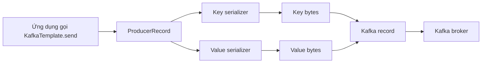

# Khai báo value serializer

Kafka lưu key và value của mỗi record dưới dạng byte. Ở phía producer, **value serializer** chịu trách nhiệm chuyển object mà ứng dụng gửi thành `byte[]` trước khi record được truyền đến broker. Trong Spring Boot, serializer này được khai báo bằng `spring.kafka.producer.value-serializer`; trong Kafka Producer API, thuộc tính tương ứng là `value.serializer`.

Chọn đúng value serializer giúp producer gửi dữ liệu theo định dạng mà consumer có thể giải mã. Ví dụ, value kiểu `String` có thể dùng `StringSerializer`, payload đã được mã hóa sẵn có thể dùng `ByteArraySerializer`, còn object Java thường dùng JSON serializer hoặc serializer theo schema như Avro. Producer và consumer phải thống nhất định dạng byte, schema và cách quản lý phiên bản dữ liệu.

## 1. Value serializer hoạt động ở đâu?

Khi ứng dụng gọi `KafkaTemplate.send(...)`, Spring Kafka chuyển yêu cầu sang Kafka producer. Producer dùng key serializer để mã hóa key và value serializer để mã hóa payload. Kết quả là các byte được ghi vào record gửi đến partition.



`value-serializer` chỉ chịu trách nhiệm mã hóa phần value. Nó không chọn topic, không quyết định consumer group và không commit offset. Việc chọn partition thường phụ thuộc vào key và partitioner; value serializer không thay thế key serializer.

Trong Kafka Java client, serializer triển khai interface `org.apache.kafka.common.serialization.Serializer<T>`:

```java
public interface Serializer<T> {
    byte[] serialize(String topic, T data);
}
```

Interface thực tế còn có các lifecycle method như `configure(...)` và `close()` với implementation mặc định ở các Kafka client hiện đại. Khi serialize, serializer nhận tên topic và object value, rồi trả về byte array. Nếu value là `null`, serializer thông thường trả về `null` để producer tạo record có null value.

## 2. Khai báo value serializer trong Spring Boot

Spring Boot ánh xạ cấu hình `spring.kafka.producer.value-serializer` sang thuộc tính serializer của Kafka producer. Ví dụ, ứng dụng gửi object event dưới dạng JSON:

```yaml
spring:
  kafka:
    bootstrap-servers: localhost:9092
    producer:
      key-serializer: org.apache.kafka.common.serialization.StringSerializer
      value-serializer: org.springframework.kafka.support.serializer.JsonSerializer
```

Trong cấu hình này:

- `StringSerializer` chuyển key kiểu `String` thành byte.
- `JsonSerializer` của Spring Kafka chuyển object value thành JSON byte.
- `bootstrap-servers` cung cấp địa chỉ broker để producer kết nối.

Ví dụ payload:

```java
import java.math.BigDecimal;
import java.time.Instant;

public record OrderCreatedEvent(
        String eventId,
        String orderId,
        Instant occurredAt,
        BigDecimal total
) {}
```

Publisher có thể gửi trực tiếp object:

```java
import org.springframework.kafka.core.KafkaTemplate;
import org.springframework.stereotype.Service;

@Service
public class OrderEventPublisher {

    private final KafkaTemplate<String, OrderCreatedEvent> kafkaTemplate;

    public OrderEventPublisher(
            KafkaTemplate<String, OrderCreatedEvent> kafkaTemplate) {
        this.kafkaTemplate = kafkaTemplate;
    }

    public void publish(OrderCreatedEvent event) {
        kafkaTemplate.send("orders.events", event.orderId(), event);
    }
}
```

`KafkaTemplate<String, OrderCreatedEvent>` thể hiện kiểu key/value ở mức Java. Generic type giúp mã nguồn dễ đọc và kiểm tra kiểu khi biên dịch; serializer được chọn bởi cấu hình producer factory lúc chạy. Khai báo generic không tự động biến object thành JSON nếu producer chưa được cấu hình JSON serializer.

## 3. Chọn serializer theo kiểu value

Mỗi serializer phù hợp với một loại payload và hợp đồng dữ liệu khác nhau:

| Value trong ứng dụng | Serializer | Dữ liệu được gửi |
|---|---|---|
| `String` | `org.apache.kafka.common.serialization.StringSerializer` | Byte của chuỗi theo encoding mà serializer hỗ trợ (mặc định UTF-8). |
| `byte[]` | `org.apache.kafka.common.serialization.ByteArraySerializer` | Byte array đã được ứng dụng tạo sẵn. |
| Object Java/DTO/Java `record` | `org.springframework.kafka.support.serializer.JsonSerializer` | JSON byte, có thể kèm type header của Spring Kafka. |
| Avro object hoặc `GenericRecord` | `io.confluent.kafka.serializers.KafkaAvroSerializer` (Confluent) | Avro binary theo cơ chế schema của serializer và Schema Registry. |
| Định dạng riêng | Serializer tự triển khai `Serializer<T>` | Byte theo wire format do hệ thống định nghĩa. |

Không có serializer tốt nhất cho mọi hệ thống. Chọn theo yêu cầu về khả năng đọc, hiệu năng, schema evolution, tính tương thích giữa ngôn ngữ và hạ tầng hỗ trợ.

### StringSerializer

Dùng `StringSerializer` khi value là chuỗi đơn giản, chẳng hạn mã trạng thái hoặc nội dung text:

```yaml
spring:
  kafka:
    producer:
      value-serializer: org.apache.kafka.common.serialization.StringSerializer
```

Ví dụ gửi:

```java
kafkaTemplate.send("system.notifications", "maintenance-started");
```

Serializer không tự chuyển một object bất kỳ thành JSON. Nếu value là `OrderCreatedEvent`, không thể dùng `StringSerializer` trực tiếp trừ khi ứng dụng chủ động chuyển object thành chuỗi trước khi gửi và template được khai báo với value type phù hợp.

### ByteArraySerializer

Dùng `ByteArraySerializer` khi ứng dụng đã tạo byte array bằng thư viện mã hóa khác hoặc khi payload đã là một định dạng byte cụ thể:

```yaml
spring:
  kafka:
    producer:
      value-serializer: org.apache.kafka.common.serialization.ByteArraySerializer
```

Ví dụ:

```java
byte[] payload = objectMapper.writeValueAsBytes(event);
kafkaTemplate.send("orders.events.raw", event.orderId(), payload);
```

Ở đây JSON được tạo bởi `ObjectMapper`, không phải `ByteArraySerializer`. Serializer chỉ chuyển tiếp byte array đến Kafka producer. Phía consumer cần biết chính xác định dạng byte đã được tạo.

### JsonSerializer của Spring Kafka

Với DTO hoặc Java `record`, `JsonSerializer` thường là lựa chọn đơn giản trong ứng dụng Spring. Nó dùng Jackson để chuyển object thành JSON byte:

```yaml
spring:
  kafka:
    producer:
      value-serializer: org.springframework.kafka.support.serializer.JsonSerializer
```

Spring Kafka `JsonSerializer` có thể thêm type information vào Kafka headers để hỗ trợ consumer xác định kiểu đích. Nếu muốn hợp đồng JSON độc lập với tên class Java hoặc consumer viết bằng ngôn ngữ khác, có thể tắt type headers:

```yaml
spring:
  kafka:
    producer:
      properties:
        spring.json.add.type.headers: false
```

Khi tắt type headers, consumer phải biết kiểu đích bằng cấu hình hoặc cơ chế schema riêng. Ví dụ, Spring Kafka `JsonDeserializer` có thể được cấu hình default value type phù hợp. Không nên tắt type headers mà chưa thống nhất cách consumer xác định schema/kiểu dữ liệu.

JSON dễ đọc và thuận tiện tích hợp, nhưng cần quản lý thay đổi field cẩn thận. Tránh đổi tên field, đổi kiểu dữ liệu hoặc xóa field đang được consumer cũ sử dụng mà không có kế hoạch tương thích. Nên thiết kế DTO event riêng, không serialize trực tiếp entity persistence có thể thay đổi theo cấu trúc database.

### Avro serializer và Schema Registry

Trong hệ thống nhiều service hoặc nhiều ngôn ngữ, Avro kết hợp Schema Registry giúp producer và consumer chia sẻ schema có phiên bản. Nếu dùng Confluent Platform, dependency serializer cần được thêm vào dự án và repository/version phải phù hợp với hệ sinh thái đang triển khai.

Ví dụ cấu hình:

```yaml
spring:
  kafka:
    producer:
      value-serializer: io.confluent.kafka.serializers.KafkaAvroSerializer
      properties:
        schema.registry.url: http://localhost:8081
```

Serializer này không nằm trong Spring Kafka core. Ứng dụng cần dependency Confluent tương ứng và Schema Registry sẵn sàng. Consumer phải dùng Avro deserializer tương thích và cùng quy tắc truy cập schema. Chính sách compatibility của Registry cần được chọn theo cách producer/consumer được triển khai, ví dụ backward hoặc full compatibility.

## 4. Cấu hình serializer bằng Java

Nếu không dùng Spring Boot hoặc cần tự tạo producer factory, có thể khai báo serializer qua Kafka producer properties:

```java
import java.util.HashMap;
import java.util.Map;

import org.apache.kafka.clients.producer.ProducerConfig;
import org.apache.kafka.common.serialization.StringSerializer;
import org.springframework.context.annotation.Bean;
import org.springframework.context.annotation.Configuration;
import org.springframework.kafka.core.DefaultKafkaProducerFactory;
import org.springframework.kafka.core.KafkaTemplate;
import org.springframework.kafka.core.ProducerFactory;
import org.springframework.kafka.support.serializer.JsonSerializer;

@Configuration
public class KafkaProducerConfiguration {

    @Bean
    ProducerFactory<String, OrderCreatedEvent> orderProducerFactory() {
        Map<String, Object> properties = new HashMap<>();
        properties.put(ProducerConfig.BOOTSTRAP_SERVERS_CONFIG, "localhost:9092");
        properties.put(ProducerConfig.KEY_SERIALIZER_CLASS_CONFIG, StringSerializer.class);
        properties.put(ProducerConfig.VALUE_SERIALIZER_CLASS_CONFIG, JsonSerializer.class);

        return new DefaultKafkaProducerFactory<>(properties);
    }

    @Bean
    KafkaTemplate<String, OrderCreatedEvent> orderKafkaTemplate(
            ProducerFactory<String, OrderCreatedEvent> orderProducerFactory) {
        return new KafkaTemplate<>(orderProducerFactory);
    }
}
```

Trong cấu hình này, `ProducerConfig.VALUE_SERIALIZER_CLASS_CONFIG` là hằng số cho property `value.serializer`. `DefaultKafkaProducerFactory` tạo Kafka producer với serializer được khai báo. Nếu đã dùng Spring Boot auto-configuration, thông thường chỉ cần `application.yml`; không cần tạo producer factory và template thủ công trừ khi muốn một cấu hình độc lập.

## 5. Tự triển khai value serializer

Khi định dạng dữ liệu không phù hợp với serializer có sẵn, có thể triển khai `Serializer<T>`. Ví dụ serializer JSON tối giản dùng Jackson:

```java
import com.fasterxml.jackson.core.JsonProcessingException;
import com.fasterxml.jackson.databind.ObjectMapper;
import com.fasterxml.jackson.datatype.jsr310.JavaTimeModule;
import org.apache.kafka.common.errors.SerializationException;
import org.apache.kafka.common.serialization.Serializer;

public class OrderEventSerializer implements Serializer<OrderCreatedEvent> {

    private final ObjectMapper objectMapper =
            new ObjectMapper().registerModule(new JavaTimeModule());

    @Override
    public byte[] serialize(String topic, OrderCreatedEvent event) {
        if (event == null) {
            return null;
        }

        try {
            return objectMapper.writeValueAsBytes(event);
        }
        catch (JsonProcessingException exception) {
            throw new SerializationException(
                    "Không thể serialize OrderCreatedEvent cho topic " + topic,
                    exception
            );
        }
    }
}
```

Đăng ký serializer tùy chỉnh:

```yaml
spring:
  kafka:
    producer:
      value-serializer: com.example.kafka.OrderEventSerializer
```

Khi tự viết serializer, cần chú ý:

- Xử lý `null` đúng quy ước; không biến null value thành chuỗi `"null"` nếu topic cần tombstone.
- Trả về byte theo wire format được tài liệu hóa để consumer có thể giải mã.
- Ném `SerializationException` có nguyên nhân rõ ràng khi không thể chuyển đổi payload.
- Không giữ mutable state dùng chung thiếu đồng bộ. Producer có thể gọi serializer trên luồng gửi; serializer nên an toàn khi được sử dụng theo cách Kafka client quản lý.
- Đóng tài nguyên bên trong `close()` nếu serializer có mở resource riêng.

Nếu dùng Jackson, hãy cấu hình `ObjectMapper` nhất quán với schema event. Trong ứng dụng Spring, nếu cần dùng các module Jackson tùy chỉnh của Boot, hãy cân nhắc serializer tích hợp sẵn hoặc tạo serializer có cấu hình mapper rõ ràng thay vì tự tạo mapper mặc định như ví dụ tối giản.

## 6. Value null và tombstone record

Kafka cho phép record có key khác `null` nhưng value bằng `null`. Với topic có `cleanup.policy=compact`, record này được gọi là **tombstone** và biểu thị việc xóa trạng thái hiện tại của key.

Ví dụ gửi tombstone bằng `KafkaTemplate`:

```java
kafkaTemplate.send("customer-state", customerId, null);
```

Value serializer cần giữ nguyên ý nghĩa null. Các serializer chuẩn của Kafka/Spring xử lý null value theo quy ước phù hợp. Với serializer tự viết, nên trả `null` khi data là `null`.

Phân biệt ba trường hợp:

| Giá trị ứng dụng | Ý nghĩa ở Kafka |
|---|---|
| Java `null` | Null value; có thể là tombstone nếu key khác null và topic compacted. |
| Chuỗi `"null"` | Value là các byte ký tự `null`, không phải tombstone. |
| JSON document `null` được serialize thành byte | Payload JSON có nội dung null; không tương đương Kafka null value nếu serializer tạo ra byte array. |

Nếu topic compacted dùng tombstone để xóa state, hãy kiểm thử riêng nhánh gửi null và consumer phải nhận biết null value để xóa dữ liệu tương ứng.

## 7. Value serializer phải tương thích với consumer

Serializer chỉ mã hóa dữ liệu ở phía producer. Consumer cần deserializer tương ứng để chuyển byte trở lại kiểu dữ liệu mà ứng dụng xử lý.

| Producer value serializer | Consumer value deserializer tương ứng |
|---|---|
| `StringSerializer` | `StringDeserializer` |
| `ByteArraySerializer` | `ByteArrayDeserializer` |
| Spring Kafka `JsonSerializer` | Spring Kafka `JsonDeserializer` hoặc converter JSON tương thích |
| Confluent `KafkaAvroSerializer` | Confluent `KafkaAvroDeserializer` |
| Custom serializer | Custom deserializer hiểu cùng wire format |

Ví dụ consumer JSON trong Spring Boot:

```yaml
spring:
  kafka:
    consumer:
      key-deserializer: org.apache.kafka.common.serialization.StringDeserializer
      value-deserializer: org.springframework.kafka.support.serializer.JsonDeserializer
      properties:
        spring.json.value.default.type: com.example.orders.OrderCreatedEvent
        spring.json.trusted.packages: com.example.orders
```

Đây là cấu hình minh họa cho consumer dùng default type. Nếu producer gửi type headers, consumer có thể sử dụng thông tin đó theo cấu hình deserializer; nếu tắt type headers, cần khai báo kiểu đích hoặc một cơ chế schema khác. Chỉ tin cậy các package cần thiết thay vì mở rộng trusted packages tùy tiện.

Hai phía cần thống nhất:

- Định dạng byte và encoding.
- Tên field, kiểu dữ liệu và quy tắc null.
- Type header hoặc schema ID nếu có.
- Quy tắc tương thích khi thêm, đổi hoặc bỏ field.
- Cách triển khai producer và consumer khi có phiên bản mới/cũ cùng tồn tại.

Đừng coi việc cả hai phía đều dùng JSON là đủ để bảo đảm tương thích. Một JSON field đổi từ số sang chuỗi vẫn có thể khiến consumer cũ giải mã thất bại.

## 8. Lỗi thường gặp khi khai báo value serializer

| Biểu hiện | Nguyên nhân | Cách xử lý |
|---|---|---|
| `SerializationException` khi gửi | Serializer không hỗ trợ kiểu value thực tế hoặc dữ liệu không thể chuyển đổi. | Kiểm tra generic type, payload và serializer đã khai báo. |
| `ClassCastException` hoặc lỗi kiểu khi serialize | `KafkaTemplate`/producer factory khai báo kiểu không khớp object thực tế. | Đồng bộ kiểu key/value giữa template, factory và lời gọi send. |
| Consumer báo lỗi deserialize | Consumer dùng deserializer khác định dạng producer gửi. | Chọn cặp serializer/deserializer tương thích và kiểm tra schema. |
| Consumer không xác định được kiểu JSON | Type header bị tắt hoặc không phù hợp, consumer thiếu default type. | Cấu hình type mapping/default type hoặc dùng schema registry. |
| Dùng `StringSerializer` cho DTO | Serializer chỉ nhận chuỗi, không tự serialize object Java. | Dùng `JsonSerializer`, serializer schema hoặc chuyển object thành chuỗi có chủ đích. |
| Tombstone không hoạt động | Ứng dụng gửi chuỗi `"null"` hoặc serializer tự tạo byte cho null. | Gửi Java `null` làm value và giữ key hợp lệ. |
| Avro serializer không khởi động | Thiếu dependency, Schema Registry URL hoặc cấu hình xác thực. | Kiểm tra thư viện Confluent và cấu hình Registry theo môi trường. |
| Đổi schema làm consumer cũ lỗi | Thay đổi field không tương thích với consumer đang chạy. | Áp dụng schema evolution và kiểm tra compatibility trước khi triển khai. |

Lỗi serialization có thể phát sinh ngay trong lời gọi `send()` trước khi record được gửi đến broker. Vì vậy, ngoài việc theo dõi future/callback, hãy xử lý cả exception đồng bộ tại nơi gọi producer và ghi log loại payload/topic phù hợp mà không làm lộ dữ liệu nhạy cảm.

## 9. Kiểm thử value serializer

Nên có unit test xác minh serializer tạo byte đúng định dạng và xử lý null đúng quy ước. Ví dụ với custom serializer:

```java
import static org.assertj.core.api.Assertions.assertThat;

import java.math.BigDecimal;
import java.time.Instant;
import java.nio.charset.StandardCharsets;
import org.junit.jupiter.api.Test;

class OrderEventSerializerTest {

    private final OrderEventSerializer serializer = new OrderEventSerializer();

    @Test
    void serializesEventAsJson() {
        OrderCreatedEvent event = new OrderCreatedEvent(
                "E100", "O100", Instant.parse("2026-01-01T10:00:00Z"),
                new BigDecimal("125.50")
        );

        byte[] bytes = serializer.serialize("orders.events", event);
        String json = new String(bytes, StandardCharsets.UTF_8);

        assertThat(json).contains("\"eventId\":\"E100\"");
        assertThat(json).contains("\"orderId\":\"O100\"");
    }

    @Test
    void preservesNullValue() {
        assertThat(serializer.serialize("customer-state", null)).isNull();
    }
}
```

Trong test hoàn chỉnh, bổ sung kiểm thử round-trip: serialize event rồi deserialize bằng deserializer mà consumer sử dụng, sau đó so sánh các field quan trọng. Với JSON/Avro, cũng nên có fixture schema hoặc payload phiên bản cũ để kiểm tra compatibility khi nâng cấp.

## 10. Ghi nhớ

- Value serializer chuyển object value thành byte trước khi producer gửi record đến Kafka.
- Spring Boot dùng `spring.kafka.producer.value-serializer`; Kafka client dùng `value.serializer`.
- Chọn `StringSerializer`, `ByteArraySerializer`, `JsonSerializer`, Avro serializer hoặc custom serializer theo kiểu dữ liệu và hợp đồng wire format.
- `KafkaTemplate<K, V>` generic không tự quyết định serializer; producer factory phải được cấu hình tương ứng.
- Producer và consumer phải dùng cặp serializer/deserializer tương thích và thống nhất schema, encoding, null semantics.
- JSON type headers có thể hỗ trợ xác định kiểu; nếu tắt chúng, consumer cần default type hoặc schema contract khác.
- Null value có key trên compacted topic có thể là tombstone; serializer tự viết phải giữ nguyên null.
- Kiểm thử serialize/deserialize round-trip và schema compatibility trước khi triển khai thay đổi.

Khi khai báo value serializer, hãy bắt đầu từ kiểu payload và consumer sẽ đọc dữ liệu đó như thế nào. Chọn serializer tương ứng, cấu hình trong `application.yml` hoặc producer factory, thống nhất wire format với consumer và kiểm thử cả dữ liệu bình thường lẫn null/schema cũ. Đây là nền tảng để producer gửi dữ liệu mà các service khác có thể giải mã ổn định.

## Tài liệu tham khảo

- [Apache Kafka — Serializer API](https://kafka.apache.org/40/javadoc/org/apache/kafka/common/serialization/Serializer.html)
- [Apache Kafka — Producer Configurations](https://kafka.apache.org/documentation/#producerconfigs)
- [Spring for Apache Kafka — Serialization, Deserialization, and Message Conversion](https://docs.spring.io/spring-kafka/reference/kafka/serdes.html)
- [Spring Boot — Kafka Properties](https://docs.spring.io/spring-boot/appendix/application-properties/index.html#application-properties.integration.spring.kafka.producer.value-serializer)
- [Confluent — Kafka Avro Serializer and Deserializer](https://docs.confluent.io/platform/current/schema-registry/fundamentals/serdes-develop/serdes-avro.html)
