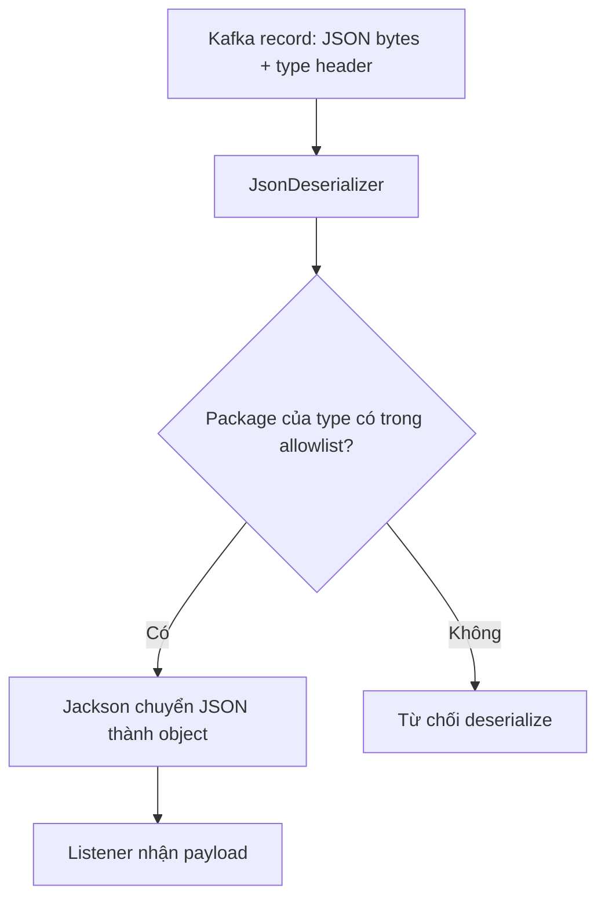

# Trusted packages khi deserialize JSON

Spring Kafka cung cấp `JsonDeserializer` để chuyển JSON trong Kafka record thành object Java. Khi serializer gửi kèm type header, deserializer có thể dùng tên class trong header để xác định kiểu object cần tạo. Vì type header đến từ record, consumer cần giới hạn những package được phép dùng làm kiểu đích.

`spring.json.trusted.packages` là allowlist package cho `JsonDeserializer`. Cấu hình này giúp ngăn record yêu cầu deserialize thành class nằm ngoài các package được ứng dụng tin cậy. Hãy khai báo package chứa event DTO mà consumer thực sự sử dụng; tránh mở toàn bộ bằng `*` trong môi trường production.

## 1. Vì sao JSON deserializer cần trusted packages?

Kafka lưu key và value dưới dạng byte. Producer serialize object thành JSON, gửi byte cùng record và có thể thêm metadata mô tả kiểu Java. Spring Kafka `JsonSerializer` mặc định có thể ghi type information vào Kafka headers, ví dụ:

| Header | Mục đích |
|---|---|
| `__TypeId__` | Kiểu chính của object được serialize |
| `__ContentTypeId__` | Kiểu phần tử bên trong một kiểu container hoặc collection |
| `__KeyTypeId__` | Kiểu key của một map khi value được serialize có cấu trúc map |

Khi `JsonDeserializer` đọc record, nó có thể dùng type header để tìm class Java cần tạo. Nếu không giới hạn package, record từ một nguồn không đáng tin có thể yêu cầu consumer khởi tạo kiểu nằm ngoài mô hình event dự kiến.

Trusted packages giới hạn phạm vi class mà type metadata được phép trỏ tới. Ví dụ, consumer chỉ chấp nhận các kiểu event trong `com.acme.orders.events` và `com.acme.shared.events`.



Allowlist package là một lớp kiểm soát kiểu đích. Nó không thay thế Kafka ACL, xác thực producer, kiểm tra schema hoặc validate dữ liệu nghiệp vụ.

## 2. Cấu hình trusted packages trong application.yml

Ví dụ ứng dụng nhận event đơn hàng. Các DTO được đặt trong hai package do ứng dụng kiểm soát:

```text
com.acme.orders.events
  OrderCreated
  OrderCancelled

com.acme.shared.events
  EventMetadata
```

Khai báo deserializer và allowlist trong Spring Boot:

```yaml
spring:
  kafka:
    bootstrap-servers: ${KAFKA_BOOTSTRAP_SERVERS:localhost:9092}
    consumer:
      group-id: order-projection
      key-deserializer: org.apache.kafka.common.serialization.StringDeserializer
      value-deserializer: org.springframework.kafka.support.serializer.JsonDeserializer
      properties:
        spring.json.trusted.packages: com.acme.orders.events,com.acme.shared.events
        spring.json.value.default.type: com.acme.orders.events.OrderCreated
```

`spring.json.trusted.packages` nhận danh sách package phân cách bằng dấu phẩy. Với YAML, giá trị chuỗi như trên được Spring Boot truyền vào Kafka consumer properties để Spring Kafka cấu hình `JsonDeserializer`.

`spring.json.value.default.type` chỉ định kiểu value mặc định khi không có type header phù hợp hoặc khi ứng dụng dùng chiến lược kiểu cố định. Nếu record có type header và consumer cho phép dùng header, type header có thể quyết định class thực tế. Phần tiếp theo sẽ phân biệt hai trường hợp này.

Listener có thể nhận POJO trực tiếp:

```java
@Component
public class OrderListener {

    @KafkaListener(topics = "orders.created.v1")
    public void onOrderCreated(OrderCreated event) {
        // Xử lý event đã được deserialize.
    }
}
```

Kiểu tham số của listener phải tương thích với class mà deserializer tạo ra. Nếu listener nhận `OrderCreated` nhưng producer gửi type header trỏ tới một class khác, cần cấu hình type mapping hoặc tách chiến lược deserialize rõ ràng.

## 3. Chỉ tin cậy package ứng dụng cần thiết

Một cấu hình allowlist nên cụ thể và có chủ sở hữu rõ ràng:

```yaml
spring:
  kafka:
    consumer:
      properties:
        spring.json.trusted.packages: com.acme.orders.events,com.acme.common.events
```

Chọn package theo các nguyên tắc:

- Chỉ đưa package chứa class event mà consumer cần deserialize.
- Ưu tiên package thuộc source code hoặc thư viện nội bộ do tổ chức kiểm soát.
- Tránh tin cậy package tổng quá rộng nếu package đó chứa nhiều class không liên quan tới message contract.
- Khi thêm loại event mới, cập nhật allowlist có chủ đích và review thay đổi cùng schema.
- Dùng cùng quy ước package và type mapping giữa producer/consumer khi hệ thống chia sẻ event contract.

Trong Spring Kafka, một package được tin cậy cũng có thể bao gồm các package con theo quy tắc kiểm tra package của thư viện. Vì vậy, nếu khai báo package gốc như `com.acme`, phạm vi tin cậy có thể rộng hơn một package event cụ thể. Hãy chọn điểm gốc hẹp nhất đáp ứng nhu cầu.

Không nên dùng `*` để xử lý nhanh lỗi `not in the trusted packages`. Wildcard mở rộng phạm vi tới mọi package và làm mất tác dụng giới hạn class theo allowlist.

## 4. Trusted packages và type headers

Spring Kafka `JsonSerializer` thường thêm type headers để `JsonDeserializer` biết kiểu dữ liệu. Khi consumer dùng type headers, quá trình xử lý khái quát như sau:

1. Producer serialize object thành JSON.
2. Serializer thêm type metadata vào record headers.
3. Consumer đọc header type, ví dụ `__TypeId__`.
4. `JsonDeserializer` xác định class tương ứng.
5. Deserializer kiểm tra package của class có được tin cậy hay không.
6. Nếu được phép, Jackson tạo object; nếu không, deserialize thất bại.

Ví dụ record có header trỏ tới `com.acme.orders.events.OrderCreated`. Nếu allowlist chứa `com.acme.orders.events`, class có thể được chấp nhận. Nếu header trỏ tới `com.external.unexpected.SomeType`, deserializer từ chối vì package không nằm trong allowlist.

Thông báo lỗi thường nêu class không thuộc trusted packages. Khi gặp lỗi này, kiểm tra type header thực tế và package class producer gửi. Không khắc phục bằng cách thêm `*` trước khi xác định nguồn gốc type header.

## 5. Khi chỉ nhận một kiểu JSON cố định

Nếu topic chỉ chứa một loại event và consumer muốn luôn deserialize về một class cố định, có thể tắt việc sử dụng type headers và đặt default type:

```yaml
spring:
  kafka:
    consumer:
      value-deserializer: org.springframework.kafka.support.serializer.JsonDeserializer
      properties:
        spring.json.value.default.type: com.acme.orders.events.OrderCreated
        spring.json.trusted.packages: com.acme.orders.events
        spring.json.use.type.headers: false
```

Với cấu hình này, deserializer dùng `OrderCreated` làm kiểu value đích và không chọn class từ type header. Điều này phù hợp khi contract của topic cố định và producer không cần quyết định class Java ở consumer.

Tắt type headers không có nghĩa bỏ qua JSON deserialization. Consumer vẫn deserialize JSON thành class đích được cấu hình trong ứng dụng. Trong chế độ này, class đích đến từ cấu hình local thay vì type header của record, nên kiểm tra trusted packages chủ yếu liên quan tới trường hợp deserializer dùng type metadata để chọn class. Nếu sau này bật lại type headers, hãy bảo đảm allowlist đã được khai báo phù hợp.

Nếu topic chứa nhiều loại event khác nhau, không đặt một default type duy nhất rồi kỳ vọng mọi payload đều tự chuyển thành class tương ứng. Hãy dùng type mapping hoặc tách topic/listener theo schema.

## 6. Dùng type mapping thay cho tên class đầy đủ trong header

Type mapping cho phép serializer ghi alias ngắn thay cho fully qualified class name. Consumer ánh xạ alias về class cục bộ tương ứng. Cách này giảm phụ thuộc vào package Java của service gửi và service nhận.

Ví dụ hai event:

```java
package com.acme.orders.events;

public record OrderCreated(String eventId, String orderId) {
}
```

```java
package com.acme.orders.events;

public record OrderCancelled(String eventId, String orderId, String reason) {
}
```

Cấu hình type mapping cho consumer:

```yaml
spring:
  kafka:
    consumer:
      value-deserializer: org.springframework.kafka.support.serializer.JsonDeserializer
      properties:
        spring.json.trusted.packages: com.acme.orders.events
        spring.json.type.mapping: order-created:com.acme.orders.events.OrderCreated,order-cancelled:com.acme.orders.events.OrderCancelled
```

Producer cũng có thể cấu hình mapping tương ứng để ghi alias vào header:

```yaml
spring:
  kafka:
    producer:
      value-serializer: org.springframework.kafka.support.serializer.JsonSerializer
      properties:
        spring.json.type.mapping: order-created:com.acme.orders.events.OrderCreated,order-cancelled:com.acme.orders.events.OrderCancelled
```

Producer ánh xạ class thành alias khi ghi header; consumer ánh xạ alias về class trong ứng dụng nhận. Alias phải thống nhất giữa hai bên. Consumer vẫn cần trusted packages cho các class được ánh xạ.

Trong kiến trúc nhiều service, hai bên có thể dùng package Java khác nhau nhưng cùng contract. Mỗi service khai báo alias tương ứng với class cục bộ của mình. Không cần buộc consumer phải có cùng package name với producer nếu type mapping đã được định nghĩa đúng.

## 7. Cấu hình bằng Java ConsumerFactory

Nếu ứng dụng không dùng Spring Boot auto-configuration hoặc cần tự tạo `ConsumerFactory`, có thể đặt trusted packages trực tiếp trong consumer properties:

```java
@Configuration
public class KafkaConsumerConfiguration {

    @Bean
    public ConsumerFactory<String, OrderCreated> consumerFactory() {
        Map<String, Object> properties = new HashMap<>();
        properties.put(ConsumerConfig.BOOTSTRAP_SERVERS_CONFIG, "localhost:9092");
        properties.put(ConsumerConfig.GROUP_ID_CONFIG, "order-projection");
        properties.put(
                ConsumerConfig.KEY_DESERIALIZER_CLASS_CONFIG,
                StringDeserializer.class);
        properties.put(
                ConsumerConfig.VALUE_DESERIALIZER_CLASS_CONFIG,
                JsonDeserializer.class);
        properties.put(
                JsonDeserializer.VALUE_DEFAULT_TYPE,
                OrderCreated.class.getName());
        properties.put(
                JsonDeserializer.TRUSTED_PACKAGES,
                "com.acme.orders.events,com.acme.shared.events");
        properties.put(JsonDeserializer.USE_TYPE_INFO_HEADERS, false);

        return new DefaultKafkaConsumerFactory<>(properties);
    }
}
```

Các hằng `JsonDeserializer.VALUE_DEFAULT_TYPE`, `TRUSTED_PACKAGES` và `USE_TYPE_INFO_HEADERS` giúp tránh gõ sai tên property. Cần import các class Kafka/Spring Kafka tương ứng và dùng phiên bản Spring Kafka hỗ trợ các hằng này.

Nếu cấu hình qua constructor hoặc setter của `JsonDeserializer`, tránh trộn nhiều cách cấu hình không nhất quán. Một số constructor/fluent API đánh dấu deserializer đã được cấu hình trực tiếp; khi đó các property map có thể không được áp dụng như mong đợi. Chọn một cách cấu hình rõ ràng và kiểm thử consumer thực tế.

## 8. Trusted packages khi key cũng là JSON

Kafka record key và value có thể dùng các deserializer khác nhau. Nếu key cũng là object JSON và được xử lý bằng Spring Kafka `JsonDeserializer`, hãy cấu hình kiểu key mặc định bằng `spring.json.key.default.type`. Allowlist package vẫn được cấu hình qua `spring.json.trusted.packages` cho `JsonDeserializer`.

Ví dụ cấu hình key và value là hai object khác kiểu:

```yaml
spring:
  kafka:
    consumer:
      key-deserializer: org.springframework.kafka.support.serializer.JsonDeserializer
      value-deserializer: org.springframework.kafka.support.serializer.JsonDeserializer
      properties:
        spring.json.key.default.type: com.acme.orders.keys.OrderKey
        spring.json.value.default.type: com.acme.orders.events.OrderCreated
        spring.json.trusted.packages: com.acme.orders.keys,com.acme.orders.events,com.acme.shared.events
```

`spring.json.key.default.type` chỉ định kiểu key mặc định; `spring.json.value.default.type` chỉ định kiểu value mặc định. `spring.json.trusted.packages` là property allowlist của `JsonDeserializer`, vì vậy hãy đưa vào đó các package cần thiết cho những deserializer JSON đang dùng. Nếu key dùng `StringDeserializer`, không cần thêm package dành riêng cho key.

Chỉ cấu hình key thành JSON object khi có yêu cầu rõ ràng. Key chuỗi thường dễ quan sát, dễ dùng với partitioner và tương thích với nhiều công cụ Kafka hơn.

## 9. Tổ chức package event an toàn và ổn định

Không nên để event contract phụ thuộc vào package của một lớp service nội bộ. Một cấu trúc dễ quản lý có thể là:

```text
com.acme
  shared
    events
      EventMetadata.java
  orders
    events
      OrderCreated.java
      OrderCancelled.java
  billing
    application
    infrastructure
```

Các class trong `events` đại diện contract trao đổi giữa producer và consumer. Package `application` hoặc `infrastructure` chứa chi tiết triển khai nội bộ và không nên được tin cậy chỉ để deserialize một event.

Nếu nhiều service dùng chung một thư viện event contract, hãy quản lý version thư viện và schema compatibility rõ ràng. Trusted packages nên phản ánh đúng các package contract được phép, không phải toàn bộ namespace của mọi dependency trong classpath.

Type mapping alias giúp tách tên kiểu trong Kafka header khỏi package triển khai. Dù dùng alias, consumer vẫn phải xác định class đích hợp lệ và tin cậy package chứa class đó.

## 10. Trusted packages không thay thế validation

Một class thuộc trusted package chỉ có nghĩa type header được phép trỏ tới class đó. Điều này không chứng minh payload hợp lệ về nghiệp vụ.

Sau khi deserialize, ứng dụng vẫn cần kiểm tra:

- Trường bắt buộc có tồn tại và có giá trị hợp lệ không.
- `eventId`, aggregate ID và timestamp có đúng định dạng không.
- Giá trị enum hoặc trạng thái có nằm trong tập được hỗ trợ không.
- Version schema có tương thích với consumer không.
- Kích thước payload và collection có nằm trong giới hạn cho phép không.
- Event có hợp lệ với trạng thái hiện tại của nghiệp vụ không.

Ví dụ DTO có thể deserialize thành công dù `orderId` rỗng hoặc `amount` âm. Những điều kiện đó cần được kiểm tra bằng Bean Validation hoặc logic domain sau khi chuyển đổi.

Không dùng trusted packages như một cơ chế authorization. Producer vẫn cần xác thực và ACL để ghi topic; consumer vẫn cần ACL để đọc topic và group. Allowlist chỉ kiểm soát package đích khi `JsonDeserializer` diễn giải type metadata.

## 11. Rủi ro khi dùng wildcard hoặc package quá rộng

Ví dụ cấu hình không nên dùng tùy tiện:

```yaml
spring:
  kafka:
    consumer:
      properties:
        spring.json.trusted.packages: "*"
```

Wildcard cho phép type metadata trỏ tới class thuộc bất kỳ package nào mà ứng dụng có thể tải. Điều này làm mất lớp giới hạn package và tăng bề mặt rủi ro khi record đến từ producer không đáng tin hoặc topic bị ghi bởi principal ngoài dự kiến.

Các lựa chọn nên ưu tiên:

| Cấu hình | Đánh giá |
|---|---|
| `com.acme.orders.events` | Phạm vi hẹp, phù hợp nếu chỉ có event đơn hàng |
| `com.acme.shared.events,com.acme.orders.events` | Cho phép rõ hai nhóm contract cần thiết |
| `com.acme` | Rộng hơn, có thể bao gồm nhiều package con không cần thiết |
| `*` | Tin cậy mọi package; tránh dùng trong production |

Không thêm package chỉ để làm cho một message lỗi deserialize chạy qua. Hãy kiểm tra producer gửi type header nào, event đó có thuộc contract được hỗ trợ hay không và liệu topic có chứa nhiều loại payload ngoài dự kiến không.

## 12. Khi producer không gửi type headers

Producer ngoài Spring Kafka hoặc serializer không thêm type metadata có thể gửi JSON thuần không có `__TypeId__`. Trong trường hợp đó, consumer cần biết kiểu đích bằng cấu hình default type hoặc cấu hình deserializer có target type cố định.

Ví dụ topic chỉ chứa `OrderCreated`:

```yaml
spring:
  kafka:
    consumer:
      value-deserializer: org.springframework.kafka.support.serializer.JsonDeserializer
      properties:
        spring.json.value.default.type: com.acme.orders.events.OrderCreated
        spring.json.use.type.headers: false
        spring.json.trusted.packages: com.acme.orders.events
```

Nếu topic chứa nhiều schema nhưng không có type header, cần một chiến lược khác để phân biệt kiểu, chẳng hạn:

- Mỗi topic chỉ chứa một loại event và listener dùng default type riêng.
- Payload có trường discriminator như `eventType` và ứng dụng dùng custom deserializer/converter để định tuyến.
- Dùng schema registry hoặc một định dạng serialization có schema ID.

Không nên suy đoán kiểu object chỉ từ tên topic nếu topic có thể chứa nhiều loại record hoặc schema thay đổi không tương thích.

## 13. Lỗi thường gặp khi cấu hình trusted packages

**Lỗi `not in the trusted packages`:** type header trỏ tới class ngoài allowlist. Kiểm tra tên class và thêm đúng package nếu đó là event contract hợp lệ.

**Đã thêm package nhưng lỗi vẫn còn:** có thể consumer đang dùng một `ConsumerFactory` hoặc `JsonDeserializer` khác, property đặt sai prefix, hoặc type header trỏ tới package khác. Kiểm tra cấu hình runtime thực tế và factory mà listener sử dụng.

**Dùng nhầm property cho key/value:** `spring.json.key.default.type` dùng để đặt kiểu key mặc định; allowlist package của `JsonDeserializer` được khai báo bằng `spring.json.trusted.packages`.

**Default type không được dùng:** type headers vẫn đang được ưu tiên. Nếu topic có một kiểu cố định, cân nhắc `spring.json.use.type.headers: false` cùng default type rõ ràng.

**Nhiều event class nhưng chỉ khai báo một default type:** tách listener/topic hoặc dùng type mapping phù hợp.

**Producer và consumer không thống nhất type mapping:** alias không ánh xạ được về class mong muốn. Đồng bộ alias giữa hai bên và kiểm tra header thực tế.

**Dùng `*` để bỏ qua lỗi:** allowlist không còn giới hạn class. Tìm nguyên nhân type header thay vì mở toàn bộ package.

**JSON deserialize thành công nhưng nghiệp vụ lỗi:** trusted package không validate nội dung. Thêm validation cho DTO và domain.

**Package event thay đổi sau refactor:** type header chứa fully qualified class name cũ không còn resolve được. Dùng type mapping ổn định hoặc duy trì compatibility trong giai đoạn chuyển đổi.

## 14. Kiểm thử trusted packages

Nên có test xác minh class thuộc allowlist được deserialize và class ngoài allowlist bị từ chối. Có thể kiểm tra trực tiếp `JsonDeserializer` hoặc dùng integration test với Kafka broker.

Ví dụ kiểm tra deserializer với một target type cố định:

```java
JsonDeserializer<OrderCreated> deserializer =
        new JsonDeserializer<>(OrderCreated.class, false)
                .trustedPackages("com.acme.orders.events");

deserializer.configure(Map.of(), false);

OrderCreated event = deserializer.deserialize(
        "orders.created.v1",
        "{\"eventId\":\"evt-1\",\"orderId\":\"order-42\"}"
                .getBytes(StandardCharsets.UTF_8));

assertThat(event.orderId()).isEqualTo("order-42");
```

Constructor với `useHeadersIfPresent=false` minh họa cách deserialize theo target type cố định, không lấy class từ type header. API constructor/fluent có thể thay đổi giữa phiên bản Spring Kafka; hãy dùng signature phù hợp dependency của dự án.

Với test type header, tạo header `__TypeId__` trỏ tới class thuộc package được phép và một header khác trỏ tới package không được phép. Xác minh trường hợp đầu thành công và trường hợp sau phát sinh lỗi deserialize. Không chỉ kiểm tra property có mặt trong YAML; cần xác minh deserializer thực tế nhận đúng cấu hình.

Các trường hợp nên có:

- Package trong allowlist được chấp nhận.
- Package ngoài allowlist bị từ chối.
- Type header không có và default type được cấu hình đúng.
- `use.type.headers=false` giữ consumer ở kiểu đích cố định.
- Type mapping alias được resolve thành class đúng.
- JSON không hợp lệ hoặc thiếu trường nghiệp vụ được xử lý qua error handling/validation phù hợp.
- Khi key và value đều là JSON object, allowlist bao gồm các package hợp lệ của cả hai kiểu.

## 15. Checklist production

- `JsonDeserializer` chỉ được dùng ở nơi cần deserialize JSON thành object Java.
- `spring.json.trusted.packages` chỉ chứa package event được ứng dụng kiểm soát.
- Không dùng wildcard `*` trong production nếu không có đánh giá rủi ro rõ ràng.
- Xác định consumer có dùng type headers hay default type cố định.
- Nếu dùng nhiều event type, type mapping được định nghĩa và đồng bộ giữa producer/consumer.
- Nếu key cũng là JSON object, cấu hình `spring.json.key.default.type` và thêm package key vào `spring.json.trusted.packages`.
- Package contract ổn định và không phụ thuộc lớp triển khai nội bộ của producer.
- Producer/consumer được bảo vệ bằng authentication và ACL phù hợp.
- Payload được validate sau deserialize; allowlist không thay thế validation.
- Có test cho package hợp lệ, package không hợp lệ, type header và default type.
- Theo dõi lỗi deserialize và ghi nhận topic/partition/offset để điều tra mà không log dữ liệu nhạy cảm.

Trusted packages giới hạn những package mà `JsonDeserializer` được phép dùng khi chuyển type metadata thành class Java. Hãy giữ allowlist hẹp, dùng default type hoặc type mapping theo contract và kiểm tra payload sau deserialize. Kết hợp các biện pháp này với ACL Kafka, schema compatibility và validation nghiệp vụ sẽ giúp luồng JSON messaging dễ kiểm soát hơn.
