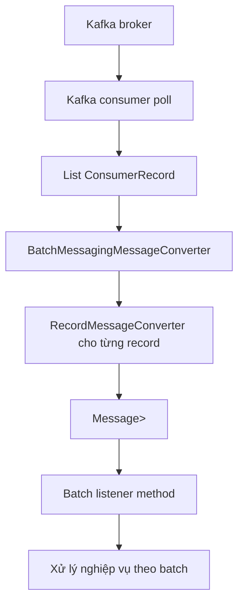

# BatchMessagingMessageConverter

Trong Spring Kafka, một consumer có thể nhận nhiều record trong một lần `poll()`. Nếu listener được cấu hình ở chế độ batch, Spring Kafka chuyển danh sách record đó thành một Spring `Message` chứa danh sách payload để method xử lý cả lô dữ liệu.

**BatchMessagingMessageConverter** là bộ chuyển đổi dành cho luồng này. Nó chuyển đổi từng record trong batch, sau đó tập hợp payload và metadata tương ứng để listener nhận được `List<T>` hoặc `Message<List<T>>`.

Converter này thuộc phía consumer. Nó không phải serializer của producer, không biến một lô record thành một JSON array trên Kafka và cũng không quyết định Kafka client gom request mạng thành batch như thế nào.

## 1. Batch listener và message converter

Với record listener, mỗi lần gọi method thường xử lý một record:

```java
@KafkaListener(topics = "order-events")
public void listen(OrderCreated event) {
    orderService.process(event);
}
```

Với batch listener, container lấy nhiều record từ một lần poll rồi gọi method một lần với danh sách payload:

```java
@KafkaListener(
    topics = "order-events",
    containerFactory = "batchKafkaListenerContainerFactory"
)
public void listen(List<OrderCreated> events) {
    orderService.processBatch(events);
}
```

Luồng chuyển đổi:



Các thành phần có trách nhiệm khác nhau:

| Thành phần | Trách nhiệm |
|---|---|
| Kafka `Deserializer` | Chuyển bytes của key/value thành kiểu Java ban đầu |
| `RecordMessageConverter` | Chuyển đổi một Kafka record thành Spring message hoặc payload tương ứng |
| `BatchMessageConverter` | Chuyển đổi danh sách record thành message dạng batch |
| `BatchMessagingMessageConverter` | Cài đặt `BatchMessageConverter`, có thể ủy quyền việc chuyển đổi từng record cho `RecordMessageConverter` |
| Batch listener | Nhận danh sách payload và thực hiện xử lý |

Điểm quan trọng là **deserializer chạy trước message converter**. Ví dụ, `StringDeserializer` biến value bytes thành `String`; sau đó `StringJsonMessageConverter` có thể chuyển JSON String thành DTO theo kiểu tham số của listener.

## 2. Khi nào nên dùng BatchMessagingMessageConverter?

Batch listener phù hợp khi xử lý theo lô giúp giảm chi phí gọi service hoặc ghi dữ liệu:

- Ghi nhiều event vào database bằng batch insert.
- Gọi API hỗ trợ gửi nhiều đối tượng trong một request.
- Tính toán tổng hợp trên một nhóm record.
- Xử lý dữ liệu theo cửa sổ hoặc theo lô nghiệp vụ.
- Giảm overhead khi số lượng record lớn và nghiệp vụ có thể xử lý theo batch.

Ví dụ, thay vì gọi repository nhiều lần:

```java
for (OrderCreated event : events) {
    orderRepository.save(toEntity(event));
}
```

Có thể chuyển thành thao tác batch:

```java
orderRepository.saveAll(
    events.stream()
        .map(this::toEntity)
        .toList()
);
```

Batch không phải lúc nào cũng nhanh hơn. Nếu mỗi record cần xử lý độc lập, cần retry riêng hoặc cần latency thấp, record listener có thể phù hợp hơn. Batch lớn cũng làm tăng bộ nhớ, thời gian xử lý một lần poll và phạm vi dữ liệu phải xử lý lại khi có lỗi.

## 3. Cấu hình batch listener container factory

Trước tiên, cần bật batch mode trên `ConcurrentKafkaListenerContainerFactory` và đăng ký batch converter.

Ví dụ dưới đây dùng Spring Boot để giữ các cấu hình Kafka chung đã được auto-configuration áp dụng:

```java
import org.springframework.boot.autoconfigure.kafka.ConcurrentKafkaListenerContainerFactoryConfigurer;
import org.springframework.context.annotation.Bean;
import org.springframework.context.annotation.Configuration;
import org.springframework.kafka.config.ConcurrentKafkaListenerContainerFactory;
import org.springframework.kafka.core.ConsumerFactory;
import org.springframework.kafka.support.converter.BatchMessagingMessageConverter;
import org.springframework.kafka.support.converter.StringJsonMessageConverter;

@Configuration
public class KafkaBatchConfiguration {

    @Bean
    ConcurrentKafkaListenerContainerFactory<String, String>
    batchKafkaListenerContainerFactory(
            ConcurrentKafkaListenerContainerFactoryConfigurer configurer,
            ConsumerFactory<String, String> consumerFactory) {

        var factory =
            new ConcurrentKafkaListenerContainerFactory<String, String>();

        configurer.configure(factory, consumerFactory);

        factory.setBatchListener(true);
        factory.setBatchMessageConverter(
            new BatchMessagingMessageConverter(
                new StringJsonMessageConverter()
            )
        );

        return factory;
    }
}
```

Ý nghĩa các bước:

1. Tạo factory dành riêng cho batch listener.
2. Dùng `configurer.configure(...)` để áp dụng cấu hình Spring Boot như consumer properties, error handler và các thiết lập chung mà configurer hỗ trợ.
3. Gọi `setBatchListener(true)` để container chuyển danh sách record từ poll cho listener.
4. Gọi `setBatchMessageConverter(...)` để chỉ định cách chuyển đổi danh sách record thành message batch.
5. Truyền `StringJsonMessageConverter` làm record converter để mỗi JSON String được chuyển thành DTO trước khi gom vào danh sách.

Nếu không dùng Spring Boot, có thể tạo factory trực tiếp và gọi `setConsumerFactory(...)`, sau đó cấu hình batch mode, converter, ack mode và error handler theo nhu cầu. Khi tự tạo factory, cần chủ động thiết lập các thuộc tính mà Boot configurer thường quản lý.

**Lưu ý phiên bản:** `StringJsonMessageConverter` là tên API thường dùng trong Spring Kafka 3.x. Với Spring Kafka 4.x, dùng `JacksonJsonMessageConverter` tương ứng với Jackson 3. Hãy chọn converter khớp major version Spring Kafka và Jackson của dự án.

## 4. Cấu hình deserializer cho JSON String

Ví dụ factory ở trên nhận `ConsumerFactory<String, String>`, nghĩa là Kafka consumer trả key và value dưới dạng String.

Cấu hình Spring Boot:

```yaml
spring:
  kafka:
    bootstrap-servers: localhost:9092

    consumer:
      group-id: order-batch-service
      auto-offset-reset: earliest
      key-deserializer: org.apache.kafka.common.serialization.StringDeserializer
      value-deserializer: org.apache.kafka.common.serialization.StringDeserializer

    producer:
      key-serializer: org.apache.kafka.common.serialization.StringSerializer
      value-serializer: org.apache.kafka.common.serialization.StringSerializer
```

Nếu chỉ một nhóm listener cần batch mode, có thể giữ listener mặc định ở chế độ record và chỉ chỉ định `containerFactory = "batchKafkaListenerContainerFactory"` cho các method batch. Khi đó không nhất thiết đặt `spring.kafka.listener.type: batch` cho toàn ứng dụng.

Producer trong ví dụ gửi JSON đã được biểu diễn thành String. Chẳng hạn:

```java
String json = objectMapper.writeValueAsString(event);

kafkaTemplate.send(
    "order-events",
    event.orderId(),
    json
);
```

Consumer thực hiện theo thứ tự:

1. `StringDeserializer` chuyển value bytes thành String.
2. `StringJsonMessageConverter` đọc JSON String.
3. Converter xác định kiểu đích từ tham số payload của listener.
4. `BatchMessagingMessageConverter` tập hợp các payload đã chuyển đổi thành danh sách.

Nếu producer gửi JSON bytes bằng một serializer khác, hãy bảo đảm bytes đó tương thích với deserializer của consumer. Không cấu hình `JsonDeserializer` để tạo DTO rồi lại dùng converter như thể payload vẫn là JSON String.

DTO dùng trong ví dụ có thể là một Java record đơn giản:

```java
public record OrderCreated(
    String orderId,
    String customerId
) {
}
```

Nếu consumer đã dùng `JsonDeserializer` để tạo `OrderCreated`, có thể dùng `new BatchMessagingMessageConverter()` để gom các object đã có. Khi đó factory và consumer factory cần dùng generic type tương ứng, ví dụ `ConcurrentKafkaListenerContainerFactory<String, OrderCreated>` và `ConsumerFactory<String, OrderCreated>`.

## 5. Nhận List<DTO> trong listener

Sau khi batch factory được cấu hình, listener có thể nhận danh sách DTO:

```java
import java.util.List;

import org.springframework.kafka.annotation.KafkaListener;
import org.springframework.messaging.handler.annotation.Payload;
import org.springframework.stereotype.Component;

@Component
public class OrderBatchListener {

    private final OrderApplicationService orderService;

    public OrderBatchListener(OrderApplicationService orderService) {
        this.orderService = orderService;
    }

    @KafkaListener(
        topics = "order-events",
        groupId = "order-batch-service",
        containerFactory = "batchKafkaListenerContainerFactory"
    )
    public void listen(@Payload List<OrderCreated> events) {
        if (events.isEmpty()) {
            return;
        }

        orderService.processBatch(events);
    }
}
```

`@Payload` làm rõ rằng tham số là payload của batch. Với method chỉ có một tham số payload, Spring có thể suy luận vai trò của tham số mà không cần annotation này; tuy nhiên, dùng `@Payload` giúp chữ ký method dễ đọc hơn.

Kích thước danh sách không cố định. Một lần gọi listener có thể nhận ít record hơn giới hạn `max.poll.records` do lượng dữ liệu hiện có, thời điểm poll, phân vùng được gán hoặc giới hạn fetch.

Không nên giả định mỗi lần gọi listener luôn có đúng một số lượng record cụ thể.

## 6. Chuyển đổi từng record trong batch

`BatchMessagingMessageConverter` có thể nhận một `RecordMessageConverter` trong constructor:

```java
new BatchMessagingMessageConverter(
    new StringJsonMessageConverter()
);
```

Cách này cho phép dùng cùng logic chuyển đổi cho từng record:

| Record đầu vào | Sau record converter |
|---|---|
| Record A, value là JSON String | `OrderCreated` A |
| Record B, value là JSON String | `OrderCreated` B |
| Record C, value là JSON String | `OrderCreated` C |

Batch converter tập hợp kết quả thành payload list:

```java
List<OrderCreated> events = List.of(
    eventA,
    eventB,
    eventC
);
```

Nó không ghép ba JSON object thành một JSON array rồi ghi ngược lên Kafka. Mỗi record vẫn là một Kafka record riêng, có key, partition, offset và header riêng.

Nếu consumer đã dùng `JsonDeserializer` để tạo `OrderCreated`, batch converter có thể nhận các object đã được deserialize và tập hợp chúng. Khi đó không cần thêm JSON String converter để parse lại payload.

## 7. Nhận metadata theo từng record

Khi listener nhận batch, metadata như key, partition, offset và topic có thể được ánh xạ thành các danh sách song song với payload.

Ví dụ:

```java
import java.util.List;

import org.springframework.kafka.annotation.KafkaListener;
import org.springframework.kafka.support.KafkaHeaders;
import org.springframework.messaging.handler.annotation.Header;
import org.springframework.messaging.handler.annotation.Payload;

@KafkaListener(
    topics = "order-events",
    containerFactory = "batchKafkaListenerContainerFactory"
)
public void listen(
        @Payload List<OrderCreated> events,
        @Header(KafkaHeaders.RECEIVED_KEY) List<String> keys,
        @Header(KafkaHeaders.RECEIVED_PARTITION) List<Integer> partitions,
        @Header(KafkaHeaders.OFFSET) List<Long> offsets) {

    for (int i = 0; i < events.size(); i++) {
        OrderCreated event = events.get(i);

        String key = keys.get(i);
        Integer partition = partitions.get(i);
        Long offset = offsets.get(i);

        // Truy vết event theo key, partition và offset.
    }
}
```

Các danh sách header được ánh xạ theo cùng thứ tự với payload list. Vì vậy, `events.get(i)`, `keys.get(i)`, `partitions.get(i)` và `offsets.get(i)` cùng đại diện cho record tại vị trí i.

Một số header thường dùng:

| Header | Giá trị trong batch |
|---|---|
| `KafkaHeaders.RECEIVED_KEY` | Danh sách key |
| `KafkaHeaders.RECEIVED_PARTITION` | Danh sách partition |
| `KafkaHeaders.OFFSET` | Danh sách offset |
| `KafkaHeaders.RECEIVED_TOPIC` | Danh sách topic |
| `KafkaHeaders.RECEIVED_TIMESTAMP` | Danh sách timestamp |

Key có thể null nếu producer không gửi key. Khi topic cho phép record không có key, cần xử lý phần tử null trong danh sách key thay vì giả định tất cả key đều tồn tại.

Không giả định các record trong một batch thuộc cùng partition. Một lần poll có thể trả record từ nhiều partition được consumer sở hữu.

## 8. Nhận Message<List<T>> và header đã chuyển đổi

Nếu cần giữ payload và Spring message headers trong cùng tham số, có thể nhận `Message<List<OrderCreated>>`:

```java
import java.util.List;

import org.springframework.kafka.annotation.KafkaListener;
import org.springframework.kafka.support.KafkaHeaders;
import org.springframework.messaging.Message;

@KafkaListener(
    topics = "order-events",
    containerFactory = "batchKafkaListenerContainerFactory"
)
public void listen(Message<List<OrderCreated>> message) {
    List<OrderCreated> events = message.getPayload();

    Object convertedHeaders = message.getHeaders()
        .get(KafkaHeaders.BATCH_CONVERTED_HEADERS);

    // convertedHeaders chứa metadata đã chuyển đổi theo từng record.
}
```

`KafkaHeaders.BATCH_CONVERTED_HEADERS` có thể chứa danh sách map header tương ứng với từng record khi batch converter tạo message. Kiểu và nội dung cụ thể phụ thuộc converter và cấu hình header mapping.

Cách truy cập này hữu ích khi cần metadata của từng record mà không muốn khai báo nhiều tham số `@Header`. Hãy kiểm tra header có tồn tại trước khi ép kiểu và chỉ đọc những trường cần thiết.

Nếu chỉ cần payload, `List<OrderCreated>` đơn giản hơn và ít phụ thuộc vào cấu trúc header.

## 9. Dùng raw ConsumerRecord khi cần kiểm soát đầy đủ

Có thể để batch listener nhận trực tiếp danh sách `ConsumerRecord`:

```java
import java.util.List;

import org.apache.kafka.clients.consumer.ConsumerRecord;
import org.springframework.kafka.annotation.KafkaListener;

@KafkaListener(
    topics = "order-events",
    containerFactory = "batchKafkaListenerContainerFactory"
)
public void listen(
        List<ConsumerRecord<String, String>> records) {

    for (ConsumerRecord<String, String> record : records) {
        String key = record.key();
        String rawJson = record.value();

        int partition = record.partition();
        long offset = record.offset();
        String topic = record.topic();

        // Tự xử lý payload và metadata của từng record.
    }
}
```

Khi nhận `ConsumerRecord`, listener làm việc với dữ liệu đã được Kafka deserializer xử lý nhưng chưa chuyển thành DTO qua message converter như ví dụ trước. Đây là lựa chọn phù hợp khi cần:

- Đọc chính xác metadata của từng record.
- Tự chọn cách parse theo topic hoặc header.
- Giữ raw payload để kiểm tra dữ liệu lỗi.
- Tự kiểm soát thứ tự chuyển đổi và xử lý.

Không cần nhận raw record nếu nghiệp vụ chỉ cần DTO. Payload list giúp method gọn và tách nghiệp vụ khỏi API Kafka.

## 10. Phân biệt batch converter với batch listener và producer batching

Ba khái niệm thường bị nhầm:

| Khái niệm | Ý nghĩa |
|---|---|
| Batch listener | Container gọi listener với một nhóm record trong một lần poll |
| `BatchMessagingMessageConverter` | Chuyển danh sách record thành Spring message và payload list |
| Producer batching | Kafka producer gom nhiều record vào request/batch mạng theo partition để tối ưu throughput |

`BatchMessagingMessageConverter` không bật batch listener thay cho factory. Cần gọi `setBatchListener(true)` hoặc cấu hình batch type phù hợp. Ngược lại, bật batch listener cũng không tự quyết định JSON sẽ được chuyển thành DTO như thế nào.

Producer batching được điều khiển bởi các cấu hình như `batch.size`, `linger.ms` và buffer của producer. Chúng không phải cấu hình của `BatchMessagingMessageConverter`.

## 11. Lỗi deserialization và conversion trong batch

Cần xác định lỗi xảy ra ở giai đoạn nào:

| Giai đoạn | Ví dụ lỗi | Hướng xử lý |
|---|---|---|
| Kafka deserialization | Bytes không thể chuyển thành String hoặc DTO | Kiểm tra serializer/deserializer; cân nhắc `ErrorHandlingDeserializer` |
| Record message conversion | JSON String không hợp lệ hoặc không khớp DTO | Kiểm tra converter, schema và kiểu tham số |
| Batch message conversion | Một record không chuyển đổi được khi converter tập hợp batch | Kiểm tra exception, record gây lỗi và error handler |
| Business processing | Một event không thỏa điều kiện nghiệp vụ | Xác định chính sách retry, bỏ qua hoặc DLT |

Lỗi deserialize xảy ra trước khi record converter nhận được Java value. Có thể dùng `ErrorHandlingDeserializer` bọc deserializer thực để chuyển thông tin lỗi thành header cho Spring Kafka xử lý.

Ví dụ cấu hình String deserializer được bọc:

```yaml
spring:
  kafka:
    consumer:
      key-deserializer: org.springframework.kafka.support.serializer.ErrorHandlingDeserializer
      value-deserializer: org.springframework.kafka.support.serializer.ErrorHandlingDeserializer
      properties:
        spring.deserializer.key.delegate.class: org.apache.kafka.common.serialization.StringDeserializer
        spring.deserializer.value.delegate.class: org.apache.kafka.common.serialization.StringDeserializer
```

Nếu listener cần xác định chính xác record nào lỗi, hãy cân nhắc nhận raw record hoặc kiểm tra header lỗi do `ErrorHandlingDeserializer` cung cấp. Không nên giả định mọi lỗi conversion đều tự động chỉ ra index record lỗi trong payload list.

Với batch listener, exception có thể làm cả batch được xem là thất bại. Khi cần retry hoặc phục hồi theo record, có thể dùng `DefaultErrorHandler` và ném `BatchListenerFailedException` với index record thất bại từ logic listener. Khi lỗi phát sinh trước khi method được gọi, việc xác định record cần phục hồi phụ thuộc giai đoạn và thông tin exception/header mà converter cung cấp.

## 12. Xử lý lỗi nghiệp vụ trong batch listener

Batch listener nên xác định rõ chính sách khi một record trong lô lỗi:

- Retry cả batch khi thao tác có thể chạy lại an toàn.
- Dùng `BatchListenerFailedException` để chỉ ra index record lỗi khi listener đã xác định được record đó.
- Chuyển record lỗi sang DLT nếu đã hết retry.
- Dùng idempotency để các record đã xử lý trước đó không tạo side effect trùng khi batch được phát lại.

Ví dụ minh họa xác định record lỗi:

```java
import java.util.List;

import org.springframework.kafka.listener.BatchListenerFailedException;

public void processBatch(List<OrderCreated> events) {
    for (int i = 0; i < events.size(); i++) {
        try {
            orderService.process(events.get(i));
        }
        catch (RuntimeException exception) {
            throw new BatchListenerFailedException(
                "Cannot process order event",
                exception,
                i
            );
        }
    }
}
```

`BatchListenerFailedException` cần được sử dụng cùng error handler hỗ trợ xử lý batch, chẳng hạn `DefaultErrorHandler`. Index phải là vị trí trong danh sách batch hiện tại, bắt đầu từ 0. Không tự tạo index từ offset Kafka vì offset không đồng nghĩa với chỉ số phần tử trong batch.

Nếu xử lý một batch bằng một transaction database, cần quyết định transaction bao phủ toàn bộ batch hay từng record. Rollback cả batch có thể làm record thành công trước đó được phát lại; vì vậy side effect cần idempotent hoặc transaction phải bao trùm đúng ranh giới nghiệp vụ.

## 13. Kích thước batch và hiệu năng

Kích thước batch phụ thuộc số record Kafka trả về trong poll và cấu hình consumer. Thuộc tính quan trọng:

```yaml
spring:
  kafka:
    consumer:
      max-poll-records: 200
      properties:
        max.poll.interval.ms: 300000
```

- `max.poll.records` giới hạn số record tối đa consumer trả về trong một lần poll.
- `max.poll.interval.ms` giới hạn khoảng thời gian giữa các lần poll trước khi group có thể xem consumer là không còn tiến triển và kích hoạt rebalance.
- Fetch size và số partition được gán cũng ảnh hưởng lượng dữ liệu có thể nhận trong một lần poll.

Nếu xử lý batch quá lâu, consumer có thể vượt `max.poll.interval.ms`. Khi đó partition có thể bị thu hồi và gán cho consumer khác, làm record đang xử lý bị phát lại.

Không nên tăng `max.poll.records` chỉ để đạt batch lớn hơn. Hãy đo thời gian xử lý, throughput, memory và độ trễ trước khi điều chỉnh.

## 14. Ordering trong batch

Kafka giữ thứ tự record trong từng partition. Batch listener có thể nhận record từ nhiều partition trong cùng một lần poll.

Điều này có nghĩa:

- Các record cùng partition được consumer trả về theo thứ tự partition.
- Không có thứ tự toàn cục được bảo đảm giữa các partition.
- Không sắp xếp lại batch theo timestamp nếu nghiệp vụ cần giữ thứ tự của partition.
- Nếu xử lý song song từng phần tử trong batch, side effect có thể hoàn tất theo thứ tự khác với thứ tự record.

Ví dụ, nếu các event của cùng `orderId` được producer gửi vào cùng partition, consumer có thể nhận theo thứ tự partition. Nhưng nếu listener đẩy từng event vào executor đa luồng, `OrderPaid` có thể hoàn tất trước `OrderCreated`. Khi cần ordering nghiệp vụ, hãy xử lý tuần tự theo key hoặc partition và dùng version/sequence để phát hiện event sai thứ tự.

## 15. Kiểm thử BatchMessagingMessageConverter

Integration test với Embedded Kafka có thể xác minh JSON String được chuyển thành DTO list. Nên kiểm tra tổng thể các event đã nhận thay vì giả định mọi lần poll luôn có cùng kích thước batch.

Một listener test có thể lưu từng batch vào queue:

```java
import java.util.List;
import java.util.concurrent.BlockingQueue;
import java.util.concurrent.LinkedBlockingQueue;
import java.util.concurrent.TimeUnit;

import org.springframework.kafka.annotation.KafkaListener;
import org.springframework.stereotype.Component;

@Component
public class OrderBatchCapture {

    private final BlockingQueue<List<OrderCreated>> batches =
        new LinkedBlockingQueue<>();

    @KafkaListener(
        id = "order-batch-capture",
        topics = "order-events",
        groupId = "order-batch-test",
        containerFactory = "batchKafkaListenerContainerFactory"
    )
    public void capture(List<OrderCreated> events) {
        batches.add(List.copyOf(events));
    }

    public List<OrderCreated> poll(long timeout, TimeUnit unit)
            throws InterruptedException {
        List<OrderCreated> batch = batches.poll(timeout, unit);
        return batch == null ? List.of() : batch;
    }
}
```

Test gửi ba event dưới dạng JSON String:

```java
import java.time.Duration;
import java.util.ArrayList;
import java.util.List;
import java.util.concurrent.TimeUnit;

import com.fasterxml.jackson.databind.ObjectMapper;
import org.junit.jupiter.api.BeforeEach;
import org.junit.jupiter.api.Test;
import org.springframework.beans.factory.annotation.Autowired;
import org.springframework.boot.test.context.SpringBootTest;
import org.springframework.kafka.config.KafkaListenerEndpointRegistry;
import org.springframework.kafka.core.KafkaTemplate;
import org.springframework.kafka.test.context.EmbeddedKafka;
import org.springframework.kafka.test.utils.ContainerTestUtils;

import static org.assertj.core.api.Assertions.assertThat;

@SpringBootTest(properties = {
    "spring.kafka.consumer.key-deserializer=org.apache.kafka.common.serialization.StringDeserializer",
    "spring.kafka.consumer.value-deserializer=org.apache.kafka.common.serialization.StringDeserializer",
    "spring.kafka.producer.key-serializer=org.apache.kafka.common.serialization.StringSerializer",
    "spring.kafka.producer.value-serializer=org.apache.kafka.common.serialization.StringSerializer",
    "spring.kafka.consumer.auto-offset-reset=earliest",
    "spring.kafka.consumer.group-id=order-batch-test"
})
@EmbeddedKafka(
    partitions = 1,
    topics = "order-events",
    bootstrapServersProperty = "spring.kafka.bootstrap-servers"
)
class OrderBatchListenerTest {

    @Autowired
    private KafkaTemplate<Object, Object> kafkaTemplate;

    @Autowired
    private ObjectMapper objectMapper;

    @Autowired
    private OrderBatchCapture capture;

    @Autowired
    private KafkaListenerEndpointRegistry registry;

    @BeforeEach
    void waitForListenerAssignment() {
        ContainerTestUtils.waitForAssignment(
            registry.getListenerContainer("order-batch-capture"),
            1
        );
    }

    @Test
    void convertsJsonRecordsToDtoBatch() throws Exception {
        List<OrderCreated> expected = List.of(
            new OrderCreated("order-1", "customer-1"),
            new OrderCreated("order-2", "customer-2"),
            new OrderCreated("order-3", "customer-3")
        );

        for (OrderCreated event : expected) {
            kafkaTemplate.send(
                "order-events",
                event.orderId(),
                objectMapper.writeValueAsString(event)
            ).get(10, TimeUnit.SECONDS);
        }

        List<OrderCreated> received = new ArrayList<>();
        long deadline = System.nanoTime() + Duration.ofSeconds(10).toNanos();

        while (received.size() < expected.size()
                && System.nanoTime() < deadline) {
            long remaining = deadline - System.nanoTime();
            List<OrderCreated> batch =
                capture.poll(remaining, TimeUnit.NANOSECONDS);

            received.addAll(batch);
        }

        assertThat(received)
            .extracting(OrderCreated::orderId)
            .containsExactlyInAnyOrder("order-1", "order-2", "order-3");
    }
}
```

Các constructor `OrderCreated` trong test là ví dụ rút gọn; hãy điều chỉnh theo DTO thật của dự án. Test dùng một partition để đơn giản hóa việc quan sát. Với nhiều partition, không khẳng định thứ tự toàn cục giữa các event.

Nếu muốn kiểm tra header list, hãy gửi record có key và xác minh mỗi key, partition, offset tương ứng với payload tại cùng index. Nếu muốn kiểm tra conversion failure, gửi JSON không hợp lệ và xác minh error handler/DLT theo cấu hình test.

## 16. Lỗi thường gặp

| Hiện tượng | Nguyên nhân có thể | Cách xử lý |
|---|---|---|
| Listener nhận một DTO thay vì `List<DTO>` | Factory đang chạy record mode | Gọi `setBatchListener(true)` hoặc chọn factory batch |
| Listener nhận `List<String>` thay vì DTO | Chưa cấu hình record converter chuyển JSON | Đăng ký `BatchMessagingMessageConverter` với JSON record converter |
| Không tìm thấy converter bean | Converter được gắn vào factory khác | Kiểm tra `containerFactory` trên `@KafkaListener` |
| Payload null hoặc lỗi conversion | Deserializer và converter không khớp kiểu dữ liệu | Kiểm tra chuỗi bytes → deserializer → record converter |
| Header list không cùng kích thước payload | Đọc sai header hoặc converter/header mapping tùy chỉnh | Kiểm tra header tương ứng theo từng record |
| Một event lỗi làm cả batch retry | Error handler đang xử lý batch như một đơn vị | Dùng `BatchListenerFailedException` và cấu hình `DefaultErrorHandler` phù hợp |
| Consumer rebalance khi xử lý batch | Thời gian xử lý vượt `max.poll.interval.ms` | Giảm batch, tối ưu xử lý hoặc điều chỉnh poll interval |
| Test đôi lúc chỉ nhận một phần batch | Một poll có thể trả ít record hơn số record đã gửi | Thu thập nhiều lần poll bằng queue và timeout |

## 17. Checklist triển khai

- Bật batch mode trên đúng listener container factory.
- Gắn `BatchMessagingMessageConverter` vào đúng factory được listener sử dụng.
- Chọn `RecordMessageConverter` phù hợp với kiểu value sau deserialization.
- Đồng bộ serializer producer, deserializer consumer và converter.
- Không nhầm batch converter với producer batching hoặc JSON array.
- Nếu cần metadata, xác minh header list căn chỉnh theo payload list.
- Nếu cần metadata gốc hoặc kiểm soát parse, cân nhắc `List<ConsumerRecord<K,V>>`.
- Thiết kế error handler phù hợp với batch failure và record failure.
- Đo thời gian xử lý để tránh vượt `max.poll.interval.ms`.
- Kiểm thử payload, headers, lỗi conversion và rebalance.

## 18. Ghi nhớ

- `BatchMessagingMessageConverter` chuyển danh sách Kafka record thành Spring message dạng batch.
- Nó có thể dùng `RecordMessageConverter` để chuyển đổi từng record trước khi tập hợp payload.
- `setBatchListener(true)` bật batch listener; cấu hình converter không tự bật chế độ này.
- Listener có thể nhận `List<T>`, `Message<List<T>>` hoặc danh sách raw `ConsumerRecord`.
- Metadata như key, partition và offset có thể được ánh xạ thành các danh sách song song với payload.
- Một batch có thể chứa record từ nhiều partition; chỉ thứ tự trong từng partition được Kafka bảo đảm.
- Lỗi conversion và lỗi nghiệp vụ cần được xử lý bằng error handler phù hợp.
- Batch lớn giúp tăng throughput trong một số workload nhưng làm tăng thời gian xử lý và phạm vi retry.

Khi cấu hình đúng batch factory, record converter và listener signature, Spring Kafka có thể chuyển từng record thành DTO rồi gom thành payload list. Listener nhờ đó xử lý được nhiều sự kiện trong một lần gọi mà vẫn giữ được metadata cần thiết để truy vết và phục hồi lỗi.

