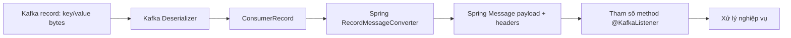

# Chuyển đổi payload theo chữ ký listener

Với `@KafkaListener`, kiểu tham số của method quyết định ứng dụng muốn nhận dữ liệu ở mức nào: payload nghiệp vụ, một Spring `Message<?>` có headers, hay Kafka `ConsumerRecord` chứa đầy đủ metadata. Spring Kafka có thể chuyển đổi record thành kiểu tham số phù hợp trước khi gọi method. Cơ chế này được gọi là **message conversion**.

Điều quan trọng là phân biệt message conversion với deserialization. Deserializer chuyển byte Kafka thành một kiểu Java ban đầu; message converter chuyển dữ liệu đã deserialize thành payload mà chữ ký listener yêu cầu. Hiểu đúng hai bước này giúp tránh cấu hình trùng lặp và xử lý lỗi đúng nơi.

## 1. Hai tầng chuyển đổi dữ liệu

Kafka lưu key và value dưới dạng byte. Khi consumer đọc record, quá trình nhận dữ liệu thường đi qua hai tầng:

1. **Deserialization:** Kafka `Deserializer` chuyển byte key/value thành kiểu Java ban đầu, ví dụ `byte[]`, `String` hoặc một object.
2. **Message conversion:** Spring Kafka `RecordMessageConverter` chuyển `ConsumerRecord` thành Spring `Message<?>` và có thể chuyển payload sang kiểu được yêu cầu bởi method `@KafkaListener`.



Ví dụ, producer gửi JSON bytes. Có hai cách phổ biến để listener nhận `OrderCreatedEvent`:

- Dùng `JsonDeserializer<OrderCreatedEvent>` để deserialize byte trực tiếp thành object. Khi đó listener nhận payload object mà không cần JSON message converter.
- Dùng `StringDeserializer` để nhận JSON dưới dạng `String`, sau đó dùng `StringJsonMessageConverter` chuyển chuỗi JSON thành `OrderCreatedEvent` theo kiểu tham số listener.

Hai cách đều hợp lệ, nhưng cần chọn rõ một chiến lược. Không nên kỳ vọng `StringDeserializer` tự biến JSON thành POJO, hoặc cấu hình `JsonDeserializer` rồi lại thêm converter để parse JSON lần thứ hai.

## 2. Chữ ký listener quyết định dữ liệu nhận được

Spring Kafka hỗ trợ nhiều kiểu tham số. Mỗi kiểu phù hợp với một mức truy cập dữ liệu khác nhau:

| Chữ ký method | Dữ liệu nhận được | Khi nên dùng |
|---|---|---|
| `void listen(OrderCreatedEvent event)` | Payload nghiệp vụ đã được deserialize/chuyển đổi thành object. | Phần lớn listener chỉ cần xử lý dữ liệu nghiệp vụ. |
| `void listen(Message<OrderCreatedEvent> message)` | Payload object cùng Spring Message headers. | Cần payload và metadata dưới dạng Spring headers. |
| `void listen(ConsumerRecord<String, OrderCreatedEvent> record)` | Kafka record với key, value, topic, partition, offset, timestamp và headers Kafka. | Cần API Kafka mức thấp hoặc metadata đầy đủ. |
| `void listen(String payload, @Header(...) String key)` | Payload cùng một số header được chọn riêng. | Muốn method gọn và chỉ lấy metadata cần thiết. |

### Nhận payload trực tiếp

Đây là dạng đơn giản nhất:

```java
@KafkaListener(topics = "orders.events", groupId = "order-projection")
public void onOrderCreated(OrderCreatedEvent event) {
    orderProjection.apply(event);
}
```

Tham số `event` là payload sau khi deserializer hoặc message converter tạo ra. Method không cần biết record được lưu ở partition nào nếu nghiệp vụ chỉ quan tâm nội dung event.

### Nhận Spring Message để đọc headers

Khi cần cả payload và metadata đã được ánh xạ sang Spring Message headers:

```java
import org.springframework.kafka.annotation.KafkaListener;
import org.springframework.kafka.support.KafkaHeaders;
import org.springframework.messaging.Message;

@KafkaListener(topics = "orders.events", groupId = "order-audit")
public void onOrderMessage(Message<OrderCreatedEvent> message) {
    OrderCreatedEvent event = message.getPayload();
    Object key = message.getHeaders().get(KafkaHeaders.RECEIVED_KEY);

    auditService.record(event, key);
}
```

Spring Kafka ánh xạ metadata của `ConsumerRecord` sang các header như received topic, key, partition, offset và timestamp. Có thể dùng `@Header` thay cho việc truy cập map trực tiếp.

### Nhận ConsumerRecord

Nếu cần metadata Kafka nguyên bản, nhận `ConsumerRecord`:

```java
import org.apache.kafka.clients.consumer.ConsumerRecord;

@KafkaListener(topics = "orders.events", groupId = "order-monitor")
public void inspect(ConsumerRecord<String, OrderCreatedEvent> record) {
    log.info("topic={}, partition={}, offset={}, key={}",
            record.topic(),
            record.partition(),
            record.offset(),
            record.key());

    monitorService.observe(record.value());
}
```

Trong chữ ký này, `record.value()` là kiểu Java mà Kafka value deserializer trả về. `ConsumerRecord` hữu ích khi cần truy cập trực tiếp metadata hoặc headers Kafka; không nên chọn nó chỉ vì muốn nhận một POJO đơn giản.

## 3. Dùng @Payload và @Header

Một listener có thể nhận payload và chỉ định rõ header cần lấy:

```java
import org.springframework.kafka.annotation.KafkaListener;
import org.springframework.kafka.support.KafkaHeaders;
import org.springframework.messaging.handler.annotation.Header;
import org.springframework.messaging.handler.annotation.Payload;

@KafkaListener(topics = "orders.events", groupId = "order-projection")
public void onOrderCreated(
        @Payload OrderCreatedEvent event,
        @Header(KafkaHeaders.RECEIVED_KEY) String orderId,
        @Header(KafkaHeaders.RECEIVED_PARTITION) int partition,
        @Header(KafkaHeaders.OFFSET) long offset) {

    orderProjection.apply(event, orderId);
    log.debug("Handled orderId={} from partition={} offset={}",
            orderId, partition, offset);
}
```

`@Payload` đánh dấu tham số chứa nội dung chính. `@Header` lấy metadata cụ thể từ Spring Message headers. Nếu header có thể không tồn tại hoặc có thể null trong một luồng dữ liệu, dùng kiểu nullable/wrapper phù hợp hoặc khai báo `required = false` và giá trị mặc định.

Một số header Kafka thường dùng:

| Header constant | Nội dung |
|---|---|
| `KafkaHeaders.RECEIVED_TOPIC` | Tên topic nhận record. |
| `KafkaHeaders.RECEIVED_KEY` | Key của record. |
| `KafkaHeaders.RECEIVED_PARTITION` | Partition nhận record. |
| `KafkaHeaders.OFFSET` | Offset của record. |
| `KafkaHeaders.RECEIVED_TIMESTAMP` | Timestamp nhận từ record. |

Tên và kiểu header có thể thay đổi theo phiên bản Spring Kafka. Khi nâng cấp, kiểm tra Javadoc của `KafkaHeaders` tương ứng với dependency dự án.

## 4. Khi nào cần RecordMessageConverter?

`RecordMessageConverter` là abstraction của Spring Kafka để chuyển đổi giữa Kafka `ConsumerRecord`/`ProducerRecord` và Spring `Message<?>`. Ở phía consumer, factory gắn converter để chuyển record nhận được thành message phục vụ method invocation.

Các implementation thường gặp:

| Converter | Kiểu dữ liệu đầu vào thường dùng | Vai trò |
|---|---|---|
| `MessagingMessageConverter` | Payload đã được deserializer thành Java object. | Chuyển record thành Spring Message và ánh xạ metadata thành headers. |
| `StringJsonMessageConverter` | `String` từ `StringDeserializer`. | Chuyển JSON string thành kiểu payload theo chữ ký listener. |
| `ByteArrayJsonMessageConverter` | `byte[]` từ `ByteArrayDeserializer`. | Chuyển JSON bytes trực tiếp thành payload. |
| `BytesJsonMessageConverter` | Kafka `Bytes` từ `BytesDeserializer`. | Chuyển Kafka Bytes thành payload. |
| `JsonMessageConverter` | JSON value dạng String/byte[]/Bytes theo cấu hình hỗ trợ. | Converter JSON tổng quát, có thể dùng trực tiếp hoặc qua subclass chuyên biệt. |

Nếu value deserializer đã tạo đúng POJO, converter mặc định `MessagingMessageConverter` thường chỉ cần đóng gói payload và headers. Nếu deserializer trả về JSON `String` hoặc bytes nhưng listener yêu cầu POJO, hãy dùng JSON message converter tương ứng.

## 5. Ví dụ: StringDeserializer kết hợp StringJsonMessageConverter

Giả sử producer gửi JSON vào topic `orders.events`. Consumer dùng `StringDeserializer`, nên giá trị ban đầu của `ConsumerRecord` là `String`. Ta muốn method listener nhận `OrderCreatedEvent`.

### Cấu hình consumer

```yaml
spring:
  kafka:
    bootstrap-servers: localhost:9092
    consumer:
      group-id: order-projection
      key-deserializer: org.apache.kafka.common.serialization.StringDeserializer
      value-deserializer: org.apache.kafka.common.serialization.StringDeserializer
```

### Cấu hình container factory

Từ Spring Kafka 2.9.6, factory cung cấp `setRecordMessageConverter(...)`:

```java
import org.springframework.context.annotation.Bean;
import org.springframework.context.annotation.Configuration;
import org.springframework.kafka.config.ConcurrentKafkaListenerContainerFactory;
import org.springframework.kafka.core.ConsumerFactory;
import org.springframework.kafka.support.converter.StringJsonMessageConverter;

@Configuration
public class KafkaListenerConfiguration {

    @Bean
    ConcurrentKafkaListenerContainerFactory<String, String>
    jsonListenerContainerFactory(
            ConsumerFactory<String, String> consumerFactory) {

        var factory =
                new ConcurrentKafkaListenerContainerFactory<String, String>();
        factory.setConsumerFactory(consumerFactory);
        factory.setRecordMessageConverter(new StringJsonMessageConverter());
        return factory;
    }
}
```

### Listener nhận POJO

```java
import org.springframework.kafka.annotation.KafkaListener;

@KafkaListener(
        topics = "orders.events",
        groupId = "order-projection",
        containerFactory = "jsonListenerContainerFactory"
)
public void onOrderCreated(OrderCreatedEvent event) {
    orderProjection.apply(event);
}
```

Ở đây, consumer factory vẫn khai báo value là `String`, đúng với `StringDeserializer`. Converter dùng kiểu tham số `OrderCreatedEvent` của method-level `@KafkaListener` làm kiểu đích, parse JSON string thành object trước khi gọi listener.

`setRecordMessageConverter(...)` có từ Spring Kafka 2.9.6. Trước phiên bản đó, factory dùng `setMessageConverter(...)`; API cũ được thay thế/deprecate để phân biệt converter cho record listener với converter cho batch listener. Hãy dùng method có trong phiên bản Spring Kafka của dự án.

## 6. Lựa chọn khác: JsonDeserializer chuyển thẳng thành POJO

Nếu không cần chuyển đổi ở tầng Spring Message, có thể để Kafka `JsonDeserializer` tạo object ngay trong bước deserialization:

```yaml
spring:
  kafka:
    consumer:
      key-deserializer: org.apache.kafka.common.serialization.StringDeserializer
      value-deserializer: org.springframework.kafka.support.serializer.JsonDeserializer
      properties:
        spring.json.value.default.type: com.example.orders.OrderCreatedEvent
        spring.json.trusted.packages: com.example.orders
```

Khi đó listener nhận trực tiếp:

```java
@KafkaListener(topics = "orders.events", groupId = "order-projection")
public void onOrderCreated(OrderCreatedEvent event) {
    orderProjection.apply(event);
}
```

Ở cách này, `ConsumerRecord<String, OrderCreatedEvent>.value()` đã là `OrderCreatedEvent`. Không cần thêm `StringJsonMessageConverter` để parse JSON lần nữa.

Hai chiến lược có điểm khác nhau:

| Tiêu chí | `JsonDeserializer` | `StringJsonMessageConverter` |
|---|---|---|
| Chuyển đổi ở đâu? | Trong Kafka consumer deserialization. | Sau khi consumer đã tạo `ConsumerRecord`, ở tầng Spring Message conversion. |
| Kiểu value của ConsumerRecord | POJO. | String. |
| Xác định kiểu đích | Default type, type headers hoặc type resolver. | Có thể suy luận từ tham số method-level `@KafkaListener`. |
| Phù hợp khi | Consumer có kiểu payload xác định và muốn nhận object ngay. | Muốn để chữ ký listener quyết định kiểu đích hoặc cần Spring Message conversion. |

Đừng cấu hình `JsonDeserializer<OrderCreatedEvent>` rồi khai báo converter JSON để parse value lần nữa. Hãy chọn một nơi chịu trách nhiệm chuyển JSON bytes thành object.

## 7. Kiểu tham số ảnh hưởng đến type inference

Khi `@KafkaListener` được khai báo trực tiếp trên method, Spring Kafka có thể cung cấp kiểu tham số cho converter để suy luận kiểu đích. Ví dụ `OrderCreatedEvent` trong method signature được dùng để chuyển JSON string thành object tương ứng.

Với class-level `@KafkaListener` có nhiều method `@KafkaHandler`, framework phải xác định method nào sẽ được gọi dựa trên kiểu payload. Vì thế, payload cần được chuyển đổi đủ sớm để chọn handler; không thể luôn dựa vào một method signature chưa được chọn để suy luận kiểu. Trong trường hợp này, hãy cung cấp type information qua header/type mapping hoặc cấu hình kiểu mặc định phù hợp.

JSON converter mặc định ưu tiên kiểu được suy luận từ method (`INFERRED`). Có thể cấu hình type mapper để ưu tiên type ID trong headers (`TYPE_ID`) khi cần dùng interface hoặc nhiều kiểu payload. Chỉ dùng type headers từ nguồn đáng tin cậy và thống nhất mapping giữa producer với consumer.

## 8. Nhận Spring Message và truy cập metadata

Ví dụ listener nhận một Spring Message:

```java
import org.springframework.kafka.annotation.KafkaListener;
import org.springframework.kafka.support.KafkaHeaders;
import org.springframework.messaging.Message;

@KafkaListener(topics = "orders.events", groupId = "order-audit")
public void audit(Message<OrderCreatedEvent> message) {
    OrderCreatedEvent event = message.getPayload();

    String topic = message.getHeaders().get(KafkaHeaders.RECEIVED_TOPIC, String.class);
    Integer partition = message.getHeaders()
            .get(KafkaHeaders.RECEIVED_PARTITION, Integer.class);
    Long offset = message.getHeaders().get(KafkaHeaders.OFFSET, Long.class);

    auditService.record(event, topic, partition, offset);
}
```

Kiểu `Message<T>` hữu ích khi method cần payload cùng nhiều headers nhưng không muốn phụ thuộc trực tiếp vào `ConsumerRecord`. Nếu chỉ cần một hoặc hai metadata, `@Header` thường gọn hơn.

## 9. Batch listener và payload dạng danh sách

Khi listener container được cấu hình ở chế độ batch, method có thể nhận `List<PayloadType>`. Với JSON payload ban đầu là String/bytes, dùng `BatchMessagingMessageConverter` kết hợp record converter phù hợp để chuyển từng phần tử.

Ví dụ cấu hình khái niệm:

```java
import java.util.List;

import org.springframework.context.annotation.Bean;
import org.springframework.kafka.annotation.KafkaListener;
import org.springframework.kafka.config.ConcurrentKafkaListenerContainerFactory;
import org.springframework.kafka.core.ConsumerFactory;
import org.springframework.kafka.support.converter.BatchMessagingMessageConverter;
import org.springframework.kafka.support.converter.StringJsonMessageConverter;

@Bean
ConcurrentKafkaListenerContainerFactory<String, String>
batchJsonListenerFactory(ConsumerFactory<String, String> consumerFactory) {

    var factory =
            new ConcurrentKafkaListenerContainerFactory<String, String>();
    factory.setConsumerFactory(consumerFactory);
    factory.setBatchListener(true);
    factory.setBatchMessageConverter(
            new BatchMessagingMessageConverter(new StringJsonMessageConverter())
    );
    return factory;
}
```

Listener nhận danh sách:

```java
import java.util.List;

import org.springframework.kafka.annotation.KafkaListener;

@KafkaListener(
        topics = "orders.events",
        groupId = "order-batch-projection",
        containerFactory = "batchJsonListenerFactory"
)
public void onOrders(List<OrderCreatedEvent> events) {
    events.forEach(orderProjection::apply);
}
```

Batch conversion có thêm quy tắc cho headers và lỗi theo từng phần tử. Nếu cần metadata tương ứng từng record, có thể nhận danh sách `Message<?>`, `ConsumerRecord<?, ?>` hoặc các batch headers được Spring Kafka hỗ trợ. Hãy kiểm tra đúng kiểu batch listener và converter của phiên bản framework đang dùng.

## 10. Conversion error và deserialization error khác nhau

Hai loại lỗi xảy ra ở hai thời điểm khác nhau:

| Loại lỗi | Thời điểm | Ví dụ | Cơ chế xử lý liên quan |
|---|---|---|---|
| Deserialization error | Trước khi `poll()` trả record cho listener container. | JSON bytes sai định dạng khiến `JsonDeserializer` không tạo được object. | `ErrorHandlingDeserializer` lưu thông tin lỗi vào header để container/error handler xử lý. |
| Message conversion error | Sau khi đã có `ConsumerRecord`, khi converter chuyển payload sang kiểu tham số listener. | JSON string không thể chuyển thành `OrderCreatedEvent` do sai field/kiểu. | Listener container error handler xử lý exception phát sinh trong quá trình gọi listener. |
| Business processing error | Sau khi payload đã chuyển đổi và method listener bắt đầu chạy. | Không tìm thấy đơn hàng hoặc database tạm thời không khả dụng. | Retry, error handler, DLT hoặc transaction theo chính sách ứng dụng. |

`ErrorHandlingDeserializer` không thay thế `RecordMessageConverter`. Nó xử lý lỗi ở tầng Kafka deserialization; converter xử lý lỗi ở tầng Spring Message. Phân biệt đúng giúp cấu hình retry và dead-letter đúng nơi.

## 11. Những lỗi thường gặp

| Biểu hiện | Nguyên nhân | Cách xử lý |
|---|---|---|
| Listener nhận `String` trong khi mong đợi POJO | Consumer dùng `StringDeserializer` nhưng chưa cấu hình JSON message converter. | Thêm `StringJsonMessageConverter` hoặc chuyển sang `JsonDeserializer`. |
| Lỗi deserialize trước khi listener chạy | `JsonDeserializer` không đọc được byte/schema/type header. | Kiểm tra serializer, schema, default type, type mapping và `ErrorHandlingDeserializer`. |
| Lỗi conversion khi gọi method | Converter không hỗ trợ kiểu tham số hoặc JSON không tương thích DTO. | Kiểm tra method signature, converter và payload JSON thực tế. |
| Chuyển đổi JSON hai lần | Vừa dùng `JsonDeserializer` tạo POJO vừa cấu hình JSON message converter. | Chọn một tầng chuyển JSON thành object. |
| Không suy luận được kiểu payload | Dùng class-level `@KafkaListener` với nhiều `@KafkaHandler` nhưng chưa có type information. | Cung cấp type header/type mapping hoặc cấu hình kiểu đích. |
| Không truy cập được Kafka metadata | Method chỉ nhận payload nhưng cố đọc metadata không được khai báo. | Nhận `Message<T>`, `ConsumerRecord<K,V>` hoặc dùng `@Header`. |
| Batch listener nhận kiểu không đúng | Factory chưa bật batch hoặc batch converter không phù hợp. | Đồng bộ `setBatchListener(true)`, converter và kiểu tham số dạng collection. |
| Header type không tương thích giữa service | Producer và consumer dùng tên class/package khác nhau. | Dùng type mapping ổn định hoặc hợp đồng schema độc lập với tên class. |

## 12. Kiểm thử chuyển đổi theo chữ ký listener

Integration test nên xác minh payload đến đúng kiểu method yêu cầu, đồng thời kiểm tra metadata nếu listener nhận `Message<?>` hoặc `ConsumerRecord`.

Với chiến lược `StringDeserializer` + `StringJsonMessageConverter`, nên kiểm tra:

1. Producer gửi JSON string vào topic.
2. Consumer factory dùng `StringDeserializer` cho value.
3. Listener method nhận `OrderCreatedEvent`, không nhận chuỗi JSON.
4. Các field như `eventId`, `orderId`, `total` có giá trị đúng.
5. JSON sai định dạng kích hoạt đúng error handler và retry/DLT đã cấu hình.

Với chiến lược `JsonDeserializer`, kiểm tra riêng việc type header/default type được giải quyết đúng và listener nhận object trực tiếp. Không nên chỉ test converter đơn lẻ; cần ít nhất một integration test qua listener container để xác minh toàn bộ pipeline.

## 13. Ghi nhớ

- Deserializer chuyển Kafka bytes thành kiểu Java ban đầu; message converter chuyển record/message thành payload theo chữ ký listener.
- Listener nhận payload trực tiếp khi chỉ cần dữ liệu nghiệp vụ.
- Dùng `Message<T>` để nhận payload cùng Spring headers; dùng `ConsumerRecord<K,V>` để truy cập metadata Kafka đầy đủ.
- `@Payload` và `@Header` giúp chọn rõ payload và metadata cần thiết.
- `JsonDeserializer` tạo POJO ngay ở tầng deserialization; `StringJsonMessageConverter` chuyển JSON String thành kiểu tham số listener ở tầng message conversion.
- `RecordMessageConverter` có thể suy luận kiểu đích từ method-level `@KafkaListener`; class-level `@KafkaListener` với `@KafkaHandler` cần type information trước khi dispatch.
- Batch listener cần batch converter phù hợp nếu muốn chuyển từng phần tử trong danh sách.
- Deserialization error, conversion error và business processing error xảy ra ở các giai đoạn khác nhau và cần xử lý đúng tầng.

Khi chọn chữ ký `@KafkaListener`, hãy bắt đầu từ thông tin method thực sự cần: payload, headers hay Kafka record. Sau đó xác định deserializer tạo kiểu Java ban đầu nào và có cần message converter để chuyển tiếp hay không. Cấu hình nhất quán giữa hai tầng sẽ giúp listener nhận đúng kiểu dữ liệu và lỗi được xử lý đúng vị trí.

## Tài liệu tham khảo

- [Spring for Apache Kafka — Serialization, Deserialization, and Message Conversion](https://docs.spring.io/spring-kafka/reference/kafka/serdes.html)
- [Spring Kafka — RecordMessageConverter API](https://docs.spring.io/spring-kafka/api/org/springframework/kafka/support/converter/RecordMessageConverter.html)
- [Spring Kafka — JsonMessageConverter API](https://docs.spring.io/spring-kafka/api/org/springframework/kafka/support/converter/JsonMessageConverter.html)
- [Spring for Apache Kafka — @KafkaListener Annotation](https://docs.spring.io/spring-kafka/reference/kafka/receiving-messages/listener-annotation.html)
