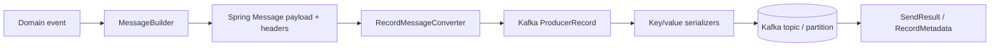

# Converter khi gửi Message<?>

Spring Kafka cho phép gửi một Spring `Message<?>` trực tiếp bằng `KafkaTemplate.send(message)`. Cách này hữu ích khi ứng dụng đã xây dựng message bằng `MessageBuilder` và muốn đóng gói payload cùng metadata như topic, key, partition, timestamp và custom headers trong một đối tượng.

Trong module `SPRING_KAFKA_MESSAGING`, producer gửi event bằng `KafkaTemplate`, consumer nhận event bằng `@KafkaListener`. Khi gửi `Message<?>`, Spring Kafka dùng `RecordMessageConverter` để chuyển Spring Message thành Kafka `ProducerRecord`. Sau đó Kafka producer mới dùng serializer để chuyển key và value thành byte. Hai bước này có trách nhiệm khác nhau và cần được cấu hình tương thích.

## 1. Gửi Spring `Message<?>` thay vì gọi overload `send(...)`

Với cách gửi thông thường, producer truyền topic, key và value trực tiếp:

```java
kafkaTemplate.send("orders.created", event.orderId(), event);
```

Nếu cần truyền thêm partition, timestamp hoặc headers, có thể dùng `ProducerRecord`. Spring Kafka cũng hỗ trợ Spring Messaging `Message<?>`:

```java
Message<OrderCreatedEvent> message = MessageBuilder
        .withPayload(event)
        .setHeader(KafkaHeaders.TOPIC, "orders.created")
        .setHeader(KafkaHeaders.MESSAGE_KEY, event.orderId())
        .build();

kafkaTemplate.send(message);
```

`Message<?>` gom payload và headers thành một đối tượng theo abstraction của Spring. Converter đọc message này, lấy metadata Kafka cần thiết và tạo `ProducerRecord` tương ứng.



## 2. Tạo `Message<?>` bằng `MessageBuilder`

Spring Messaging cung cấp `MessageBuilder` để tạo message có payload và headers. Ví dụ event:

```java
import java.math.BigDecimal;
import java.time.Instant;

public record OrderCreatedEvent(
        String eventId,
        String orderId,
        BigDecimal total,
        Instant occurredAt
) {}
```

Producer tạo message với metadata Kafka:

```java
import org.springframework.kafka.support.KafkaHeaders;
import org.springframework.messaging.Message;
import org.springframework.messaging.support.MessageBuilder;

public Message<OrderCreatedEvent> toMessage(
        OrderCreatedEvent event,
        String correlationId) {

    return MessageBuilder
            .withPayload(event)
            .setHeader(KafkaHeaders.TOPIC, "orders.created")
            .setHeader(KafkaHeaders.MESSAGE_KEY, event.orderId())
            .setHeader(KafkaHeaders.TIMESTAMP, event.occurredAt().toEpochMilli())
            .setHeader("correlation-id", correlationId)
            .setHeader("event-type", "OrderCreated")
            .build();
}
```

Các header quan trọng:

| Header | Giá trị thường dùng | Vai trò khi gửi |
|---|---|---|
| `KafkaHeaders.TOPIC` | `String` | Topic đích; cần có nếu template không có default topic |
| `KafkaHeaders.MESSAGE_KEY` | Key tương ứng với `K` | Key của Kafka record |
| `KafkaHeaders.PARTITION` | `Integer` | Chỉ định partition; nếu bỏ qua, partitioner lựa chọn |
| `KafkaHeaders.TIMESTAMP` | `Long` | Timestamp record tính bằng mili giây từ Unix epoch |
| Custom header | Ví dụ `correlation-id` | Metadata bổ sung được header mapper ánh xạ |

`MessageHeaders` cũng có các header chuẩn của Spring như `id` và `timestamp`. Không nhầm `MessageHeaders.TIMESTAMP` với Kafka record timestamp; khi muốn chỉ định timestamp cho Kafka, dùng `KafkaHeaders.TIMESTAMP`.

## 3. Gửi message bằng `KafkaTemplate.send(Message<?>)`

Ví dụ publisher hoàn chỉnh:

```java
import java.util.concurrent.CompletableFuture;

import org.springframework.kafka.support.KafkaHeaders;
import org.springframework.kafka.core.KafkaTemplate;
import org.springframework.kafka.support.SendResult;
import org.springframework.messaging.Message;
import org.springframework.messaging.support.MessageBuilder;
import org.springframework.stereotype.Service;

@Service
public class OrderEventPublisher {

    private final KafkaTemplate<String, OrderCreatedEvent> kafkaTemplate;

    public OrderEventPublisher(
            KafkaTemplate<String, OrderCreatedEvent> kafkaTemplate) {
        this.kafkaTemplate = kafkaTemplate;
    }

    public CompletableFuture<SendResult<String, OrderCreatedEvent>> publish(
            OrderCreatedEvent event,
            String correlationId) {

        Message<OrderCreatedEvent> message = MessageBuilder
                .withPayload(event)
                .setHeader(KafkaHeaders.TOPIC, "orders.created")
                .setHeader(KafkaHeaders.MESSAGE_KEY, event.orderId())
                .setHeader(KafkaHeaders.TIMESTAMP,
                        event.occurredAt().toEpochMilli())
                .setHeader("correlation-id", correlationId)
                .build();

        return kafkaTemplate.send(message);
    }
}
```

Trong Spring Kafka 3.x, `send(...)` trả về `CompletableFuture<SendResult<K, V>>`. Ở các phiên bản cũ hơn, API có thể trả `ListenableFuture`; hãy đối chiếu version dependency của dự án.

Nếu muốn gửi đến partition cụ thể, thêm header `KafkaHeaders.PARTITION` với chỉ số partition hợp lệ. Nếu không có partition header, converter tạo record không chỉ định partition và Kafka partitioner quyết định dựa trên key cùng cấu hình producer.

## 4. `RecordMessageConverter` làm gì?

`RecordMessageConverter` là abstraction của Spring Kafka để chuyển đổi giữa Spring `Message<?>` và Kafka record. Với chiều gửi, converter nhận Spring Message và tạo `ProducerRecord`; với chiều nhận, converter có thể chuyển `ConsumerRecord` thành Spring Message cho listener.

`MessagingMessageConverter` là implementation phổ biến. Nó ánh xạ:

- `Message.getPayload()` thành value của `ProducerRecord`.
- `KafkaHeaders.TOPIC` thành topic.
- `KafkaHeaders.MESSAGE_KEY` thành key.
- `KafkaHeaders.PARTITION` thành partition nếu được chỉ định.
- `KafkaHeaders.TIMESTAMP` thành timestamp nếu được chỉ định.
- Các custom headers qua `KafkaHeaderMapper`.

Điều quan trọng: `MessagingMessageConverter` không mặc nhiên biến mọi POJO thành JSON byte array. Nó chuyển cấu trúc Spring Message thành Kafka record và để Kafka key/value serializer xử lý kiểu dữ liệu tương ứng.

Trong nhiều cấu hình Spring Kafka, `KafkaTemplate` đã có message converter mặc định. Chỉ cấu hình converter riêng khi cần thay đổi cách ánh xạ payload hoặc headers.

## 5. Phân biệt message converter và Kafka serializer

Hai thành phần nằm ở hai bước khác nhau:

| Thành phần | Đầu vào | Đầu ra | Ví dụ trách nhiệm |
|---|---|---|---|
| `RecordMessageConverter` | Spring `Message<?>` | Kafka `ProducerRecord<K, V>` | Đọc topic/key/partition/timestamp từ headers và lấy payload |
| Key serializer | Java key `K` | `byte[]` | Chuyển `String` key thành byte |
| Value serializer | Java value `V` | `byte[]` | Chuyển POJO thành JSON hoặc byte array |
| Header mapper | Spring Message headers | Kafka record headers | Chuyển custom metadata sang Kafka headers |

Ví dụ, nếu dùng `KafkaTemplate<String, OrderCreatedEvent>` với `JsonSerializer`, `MessagingMessageConverter` chuyển payload event vào `ProducerRecord`; `JsonSerializer` mới biến `OrderCreatedEvent` thành JSON byte array.

Nếu serializer được cấu hình là `StringSerializer` nhưng payload vẫn là `OrderCreatedEvent`, producer sẽ gặp lỗi kiểu dữ liệu/serialization. Thêm `MessageBuilder` không tự khắc phục mismatch này.

## 6. Cấu hình converter cho `KafkaTemplate`

Có thể gắn `RecordMessageConverter` vào template khi cần tùy chỉnh. Ví dụ cấu hình `MessagingMessageConverter` và header mapper:

```java
import org.springframework.context.annotation.Bean;
import org.springframework.context.annotation.Configuration;
import org.springframework.kafka.core.KafkaTemplate;
import org.springframework.kafka.core.ProducerFactory;
import org.springframework.kafka.support.DefaultKafkaHeaderMapper;
import org.springframework.kafka.support.converter.MessagingMessageConverter;
import org.springframework.kafka.support.converter.RecordMessageConverter;

@Configuration
public class KafkaMessageConversionConfiguration {

    @Bean
    public RecordMessageConverter outboundRecordMessageConverter() {
        MessagingMessageConverter converter =
                new MessagingMessageConverter();
        converter.setHeaderMapper(new DefaultKafkaHeaderMapper());
        return converter;
    }

    @Bean
    public KafkaTemplate<String, OrderCreatedEvent> orderKafkaTemplate(
            ProducerFactory<String, OrderCreatedEvent> producerFactory,
            RecordMessageConverter outboundRecordMessageConverter) {

        KafkaTemplate<String, OrderCreatedEvent> template =
                new KafkaTemplate<>(producerFactory);
        template.setMessageConverter(outboundRecordMessageConverter);
        return template;
    }
}
```

Ví dụ trên cho thấy điểm có thể tùy biến: `MessagingMessageConverter` chịu trách nhiệm chuyển Spring Message và Kafka record; `DefaultKafkaHeaderMapper` ánh xạ headers. Producer factory vẫn phải cấu hình serializer tương thích với `String` key và `OrderCreatedEvent` value.

Nếu Spring Boot đã tự tạo `KafkaTemplate` mặc định, chỉ khai báo bean tùy chỉnh khi thực sự cần và kiểm tra điều kiện auto-configuration để tránh inject nhầm template. Khi có nhiều template hoặc converter, đặt tên bean và dùng `@Qualifier` rõ ràng.

## 7. Ánh xạ custom headers

Custom header có thể mang correlation ID, trace context hoặc loại event:

```java
Message<OrderCreatedEvent> message = MessageBuilder
        .withPayload(event)
        .setHeader(KafkaHeaders.TOPIC, "orders.created")
        .setHeader(KafkaHeaders.MESSAGE_KEY, event.orderId())
        .setHeader("correlation-id", "corr-9f81")
        .setHeader("event-type", "OrderCreated")
        .build();
```

`KafkaHeaderMapper` quyết định cách custom header được chuyển thành Kafka header. `DefaultKafkaHeaderMapper` hỗ trợ ánh xạ nhiều kiểu header và có thể mang metadata kiểu cho các giá trị không phải byte array. `SimpleKafkaHeaderMapper` phù hợp khi ứng dụng muốn quy ước byte/string đơn giản hơn.

Ở phía consumer, custom header được ánh xạ trở lại Spring Message theo cấu hình mapper. Producer và consumer cần thống nhất tên header, kiểu dữ liệu và encoding. Nếu một consumer ngoài Spring Kafka đọc record, header vẫn là byte array và consumer đó phải biết cách giải mã.

Không đưa payload lớn, token bí mật hoặc dữ liệu nhạy cảm không cần thiết vào headers. Header phù hợp cho metadata nhỏ; nội dung nghiệp vụ nên nằm trong payload và được bảo vệ bằng chính sách dữ liệu phù hợp.

## 8. Dùng JSON message converter khi serializer là String

Có hai cách phổ biến để gửi POJO dưới dạng JSON:

1. Dùng `MessagingMessageConverter` (hoặc converter mặc định) để tạo `ProducerRecord<OrderCreatedEvent>`, sau đó dùng `JsonSerializer` ở producer factory.
2. Dùng JSON message converter để chuyển payload thành chuỗi JSON, sau đó dùng `StringSerializer`.

Ví dụ cách thứ hai:

```java
import org.springframework.kafka.core.KafkaTemplate;
import org.springframework.kafka.core.ProducerFactory;
import org.springframework.kafka.support.converter.RecordMessageConverter;
import org.springframework.kafka.support.converter.StringJsonMessageConverter;
import org.springframework.context.annotation.Bean;
import org.springframework.context.annotation.Configuration;

@Configuration
public class StringJsonKafkaConfiguration {

    @Bean
    public RecordMessageConverter stringJsonMessageConverter() {
        return new StringJsonMessageConverter();
    }

    @Bean
    public KafkaTemplate<String, String> jsonTextKafkaTemplate(
            ProducerFactory<String, String> producerFactory,
            RecordMessageConverter stringJsonMessageConverter) {

        KafkaTemplate<String, String> template =
                new KafkaTemplate<>(producerFactory);
        template.setMessageConverter(stringJsonMessageConverter);
        return template;
    }
}
```

Trong cách này, `ProducerFactory<String, String>` phải dùng `StringSerializer` cho cả key và value. Converter chuyển POJO trong `Message<?>` thành JSON String trước khi gửi. Không kết hợp `StringJsonMessageConverter` với factory chỉ có `JsonSerializer` nếu không hiểu rõ kiểu value mà converter tạo ra.

Hai chiến lược trên đều có thể tạo JSON trên wire, nhưng serializer và converter phải đi thành cặp tương thích. Tránh cấu hình đồng thời hai thành phần cùng cố serialize payload theo hai định dạng khác nhau.

## 9. Theo dõi kết quả gửi và lỗi

Gửi bằng `Message<?>` vẫn là thao tác bất đồng bộ. Hãy quan sát future để biết record có được broker ghi thành công hay không:

```java
import java.util.concurrent.CompletableFuture;

import org.slf4j.Logger;
import org.slf4j.LoggerFactory;
import org.springframework.kafka.core.KafkaTemplate;
import org.springframework.kafka.support.SendResult;
import org.springframework.messaging.Message;
import org.springframework.stereotype.Service;

@Service
public class AuditedMessagePublisher {

    private static final Logger log =
            LoggerFactory.getLogger(AuditedMessagePublisher.class);

    private final KafkaTemplate<String, OrderCreatedEvent> kafkaTemplate;

    public AuditedMessagePublisher(
            KafkaTemplate<String, OrderCreatedEvent> kafkaTemplate) {
        this.kafkaTemplate = kafkaTemplate;
    }

    public CompletableFuture<SendResult<String, OrderCreatedEvent>> send(
            Message<?> message) {

        return kafkaTemplate.send(message).whenComplete((result, exception) -> {
            if (exception != null) {
                log.error("Kafka message send failed", exception);
                return;
            }

            var metadata = result.getRecordMetadata();
            log.info(
                    "Sent topic={} partition={} offset={}",
                    metadata.topic(),
                    metadata.partition(),
                    metadata.offset()
            );
        });
    }
}
```

Ví dụ dùng `Message<?>` ở chữ ký method để nhận message đã được tạo ở bước trước; trong hệ thống thật, cần bảo đảm payload bên trong là `OrderCreatedEvent` và headers bắt buộc đã có. Nếu không, nên dùng `Message<OrderCreatedEvent>` để thể hiện kiểu payload rõ hơn.

Các lỗi thường gặp gồm thiếu topic header, partition không tồn tại, key/value serializer không tương thích, header không ánh xạ được hoặc broker/network từ chối gửi. Một số lỗi xảy ra khi converter tạo `ProducerRecord`; lỗi serialization xảy ra ở bước Kafka producer serialize key/value. Cần ghi log đủ topic, key định danh, exception và metadata khi gửi thành công để điều tra.

## 10. Những lỗi thường gặp

- **Thiếu `KafkaHeaders.TOPIC`:** nếu template không có default topic, converter không thể xác định topic đích.
- **Dùng `MessageHeaders.TIMESTAMP` thay cho Kafka timestamp:** dùng `KafkaHeaders.TIMESTAMP` khi muốn điều khiển timestamp record.
- **Dùng sai header key:** `KafkaHeaders.MESSAGE_KEY` là header dành cho Kafka record key; custom header có tên gần giống không tự trở thành key.
- **Nhầm converter với serializer:** converter tạo `ProducerRecord`; serializer mới biến key/value thành byte.
- **Generic type và serializer không khớp:** ví dụ template value là POJO nhưng factory dùng `StringSerializer`.
- **Chỉ định partition không tồn tại:** record không thể được ghi vào partition đó; xác minh topic metadata/provisioning.
- **Giả định mọi custom header đều được truyền nguyên trạng:** header mapper có thể chuyển kiểu hoặc lọc header theo cấu hình.
- **Đưa dữ liệu lớn hoặc bí mật vào header:** tăng overhead và có thể làm lộ dữ liệu qua log/monitoring.
- **Bỏ qua future trả về từ `send(message)`:** ứng dụng không quan sát được lỗi gửi bất đồng bộ.
- **Tạo converter riêng nhưng không gắn vào template:** bean tồn tại trong context không có nghĩa `KafkaTemplate` tự sử dụng nó.

## 11. Kiểm thử gửi `Message<?>`

Kiểm thử nên xác minh cả bước chuyển message và kết quả gửi:

- **Unit test message factory:** tạo message và kiểm tra payload, topic, key, partition, timestamp cùng custom headers.
- **Converter test:** xác minh `RecordMessageConverter` tạo `ProducerRecord` với topic/key/partition/timestamp đúng.
- **Serializer test:** xác minh producer factory serialize payload theo đúng wire format, ví dụ JSON hoặc String.
- **Integration test:** dùng Embedded Kafka hoặc Testcontainers, gửi `Message<?>`, consume record và kiểm tra payload cùng headers thực tế.
- **Failure test:** bỏ topic header, chỉ định partition không hợp lệ hoặc cấu hình serializer sai để xác minh lỗi được quan sát đúng.
- **Header mapping test:** kiểm tra custom header được chuyển thành Kafka header và consumer có thể đọc lại theo mapper đã chọn.

Với integration test, tạo topic có partition count tường minh và dùng consumer group riêng. Khi xác minh kết quả, đọc `RecordMetadata` từ future hoặc metadata trên `ConsumerRecord`, không giả định partition luôn bằng `0` nếu producer không chỉ định.

## 12. Checklist trước khi gửi `Message<?>`

- [ ] Payload có kiểu phù hợp với `KafkaTemplate<K, V>` và producer serializer.
- [ ] Có `KafkaHeaders.TOPIC` hoặc template được cấu hình default topic.
- [ ] Key được đặt bằng `KafkaHeaders.MESSAGE_KEY` khi cần routing theo key.
- [ ] Partition chỉ được đặt khi đã xác minh partition tồn tại.
- [ ] Kafka timestamp dùng `KafkaHeaders.TIMESTAMP` và đơn vị mili giây.
- [ ] Custom headers có tên, kiểu và encoding thống nhất.
- [ ] `RecordMessageConverter`/header mapper phù hợp với cách gửi.
- [ ] Phân biệt rõ message converter với key/value serializer.
- [ ] Nếu dùng JSON message converter, serializer phải nhận đúng kiểu String/byte[] mà converter tạo ra.
- [ ] Future gửi được quan sát và lỗi được xử lý theo chính sách.
- [ ] Integration test xác minh record và headers thực tế trên Kafka.

Gửi `Message<?>` giúp producer gom payload và metadata vào một Spring Message, còn `RecordMessageConverter` chuyển nó thành Kafka record trước khi serializer tạo byte. Khi khai báo đúng Kafka headers, header mapper và serializer tương thích, `KafkaTemplate.send(message)` tạo ra luồng gửi dễ đọc, dễ mở rộng và có thể kiểm thử rõ ràng.
