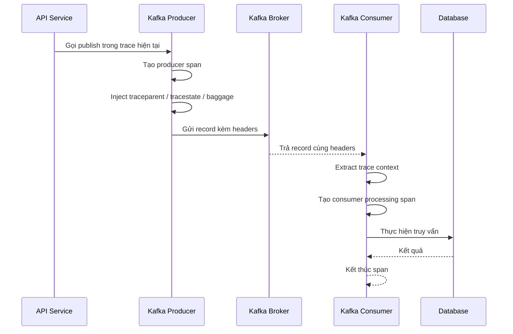

# Header chứa trace context

Trong ứng dụng Spring Kafka, một message thường đi qua nhiều service: API nhận request, service nghiệp vụ phát event, consumer cập nhật dữ liệu hoặc gọi service khác. Khi một bước chậm hoặc lỗi, log riêng lẻ của từng service không đủ để nhìn thấy toàn bộ hành trình. Distributed tracing giải quyết vấn đề này bằng cách gắn các span có quan hệ với nhau vào cùng một trace.

Trace context được truyền qua Kafka record headers. Producer inject context vào header trước khi gửi; consumer extract context từ header khi nhận record rồi tạo span cho công việc xử lý. Với Spring Kafka, Micrometer Observation và Micrometer Tracing có thể tự động thực hiện phần lớn việc này nếu được cấu hình đúng. Hiểu cấu trúc header và cách propagation hoạt động giúp kiểm tra trace xuyên service, xử lý async và tránh tạo trace bị đứt đoạn.

## 1. Trace, span và trace context

Một trace biểu diễn hành trình của một request hoặc một luồng công việc qua nhiều thành phần. Trace gồm một hoặc nhiều span; mỗi span đại diện cho một thao tác có thời điểm bắt đầu, kết thúc, thuộc tính và trạng thái.

Ví dụ request tạo đơn hàng phát event Kafka, rồi consumer xử lý:

```text
HTTP request
  └── API span
        └── Kafka producer span
              └── Kafka consumer span
                    └── Database span
```

Các span có thể nằm trên nhiều process và host khác nhau. Trace context mang những định danh và thông tin cần thiết để liên kết span mới với trace đang chạy.

Các khái niệm chính:

| Thành phần | Ý nghĩa |
|---|---|
| Trace ID | Định danh trace xuyên suốt các service |
| Span ID | Định danh một span cụ thể |
| Parent span ID | Span cha mà span hiện tại được tạo từ đó |
| Trace flags | Cờ điều khiển như sampled |
| Trace state | Trạng thái mở rộng do vendor tracing sử dụng |
| Baggage | Các key/value cần truyền xuyên qua nhiều service ngoài trace ID |

Trace context không phải payload nghiệp vụ. Nó là metadata phục vụ quan sát và liên kết hoạt động.

## 2. W3C Trace Context trong Kafka headers

W3C Trace Context là chuẩn phổ biến để truyền trace context qua các hệ thống. Hai header quan trọng là `traceparent` và `tracestate`.

`traceparent` có cấu trúc:

```text
version-trace-id-parent-id-trace-flags
```

Ví dụ:

```text
traceparent: 00-4bf92f3577b34da6a3ce929d0e0e4736-00f067aa0ba902b7-01
```

Ý nghĩa:

| Phần | Ví dụ | Vai trò |
|---|---|---|
| Version | `00` | Phiên bản định dạng |
| Trace ID | `4bf92f3577b34da6a3ce929d0e0e4736` | ID 16 byte biểu diễn bằng 32 ký tự hex |
| Parent ID | `00f067aa0ba902b7` | Span ID 8 byte biểu diễn bằng 16 ký tự hex |
| Trace flags | `01` | Bit sampled được bật trong ví dụ |

Header `tracestate` mang thông tin mở rộng của tracing vendor. Ứng dụng thường nên để propagator chuẩn quản lý thay vì tự parse hoặc tự ghép chuỗi.

Baggage được truyền qua header `baggage`, thường có dạng danh sách key/value theo chuẩn W3C. Ví dụ có thể truyền tenant tier hoặc một mã phân vùng không nhạy cảm. Baggage không thay thế trace ID và cần được giới hạn vì nó có thể đi qua nhiều service.

Trong Kafka, các header này là các cặp tên và byte array. W3C yêu cầu giá trị dạng text; khi thao tác trực tiếp với Kafka headers, cần mã hóa/giải mã UTF-8 theo đúng chuẩn.

## 3. Trace context được truyền qua Kafka như thế nào?

Luồng propagation cơ bản:



Producer và consumer không chia sẻ bộ nhớ hay thread. Kafka headers là cầu nối để truyền context qua ranh giới process.

Một trace có thể chứa nhiều span và nhiều service. Khi consumer extract đúng context, span xử lý message được liên kết với trace đã bắt đầu ở producer. Nếu context bị mất, consumer có thể tạo trace mới độc lập, khiến giao diện tracing không hiển thị đầy đủ hành trình.

## 4. Phân biệt trace context với correlation ID

Trace ID và correlation ID thường xuất hiện cùng nhau nhưng phục vụ mục đích khác nhau:

| Giá trị | Mục đích | Ai quản lý? |
|---|---|---|
| Trace ID | Liên kết các span trong distributed trace | Tracing SDK/propagator |
| Span ID | Định danh một thao tác trong trace | Tracing SDK |
| Correlation ID | Tìm và đối chiếu một request hoặc business workflow | Ứng dụng |
| Event ID | Định danh một event để deduplicate hoặc audit | Domain/application |
| Aggregate ID | Định danh entity, thường dùng làm Kafka key | Domain/application |

Không nên tự dùng correlation ID thay cho `traceparent`. Một correlation ID có thể tồn tại lâu hơn một trace hoặc liên kết nhiều trace; trace context còn mang quan hệ parent-child, sampling và vendor state.

Có thể truyền cả correlation ID và trace context:

- `traceparent`, `tracestate`, `baggage`: do tracing propagation quản lý.
- `correlation-id`: do ứng dụng quy định.
- `event-id`, `aggregate-id`: thuộc hợp đồng message nếu nghiệp vụ cần.

Không tạo header trùng tên hoặc ghi đè trace context do framework đã inject. Nếu ứng dụng tự quản lý correlation ID, cần định nghĩa rõ nguồn tạo, phạm vi và cách giữ nguyên qua retry.

## 5. Spring Kafka hỗ trợ Observation

Spring Kafka tích hợp Micrometer Observation cho thao tác gửi bằng `KafkaTemplate` và xử lý bằng listener container. Khi bật observation và ứng dụng có Micrometer Tracing bridge phù hợp, tracing implementation có thể inject/extract trace context tự động qua record headers.

Các điểm cần cấu hình:

- Bật observation trên `KafkaTemplate`.
- Bật observation trên listener container properties.
- Cung cấp `ObservationRegistry` cho template và container.
- Thêm Micrometer Tracing bridge, chẳng hạn bridge dùng OpenTelemetry.
- Cấu hình exporter để gửi span đến backend tracing nếu cần xem trace tập trung.

Ví dụ cấu hình template và listener factory:

```java
import org.springframework.context.annotation.Bean;
import org.springframework.context.annotation.Configuration;
import org.springframework.boot.autoconfigure.kafka.ConcurrentKafkaListenerContainerFactoryConfigurer;
import org.springframework.kafka.config.ConcurrentKafkaListenerContainerFactory;
import org.springframework.kafka.core.ConsumerFactory;
import org.springframework.kafka.core.KafkaTemplate;
import org.springframework.kafka.core.ProducerFactory;
import io.micrometer.observation.ObservationRegistry;

@Configuration
class KafkaObservationConfiguration {

    @Bean
    KafkaTemplate<String, OrderEvent> orderKafkaTemplate(
            ProducerFactory<String, OrderEvent> producerFactory,
            ObservationRegistry observationRegistry) {

        KafkaTemplate<String, OrderEvent> template =
                new KafkaTemplate<>(producerFactory);

        template.setObservationRegistry(observationRegistry);
        template.setObservationEnabled(true);
        return template;
    }

    @Bean
    ConcurrentKafkaListenerContainerFactory<String, OrderEvent>
    orderListenerFactory(
            ConcurrentKafkaListenerContainerFactoryConfigurer configurer,
            ConsumerFactory<String, OrderEvent> consumerFactory) {

        var factory =
                new ConcurrentKafkaListenerContainerFactory<String, OrderEvent>();

        configurer.configure(factory, consumerFactory);
        factory.getContainerProperties().setObservationEnabled(true);
        return factory;
    }
}
```

Ví dụ minh họa API Spring Kafka có hỗ trợ observation. Trong ứng dụng Spring Boot, ưu tiên dùng auto-configuration/configurer để giữ các thiết lập consumer, converter, error handler và observation registry chung. Nếu tự tạo factory hoặc template, hãy xác minh chúng nhận đúng `ObservationRegistry` từ application context; bật cờ observation nhưng thiếu registry/tracing bridge thì chưa đủ để xuất trace.

Khi dùng factory mặc định do Spring Boot tạo, có thể cấu hình observation qua các thuộc tính `spring.kafka.template.observation-enabled` và `spring.kafka.listener.observation-enabled` nếu phiên bản Boot đang dùng hỗ trợ các thuộc tính này. Tên và khả năng bind phụ thuộc phiên bản Spring Boot/Spring Kafka; kiểm tra metadata cấu hình đúng với dependency của dự án.

## 6. Dependency cho Micrometer Tracing và OpenTelemetry

Với Spring Boot 3, một ứng dụng thường dùng Actuator, Micrometer Tracing bridge và exporter OTLP. Ví dụ Maven dependencies khi dùng dependency management của Spring Boot:

```xml
<dependencies>
    <dependency>
        <groupId>org.springframework.boot</groupId>
        <artifactId>spring-boot-starter-actuator</artifactId>
    </dependency>

    <dependency>
        <groupId>io.micrometer</groupId>
        <artifactId>micrometer-tracing-bridge-otel</artifactId>
    </dependency>

    <dependency>
        <groupId>io.opentelemetry</groupId>
        <artifactId>opentelemetry-exporter-otlp</artifactId>
    </dependency>
</dependencies>
```

Spring Boot quản lý phiên bản thư viện tương thích qua BOM. Không tự chọn phiên bản Micrometer hoặc OpenTelemetry lệch với Spring Boot đang sử dụng.

Một cấu hình tối thiểu có thể đặt sampling và endpoint OTLP theo môi trường:

```yaml
management:
  tracing:
    sampling:
      probability: 0.1
  otlp:
    tracing:
      endpoint: http://localhost:4318/v1/traces
```

Ví dụ endpoint OTLP HTTP thường dùng cổng 4318. Nếu collector dùng OTLP gRPC hoặc endpoint riêng, cấu hình theo giao thức và môi trường triển khai. Không bật sampling 100% ở production chỉ để quan sát mọi request nếu lưu lượng lớn; hãy chọn sampling policy phù hợp và dùng log/metrics để bổ sung.

`management.tracing.sampling.probability` điều khiển tỷ lệ trace được sample trong cấu hình đơn giản. Sampling có thể ảnh hưởng span được export, nhưng không nên tự sửa `traceparent` để ép sampled flag khi dùng propagator chuẩn.

## 7. Bật observation bằng application.yml

Với phiên bản Spring Boot hỗ trợ các thuộc tính này, có thể bật observation cho template và listener:

```yaml
spring:
  kafka:
    template:
      observation-enabled: true
    listener:
      observation-enabled: true

management:
  tracing:
    sampling:
      probability: 0.1
```

Observation tạo điểm đo cho thao tác Kafka; Micrometer Tracing bridge chuyển observation thành span và thực hiện propagation theo propagator đã cấu hình. Chỉ bật observation không tự tạo backend lưu trace. Cần có exporter và collector/backend phù hợp nếu muốn xem trace ngoài process.

Nếu đang dùng custom `KafkaTemplate` hoặc custom listener factory, hãy kiểm tra bean đó có được cấu hình observation tương tự. Cấu hình property có thể áp dụng cho auto-configured bean nhưng không nhất thiết tự sửa các bean do ứng dụng tự khai báo.

## 8. Đọc trace context từ Kafka headers

Trong hầu hết ứng dụng, nên để Micrometer Tracing hoặc OpenTelemetry propagator thực hiện inject/extract. Không tự parse `traceparent` bằng substring vì phải xử lý version, độ dài, ký tự không hợp lệ và các quy tắc chuẩn.

Nếu cần kiểm tra header khi debug, có thể đọc native headers:

```java
import java.nio.charset.StandardCharsets;

import org.apache.kafka.clients.consumer.ConsumerRecord;
import org.apache.kafka.common.header.Header;

void logTraceHeaders(ConsumerRecord<String, OrderEvent> record) {
    Header traceparent =
            record.headers().lastHeader("traceparent");

    Header tracestate =
            record.headers().lastHeader("tracestate");

    String traceparentValue = traceparent == null
            ? null
            : new String(
                    traceparent.value(),
                    StandardCharsets.UTF_8
            );

    String tracestateValue = tracestate == null
            ? null
            : new String(
                    tracestate.value(),
                    StandardCharsets.UTF_8
            );

    log.debug(
            "Kafka trace headers: traceparent={}, tracestatePresent={}",
            traceparentValue,
            tracestateValue != null
    );
}
```

Ví dụ này chỉ phục vụ quan sát/debug. `tracestate` có thể chứa dữ liệu vendor-specific; cân nhắc chỉ ghi nhận sự hiện diện thay vì log nguyên văn. Trace ID cũng có thể là dữ liệu liên kết nhạy cảm theo chính sách bảo mật nội bộ.

Kafka cho phép nhiều header cùng tên. Với header propagation chuẩn, nên bảo đảm record chỉ có một giá trị hợp lệ cho từng trường. Nếu phải tự inject, loại bỏ giá trị cũ trước khi thêm giá trị mới; không append nhiều `traceparent` mâu thuẫn.

## 9. Truyền baggage và giới hạn dữ liệu

Baggage là tập key/value được truyền cùng trace context. Nó hữu ích khi một giá trị cần thiết cho việc quan sát ở nhiều service, ví dụ `tenant-tier` hoặc `region`. Baggage không phải nơi lưu payload hoặc thông tin nghiệp vụ lớn.

Các nguyên tắc:

- Chỉ truyền trường thật sự cần cho tracing hoặc routing quan sát.
- Không đưa password, access token, email, số điện thoại hoặc dữ liệu cá nhân vào baggage.
- Giới hạn số lượng key, độ dài và tổng kích thước.
- Không dùng baggage làm cơ chế authorization; consumer phải xác thực bằng cơ chế bảo mật riêng.
- Tránh giá trị cardinality cao nếu nó được đưa vào metric hoặc index.
- Kiểm tra quy tắc allowlist của propagator để chỉ truyền các baggage key đã được phê duyệt.

Baggage có thể được forward qua nhiều service và Kafka topic. Một giá trị tưởng như chỉ nội bộ ở producer có thể xuất hiện trong log, trace backend hoặc service downstream. Hãy xem baggage như metadata có phạm vi lan truyền rộng.
## 10. Manual propagation bằng OpenTelemetry

Chỉ dùng manual propagation khi ứng dụng không dùng instrumentation tự động hoặc có một luồng đặc biệt cần kiểm soát riêng. Nếu Spring Kafka Observation đã inject/extract trace context, không inject lần nữa bằng code tự viết; việc này có thể tạo header trùng hoặc làm parent context sai.

OpenTelemetry cung cấp `TextMapPropagator` để inject/extract context theo chuẩn đang cấu hình. Không tự xây dựng chuỗi `traceparent`.

Ví dụ inject context hiện tại vào `ProducerRecord`:

```java
import io.opentelemetry.api.OpenTelemetry;
import io.opentelemetry.context.Context;
import io.opentelemetry.context.propagation.TextMapPropagator;
import io.opentelemetry.context.propagation.TextMapSetter;
import org.apache.kafka.clients.producer.ProducerRecord;
import org.apache.kafka.common.header.Headers;

import java.nio.charset.StandardCharsets;

class KafkaTraceHeaderInjector {

    private final TextMapPropagator propagator;

    private static final TextMapSetter<Headers> SETTER =
            (headers, key, value) -> {
                headers.remove(key);
                headers.add(
                        key,
                        value.getBytes(StandardCharsets.UTF_8)
                );
            };

    KafkaTraceHeaderInjector(OpenTelemetry openTelemetry) {
        this.propagator =
                openTelemetry.getPropagators().getTextMapPropagator();
    }

    <K, V> ProducerRecord<K, V> inject(
            String topic,
            K key,
            V value) {

        ProducerRecord<K, V> record =
                new ProducerRecord<>(topic, key, value);

        propagator.inject(Context.current(), record.headers(), SETTER);
        return record;
    }
}
```

Gọi injector khi đang ở trong context của span cần truyền:

```java
ProducerRecord<String, OrderEvent> record =
        traceHeaderInjector.inject("orders", orderId, event);

kafkaTemplate.send(record);
```

Ví dụ này inject context đang active. Trong một ứng dụng production, producer operation cũng nên có span riêng; hãy để Spring Kafka Observation tạo span producer nếu đã bật tracing. Manual injector ở trên chỉ minh họa cách mang context hiện tại qua headers.

Consumer cần extract bằng `TextMapGetter`:

```java
import io.opentelemetry.api.OpenTelemetry;
import io.opentelemetry.api.trace.Span;
import io.opentelemetry.api.trace.SpanKind;
import io.opentelemetry.api.trace.Tracer;
import io.opentelemetry.context.Context;
import io.opentelemetry.context.Scope;
import io.opentelemetry.context.propagation.TextMapGetter;
import io.opentelemetry.context.propagation.TextMapPropagator;
import org.apache.kafka.clients.consumer.ConsumerRecord;
import org.apache.kafka.common.header.Header;
import org.apache.kafka.common.header.Headers;

import java.nio.charset.StandardCharsets;
import java.util.ArrayList;
import java.util.List;
import java.util.function.Consumer;

class KafkaTraceHeaderExtractor {

    private final TextMapPropagator propagator;
    private final Tracer tracer;

    private static final TextMapGetter<Headers> GETTER =
            new TextMapGetter<>() {
                @Override
                public Iterable<String> keys(Headers headers) {
                    List<String> keys = new ArrayList<>();
                    for (Header header : headers) {
                        keys.add(header.key());
                    }
                    return keys;
                }

                @Override
                public String get(Headers headers, String key) {
                    Header header = headers.lastHeader(key);
                    if (header == null || header.value() == null) {
                        return null;
                    }

                    return new String(
                            header.value(),
                            StandardCharsets.UTF_8
                    );
                }
            };

    KafkaTraceHeaderExtractor(
            OpenTelemetry openTelemetry,
            Tracer tracer) {
        this.propagator =
                openTelemetry.getPropagators().getTextMapPropagator();
        this.tracer = tracer;
    }

    void process(
            ConsumerRecord<String, OrderEvent> record,
            Consumer<OrderEvent> handler) {
        Context extracted = propagator.extract(
                Context.current(),
                record.headers(),
                GETTER
        );

        Span span = tracer.spanBuilder("orders.process")
                .setParent(extracted)
                .setSpanKind(SpanKind.CONSUMER)
                .startSpan();

        try (Scope scope = span.makeCurrent()) {
            handler.accept(record.value());
        }
        catch (RuntimeException exception) {
            span.recordException(exception);
            span.setStatus(
                    io.opentelemetry.api.trace.StatusCode.ERROR
            );
            throw exception;
        }
        finally {
            span.end();
        }
    }
}
```

Đây là ví dụ minh họa cách dùng OpenTelemetry API; các dependency, bean và service nghiệp vụ cần được inject theo cấu trúc ứng dụng. Nếu đã dùng Spring Kafka Observation, không tạo consumer span thủ công cho cùng listener vì sẽ sinh span trùng.

## 11. Context propagation qua executor và callback

Context thường được giữ trong thread-local scope. Khi ứng dụng chuyển công việc sang thread pool, thread mới không tự động nhận context của thread gửi công việc.

Ví dụ cần giữ context khi chuyển sang executor:

```java
import io.opentelemetry.context.Context;
import java.util.concurrent.Executor;

Executor contextAwareExecutor =
        Context.taskWrapping(applicationExecutor);

contextAwareExecutor.execute(() -> {
    orderService.processAsync(event);
});
```

`Context.taskWrapping` bọc task để context đang active khi submit được khôi phục khi task chạy. Với Micrometer Context Propagation, có thể dùng cơ chế context snapshot tương ứng. Cần chọn một cơ chế nhất quán với tracing stack của ứng dụng.

Callback của `CompletableFuture` cũng có thể chạy trên thread khác. Nếu callback ghi log hoặc tạo span con, hãy capture context trước khi đăng ký callback:

```java
import io.opentelemetry.context.Context;
import io.opentelemetry.context.Scope;

Context captured = Context.current();

kafkaTemplate.send("orders", orderId, event)
        .whenComplete((result, exception) -> {
            try (Scope scope = captured.makeCurrent()) {
                if (exception != null) {
                    log.error("Kafka publish failed", exception);
                }
                else {
                    log.info("Kafka publish completed");
                }
            }
        });
```

Đoạn code trên khôi phục context cho callback; nó không thay thế producer observation hoặc xử lý lỗi gửi. Không giữ một scope mở qua nhiều thread hoặc qua thời gian sống của future. Scope phải được đóng trên đúng thread đã mở nó.

## 12. Retry, retry topic và dead-letter giữ trace context ra sao?

Spring Kafka có thể mang headers qua các luồng retry và dead-letter, nhưng ứng dụng cần kiểm tra cấu hình và phiên bản đang dùng. Các header phục vụ retry như delivery attempt, exception class hoặc exception message có mục đích khác với trace context.

Khi một record được retry:

- Trace context ban đầu có thể được giữ lại để liên kết lần xử lý lại với event gốc.
- Mỗi lần xử lý có thể tạo span mới để quan sát từng attempt.
- Với retry topic, producer gửi record sang topic khác; tracing instrumentation có thể tạo span producer mới và consumer retry tạo span xử lý mới.
- Khi chuyển sang DLT, các header gốc và header mô tả lỗi có thể cùng tồn tại; cần tránh ghi đè `traceparent` không chủ ý.
- Khi replay DLT sau nhiều giờ hoặc nhiều ngày, cân nhắc tạo một trace mới và liên kết với trace gốc thay vì kéo dài một trace đã kết thúc.

Không giả định mọi custom header đều được giữ nguyên qua mọi serializer, interceptor, retry recoverer hoặc bridge. Hãy viết integration test để xác nhận `traceparent`, `tracestate`, correlation ID và event ID có mặt sau từng đường đi.

Nếu retry topic làm thay đổi thứ tự nghiệp vụ, trace chỉ giúp quan sát hành trình; nó không sửa thứ tự event. Ordering và retry policy phải được thiết kế riêng.

## 13. Sampling và trace bị đứt đoạn

Sampling quyết định trace/span nào được ghi nhận và export. Nếu trace được sample out, một số backend có thể không hiển thị trace dù message vẫn mang trace context. Không kết luận propagation hỏng chỉ vì không tìm thấy trace trong UI.

Các nguyên nhân phổ biến khiến trace bị đứt:

| Hiện tượng | Nguyên nhân có thể | Cách kiểm tra |
|---|---|---|
| Producer có span nhưng consumer thành trace mới | Header không được inject hoặc không được extract | Kiểm tra `traceparent` trong record và Observation config |
| Consumer span không có parent mong muốn | Consumer dùng sai propagator hoặc header không hợp lệ | Kiểm tra bridge và propagator thống nhất giữa service |
| Trace chỉ xuất hiện ở một số request | Sampling hoặc exporter filter | Kiểm tra sampling policy và collector |
| Span biến mất sau executor | Context không được truyền qua thread boundary | Dùng context propagation hoặc snapshot |
| Có hai trace không liên kết cho một message | Manual và automatic propagation xung đột hoặc trace header bị ghi đè | Chỉ dùng một cơ chế inject/extract |
| Trace cũ xuất hiện khi replay DLT | Replay giữ nguyên context lịch sử | Định nghĩa chính sách trace mới/link với trace gốc |

Trace ID giống nhau là dấu hiệu liên kết, nhưng để xác minh đúng parent-child cần xem cả span ID, parent span ID và span kind trong backend tracing.

## 14. Kiểm thử trace context trong Kafka headers

Nên kiểm thử ít nhất hai lớp:

1. Unit test cho logic header helper nếu ứng dụng tự inject/extract.
2. Integration test với broker thử nghiệm để xác nhận header thực sự được gửi, lưu và consumer nhận lại.

Ví dụ kiểm tra native headers trên record:

```java
import static org.assertj.core.api.Assertions.assertThat;

import java.nio.charset.StandardCharsets;
import org.apache.kafka.clients.consumer.ConsumerRecord;
import org.apache.kafka.common.header.Header;
import org.junit.jupiter.api.Test;

class TraceHeaderTest {

    @Test
    void recordContainsTraceparentHeader() {
        ConsumerRecord<String, String> record =
                new ConsumerRecord<>("orders", 0, 10L, "order-101", "{}");

        record.headers().add(
                "traceparent",
                "00-4bf92f3577b34da6a3ce929d0e0e4736-00f067aa0ba902b7-01"
                        .getBytes(StandardCharsets.UTF_8)
        );

        Header header = record.headers().lastHeader("traceparent");

        assertThat(header).isNotNull();
        assertThat(new String(
                header.value(),
                StandardCharsets.UTF_8
        )).startsWith("00-");
    }
}
```

Unit test này chỉ xác nhận thao tác với header. Integration test cần publish record qua `KafkaTemplate`, consume từ broker, rồi kiểm tra header và span/trace được export. Nếu dùng Spring Kafka Observation, hãy kiểm tra span producer và consumer được tạo và có quan hệ đúng trong test tracing registry hoặc exporter test.

Không chỉ assert header tồn tại; hãy kiểm tra giá trị parse được bởi propagator, không có header trùng mâu thuẫn và context được khôi phục qua executor nếu ứng dụng xử lý bất đồng bộ.

## 15. Những lỗi thường gặp

| Lỗi | Nguyên nhân | Cách xử lý |
|---|---|---|
| Không thấy `traceparent` | Observation chưa bật hoặc không có tracing bridge | Kiểm tra KafkaTemplate, container và dependency |
| Có header nhưng trace không nối | Consumer không extract context hoặc propagator khác chuẩn | Dùng cùng W3C propagator ở producer/consumer |
| Header bị lặp | Manual injection chạy cùng automatic instrumentation | Chọn một cơ chế propagation |
| Consumer span không có parent | Context không được active khi listener chạy hoặc header sai | Kiểm tra listener observation và header |
| Trace mất sau async executor | Thread mới không có context | Dùng context-aware executor/snapshot |
| Log lộ baggage | Truyền dữ liệu nhạy cảm hoặc log nguyên header | Allowlist và giới hạn baggage |
| Replay DLT nối vào trace quá cũ | Header trace lịch sử được giữ nguyên | Đặt chính sách trace mới và link tới trace gốc |
| Chỉ thấy một phần trace | Sampling hoặc exporter/collector filter | Kiểm tra sampling và pipeline export |

## 16. Checklist triển khai trace context

1. Dùng W3C Trace Context hoặc một propagator thống nhất giữa các service.
2. Bật Spring Kafka Observation cho template và listener container.
3. Cung cấp Micrometer Tracing bridge và exporter tương thích với Spring Boot.
4. Để framework inject/extract context tự động nếu có thể.
5. Không tự parse hoặc tự tạo `traceparent` khi đã có propagator.
6. Truyền correlation ID riêng nếu nghiệp vụ cần đối chiếu request.
7. Dùng context propagation khi chuyển công việc sang executor hoặc callback.
8. Kiểm tra trace context qua retry topic và DLT.
9. Giới hạn baggage và không đưa dữ liệu nhạy cảm vào header.
10. Kiểm thử header, parent-child span và sampling trên môi trường tích hợp.

Trace context trong Kafka headers giúp nối các thao tác producer và consumer vào cùng một hành trình quan sát. Spring Kafka Observation kết hợp Micrometer Tracing có thể tự động hóa propagation; khi cần làm thủ công, hãy dùng OpenTelemetry propagator thay vì tự xử lý chuỗi header. Kết hợp cấu hình đúng, context propagation qua thread và chính sách retry/replay rõ ràng sẽ giúp trace xuyên service đáng tin cậy hơn.
