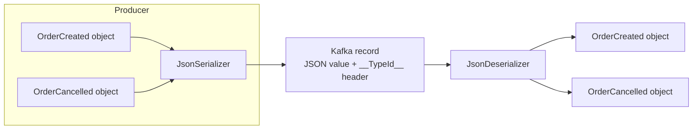

# Header chứa type information

Khi gửi object Java qua Kafka bằng JSON, producer phải chuyển object thành byte trước khi broker lưu record. Consumer nhận byte và cần biết kiểu dữ liệu nào sẽ được tạo lại. Spring Kafka hỗ trợ truyền thông tin kiểu dữ liệu qua các Kafka header do `JsonSerializer` thêm vào và `JsonDeserializer` đọc khi deserialize.

Header type information đặc biệt hữu ích khi một topic chứa nhiều loại event, ví dụ `OrderCreated` và `OrderCancelled`. Producer có thể ghi tên class hoặc một alias vào header; consumer dùng thông tin đó để chọn kiểu Java tương ứng. Cách làm này giúp một listener nhận nhiều event type, nhưng cần quản lý chặt hợp đồng kiểu dữ liệu, package được phép deserialize và khả năng tương thích giữa các service.

## 1. Vì sao cần type information?

Kafka lưu key và value dưới dạng byte array. Broker không hiểu object Java, tên class hay cấu trúc JSON. Serializer và deserializer ở hai đầu phải thống nhất cách chuyển đổi dữ liệu.

Giả sử producer gửi hai event vào cùng topic `orders.events`:

```java
import java.math.BigDecimal;

public record OrderCreated(
        String eventId,
        String orderId,
        BigDecimal total
) {}

public record OrderCancelled(
        String eventId,
        String orderId,
        String reason
) {}
```

Hai record type là hai file Java riêng; imports và package được lược bỏ để tập trung vào payload. Listener dùng pattern matching trong `instanceof`, cú pháp có từ Java 16 trở lên.

JSON của hai event có thể có cấu trúc khác nhau. Nếu consumer chỉ khai báo một kiểu cố định như `OrderCreated`, nó không thể tự biết một JSON khác là `OrderCancelled` nếu không có quy ước bổ sung.

Spring Kafka có thể thêm header `__TypeId__` để cho consumer biết kiểu value được serialize. Khi deserialize, `JsonDeserializer` đọc header này và chọn class tương ứng, miễn là class được phép và có mapping hợp lệ.



Type information là metadata về kiểu Java của payload. Nó không thay thế schema event, không phải business event type và cũng không tự bảo đảm hai service có cùng phiên bản class.

## 2. Các header type information mặc định

Spring Kafka `JsonSerializer` có thể ghi các header sau:

| Header | Ý nghĩa |
| --- | --- |
| `__TypeId__` | Kiểu chính của value được serialize, thường là tên class hoặc alias |
| `__ContentTypeId__` | Kiểu phần tử bên trong một kiểu container/generic khi cần thông tin bổ sung |
| `__KeyTypeId__` | Kiểu key bên trong một payload dạng `Map`; đây không phải Kafka record key |

Trong trường hợp event object thông thường, header cần quan tâm nhất là `__TypeId__`. Các header content/key type hữu ích với payload dạng collection, map hoặc key/value có kiểu generic cần được mô tả rõ hơn.

Các header này là Kafka record headers, tách biệt với JSON value. Record có thể được hình dung như sau:

```text
Topic: orders.events
Key: ORD-100
Value: {"eventId":"evt-1","orderId":"ORD-100","total":125000}
Headers:
  __TypeId__: order-created
  trace-id: 8f1c...
```

Giá trị header được lưu dưới dạng byte array. Với type mapping, `__TypeId__` có thể chứa alias như `order-created`; nếu không mapping, nó thường chứa tên class đầy đủ.

## 3. JsonSerializer thêm type header

`JsonSerializer` của Spring Kafka có thể tự thêm type information header. Theo cấu hình mặc định, serializer thêm type header để `JsonDeserializer` ở consumer có thể suy ra kiểu Java từ metadata.

Ví dụ producer gửi nhiều loại event qua cùng một template:

```java
package com.example.orders.messaging;

import java.util.concurrent.CompletableFuture;
import org.springframework.kafka.core.KafkaTemplate;
import org.springframework.kafka.support.SendResult;
import org.springframework.stereotype.Service;

@Service
public class OrderEventPublisher {

    private final KafkaTemplate<String, Object> kafkaTemplate;

    public OrderEventPublisher(KafkaTemplate<String, Object> kafkaTemplate) {
        this.kafkaTemplate = kafkaTemplate;
    }

    public CompletableFuture<SendResult<String, Object>> publish(
            String orderId,
            Object event
    ) {
        return kafkaTemplate.send("orders.events", orderId, event);
    }
}
```

Khi gửi `OrderCreated`, serializer nhìn kiểu runtime của object và ghi type information tương ứng. Khi gửi `OrderCancelled`, header thể hiện kiểu của event thứ hai. Consumer có thể nhận value dưới dạng `Object` và xử lý theo kiểu thực tế sau deserialize.

Nếu muốn tắt type header ở producer, có thể cấu hình:

```yaml
spring:
  kafka:
    producer:
      properties:
        "[spring.json.add.type.headers]": false
```

Khi tắt, consumer không thể dựa vào `__TypeId__` do producer này tạo ra để chọn class. Ứng dụng phải có cách xác định kiểu khác, ví dụ cấu hình một target type cố định hoặc dùng một event envelope có trường `eventType`.

## 4. JsonDeserializer đọc type header

`JsonDeserializer` có thể đọc type information từ header và tạo object tương ứng. Ví dụ cấu hình consumer cho topic có nhiều event type:

```yaml
spring:
  kafka:
    consumer:
      group-id: order-projection
      enable-auto-commit: false
      key-deserializer: org.apache.kafka.common.serialization.StringDeserializer
      value-deserializer: org.springframework.kafka.support.serializer.JsonDeserializer
      properties:
        "[spring.json.use.type.headers]": true
        "[spring.json.trusted.packages]": com.example.orders.events
```

Với cấu hình này, deserializer sử dụng type header để xác định class và chỉ tin cậy package được khai báo. Listener có thể nhận `Object`:

```java
@KafkaListener(topics = "orders.events", groupId = "order-projection")
public void onOrderEvent(Object event) {
    if (event instanceof OrderCreated created) {
        orderProjection.onCreated(created);
    } else if (event instanceof OrderCancelled cancelled) {
        orderProjection.onCancelled(cancelled);
    } else {
        throw new IllegalArgumentException(
                "Unsupported order event type: " + event.getClass().getName()
        );
    }
}
```

Đoạn listener giả định deserializer đã chuyển JSON thành một trong các class event tương ứng. Nếu header thiếu, deserializer có thể dùng default target type đã cấu hình; nếu không có kiểu cụ thể, payload có thể được tạo thành cấu trúc map như `LinkedHashMap`. Alias không hợp lệ, class không tìm thấy hoặc package không được tin cậy có thể gây lỗi ngay trong giai đoạn deserialize, trước khi method listener được gọi.

## 5. Tên class đầy đủ và sự phụ thuộc giữa các service

Nếu không cấu hình alias, type header có thể chứa fully qualified class name, ví dụ:

```text
com.example.orders.events.OrderCreated
```

Khi consumer dùng header này, nó cần class có tên tương ứng và package phải được trusted. Điều này tạo liên kết giữa hợp đồng Kafka và cấu trúc package Java của producer.

Giả sử producer đổi package từ:

```text
com.example.orders.events.OrderCreated
```

sang:

```text
com.company.ordering.contract.OrderCreated
```

Consumer cũ có thể không tìm thấy class trong header mới. Chỉ đổi package nội bộ của producer cũng có thể làm ảnh hưởng consumer dù JSON field không đổi.

Đối với các service triển khai độc lập, không nên mặc định tên class Java nội bộ là hợp đồng dữ liệu lâu dài. Type mapping cho phép tách tên type trên wire khỏi package thực tế của mỗi service.

## 6. Type mapping bằng alias

Spring Kafka hỗ trợ mapping giữa alias và class. Alias là tên type ổn định được ghi vào header; mỗi phía ánh xạ alias đó sang class cục bộ của mình.

Ví dụ producer có class trong package `com.example.orders.events`:

```yaml
spring:
  kafka:
    producer:
      properties:
        "[spring.json.type.mapping]": "order-created:com.example.orders.events.OrderCreated,order-cancelled:com.example.orders.events.OrderCancelled"
```

Khi serialize `OrderCreated`, header `__TypeId__` chứa `order-created`; với `OrderCancelled`, header chứa `order-cancelled`.

Consumer có thể dùng class riêng trong package `com.example.billing.contract` nhưng vẫn hiểu cùng alias:

```yaml
spring:
  kafka:
    consumer:
      properties:
        "[spring.json.use.type.headers]": true
        "[spring.json.type.mapping]": "order-created:com.example.billing.contract.OrderCreated,order-cancelled:com.example.billing.contract.OrderCancelled"
        "[spring.json.trusted.packages]": com.example.billing.contract
```

Hai phía không cần dùng cùng package hoặc cùng tên class. Điều cần thống nhất là alias và cấu trúc JSON tương thích.

| Phía | Alias | Class cục bộ |
| --- | --- | --- |
| Producer | `order-created` | `com.example.orders.events.OrderCreated` |
| Consumer | `order-created` | `com.example.billing.contract.OrderCreated` |
| Producer | `order-cancelled` | `com.example.orders.events.OrderCancelled` |
| Consumer | `order-cancelled` | `com.example.billing.contract.OrderCancelled` |

Mapping phải có ở cả producer và consumer khi hai bên dùng package khác nhau. Producer dùng mapping để ghi alias; consumer dùng mapping để giải alias thành class mà consumer biết.

## 7. Cấu hình type header qua application.yml đầy đủ

Một ví dụ kết hợp producer và consumer có thể viết như sau:

```yaml
spring:
  kafka:
    bootstrap-servers: ${KAFKA_BOOTSTRAP_SERVERS:localhost:9092}

    producer:
      key-serializer: org.apache.kafka.common.serialization.StringSerializer
      value-serializer: org.springframework.kafka.support.serializer.JsonSerializer
      properties:
        "[spring.json.add.type.headers]": true
        "[spring.json.type.mapping]": "order-created:com.example.orders.events.OrderCreated,order-cancelled:com.example.orders.events.OrderCancelled"

    consumer:
      group-id: order-projection
      enable-auto-commit: false
      key-deserializer: org.apache.kafka.common.serialization.StringDeserializer
      value-deserializer: org.springframework.kafka.support.serializer.JsonDeserializer
      properties:
        "[spring.json.use.type.headers]": true
        "[spring.json.remove.type.headers]": true
        "[spring.json.type.mapping]": "order-created:com.example.billing.contract.OrderCreated,order-cancelled:com.example.billing.contract.OrderCancelled"
        "[spring.json.trusted.packages]": com.example.billing.contract
```

Các property trong `spring.kafka.producer.properties` được chuyển cho serializer; các property trong `spring.kafka.consumer.properties` được chuyển cho deserializer. Cách đặt dấu ngoặc vuông quanh key giúp Spring Boot giữ nguyên tên property có dấu chấm khi bind map.

`spring.json.add.type.headers` điều khiển việc serializer thêm type header. `spring.json.use.type.headers` điều khiển việc deserializer sử dụng header để chọn target type. `spring.json.type.mapping` định nghĩa alias. `spring.json.trusted.packages` giới hạn các package có thể được deserialize.

## 8. Trusted packages và an toàn khi deserialize

Type header có thể ảnh hưởng class mà deserializer cố gắng khởi tạo. Nếu consumer tin cậy tùy tiện mọi class được chỉ định từ record, dữ liệu từ producer không đáng tin có thể khiến ứng dụng tạo object ngoài dự kiến.

Spring Kafka `JsonDeserializer` hỗ trợ danh sách trusted packages. Ví dụ:

```yaml
spring:
  kafka:
    consumer:
      properties:
        "[spring.json.trusted.packages]": com.example.billing.contract,com.example.shared.events
```

Chỉ thêm package chứa các kiểu event hợp lệ mà consumer cần nhận. Tránh dùng wildcard `*` trong hệ thống production nếu không có lý do được đánh giá rõ ràng. Hạn chế trusted packages giúp thu hẹp phạm vi type mà deserializer được phép tạo.

Type mapping alias cũng giúp giới hạn các loại event mà consumer hiểu. Tuy nhiên, alias không thay thế kiểm tra schema, validation payload hoặc kiểm soát quyền ghi topic. Producer vẫn cần được xác thực và cấp quyền phù hợp; consumer vẫn phải xử lý lỗi deserialize và event không hợp lệ.

## 9. Dùng default type khi không muốn dựa vào header

Không phải topic nào cũng chứa nhiều loại event. Nếu topic chỉ chứa một kiểu payload cố định, consumer có thể cấu hình default target type và bỏ qua type header:

```yaml
spring:
  kafka:
    consumer:
      value-deserializer: org.springframework.kafka.support.serializer.JsonDeserializer
      properties:
        "[spring.json.use.type.headers]": false
        "[spring.json.value.default.type]": com.example.billing.contract.OrderCreated
        "[spring.json.trusted.packages]": com.example.billing.contract
```

Với cấu hình này, deserializer dùng `OrderCreated` làm kiểu đích thay vì lấy kiểu từ `__TypeId__`. Cách này phù hợp khi hợp đồng topic đảm bảo mọi value có cùng schema/kiểu.

Nếu topic chứa nhiều event type nhưng tắt type headers, cần một cơ chế khác để phân biệt chúng. Một cách phổ biến là dùng event envelope cố định:

```java
public record EventEnvelope(
        String eventId,
        String eventType,
        int schemaVersion,
        String aggregateId,
        JsonNode payload
) {}
```

Consumer deserialize mọi record thành `EventEnvelope`, sau đó chọn handler theo `eventType` và `schemaVersion`. Cách này tránh để consumer phụ thuộc vào tên class Java của producer và dễ tương thích với client không chạy Java.

## 10. Giữ hoặc loại bỏ type header sau deserialize

Từ các phiên bản Spring Kafka hiện đại, `JsonDeserializer` mặc định loại bỏ type information headers sau khi dùng chúng để xác định target type. Vì vậy, listener nhận object đã deserialize có thể không còn thấy `__TypeId__` trong `ConsumerRecord.headers()`.

Nếu cần giữ header để log, tracing hoặc chuyển tiếp record, có thể đặt:

```yaml
spring:
  kafka:
    consumer:
      properties:
        "[spring.json.remove.type.headers]": false
```

Việc giữ header không làm thay đổi payload đã deserialize; nó chỉ giữ metadata trong record headers để listener hoặc tầng tiếp theo có thể đọc. Nếu không cần dùng lại type header, để mặc định loại bỏ sẽ tránh mang metadata nội bộ sang các luồng xử lý khác một cách không cần thiết.

## 11. Đọc type header thủ công

Trong một số tình huống cần quan sát raw metadata hoặc tự định tuyến handler, listener có thể nhận `ConsumerRecord` và đọc `__TypeId__`:

```java
package com.example.billing.consumer;

import java.nio.charset.StandardCharsets;
import org.apache.kafka.clients.consumer.ConsumerRecord;
import org.apache.kafka.common.header.Header;
import org.slf4j.Logger;
import org.slf4j.LoggerFactory;
import org.springframework.kafka.annotation.KafkaListener;
import org.springframework.stereotype.Component;

@Component
public class OrderHeaderInspector {

    private static final Logger log =
            LoggerFactory.getLogger(OrderHeaderInspector.class);

    @KafkaListener(topics = "orders.events", groupId = "order-header-inspector")
    public void inspect(ConsumerRecord<String, Object> record) {
        Header typeHeader = record.headers().lastHeader("__TypeId__");
        String typeId = typeHeader == null
                ? null
                : new String(typeHeader.value(), StandardCharsets.UTF_8);

        log.info("topic={}, partition={}, offset={}, typeId={}",
                record.topic(), record.partition(), record.offset(), typeId);
    }
}
```

`lastHeader()` trả về header cuối cùng có tên tương ứng; nếu không có header, kết quả là `null`. Vì deserializer có thể loại bỏ type headers theo mặc định, muốn đọc header trong listener cần cấu hình `spring.json.remove.type.headers=false`.

Không nên dùng giá trị header thô làm căn cứ duy nhất để thực thi hành động nhạy cảm. Hãy kiểm tra alias trong danh sách được phép và validate payload theo schema của event.

## 12. Một topic chứa nhiều event type

Với type mapping, một topic có thể chứa nhiều event type. Consumer có thể nhận `Object` rồi dispatch theo class:

```java
@KafkaListener(topics = "orders.events", groupId = "order-projection")
public void onEvent(Object event) {
    if (event instanceof OrderCreated created) {
        orderProjection.onCreated(created);
        return;
    }

    if (event instanceof OrderCancelled cancelled) {
        orderProjection.onCancelled(cancelled);
        return;
    }

    throw new IllegalArgumentException(
            "Unsupported event type: " + event.getClass().getName()
    );
}
```

Hãy định nghĩa rõ hành vi với event type mới mà consumer chưa biết. Có thể chuyển event sang dead-letter/quarantine, ghi metric và cảnh báo thay vì để listener lặp vô hạn. Không nên bỏ qua event lạ một cách im lặng nếu điều đó làm mất cập nhật nghiệp vụ.

Nếu dùng `ConsumerRecord<String,Object>`, consumer có thể đọc thêm key, partition, offset và headers để phục vụ tracing. Tuy nhiên, type header đã được deserializer sử dụng và có thể bị loại bỏ; hãy cấu hình giữ header nếu cần quan sát nó sau deserialize.

## 13. Khi nào nên dùng type header, khi nào nên dùng event envelope?

| Tiêu chí | Type information header | Event envelope có `eventType` |
| --- | --- | --- |
| Mục đích | Giúp Jackson/Spring Kafka chọn class Java khi deserialize | Là hợp đồng dữ liệu mô tả event type và schema version |
| Phụ thuộc Java | Có thể phụ thuộc class name hoặc alias mapping | Có thể độc lập với package/class Java |
| Đa ngôn ngữ | Client khác Java cần tự hiểu quy ước header | Dễ dùng chung nếu envelope/schema được công bố |
| Versioning | Alias không tự quản lý version schema | Có thể có `schemaVersion` hoặc schema ID rõ ràng |
| Cấu hình | `JsonSerializer`/`JsonDeserializer` và type mapping | Deserialize envelope cố định rồi dispatch theo event type |
| Trường hợp phù hợp | Các service Spring Kafka dùng chung quy ước type mapping | Hệ thống nhiều ngôn ngữ, hợp đồng event dài hạn hoặc cần version rõ |

Hai cách có thể cùng tồn tại: envelope là hợp đồng nghiệp vụ, type header chỉ là metadata hỗ trợ deserialize trong một số consumer Java. Tránh để class name Java trở thành hợp đồng duy nhất giữa các service độc lập.

## 14. Tương thích khi thêm event type hoặc thay đổi class

Khi thêm event type mới vào topic:

1. Chọn alias ổn định, ví dụ `order-refunded`.
2. Cập nhật mapping của producer để ghi alias.
3. Cập nhật mapping của consumer trước hoặc cùng thời điểm producer bắt đầu gửi type mới.
4. Bảo đảm package của class consumer nằm trong trusted packages.
5. Kiểm thử event mới cùng event cũ để xác nhận deserialize và dispatch.
6. Xác định hành vi với consumer cũ chưa hiểu alias mới.

Khi đổi package class nhưng schema không đổi, có thể giữ alias và cập nhật mapping ở consumer/producer theo phiên bản triển khai. Điều này tránh thay đổi giá trị type ID trên wire.

Khi thay đổi field hoặc kiểu dữ liệu trong JSON, type mapping không giải quyết compatibility của schema. Cần thiết kế quy tắc thêm/bỏ field, default value, schema version và kiểm thử consumer cũ với payload mới.

## 15. Kiểm thử type information headers

Integration test nên xác minh cả JSON value và type header. Một số trường hợp quan trọng:

- Producer gửi `OrderCreated`, header chứa alias `order-created`.
- Producer gửi `OrderCancelled`, header chứa alias `order-cancelled`.
- Consumer mapping alias về đúng class cục bộ dù package producer khác package consumer.
- Header thiếu và consumer có/không có default type.
- Alias không được mapping hoặc package không trusted.
- `remove.type.headers=true` và `false` cho kết quả header sau deserialize khác nhau như dự kiến.
- Producer tắt `add.type.headers` nhưng consumer vẫn được cấu hình để xử lý theo default type hoặc envelope.
- Consumer nhận event type chưa hỗ trợ và chuyển lỗi theo chính sách.

Ví dụ kiểm tra raw header sau khi gửi:

```java
var result = kafkaTemplate.send("orders.events", "ORD-100", event)
        .get(10, TimeUnit.SECONDS);

assertThat(result.getRecordMetadata().topic()).isEqualTo("orders.events");
```

Đoạn trên chỉ kiểm tra send metadata. Để kiểm tra header thực tế, cần dùng một Kafka consumer test đọc `ConsumerRecord` trực tiếp và assert `record.headers().lastHeader("__TypeId__")`; hoặc dùng consumer test có deserializer phù hợp rồi kiểm tra object được tạo. Nếu deserializer loại bỏ header, hãy đọc raw record bằng `ByteArrayDeserializer` hoặc tạm đặt `remove.type.headers=false` cho test quan sát.

## 16. Lỗi thường gặp

| Hiện tượng | Nguyên nhân thường gặp | Cách xử lý |
| --- | --- | --- |
| `ClassNotFoundException` hoặc không resolve type | Header chứa class name mà consumer không có | Dùng alias mapping hoặc cung cấp class contract tương thích |
| `The class ... is not in the trusted packages` | Package của event chưa được tin cậy | Thêm package cụ thể vào `spring.json.trusted.packages` |
| Consumer tạo `LinkedHashMap` thay vì event class | Type header không có, bị tắt hoặc deserializer dùng target type mặc định | Kiểm tra `add.type.headers`, `use.type.headers` và default type |
| Alias không được resolve | Producer/consumer mapping không thống nhất | Đồng bộ alias và mapping hai phía |
| Listener không đọc được `__TypeId__` | Deserializer đã loại bỏ header sau khi dùng | Đặt `spring.json.remove.type.headers=false` nếu cần giữ |
| Producer gửi type mới nhưng consumer cũ lỗi | Consumer chưa biết alias/class mới | Triển khai mapping/handler trước khi phát type mới hoặc dùng envelope có fallback |
| Đổi package làm consumer lỗi | Header đang chứa fully qualified class name | Dùng alias ổn định và cập nhật mapping |
| Type header không bảo vệ được schema | Type ID chỉ chọn class, không xác nhận JSON tương thích | Dùng schema version, validation và contract test |

## 17. Quy trình thiết kế type information cho topic

1. Xác định topic chứa một payload type hay nhiều event type.
2. Nếu chỉ có một type, cân nhắc default type và không phụ thuộc header.
3. Nếu có nhiều type trong Spring Kafka, quyết định dùng type header hay envelope.
4. Nếu dùng type header giữa các service độc lập, ưu tiên alias thay cho fully qualified class name.
5. Cấu hình `JsonSerializer` thêm header và `JsonDeserializer` sử dụng header theo đúng nhu cầu.
6. Giới hạn `trusted.packages` vào package event được phép.
7. Quyết định có giữ header sau deserialize hay không.
8. Đồng bộ mapping và triển khai consumer trước khi producer phát type mới.
9. Kiểm thử type mapping, class resolution, header thiếu, type lạ và schema compatibility.
10. Theo dõi lỗi deserialize, event type không hỗ trợ và dead-letter rate trong production.

Type information header giúp Spring Kafka tái tạo đúng kiểu object từ JSON, đặc biệt khi một topic chứa nhiều event type. Muốn dùng ổn định giữa các service, hãy quản lý alias như một phần hợp đồng, giới hạn class được phép deserialize và tách metadata chọn kiểu khỏi schema nghiệp vụ của event.

## 18. Tự kiểm tra

1. `__TypeId__` có vai trò gì khi `JsonSerializer` và `JsonDeserializer` làm việc với nhau?
2. Vì sao tên class đầy đủ trong type header có thể tạo coupling giữa producer và consumer?
3. Type mapping alias giải quyết vấn đề package khác nhau như thế nào?
4. `spring.json.add.type.headers` và `spring.json.use.type.headers` khác nhau ở phía nào?
5. Vì sao nên giới hạn `spring.json.trusted.packages`?
6. `spring.json.remove.type.headers` ảnh hưởng thế nào đến việc đọc header trong listener?
7. Khi topic chỉ chứa một payload type, vì sao có thể dùng `spring.json.value.default.type` và bỏ qua type header?
8. Event envelope với `eventType` và `schemaVersion` có ưu điểm gì trong hệ thống đa ngôn ngữ?
9. Cần cập nhật những gì trước khi producer phát một alias event type mới?
10. Vì sao type header không thay thế schema compatibility và payload validation?
