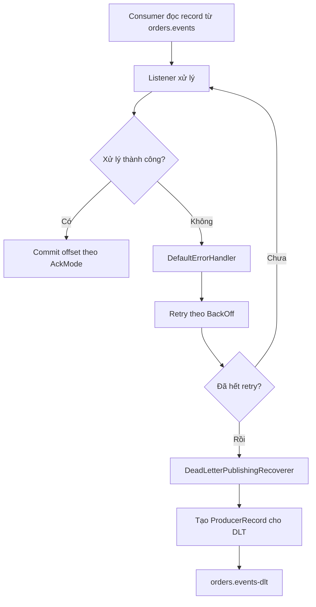

# Header trong dead-letter record

Khi một Kafka record không thể được xử lý thành công sau số lần retry đã cấu hình, ứng dụng thường chuyển record đó sang **dead-letter topic (DLT)** để điều tra hoặc xử lý lại sau. Spring Kafka cung cấp `DeadLetterPublishingRecoverer` để publish record lỗi sang topic đích. Record được chuyển tiếp vẫn mang payload và các header gốc; ngoài ra, recoverer bổ sung metadata cho biết record đến từ đâu và lỗi nào đã khiến nó bị đưa vào DLT.

Các metadata này rất quan trọng khi vận hành: consumer DLT có thể xác định topic, partition, offset ban đầu, consumer group gây lỗi và exception liên quan mà không cần suy luận từ tên topic DLT. Bài viết tập trung vào cấu trúc header của dead-letter record, cách đọc, tùy biến và kiểm soát kích thước cũng như dữ liệu nhạy cảm.

## 1. Dead-letter record được tạo như thế nào?

`DeadLetterPublishingRecoverer` thường được gọi bởi `DefaultErrorHandler` sau khi retry đã hết hoặc exception được phân loại là không retry. Recoverer tạo một `ProducerRecord` mới và gửi record đó đến DLT.

Mặc định, topic đích có tên `<originalTopic>-dlt` và partition đích giống partition của record gốc. Vì vậy, nếu dùng destination resolver mặc định, DLT cần có ít nhất số partition bằng topic nguồn. Có thể tùy biến resolver để gửi đến topic/partition khác.



Một dead-letter record thường mang:

- Key và value của record gốc, trừ trường hợp deserialization lỗi cần khôi phục raw bytes.
- Các Kafka header gốc.
- Các header `KafkaHeaders.DLT_*` do Spring Kafka bổ sung.
- Header tùy chỉnh do ứng dụng hoặc retry infrastructure thêm vào.

Timestamp của record gửi sang DLT là timestamp của lần publish mới. Timestamp ban đầu được lưu riêng trong header `KafkaHeaders.DLT_ORIGINAL_TIMESTAMP`; không nên lấy timestamp của DLT record để suy ra thời điểm record nguồn được tạo.

## 2. Các header DLT tiêu chuẩn

Spring Kafka cung cấp các hằng số trong `org.springframework.kafka.support.KafkaHeaders`. Dùng hằng số thay vì tự gõ tên header giúp tránh sai chính tả và làm rõ mục đích của metadata.

### Header mô tả exception của value

| Hằng số | Ý nghĩa |
|---|---|
| `KafkaHeaders.DLT_EXCEPTION_FQCN` | Tên đầy đủ của class exception khiến record thất bại. |
| `KafkaHeaders.DLT_EXCEPTION_CAUSE_FQCN` | Tên đầy đủ của exception cause, nếu có; có từ Spring Kafka 2.8. |
| `KafkaHeaders.DLT_EXCEPTION_MESSAGE` | Message mô tả exception. |
| `KafkaHeaders.DLT_EXCEPTION_STACKTRACE` | Stack trace của exception. |

Exception thường là `ListenerExecutionFailedException` khi lỗi phát sinh trong `@KafkaListener`, nhưng có thể là loại exception khác tùy vị trí lỗi và cơ chế recover.

### Header mô tả record gốc

| Hằng số | Ý nghĩa |
|---|---|
| `KafkaHeaders.DLT_ORIGINAL_TOPIC` | Tên topic ban đầu. |
| `KafkaHeaders.DLT_ORIGINAL_PARTITION` | Partition ban đầu. |
| `KafkaHeaders.DLT_ORIGINAL_OFFSET` | Offset ban đầu trong partition nguồn. |
| `KafkaHeaders.DLT_ORIGINAL_TIMESTAMP` | Timestamp ban đầu của record. |
| `KafkaHeaders.DLT_ORIGINAL_TIMESTAMP_TYPE` | Loại timestamp ban đầu, ví dụ `CreateTime` hoặc `LogAppendTime`. |
| `KafkaHeaders.DLT_ORIGINAL_CONSUMER_GROUP` | Consumer group đã không xử lý được record; có từ Spring Kafka 2.8. |

Các header này cho phép truy vết record nguồn ngay cả khi record đã đi qua nhiều topic retry hoặc DLT.

### Header riêng cho lỗi deserialize key

Khi key deserialization thất bại, Spring Kafka có nhóm header riêng:

| Hằng số | Ý nghĩa |
|---|---|
| `KafkaHeaders.DLT_KEY_EXCEPTION_FQCN` | Class exception của lỗi deserialize key. |
| `KafkaHeaders.DLT_KEY_EXCEPTION_MESSAGE` | Message của lỗi deserialize key. |
| `KafkaHeaders.DLT_KEY_EXCEPTION_STACKTRACE` | Stack trace của lỗi deserialize key. |

Nhóm này chỉ xuất hiện khi có lỗi deserialize key. Không có `DLT_KEY_EXCEPTION_CAUSE_FQCN` tương ứng trong bộ header tiêu chuẩn.

## 3. Phân biệt header gốc và DLT header

Header gốc là metadata do producer ban đầu gửi cùng record, chẳng hạn `event-type`, `correlation-id`, `trace-id` hoặc `schema-version`. `DeadLetterPublishingRecoverer` giữ lại các header này khi chuyển record sang DLT, sau đó bổ sung header DLT.

Ví dụ một record ban đầu:

| Header | Giá trị minh họa |
|---|---|
| `event-type` | `OrderCreated` |
| `correlation-id` | `corr-82f1` |
| `schema-version` | `2` |

Sau khi chuyển sang DLT, record có thể có thêm:

| Header DLT | Giá trị minh họa |
|---|---|
| `kafka_dlt-original-topic` | `orders.events` |
| `kafka_dlt-original-partition` | Partition nguồn |
| `kafka_dlt-original-offset` | Offset nguồn |
| `kafka_dlt-exception-fqcn` | Class exception |
| `kafka_dlt-exception-message` | Nội dung lỗi |

Tên hiển thị trong bảng minh họa theo prefix hiện hành; trong code nên dùng `KafkaHeaders.DLT_ORIGINAL_TOPIC`, `KafkaHeaders.DLT_EXCEPTION_FQCN` và các hằng số tương ứng. Giá trị thực của mọi Kafka header được lưu dưới dạng `byte[]`; các header text có thể giải mã bằng UTF-8. Với header số hoặc header do ứng dụng tự định nghĩa, phải dùng đúng encoding mà bên tạo header đã quy ước.

Không nhầm `KafkaHeaders.DLT_ORIGINAL_TOPIC` với `KafkaHeaders.ORIGINAL_TOPIC` của retry-topic infrastructure. Bộ `DLT_*` mô tả record được publish vào dead-letter topic; bộ `ORIGINAL_*` có thể được dùng trong luồng non-blocking retry để giữ nguồn ban đầu qua các retry topic.

## 4. Đọc DLT header bằng ConsumerRecord

Khi consumer DLT cần kiểm tra metadata gốc, nhận `ConsumerRecord` để truy cập trực tiếp Kafka headers:

```java
import java.nio.charset.StandardCharsets;

import org.apache.kafka.clients.consumer.ConsumerRecord;
import org.apache.kafka.common.header.Header;
import org.springframework.kafka.support.KafkaHeaders;
import org.springframework.kafka.annotation.KafkaListener;
import org.springframework.stereotype.Component;

@Component
public class OrderDltListener {

    @KafkaListener(
            topics = "orders.events-dlt",
            groupId = "orders-dlt-inspector"
    )
    public void inspect(ConsumerRecord<?, ?> record) {
        String originalTopic = readTextHeader(
                record, KafkaHeaders.DLT_ORIGINAL_TOPIC);
        String exceptionType = readTextHeader(
                record, KafkaHeaders.DLT_EXCEPTION_FQCN);
        String exceptionMessage = readTextHeader(
                record, KafkaHeaders.DLT_EXCEPTION_MESSAGE);

        System.out.printf(
                "dltTopic=%s, originalTopic=%s, originalPartitionHeaderPresent=%s, " +
                "exception=%s, message=%s%n",
                record.topic(),
                originalTopic,
                record.headers().lastHeader(KafkaHeaders.DLT_ORIGINAL_PARTITION) != null,
                exceptionType,
                exceptionMessage
        );
    }

    private String readTextHeader(ConsumerRecord<?, ?> record, String name) {
        Header header = record.headers().lastHeader(name);
        return header == null
                ? null
                : new String(header.value(), StandardCharsets.UTF_8);
    }
}
```

Ví dụ đọc các header dạng text. Không nên áp dụng `new String(..., UTF_8)` cho mọi header một cách máy móc; các giá trị partition, offset hoặc timestamp có thể được mã hóa nhị phân. Hãy dùng đúng encoding của phiên bản Spring Kafka và header cụ thể, hoặc dùng các helper/API có sẵn trong phiên bản dự án.

`ConsumerRecord<?, ?>` phù hợp cho listener kiểm tra DLT vì value có thể là object đã deserialize hoặc raw `byte[]` trong trường hợp record nguồn lỗi deserialize. Nếu khai báo `ConsumerRecord<String, OrderEvent>`, hãy bảo đảm DLT consumer có deserializer tương thích với tất cả loại value có thể được publish vào topic đó.

## 5. Cấu hình DeadLetterPublishingRecoverer

Ví dụ cấu hình blocking retry bằng `DefaultErrorHandler` và recoverer:

```java
import org.apache.kafka.common.TopicPartition;
import org.springframework.context.annotation.Bean;
import org.springframework.context.annotation.Configuration;
import org.springframework.kafka.core.KafkaTemplate;
import org.springframework.kafka.listener.DeadLetterPublishingRecoverer;
import org.springframework.kafka.listener.DefaultErrorHandler;
import org.springframework.util.backoff.FixedBackOff;

@Configuration
public class KafkaErrorConfiguration {

    @Bean
    DefaultErrorHandler kafkaErrorHandler(
            KafkaTemplate<Object, Object> dltKafkaTemplate) {

        DeadLetterPublishingRecoverer recoverer =
                new DeadLetterPublishingRecoverer(
                        dltKafkaTemplate,
                        (record, exception) -> new TopicPartition(
                                record.topic() + "-dlt",
                                record.partition()
                        )
                );

        // 2 lần retry sau lần giao đầu tiên: tổng cộng 3 lần thử.
        return new DefaultErrorHandler(
                recoverer,
                new FixedBackOff(1_000L, 2L)
        );
    }
}
```

`KafkaTemplate<Object, Object>` ở đây đại diện cho template được cấu hình serializer có thể xử lý các kiểu key/value mà recoverer sẽ gửi. Nếu DLT có thể chứa cả POJO đã deserialize và raw `byte[]` từ lỗi deserialize, hãy cấu hình template/serializer phù hợp; Spring Kafka cũng hỗ trợ cung cấp nhiều template để chọn theo kiểu value.

Nếu dùng Spring Boot, bean `DefaultErrorHandler` có thể được áp dụng vào listener container factory auto-configured. Với factory tự tạo, gắn handler bằng `factory.setCommonErrorHandler(...)`.

Khi dùng destination resolver như ví dụ, topic `orders.events-dlt` phải có partition tương ứng với partition nguồn. Nếu muốn để Kafka tự chọn partition, resolver có thể trả `TopicPartition` với partition âm theo quy tắc của API; cần kiểm tra hành vi cụ thể của phiên bản Spring Kafka đang dùng.

## 6. Thêm header tùy chỉnh bằng headersFunction

Ứng dụng có thể thêm thông tin nghiệp vụ vào dead-letter record, ví dụ mã phân loại lỗi, tên service xử lý hoặc correlation ID. Cách đơn giản là dùng `setHeadersFunction()`:

```java
import java.nio.charset.StandardCharsets;

import org.apache.kafka.common.header.Headers;
import org.apache.kafka.common.header.internals.RecordHeader;
import org.apache.kafka.common.header.internals.RecordHeaders;

recoverer.setHeadersFunction((record, exception) -> {
    Headers headers = new RecordHeaders();

    headers.add(new RecordHeader(
            "failure-category",
            classify(exception).getBytes(StandardCharsets.UTF_8)
    ));
    headers.add(new RecordHeader(
            "failed-service",
            "order-service".getBytes(StandardCharsets.UTF_8)
    ));

    return headers;
});
```

Hàm nhận record gốc và exception, trả về tập header được thêm vào record gửi đi. Kafka cho phép nhiều header trùng tên nên header tùy chỉnh có thể được append vào các giá trị đã tồn tại.

Từ Spring Kafka 2.8.4, có thể dùng `addHeadersFunction()` để bổ sung nhiều function mà không ghi đè function đã đăng ký. Từ 2.9.5, `DeadLetterPublishingRecoverer.SingleRecordHeader` cho phép thay các giá trị cùng tên bằng một giá trị mới khi dùng header function. Điều này hữu ích cho header trạng thái chỉ nên có một giá trị hiện hành.

## 7. Loại bỏ hoặc thay đổi header không nên chuyển tiếp

`headersFunction` chỉ thêm header. Nếu cần xóa hoặc thay đổi header gốc đã được copy sang DLT, hãy subclass `DeadLetterPublishingRecoverer` và override `createProducerRecord()`:

```java
import org.apache.kafka.clients.consumer.ConsumerRecord;
import org.apache.kafka.clients.producer.ProducerRecord;
import org.apache.kafka.common.TopicPartition;
import org.apache.kafka.common.header.Headers;
import org.springframework.kafka.listener.DeadLetterPublishingRecoverer;

DeadLetterPublishingRecoverer recoverer = new DeadLetterPublishingRecoverer(dltKafkaTemplate) {

    @Override
    protected ProducerRecord<Object, Object> createProducerRecord(
            ConsumerRecord<?, ?> record,
            TopicPartition topicPartition,
            Headers headers,
            byte[] key,
            byte[] value) {

        // Không chuyển tiếp header nội bộ hoặc chứa thông tin nhạy cảm.
        headers.remove("authorization");
        headers.remove("internal-routing");

        return super.createProducerRecord(
                record, topicPartition, headers, key, value);
    }
};
```

`headers` được truyền vào đã chứa header gốc và header DLT tiêu chuẩn được tạo cho record. Vì vậy, có thể lọc trước khi tạo `ProducerRecord` cuối cùng. Nếu cần đổi tên hoặc thay giá trị, hãy xóa header cũ rồi thêm giá trị đã chuẩn hóa.

Không xóa các header truy vết cần thiết nếu quy trình vận hành phụ thuộc vào chúng. Hãy xác định rõ header nào được phép đi qua ranh giới service và header nào chỉ có ý nghĩa nội bộ.

## 8. Quản lý header qua nhiều lần retry hoặc DLT

Kafka cho phép nhiều header cùng tên. Khi record lỗi được publish lại qua nhiều retry topic hoặc DLT, header có thể tích lũy qua từng lần chuyển tiếp. Đặc biệt, stack trace có thể dài; record có nhiều bản stack trace có nguy cơ vượt giới hạn kích thước message và gây `RecordTooLargeException`.

`DeadLetterPublishingRecoverer` có hai thuộc tính quản lý header đã tồn tại:

| Thuộc tính | Ý nghĩa | Mặc định của recoverer |
|---|---|---|
| `appendOriginalHeaders` | Có append thêm header mô tả nguồn ban đầu khi header đó đã tồn tại hay không. | `true`. |
| `stripPreviousExceptionHeaders` | Có loại bỏ header exception cũ trước khi thêm thông tin exception mới hay không. | `true` từ Spring Kafka 2.8. |

Hai thuộc tính giải quyết hai mục tiêu khác nhau:

- Có thể giữ lịch sử topic/partition mà record đã đi qua bằng cách append original headers.
- Thường chỉ cần giữ exception mới nhất để tránh stack trace cũ làm record phình to.

Với non-blocking retry infrastructure (`@RetryableTopic`), framework mặc định cấu hình `appendOriginalHeaders=false` để chỉ giữ bộ original header đầu tiên; `stripPreviousExceptionHeaders` theo mặc định của recoverer. Đây là mặc định khác với recoverer được tạo và dùng độc lập. Khi tùy biến, hãy kiểm tra cấu hình thực tế của retry infrastructure thay vì giả định hai trường hợp giống nhau.

Ví dụ tùy chỉnh recoverer do retry-topic infrastructure tạo:

```java
import org.springframework.context.annotation.Configuration;
import org.springframework.kafka.retrytopic.RetryTopicConfigurationSupport;

@Configuration
class RetryTopicConfiguration extends RetryTopicConfigurationSupport {

    @Override
    protected void configureCustomizers(CustomizersConfigurer customizersConfigurer) {
        customizersConfigurer.customizeDeadLetterPublishingRecoverer(recoverer -> {
            recoverer.setAppendOriginalHeaders(true);
            recoverer.setStripPreviousExceptionHeaders(false);
        });
    }
}
```

Chỉ giữ toàn bộ lịch sử exception khi có nhu cầu điều tra cụ thể và đã đánh giá giới hạn kích thước record. Trong nhiều hệ thống, giữ original header đầu tiên cùng exception cuối cùng là đủ cho vận hành.

## 9. Chọn header tiêu chuẩn nào sẽ được thêm

Từ Spring Kafka 2.8.4, có thể loại bỏ một số header tiêu chuẩn bằng `excludeHeader(...)`. Ví dụ, nếu stack trace quá lớn hoặc không được phép xuất khỏi service:

```java
import org.springframework.kafka.listener.DeadLetterPublishingRecoverer.HeaderNames;

recoverer.excludeHeader(HeaderNames.HeadersToAdd.EX_STACKTRACE);
```

Tên enum `HeadersToAdd` là nhóm định danh logic của header; tên Kafka header thực tế được Spring Kafka cung cấp. Có thể tùy biến toàn bộ cách tạo exception headers bằng `setExceptionHeadersCreator(...)`; khi dùng cơ chế này, các exception header tiêu chuẩn sẽ bị thay thế bởi nội dung do ứng dụng tự tạo.

Hãy cân nhắc nhu cầu điều tra trước khi bỏ `DLT_EXCEPTION_STACKTRACE`. Nếu cần giữ khả năng phân loại lỗi nhưng không muốn gửi stack trace dài, có thể giữ exception class/message và bổ sung một error code ngắn do ứng dụng quản lý.

## 10. Header từ ErrorHandlingDeserializer

Khi dùng `ErrorHandlingDeserializer`, lỗi deserialize key/value được lưu tạm trong các header riêng của deserializer:

- `ErrorHandlingDeserializer.KEY_DESERIALIZER_EXCEPTION_HEADER`.
- `ErrorHandlingDeserializer.VALUE_DESERIALIZER_EXCEPTION_HEADER`.

Các header này chứa exception được Java serialize. Mặc định, chúng không được giữ nguyên trong record publish sang DLT; recoverer tạo các DLT exception header tiêu chuẩn để mô tả lỗi.

Khi dùng `ErrorHandlingDeserializer`, Spring Kafka có thể khôi phục raw bytes ban đầu bị lỗi vào key/value của DLT record. Value raw được khôi phục từ Spring Kafka 2.3; trường hợp cả key và value đều lỗi được hỗ trợ từ 2.7. Nếu thật sự cần giữ header exception gốc của `ErrorHandlingDeserializer`, có thể gọi `setRetainExceptionHeader(true)` trên recoverer.

Chỉ giữ các header exception Java-serialized khi consumer DLT có nhu cầu cụ thể và tin cậy nguồn dữ liệu. Không deserialize dữ liệu Java tùy ý từ topic không tin cậy. Thông thường, DLT exception headers tiêu chuẩn đã đủ để điều tra mà không cần giữ object exception serialized ban đầu.

## 11. Đọc nhiều header trùng tên

`Headers.lastHeader(name)` trả về giá trị cuối cùng có tên tương ứng. Nếu cần xem tất cả giá trị, dùng `headers(name)` để duyệt các header trùng tên:

```java
import java.nio.charset.StandardCharsets;

record.headers().headers(KafkaHeaders.DLT_EXCEPTION_MESSAGE)
        .forEach(header -> {
            String message = new String(
                    header.value(), StandardCharsets.UTF_8);
            log.info("DLT exception message: {}", message);
        });
```

Ví dụ này hữu ích khi hệ thống chủ động lưu lịch sử exception. Nếu recoverer đang strip previous exception headers, thường chỉ còn một giá trị mới nhất. Khi append headers qua nhiều lần chuyển tiếp, có thể có nhiều giá trị cùng tên.

## 12. Bảo mật và kích thước header

DLT thường là nơi lưu dữ liệu lỗi lâu hơn topic nghiệp vụ và có thể được nhiều công cụ vận hành truy cập. Header gốc và exception có thể vô tình chứa thông tin không nên phát tán:

- Header `authorization`, token hoặc credential nội bộ.
- Header chứa email, số điện thoại hoặc dữ liệu định danh cá nhân.
- Exception message có thể chứa SQL, URL nội bộ, tham số request hoặc dữ liệu đầu vào.
- Stack trace có thể để lộ package, tên class, cấu trúc hệ thống và đường dẫn triển khai.

Nên áp dụng các nguyên tắc sau:

1. Chỉ truyền tiếp header phục vụ correlation, trace, schema hoặc điều tra lỗi.
2. Loại bỏ credential và header routing nội bộ trước khi publish DLT.
3. Giới hạn hoặc bỏ stack trace nếu kích thước và chính sách bảo mật yêu cầu.
4. Đặt retention và quyền truy cập DLT phù hợp vì DLT có thể chứa payload lỗi và metadata nhạy cảm.
5. Theo dõi kích thước record và lỗi `RecordTooLargeException`, nhất là khi có nhiều vòng retry.
6. Dùng `lastHeader()` khi chỉ cần trạng thái cuối; duyệt tất cả header khi cần lịch sử và đã chấp nhận chi phí kích thước.

## 13. Kiểm thử DLT headers

Integration test nên gửi một record gây lỗi có kiểm soát, để error handler chuyển record sang DLT, sau đó đọc DLT và xác minh:

- Key/value được giữ nguyên hoặc được khôi phục đúng nếu lỗi deserialize.
- Header nghiệp vụ cần giữ như `correlation-id` vẫn tồn tại.
- `DLT_ORIGINAL_TOPIC`, `DLT_ORIGINAL_PARTITION`, `DLT_ORIGINAL_OFFSET` mô tả đúng vị trí record nguồn.
- `DLT_EXCEPTION_FQCN` và `DLT_EXCEPTION_MESSAGE` mô tả lỗi dự kiến.
- Header nhạy cảm đã được loại bỏ.
- Không tích lũy nhiều exception stack trace ngoài chủ đích.

Ví dụ kiểm tra header tồn tại:

```java
Header originalTopic = dltRecord.headers()
        .lastHeader(KafkaHeaders.DLT_ORIGINAL_TOPIC);
Header exceptionType = dltRecord.headers()
        .lastHeader(KafkaHeaders.DLT_EXCEPTION_FQCN);

assertThat(originalTopic).isNotNull();
assertThat(exceptionType).isNotNull();
assertThat(new String(originalTopic.value(), StandardCharsets.UTF_8))
        .isEqualTo("orders.events");
```

Đây là đoạn assertion minh họa; test đầy đủ cần chờ record DLT bằng poll có timeout hữu hạn, dùng consumer group riêng và kiểm tra kết quả gửi DLT đã được xác nhận. Không dùng `Thread.sleep` cố định để đoán thời điểm record xuất hiện.

## 14. Những lỗi thường gặp

| Biểu hiện | Nguyên nhân | Cách xử lý |
|---|---|---|
| Không thấy `DLT_*` headers | Record được gửi bằng recoverer tùy chỉnh không tạo header chuẩn hoặc listener đọc nhầm tên header. | Kiểm tra `DeadLetterPublishingRecoverer` và dùng `KafkaHeaders.DLT_*`. |
| Không tìm thấy record ở DLT partition tương ứng | DLT có ít partition hơn topic nguồn hoặc destination resolver trả partition không hợp lệ. | Tạo DLT đủ partition hoặc tùy biến partition resolver. |
| Header exception xuất hiện nhiều lần | Record được republish qua nhiều retry/DLT và cấu hình append lịch sử. | Cấu hình `appendOriginalHeaders` và `stripPreviousExceptionHeaders` phù hợp. |
| Publish DLT thất bại vì record quá lớn | Header stack trace hoặc lịch sử retry tích lũy quá nhiều. | Exclude stack trace, strip exception cũ hoặc giới hạn header tùy chỉnh. |
| Consumer DLT không deserialize được value | DLT chứa cả object đã deserialize và raw `byte[]` từ lỗi deserialize. | Dùng serializer/deserializer hoặc nhiều `KafkaTemplate` phù hợp với các kiểu value. |
| Không còn ErrorHandlingDeserializer exception header | Recoverer loại bỏ header này theo mặc định. | Chỉ bật `setRetainExceptionHeader(true)` nếu thực sự cần và nguồn dữ liệu đáng tin cậy. |
| Mất header correlation sau khi vào DLT | Header mapper/custom recoverer lọc header hoặc header không được tạo ở producer. | Kiểm tra header gốc, mapper và logic override `createProducerRecord()`. |
| DLT chứa credential hoặc thông tin nhạy cảm | Recoverer giữ lại header gốc theo mặc định. | Lọc header nhạy cảm trước khi tạo producer record DLT. |

## 15. Ghi nhớ

- `DeadLetterPublishingRecoverer` giữ các header gốc và bổ sung header `KafkaHeaders.DLT_*`.
- `DLT_ORIGINAL_*` giúp truy vết topic, partition, offset, timestamp và consumer group ban đầu.
- `DLT_EXCEPTION_*` mô tả exception; `DLT_KEY_EXCEPTION_*` dành riêng cho lỗi deserialize key.
- Kafka header có kiểu `byte[]` và cho phép nhiều giá trị cùng tên; dùng `lastHeader()` để lấy giá trị cuối hoặc duyệt `headers(name)` để đọc lịch sử.
- `setHeadersFunction()` dùng để thêm metadata; subclass `createProducerRecord()` khi cần xóa hoặc thay đổi header đã copy.
- `appendOriginalHeaders` và `stripPreviousExceptionHeaders` kiểm soát việc tích lũy header qua nhiều lần retry; retry-topic infrastructure có mặc định riêng.
- `ErrorHandlingDeserializer` exception headers bị loại bỏ mặc định khi publish DLT; recoverer có thể khôi phục raw bytes của record lỗi.
- Luôn lọc credential, dữ liệu cá nhân và stack trace không cần thiết; theo dõi kích thước DLT record.

Khi thiết kế DLT, hãy coi header là một phần của hợp đồng vận hành: giữ đủ thông tin để truy vết record nguồn và phân loại lỗi, nhưng giới hạn lịch sử và dữ liệu nhạy cảm. Consumer DLT nên đọc header bằng hằng số `KafkaHeaders`, xử lý giá trị byte theo đúng encoding và có quy trình replay sau khi nguyên nhân lỗi đã được khắc phục.

## Tài liệu tham khảo

- [Spring for Apache Kafka — Publishing Dead-letter Records](https://docs.spring.io/spring-kafka/reference/kafka/annotation-error-handling.html#publishing-dead-letter-records)
- [Spring for Apache Kafka — Managing Dead Letter Record Headers](https://docs.spring.io/spring-kafka/reference/kafka/annotation-error-handling.html#managing-dead-letter-record-headers)
- [Spring for Apache Kafka — Retry Topic Failure Header Management](https://docs.spring.io/spring-kafka/reference/retrytopic/features.html#failure-header-management)
- [Spring Kafka — KafkaHeaders API](https://docs.spring.io/spring-kafka/api/org/springframework/kafka/support/KafkaHeaders.html)
- [Spring Kafka — DeadLetterPublishingRecoverer API](https://docs.spring.io/spring-kafka/api/org/springframework/kafka/listener/DeadLetterPublishingRecoverer.html)
