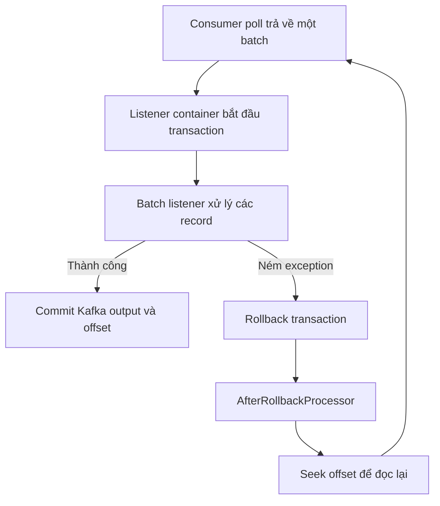

# AfterRollbackProcessor cho batch

Khi một `@KafkaListener` xử lý cả một batch trong Kafka transaction và ném exception, transaction bị rollback. Spring Kafka gọi `AfterRollbackProcessor` sau rollback để đưa các offset chưa hoàn tất về vị trí cần đọc lại hoặc thực hiện recovery. Với batch listener, điểm quan trọng là container thường chỉ biết batch đã thất bại, không biết chính xác record nào trong batch gây lỗi. Vì vậy, hành vi mặc định là đọc lại toàn bộ batch.

Bài học này tập trung vào `DefaultAfterRollbackProcessor`, cách batch được phát lại, và cách bật recovery cho cả batch trong Spring Kafka 3.2 trở lên. Đây là một phần của việc xây dựng luồng messaging tin cậy: retry phải có giới hạn, offset phải được xử lý đúng và throughput không nên bị giảm kéo dài bởi một batch lỗi.

## 1. AfterRollbackProcessor nằm ở đâu trong luồng xử lý?

`AfterRollbackProcessor` chỉ tham gia vào luồng xử lý có transaction. Với Kafka transaction, listener container bắt đầu transaction trước khi gọi listener. Khi listener xử lý thành công, các record được gửi đi bằng `KafkaTemplate` tham gia transaction và offset nguồn được gửi vào cùng transaction để commit. Nếu listener ném exception, transaction thất bại; các Kafka output và offset nằm trong transaction đó không được commit. Sau khi rollback, container gọi `AfterRollbackProcessor`.

Luồng cơ bản:



`DefaultAfterRollbackProcessor` là implementation mặc định. Với record listener, nó có thể seek partition về record lỗi để record đó được giao lại. Với batch listener, container không có thông tin chắc chắn về record lỗi nên mặc định seek để phát lại toàn bộ batch. Những record đã được listener xử lý trước khi exception xảy ra cũng có thể xuất hiện lại.

`AfterRollbackProcessor` khác `DefaultErrorHandler` ở ngữ cảnh sử dụng:

| Thành phần | Ngữ cảnh chính | Vai trò |
|---|---|---|
| `AfterRollbackProcessor` | Listener chạy trong transaction và transaction đã rollback | Xử lý offset sau rollback, retry hoặc recovery |
| `DefaultErrorHandler` | Container xử lý lỗi listener theo cơ chế error handler | Retry, backoff và recovery khi không dựa vào rollback transaction |

Nếu cấu hình một error handler tùy chỉnh cho transactional container, handler phải ném exception tiếp tục lên container khi muốn transaction rollback. Nếu handler bắt lỗi rồi trả về bình thường, luồng rollback có thể không xảy ra và `AfterRollbackProcessor` không được gọi như mong đợi.

## 2. Vì sao batch mặc định được phát lại toàn bộ?

Giả sử một lần `poll()` trả về 5 đơn hàng. Listener xử lý lần lượt và gặp lỗi ở đơn hàng thứ ba:

```text
Batch lần đầu:  [A, B, C, D, E]
                         ^
                         C gây lỗi

Transaction: rollback
Batch giao lại: [A, B, C, D, E]
```

Container nhận được exception từ lời gọi listener cho cả batch. Nó không thể suy ra rằng A và B đã hoàn tất an toàn, C là record lỗi, còn D và E chưa được xử lý. Vì thế, `DefaultAfterRollbackProcessor` mặc định seek để batch được đọc lại. Lần giao lại có thể chứa các record đã chạy thành công ở lần trước.

Điều này ảnh hưởng trực tiếp đến throughput và tính đúng đắn:

- **Tăng công việc lặp:** A và B có thể được xử lý lại dù chúng không gây lỗi.
- **Tăng độ trễ:** một record lỗi có thể khiến các record còn lại trong batch phải chờ retry.
- **Nguy cơ tác dụng phụ trùng lặp:** nếu listener gọi API, ghi file hoặc cập nhật một hệ thống bên ngoài, thao tác đã hoàn thành trước rollback Kafka không tự động được hoàn tác.
- **Batch lớn làm phạm vi phát lại lớn:** batch càng lớn thì chi phí xử lý lại các record không lỗi càng cao.

Vì vậy, logic xử lý record trong batch nên có tính idempotent. Có thể dùng mã sự kiện hoặc business key làm khóa chống xử lý trùng, lưu trạng thái xử lý trong cùng transaction của hệ thống đích khi có thể, và tránh thực hiện side effect không thể lặp an toàn trước khi biết transaction đã commit.

Ví dụ listener:

```java
@KafkaListener(
        topics = "orders",
        containerFactory = "transactionalBatchFactory"
)
public void consume(List<ConsumerRecord<String, Order>> records) {
    for (ConsumerRecord<String, Order> record : records) {
        orderService.apply(record.value());
    }
}
```

Nếu `apply()` ném exception ở bất kỳ record nào, transaction của lần gọi listener bị rollback. Với cách xử lý batch mặc định, các record trong batch được giao lại. Không nên giả định `BatchListenerFailedException` sẽ giúp `AfterRollbackProcessor` xác định record lỗi: exception này thường được dùng để chỉ vị trí lỗi cho `DefaultErrorHandler`; `AfterRollbackProcessor` vẫn xử lý batch sau rollback.

## 3. Recovery cả batch từ Spring Kafka 3.2

Từ Spring Kafka 3.2, có thể bật khả năng recovery để bỏ qua một batch liên tục thất bại bằng thuộc tính:

```java
containerProperties.setBatchRecoverAfterRollback(true);
```

Đây là recovery ở cấp **toàn bộ batch**. Framework vẫn không xác định được record lỗi riêng lẻ. Khi số lần retry theo `BackOff` đã hết, recoverer được gọi cho từng record trong batch; sau khi recovery thành công, offset của các record trong batch được commit. Nếu dùng dead-letter topic (DLT), điều đó có nghĩa là cả những record đã xử lý thành công trước khi xảy ra lỗi cũng có thể được gửi sang DLT cùng batch.

Để recovery batch được hoàn tất đúng trong transactional flow, cấu hình `DefaultAfterRollbackProcessor` với `commitRecovered = true` và cung cấp `KafkaTemplate` có khả năng tạo transaction. Processor dùng transaction recovery sau rollback để gửi các record được recover và commit offset nguồn. Ví dụ sau giả định listener container đã được gắn `KafkaTransactionManager`, còn `transactionalKafkaTemplate` dùng `ProducerFactory` có cấu hình transaction:

```java
@Bean
ConcurrentKafkaListenerContainerFactory<String, Order> transactionalBatchFactory(
        ConsumerFactory<String, Order> consumerFactory,
        KafkaTemplate<Object, Object> transactionalKafkaTemplate) {

    var factory = new ConcurrentKafkaListenerContainerFactory<String, Order>();
    factory.setConsumerFactory(consumerFactory);
    factory.setBatchListener(true);

    var dltRecoverer = new DeadLetterPublishingRecoverer(transactionalKafkaTemplate);

    var afterRollbackProcessor = new DefaultAfterRollbackProcessor<String, Order>(
            (record, exception) -> dltRecoverer.accept(record, exception),
            new FixedBackOff(1_000L, 2L),
            transactionalKafkaTemplate,
            true
    );

    factory.setAfterRollbackProcessor(afterRollbackProcessor);
    factory.getContainerProperties().setBatchRecoverAfterRollback(true);

    return factory;
}
```

Trong ví dụ:

- `FixedBackOff(1_000L, 2L)` chờ 1 giây giữa các lần retry và cho phép 2 lần retry sau lần giao đầu tiên, tức tối đa 3 lần xử lý batch.
- `DeadLetterPublishingRecoverer` gửi từng record được recovery sang DLT. Resolver mặc định dùng tên topic gốc cộng hậu tố `-dlt` và giữ partition nguồn; vì vậy DLT cần có đủ partition tương ứng.
- `commitRecovered = true` yêu cầu truyền `KafkaTemplate` vào processor. Template phải dùng cấu hình transactional phù hợp để thao tác gửi DLT và offset nguồn được commit trong transaction recovery.
- `setBatchRecoverAfterRollback(true)` bật recovery ở cấp batch. Nếu không bật thuộc tính này, hành vi mặc định vẫn là phát lại batch và framework không tự bỏ qua batch lỗi.

Nếu recoverer ném exception, processor seek để batch được giao lại. Điều này giúp tránh commit offset nguồn khi việc gửi bản ghi cần recovery chưa thành công. Cần theo dõi lỗi gửi DLT và bảo đảm DLT tồn tại, có cấu hình serializer tương thích, đủ partition và có chính sách lưu trữ phù hợp.

## 4. Khi nào cần xử lý từng record trong batch?

Recovery toàn batch phù hợp khi nghiệp vụ chấp nhận đưa cả batch lỗi sang luồng xử lý lại hoặc cần bỏ qua một lô dữ liệu không thể xử lý. Nếu chỉ một record lỗi nhưng các record còn lại cần tiếp tục bình thường, việc đưa cả batch vào DLT có thể làm mất cơ hội xử lý các record hợp lệ đúng luồng.

Trong trường hợp đó, cân nhắc `BatchToRecordAdapter` (có từ Spring Kafka 2.4.2). Container vẫn nhận dữ liệu theo batch từ Kafka, nhưng adapter gọi listener lần lượt cho từng record. Cách này cho phép xử lý lỗi và recovery theo từng record, ví dụ dùng `DeadLetterPublishingRecoverer` cho record lỗi, trong khi các record khác tiếp tục theo chính sách đã cấu hình. Một lựa chọn khác là dùng record listener nếu nghiệp vụ không cần batch listener.

| Nhu cầu | Hướng xử lý phù hợp |
|---|---|
| Muốn đơn giản, chấp nhận phát lại toàn batch khi có lỗi | `DefaultAfterRollbackProcessor` mặc định |
| Muốn bỏ qua một batch liên tục lỗi sau số lần retry hữu hạn | Spring Kafka 3.2+, `setBatchRecoverAfterRollback(true)` và processor cấu hình recovery transaction |
| Muốn cô lập record lỗi, tiếp tục xử lý các record còn lại | `BatchToRecordAdapter` hoặc record listener |

## 5. Những điểm cần kiểm tra khi vận hành

**Chọn kích thước batch theo chi phí retry.** Batch lớn thường tăng hiệu quả mỗi lần poll, nhưng cũng làm phạm vi phát lại lớn hơn khi một record gây lỗi. Theo dõi thời gian xử lý p95/p99, số lần rollback và số record được xử lý lại để điều chỉnh `max.poll.records` cùng logic batch.

**Đặt giới hạn retry có chủ đích.** Retry vô hạn có thể giữ partition ở trạng thái không tiến triển nếu lỗi là dữ liệu không hợp lệ hoặc lỗi cấu hình. `BackOff` hữu hạn kết hợp DLT giúp luồng chính tiếp tục sau khi batch được recovery. Ngược lại, lỗi hạ tầng tạm thời có thể cần khoảng backoff dài hơn và cơ chế cảnh báo trước khi đưa batch sang DLT.

**Đồng bộ thời gian timeout.** Thời gian xử lý batch, thời gian chờ backoff và thời gian transaction cần tương thích với `max.poll.interval.ms` và `transaction.timeout.ms`. Nếu transaction hết hạn khi listener đang xử lý, consumer hoặc producer có thể bị fencing và luồng recovery không hoạt động như một lần rollback thông thường.

**Thiết kế side effect có thể lặp.** Kafka transaction có thể bảo vệ Kafka output và offset trong cùng transaction. Nó không tự động rollback một lời gọi REST hoặc một transaction cơ sở dữ liệu độc lập. Dùng idempotency key, outbox/inbox hoặc cơ chế phối hợp transaction phù hợp với hệ thống đích.

**Kiểm tra nội dung DLT.** Nếu recovery ở cấp batch, DLT có thể chứa nhiều record hợp lệ cùng record gây lỗi. Cần lưu metadata nguồn như topic, partition, offset, exception và correlation ID để có thể phân loại, điều tra và phát lại có kiểm soát.

## 6. Tình huống minh họa

Một consumer nhận batch 100 đơn hàng. Record thứ 27 gặp lỗi do dịch vụ định giá tạm thời không phản hồi. Listener đã xử lý 26 record trước khi exception xuất hiện.

1. Transaction hiện tại rollback; các Kafka output và offset thuộc transaction không được commit.
2. Với cấu hình mặc định, `AfterRollbackProcessor` seek và batch được giao lại. 26 record đầu có thể được xử lý lần nữa, do đó `orderService.apply()` cần chống trùng.
3. Nếu bật batch recovery từ Spring Kafka 3.2 và đặt backoff 2 lần retry, batch có thể được giao lại tối đa 3 lần.
4. Nếu vẫn thất bại và recovery được cấu hình, recoverer gửi cả 100 record sang DLT; offset nguồn được commit trong transaction recovery sau khi các thao tác recovery thành công.
5. Consumer tiếp tục với dữ liệu tiếp theo. Một quy trình riêng có thể phân loại DLT, sửa nguyên nhân và phát lại những đơn hàng cần xử lý.

Nếu yêu cầu nghiệp vụ là chỉ đưa đơn hàng thứ 27 vào DLT và vẫn xử lý 28–100 bình thường, recovery cả batch không phải lựa chọn phù hợp. Hãy dùng `BatchToRecordAdapter` hoặc record listener để cô lập lỗi theo từng record.

## 7. Ghi nhớ

- `AfterRollbackProcessor` xử lý sau khi transaction của listener rollback.
- Với batch listener, hành vi mặc định là phát lại toàn bộ batch vì container không biết record nào gây lỗi.
- Từ Spring Kafka 3.2, `setBatchRecoverAfterRollback(true)` cho phép recovery cả batch sau khi retry hết; cần cấu hình `DefaultAfterRollbackProcessor` với `commitRecovered = true` và transactional `KafkaTemplate` để recovery cùng offset nguồn trong transaction.
- Batch recovery gửi hoặc bỏ qua toàn bộ batch. Muốn recovery riêng record lỗi, dùng `BatchToRecordAdapter` hoặc record listener.
- Thiết kế idempotency, retry, DLT và batch size cùng nhau để hạn chế xử lý trùng và bảo vệ throughput.

## Tài liệu tham khảo

- [Spring for Apache Kafka — Handling Exceptions, mục After Rollback Processor](https://docs.spring.io/spring-kafka/reference/kafka/annotation-error-handling.html)
- [Spring for Apache Kafka — Transactions with Batch Listeners](https://docs.spring.io/spring-kafka/reference/kafka/transactions.html)
- [Spring for Apache Kafka — Listener Container Properties](https://docs.spring.io/spring-kafka/reference/kafka/container-props.html)
