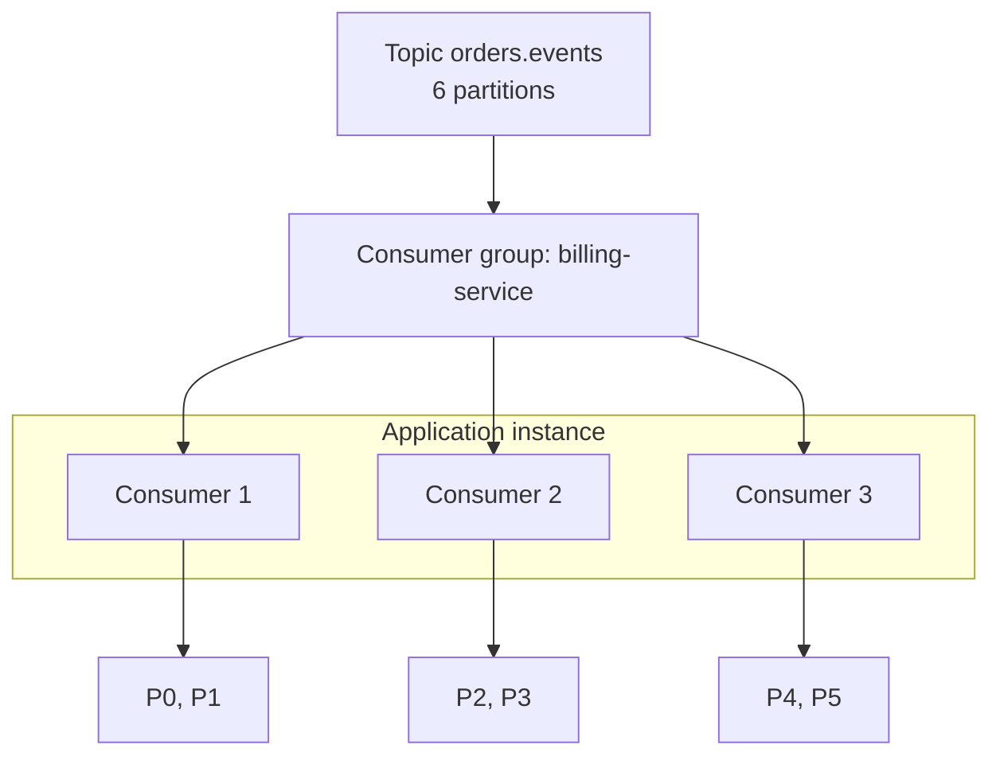
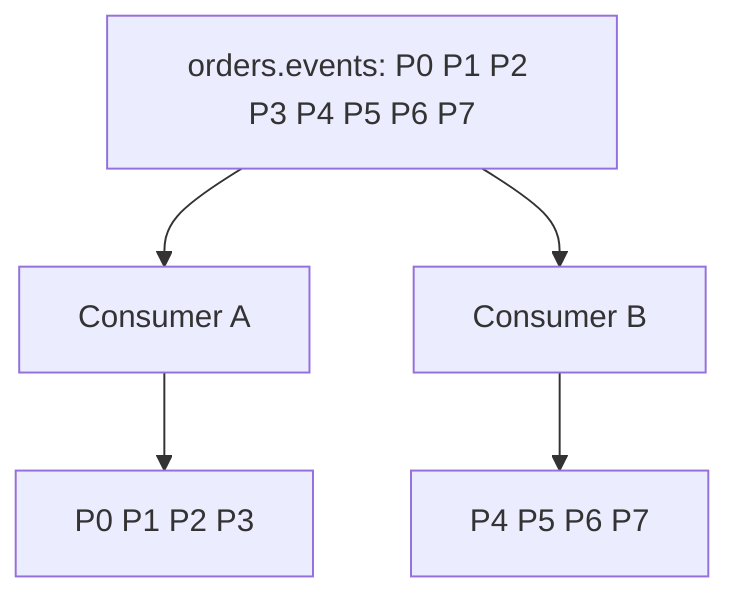

# Giới hạn concurrency theo số partition

Trong Spring Kafka, `concurrency` quy định số consumer mà một listener container tạo ra trong mỗi instance ứng dụng. Mỗi consumer tham gia consumer group và được Kafka gán một hoặc nhiều partition. Vì một partition chỉ được gán cho tối đa một consumer member trong cùng group tại một thời điểm, số partition giới hạn mức xử lý song song mà group có thể khai thác.

Nếu topic có sáu partition nhưng toàn bộ ứng dụng chỉ tạo hai consumer member, mỗi consumer phải đọc nhiều partition. Nếu ứng dụng tạo mười consumer member, tối đa sáu consumer có thể nhận partition của topic đó; bốn consumer còn lại không có partition để xử lý. Tăng concurrency vượt quá số partition không làm một partition được nhiều consumer cùng đọc song song.

Khi chạy nhiều replica, cần tính cả concurrency trên mỗi replica. Với một topic và một consumer group dùng cùng subscription:

\[
\text{Tổng consumer member} =
\text{Số replica} \times \text{Concurrency mỗi replica}
\]

\[
\text{Số consumer có partition tối đa} =
\min(\text{Tổng consumer member},\text{Số partition})
\]

Đây là giới hạn lý thuyết cho một topic mà các member cùng subscribe. Assignment thực tế còn phụ thuộc danh sách topic, partition assignor và cấu hình subscription.

## 1. Partition là giới hạn song song của consumer group

Mỗi partition là một log có thứ tự riêng. Consumer group phân phối partition cho các consumer member để nhiều partition có thể được đọc đồng thời.



Với một topic có sáu partition và ba consumer member, một assignment cân bằng có thể giao hai partition cho mỗi consumer. Kafka không chia một partition cho hai consumer trong cùng group, vì vậy mỗi partition chỉ có một owner tại một thời điểm.

Điều này có nghĩa:

- Một consumer có thể nhận nhiều partition.
- Một partition không được nhiều consumer member cùng group xử lý đồng thời.
- Các partition khác nhau có thể được xử lý song song.
- Tăng số consumer chỉ hữu ích khi còn partition có thể gán cho consumer mới.

`concurrency` không phải số thread được tạo cho từng partition. Với concurrent listener container, Spring Kafka tạo nhiều child container; mỗi child quản lý một Kafka consumer và luồng xử lý riêng.

## 2. Quan hệ giữa partition count và concurrency

Giả sử topic `orders.events` có sáu partition, tất cả consumer cùng tham gia group `billing-service`:

| Consumer member | Số partition của topic | Khả năng song song |
| ---: | ---: | --- |
| 1 | 6 | Một consumer xử lý cả sáu partition |
| 2 | 6 | Tối đa hai consumer xử lý đồng thời |
| 3 | 6 | Tối đa ba consumer xử lý đồng thời |
| 6 | 6 | Tối đa sáu consumer xử lý đồng thời |
| 8 | 6 | Tối đa sáu consumer có partition; hai consumer rảnh |

Với một topic và các consumer có cùng subscription, số consumer member có thể thực sự nhận partition bị giới hạn bởi partition count. Nếu `consumerCount > partitionCount`, các member dư không nhận partition.

Một consumer được giao nhiều partition vẫn chỉ có một luồng poll và xử lý listener của child container đó. Các record của các partition được consumer đọc có thể xen kẽ theo các lần poll, nhưng listener method thông thường vẫn được gọi trên luồng container; không nên hiểu một consumer có bốn partition là bốn worker xử lý đồng thời.

### 2.1. Bảng ví dụ khi chạy một instance

Topic có sáu partition và ứng dụng có một replica:

| `concurrency` | Consumer được tạo | Consumer có partition tối đa | Consumer rảnh |
| ---: | ---: | ---: | ---: |
| 1 | 1 | 1 | 0 |
| 2 | 2 | 2 | 0 |
| 3 | 3 | 3 | 0 |
| 6 | 6 | 6 | 0 |
| 8 | 8 | 6 | 2 |

Khi concurrency bằng một, consumer đó có thể được gán cả sáu partition. Tăng lên ba giúp có tối đa ba luồng consumer hoạt động trên các partition khác nhau. Tăng từ sáu lên tám không tăng số partition có thể xử lý song song.

### 2.2. Consumer rảnh vẫn có chi phí

Consumer không có partition vẫn là một member/container được tạo ra. Nó có thể duy trì kết nối, heartbeat và tài nguyên client, dù không đọc record từ topic đó. Tạo nhiều consumer hơn số partition có thể làm tăng chi phí bộ nhớ, socket, thread và độ phức tạp khi rebalance mà không tăng throughput.

## 3. Tính cả số replica ứng dụng

Thuộc tính `concurrency` áp dụng cho mỗi listener container trong mỗi instance ứng dụng. Nếu triển khai nhiều pod hoặc VM với cùng `group.id`, tổng số consumer member là tích của số replica và concurrency mỗi replica.

Ví dụ topic có sáu partition:

| Replica | Concurrency mỗi replica | Tổng consumer member | Consumer có partition tối đa | Consumer rảnh tối thiểu |
| ---: | ---: | ---: | ---: | ---: |
| 1 | 2 | 2 | 2 | 0 |
| 2 | 2 | 4 | 4 | 0 |
| 2 | 3 | 6 | 6 | 0 |
| 3 | 3 | 9 | 6 | 3 |
| 4 | 2 | 8 | 6 | 2 |

Với hai replica, mỗi replica có `concurrency=3`, group có tổng cộng sáu consumer member. Sáu partition có thể được phân phối cho sáu member, nếu tất cả member có cùng subscription và assignor phân phối phù hợp.

Nếu scale ứng dụng từ hai lên bốn replica mà vẫn giữ concurrency bằng ba, tổng member tăng từ sáu lên mười hai. Với topic sáu partition, tối đa sáu member có partition; số member còn lại không làm tăng mức song song cho topic này.

## 4. Công thức ước lượng concurrency hữu ích

Với một topic và một group, có thể dùng các ký hiệu:

- `P`: số partition của topic.
- `R`: số replica ứng dụng đang chạy.
- `C`: concurrency mỗi replica cho listener.
- `M = R × C`: tổng consumer member của group do listener tạo ra.

Số consumer có thể được gán partition tối đa:

\[
A_{max} = \min(P,M)
\]

Số consumer không có partition trong trường hợp đơn giản:

\[
I = \max(0,M-P)
\]

Ví dụ: `P=12`, `R=3`, `C=2` thì `M=6`, `Amax=6`, `I=0`. Nếu tăng `C=5`, `M=15`, `Amax=12`, `I=3`.

Đây là cách ước lượng cho một topic có subscription giống nhau. Với listener subscribe nhiều topic, số partition có thể gán là tổng partition của các topic trong subscription; tuy nhiên, partition assignor và cách các member subscribe có thể khiến assignment thực tế không đều hoặc có consumer rảnh dù tổng số partition lớn hơn số member.

Công thức `M = R × C` áp dụng cho một listener endpoint. Nếu ứng dụng có nhiều endpoint cùng group ID, hãy cộng consumer member do tất cả endpoint tạo ra (và các consumer từ replica/service khác trong group) trước khi so sánh với partition count.

## 5. Cấu hình concurrency trong Spring Kafka

Spring Kafka cho phép cấu hình concurrency ở factory hoặc ghi đè ở từng `@KafkaListener`.

### 5.1. Cấu hình mặc định ở application.yml

```yaml
spring:
  kafka:
    bootstrap-servers: ${KAFKA_BOOTSTRAP_SERVERS:localhost:9092}
    consumer:
      group-id: billing-service
      enable-auto-commit: false
      key-deserializer: org.apache.kafka.common.serialization.StringDeserializer
      value-deserializer: org.springframework.kafka.support.serializer.JsonDeserializer
      properties:
        "[spring.json.trusted.packages]": com.example.messaging.event
        "[spring.json.value.default.type]": com.example.messaging.event.OrderCreated
    listener:
      concurrency: 3

app:
  kafka:
    topic:
      orders: orders.events
```

`spring.kafka.listener.concurrency` là concurrency mặc định mà Spring Boot cấu hình cho listener container factory. Nếu không đặt giá trị riêng ở annotation hoặc factory, listener sử dụng concurrency mặc định này. Giá trị mặc định phổ biến là một consumer.

### 5.2. Ghi đè concurrency trên @KafkaListener

Một listener có thể khai báo concurrency riêng:

```java
import com.example.messaging.event.OrderCreated;
import com.example.messaging.service.BillingService;
import org.springframework.kafka.annotation.KafkaListener;
import org.springframework.stereotype.Component;

@Component
public class OrderCreatedListener {

    private final BillingService billingService;

    public OrderCreatedListener(BillingService billingService) {
        this.billingService = billingService;
    }

    @KafkaListener(
            id = "ordersBillingListener",
            topics = "${app.kafka.topic.orders}",
            groupId = "billing-service",
            concurrency = "6"
    )
    public void onOrderCreated(OrderCreated event) {
        billingService.handle(event);
    }
}
```

Giá trị `concurrency` trên annotation ghi đè concurrency mặc định của factory cho listener endpoint đó. Trong ví dụ, listener tạo sáu consumer cho mỗi instance ứng dụng. Nếu chạy ba replica, tổng số member của group có thể là 18.

### 5.3. Dùng property placeholder theo môi trường

Không cần hardcode concurrency trong source code. Có thể dùng placeholder:

```java
@KafkaListener(
        id = "ordersBillingListener",
        topics = "${app.kafka.topic.orders}",
        groupId = "billing-service",
        concurrency = "${app.kafka.listener.orders-concurrency:3}"
)
public void onOrderCreated(OrderCreated event) {
    billingService.handle(event);
}
```

`application.yml`:

```yaml
app:
  kafka:
    listener:
      orders-concurrency: 3
```

Môi trường production có thể ghi đè bằng biến môi trường:

```text
APP_KAFKA_LISTENER_ORDERS_CONCURRENCY=6
```

Giá trị phải là số nguyên dương hợp lệ. Thay đổi biến môi trường của process đang chạy không tự động thay đổi số consumer đã tạo; thông thường cần cập nhật cấu hình và restart/rollout instance theo quy trình triển khai.

### 5.4. Cấu hình bằng ConcurrentKafkaListenerContainerFactory

Nếu tự tạo factory, đặt concurrency mặc định bằng `setConcurrency`:

```java
package com.example.messaging.config;

import com.example.messaging.event.OrderCreated;
import org.springframework.context.annotation.Bean;
import org.springframework.context.annotation.Configuration;
import org.springframework.kafka.config.ConcurrentKafkaListenerContainerFactory;
import org.springframework.kafka.core.ConsumerFactory;

@Configuration
public class KafkaListenerConfiguration {

    @Bean
    public ConcurrentKafkaListenerContainerFactory<String, OrderCreated>
            kafkaListenerContainerFactory(
                    ConsumerFactory<String, OrderCreated> consumerFactory
            ) {
        var factory =
                new ConcurrentKafkaListenerContainerFactory<String, OrderCreated>();
        factory.setConsumerFactory(consumerFactory);
        factory.setConcurrency(3);
        return factory;
    }
}
```

Annotation có thể ghi đè giá trị ba consumer mặc định bằng `concurrency="6"` cho listener cần throughput cao hơn. Khi nhiều listener dùng chung factory, mỗi listener không ghi đè sẽ dùng giá trị mặc định của factory.

## 6. Một consumer có thể nhận nhiều partition

Số partition lớn hơn số consumer không phải lỗi. Đây là cách Kafka thường phân phối tải: một consumer member nhận nhiều partition và đọc chúng trong cùng vòng lặp poll.

Ví dụ topic có tám partition và group có hai consumer:



Mỗi consumer poll dữ liệu từ các partition được gán. Khi consumer xử lý xong record ở partition này, nó có thể tiếp tục xử lý record ở partition khác. Điều đó không đồng nghĩa các listener invocation trong cùng consumer tự động chạy song song.

Nếu tăng consumer từ hai lên bốn, mỗi consumer có thể nhận ít partition hơn. Việc này có thể cải thiện throughput nếu CPU, I/O và hệ thống đích có khả năng xử lý song song tốt hơn.

## 7. Giới hạn khi listener subscribe nhiều topic

Nếu một listener subscribe nhiều topic, consumer group phân phối các partition của những topic đó cho các member. Tổng số partition của subscription tạo ra giới hạn trên lý thuyết cho số member có thể hoạt động.

Ví dụ listener subscribe ba topic, mỗi topic có hai partition:

| Topic | Partition count |
| --- | ---: |
| `orders.events` | 2 |
| `payments.events` | 2 |
| `shipments.events` | 2 |
| Tổng | 6 |

Về lý thuyết, có thể có tối đa sáu consumer member được gán partition. Tuy nhiên, kết quả assignment còn phụ thuộc partition assignor và subscription của từng member.

### 7.1. Partition assignor ảnh hưởng phân phối

Kafka có nhiều chiến lược phân phối partition. Ví dụ `RangeAssignor` chia partition theo range trong từng topic; khi nhiều topic cùng có cấu trúc partition giống nhau, một số member có thể nhận nhiều partition trong khi member khác không nhận partition nào. `RoundRobinAssignor` phân phối luân phiên trên tập partition và thường tạo assignment đồng đều hơn khi subscription tương thích. Các assignor cooperative/sticky ưu tiên giảm di chuyển partition khi rebalance.

Không nên chỉ cộng tổng partition của nhiều topic rồi khẳng định mọi consumer sẽ có partition. Hãy kiểm tra assignment thực tế của group và subscription của từng member.

### 7.2. Nhiều listener cùng group ID

Nếu nhiều `@KafkaListener` cùng subscribe một topic và dùng chung `groupId`, các consumer từ các container đó tham gia cùng group và chia partition/record cho nhau. Chúng không nhận bản sao đầy đủ của mọi record.

Nếu hai nghiệp vụ cần nhận độc lập toàn bộ event, chúng phải dùng group ID riêng. Mỗi group có thể nhận tất cả partition của topic và có tiến độ offset riêng.

## 8. Phân biệt concurrency với các cấu hình khác

Một số cấu hình thường bị nhầm với concurrency:

| Cấu hình | Điều khiển | Không có nghĩa là |
| --- | --- | --- |
| `concurrency` | Số consumer member được tạo bởi listener container trên mỗi instance | Số partition hoặc số record xử lý cùng lúc trong một partition |
| `max.poll.records` | Số record tối đa trả về trong một lần `poll()` của mỗi consumer | Số consumer hoặc số thread |
| `max.poll.interval.ms` | Khoảng thời gian tối đa giữa các lần poll trước khi member có thể bị xem là không tiến triển | Thời gian chờ commit hoặc số consumer |
| `fetch.min.bytes` | Lượng dữ liệu tối thiểu broker chờ để trả fetch response (theo điều kiện timeout) | Số partition được gán |
| `group.id` | Định danh consumer group | Số replica hoặc số consumer |
| Partition count | Số log độc lập của topic | Số consumer ứng dụng đã tạo |

`max.poll.records` có thể làm một consumer nhận nhiều record hơn trong một lần poll, nhưng listener vẫn chạy trên consumer/container thread theo cách xử lý đã cấu hình. Muốn tăng mức song song giữa partition, hãy xem partition count và số consumer member.

## 9. Concurrency và thứ tự trong partition

Kafka bảo đảm thứ tự record trong từng partition. Trong cùng consumer group, một partition chỉ được giao cho một consumer member tại một thời điểm, nên consumer có thể xử lý record của partition theo thứ tự offset.

Nếu producer dùng `orderId` làm key:

```java
kafkaTemplate.send("orders.events", event.orderId(), event);
```

các event của cùng đơn hàng thường được định tuyến về cùng partition khi partition count và partitioner ổn định. Tăng concurrency không làm các event cùng partition được nhiều consumer xử lý song song.

Nếu listener gửi công việc sang executor rồi trả về ngay, các tác vụ bất đồng bộ có thể hoàn tất sai thứ tự hoặc container có thể commit offset trước khi công việc hoàn tất. Muốn xử lý async, cần thiết kế acknowledgment, backpressure và sequencing theo key rõ ràng.

## 10. Concurrency lớn hơn partition count có vấn đề gì?

Ví dụ topic có bốn partition, ứng dụng chạy ba replica, mỗi replica cấu hình concurrency bằng ba:

\[
M = 3 \times 3 = 9\text{ consumer member}
\]

\[
A_{max} = \min(4,9)=4
\]

Tối đa bốn member nhận partition; ít nhất năm member không có partition trong assignment đơn giản của một topic. Việc tạo chín consumer không tạo ra chín luồng xử lý hữu ích cho topic bốn partition.

Các tác động có thể có:

- Tăng số thread, socket và tài nguyên consumer client.
- Tăng số member tham gia group coordination.
- Rebalance có thể tốn thời gian hơn khi số member lớn.
- Log và metric khó quan sát hơn do có nhiều member rảnh.
- Throughput không tăng vì số partition vẫn giữ nguyên.

Trong một số trường hợp nhiều topic/assignor, số consumer rảnh có thể khác phép tính đơn giản. Hãy xem assignment thực tế để xác định chính xác.

## 11. Khi nào cần tăng partition thay vì tăng concurrency?

Nếu số consumer member đã bằng hoặc lớn hơn partition count của topic và consumer lag vẫn tăng, tăng concurrency thường không giải quyết được giới hạn song song của topic. Có thể cần đánh giá tăng partition, nhưng trước hết phải xác định bottleneck.

Tăng partition có thể phù hợp khi:

- Consumer group cần thêm đơn vị song song và workload có thể phân phối qua nhiều key.
- Một consumer hiện phải xử lý quá nhiều partition và không theo kịp tốc độ ghi.
- Producer throughput cần nhiều partition để phân phối record và batch.

Tăng partition có thể không giúp khi:

- Một key nóng chiếm phần lớn lưu lượng và luôn đi vào cùng partition.
- Database/API downstream là bottleneck.
- Listener xử lý chậm do gọi dịch vụ tuần tự hoặc lock contention.
- Producer không phân phối key đều.

Tăng partition cũng có thể làm thay đổi routing theo key và ảnh hưởng ordering. Hãy đánh giá partitioner, key contract, compacted topic và consumer trước khi thực hiện.

## 12. Theo dõi assignment và consumer group

Sau khi thay đổi concurrency, hãy kiểm tra số consumer member thực tế và partition được gán cho từng member:

```bash
kafka-consumer-groups.sh \
  --bootstrap-server localhost:9092 \
  --describe \
  --group billing-service
```

Kết quả thường hiển thị consumer ID, host, client ID, topic, partition, current offset, log end offset và lag. Dựa vào đó có thể xác định:

- Có bao nhiêu member đã tham gia group.
- Partition nào đang được gán cho member nào.
- Member nào không có partition assignment (xem thêm lệnh/metric mô tả group tùy phiên bản Kafka).
- Consumer lag tập trung ở partition nào.
- Tải có phân phối đều hay có partition nóng.

Các metric nên theo dõi:

| Metric/quan sát | Ý nghĩa |
| --- | --- |
| Consumer group member count | Số consumer member đã tham gia group |
| Partition assignment | Quan hệ giữa member và partition |
| Records consumed rate | Tốc độ consumer đọc record |
| Consumer lag | Khoảng cách giữa offset group và log end offset |
| Listener processing time | Thời gian xử lý một record hoặc batch |
| Rebalance count/duration | Tần suất và thời gian group phân phối lại partition |
| CPU, memory, thread count | Chi phí tăng concurrency trên ứng dụng |
| Downstream latency/error | Hệ thống đích có chịu được mức song song mới không |

Nếu số member tăng nhưng throughput không tăng, hãy kiểm tra partition assignment, key skew, consumer lag và thời gian xử lý downstream trước khi tăng tiếp.

## 13. Kiểm thử giới hạn concurrency

Có thể dùng `@EmbeddedKafka` hoặc Testcontainers để kiểm tra listener với số partition và concurrency khác nhau.

Một kịch bản test:

1. Tạo topic `orders.events` có ba partition.
2. Khởi động listener với `concurrency="5"` và một group ID riêng.
3. Chờ consumer group ổn định và nhận assignment.
4. Xác minh có tối đa ba consumer member nhận partition của topic; hai member còn lại không có partition.
5. Gửi record vào cả ba partition và dùng `CountDownLatch` để xác nhận listener nhận dữ liệu.
6. Chạy lại với concurrency bằng hai để quan sát mỗi consumer nhận nhiều partition hơn.
7. Kiểm tra consumer lag và thời gian xử lý khi workload giống nhau.

Khi kiểm thử assignment, không nên giả định partition cụ thể luôn được gán cho consumer ID cụ thể vì assignor có thể phân phối khác nhau. Hãy kiểm tra tổng số assignment và mỗi partition chỉ xuất hiện một lần trong group.

Không dùng `Thread.sleep()` cố định làm đồng bộ duy nhất. Hãy chờ assignment bằng `ContainerTestUtils.waitForAssignment()` hoặc polling có timeout, và dùng latch/queue để đồng bộ với listener.

## 14. Lỗi thường gặp

| Hiện tượng | Nguyên nhân thường gặp | Cách xử lý |
| --- | --- | --- |
| Tăng concurrency nhưng số consumer có partition không tăng | Consumer member đã bằng hoặc vượt partition count | Kiểm tra partition count và group assignment |
| Một số consumer không nhận partition | Tổng consumer lớn hơn partition có thể gán hoặc assignor phân phối không đều | Giảm concurrency, kiểm tra assignor và subscription |
| Consumer lag vẫn cao dù tăng replica | Partition count thấp, hot partition hoặc downstream chậm | Đo lag theo partition, key distribution và downstream latency |
| Một consumer xử lý nhiều partition | Consumer member ít hơn partition | Tăng concurrency nếu tài nguyên và partition cho phép |
| Nhiều replica tạo quá nhiều consumer | Nhân concurrency với số replica nhưng không tính partition | Tính tổng member trước khi scale |
| Consumer group rebalance thường xuyên | Scale pod, restart hoặc consumer không poll đúng hạn | Theo dõi rebalance, xử lý listener và `max.poll.interval.ms` |
| Một partition lag cao hơn hẳn | Hot key, dữ liệu phân phối lệch hoặc một partition có record xử lý chậm | Kiểm tra key và workload từng partition |
| Nhiều listener không nhận bản sao event | Chúng dùng cùng group ID và chia partition | Dùng group ID riêng cho từng nghiệp vụ cần fan-out |

## 15. Quy trình chọn concurrency theo partition

1. Xác định topic listener subscribe và số partition hiện tại.
2. Xác định số replica dự kiến trong môi trường triển khai.
3. Chọn concurrency mỗi replica; tính tổng consumer member bằng `replica × concurrency`.
4. So sánh tổng member với partition count; nhận diện số member có thể rảnh.
5. Kiểm tra các listener khác cùng group và subscription nhiều topic.
6. Xem partition assignor để hiểu khả năng phân phối thực tế.
7. Cấu hình concurrency bằng factory hoặc `@KafkaListener`/property placeholder.
8. Quan sát assignment, lag, throughput, rebalance và tải downstream.
9. Chỉ tăng partition nếu bottleneck thực sự nằm ở số partition và đã đánh giá tác động đến key routing/order.
10. Kiểm thử lại với tải đại diện trước khi triển khai rộng.

Concurrency hữu ích khi nó khai thác được các partition độc lập mà topic đã có. Hãy tính tổng consumer trên tất cả replica và kiểm tra assignment thực tế để tránh tạo thêm consumer rảnh. Nếu đã dùng hết partition, bước tiếp theo là điều tra key distribution, thời gian xử lý và năng lực hệ thống đích trước khi quyết định mở rộng topic.

## 16. Tự kiểm tra

1. Vì sao một partition chỉ được gán cho tối đa một consumer member trong cùng group?
2. Topic có sáu partition, hai replica, mỗi replica concurrency bằng bốn: có bao nhiêu consumer member và tối đa bao nhiêu member có partition?
3. Vì sao tăng concurrency từ sáu lên mười cho topic sáu partition không tăng mức song song của topic?
4. Một consumer được gán bốn partition có nghĩa là bốn listener method chạy đồng thời không?
5. Khi listener subscribe nhiều topic, vì sao tổng partition count chưa đủ để kết luận assignment sẽ cân bằng?
6. `concurrency` khác `max.poll.records` như thế nào?
7. Khi nào cần tăng partition thay vì tăng concurrency?
8. Vì sao hot key có thể khiến một partition lag cao dù các partition khác còn rảnh?
9. Nếu hai listener cùng group ID subscribe cùng topic, chúng nhận bản sao hay chia record?
10. Những metric nào cần theo dõi sau khi tăng concurrency?
