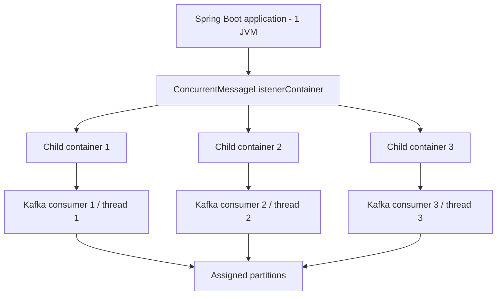

# Scale consumer trong một JVM với Spring Kafka

Trong một JVM, Spring Kafka có thể tăng số consumer bằng `concurrency` của listener container. Một `ConcurrentMessageListenerContainer` quản lý nhiều `KafkaMessageListenerContainer` con; mỗi container con tạo và quản lý một Kafka consumer riêng. Nhờ đó, một instance ứng dụng có thể tiêu thụ nhiều partition song song mà không cần chạy thêm JVM hoặc pod.

Concurrency chỉ tạo thêm consumer và luồng xử lý trong tiến trình hiện tại. Nó không tạo thêm partition, không tăng khả năng xử lý của một partition bằng nhiều consumer cùng group, và không bảo đảm throughput tăng tuyến tính. Mức song song hữu ích phụ thuộc số partition được cấp, thời gian xử lý, tài nguyên CPU/I/O và cách listener xử lý record.

## 1. Scale trong một JVM là gì?

Với listener container đơn giản, một container thường quản lý một Kafka consumer. Khi dùng `ConcurrentKafkaListenerContainerFactory`, Spring Kafka tạo một concurrent container có thể quản lý nhiều child container. Mỗi child container chạy consumer riêng và thực hiện poll trên consumer thread của nó.



Ví dụ một instance `order-service` có listener concurrency bằng `3`:

- Spring tạo một concurrent container cho endpoint.
- Container cha quản lý ba child container.
- Mỗi child container tạo một Kafka consumer.
- Ba consumer tham gia cùng consumer group của listener.
- Kafka phân công các partition trong subscription cho ba consumer.

Các consumer này vẫn thuộc cùng một JVM, dùng chung heap, CPU, connection pool và các singleton bean của ứng dụng. Đây là scale theo chiều ngang bên trong một tiến trình bằng nhiều consumer thread.

## 2. Cấu hình concurrency trên listener container factory

Cách phổ biến là đặt concurrency mặc định trên `ConcurrentKafkaListenerContainerFactory`:

```java
@Configuration
public class KafkaListenerConfiguration {

    @Bean
    public ConcurrentKafkaListenerContainerFactory<String, OrderCreated>
            kafkaListenerContainerFactory(
                    ConsumerFactory<String, OrderCreated> consumerFactory) {

        var factory = new ConcurrentKafkaListenerContainerFactory<String, OrderCreated>();
        factory.setConsumerFactory(consumerFactory);
        factory.setConcurrency(3);
        return factory;
    }
}
```

Mọi endpoint sử dụng factory này sẽ dùng concurrency mặc định là `3`, trừ khi endpoint cung cấp giá trị riêng. Tên bean `kafkaListenerContainerFactory` thường là tên mặc định mà `@KafkaListener` tìm kiếm khi không khai báo `containerFactory`.

Với Spring Boot, có thể đặt concurrency mặc định cho factory auto-configured bằng cấu hình:

```yaml
spring:
  kafka:
    listener:
      concurrency: 3
```

Nếu tự khai báo factory riêng, hãy kiểm tra cấu hình của bean đó. Không giả định mọi factory tùy chỉnh tự động nhận toàn bộ giá trị từ factory mặc định của Spring Boot.

## 3. Ghi đè concurrency cho một @KafkaListener

Một listener có thể ghi đè concurrency của factory bằng thuộc tính `concurrency`:

```java
@KafkaListener(
        id = "orders-listener",
        topics = "orders",
        groupId = "orders-service",
        concurrency = "5"
)
public void onOrder(OrderCreated event) {
    orderService.process(event);
}
```

Trong ví dụ, endpoint này yêu cầu năm consumer trong instance ứng dụng, dù factory mặc định có thể được cấu hình concurrency bằng `3`. Thuộc tính annotation là chuỗi nên có thể dùng placeholder:

```yaml
app:
  kafka:
    listeners:
      orders:
        concurrency: 5
```

```java
@KafkaListener(
        id = "orders-listener",
        topics = "orders",
        groupId = "orders-service",
        concurrency = "${app.kafka.listeners.orders.concurrency:3}"
)
public void onOrder(OrderCreated event) {
    orderService.process(event);
}
```

Giá trị concurrency được dùng khi Spring tạo endpoint/container. Thay property trong file cấu hình sau khi ứng dụng đã chạy không tự động tăng hoặc giảm số consumer hiện tại. Với thay đổi cấu hình thông thường, triển khai lại instance; nếu cần điều chỉnh runtime, phải dùng API quản lý container phù hợp phiên bản và có kế hoạch rebalance rõ ràng.

## 4. Mối quan hệ giữa concurrency và partition

Kafka phân công partition cho consumer trong cùng group. Trong trạng thái assignment ổn định, một partition chỉ được giao cho tối đa một consumer của group tại một thời điểm. Vì vậy, concurrency hữu ích bị giới hạn bởi tổng số partition mà group có thể đọc.

Ví dụ topic `orders` có sáu partition:

| Concurrency trong một JVM | Consumer được tạo | Kết quả điển hình |
|---:|---:|---|
| 1 | 1 | Một consumer có thể nhận cả sáu partition |
| 2 | 2 | Hai consumer chia sáu partition |
| 3 | 3 | Ba consumer chia sáu partition |
| 6 | 6 | Có thể một partition cho mỗi consumer |
| 8 | 8 | Ít nhất hai consumer không có partition được giao |

Phân công cụ thể phụ thuộc partition assignor, subscription và các consumer khác trong group. Bảng chỉ minh họa giới hạn song song, không cam kết mỗi consumer nhận số partition bằng nhau.

Nếu concurrency lớn hơn số partition có thể được gán, consumer dư vẫn được tạo nhưng không xử lý record cho tới khi có partition được giao. Tăng concurrency từ `6` lên `12` không làm topic sáu partition xử lý song song thành mười hai luồng.

## 5. Khi listener subscribe nhiều topic

Concurrency cần được so sánh với tổng số partition trong subscription của group, không chỉ số partition của một topic. Ví dụ listener subscribe `orders` có sáu partition và `payments` có ba partition, tổng subscription là chín partition.

```java
@KafkaListener(
        topics = {"orders", "payments"},
        groupId = "business-projection",
        concurrency = "4"
)
public void onBusinessEvent(BusinessEvent event) {
    projectionService.apply(event);
}
```

Với tổng chín partition và bốn consumer, các consumer có thể nhận nhiều partition. Không có bảo đảm mỗi consumer nhận partition từ cả hai topic hoặc số lượng giống nhau.

Khi một listener subscribe nhiều topic, hãy kiểm tra tổng partition và tải của từng topic. Một topic có lưu lượng lớn có thể chiếm phần lớn thời gian xử lý dù số partition của nó không chiếm đa số. Nếu hai luồng có yêu cầu throughput hoặc lifecycle khác nhau, tách listener và factory có thể giúp điều chỉnh độc lập.

## 6. Một consumer thread xử lý partition như thế nào?

Mỗi child container chạy một Kafka consumer. Kafka consumer không thread-safe và việc poll, commit, seek hoặc các thao tác consumer phải tuân thủ thread model của Kafka/Spring Kafka.

Trong record listener đồng bộ thông thường, consumer thread poll record và gọi listener trên luồng xử lý của child container. Nếu một consumer được giao nhiều partition, nó có thể nhận record từ nhiều partition trong cùng poll; listener xử lý các record theo luồng consumer đó.

Ví dụ:

```text
JVM: order-service

Consumer thread 1 -> partition 0, partition 3
Consumer thread 2 -> partition 1, partition 4
Consumer thread 3 -> partition 2, partition 5
```

Một consumer có thể sở hữu nhiều partition, nhưng cùng một partition không được hai consumer của cùng group xử lý đồng thời trong assignment ổn định. Kafka bảo đảm thứ tự record trong từng partition; nó không bảo đảm thứ tự toàn cục giữa nhiều partition.

Không truyền cùng một `KafkaConsumer` cho nhiều thread tự tạo. Nếu cần xử lý song song bên trong listener, phải thiết kế cơ chế handoff, acknowledgment và commit rõ ràng thay vì gọi trực tiếp Kafka consumer từ executor khác.

## 7. Concurrency ảnh hưởng ordering như thế nào?

Kafka chỉ bảo đảm thứ tự record trong một partition. Tăng concurrency làm các partition khác nhau được xử lý song song, vì vậy thứ tự hoàn thành giữa các partition có thể khác nhau.

Ví dụ topic có hai partition:

```text
Partition 0: A1 -> A2 -> A3
Partition 1: B1 -> B2 -> B3
```

Consumer thread 1 có thể xử lý `A1`, `A2`, `A3`; consumer thread 2 xử lý `B1`, `B2`, `B3` đồng thời. Ứng dụng không nên giả định thứ tự hoàn thành toàn cục là `A1, B1, A2, B2, ...` hay bất kỳ thứ tự cố định nào.

Nếu các event của cùng một aggregate cần giữ thứ tự, producer nên dùng cùng key để các event đó đi vào cùng partition. Khi consumer xử lý đồng bộ theo partition, thứ tự record của partition được giữ theo log. Nếu tự gửi record sang thread pool và xử lý bất đồng bộ, thứ tự hoàn thành có thể bị đảo dù Kafka đã giao record theo đúng thứ tự.

Concurrency không phá thứ tự bên trong Kafka partition; cách ứng dụng tách xử lý khỏi consumer thread mới có thể làm mất thứ tự nghiệp vụ hoặc tạo commit vượt trước record chưa hoàn tất.

## 8. Listener bean phải thread-safe

Khi concurrency lớn hơn `1`, nhiều child container có thể gọi cùng một phương thức trên cùng Spring bean singleton. Do đó, listener phải an toàn khi nhiều thread truy cập đồng thời.

Ví dụ không an toàn:

```java
@Component
public class OrderListener {

    private String currentOrderId;

    @KafkaListener(topics = "orders", concurrency = "3")
    public void onOrder(OrderCreated event) {
        currentOrderId = event.orderId();
        orderService.process(currentOrderId);
    }
}
```

`currentOrderId` là mutable state dùng chung. Hai thread có thể ghi đè giá trị của nhau. Hãy dùng biến local cho dữ liệu của từng invocation:

```java
@Component
public class OrderListener {

    @KafkaListener(topics = "orders", concurrency = "3")
    public void onOrder(OrderCreated event) {
        String orderId = event.orderId();
        orderService.process(orderId);
    }
}
```

Các nguyên tắc:

- Ưu tiên listener stateless; giữ dữ liệu record trong biến local.
- Không dùng mutable field để lưu trạng thái tạm của một lần xử lý.
- Nếu cần cache hoặc bộ đếm dùng chung, chọn cấu trúc thread-safe và xác định rõ tính nhất quán.
- Service được inject cũng phải an toàn khi được gọi đồng thời.
- Kiểm tra connection pool, HTTP client và database pool có đủ khả năng phục vụ số luồng tăng thêm.
- Không giả định một listener bean sẽ có một instance riêng cho mỗi consumer.

Tăng concurrency thường làm lộ race condition vốn ít xuất hiện khi listener chỉ có một consumer. Nên kiểm tra shared state trước khi bật concurrency cao.

## 9. Batch listener và concurrency

Nếu factory bật batch mode, mỗi consumer vẫn poll độc lập nhưng listener nhận một batch record thay vì từng record một. Concurrency tạo nhiều consumer; mỗi consumer có thể nhận và xử lý batch của partition được giao.

Ví dụ factory:

```java
@Bean
ConcurrentKafkaListenerContainerFactory<String, OrderCreated>
        batchKafkaListenerContainerFactory(
                ConsumerFactory<String, OrderCreated> consumerFactory) {

    var factory = new ConcurrentKafkaListenerContainerFactory<String, OrderCreated>();
    factory.setConsumerFactory(consumerFactory);
    factory.setBatchListener(true);
    factory.setConcurrency(3);
    return factory;
}
```

Listener nhận batch:

```java
@KafkaListener(
        topics = "orders",
        groupId = "order-batch",
        containerFactory = "batchKafkaListenerContainerFactory"
)
public void onOrders(List<ConsumerRecord<String, OrderCreated>> records) {
    for (ConsumerRecord<String, OrderCreated> record : records) {
        orderService.process(record.value());
    }
}
```

Batch size thực tế phụ thuộc dữ liệu có sẵn, `max.poll.records`, partition assignment và thời điểm poll; concurrency không có nghĩa mỗi consumer nhận cùng số record. Nếu batch xử lý quá lâu, consumer có thể vượt `max.poll.interval.ms` và bị xem là không còn hoạt động.

Batch processing cần thiết kế rõ lỗi một phần: nếu một record trong batch lỗi, chính sách acknowledgment, error handler và commit quyết định những record nào được retry hoặc phục hồi. Tăng concurrency không thay thế chiến lược xử lý lỗi batch.

## 10. Điều chỉnh concurrency theo loại workload

Không có một giá trị concurrency tối ưu cho mọi listener. Hãy bắt đầu từ số partition và đặc điểm xử lý.

| Workload | Cách chọn ban đầu | Điều cần theo dõi |
|---|---|---|
| I/O-bound, chờ database/API | Có thể tăng consumer nếu partition và pool cho phép | Connection pool, latency downstream, timeout, lag |
| CPU-bound, xử lý tính toán nặng | Bắt đầu gần số core có thể cấp cho ứng dụng rồi đo | CPU saturation, GC, thời gian xử lý |
| Xử lý nhanh, ít tải | Concurrency thấp có thể đã đủ | Consumer lag và throughput |
| Batch lớn, xử lý lâu | Cân đối concurrency với thời gian mỗi poll và `max.poll.interval.ms` | Poll interval, batch duration, rebalance |
| Phụ thuộc hệ thống ngoài có giới hạn quota | Giới hạn concurrency theo năng lực downstream | Rate limit, lỗi 429/503, connection saturation |

Với I/O-bound listener, nhiều consumer thread có thể giúp tận dụng thời gian chờ. Nhưng nếu database chỉ có pool 10 connection mà listener tạo 30 luồng cùng truy vấn, tăng concurrency có thể làm tăng queue và timeout thay vì tăng throughput.

Với CPU-bound listener, số luồng vượt quá khả năng CPU có thể tăng context switching và GC. Hãy đo throughput, p95/p99 processing latency và mức sử dụng CPU thay vì chỉ nhìn số consumer.

## 11. Phân biệt concurrency, max.poll.records và max.poll.interval.ms

Ba cấu hình này giải quyết các vấn đề khác nhau:

| Cấu hình | Tầng | Ý nghĩa |
|---|---|---|
| `concurrency` | Spring Kafka listener container | Số consumer/child container trong một endpoint tại một instance |
| `max.poll.records` | Kafka consumer | Giới hạn số record tối đa trả về trong một lần poll |
| `max.poll.interval.ms` | Kafka consumer | Thời gian tối đa giữa các lần poll trước khi consumer bị xem là không tiến triển |

Ví dụ cấu hình:

```yaml
spring:
  kafka:
    consumer:
      properties:
        max.poll.records: 100
        max.poll.interval.ms: 300000
    listener:
      concurrency: 3
```

`max.poll.records=100` không có nghĩa mỗi consumer luôn nhận đủ 100 record; số record trả về còn phụ thuộc dữ liệu có sẵn và partition assignment. Nếu xử lý record đồng bộ mất quá lâu, tổng thời gian xử lý các record từ một poll có thể vượt `max.poll.interval.ms`.

Không tăng `max.poll.interval.ms` để che giấu xử lý bị treo mà chưa điều tra nguyên nhân. Cũng không tăng `max.poll.records` chỉ để tận dụng concurrency; batch lớn có thể kéo dài thời gian xử lý và tăng bộ nhớ.

## 12. Concurrency và rebalance

Khi consumer mới tham gia hoặc rời group, Kafka có thể rebalance để phân phối lại partition. Tăng concurrency từ `1` lên `4` tạo thêm thành viên group và thường dẫn đến một lần rebalance. Tương tự, dừng ứng dụng hoặc thay đổi số instance cũng có thể làm partition assignment thay đổi.

Trong quá trình rebalance:

- Consumer có thể tạm dừng nhận record trong lúc assignment được cập nhật.
- Partition có thể chuyển từ consumer thread này sang thread khác.
- Offset commit và thời điểm dừng xử lý ảnh hưởng khả năng record được giao lại.
- Một lần rebalance quá thường xuyên có thể làm giảm throughput.

Nếu listener xử lý lâu, hãy kiểm tra `max.poll.interval.ms`, thời gian xử lý batch và thời điểm poll tiếp theo. Nếu ứng dụng có nhiều lần rebalance liên tiếp, kiểm tra log group coordinator, consumer membership, thời gian xử lý và cấu hình session/heartbeat phù hợp phiên bản Kafka.

Concurrency cao không tự gây rebalance liên tục; thay đổi membership, consumer không poll kịp hoặc lỗi kết nối mới là các nguyên nhân cần điều tra.

## 13. Client ID và quan sát từng consumer

Đặt `clientIdPrefix` trên listener giúp phân biệt consumer do cùng một endpoint tạo ra:

```java
@KafkaListener(
        id = "orders-listener",
        topics = "orders",
        groupId = "orders-service",
        clientIdPrefix = "orders-consumer",
        concurrency = "3"
)
public void onOrder(OrderCreated event) {
    orderService.process(event);
}
```

Spring Kafka thêm hậu tố để các consumer con có client ID riêng. Tên cụ thể có thể khác theo phiên bản, nhưng mục tiêu là tránh trùng client ID và giúp quan sát từng consumer.

Khi kiểm tra trên broker hoặc metric, phân biệt:

- `group.id`: nhóm consumer chia sẻ offset và partition assignment.
- `client.id`: định danh client để log/metric.
- Listener `id`: định danh endpoint trong Spring Kafka registry.
- `concurrency`: số consumer con của endpoint trong một JVM.

Không dùng `clientIdPrefix` thay cho `groupId`. Đổi client ID không tạo consumer group mới và không reset offset.

## 14. Scale nhiều listener trong cùng JVM

Một ứng dụng có thể có nhiều endpoint với concurrency khác nhau:

```java
@Component
public class ApplicationListeners {

    @KafkaListener(
            id = "orders-listener",
            topics = "orders",
            groupId = "orders-service",
            concurrency = "4"
    )
    public void onOrder(OrderCreated event) {
        orderService.process(event);
    }

    @KafkaListener(
            id = "payments-listener",
            topics = "payments",
            groupId = "payments-service",
            concurrency = "2"
    )
    public void onPayment(PaymentCreated event) {
        paymentService.process(event);
    }
}
```

Trong ví dụ, JVM tạo bốn consumer cho endpoint orders và hai consumer cho endpoint payments. Mỗi endpoint có group ID và subscription riêng. Tổng số consumer trong tiến trình là sáu, nhưng partition ceiling được tính riêng theo group và subscription của từng endpoint.

Tổng concurrency của tất cả listener ảnh hưởng tới thread count, memory, connection pool và tài nguyên downstream. Đừng chỉ tối ưu từng listener riêng lẻ mà bỏ qua tổng tải của JVM.

## 15. Scale trong một JVM so với scale nhiều JVM

Concurrency trong một JVM và chạy nhiều instance đều làm tăng số consumer của group, nhưng có phạm vi tài nguyên và failure domain khác nhau.

| Tiêu chí | Tăng concurrency trong một JVM | Tăng số JVM/pod |
|---|---|---|
| Consumer count | Tăng theo concurrency của listener | Tăng theo số instance nhân concurrency mỗi instance |
| Tài nguyên | Dùng chung CPU, heap và connection pool của một JVM | Có thể dùng tài nguyên độc lập trên nhiều node |
| Failure domain | Một JVM lỗi có thể làm mất tất cả consumer của instance | Lỗi một instance thường không làm dừng toàn bộ instance khác |
| Triển khai | Không cần thêm replica | Cần orchestration/deployment nhiều replica |
| Giới hạn partition | Tổng consumer của group vẫn bị giới hạn bởi partition | Tổng consumer của group trên mọi instance vẫn bị giới hạn bởi partition |
| Phù hợp | Tận dụng CPU và I/O của một instance | Tăng năng lực tài nguyên và khả năng chịu lỗi |

Ví dụ topic có mười hai partition:

- Một JVM, concurrency `4`: tối đa bốn consumer trong group từ instance đó.
- Ba JVM, mỗi JVM concurrency `2`: tổng cộng sáu consumer trong group.
- Sáu JVM, mỗi JVM concurrency `3`: tạo mười tám consumer; ít nhất sáu consumer không thể nhận partition nếu group chỉ subscribe mười hai partition.

Tăng instance không loại bỏ giới hạn partition. Nếu cần nhiều consumer hoạt động song song hơn, phải đánh giá tăng partition và tác động của việc thay đổi partition tới key ordering/partitioning.

## 16. Handoff sang executor và xử lý bất đồng bộ

Một cách thường thấy để tăng throughput là consumer thread nhận record rồi đẩy công việc sang `ExecutorService`. Cách này có thể tăng mức song song của phần xử lý nghiệp vụ, nhưng tạo thêm rủi ro về ordering và offset.

Ví dụ ý tưởng không nên dùng tùy tiện:

```java
@KafkaListener(topics = "orders", concurrency = "3")
public void onOrder(OrderCreated event) {
    executor.submit(() -> orderService.process(event));
    // Listener return trước khi công việc hoàn tất.
}
```

Nếu listener return và container commit offset trước khi task hoàn tất, ứng dụng có thể mất xử lý khi JVM dừng sau commit. Nếu task lỗi sau đó, Kafka có thể không giao lại record vì offset đã được commit.

Nếu cần asynchronous listener, dùng cơ chế return type/acknowledgment được Spring Kafka hỗ trợ ở phiên bản đang dùng và xác minh chính xác thời điểm commit. Không gọi `KafkaConsumer` hoặc acknowledgment object tùy tiện từ thread executor. Cần có giới hạn queue/backpressure để tránh nhận nhanh hơn khả năng xử lý và làm đầy heap.

Trong nhiều trường hợp, tăng concurrency của listener container và giữ xử lý đồng bộ theo consumer thread đơn giản, dễ bảo đảm offset hơn việc tự xây thêm thread pool.

## 17. Đo hiệu quả scale trong một JVM

Trước khi tăng concurrency, đo baseline; sau mỗi thay đổi, so sánh cùng loại workload và cùng khoảng thời gian.

Các chỉ số nên theo dõi:

- Consumer lag theo group/topic/partition.
- Record throughput và thời gian xử lý trung bình, p95/p99.
- Số consumer đang hoạt động và partition assignment.
- Số lần rebalance và thời gian rebalance.
- CPU, heap, GC pause và thread count của JVM.
- Database connection pool usage, HTTP pool, timeout và rate limit.
- Thời gian poll và khoảng cách giữa các lần poll.
- Retry, DLT và lỗi xử lý record.

Ví dụ bảng benchmark:

| Concurrency | Throughput | p95 xử lý | CPU | Lag cuối kỳ |
|---:|---:|---:|---:|---:|
| 1 | Ghi số đo | Ghi số đo | Ghi số đo | Ghi số đo |
| 2 | Ghi số đo | Ghi số đo | Ghi số đo | Ghi số đo |
| 4 | Ghi số đo | Ghi số đo | Ghi số đo | Ghi số đo |
| 6 | Ghi số đo | Ghi số đo | Ghi số đo | Ghi số đo |

Không chọn concurrency chỉ theo throughput tức thời. Nếu throughput tăng nhưng p99 latency, lỗi downstream hoặc rebalance tăng mạnh, cấu hình mới có thể làm giảm độ ổn định tổng thể.

## 18. Quy trình chọn concurrency thực tế

Một quy trình có thể áp dụng:

1. Xác định số partition trong subscription và số consumer hiện có trên toàn group.
2. Đo baseline với concurrency thấp, thường bắt đầu bằng `1`.
3. Tăng từng bước, chẳng hạn `2`, `3`, `4`, trong giới hạn partition.
4. Đo throughput, lag, p95/p99, CPU, GC và tải downstream.
5. Kiểm tra listener có thread-safe và không tạo side effect trùng khi rebalance.
6. Kiểm tra thời gian xử lý mỗi poll so với `max.poll.interval.ms`.
7. Chọn giá trị thấp nhất đáp ứng mục tiêu throughput/lag với tài nguyên và độ ổn định phù hợp.
8. Kiểm thử khi restart, rebalance và scale instance để xác nhận hành vi thực tế.

Ví dụ nếu topic có tám partition, concurrency `1` không xử lý kịp backlog, concurrency `4` đạt mục tiêu và concurrency `8` không cải thiện thêm nhưng tăng CPU, có thể chọn `4`. Đây chỉ là cách đọc kết quả benchmark; quyết định cần dựa trên số liệu của hệ thống.

## 19. Các lỗi thường gặp khi scale trong một JVM

**Tăng concurrency vượt số partition:** consumer dư không có partition. Kiểm tra partition assignment trước khi tăng tiếp.

**Nghĩ concurrency là số thread của toàn ứng dụng:** đây là số consumer child của endpoint; ứng dụng còn có thread web, scheduler, producer, executor và các thread khác.

**Listener bean không thread-safe:** mutable field dùng chung gây race condition. Dùng biến local hoặc state có đồng bộ phù hợp.

**Database pool không đủ:** nhiều consumer cùng truy vấn làm cạn connection pool. Điều chỉnh pool hoặc giới hạn concurrency theo capacity downstream.

**Mất ordering nghiệp vụ:** record được handoff sang executor và hoàn tất không theo thứ tự. Giữ xử lý theo partition hoặc thiết kế sequencing rõ ràng.

**Commit trước khi xử lý async hoàn tất:** task có thể mất sau khi offset đã commit. Dùng cơ chế async acknowledgment được hỗ trợ và kiểm thử crash/restart.

**Rebalance thường xuyên:** xử lý poll quá lâu, consumer mất kết nối hoặc membership thay đổi. Kiểm tra poll interval, thời gian xử lý và log group.

**Tăng max.poll.records thay cho concurrency:** hai cấu hình có mục đích khác nhau. Điều chỉnh theo batch size và thời gian xử lý.

**Dùng cùng group ID khi cần xử lý độc lập:** các instance/listener chia partition thay vì mỗi bên nhận toàn bộ record. Dùng group riêng cho từng chức năng độc lập.

**Không tính tổng tải trong JVM:** nhiều listener concurrency cao cùng tranh CPU, heap và connection pool. Theo dõi tổng tài nguyên tiến trình.

## 20. Checklist production

- Đã biết số partition của tất cả topic mà listener subscribe.
- Đã tính tổng consumer của group trên mọi JVM/pod, không chỉ instance hiện tại.
- Concurrency không vượt quá mức song song có ích nếu không có lý do vận hành cụ thể.
- Listener và service được gọi an toàn khi nhiều thread chạy đồng thời.
- Database/HTTP connection pool đủ capacity cho số consumer.
- Key/partition strategy bảo đảm ordering nghiệp vụ cần thiết.
- `max.poll.records` và `max.poll.interval.ms` phù hợp thời gian xử lý.
- Batch hoặc asynchronous handoff có chiến lược acknowledgment/commit rõ ràng.
- Có metric consumer lag, partition assignment, rebalance, latency, throughput và tài nguyên JVM.
- Đã benchmark nhiều mức concurrency với workload đại diện.
- Đã kiểm thử restart/rebalance và khả năng xử lý lại record.
- Có kế hoạch tăng partition hoặc scale thêm JVM nếu một instance không còn đủ tài nguyên.

Scale trong một JVM bằng concurrency là cách tăng số consumer và luồng poll của listener container. Hãy chọn concurrency dựa trên partition assignment, thread safety và năng lực downstream; đo kết quả bằng lag, throughput, latency và tài nguyên. Khi một JVM đã chạm giới hạn CPU, heap hoặc failure domain, scale nhiều instance có thể phù hợp hơn, nhưng tổng consumer của group vẫn phải được thiết kế theo số partition.
