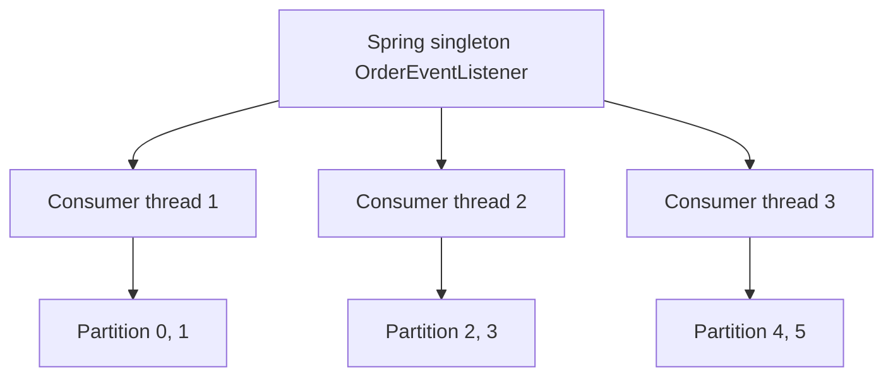

# Thread safety của listener

Khi tăng `concurrency` của Spring Kafka listener container, nhiều consumer thread có thể gọi cùng một listener trong cùng thời điểm. Điều này giúp xử lý các partition song song, nhưng cũng làm lộ ra lỗi truy cập dữ liệu dùng chung nếu listener hoặc service được inject có trạng thái mutable không an toàn giữa các thread.

Trong Spring, bean mặc định có scope singleton. Một bean được gắn với `@KafkaListener` thường được dùng làm đối tượng xử lý cho các consumer con do concurrent container tạo ra. Vì vậy, khi cấu hình `concurrency = 3`, không nên giả định Spring tạo ba bản sao độc lập của listener bean. Hãy thiết kế listener như một thành phần có thể được gọi đồng thời.

## 1. Vì sao listener phải thread-safe?

`ConcurrentMessageListenerContainer` tạo nhiều `KafkaMessageListenerContainer` con. Mỗi child container có consumer và consumer thread riêng. Các consumer trong cùng group nhận các partition khác nhau, nhưng có thể cùng gọi một listener object.



Ví dụ, topic có sáu partition và listener dùng `concurrency=3`. Kafka có thể gán hai partition cho mỗi consumer. Ba thread có thể gọi method `onOrderEvent()` đồng thời trên cùng instance `OrderEventListener`.

Thread safety là khả năng một object được nhiều thread sử dụng đồng thời mà không làm hỏng trạng thái hoặc tạo kết quả sai. Một listener có thể chạy đúng khi chỉ có một consumer, nhưng phát sinh race condition khi tăng concurrency hoặc khi nhiều listener container dùng chung một service.

## 2. Listener thường được chia sẻ như thế nào?

Ví dụ listener được Spring quản lý:

```java
import org.springframework.kafka.annotation.KafkaListener;
import org.springframework.stereotype.Component;

@Component
public class OrderEventListener {

    private final OrderApplicationService orderService;

    public OrderEventListener(OrderApplicationService orderService) {
        this.orderService = orderService;
    }

    @KafkaListener(
            id = "orderListener",
            topics = "orders.events",
            groupId = "order-projection",
            concurrency = "3"
    )
    public void onOrderEvent(OrderCreatedEvent event) {
        orderService.handle(event);
    }
}
```

Trong ví dụ, Spring tạo một bean singleton `OrderEventListener`. Concurrent listener container có thể gọi `onOrderEvent()` từ nhiều consumer thread. Method an toàn nếu nó không sửa trạng thái dùng chung không được bảo vệ và `OrderApplicationService` cùng các collaborator của service cũng an toàn khi được gọi đồng thời.

Đừng chỉ kiểm tra class listener. Thread safety là thuộc tính xuyên suốt call graph: listener có thể stateless nhưng vẫn gặp race condition nếu service, cache, mapper hoặc helper mà nó gọi chứa mutable state dùng chung.

Các tình huống có thể tạo truy cập đồng thời:

- Một `@KafkaListener` dùng `concurrency` lớn hơn 1.
- Nhiều listener container cùng gọi một service singleton.
- Một bean có nhiều method `@KafkaListener` được gọi từ các container khác nhau.
- Listener gọi executor hoặc `@Async` để xử lý công việc ngoài consumer thread.
- Ứng dụng chạy nhiều instance; mỗi instance có state trong bộ nhớ riêng và cùng ghi vào một hệ thống dữ liệu bên ngoài.

## 3. Ưu tiên listener stateless

Thiết kế đơn giản nhất là giữ listener stateless: chỉ inject dependency bất biến và dùng biến local trong mỗi lần gọi method. Biến local thuộc stack frame của thread hiện tại, do đó không bị các invocation khác ghi đè.

```java
import org.springframework.kafka.annotation.KafkaListener;
import org.springframework.stereotype.Component;

@Component
public class PaymentEventListener {

    private final PaymentApplicationService paymentService;

    public PaymentEventListener(PaymentApplicationService paymentService) {
        this.paymentService = paymentService;
    }

    @KafkaListener(
            topics = "payments.events",
            groupId = "payment-projection",
            concurrency = "4"
    )
    public void onPayment(PaymentEvent event) {
        String paymentId = event.paymentId();
        long amountInCents = event.amountInCents();

        paymentService.apply(paymentId, amountInCents);
    }
}
```

`paymentId` và `amountInCents` là biến local của invocation. Listener không giữ event đang xử lý trong field, không tái sử dụng một buffer mutable giữa các thread và không tự quản lý consumer.

Stateless không có nghĩa toàn hệ thống không có state. State nghiệp vụ có thể nằm trong database, cache hoặc state store có cơ chế đồng bộ và transaction phù hợp. Listener chỉ nên điều phối việc xử lý state đó qua collaborator được thiết kế đúng cho truy cập đồng thời.

## 4. Ví dụ race condition với mutable field

Một lỗi phổ biến là dùng `HashMap` hoặc `ArrayList` làm field rồi cập nhật từ listener:

```java
import java.util.HashMap;
import java.util.Map;

@Component
public class UnsafeOrderListener {

    private final Map<String, Integer> processedCounts = new HashMap<>();

    @KafkaListener(
            topics = "orders.events",
            groupId = "order-counter",
            concurrency = "4"
    )
    public void onOrder(OrderEvent event) {
        Integer count = processedCounts.get(event.orderId());
        processedCounts.put(event.orderId(), count == null ? 1 : count + 1);
    }
}
```

Đoạn code này có hai vấn đề:

1. `HashMap` không hỗ trợ nhiều thread đọc/ghi đồng thời.
2. Ngay cả khi thay bằng `ConcurrentHashMap`, chuỗi thao tác `get()` rồi `put()` vẫn không phải một phép cập nhật nguyên tử. Hai thread có thể cùng đọc giá trị 5 rồi cùng ghi 6, làm mất một lần tăng.

Kết quả có thể sai mà không nhất thiết xuất hiện exception. Đây là lý do race condition thường khó phát hiện bằng kiểm thử tuần tự.

## 5. Dùng cấu trúc dữ liệu thread-safe đúng cách

Nếu cần bộ đếm trong bộ nhớ phục vụ metric hoặc quan sát, dùng cấu trúc đồng thời và thao tác nguyên tử:

```java
import java.util.concurrent.ConcurrentHashMap;
import java.util.concurrent.ConcurrentMap;
import java.util.concurrent.atomic.LongAdder;

import org.springframework.kafka.annotation.KafkaListener;
import org.springframework.stereotype.Component;

@Component
public class OrderMetricListener {

    private final ConcurrentMap<String, LongAdder> counts =
            new ConcurrentHashMap<>();

    @KafkaListener(
            topics = "orders.events",
            groupId = "order-metrics",
            concurrency = "4"
    )
    public void onOrder(OrderEvent event) {
        counts.computeIfAbsent(event.type(), key -> new LongAdder())
                .increment();
    }
}
```

`ConcurrentHashMap.computeIfAbsent()` tạo hoặc lấy counter theo cách an toàn khi nhiều thread cùng truy cập; `LongAdder` phù hợp cho bộ đếm cập nhật đồng thời với tần suất cao.

Tuy nhiên, state trong ví dụ chỉ tồn tại trong memory của một application instance. Nó mất khi restart và không tự đồng bộ giữa nhiều instance. Không dùng bộ đếm này làm nguồn dữ liệu nghiệp vụ như số dư tài khoản hoặc số lượng đơn hàng chính thức. Với dữ liệu nghiệp vụ, hãy dùng database transaction, optimistic locking, atomic update hoặc state store có bảo đảm phù hợp.

## 6. Thread-safe collaborator và tài nguyên dùng chung

Một listener stateless vẫn có thể gọi một service không thread-safe. Khi review listener, hãy kiểm tra mọi dependency được inject.

| Thành phần | Cách sử dụng an toàn |
|---|---|
| Spring `KafkaTemplate` | Có thể dùng chung giữa các thread; Kafka producer được quản lý bởi factory có hỗ trợ sử dụng đồng thời. |
| Kafka `Consumer` | Không chia sẻ một instance giữa nhiều thread; consumer do listener container quản lý và được sử dụng trên consumer thread của nó. |
| `HashMap`, `ArrayList`, `StringBuilder` mutable dùng chung | Không đọc/ghi đồng thời nếu không có đồng bộ phù hợp. Dùng biến local hoặc cấu trúc concurrent phù hợp. |
| `JdbcTemplate` và Spring Data repository | Thông thường được thiết kế để inject dùng chung; transaction và state nghiệp vụ vẫn cần được xử lý đúng. Không giữ `Connection` mutable trong field. |
| JPA `EntityManager`/Hibernate `Session` | Không chia sẻ instance persistence context giữa các thread. Dùng cơ chế proxy/transaction-bound do Spring quản lý. |
| `ObjectMapper` đã cấu hình xong | Có thể dùng chung cho thao tác đọc/ghi sau khi hoàn tất cấu hình; không tiếp tục thay đổi cấu hình trong lúc xử lý. |
| `SimpleDateFormat` | Không thread-safe; dùng `DateTimeFormatter` bất biến hoặc tạo formatter riêng theo invocation. |
| Custom cache/service | Kiểm tra implementation, thư viện nền và cách cập nhật state; singleton không tự động có nghĩa là thread-safe. |

Không lưu `KafkaConsumer`, `EntityManager`, Hibernate `Session`, JDBC `Connection` hoặc một request context mutable trong field của listener để dùng lại từ nhiều invocation. Những đối tượng này có vòng đời hoặc giới hạn thread riêng.

## 7. Bảo vệ state khi thực sự cần mutable state

Nếu không thể loại bỏ mutable state, chọn cơ chế bảo vệ dựa trên phạm vi dữ liệu và mức tranh chấp.

### Atomic và concurrent collections

Dùng `AtomicInteger`, `AtomicLong`, `LongAdder` hoặc `ConcurrentHashMap` khi thao tác phù hợp với semantics của chúng. Với nhiều thao tác phải nhất quán cùng nhau, một atomic field đơn lẻ không đủ bảo vệ invariant liên quan đến nhiều field.

### synchronized hoặc Lock

Có thể dùng lock để bảo vệ vùng critical section:

```java
private final Object stateLock = new Object();
private final Map<String, OrderState> states = new HashMap<>();

public void updateState(String orderId, OrderState nextState) {
    synchronized (stateLock) {
        states.put(orderId, nextState);
    }
}
```

Lock bảo vệ thao tác trên map, nhưng mọi thread cùng dùng một lock sẽ phải chờ nhau. Nếu đặt `synchronized` trên toàn bộ listener method, concurrency của consumer có thể bị triệt tiêu và thời gian xử lý có thể vượt `max.poll.interval.ms`.

Giữ critical section ngắn; không thực hiện HTTP, database call hoặc chờ I/O trong khi giữ lock. Nếu cần lock theo key, phải thiết kế vòng đời lock và dọn dẹp cẩn thận để tránh rò rỉ bộ nhớ hoặc deadlock. Đừng tự xây dựng lock registry theo key nếu database transaction hoặc partitioning đã giải quyết được yêu cầu.

### Immutable object

Ưu tiên object bất biến cho cấu hình và dữ liệu truyền giữa các thread. Java `record`, field `final` và collection immutable giúp giảm số trạng thái có thể bị thay đổi sau khi publish object cho thread khác. Lưu ý `final` chỉ cố định tham chiếu; nếu tham chiếu trỏ đến collection mutable thì nội dung collection vẫn có thể thay đổi.

## 8. Ordering theo partition và thread safety là hai vấn đề khác nhau

Trong một consumer group, một partition được gán cho tối đa một consumer member tại một thời điểm. Với listener xử lý đồng bộ, consumer thread gọi listener tuần tự cho các record nó nhận từ partition. Đây là cơ sở để xử lý thứ tự record trong partition.

Tuy vậy, điều đó không khiến mọi field của listener trở nên thread-safe:

- Một listener có thể xử lý nhiều partition đồng thời thông qua nhiều consumer con.
- Nhiều listener container hoặc consumer group khác nhau có thể cùng gọi một service singleton.
- Nhiều application instance có state trong memory riêng nhưng cùng cập nhật một database.
- Một listener có thể chuyển công việc sang executor, làm nhiều record chạy đồng thời ngay cả khi chúng đến từ cùng partition.

Nếu dùng key để gom các event của cùng aggregate vào cùng partition, các record của aggregate đó thường được một consumer trong group xử lý tuần tự, miễn là key mapping và partition count ổn định và listener không tự phá thứ tự bằng async handoff. Những key khác nhau vẫn có thể được xử lý song song trên các partition khác nhau.

Thread-safe collection chỉ bảo vệ cấu trúc dữ liệu trong process. Nó không bảo đảm thứ tự nghiệp vụ, không tạo transaction phân tán và không ngăn hai application instance cùng cập nhật một bản ghi database.

## 9. Cẩn thận khi chuyển xử lý sang executor hoặc @Async

Một cách mở rộng thường gặp là listener nhận record rồi đẩy công việc sang thread pool:

```java
@KafkaListener(topics = "orders.events", groupId = "order-worker")
public void onOrder(OrderEvent event) {
    executor.execute(() -> orderService.handle(event));
}
```

Đoạn code này trả về ngay sau khi submit task. Listener container có thể xem invocation đã hoàn tất bình thường và commit offset theo AckMode, trong khi công việc thật vẫn đang chạy. Nếu task thất bại sau đó, exception không tự quay lại listener container để kích hoạt retry như khi xử lý đồng bộ.

Ngoài ra, hai event cùng partition có thể được submit theo thứ tự nhưng hoàn tất ngược thứ tự. Điều này làm sai ordering của side effect và khiến offset commit không phản ánh công việc đã hoàn tất.

Nếu cần xử lý bất đồng bộ:

1. Chọn mô hình async listener được Spring Kafka hỗ trợ trong phiên bản đang dùng, hoặc thiết kế acknowledgement thủ công có kiểm soát.
2. Chỉ xác nhận/commit record sau khi công việc tương ứng hoàn tất thành công.
3. Quản lý số lượng task đang chạy, queue capacity và backpressure; không dùng executor không giới hạn.
4. Bảo đảm các record cùng key/partition hoàn tất theo thứ tự nếu nghiệp vụ yêu cầu.
5. Xử lý exception trong worker và chuyển lỗi về cơ chế retry/DLT đã thiết kế.
6. Không giả định transaction context của consumer thread tự truyền sang thread executor.

Với Spring Kafka hiện đại có hỗ trợ async listener return types, hãy kiểm tra semantics acknowledgement và out-of-order completion của đúng phiên bản framework. Cấu hình async acknowledgements có thể khiến container giữ các offset hoàn tất sau cho đến khi các offset trước được xác nhận; điều đó không tự bảo đảm side effect nghiệp vụ đã được sắp thứ tự.

Spring Kafka từ 3.2 hỗ trợ các kiểu trả về bất đồng bộ như `CompletableFuture` và Reactor `Mono` cho listener. Khi dùng đúng cơ chế này, container theo dõi completion và exception của kết quả async; hành vi acknowledgement được điều chỉnh để chỉ xác nhận khi xử lý hoàn tất. Đây là lựa chọn phù hợp hơn việc tự submit task rồi return, nhưng vẫn cần kiểm tra semantics của phiên bản đang dùng và bảo đảm thứ tự nghiệp vụ khi nhiều kết quả hoàn tất không theo thứ tự.

## 10. Transaction và database khi listener chạy đồng thời

Listener thường cập nhật database. Khi concurrency lớn hơn 1, nhiều transaction có thể cùng cập nhật dữ liệu liên quan. Cần chọn cơ chế bảo vệ ở tầng persistence:

- Dùng transaction cho nhóm thao tác cần commit cùng nhau trong database.
- Dùng optimistic locking (`@Version`) để phát hiện hai invocation cùng cập nhật một entity.
- Dùng câu lệnh atomic update hoặc unique constraint khi phù hợp.
- Dùng idempotency key/event ID để tránh áp dụng cùng event nhiều lần sau retry hoặc redelivery.
- Dùng transaction isolation và khóa database theo yêu cầu nghiệp vụ, không dựa vào synchronized trong một JVM để bảo vệ dữ liệu giữa nhiều instance.

Ví dụ entity có optimistic locking:

```java
import jakarta.persistence.Entity;
import jakarta.persistence.Id;
import jakarta.persistence.Version;

@Entity
public class AccountBalance {

    @Id
    private String accountId;

    private long balanceInCents;

    @Version
    private long version;

    // Getter và các phương thức nghiệp vụ.
}
```

Khi hai transaction cùng đọc một version rồi cùng cập nhật, transaction ghi sau có thể nhận `OptimisticLockingFailureException`. Ứng dụng cần quyết định retry transaction, tải lại state và áp dụng event theo thứ tự nghiệp vụ. Optimistic locking phát hiện xung đột; nó không tự sắp xếp lại event.

Spring transaction thường gắn resource với thread đang chạy. Nếu listener offload công việc sang thread khác, transaction của consumer thread không tự bao quanh công việc ở thread mới. Hãy mở transaction phù hợp tại worker hoặc dùng mô hình xử lý được hỗ trợ rõ ràng.

## 11. ThreadLocal và state theo thread

`ThreadLocal` đôi khi được dùng để giữ context theo thread, nhưng listener container tái sử dụng consumer thread trong thời gian dài. Nếu không gọi `remove()` sau khi xử lý, dữ liệu cũ có thể tồn tại và rò rỉ sang lần xử lý sau trên cùng thread.

Không dùng `ThreadLocal` để lưu event hiện tại hoặc trạng thái nghiệp vụ lâu dài. Nếu thư viện tracing/security cung cấp context theo thread, dùng cơ chế tích hợp của thư viện và bảo đảm context được clear ở cuối invocation. Khi chuyển sang executor, context không tự truyền sang thread khác trừ khi có cơ chế propagation riêng.

## 12. Kiểm thử thread safety

Unit test tuần tự không đủ để phát hiện mọi race condition. Nên kiểm thử với nhiều invocation đồng thời và integration test có nhiều consumer thread.

### Kiểm thử service với nhiều thread

Với state dùng chung trong memory, có thể tạo nhiều task đồng thời bằng `ExecutorService` và `CountDownLatch`, sau đó xác minh invariant sau khi tất cả task hoàn tất. Dùng barrier/latch để tăng khả năng các thread chạm vào vùng cập nhật cùng lúc; không dựa vào `Thread.sleep` để tạo race condition.

### Integration test với Embedded Kafka hoặc Testcontainers

Một integration test hữu ích nên:

1. Tạo topic có nhiều partition.
2. Khởi động listener với `concurrency` lớn hơn 1.
3. Gửi đủ record để nhiều consumer có việc đồng thời.
4. Ghi nhận số invocation đang hoạt động cực đại bằng `AtomicInteger`/`LongAdder` trong test probe.
5. Xác minh không mất/cập nhật trùng dữ liệu theo hợp đồng của test.
6. Nếu yêu cầu ordering theo key, gửi nhiều event cùng key và xác minh sequence/side effect vẫn đúng.
7. Dừng container và chờ các invocation kết thúc để tránh test rò rỉ thread.

Ví dụ probe đo mức đồng thời trong listener:

```java
import java.util.concurrent.atomic.AtomicInteger;

public final class ConcurrencyProbe {

    private final AtomicInteger active = new AtomicInteger();
    private final AtomicInteger maxActive = new AtomicInteger();

    public void enter() {
        int current = active.incrementAndGet();
        maxActive.accumulateAndGet(current, Math::max);
    }

    public void exit() {
        active.decrementAndGet();
    }

    public int maxActive() {
        return maxActive.get();
    }
}
```

Trong test, listener gọi `enter()` trước khi xử lý và `exit()` trong `finally`. Dùng latch để giữ các invocation đang chạy trong một khoảng đồng bộ có kiểm soát; sau đó xác minh `maxActive()` lớn hơn 1 khi topic có đủ partition và concurrency cho phép. Probe chỉ phục vụ kiểm thử, không phải cơ chế đồng bộ nghiệp vụ.

## 13. Lỗi thường gặp

| Biểu hiện | Nguyên nhân | Cách xử lý |
|---|---|---|
| Counter hoặc cache có giá trị sai khi tăng concurrency | Listener sửa mutable field bằng collection không thread-safe hoặc chuỗi thao tác không nguyên tử. | Dùng state stateless, atomic operation hoặc cấu trúc concurrent phù hợp. |
| Listener có `synchronized` nhưng throughput không tăng | Tất cả consumer thread bị serialize qua một lock. | Thu hẹp critical section hoặc chuyển state sang cơ chế persistence phù hợp. |
| Database phát sinh optimistic locking failure | Nhiều invocation cập nhật cùng entity/version. | Xử lý conflict/retry và bảo đảm sequence nghiệp vụ. |
| Record được commit nhưng xử lý nền thất bại | Listener submit task rồi return trước khi worker hoàn tất. | Dùng async listener/acknowledgement có kiểm soát; propagate lỗi và commit sau completion. |
| Event cùng key hoàn tất sai thứ tự | Executor xử lý song song hoặc nhiều producer phát không theo sequence. | Tuần tự hóa theo key/partition và kiểm tra sequence/version. |
| Test chỉ pass khi chạy đơn luồng | Test chưa tạo tranh chấp hoặc chưa kiểm tra invariant đồng thời. | Dùng barrier/latch và integration test với nhiều consumer. |
| Dữ liệu bị rò giữa các lần xử lý | Dùng `ThreadLocal` hoặc field mutable mà không reset. | Dùng biến local; clear context/thread-local trong `finally`. |
| Dùng chung KafkaConsumer từ nhiều thread | Kafka consumer không thread-safe. | Để Spring listener container sở hữu consumer; không tự chia sẻ instance. |

## 14. Checklist thiết kế listener thread-safe

- Listener bean có thể được gọi đồng thời; field chỉ chứa dependency bất biến hoặc state có cơ chế bảo vệ rõ ràng.
- Không giữ event, buffer, collection mutable hoặc context của một invocation trong field dùng chung.
- Mọi service/cache/helper được inject đã được đánh giá thread safety.
- Không chia sẻ `KafkaConsumer`, `EntityManager`, `Session` hoặc JDBC `Connection` giữa các thread.
- `KafkaTemplate` và collaborator thread-safe được dùng theo đúng hợp đồng của chúng.
- Nếu có async handoff, đã xác định rõ ordering, acknowledgement, commit, retry và backpressure.
- State nghiệp vụ dùng database transaction, optimistic locking, atomic update hoặc cơ chế phù hợp giữa nhiều instance.
- Test đã chạy với concurrency lớn hơn 1 và xác minh invariant nghiệp vụ.

## 15. Ghi nhớ

- `concurrency` tạo nhiều consumer con và consumer thread; các thread có thể gọi cùng listener bean singleton.
- Không giả định mỗi consumer thread có một bản sao listener riêng.
- Ưu tiên listener stateless, biến local và dependency thread-safe.
- `HashMap`/`ArrayList` mutable dùng chung dễ gây race condition; dùng atomic/concurrent structure khi phù hợp.
- `KafkaTemplate` có thể dùng chung; `KafkaConsumer` không được chia sẻ giữa nhiều thread.
- Một partition chỉ được gán cho một consumer trong group tại một thời điểm, nhưng listener vẫn có thể được gọi đồng thời cho các partition khác nhau.
- Thread safety không tự bảo đảm ordering nghiệp vụ hoặc tính nhất quán giữa nhiều application instance.
- Async handoff có thể làm commit offset trước khi công việc hoàn tất và làm đảo thứ tự side effect.
- Dùng transaction, optimistic locking, idempotency và sequence/version để bảo vệ state nghiệp vụ.
- Kiểm thử bằng nhiều thread và nhiều partition, dùng latch/barrier thay cho delay cố định.

Khi tăng concurrency cho Spring Kafka, hãy xem listener và toàn bộ collaborator như các thành phần được gọi đồng thời. Giữ listener stateless, đặt state nghiệp vụ trong cơ chế lưu trữ có bảo đảm phù hợp, và kiểm thử cả race condition lẫn thứ tự xử lý. Cách tiếp cận này giúp mở rộng consumer mà không biến lỗi đồng thời thành lỗi dữ liệu khó truy vết.

## Tài liệu tham khảo

- [Spring for Apache Kafka — Message Listener Containers](https://docs.spring.io/spring-kafka/reference/kafka/receiving-messages/message-listener-container.html)
- [Spring for Apache Kafka — Thread Safety and Listener Containers](https://docs.spring.io/spring-kafka/reference/kafka/thread-safety.html)
- [Apache Kafka — KafkaConsumer API](https://kafka.apache.org/40/javadoc/org/apache/kafka/clients/consumer/KafkaConsumer.html)
- [Apache Kafka — KafkaProducer API](https://kafka.apache.org/40/javadoc/org/apache/kafka/clients/producer/KafkaProducer.html)
