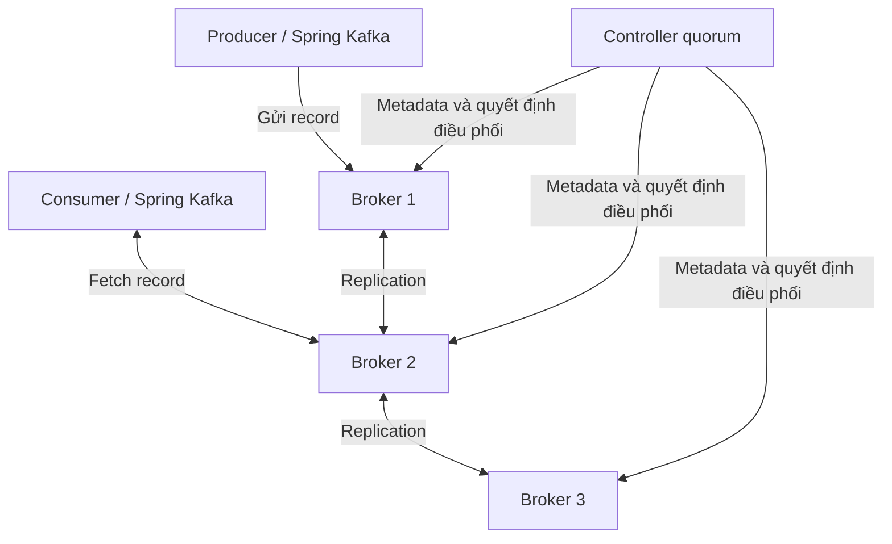
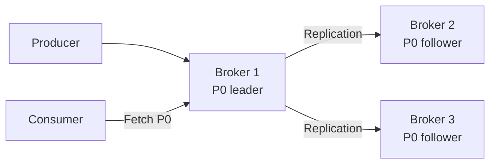

# Cluster, broker và controller

Kafka được thiết kế như một hệ thống phân tán. Một ứng dụng có thể gửi và nhận sự kiện qua một địa chỉ kết nối, nhưng phía sau địa chỉ đó là một **cluster** gồm nhiều **broker**, có cơ chế điều phối metadata và phân phối dữ liệu giữa các node. Muốn vận hành Spring Kafka ổn định, cần hiểu broker nào lưu dữ liệu, controller nào quản lý trạng thái cluster và client tìm đúng broker bằng cách nào.

## 1. Nhìn tổng thể: cluster gồm những vai trò nào?

**Kafka cluster** là tập hợp các tiến trình Kafka cùng phối hợp để cung cấp một hệ thống lưu trữ và truyền sự kiện. Các tiến trình này thường chạy trên nhiều máy hoặc container để phân tán tải và chịu lỗi.

Ba khái niệm cần phân biệt:

- **Cluster** là toàn bộ hệ thống Kafka đang phối hợp với nhau.
- **Broker** là node phục vụ dữ liệu: nhận bản ghi từ producer, lưu các partition, phục vụ consumer và tham gia replication.
- **Controller** là vai trò quản lý metadata và điều phối thay đổi trạng thái của cluster, chẳng hạn broker tham gia/rời cluster hoặc thay đổi leader của partition.

Có thể hình dung hai luồng trách nhiệm:

- **Data plane**: producer và consumer trao đổi record trực tiếp với broker.
- **Control plane**: controller điều phối trạng thái và metadata để các broker biết cluster đang được tổ chức như thế nào.

Controller không phải một máy chủ trung gian mà mọi record phải đi qua. Khi producer gửi record, request dữ liệu được gửi tới broker đang giữ vai trò leader của partition đích.

### Sơ đồ vai trò



Sơ đồ rút gọn này mô tả vai trò logic. Trong triển khai KRaft, controller có thể chạy trên node chuyên dụng hoặc cùng tiến trình với broker tùy cấu hình. Đường đi của record vẫn là producer/consumer đến broker.

## 2. Broker: node phục vụ dữ liệu

Mỗi broker là một tiến trình Kafka có định danh trong cluster. Broker chịu trách nhiệm lưu trữ và phục vụ các partition được phân công cho nó.

Các nhiệm vụ chính của broker gồm:

1. **Nhận record từ producer**: broker kiểm tra request, xác định partition và ghi record vào log của partition nếu nó là partition leader.
2. **Lưu log của partition**: record được ghi nối tiếp vào log trên đĩa. Kafka giữ thứ tự record trong phạm vi một partition.
3. **Phục vụ consumer**: consumer gửi fetch request đến broker đang giữ bản sao partition mà consumer cần đọc.
4. **Replication**: broker giữ bản sao follower lấy dữ liệu từ leader để duy trì nhiều bản sao của partition.
5. **Tham gia quản lý consumer group**: một broker được chọn làm group coordinator cho từng consumer group để xử lý việc tham gia nhóm, heartbeat và phân công partition.

Broker thường được cấu hình với một định danh duy nhất, ví dụ `node.id` trong chế độ KRaft. Định danh này giúp Kafka phân biệt các node; nó không phải địa chỉ mạng mà client dùng để kết nối.

### Một broker không đồng nghĩa với một partition

Một broker có thể lưu nhiều partition của nhiều topic. Ngược lại, các replica của cùng một partition được phân bố trên những broker khác nhau khi cluster có đủ node và cấu hình replication phù hợp.

Ví dụ topic `order-events` có 3 partition và replication factor bằng 3:

| Partition | Replica được đặt trên broker | Vai trò tại một thời điểm |
|---|---|---|
| P0 | Broker 1, 2, 3 | Một leader, hai follower |
| P1 | Broker 2, 3, 1 | Một leader, hai follower |
| P2 | Broker 3, 1, 2 | Một leader, hai follower |

Bảng chỉ minh họa cách phân bố. Kafka có thể chọn leader khác nhau cho từng partition; không có quy tắc rằng Broker 1 luôn là leader.

### Broker leader và follower

Với mỗi partition, tại một thời điểm bình thường chỉ có một replica giữ vai trò **leader**. Producer ghi vào leader; consumer cũng đọc từ leader theo cơ chế phổ biến mặc định. Những replica còn lại là **follower**, liên tục bắt kịp log của leader.



Nếu broker đang giữ leader gặp sự cố, Kafka có thể bầu một replica đủ điều kiện khác làm leader. Nhờ vậy partition tiếp tục phục vụ sau khi cluster hoàn tất quá trình chuyển đổi.

## 3. Controller: quản lý metadata và trạng thái cluster

Kafka cần một thành phần biết broker nào đang hoạt động, partition nào nằm trên broker nào và replica nào đang giữ vai trò leader. Thành phần đó là **controller**.

Controller xử lý các thay đổi ở cấp cluster, chẳng hạn:

- Theo dõi việc broker đăng ký, mất kết nối hoặc rời cluster.
- Quản lý metadata của topic, partition, replica và cấu hình liên quan.
- Điều phối thay đổi partition leader khi có sự cố hoặc khi cluster cần cân bằng lại.
- Phân phối các thay đổi metadata để broker cập nhật trạng thái nội bộ.

Controller làm việc với **metadata**, tức thông tin mô tả cluster. Metadata khác với record nghiệp vụ trong topic. Ví dụ, tên topic, số partition, replica assignment và leader hiện tại là metadata; một sự kiện `OrderCreated` là record dữ liệu.

### Active controller và controller quorum trong KRaft

Ở kiến trúc Kafka hiện đại sử dụng **KRaft**, Kafka quản lý metadata bằng một nhóm controller phối hợp theo cơ chế quorum dựa trên Raft. Một thành viên giữ vai trò **active controller** để xử lý các thay đổi metadata. Các thành viên còn lại tham gia duy trì bản sao metadata và có thể tiếp quản khi active controller gặp sự cố.

Một thay đổi metadata chỉ được xem là cam kết khi đạt điều kiện quorum. Với quorum có số thành viên lẻ là 3, thông thường cần đa số 2 thành viên xác nhận. Vì vậy:

- Một controller có thể gặp sự cố mà cluster vẫn còn khả năng điều phối.
- Nếu mất quá nhiều thành viên đến mức không còn đa số, các thay đổi metadata mới có thể bị đình trệ cho tới khi quorum được khôi phục.
- Số lượng và vị trí controller cần được thiết kế để tránh đặt tất cả thành viên vào cùng một miền lỗi.

Trong KRaft, metadata được ghi vào metadata log và được các controller trong quorum duy trì. Broker nhận các thay đổi metadata để cập nhật trạng thái của mình. Metadata log này không phải log sự kiện nghiệp vụ của các topic.

Kafka từng có kiến trúc dựa trên ZooKeeper để lưu và điều phối metadata. Khi đọc tài liệu hoặc cấu hình của cluster cũ, bạn có thể gặp thuật ngữ ZooKeeper và controller theo mô hình cũ. Với triển khai KRaft, vai trò quorum controller được đảm nhiệm bởi chính Kafka, không cần ZooKeeper.

### Controller có nhất thiết là một máy riêng?

Không. KRaft hỗ trợ hai cách triển khai phổ biến:

- **Combined mode**: một node đảm nhiệm cả vai trò broker và controller. Cách này tiện cho môi trường phát triển, thử nghiệm hoặc hệ thống nhỏ.
- **Dedicated controller mode**: node controller chỉ tập trung vào điều phối metadata, còn broker tập trung phục vụ dữ liệu. Cách này giúp cô lập tài nguyên và miền lỗi tốt hơn cho cluster cần vận hành nghiêm túc.

Dù dùng cách nào, cần phân biệt vai trò logic: broker phục vụ record; controller quản lý metadata và trạng thái cluster.

## 4. Đừng nhầm controller với partition leader

Đây là nhầm lẫn phổ biến vì cả hai đều có chữ “leader”:

| Khái niệm | Phạm vi | Trách nhiệm |
|---|---|---|
| Active controller | Toàn cluster | Điều phối thay đổi metadata và trạng thái cluster |
| Partition leader | Một partition | Nhận ghi và phục vụ đọc cho partition đó theo cấu hình |
| Consumer group coordinator | Một consumer group | Quản lý thành viên, heartbeat và phân công partition của group |

Một cluster chỉ có một active controller tại một thời điểm trong mô hình KRaft, nhưng có thể có rất nhiều partition leader cùng lúc. Mỗi partition có leader riêng, và các partition leader có thể nằm trên những broker khác nhau.

**Group coordinator** cũng là vai trò khác. Nó được đảm nhiệm bởi một broker và quản lý giao thức consumer group. Controller không trực tiếp điều phối từng lần consumer poll hay xử lý offset commit thay cho group coordinator.

## 5. Replication, ISR và khả năng chịu lỗi

Replication giúp partition có nhiều bản sao trên các broker khác nhau. Kafka dùng replication để giảm nguy cơ mất dữ liệu và duy trì khả năng phục vụ khi một broker gặp sự cố.

Các thuật ngữ quan trọng:

- **Replication factor**: tổng số replica của một partition, bao gồm leader. Replication factor bằng 3 nghĩa là có một leader và hai follower.
- **Follower**: replica sao chép log từ leader để bắt kịp dữ liệu.
- **ISR (In-Sync Replicas)**: tập replica đang theo kịp leader theo tiêu chí của Kafka. Một replica chậm quá mức có thể bị loại khỏi ISR và được thêm lại khi bắt kịp.
- **Under-replicated partition**: partition có replica chưa theo kịp đầy đủ, thường là dấu hiệu cần điều tra sức khỏe broker hoặc mạng.

Khi producer cấu hình `acks=all`, broker leader đợi các replica thuộc ISR xác nhận theo điều kiện Kafka trước khi trả kết quả thành công. `min.insync.replicas` đặt ngưỡng ISR tối thiểu để một lần ghi với `acks=all` được chấp nhận. Ví dụ, replication factor bằng 3 và `min.insync.replicas=2` cho phép ghi khi còn ít nhất hai replica trong ISR; nếu số replica trong ISR thấp hơn ngưỡng, producer có thể nhận lỗi thay vì ghi với mức an toàn thấp hơn.

Cấu hình này là một lựa chọn giữa độ sẵn sàng ghi và mức bảo vệ dữ liệu. Nó không thay thế việc giám sát replication, phân bố broker trên các miền lỗi và xử lý lỗi ở ứng dụng.

### Khi leader bị mất

Giả sử P0 có leader trên Broker 1 và follower trên Broker 2, Broker 3:

1. Broker 1 mất kết nối.
2. Controller phát hiện broker không còn hoạt động và điều phối việc chọn leader mới từ replica đủ điều kiện.
3. Một follower đang nằm trong ISR, chẳng hạn Broker 2, có thể được chọn làm leader.
4. Broker và client nhận metadata mới.
5. Producer và consumer tiếp tục làm việc với leader mới sau khi cập nhật metadata và kết nối.

Nếu không còn replica đủ điều kiện, partition có thể tạm thời không khả dụng. Cho phép bầu một replica ngoài ISR (unclean leader election) có thể tăng khả năng phục vụ nhưng có nguy cơ mất những record mà replica đó chưa nhận được. Đây là quyết định vận hành cần cân nhắc theo yêu cầu dữ liệu của hệ thống.

## 6. Client tìm broker bằng bootstrap servers như thế nào?

Ứng dụng không cần biết trước leader của từng partition. Client chỉ cần một hoặc vài địa chỉ **bootstrap servers** có thể truy cập:

1. Producer hoặc consumer kết nối tới một broker trong danh sách bootstrap.
2. Broker trả về metadata cần thiết của cluster, gồm topic, partition và địa chỉ broker liên quan.
3. Client xác định broker đang giữ leader của partition cần thao tác.
4. Client gửi produce hoặc fetch request trực tiếp đến broker đó.
5. Khi metadata thay đổi, client cập nhật thông tin và có thể kết nối lại tới leader mới.

Vì vậy, `bootstrap.servers` là điểm khởi đầu để khám phá cluster, không phải một proxy bắt buộc cho toàn bộ lưu lượng.

### Cấu hình Spring Boot

Ví dụ ứng dụng Spring Kafka kết nối tới cluster ba broker:

```yaml
spring:
  kafka:
    bootstrap-servers:
      - kafka-1.example.internal:9092
      - kafka-2.example.internal:9092
      - kafka-3.example.internal:9092
    consumer:
      group-id: billing-service
      auto-offset-reset: earliest
```

Danh sách nhiều bootstrap server giúp client vẫn có thể khởi tạo kết nối nếu một địa chỉ không khả dụng. Các địa chỉ phải truy cập được từ môi trường chạy ứng dụng.

Producer sử dụng `KafkaTemplate`:

```java
@Service
public class OrderEventPublisher {

    private final KafkaTemplate<String, OrderCreated> kafkaTemplate;

    public OrderEventPublisher(
            KafkaTemplate<String, OrderCreated> kafkaTemplate) {
        this.kafkaTemplate = kafkaTemplate;
    }

    public void publish(OrderCreated event) {
        kafkaTemplate.send(
            "order-events",
            event.orderId(),
            event
        );
    }
}
```

Consumer sử dụng `@KafkaListener`:

```java
@Component
public class BillingEventListener {

    @KafkaListener(
        topics = "order-events",
        groupId = "billing-service"
    )
    public void onOrderCreated(OrderCreated event) {
        // Xử lý sự kiện đơn hàng
    }
}
```

Spring Kafka quản lý việc tạo producer/consumer và tương tác với Kafka client. Kafka client thực hiện metadata discovery và kết nối tới broker phù hợp. Ứng dụng không cần tự tra cứu partition leader trong mã nghiệp vụ.

### Lưu ý quan trọng về advertised listeners

Một broker có thể lắng nghe trên một địa chỉ nội bộ nhưng quảng bá địa chỉ khác cho client thông qua cấu hình listener. Sau khi bootstrap, client sử dụng các địa chỉ broker mà cluster công bố trong metadata.

Vì vậy, cấu hình mạng phải bảo đảm các địa chỉ được quảng bá có thể truy cập từ nơi chạy ứng dụng. Đây là lỗi thường gặp khi chạy Kafka trong Docker, Kubernetes, máy ảo hoặc sau NAT: client kết nối được bootstrap address nhưng sau đó không kết nối được địa chỉ broker được quảng bá.

Khi gặp lỗi kết nối, hãy kiểm tra cả:

- Danh sách `spring.kafka.bootstrap-servers`.
- Listener và `advertised.listeners` của broker.
- DNS, port, firewall và network route từ ứng dụng đến từng broker.
- Cấu hình bảo mật như TLS hoặc SASL nếu cluster yêu cầu.

## 7. Chọn topology phù hợp

Một cluster thử nghiệm trên máy cá nhân có thể chạy một broker để học cách gửi và nhận record. Tuy nhiên, một broker không thể minh họa đầy đủ lợi ích chịu lỗi của replication giữa nhiều node.

Với môi trường cần độ sẵn sàng cao, hãy thiết kế số broker và controller dựa trên tải, replication factor, miền lỗi và mục tiêu phục hồi. Một vài nguyên tắc thực tế:

- Đặt replica của cùng partition trên các broker khác nhau; nếu có thể, phân bố broker qua các miền lỗi độc lập.
- Bảo đảm controller quorum có đủ thành viên và không tập trung vào cùng một máy hoặc cùng một miền lỗi.
- Theo dõi broker mất kết nối, controller quorum, under-replicated partition, ISR và request latency.
- Dùng nhiều bootstrap server có thể truy cập từ ứng dụng.
- Kiểm tra advertised listener từ chính môi trường chạy Spring Boot, không chỉ từ máy đang chạy Kafka.
- Chọn `acks`, `min.insync.replicas` và replication factor theo yêu cầu độ bền dữ liệu và khả năng chấp nhận gián đoạn ghi.

## 8. Checklist khi kết nối Spring Kafka tới cluster

Khi ứng dụng không gửi hoặc nhận được sự kiện, có thể kiểm tra theo thứ tự:

1. Các broker có đang chạy và ứng dụng có truy cập được ít nhất một bootstrap server không?
2. Broker có quảng bá đúng hostname và port mà ứng dụng truy cập được không?
3. Topic đã tồn tại chưa, số partition và replication factor có phù hợp không?
4. Partition leader có được bầu và ISR có đủ khỏe không?
5. Controller quorum có hoạt động và cluster có đang xử lý thay đổi metadata được không?
6. Consumer group có coordinator, thành viên và partition assignment hợp lệ không?
7. Nếu lỗi xảy ra khi broker dừng hoặc khởi động lại, client có cập nhật metadata và kết nối tới leader mới được không?

Các câu hỏi trên giúp phân biệt lỗi mạng/kết nối, lỗi metadata, lỗi replication và lỗi consumer group. Không nên quy mọi lỗi Kafka về controller: một ứng dụng có thể kết nối được controller plane nhưng vẫn không truy cập được broker endpoint mà metadata trả về, hoặc partition có thể chưa có leader do replication không đủ điều kiện.

## 9. Ghi nhớ

- Cluster là toàn bộ hệ thống Kafka; broker là node phục vụ dữ liệu.
- Controller quản lý metadata và điều phối thay đổi trạng thái cluster.
- Producer và consumer trao đổi record trực tiếp với broker, thường là partition leader.
- Active controller, partition leader và group coordinator là ba vai trò khác nhau.
- KRaft dùng controller quorum để duy trì metadata; metadata log khác với log record nghiệp vụ.
- Bootstrap servers giúp client khám phá cluster; advertised listeners quyết định client có kết nối được các broker sau bước khám phá hay không.
- Replication, ISR, `acks` và `min.insync.replicas` phối hợp để kiểm soát độ bền dữ liệu khi broker gặp sự cố.

Khi đã hiểu các vai trò này, những cấu hình Spring Kafka như `bootstrap-servers`, producer, consumer và listener sẽ có ý nghĩa rõ ràng hơn: Spring Kafka cung cấp API tích hợp ở phía ứng dụng, còn Kafka cluster chịu trách nhiệm định tuyến, lưu trữ, replication và điều phối các node.

