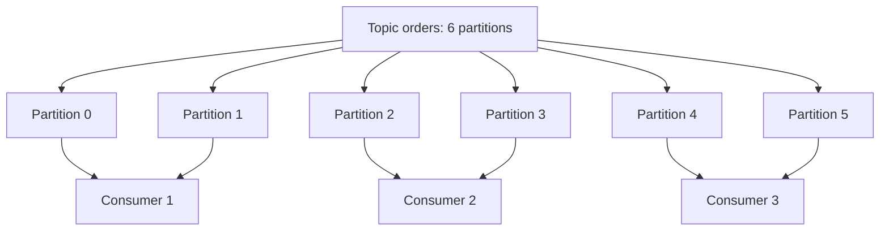

# Partition và đơn vị song song trong Kafka

Trong Kafka, **partition là đơn vị lưu trữ có thứ tự và cũng là đơn vị phân phối công việc cho consumer**. Một topic có thể gồm nhiều partition. Producer ghi record vào các partition; consumer group chia nhau đọc những partition đó. Vì vậy, cách chia partition và chọn key ảnh hưởng trực tiếp đến thứ tự xử lý, khả năng mở rộng và mức độ cân bằng tải của ứng dụng Spring Kafka.

Bài này tập trung vào mối quan hệ giữa topic, partition, offset và consumer group, sau đó áp dụng vào `KafkaTemplate` và `@KafkaListener`.

## 1. Topic, partition và record

Topic là tên logic của một luồng sự kiện, chẳng hạn `orders`, `payments` hoặc `inventory-events`. Dữ liệu của topic được chia thành một hoặc nhiều partition. Mỗi partition là một log chỉ ghi nối tiếp: record mới được thêm vào cuối log và có một offset xác định vị trí của nó trong partition đó.

Một record Kafka thường có các thành phần:

| Thành phần | Ý nghĩa |
|---|---|
| Key | Khóa dùng để định tuyến record tới partition; có thể để trống |
| Value | Payload của sự kiện |
| Headers | Metadata dạng key-value, ví dụ correlation ID hoặc event type |
| Timestamp | Thời điểm gắn với record theo cấu hình producer/broker |
| Partition | Partition chứa record |
| Offset | Vị trí của record trong partition đó |

Ví dụ, topic `orders` có ba partition:

```text
Topic: orders

Partition 0:  offset 0 -> offset 1 -> offset 2 -> offset 3 -> ...
Partition 1:  offset 0 -> offset 1 -> offset 2 -> ...
Partition 2:  offset 0 -> offset 1 -> offset 2 -> offset 3 -> ...
```

Offset chỉ có ý nghĩa trong phạm vi một partition. `orders-0` có offset `12` và `orders-1` cũng có offset `12` là hai record khác nhau. Kafka không tạo một dãy offset toàn cục cho cả topic, do đó không thể dùng offset để suy ra thứ tự tuyệt đối giữa các partition.

### Partition là một log có thứ tự

Kafka bảo đảm thứ tự record bên trong cùng một partition theo offset. Nếu record A có offset nhỏ hơn record B trong partition P, consumer đọc partition P sẽ gặp A trước B khi đọc tuần tự.

Kafka không bảo đảm thứ tự tổng thể giữa các partition. Ví dụ, một sự kiện ở `orders-0` có thể được consumer xử lý trước hoặc sau một sự kiện ở `orders-1`, tùy lịch poll và tốc độ xử lý. Timestamp của hai record không tạo ra một thứ tự xử lý toàn cục.

Điều này dẫn đến quy tắc thiết kế quan trọng: **nếu các sự kiện cần được xử lý theo thứ tự, hãy đưa chúng vào cùng một partition**. Trong phần lớn trường hợp, producer thực hiện điều đó bằng cách gửi cùng một key cho các sự kiện thuộc cùng một thực thể nghiệp vụ.

### Replica không phải partition bổ sung

Partition có thể được sao chép trên nhiều broker để tăng khả năng chịu lỗi. Một replica được bầu làm leader; các replica khác theo dõi dữ liệu từ leader. Producer và consumer thông thường làm việc với leader theo cơ chế của Kafka.

Replication factor giúp dữ liệu có bản sao khi broker gặp sự cố. Nó không làm tăng số partition logic và cũng không làm tăng số consumer trong cùng group có thể xử lý song song. Muốn tăng mức song song của một consumer group, cần xem số partition mà group đăng ký đọc.

## 2. Key quyết định partition và phạm vi thứ tự

Khi gửi record, producer có thể chỉ định topic và value, hoặc chỉ định cả key. Với partitioner mặc định của Kafka, record có key thường được định tuyến dựa trên hash của key và số partition hiện có. Vì thế, các record có cùng key thường đi vào cùng một partition khi cấu hình partition không thay đổi.

Partitioner nhận key sau khi key đã được serializer chuyển thành byte. Vì vậy, các producer cùng ghi vào một topic cần dùng cách serialize key ổn định và tương thích. Nếu hai dịch vụ gửi cùng một mã đơn hàng nhưng serialize mã đó thành các chuỗi byte khác nhau, Kafka có thể tính ra partition khác nhau. Serializer của value quyết định cách mã hóa payload; khi record đã có key, chính key mới là dữ liệu dùng để định tuyến theo partitioner mặc định.

Trong Spring Kafka, `KafkaTemplate` cho phép truyền key trực tiếp:

```java
@Service
public class OrderEventPublisher {

    private final KafkaTemplate<String, OrderCreated> kafkaTemplate;

    public OrderEventPublisher(
            KafkaTemplate<String, OrderCreated> kafkaTemplate) {
        this.kafkaTemplate = kafkaTemplate;
    }

    public void publish(OrderCreated event) {
        kafkaTemplate.send("orders", event.orderId(), event);
    }
}
```

Ở ví dụ này, `orderId` là key. Các sự kiện của cùng một đơn hàng, chẳng hạn `OrderCreated`, `OrderPaid` và `OrderShipped`, sẽ được định tuyến tới cùng partition nếu chúng dùng cùng key và cách phân vùng không đổi. Consumer có thể đọc các sự kiện đó theo thứ tự ghi trong partition.

Chọn key theo **đơn vị cần giữ thứ tự nghiệp vụ**:

| Nhu cầu | Key thường phù hợp | Hệ quả |
|---|---|---|
| Giữ thứ tự sự kiện của từng đơn hàng | `orderId` | Các sự kiện của một đơn hàng ở cùng partition |
| Giữ thứ tự thay đổi tồn kho của từng sản phẩm | `productId` hoặc `sku` | Các thay đổi của một sản phẩm được xếp cùng luồng |
| Giữ thứ tự giao dịch của từng tài khoản | `accountId` | Một tài khoản có một luồng tuần tự |
| Phân phối tải khi không cần thứ tự theo thực thể | Key phù hợp với nghiệp vụ hoặc không dùng key | Có thể phân phối rộng hơn, tùy partitioner |

Key có cardinality thấp hoặc phân bố lệch có thể làm một partition nhận quá nhiều dữ liệu. Ví dụ, nếu mọi record đều dùng key `VIETNAM`, chúng có thể tập trung vào cùng một partition. Những partition còn lại ít việc, dù tổng số partition lớn.

Nếu không truyền key, partitioner sẽ chọn partition theo chính sách của producer và phiên bản/cấu hình đang dùng. Không nên dựa vào một thứ tự cụ thể giữa các record không có key. Khi cần định tuyến chính xác, có thể cấu hình partitioner riêng hoặc chỉ định partition trong API gửi, nhưng chỉ nên làm vậy khi ứng dụng thực sự quản lý được quy tắc phân phối.

### Tăng số partition có thể thay đổi nơi nhận key

Với partitioner mặc định, kết quả định tuyến key phụ thuộc vào số partition. Khi tăng số partition, một key có thể được ánh xạ sang partition khác. Các record cũ của key vẫn nằm ở partition cũ, còn record mới có thể đi vào partition mới. Khi đó, không còn một luồng duy nhất bảo đảm thứ tự cho toàn bộ lịch sử của key.

Vì vậy, cần dự tính số partition ngay khi thiết kế topic. Nếu nghiệp vụ phụ thuộc chặt vào thứ tự theo key, việc tăng partition cần được xem là thay đổi kiến trúc: đánh giá tác động, có kế hoạch chuyển đổi hoặc tạo topic mới, và kiểm thử thứ tự sau chuyển đổi.

## 3. Consumer group chia partition để xử lý song song

Consumer group là tập hợp các consumer cùng dùng một `group.id` để đọc topic. Kafka phân công partition cho các consumer trong group. Tại một thời điểm ổn định, một partition được gán cho tối đa một consumer trong cùng group. Một consumer có thể nhận nhiều partition.

Ví dụ topic có sáu partition và group `order-projection-v1` có ba consumer:



Sơ đồ minh họa một cách phân công có thể xảy ra; cách chia thực tế phụ thuộc partition assignor và các consumer đang tham gia group.

Nếu có hai consumer trong group, mỗi consumer có thể được giao ba partition. Nếu có sáu consumer, mỗi consumer có thể nhận một partition. Nếu có tám consumer, ít nhất hai consumer sẽ không có partition để đọc topic này trong thời gian đó. Thêm consumer vượt quá số partition không làm tăng mức song song của topic.

Với một topic và một group đăng ký tất cả partition của topic đó, số consumer thực sự có việc tại một thời điểm không thể vượt quá số partition. Giới hạn này cần được tính theo tổng partition có thể gán cho consumer trong subscription khi group đọc nhiều topic.

### Các group khác nhau đọc độc lập

Ràng buộc một partition chỉ thuộc về tối đa một consumer trong cùng group. Một group khác vẫn có thể đọc toàn bộ partition của topic đó bằng offset riêng.

Ví dụ:

```text
Topic orders
  ├── group: order-projection-v1  -> cập nhật màn hình đơn hàng
  ├── group: billing-service     -> tạo dữ liệu thanh toán
  └── group: analytics-service   -> tổng hợp số liệu
```

Ba group nhận cùng luồng sự kiện nhưng tiến độ đọc độc lập. Đây là cách Kafka cho phép nhiều dịch vụ tiêu thụ cùng một sự kiện mà không cần producer gửi riêng một bản tin cho từng dịch vụ.

## 4. Offset và tiến độ của consumer

Offset xác định vị trí record trong một partition. Consumer group lưu offset đã commit riêng cho từng partition để biết lần đọc tiếp theo cần bắt đầu ở đâu.

Offset được commit thường biểu thị **vị trí kế tiếp cần đọc**, không phải offset của record cuối cùng đã xử lý. Ví dụ, nếu consumer xử lý thành công record có offset `41` rồi commit `42`, lần đọc tiếp theo bắt đầu từ offset `42`.

Không nên xem offset như số lượng record đã nhìn thấy. Compaction, transaction và các loại record nội bộ có thể khiến offset quan sát được có khoảng trống. Consumer cần dựa vào record và offset Kafka cung cấp, không tự giả định offset luôn liên tục.

### Commit quá sớm và commit quá muộn

- Nếu commit offset trước khi xử lý xong, ứng dụng có thể mất xử lý một record khi tiến trình dừng sau commit nhưng trước khi hoàn tất nghiệp vụ.
- Nếu xử lý xong nhưng chưa commit, ứng dụng có thể đọc lại record sau khi khởi động lại hoặc rebalance. Đây là tình huống tạo ra xử lý lặp.

Với xử lý thông thường, ứng dụng thường chọn cách chỉ commit sau khi listener xử lý thành công và thiết kế handler có tính idempotent. Idempotent nghĩa là xử lý cùng một sự kiện nhiều lần vẫn không làm sai trạng thái nghiệp vụ, ví dụ dùng `eventId` làm khóa chống ghi trùng.

Spring Kafka cung cấp nhiều chế độ acknowledgment. Với `AckMode.RECORD`, container commit sau khi listener xử lý thành công từng record; với `AckMode.BATCH`, container commit sau khi xử lý xong batch lấy từ một lần poll. Khi container quản lý commit, thường đặt `enable-auto-commit=false` để tránh cơ chế auto-commit của Kafka client can thiệp vào tiến độ xử lý.

Ví dụ cấu hình cơ bản:

```yaml
spring:
  kafka:
    consumer:
      group-id: order-projection-v1
      enable-auto-commit: false
      auto-offset-reset: earliest
    listener:
      ack-mode: record
      concurrency: 3
```

`auto-offset-reset` chỉ được áp dụng khi group chưa có offset hợp lệ (hoặc offset không còn khả dụng). `earliest` yêu cầu bắt đầu từ phần dữ liệu còn lưu sớm nhất; `latest` bắt đầu từ dữ liệu mới được ghi. Cấu hình này không tự đưa một group đã có offset về đầu topic.

Nếu listener gọi hệ thống ngoài Kafka, chẳng hạn ghi database hoặc gọi API, commit Kafka và transaction của hệ thống ngoài không tự động trở thành một transaction nguyên tử. Ứng dụng cần xử lý trường hợp ghi database thành công nhưng commit Kafka thất bại, hoặc ngược lại. Idempotency, inbox/outbox và cơ chế retry phù hợp giúp kiểm soát các tình huống này. Kafka transaction có thể bảo đảm một số luồng đọc-ghi Kafka ở mức exactly-once theo cấu hình phù hợp, nhưng không tự làm cho mọi tác động bên ngoài Kafka trở thành exactly-once.

## 5. Cấu hình mức song song trong Spring Kafka

Spring Kafka tạo listener container để quản lý consumer và gọi phương thức `@KafkaListener`. Thuộc tính `concurrency` xác định số consumer/container con mà listener container có thể chạy.

Ví dụ listener đọc topic `orders`:

```java
@Component
public class OrderEventListener {

    @KafkaListener(
            topics = "orders",
            groupId = "order-projection-v1"
    )
    public void onOrderEvent(ConsumerRecord<String, OrderCreated> record) {
        String orderId = record.key();
        int partition = record.partition();
        long offset = record.offset();

        // Cập nhật projection cho đơn hàng.
        // Nên bảo đảm thao tác có thể xử lý lặp an toàn.
    }
}
```

Kết hợp với `spring.kafka.listener.concurrency: 3`, ứng dụng chạy tối đa ba consumer cho listener container này. Nếu topic có sáu partition và chỉ một instance ứng dụng, ba consumer có thể chia nhau sáu partition. Nếu topic chỉ có hai partition, tối đa hai consumer có partition để đọc; consumer còn lại sẽ nhàn rỗi.

Khi chạy nhiều instance ứng dụng, concurrency được áp dụng trên từng instance. Ví dụ hai instance, mỗi instance concurrency bằng ba, tạo tổng cộng sáu consumer trong cùng group. Nếu topic có sáu partition thì đây là mức song song tối đa cho topic đó trong group. Nếu tăng lên ba instance, mỗi instance vẫn tạo ba consumer nhưng tổng cộng có chín consumer; ba consumer sẽ không được giao partition khi group ổn định.

Có thể hình dung giới hạn cơ bản như sau:

```text
Số consumer có việc tối đa <= số partition được gán cho group

Ví dụ:
  6 partitions, 3 consumers  -> tối đa 3 consumer có việc
  6 partitions, 6 consumers  -> tối đa 6 consumer có việc
  6 partitions, 9 consumers  -> tối đa 6 consumer có việc
```

Đây là giới hạn song song ở tầng consumer. Nó không có nghĩa hệ thống luôn đạt throughput tối đa: tốc độ còn phụ thuộc kích thước record, thời gian xử lý, I/O, database, cấu hình poll, network và mức tải của broker.

### Một consumer nhận nhiều partition vẫn xử lý theo từng luồng

Consumer có thể được giao nhiều partition. Client Kafka theo dõi vị trí đọc riêng cho từng partition. Với listener đồng bộ thông thường, container gọi listener trên luồng xử lý của consumer; không nên mặc định rằng nhiều partition được giao cho một consumer đồng nghĩa các record sẽ tự chạy song song trong mã nghiệp vụ.

Nếu tự đẩy record sang thread pool để xử lý bất đồng bộ, cần quản lý thứ tự hoàn tất và offset theo từng partition. Không được commit vượt qua một record chưa xử lý xong, vì sau khi khởi động lại record đó có thể bị bỏ qua. Nếu nghiệp vụ yêu cầu thứ tự theo key, việc xử lý đồng thời phải bảo toàn thứ tự của các record cùng key.

## 6. Rebalance khi thành viên group thay đổi

Kafka có thể phân công lại partition khi consumer tham gia, rời group, mất kết nối hoặc subscription thay đổi. Quá trình này gọi là rebalance. Khi rebalance xảy ra, partition có thể được thu hồi từ consumer cũ và giao cho consumer mới.

Rebalance là cơ chế bình thường để group thích nghi với việc scale ứng dụng và sự cố. Tuy nhiên, nó có thể làm gián đoạn ngắn việc tiêu thụ dữ liệu. Nếu listener xử lý quá lâu, không poll đúng hạn hoặc thường xuyên khởi động lại, group có thể rebalance nhiều lần và giảm throughput.

Để giảm tác động:

- Giữ thời gian xử lý mỗi batch trong giới hạn phù hợp với `max.poll.interval.ms`.
- Điều chỉnh `max.poll.records` theo thời gian xử lý và tài nguyên của ứng dụng.
- Đóng consumer/container đúng vòng đời để Kafka thu hồi partition có trật tự.
- Thiết kế xử lý idempotent vì record có thể được đọc lại sau rebalance hoặc restart.
- Theo dõi số lần rebalance, lag và thời gian xử lý listener khi vận hành.

Spring Kafka quản lý vòng đời listener container và tham gia cơ chế rebalance của Kafka client. Ứng dụng vẫn cần xử lý đúng các tình huống dừng, retry và xử lý lặp ở tầng nghiệp vụ.

## 7. Chọn số partition cho một topic

Số partition quyết định mức song song tối đa có thể khai thác trong consumer group, nhưng tạo quá nhiều partition cũng có chi phí vận hành. Mỗi partition cần metadata, file log, tài nguyên broker và công việc quản lý replica. Khi số partition tăng, việc rebalance và quản lý consumer cũng có thể phức tạp hơn.

Khi chọn số partition, hãy xem xét đồng thời:

1. **Throughput mục tiêu:** lượng record mỗi giây, kích thước record và tốc độ xử lý dự kiến của mỗi consumer.
2. **Mức song song cần thiết:** số consumer muốn chạy trong một group ở hiện tại và trong giai đoạn tăng tải.
3. **Phân bố key:** số lượng key, độ lệch tải và nguy cơ một key nóng tập trung vào một partition.
4. **Yêu cầu thứ tự:** đơn vị nghiệp vụ nào phải được xử lý tuần tự và key có giữ được các sự kiện đó cùng partition không.
5. **Tài nguyên broker:** số topic, replication factor, dung lượng lưu trữ và giới hạn vận hành của cụm Kafka.
6. **Kế hoạch tăng trưởng:** dự kiến tăng consumer hoặc throughput trong tương lai, đồng thời tính đến tác động khi tăng partition.

Không có công thức cố định phù hợp cho mọi topic. Có thể bắt đầu bằng cách đo throughput thực tế trên môi trường gần production, sau đó điều chỉnh partition và concurrency dựa trên lag, thời gian xử lý và mức sử dụng broker.

### Phân biệt ba thông số thường bị nhầm

| Thông số | Quyết định điều gì | Không quyết định điều gì |
|---|---|---|
| Số partition | Số luồng dữ liệu có thể được phân công độc lập trong topic | Số replica lưu dữ liệu |
| Replication factor | Số bản sao của mỗi partition | Mức song song của consumer group |
| Consumer concurrency | Số consumer/container con chạy cho listener trong một instance | Số partition mà topic có |

Ví dụ, topic có 12 partition và replication factor 3 vẫn có 12 partition logic. Mỗi partition có thể có ba replica, nhưng một consumer group thông thường vẫn chỉ phân công mỗi partition cho tối đa một consumer tại một thời điểm.

## 8. Theo dõi partition, consumer và lag

Khi vận hành, cần biết partition nào đang nhận tải, consumer nào được giao partition và group đang chậm bao nhiêu so với dữ liệu mới nhất.

Có thể dùng lệnh Kafka CLI để xem metadata topic:

```bash
kafka-topics.sh \
  --bootstrap-server localhost:9092 \
  --describe \
  --topic orders
```

Lệnh mô tả consumer group:

```bash
kafka-consumer-groups.sh \
  --bootstrap-server localhost:9092 \
  --describe \
  --group order-projection-v1
```

Kết quả consumer group thường cho biết partition, offset hiện tại, log end offset và lag. Lag là khoảng cách giữa vị trí group đã commit và vị trí cuối mà broker ghi nhận cho partition; cách diễn giải chi tiết phụ thuộc công cụ và trạng thái group. Lag tăng liên tục có thể là dấu hiệu consumer xử lý chậm, thiếu partition/consumer phù hợp, lỗi retry hoặc hệ thống downstream đang nghẽn.

Trong ứng dụng Spring Kafka, nên ghi log hoặc metric có các thông tin cần thiết như topic, partition, offset, key hoặc event ID và thời gian xử lý. Các trường này giúp truy vết một record cụ thể khi có lỗi. Tránh ghi toàn bộ payload nhạy cảm vào log.

## 9. Kiểm thử hành vi phân vùng

Kiểm thử partition nên xác minh hành vi thực tế của producer và consumer thay vì chỉ kiểm tra listener được gọi.

Một số tình huống nên có trong integration test:

- Gửi nhiều record cùng key và xác minh chúng được ghi vào cùng partition.
- Gửi các record có key khác nhau và quan sát cách phân phối; không giả định chúng luôn chia đều.
- Tạo topic có ít partition hơn concurrency và xác minh số consumer hoạt động bị giới hạn bởi partition.
- Khởi động nhiều consumer cùng group và kiểm tra partition được phân công mà không bị hai consumer trong cùng group đọc đồng thời cùng một partition trong trạng thái ổn định.
- Dừng một consumer rồi quan sát rebalance và khả năng tiếp tục đọc từ offset đã commit.
- Làm listener thất bại trước khi commit để xác minh retry, xử lý lặp và tính idempotent.

Có thể dùng Testcontainers để kiểm thử với broker Kafka thật trong môi trường test, hoặc `@EmbeddedKafka` khi phù hợp với phiên bản Spring Kafka của dự án. Với kiểm thử phụ thuộc thời gian, hãy dùng điều kiện chờ có timeout thay vì `Thread.sleep` cố định.

## 10. Ví dụ thiết kế: topic sự kiện đơn hàng

Giả sử hệ thống phát các sự kiện `OrderCreated`, `OrderPaid` và `OrderCancelled`. Yêu cầu là các sự kiện của cùng một đơn hàng phải được xử lý theo thứ tự.

Một thiết kế phù hợp:

1. Dùng topic `orders`.
2. Chọn `orderId` làm key cho mọi sự kiện của đơn hàng.
3. Chọn số partition theo throughput và mức song song mục tiêu của các consumer group.
4. Mỗi dịch vụ tiêu thụ dùng một group riêng, ví dụ `order-projection-v1`, `billing-service` và `analytics-service`.
5. Cấu hình concurrency theo số partition và số instance dự kiến.
6. Làm handler idempotent để chịu được việc đọc lại record.
7. Theo dõi lag theo partition để phát hiện key nóng hoặc partition mất cân bằng.

Với thiết kế này, các sự kiện của cùng một `orderId` được xếp trong cùng partition, nên consumer có thể giữ thứ tự xử lý của đơn hàng đó. Hai đơn hàng khác nhau có thể nằm ở hai partition khác nhau và được xử lý song song. Nếu một đơn hàng có lượng sự kiện vượt trội, partition chứa đơn hàng đó vẫn có thể trở thành điểm nghẽn; tăng số partition không chia nhỏ được một key đang cố ý giữ cùng partition.

Nếu yêu cầu thực tế là giữ thứ tự cho tất cả đơn hàng của cùng một khách hàng, key cần đổi thành `customerId`. Khi đó mọi đơn hàng của khách hàng đó cùng nằm trong một partition và có thể làm giảm mức song song. Key phải phản ánh đúng phạm vi thứ tự nghiệp vụ, không chỉ dựa trên tên entity thuận tiện.

## 11. Các lỗi thiết kế thường gặp

**Tăng consumer nhưng không tăng partition:** số consumer có thể nhận partition không tăng, nên tài nguyên bổ sung bị nhàn rỗi.

**Dùng một key cho mọi record:** dữ liệu tập trung vào một partition, tạo hot partition và giới hạn throughput dù topic có nhiều partition.

**Không dùng key dù cần thứ tự:** các sự kiện của cùng một thực thể có thể nằm ở nhiều partition, khiến consumer không thể dựa vào Kafka để giữ thứ tự nghiệp vụ.

**Cho rằng offset là duy nhất trong topic:** offset chỉ duy nhất trong một partition; khi truy vết record cần kết hợp topic, partition và offset.

**Nhầm replication factor với số partition:** tăng replica giúp chịu lỗi, không tăng mức song song consumer.

**Commit offset trước khi xử lý xong:** ứng dụng có thể bỏ qua nghiệp vụ khi gặp sự cố sau commit.

**Xử lý bất đồng bộ nhưng commit vượt record chưa hoàn tất:** khi restart, các record chưa xong có thể bị bỏ qua. Cần quản lý thứ tự hoàn tất và commit riêng theo partition.

**Tăng partition mà không đánh giá key:** record mới của một key có thể sang partition khác, làm thay đổi giả định về thứ tự xuyên suốt lịch sử.

## 12. Checklist thiết kế

Trước khi đưa một topic vào production, hãy trả lời được các câu hỏi sau:

- Topic có bao nhiêu partition và con số đó dựa trên throughput, concurrency hay yêu cầu thứ tự nào?
- Key đại diện cho thực thể nào cần giữ thứ tự? Phân bố key có nguy cơ lệch tải không?
- Các consumer group có đúng là những ứng dụng cần đọc độc lập cùng luồng sự kiện không?
- Tổng consumer của mỗi group có phù hợp với số partition và số instance không?
- `enable-auto-commit` và acknowledgment mode có khớp với cách xử lý nghiệp vụ không?
- Handler có an toàn khi một record được đọc lại không?
- Ứng dụng có theo dõi lag, rebalance, lỗi listener và thời gian xử lý theo partition không?
- Nhóm vận hành đã đánh giá tác động nếu cần tăng số partition chưa?

Khi trả lời rõ các câu hỏi này, partition sẽ trở thành một quyết định thiết kế có chủ đích: nó xác định ranh giới thứ tự, giới hạn song song và cách consumer group mở rộng khi tải tăng.
