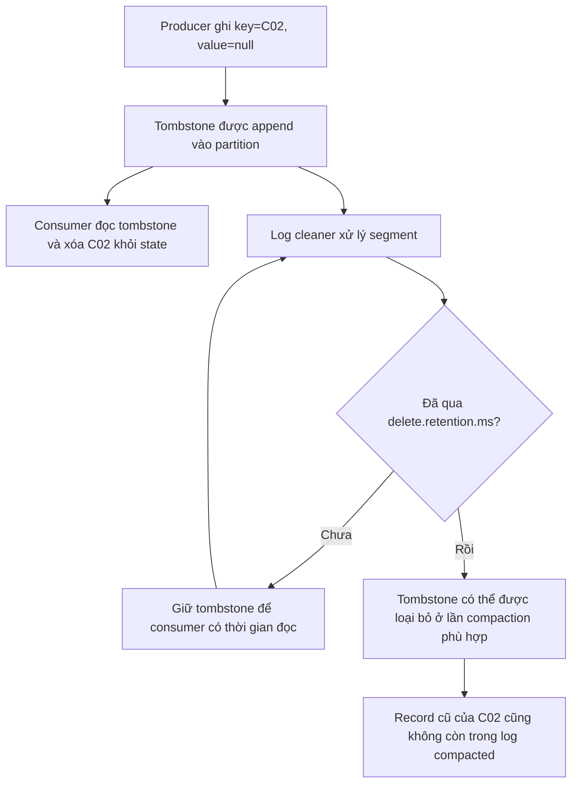

# Compaction và tombstone record

Kafka thường được dùng để lưu lại một chuỗi sự kiện theo thời gian. Tuy nhiên, có những luồng dữ liệu mà ứng dụng chủ yếu cần **trạng thái mới nhất của mỗi thực thể**: cấu hình hiện tại của một cửa hàng, thông tin mới nhất của khách hàng hoặc trạng thái của một thiết bị. Nếu giữ mọi phiên bản mãi mãi, consumer phải đọc và tự gộp rất nhiều bản ghi cũ mỗi lần dựng lại trạng thái.

**Log compaction** giải quyết bài toán này bằng cách giữ lại bản ghi mới nhất theo key trong từng partition. Khi cần biểu diễn việc xóa một key khỏi trạng thái hiện tại, producer gửi một **tombstone record**: record có key nhưng value bằng `null`. Compaction và tombstone thường được dùng cùng nhau để xây dựng topic đóng vai trò changelog hoặc kho trạng thái có thể phát lại.

## 1. Log compaction là gì?

Kafka ghi record nối tiếp vào log của từng partition. Với topic dùng chính sách `compact`, Kafka chạy tiến trình log cleaner ở nền để loại bỏ các phiên bản cũ của cùng một key. Sau khi compaction hoàn tất, log vẫn giữ phiên bản mới nhất của mỗi key còn tồn tại, cùng các record chưa đến thời điểm có thể dọn dẹp.

Ví dụ topic `customer-state` nhận các record sau. Cột `key` là mã khách hàng, `value` là trạng thái được serialize:

| Offset | Key | Value | Ý nghĩa |
|---:|---|---|---|
| 0 | `C01` | `{"name":"An","city":"Hue"}` | Tạo trạng thái ban đầu của C01 |
| 1 | `C02` | `{"name":"Binh","city":"Da Nang"}` | Tạo trạng thái của C02 |
| 2 | `C01` | `{"name":"An","city":"Hanoi"}` | Cập nhật C01 |
| 3 | `C03` | `{"name":"Chi","city":"Can Tho"}` | Tạo trạng thái của C03 |
| 4 | `C02` | `null` | Xóa C02 bằng tombstone |
| 5 | `C01` | `{"name":"An","city":"HCMC"}` | Cập nhật C01 lần nữa |

Sau khi cleaner xử lý các segment phù hợp, log có thể chỉ còn các record mới nhất tương ứng:

| Offset gốc | Key | Value còn lại | Trạng thái |
|---:|---|---|---|
| 3 | `C03` | `{"name":"Chi","city":"Can Tho"}` | C03 còn tồn tại |
| 4 | `C02` | `null` | Tombstone của C02 còn trong thời gian lưu |
| 5 | `C01` | `{"name":"An","city":"HCMC"}` | C01 còn tồn tại với dữ liệu mới nhất |

Các offset được giữ theo vị trí ban đầu. Kafka không đánh số lại các record còn lại, vì vậy consumer có thể thấy khoảng trống giữa các offset. Bảng trên mô tả kết quả khái niệm; compaction diễn ra bất đồng bộ và không đảm bảo log được rút gọn ngay sau mỗi lần gửi.

## 2. Kafka compaction hoạt động theo key và partition

Compaction có một số đặc điểm quan trọng:

1. **So sánh key trong từng partition.** Kafka giữ phiên bản mới nhất của key trong partition đó. Cleaner không gộp các record cùng key nằm ở hai partition khác nhau.
2. **Key phải ổn định.** Producer nên dùng cùng quy tắc serialize key và cùng partitioning strategy cho một thực thể. Với partitioner mặc định và key khác `null`, các record có cùng key thường đi vào cùng partition khi số partition và cấu hình định tuyến không thay đổi.
3. **Record không có key không được compaction theo key.** Nếu gửi record với key `null`, Kafka không có định danh để xác định phiên bản nào thay thế phiên bản nào.
4. **Cleaner chạy nền.** Compaction xử lý các segment đủ điều kiện; record mới có thể vẫn còn nhiều phiên bản trong log một thời gian. Consumer không được giả định rằng topic chỉ có đúng một record cho mỗi key ở mọi thời điểm.
5. **Offset và thứ tự trong partition được giữ.** Record bị loại bỏ tạo ra khoảng trống offset, nhưng Kafka không thay đổi thứ tự tương đối của các record còn lại. Kafka không đảm bảo thứ tự tổng thể giữa các partition.

Điểm thứ hai đặc biệt quan trọng khi tăng số partition hoặc thay đổi partitioner. Một key có thể được định tuyến sang partition mới trong khi phiên bản cũ vẫn nằm ở partition cũ. Vì compaction diễn ra theo từng partition, topic có thể còn nhiều phiên bản của key đó ở các partition khác nhau. Hãy thiết kế partitioning ổn định nếu topic được dùng để khôi phục trạng thái theo key.

## 3. Tombstone record dùng để xóa key

Trong topic compacted, một record có **key khác `null` và value bằng `null`** được gọi là tombstone. Nó biểu thị rằng trạng thái hiện tại của key đó đã bị xóa.

Ví dụ, để xóa trạng thái khách hàng `C02`, producer gửi:

```text
key   = C02
value = null
```

Tombstone không phải là JSON có nội dung `null`, chuỗi ký tự `"null"` hoặc một object có trường `deleted: true`. Đó là Kafka record mà phần value thực sự không có dữ liệu (`null`). Kafka dùng dấu hiệu này để phân biệt một lần xóa với một giá trị thông thường.

### Vòng đời của tombstone

Tombstone cần tồn tại đủ lâu để consumer có thời gian đọc và nhận biết việc xóa. Cấu hình `delete.retention.ms` xác định khoảng thời gian Kafka giữ delete marker trước khi marker đủ điều kiện bị loại bỏ trong quá trình compaction tiếp theo.

Có thể hình dung vòng đời như sau:



Khi cleaner loại bỏ tombstone, các phiên bản cũ hơn của key đó cũng có thể bị loại bỏ. Sau giai đoạn này, consumer đọc lại topic từ đầu sẽ không còn thấy C02 hoặc tombstone của nó; điều đó có nghĩa C02 không thuộc trạng thái hiện tại được dựng từ topic.

`delete.retention.ms` không phải thời gian mà ứng dụng phải chờ trước khi xóa dữ liệu khỏi database. Nó là thời gian lưu dấu xóa trong log compacted. Giá trị này cần đủ dài cho consumer có thể khởi tạo lại hoặc phục hồi từ offset cũ và đọc đến cuối log. Nếu consumer không thể hoàn tất việc đọc log trong khoảng thời gian tombstone được giữ, nó có thể bỏ lỡ dấu xóa trong lúc dựng lại snapshot. Vì vậy, cần chọn thời gian lưu dựa trên thời gian phục hồi tối đa dự kiến của consumer.

### Tombstone khác event xóa nghiệp vụ

`CustomerDeleted` là một event nghiệp vụ có payload mô tả việc khách hàng bị xóa. Nếu gửi event này với value khác `null` vào topic compacted, Kafka xem đó là giá trị mới nhất của key và giữ lại nó như các value khác.

Tombstone lại là chỉ thị xóa key khỏi trạng thái được materialize. Nếu hệ thống cần cả lịch sử kiểm toán lẫn trạng thái hiện tại, có thể phát hành event `CustomerDeleted` vào topic lịch sử append-only và gửi tombstone vào topic trạng thái compacted. Hai luồng phục vụ hai mục đích khác nhau.

## 4. Cấu hình topic compacted

Thuộc tính quyết định chính sách dọn dẹp là `cleanup.policy`:

| Giá trị | Hành vi |
|---|---|
| `delete` | Xóa các segment cũ theo chính sách retention của topic hoặc broker. Đây là chính sách mặc định phổ biến. |
| `compact` | Giữ phiên bản mới nhất theo key trong từng partition; tombstone được lưu trong khoảng `delete.retention.ms`. |
| `compact,delete` | Áp dụng cả compaction và xóa segment theo retention. Cần chọn khi dữ liệu cũ được phép hết hạn theo thời gian. |

Ví dụ tạo topic bằng Spring Kafka:

```java
import org.apache.kafka.clients.admin.NewTopic;
import org.apache.kafka.common.config.TopicConfig;
import org.springframework.context.annotation.Bean;
import org.springframework.context.annotation.Configuration;
import org.springframework.kafka.config.TopicBuilder;

@Configuration
public class KafkaTopicConfiguration {

    @Bean
    NewTopic customerStateTopic() {
        return TopicBuilder.name("customer-state")
                .partitions(6)
                .replicas(1) // Ví dụ cho môi trường local; production cần chọn theo cluster.
                .config(
                        TopicConfig.CLEANUP_POLICY_CONFIG,
                        TopicConfig.CLEANUP_POLICY_COMPACT
                )
                .config(TopicConfig.DELETE_RETENTION_MS_CONFIG, "86400000")
                .config("min.compaction.lag.ms", "60000")
                .build();
    }
}
```

Trong ví dụ, topic dùng `compact`, giữ tombstone ít nhất theo khoảng cấu hình một ngày (`86400000` mili giây), và đặt độ trễ compaction tối thiểu một phút. Đây là giá trị minh họa, không phải cấu hình phù hợp cho mọi hệ thống. Với cluster nhiều broker, replication factor phải phù hợp với số broker và yêu cầu sẵn sàng.

Một số cấu hình thường cần cân nhắc:

| Cấu hình | Ý nghĩa |
|---|---|
| `cleanup.policy` | Chọn `compact`, `delete` hoặc kết hợp cả hai. |
| `delete.retention.ms` | Thời gian giữ tombstone trước khi nó đủ điều kiện bị dọn. |
| `min.compaction.lag.ms` | Khoảng thời gian tối thiểu một record phải tồn tại trước khi được compaction. |
| `max.compaction.lag.ms` | Giới hạn thời gian record có thể chờ trước khi đủ điều kiện compaction; cleaner vẫn chạy theo khả năng và điều kiện vận hành. |
| `min.cleanable.dirty.ratio` | Ngưỡng tỷ lệ phần log chưa được compact để log cleaner cân nhắc xử lý segment. |
| `retention.ms` | Thời gian giữ dữ liệu theo chính sách `delete`; khi kết hợp `compact,delete`, segment cũ vẫn có thể bị xóa theo retention. |

Với topic chỉ dùng `compact`, đừng đặt `retention.ms` với kỳ vọng nó quyết định thời gian lưu mọi key. Khi bật thêm `delete`, retention có thể làm mất cả trạng thái mới nhất của key nếu segment chứa trạng thái đó đã quá hạn. Chỉ kết hợp hai chính sách khi yêu cầu nghiệp vụ thực sự cho phép dữ liệu hết hạn.

## 5. Gửi value và tombstone bằng Spring Kafka

Giả sử topic `customer-state` lưu trạng thái hiện tại của khách hàng. Key là `customerId`, value là snapshot mới nhất.

```java
import java.math.BigDecimal;
import java.util.concurrent.CompletableFuture;

import org.springframework.kafka.core.KafkaTemplate;
import org.springframework.kafka.support.SendResult;
import org.springframework.stereotype.Service;

record CustomerSnapshot(
        String customerId,
        String name,
        String city,
        BigDecimal creditLimit
) {}

@Service
public class CustomerStatePublisher {

    private static final String TOPIC = "customer-state";

    private final KafkaTemplate<String, CustomerSnapshot> kafkaTemplate;

    public CustomerStatePublisher(
            KafkaTemplate<String, CustomerSnapshot> kafkaTemplate) {
        this.kafkaTemplate = kafkaTemplate;
    }

    public CompletableFuture<SendResult<String, CustomerSnapshot>> publish(
            CustomerSnapshot snapshot) {
        return kafkaTemplate.send(TOPIC, snapshot.customerId(), snapshot);
    }

    public CompletableFuture<SendResult<String, CustomerSnapshot>> delete(
            String customerId) {
        // Value null tạo tombstone cho key customerId.
        return kafkaTemplate.send(TOPIC, customerId, null);
    }
}
```

`KafkaTemplate.send(topic, key, value)` nhận `null` ở tham số value để tạo tombstone. Key vẫn phải có giá trị. Cấu hình producer cần có key serializer và value serializer tương thích với kiểu dữ liệu. Với JSON serializer của Spring Kafka, value `null` được gửi dưới dạng null Kafka value; consumer cần phân biệt trường hợp này với một object snapshot thông thường.

Ví dụ trên trả về `CompletableFuture` để phía gọi có thể theo dõi kết quả gửi và xử lý lỗi. Trong ứng dụng thực tế, không nên xem việc gọi `send` là bằng chứng record đã được broker ghi thành công; hãy quan sát kết quả gửi theo yêu cầu độ tin cậy của luồng.

## 6. Consumer xử lý tombstone

Consumer cần nhận được cả key lẫn value để phân biệt cập nhật và xóa. Dùng `ConsumerRecord` giúp truy cập trực tiếp hai trường này:

```java
import org.apache.kafka.clients.consumer.ConsumerRecord;
import org.springframework.kafka.annotation.KafkaListener;
import org.springframework.stereotype.Component;

@Component
public class CustomerStateListener {

    private final CustomerStateStore stateStore;

    public CustomerStateListener(CustomerStateStore stateStore) {
        this.stateStore = stateStore;
    }

    @KafkaListener(
            topics = "customer-state",
            groupId = "customer-state-projector"
    )
    public void onRecord(
            ConsumerRecord<String, CustomerSnapshot> record) {

        String customerId = record.key();
        CustomerSnapshot snapshot = record.value();

        if (snapshot == null) {
            stateStore.delete(customerId);
            return;
        }

        stateStore.upsert(customerId, snapshot);
    }
}
```

`CustomerStateStore` ở đây là abstraction của nơi lưu trạng thái, ví dụ database hoặc cache. Khi value khác `null`, consumer cập nhật trạng thái theo key. Khi value là `null`, consumer xóa trạng thái tương ứng. Phần xử lý nên idempotent để việc nhận lại record sau retry hoặc khởi động lại không làm sai kết quả.

Nếu listener chỉ nhận payload kiểu `CustomerSnapshot`, ứng dụng có thể không còn đủ thông tin để phân biệt tombstone và xử lý key cần xóa. Với compacted topic, nên nhận `ConsumerRecord` hoặc một kiểu đầu vào tương đương có thể giữ cả key và null value.

Khi dựng lại state từ đầu, consumer thường dùng một consumer group mới hoặc cấu hình offset phù hợp để đọc từ đầu log. Nó áp dụng tuần tự các record: value thì upsert, tombstone thì delete. Vì compaction bất đồng bộ, consumer có thể gặp nhiều phiên bản của cùng key; xử lý theo thứ tự partition và dùng thao tác idempotent sẽ giúp state cuối cùng hội tụ về phiên bản mới nhất.

## 7. Khi nào nên dùng compacted topic?

Compacted topic phù hợp khi cần một changelog có thể phát lại để dựng trạng thái hiện tại:

- Trạng thái mới nhất của khách hàng, đơn hàng hoặc thiết bị.
- Cấu hình hiện hành theo `configId`.
- Bản đồ `entityId → current value` dùng làm cache hoặc materialized view.
- Changelog cho state store hoặc luồng xử lý stream.

Compacted topic không thay thế một event log dùng cho kiểm toán. Sau compaction, các phiên bản trung gian có thể bị loại bỏ; vì vậy, không thể dựa vào nó để truy vấn đầy đủ mọi thay đổi đã xảy ra. Nếu cần lịch sử, hãy lưu riêng một topic append-only hoặc kho audit phù hợp.

## 8. Lỗi thường gặp và cách phòng tránh

| Lỗi | Hệ quả | Cách xử lý |
|---|---|---|
| Gửi record không có key | Kafka không thể gộp các phiên bản theo thực thể. | Chọn key ổn định, có ý nghĩa với trạng thái cần lưu. |
| Dùng key khác nhau cho cùng một thực thể | Các phiên bản không được compaction như một chuỗi duy nhất. | Chuẩn hóa key và serializer ở mọi producer. |
| Nghĩ compaction xảy ra ngay sau `send` | Consumer có thể đọc nhiều phiên bản của cùng key. | Viết consumer chịu được cập nhật lặp và xử lý theo thứ tự partition. |
| Gửi `"null"` hoặc JSON `null` thay vì Kafka null value | Record trở thành một value thông thường, không phải tombstone. | Gửi value Java `null` với key hợp lệ. |
| Consumer bỏ qua record có value null | Trạng thái đã xóa có thể sống lại khi dựng lại state. | Xử lý tombstone như thao tác delete. |
| `delete.retention.ms` quá ngắn | Consumer phục hồi chậm có thể bỏ lỡ dấu xóa. | Chọn thời gian lưu dài hơn khoảng phục hồi tối đa dự kiến. |
| Dùng `compact,delete` mà không xét retention | Segment chứa trạng thái mới nhất có thể bị xóa theo thời gian. | Chỉ bật `delete` nếu dữ liệu được phép hết hạn. |
| Thay đổi số partition hoặc partitioner tùy tiện | Cùng key có thể xuất hiện ở partition khác nhau. | Lập kế hoạch partitioning và migration cho topic lưu trạng thái. |

## 9. Ghi nhớ

- `cleanup.policy=compact` yêu cầu Kafka giữ phiên bản mới nhất theo key trong từng partition.
- Compaction chạy nền, không xóa trùng ngay lập tức; offset được giữ nguyên nên log có thể có khoảng trống.
- Tombstone là record có key khác `null` và value bằng `null`, dùng để đánh dấu xóa một key khỏi trạng thái compacted.
- `delete.retention.ms` giữ tombstone đủ lâu cho consumer đọc dấu xóa trước khi marker có thể bị loại bỏ.
- Producer phải dùng key ổn định; consumer phải xử lý value `null` như thao tác xóa.
- Compacted topic phù hợp để khôi phục trạng thái mới nhất; event log append-only phù hợp để giữ lịch sử đầy đủ.

Khi thiết kế một compacted topic, hãy xác định rõ key đại diện cho thực thể nào, consumer sẽ dựng lại state ra sao và thời gian phục hồi tối đa là bao lâu. Ba quyết định đó chi phối cách chọn partitioning, cách gửi tombstone và giá trị `delete.retention.ms`.
