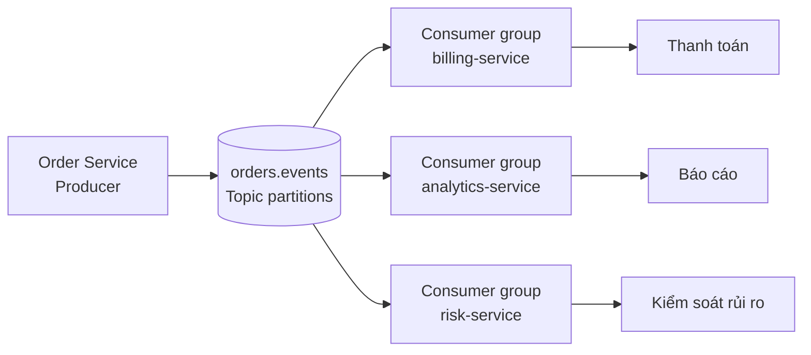
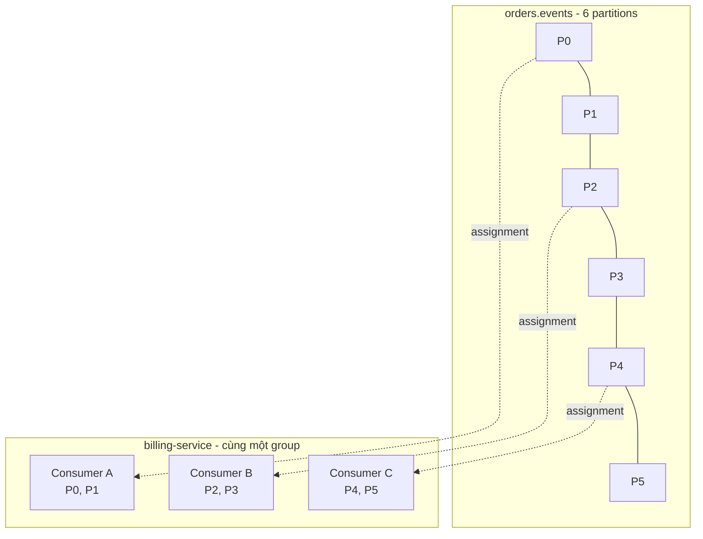

# Consumer group như một thuê bao logic

Trong Kafka, một topic có thể phục vụ nhiều ứng dụng cùng lúc. Khi một đơn hàng được tạo, dịch vụ thanh toán cần xử lý khoản tiền, dịch vụ phân tích cần cập nhật báo cáo, còn dịch vụ kiểm soát rủi ro có thể cần đánh giá giao dịch. Các ứng dụng này đều cần đọc sự kiện `OrderCreated`, nhưng chúng có mục đích, tốc độ và tiến độ xử lý khác nhau.

Kafka dùng **consumer group** để biểu diễn một thuê bao logic của luồng sự kiện. Mỗi group có một danh tính riêng, tự theo dõi offset đã đọc và có thể gồm một hoặc nhiều consumer instance cùng chia sẻ các partition. Nhiều group có thể đọc cùng một topic độc lập với nhau. Nhờ đó, producer chỉ cần phát một record vào Kafka; mỗi ứng dụng nhận sự kiện theo tiến độ riêng mà không phải gọi trực tiếp từng ứng dụng.

Khái niệm này là nền tảng khi xây dựng ứng dụng messaging với Spring Kafka. `group.id` xác định thuê bao logic, còn `@KafkaListener` và listener container tạo, quản lý các consumer instance tham gia thuê bao đó.

## 1. Consumer group là một thuê bao logic

Hãy phân biệt ba cấp độ:

- **Topic** là luồng record được Kafka lưu trữ. Record nằm trong các partition của topic.
- **Consumer group** là một nhóm logic có chung danh tính `group.id`, dùng chung tiến độ đọc của group đối với từng partition.
- **Consumer instance** là một tiến trình hoặc một consumer đang hoạt động trong group. Nhiều instance của cùng group chia nhau các partition để xử lý song song.

Ví dụ, topic `orders.events` chứa các sự kiện về đơn hàng. Hệ thống có ba thuê bao:

| Consumer group | Mục đích đọc | Tiến độ được quản lý riêng? |
| --- | --- | --- |
| `billing-service` | Xử lý thanh toán | Có |
| `analytics-service` | Cập nhật báo cáo | Có |
| `risk-service` | Phân tích rủi ro | Có |

Mỗi group đọc cùng một luồng record nhưng giữ offset riêng. Nếu `billing-service` đã xử lý đến offset 120, điều đó không làm `analytics-service` hoặc `risk-service` chuyển offset theo. Mỗi thuê bao có thể đọc nhanh, chậm, tạm dừng hoặc khởi động lại theo nhu cầu riêng, miễn record vẫn còn trong thời gian lưu trữ của topic.



Đây là mô hình fan-out ở tầng consumer group: một record được lưu một lần trong log của Kafka, nhưng nhiều group có thể đọc record đó bằng offset độc lập. Kafka không cần tạo một bản sao vật lý của toàn bộ topic cho từng group. Group lưu trạng thái đọc, còn dữ liệu record vẫn nằm trong partition log theo chính sách retention hoặc compaction.

## 2. `group.id` xác định danh tính thuê bao

`group.id` là tên định danh consumer group. Các consumer dùng cùng `group.id`, cùng cluster và cơ chế đăng ký subscription/group management sẽ tham gia cùng một group. Kafka dùng danh tính này để quản lý thành viên, phân phối partition và lưu offset đã commit. Nếu ứng dụng tự gán partition bằng `assign()` thì consumer không tham gia cơ chế phân phối member của group theo cách này.

Quyết định đặt `group.id` có ảnh hưởng trực tiếp đến cách ứng dụng nhận dữ liệu:

| Cách đặt `group.id` | Hành vi |
| --- | --- |
| Các replica của Billing cùng dùng `billing-service` | Chúng chia sẻ partition và cùng chia sẻ tiến độ của một thuê bao thanh toán |
| Analytics dùng `analytics-service` | Analytics trở thành thuê bao riêng và tự đọc các record của topic |
| Đổi group từ `billing-service` sang `billing-service-v2` | Kafka xem đây là group mới; group mới không tự kế thừa offset đã commit của group cũ |
| Mỗi pod dùng một group ID khác nhau dù cùng chạy Billing | Mỗi pod trở thành một thuê bao độc lập, có thể cùng đọc toàn bộ dữ liệu thay vì chia tải |

Vì vậy, nếu mục tiêu là mở rộng một ứng dụng bằng nhiều replica, các replica phải dùng cùng group ID. Nếu hai ứng dụng phải nhận mọi record một cách độc lập, chúng phải dùng group ID khác nhau.

### 2.1. Group ID không phải ID của từng instance

Không nên ghép một mã ngẫu nhiên hoặc tên pod vào `group.id` khi muốn các replica chia nhau công việc. Ví dụ `billing-service-pod-01`, `billing-service-pod-02` và `billing-service-pod-03` sẽ tạo ba group riêng. Mỗi group có thể đọc toàn bộ topic, dẫn đến cùng một đơn hàng bị xử lý nhiều lần bởi các thuê bao khác nhau.

Thông thường nên giữ group ID ổn định theo ứng dụng và môi trường:

```text
billing-service-dev
billing-service-staging
billing-service-prod
```

Nếu các môi trường dùng chung một Kafka cluster, hậu tố môi trường giúp chúng không vô tình tham gia cùng một group. Trong cùng môi trường, các replica của Billing vẫn phải dùng chung một giá trị.

`group.id` cũng không phải ranh giới bảo mật hay danh tính người dùng. Quyền đọc topic và quyền sử dụng group được kiểm soát bằng cơ chế xác thực, authorization và ACL phù hợp của Kafka. Đặt một group ID khác không tự cấp thêm quyền truy cập.

## 3. Các consumer trong cùng group chia sẻ partition

Một topic được chia thành nhiều partition. Trong một consumer group, Kafka phân phối các partition cho các consumer member. Tại một thời điểm, mỗi partition được gán cho tối đa một consumer trong cùng group. Một consumer có thể nhận nhiều partition; một partition không được hai member trong cùng group cùng xử lý theo cơ chế group assignment thông thường.

Giả sử topic có sáu partition:

| Số consumer member trong group | Phân phối minh họa | Số member không có partition |
| ---: | --- | ---: |
| 1 | Consumer A nhận P0, P1, P2, P3, P4, P5 | 0 |
| 2 | A nhận P0, P1, P2; B nhận P3, P4, P5 | 0 |
| 3 | A nhận P0, P1; B nhận P2, P3; C nhận P4, P5 | 0 |
| 6 | Mỗi consumer nhận một partition | 0 |
| 8 | Sáu consumer nhận partition, hai consumer chưa được gán partition | 2 |

Đây chỉ là ví dụ phân phối; assignment thực tế phụ thuộc partition assignor và trạng thái group. Số consumer có thể hoạt động song song trên topic trong một group bị giới hạn bởi số partition. Thêm consumer vượt quá số partition không tự làm tăng mức song song của topic đó.



Điểm quan trọng là **cùng group thì chia tải; khác group thì đọc độc lập**. Đây là hai mục đích khác nhau:

- Chạy ba replica Billing với cùng `billing-service` để chia tải xử lý thanh toán.
- Chạy Billing và Analytics với hai group ID khác nhau để cả hai ứng dụng đều nhận được sự kiện.

Nếu đặt Billing và Analytics vào cùng một group, Kafka sẽ xem chúng là các member của một thuê bao. Một partition chỉ được giao cho một member trong group tại một thời điểm; do đó hai ứng dụng có thể chia nhau record thay vì cả hai cùng nhận mọi record. Đây thường là cấu hình sai nếu hai ứng dụng cần xử lý độc lập.

## 4. Offset được quản lý riêng cho từng group

Offset là vị trí của record trong một partition. Tiến độ đã commit được Kafka lưu theo cặp **consumer group và partition**. Có thể hình dung trạng thái đọc là một bảng nhiều chiều:

| Group | Partition | Offset đã commit (minh họa) |
| --- | --- | ---: |
| `billing-service` | `orders.events-0` | 120 |
| `billing-service` | `orders.events-1` | 85 |
| `analytics-service` | `orders.events-0` | 95 |
| `analytics-service` | `orders.events-1` | 140 |

Billing đã đọc xa hơn trên partition 0, nhưng Analytics lại đi xa hơn trên partition 1. Điều này bình thường vì mỗi ứng dụng có khối lượng xử lý và tốc độ riêng.

Khi consumer commit offset `120`, về mặt thông thường offset được lưu là vị trí tiếp theo cần đọc, tức consumer đã xử lý các record trước vị trí đó. Vì vậy, khi xem log hoặc công cụ quản trị, cần hiểu offset commit là tiến độ tiếp tục đọc, không nhất thiết là số offset của record cuối cùng vừa xử lý.

Offset commit thường được lưu trong topic nội bộ `__consumer_offsets` do Kafka quản lý. Ứng dụng nên dùng Kafka client hoặc công cụ quản trị phù hợp để xem và điều chỉnh offset; không sửa trực tiếp record của topic nội bộ này.

### 4.1. Group mới bắt đầu đọc từ đâu?

Khi một group chưa có offset hợp lệ cho partition, Kafka client sử dụng `auto.offset.reset` để chọn vị trí bắt đầu. Hai giá trị thường gặp:

- `earliest`: bắt đầu từ record sớm nhất còn có thể đọc trong partition.
- `latest`: bắt đầu từ cuối log, tức nhận các record mới được ghi sau thời điểm group bắt đầu đọc.

Thiết lập này không ghi đè offset đã commit hợp lệ. Nếu group đã có offset, consumer tiếp tục từ tiến độ đó. `auto.offset.reset` được áp dụng khi không có offset hợp lệ, ví dụ group chạy lần đầu hoặc offset đã commit nằm ngoài phạm vi dữ liệu còn lưu.

Muốn một ứng dụng đọc lại từ đầu, cần chủ động chọn cách reset offset hoặc dùng một group ID mới, đồng thời kiểm tra retention và khả năng xử lý lặp của nghiệp vụ. Chỉ đổi `auto.offset.reset` trong cấu hình không làm group đang có offset hợp lệ tự quay về đầu topic.

### 4.2. Một group bị chậm không làm group khác dừng

Mỗi group có offset và consumer lag riêng. Nếu Billing xử lý chậm, lag của `billing-service` tăng; Analytics vẫn có thể tiếp tục đọc và commit offset của `analytics-service`. Hai group không dùng chung tiến độ đọc.

Tuy vậy, record trong Kafka vẫn chịu chính sách retention của topic. Nếu một group bị chậm quá lâu và record cần xử lý đã hết thời gian lưu trữ, group có thể không còn đọc được các record cũ đó. Khi thiết kế cần chọn retention đủ dài cho khoảng thời gian gián đoạn hoặc backlog mà hệ thống phải chịu được.

## 5. Group membership và rebalance

Consumer group không phải một danh sách consumer cố định. Các consumer có thể tham gia, rời đi hoặc mất kết nối. Khi membership hoặc số partition thay đổi, Kafka cần phân phối lại partition cho các member; quá trình này gọi là **rebalance**.

Một số tình huống có thể kích hoạt rebalance:

- Một instance mới khởi động và tham gia group.
- Một instance tắt bình thường hoặc bị lỗi.
- Consumer không gửi heartbeat đúng hạn hoặc không đáp ứng các giới hạn poll đã cấu hình.
- Topic được thêm partition hoặc subscription của group thay đổi.
- Một member bị xem là không còn hoạt động và được loại khỏi group.

Kafka có group coordinator quản lý membership, trạng thái group và quá trình phối hợp assignment. Partition assignor quyết định partition nào được giao cho member nào. Khi rebalance, assignment cũ được điều chỉnh; trong một số chiến lược, việc phân phối lại có thể tạm dừng xử lý trong một khoảng thời gian.

### 5.1. Rebalance ảnh hưởng thế nào đến ứng dụng?

Giả sử `billing-service` có ba instance và topic có sáu partition. Khi instance thứ tư tham gia, Kafka có thể phân phối lại sáu partition cho bốn member. Một số partition chuyển sang instance mới; các instance cũ cần hoàn tất hoặc nhường quyền xử lý theo quy trình của consumer group.

Rebalance là cơ chế cần thiết để group thích ứng với thay đổi, nhưng xảy ra quá thường xuyên có thể làm giảm throughput và tăng độ trễ. Ứng dụng nên:

- Giữ thời gian xử lý mỗi batch phù hợp với cấu hình poll và giới hạn của consumer.
- Theo dõi heartbeat, session timeout, `max.poll.interval.ms` và log rebalance.
- Tránh khởi động lại hàng loạt replica cùng lúc nếu không cần thiết.
- Chọn partition assignor phù hợp. Cooperative assignment có thể giảm lượng partition phải thu hồi cùng lúc so với kiểu eager trong các trường hợp tương thích.
- Cân nhắc static membership (`group.instance.id`) khi môi trường triển khai có danh tính instance ổn định và cần giảm rebalance do restart ngắn hạn.

Static membership không nên được cấu hình bằng một ID trùng lặp cho nhiều instance đang chạy đồng thời. Nếu một instance cũ chưa rời group nhưng instance mới dùng cùng static ID, group có thể phải chờ hoặc loại thành viên cũ theo timeout và quy tắc membership.

## 6. Cấu hình consumer group trong Spring Kafka

Spring Boot cho phép đặt group ID mặc định trong `application.yml`. Ví dụ sau cấu hình Billing tham gia group `billing-service`:

```yaml
spring:
  kafka:
    bootstrap-servers: localhost:9092
    consumer:
      group-id: billing-service
      enable-auto-commit: false
      auto-offset-reset: earliest
      key-deserializer: org.apache.kafka.common.serialization.StringDeserializer
      value-deserializer: org.apache.kafka.common.serialization.StringDeserializer
```

Trong ví dụ, `group-id` là danh tính thuê bao của Billing. `enable-auto-commit: false` để listener container và cấu hình acknowledgment của Spring Kafka quản lý thời điểm commit offset. `auto-offset-reset: earliest` có hiệu lực khi group chưa có offset hợp lệ, không khiến group đã chạy tự đọc lại từ đầu.

### 6.1. Dùng `@KafkaListener` với group ID mặc định

Nếu listener không chỉ định `groupId`, listener có thể sử dụng group ID mặc định từ cấu hình consumer:

```java
@Component
public class BillingListener {

    private final BillingService billingService;

    public BillingListener(BillingService billingService) {
        this.billingService = billingService;
    }

    @KafkaListener(topics = "orders.events")
    public void onOrderCreated(String payload) {
        billingService.handle(payload);
    }
}
```

Khi triển khai nhiều replica của ứng dụng Billing, tất cả replica dùng cùng cấu hình `billing-service`. Listener container ở mỗi replica tạo consumer member tham gia cùng group; Kafka phân phối các partition cho các member.

### 6.2. Chỉ định group ID ngay tại listener

Có thể chỉ định group ID cụ thể cho từng listener bằng thuộc tính `groupId`:

```java
@Component
public class OrderEventListeners {

    private final BillingService billingService;
    private final AnalyticsService analyticsService;

    public OrderEventListeners(
            BillingService billingService,
            AnalyticsService analyticsService
    ) {
        this.billingService = billingService;
        this.analyticsService = analyticsService;
    }

    @KafkaListener(
            topics = "orders.events",
            groupId = "billing-service",
            concurrency = "3"
    )
    public void bill(String payload) {
        billingService.handle(payload);
    }

    @KafkaListener(
            topics = "orders.events",
            groupId = "analytics-service"
    )
    public void analyze(String payload) {
        analyticsService.record(payload);
    }
}
```

Hai listener trên tạo hai thuê bao logic độc lập. `billing-service` có concurrency bằng 3, nghĩa là listener container có thể tạo ba consumer để chia partition trong cùng group. `analytics-service` là group riêng nên vẫn nhận record theo offset riêng. Nếu topic có ít partition hơn số consumer của Billing, một số consumer sẽ không được gán partition và không tăng thêm mức song song.

Khi đặt `groupId` trực tiếp trên `@KafkaListener`, giá trị đó xác định group cho listener. Cách này hữu ích khi một ứng dụng có nhiều listener cần đọc cùng topic nhưng phục vụ các nghiệp vụ độc lập. Hãy bảo đảm các replica của cùng listener vẫn dùng cùng giá trị group ID.

### 6.3. Scale một group bằng concurrency hoặc nhiều replica

Spring Kafka hỗ trợ tăng số consumer member bằng `concurrency` của listener container hoặc chạy nhiều replica ứng dụng. Ví dụ:

```java
@KafkaListener(
        topics = "orders.events",
        groupId = "billing-service",
        concurrency = "4"
)
public void consume(String payload) {
    billingService.handle(payload);
}
```

`concurrency = "4"` tạo tối đa bốn consumer member cho listener container đó. Nếu ứng dụng có hai replica và mỗi replica tạo concurrency 4, group có thể có tổng cộng tám member. Số member thực sự được gán partition vẫn phụ thuộc số partition, subscription và assignment.

Tăng concurrency trong cùng một group phù hợp khi một nghiệp vụ cần chia tải. Muốn thêm một ứng dụng độc lập xử lý mọi record, hãy tạo listener hoặc ứng dụng với group ID khác. Không tăng concurrency bằng cách tạo group ID ngẫu nhiên cho từng consumer.

## 7. Chọn mô hình group theo yêu cầu nghiệp vụ

Hai câu hỏi giúp xác định group ID:

1. Các instance có đang thực hiện cùng một công việc và chỉ cần chia nhau record không? Nếu có, chúng thuộc cùng group.
2. Các ứng dụng có cần nhận và xử lý toàn bộ record một cách độc lập không? Nếu có, mỗi ứng dụng cần một group riêng.

Ví dụ thiết kế cho hệ thống đơn hàng:

| Thành phần triển khai | Group ID | Mục đích |
| --- | --- | --- |
| Billing replica 1, 2, 3 | `billing-service` | Chia tải xử lý thanh toán |
| Analytics replica 1, 2 | `analytics-service` | Chia tải cập nhật báo cáo |
| Risk processor | `risk-service` | Đọc độc lập để đánh giá rủi ro |
| Công cụ kiểm tra dữ liệu chạy riêng | `orders-audit` | Đọc độc lập phục vụ đối soát |

Các group này có thể cùng subscribe `orders.events`. Nếu một group tạm dừng, các group khác vẫn đọc theo tiến độ của chúng. Khi group tạm dừng quay lại, nó tiếp tục từ offset đã commit nếu offset còn hợp lệ và dữ liệu vẫn được giữ.

### 7.1. Những lỗi thiết kế thường gặp

- **Dùng group ID riêng cho mỗi pod:** làm mỗi pod trở thành một thuê bao độc lập, gây xử lý lặp toàn bộ luồng thay vì chia tải.
- **Dùng chung group ID cho hai nghiệp vụ độc lập:** khiến chúng chia partition và record; mỗi nghiệp vụ không còn nhận đầy đủ mọi sự kiện.
- **Đổi group ID khi deploy mà không có kế hoạch:** group mới không kế thừa offset của group cũ, có thể đọc lại nhiều dữ liệu hoặc bỏ qua lịch sử tùy `auto.offset.reset`.
- **Tăng consumer vượt quá số partition:** làm xuất hiện member nhàn rỗi mà không tăng khả năng song song của topic.
- **Cho rằng offset của group này ảnh hưởng group khác:** mỗi group có tiến độ riêng; cần theo dõi lag của từng group.
- **Bỏ qua retention:** group chậm có thể mất khả năng đọc record cũ khi dữ liệu đã hết thời gian lưu trữ.
- **Dùng group ID như cơ chế phân quyền:** group ID không thay thế authentication, authorization hoặc ACL.

## 8. Theo dõi và vận hành consumer group

Trong môi trường production, cần quan sát group như một đơn vị vận hành. Các chỉ số hữu ích gồm:

| Chỉ số | Câu hỏi cần trả lời |
| --- | --- |
| Số member trong group | Có đủ consumer hoạt động hay đang có member rời group liên tục? |
| Partition assignment | Partition được phân phối ra sao? Có member nào không được gán partition? |
| Consumer lag theo partition | Group đang chậm bao nhiêu record so với cuối log? |
| Commit rate và commit failure | Tiến độ có được ghi nhận đều đặn không? |
| Rebalance rate và thời gian rebalance | Group có thường xuyên mất ổn định không? |
| Processing latency và error rate | Ứng dụng xử lý record nhanh và ổn định không? |

Lag cần được xem theo từng group và partition. Một topic có thể có nhiều group với trạng thái rất khác nhau: Billing gần như không có lag, Analytics chậm vài nghìn record, còn Risk đang tạm dừng để khắc phục lỗi. Nhìn riêng trạng thái topic sẽ không cho biết đầy đủ tình trạng của từng thuê bao.

Khi điều tra group bị chậm, hãy kiểm tra lần lượt: số partition và assignment; số member đang hoạt động; thời gian xử lý mỗi record; lỗi và retry; khả năng ghi dữ liệu đích; commit offset; và retention còn lại. Nếu tăng member không cải thiện lag, nguyên nhân có thể nằm ở partition limit hoặc hệ thống phụ thuộc như database, chứ không chỉ ở số consumer.

## 9. Quy trình thiết kế consumer group

Khi thêm một subscriber mới cho topic, có thể thực hiện theo các bước sau:

1. Xác định subscriber là nghiệp vụ độc lập hay chỉ là replica mở rộng của một nghiệp vụ hiện tại.
2. Chọn `group.id` ổn định theo tên ứng dụng và môi trường; các replica của cùng subscriber dùng chung ID.
3. Chọn số partition đủ cho mức song song dự kiến và kiểm tra cách phân phối key để bảo toàn thứ tự cần thiết.
4. Xác định chính sách bắt đầu đọc (`earliest` hoặc `latest`) cho group mới và quy trình replay khi cần.
5. Chọn acknowledgment, commit, retry và xử lý idempotent để ứng dụng chịu được việc record được giao lại.
6. Đặt retention đủ dài cho thời gian xử lý backlog hoặc gián đoạn dự kiến của subscriber chậm nhất.
7. Theo dõi lag, assignment, rebalance, lỗi xử lý và tốc độ commit riêng cho từng group.

Consumer group giúp tách biệt tiến độ và mục đích đọc của các ứng dụng, trong khi partition assignment giúp mở rộng một ứng dụng bằng nhiều consumer member. Khi hiểu đúng hai chiều này, có thể thiết kế luồng Kafka để một sự kiện phục vụ nhiều nghiệp vụ độc lập mà mỗi nghiệp vụ vẫn có khả năng scale, replay và vận hành theo nhu cầu riêng.

## 10. Tự kiểm tra

1. Nếu ba replica Billing phải chia nhau xử lý đơn hàng, chúng cần dùng một hay ba `group.id`? Vì sao?
2. Vì sao Analytics cần một group ID riêng nếu cũng phải nhận tất cả record mà Billing đã nhận?
3. Một group có sáu partition và tám consumer member. Có bao nhiêu member tối đa được gán partition tại cùng thời điểm?
4. Khi group mới bắt đầu đọc, `auto.offset.reset=earliest` có ý nghĩa gì? Cấu hình này có làm group đã có offset hợp lệ quay về đầu topic không?
5. Vì sao Billing bị lag không nhất thiết làm Analytics bị lag theo?
6. Nếu thay `group.id` của ứng dụng trong một lần triển khai, cần kiểm tra điều gì về offset và dữ liệu có thể bị đọc lại?
7. Rebalance xảy ra trong những tình huống nào và có thể ảnh hưởng ra sao đến throughput?
