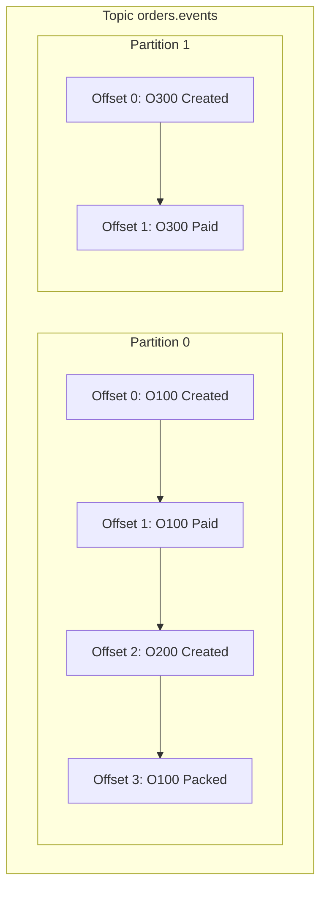
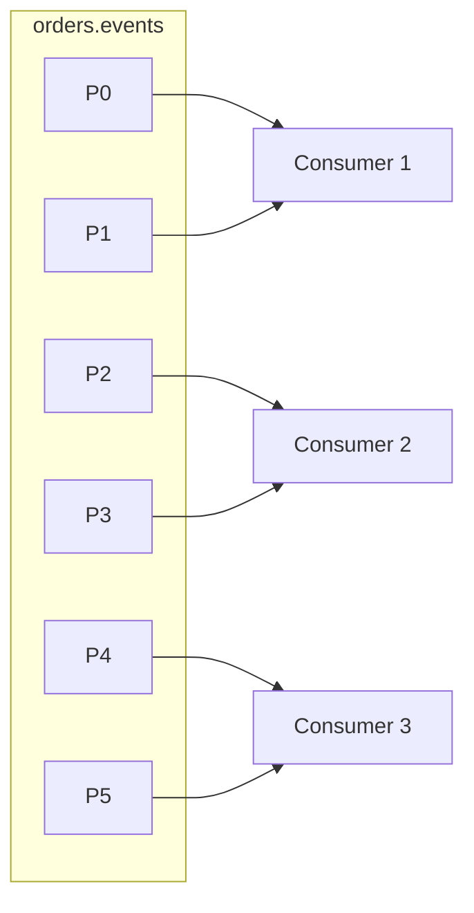

# Thứ tự bản ghi trong partition

Kafka được thiết kế để lưu và đọc record theo thứ tự trong từng partition. Đây là nền tảng để xử lý các chuỗi thay đổi của cùng một thực thể, chẳng hạn các trạng thái liên tiếp của một đơn hàng hoặc các giao dịch của một tài khoản. Tuy nhiên, bảo đảm thứ tự của Kafka có phạm vi rõ ràng: **Kafka giữ thứ tự trong một partition, không tạo ra thứ tự tổng thể giữa nhiều partition**.

Để tận dụng đúng bảo đảm này, producer cần định tuyến các record liên quan vào cùng partition, consumer cần xử lý chúng theo thứ tự nhận được, và cơ chế retry không được vô tình cho phép record sau vượt qua record trước. Bài viết này giải thích các điều kiện đó và cách áp dụng trong Spring Kafka.

## 1. Kafka bảo đảm thứ tự ở phạm vi nào?

Mỗi partition là một log chỉ ghi nối tiếp. Khi broker append record vào partition, record nhận một offset tăng dần. Offset xác định vị trí của record trong partition đó và thể hiện thứ tự append:

| Partition | Offset | Key | Value |
|---|---:|---|---|
| P0 | 0 | `O100` | `OrderCreated` |
| P0 | 1 | `O100` | `OrderPaid` |
| P0 | 2 | `O200` | `OrderCreated` |
| P0 | 3 | `O100` | `OrderPacked` |
| P1 | 0 | `O300` | `OrderCreated` |
| P1 | 1 | `O300` | `OrderPaid` |

Trong P0, consumer đọc theo thứ tự offset 0, 1, 2, 3. Với đơn hàng `O100`, các record `OrderCreated`, `OrderPaid`, `OrderPacked` xuất hiện theo đúng thứ tự append trong P0. Trong P1, `O300` cũng có thứ tự riêng là offset 0 rồi offset 1.

Không thể kết luận `OrderCreated` ở P0 xảy ra trước hay sau `OrderCreated` ở P1 chỉ bằng offset, vì offset chỉ có ý nghĩa trong partition của nó. Kafka không cung cấp một offset toàn cục cho toàn topic. Nếu nhiều partition nhận record đồng thời, thứ tự xen kẽ giữa các partition không được bảo đảm.



Mỗi partition có thứ tự độc lập. Một topic chỉ có một partition có thể tạo thứ tự append duy nhất cho tất cả record của topic, nhưng khả năng xử lý song song và thông lượng ghi sẽ bị giới hạn bởi partition đó. Khi topic có nhiều partition, hệ thống có thể mở rộng tốt hơn nhưng phải chấp nhận không có thứ tự tổng thể giữa chúng.

## 2. Dùng key để giữ các record liên quan cùng partition

Producer thường không chỉ định partition trực tiếp mà gửi record kèm key. Với partitioner mặc định, Kafka dùng key đã serialize để chọn partition. Khi số partition và cách serialize/partitioning không đổi, cùng một key thường được định tuyến vào cùng partition.

Ví dụ, nếu cần giữ thứ tự thay đổi của một đơn hàng, hãy dùng `orderId` làm key:

| Event | Key | Partition dự kiến |
|---|---|---|
| `OrderCreated` của O100 | `O100` | P0 |
| `OrderPaid` của O100 | `O100` | P0 |
| `OrderPacked` của O100 | `O100` | P0 |
| `OrderCreated` của O200 | `O200` | P1 |

Các event của O100 được gửi đến cùng partition, do đó consumer có thể xử lý theo offset để giữ thứ tự thay đổi của đơn hàng đó. Các đơn hàng khác vẫn có thể được xử lý song song ở partition khác.

Ví dụ producer Spring Kafka:

```java
import org.springframework.kafka.core.KafkaTemplate;
import org.springframework.stereotype.Service;

record OrderEvent(String orderId, String type) {}

@Service
public class OrderEventPublisher {

    private static final String TOPIC = "orders.events";

    private final KafkaTemplate<String, OrderEvent> kafkaTemplate;

    public OrderEventPublisher(KafkaTemplate<String, OrderEvent> kafkaTemplate) {
        this.kafkaTemplate = kafkaTemplate;
    }

    public void publish(OrderEvent event) {
        // orderId là key để các event của cùng đơn hàng vào cùng partition.
        kafkaTemplate.send(TOPIC, event.orderId(), event);
    }
}
```

Nếu key là `null`, producer không có định danh ổn định để gom các event của một thực thể vào cùng partition. Cơ chế phân phối record không key có thể phân tán chúng qua nhiều partition, nên không thể dựa vào đó để bảo đảm thứ tự theo đơn hàng.

### Chọn key theo yêu cầu nghiệp vụ

Key nên đại diện cho thực thể mà các thay đổi của nó cần được tuần tự hóa:

- `orderId` nếu cần thứ tự các thay đổi của từng đơn hàng.
- `accountId` nếu cần thứ tự cập nhật số dư của từng tài khoản.
- `deviceId` nếu cần xử lý chuỗi trạng thái của từng thiết bị.

Không nhất thiết chọn `eventId` làm key. `eventId` định danh một lần phát sinh event; key thường cần định tuyến tất cả event của cùng một thực thể về cùng partition. Hai giá trị có mục đích khác nhau.

Key chỉ tạo điều kiện để các record đi cùng partition; nó không tự sắp xếp lại những event được gửi sai thứ tự từ ứng dụng. Nếu hai luồng xử lý đồng thời gửi `OrderPaid` và `OrderCreated`, Kafka append theo thứ tự broker nhận được. Khi thứ tự nghiệp vụ phải được xác định chính xác, ứng dụng cần điều phối việc phát hành hoặc mang theo số phiên bản/sequence của aggregate để phát hiện event đến sai thứ tự.

## 3. Producer và thứ tự gửi record

Kafka producer gửi record bất đồng bộ và gom record thành batch. Khi một producer gửi nhiều record đến cùng partition, Kafka producer duy trì thứ tự gửi trong điều kiện cấu hình phù hợp. Tuy nhiên, retry có thể ảnh hưởng đến thứ tự nếu producer cho phép nhiều request đang bay và không bật idempotence.

Ví dụ producer gửi A rồi B đến cùng partition:

1. Batch chứa A được gửi nhưng broker phản hồi lỗi tạm thời.
2. Batch chứa B được broker ghi thành công.
3. Producer gửi lại batch A.

Nếu producer không bật idempotence và cho phép nhiều request đồng thời, B có thể được append trước A trong một số tình huống retry. Đây là lý do cần cấu hình producer để duy trì thứ tự khi có lỗi truyền tải.

Với Kafka client hiện đại, bật idempotence cho phép producer dùng sequence number để broker nhận diện retry, tránh ghi trùng và bảo toàn thứ tự batch theo từng producer/partition. Cấu hình có thể khai báo rõ trong Spring Boot:

```yaml
spring:
  kafka:
    producer:
      acks: all
      retries: 2147483647
      properties:
        enable.idempotence: true
        max.in.flight.requests.per.connection: 5
```

`enable.idempotence=true` yêu cầu cấu hình tương thích, bao gồm `acks=all`, `retries` lớn hơn 0 và `max.in.flight.requests.per.connection` không vượt quá giới hạn hỗ trợ của Kafka client (hiện đại là tối đa 5). Nếu tắt idempotence, cần đặc biệt thận trọng với nhiều request đồng thời khi retry; giới hạn `max.in.flight.requests.per.connection=1` là cách đơn giản để tránh trường hợp batch sau vượt batch trước, đổi lại giảm thông lượng.

Idempotence bảo vệ thứ tự retry của một producer session theo partition. Nó không tạo thứ tự nghiệp vụ chung giữa nhiều producer độc lập cùng ghi vào một key. Nếu nhiều instance cùng phát event cho một aggregate, thứ tự append vẫn phụ thuộc vào thời điểm broker nhận record. Khi cần thứ tự nhân quả, hãy dùng một luồng phát hành được điều phối hoặc số phiên bản tăng dần trong event để consumer kiểm tra.

## 4. Consumer group và thứ tự xử lý

Trong cùng một consumer group, tại một thời điểm, một partition được gán cho tối đa một consumer member. Consumer đọc record của partition theo thứ tự offset. Đây là cơ sở để mở rộng consumer theo số partition mà vẫn giữ thứ tự trong từng partition.

Ví dụ topic có sáu partition và consumer group có ba member:



Đây là một cách phân bổ minh họa; Kafka có thể dùng chiến lược assignment khác. Mỗi member xử lý các partition được giao. Một partition không được chia cho hai member cùng group trong cùng thời điểm, nên các record trong partition có một consumer owner tại thời điểm đó.

Số consumer xử lý song song hiệu quả không thể vượt quá số partition được gán. Nếu topic có ba partition nhưng listener đặt `concurrency=8`, tối đa ba consumer trong group có thể nhận partition ở cùng thời điểm; các consumer còn lại không có partition để xử lý. Muốn tăng mức song song, cần cân nhắc tăng partition và kiểm tra khả năng xử lý của broker, producer, consumer cùng hệ thống downstream.

### Cấu hình listener trong Spring Kafka

```java
import org.apache.kafka.clients.consumer.ConsumerRecord;
import org.springframework.kafka.annotation.KafkaListener;
import org.springframework.stereotype.Component;

record OrderEvent(String orderId, String type) {}

interface OrderProjection {
    void apply(OrderEvent event);
}

@Component
public class OrderEventListener {

    private final OrderProjection orderProjection;

    public OrderEventListener(OrderProjection orderProjection) {
        this.orderProjection = orderProjection;
    }

    @KafkaListener(
            topics = "orders.events",
            groupId = "order-projection",
            concurrency = "3"
    )
    public void onOrderEvent(ConsumerRecord<String, OrderEvent> record) {
        OrderEvent event = record.value();

        System.out.printf(
                "orderId=%s, partition=%d, offset=%d, type=%s%n",
                record.key(),
                record.partition(),
                record.offset(),
                event.type()
        );

        // Xử lý đồng bộ để hoàn tất record hiện tại trước record kế tiếp.
        orderProjection.apply(event);
    }
}
```

Trong ví dụ, `concurrency="3"` tạo tối đa ba consumer thread cho listener container. Mỗi partition được gán cho một consumer trong group; các partition khác nhau có thể xử lý song song. Phần xử lý trong listener được viết đồng bộ để giữ thứ tự các lần cập nhật trên cùng partition. `orderProjection` đại diện cho thành phần cập nhật trạng thái nghiệp vụ.

## 5. Những cách làm có thể phá vỡ thứ tự ở tầng ứng dụng

Kafka giao record theo thứ tự offset, nhưng ứng dụng có thể tự làm mất thứ tự sau khi nhận record.

### Đẩy từng record sang thread pool không kiểm soát

Giả sử consumer nhận A rồi B từ cùng partition, nhưng gửi hai tác vụ vào một thread pool:

```java
executor.submit(() -> process(recordA));
executor.submit(() -> process(recordB));
```

Nếu B xử lý nhanh hơn A, side effect của B có thể hoàn thành trước A. Khi đó Kafka vẫn giao record đúng thứ tự, nhưng trạng thái database hoặc kết quả nghiệp vụ lại bị đảo thứ tự.

Nếu cần xử lý bất đồng bộ, hãy bảo đảm các record trong cùng partition hoặc cùng key được thực thi tuần tự. Có thể dùng một hàng đợi tuần tự cho mỗi partition/key, hoặc thiết kế bộ xử lý có sequence/version để từ chối cập nhật cũ. Việc commit offset cũng phải chờ các record trước đó hoàn tất; commit vượt qua một record chưa xử lý có thể khiến record đó bị bỏ qua sau khi ứng dụng khởi động lại.

### Retry và dead-letter

Với retry chặn (blocking retry), consumer có thể tạm dừng xử lý partition hoặc seek về record lỗi để thử lại. Record sau trong partition phải chờ record lỗi được xử lý xong. Cách này giúp giữ thứ tự, nhưng một record lỗi lâu có thể chặn các record khác trong cùng partition.

Với non-blocking retry topic, record lỗi được chuyển sang retry topic để thử lại sau, còn partition chính có thể tiếp tục xử lý record tiếp theo. Cách này tăng khả năng tiếp tục tiêu thụ nhưng có thể khiến record sau hoàn thành trước record lỗi. Nếu thứ tự theo aggregate là bắt buộc, cần đánh giá kỹ chiến lược retry; có thể giữ xử lý chặn, tạm dừng key/partition liên quan hoặc thiết kế consumer kiểm tra sequence trước khi áp dụng.

Dead-letter topic cũng cần được xem xét theo cùng nguyên tắc. Đưa record lỗi sang DLT không có nghĩa là record đó đã được xử lý theo thứ tự nghiệp vụ. Khi replay từ DLT, cần tránh ghi đè trạng thái mới hơn bằng một event cũ.

## 6. Tăng partition có thể ảnh hưởng đến thứ tự theo key

Với partitioner mặc định, key được ánh xạ dựa trên số partition hiện tại. Nếu tăng số partition của topic, kết quả ánh xạ của cùng key có thể thay đổi. Record cũ của `O100` vẫn ở partition trước đó, còn record mới của `O100` có thể vào partition khác.

Khi đó, hai partition có thể được consumer xử lý song song và không có bảo đảm thứ tự giữa chúng. Vì vậy, tăng partition không chỉ là thay đổi năng lực thông lượng; nó có thể thay đổi cách phân phối key và ảnh hưởng đến luồng cần thứ tự theo thực thể.

Trước khi tăng partition cho topic yêu cầu ordering theo key, hãy xem xét:

- Có thể tạo topic phiên bản mới và chuyển dữ liệu theo quy trình có kiểm soát hay không.
- Có cần custom partitioner hoặc chiến lược định tuyến ổn định để giữ mapping hay không.
- Consumer cần đồng bộ/đối chiếu dữ liệu cũ và mới trong giai đoạn chuyển đổi ra sao.
- Có thể dùng sequence/version của aggregate để phát hiện event đến muộn hoặc sai thứ tự hay không.

Không nên thay đổi partition count một cách tùy tiện nếu ứng dụng dựa vào cùng key luôn nằm trong một partition trong suốt vòng đời dữ liệu.

## 7. Khi nào cần thứ tự toàn cục?

Đa số hệ thống chỉ cần thứ tự theo một thực thể: đơn hàng, tài khoản, thiết bị hoặc khách hàng. Chọn key phù hợp cho phép các thực thể khác nhau được xử lý song song mà vẫn giữ thứ tự trong từng nhóm.

Nếu nghiệp vụ thật sự yêu cầu mọi record của topic có một thứ tự tổng thể, cách trực tiếp là dùng một partition. Đổi lại, producer và consumer chỉ có một luồng partition để khai thác, làm giới hạn khả năng mở rộng. Với tải lớn, có thể cân nhắc một sequencer hoặc hệ thống cấp số thứ tự ở tầng nghiệp vụ, nhưng consumer vẫn phải kiểm soát việc áp dụng sequence.

Không nên cố suy ra thứ tự toàn cục bằng cách so sánh timestamp giữa các partition. Timestamp có thể trùng nhau, đồng hồ producer có thể lệch, và thời điểm tạo event không nhất thiết là thứ tự broker append record.

## 8. Checklist thiết kế ordering

| Câu hỏi | Hướng xử lý |
|---|---|
| Thực thể nào cần thứ tự? | Chọn `aggregateId`/`orderId` làm key. |
| Các record có cùng key vào cùng partition không? | Giữ partitioner, key serializer và partition count ổn định. |
| Producer có retry không? | Bật idempotence và cấu hình `acks`, `retries`, `max.in.flight` tương thích. |
| Có nhiều producer cùng ghi một key không? | Điều phối writer hoặc mang sequence/version nghiệp vụ. |
| Consumer có xử lý song song trong một partition không? | Tuần tự hóa side effect theo partition/key. |
| Retry có cho record sau vượt record lỗi không? | Chọn blocking retry hoặc thiết kế cơ chế bảo vệ thứ tự. |
| Có dự định tăng partition không? | Đánh giá lại mapping key và lập kế hoạch migration. |
| Có cần thứ tự toàn cục không? | Cân nhắc một partition và giới hạn thông lượng đi kèm. |

## 9. Ghi nhớ

- Kafka bảo đảm thứ tự record theo offset trong **một partition**.
- Offset của hai partition khác nhau không thể dùng để suy ra thứ tự toàn topic.
- Dùng key đại diện cho aggregate để các event liên quan được định tuyến vào cùng partition.
- Producer nên bật idempotence để retry không làm đảo thứ tự batch trong cùng producer/partition.
- Trong một consumer group, mỗi partition được gán cho tối đa một consumer member tại một thời điểm; các partition khác nhau có thể chạy song song.
- Xử lý bất đồng bộ, retry topic và thay đổi partition count có thể làm sai thứ tự side effect ở tầng ứng dụng.
- Nếu cần thứ tự nghiệp vụ nghiêm ngặt, hãy kết hợp partitioning ổn định với sequence/version và cơ chế điều phối phù hợp.

Khi thiết kế một luồng Kafka, hãy xác định thứ tự cần bảo vệ ở cấp nào: toàn topic, từng partition hay từng aggregate. Từ đó mới chọn số partition, key, cấu hình producer và cách consumer xử lý lỗi. Phần lớn hệ thống có thể mở rộng tốt khi bảo vệ thứ tự theo aggregate thay vì yêu cầu một thứ tự toàn cục.
