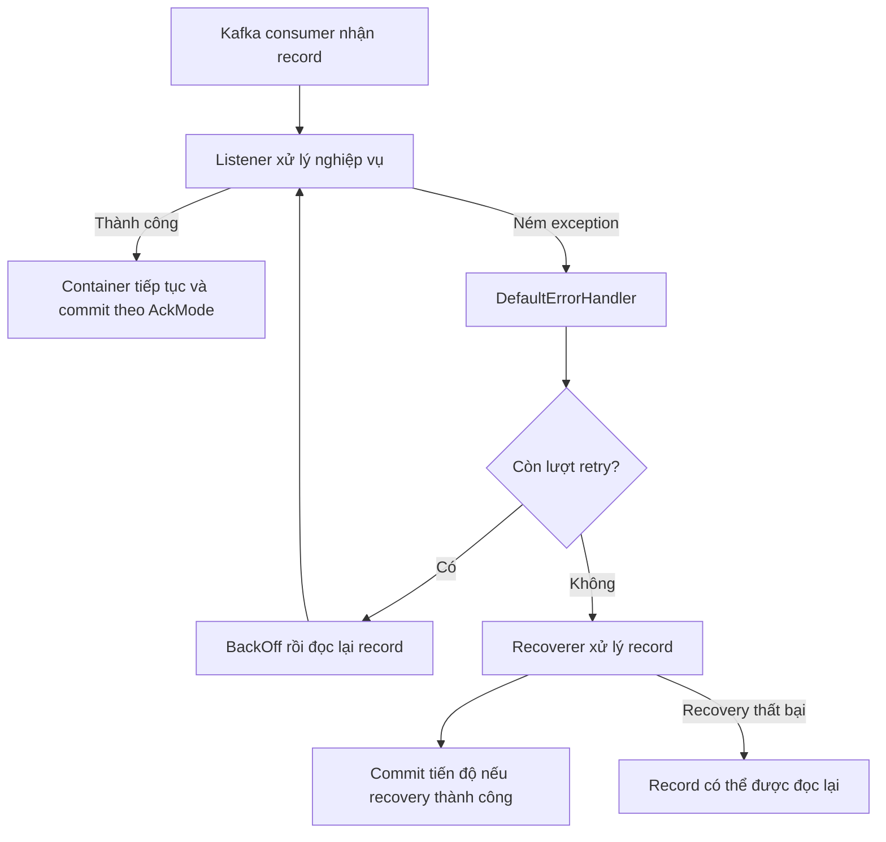

# DefaultErrorHandler

Trong ứng dụng Spring Kafka, listener có thể ném exception khi xử lý một record vì dữ liệu không hợp lệ, dịch vụ phụ thuộc tạm thời không sẵn sàng hoặc lỗi lập trình. Nếu không có cơ chế xử lý lỗi phù hợp, consumer có thể liên tục nhận lại record lỗi, làm giảm throughput và giữ các record khác trong cùng partition phải chờ.

`DefaultErrorHandler` là common error handler ở cấp listener container, được Spring Kafka dùng để quyết định cách retry và phục hồi record sau khi listener thất bại. Ta có thể cấu hình thời gian chờ giữa các lần thử, phân loại exception, rồi chuyển record đã hết retry sang dead-letter topic (DLT).

## 1. DefaultErrorHandler nằm ở đâu trong luồng xử lý?

Listener tập trung vào nghiệp vụ: nhận payload, kiểm tra và gọi service. Khi listener ném exception, container chuyển lỗi cho `DefaultErrorHandler`. Error handler áp dụng chính sách đã cấu hình và điều khiển việc đọc lại record bằng cơ chế seek của consumer.



`DefaultErrorHandler` triển khai `CommonErrorHandler`, vì vậy được gắn vào `ConcurrentKafkaListenerContainerFactory`. Đây là cơ chế xử lý lỗi ở container, khác với việc bắt exception bên trong từng phương thức listener hoặc dùng `KafkaListenerErrorHandler` cho một listener nhận message.

Với record listener, khi xử lý thất bại, handler thường seek về offset cần xử lý lại để consumer giao record đó lần nữa. Những record tiếp theo trong partition sẽ chờ phía sau record lỗi. Với batch listener, handler có thể dùng `BatchListenerFailedException` để xác định vị trí record lỗi; nếu exception không chỉ ra record, framework có thể phải retry toàn bộ batch.

## 2. Cấu hình retry bằng BackOff

BackOff xác định khoảng chờ và số lần thử lại. Ví dụ sau cho phép retry hai lần, mỗi lần cách nhau một giây sau lần xử lý ban đầu:

```java
@Bean
public DefaultErrorHandler kafkaErrorHandler() {
    return new DefaultErrorHandler(
        new FixedBackOff(1_000L, 2L));
}
```

`FixedBackOff(1_000L, 2L)` có nghĩa là khoảng chờ là 1.000 mili giây và tối đa hai lần retry. Tổng số lần listener có thể được gọi cho cùng một record trong chu kỳ xử lý này là ba: một lần đầu và hai lần thử lại.

Nếu cần khoảng chờ tăng dần, có thể dùng một implementation `BackOff` khác, chẳng hạn exponential backoff. Backoff giúp tránh gọi dồn dập một dịch vụ đang gặp sự cố. Hãy đặt giới hạn hợp lý để thời gian retry không vượt quá yêu cầu xử lý của hệ thống.

Retry của `DefaultErrorHandler` là kiểu retry tại consumer: record lỗi được đọc lại theo chính sách của container. Trong thời gian chờ và retry, partition có thể bị chặn bởi record lỗi. Nếu cần đưa record lỗi sang các retry topic để các record sau tiếp tục được xử lý, hãy đánh giá cơ chế non-blocking retry như `@RetryableTopic`; đây là một kiến trúc retry khác và cần quản lý thêm retry topic, DLT cùng thứ tự xử lý.

## 3. Phân loại exception

Không phải lỗi nào cũng có thể tự hết khi thử lại. Lỗi timeout hoặc kết nối tạm thời có thể retry; payload sai cấu trúc hoặc vi phạm quy tắc nghiệp vụ thường không thay đổi sau vài giây. `DefaultErrorHandler` cho phép bổ sung các loại exception retry được hoặc không retry được.

```java
@Bean
public DefaultErrorHandler kafkaErrorHandler() {
    DefaultErrorHandler handler = new DefaultErrorHandler(
        new FixedBackOff(1_000L, 2L));

    // Lỗi dữ liệu cố định: không retry.
    handler.addNotRetryableExceptions(InvalidOrderException.class);

    // Lỗi phụ thuộc tạm thời: cho phép retry.
    handler.addRetryableExceptions(PartnerUnavailableException.class);
    return handler;
}
```

Các exception được phân loại không retry sẽ đi thẳng đến bước recovery sau lần thất bại đầu tiên. Khi không khai báo phân loại riêng, Spring Kafka đã có một số quy tắc mặc định; các lỗi liên quan đến deserialize, convert message hoặc resolve tham số listener thường được xem là không retry vì thử lại cùng dữ liệu thường không giải quyết được nguyên nhân.

Khi phân loại, hãy xem cả exception cause. Một lỗi nghiệp vụ có thể được bọc bên trong exception khác; log loại exception gốc và record metadata sẽ giúp xác định chính sách thực sự được áp dụng.

## 4. Phục hồi record và chuyển sang DLT

Khi hết retry, handler gọi recoverer. Nếu không cung cấp recoverer riêng, `DefaultErrorHandler` mặc định ghi log record thất bại. Trong hệ thống cần điều tra hoặc xử lý lại dữ liệu, nên cân nhắc `DeadLetterPublishingRecoverer` để publish record sang DLT.

```java
@Bean
public DefaultErrorHandler kafkaErrorHandler(
        KafkaTemplate<Object, Object> kafkaTemplate) {
    DeadLetterPublishingRecoverer recoverer =
        new DeadLetterPublishingRecoverer(
            kafkaTemplate,
            (record, exception) -> new TopicPartition(
                record.topic() + ".DLT", record.partition()));

    DefaultErrorHandler handler = new DefaultErrorHandler(
        recoverer, new FixedBackOff(1_000L, 2L));
    handler.addNotRetryableExceptions(InvalidOrderException.class);
    return handler;
}
```

Resolver trong ví dụ gửi record từ topic `orders` sang `orders.DLT` và giữ nguyên số partition. Vì vậy, topic DLT phải tồn tại và có đủ partition tương ứng với partition nguồn. Nếu muốn dùng số partition khác hoặc gom lỗi về một partition, hãy thay đổi destination resolver có chủ đích.

Producer của `KafkaTemplate` cần serializer tương thích với key và value của record được chuyển tiếp. `DeadLetterPublishingRecoverer` bổ sung các header phục vụ truy vết, chẳng hạn thông tin topic, partition, offset nguồn và exception. Khi đọc DLT, hãy kiểm tra các header này cùng payload để xác định record đến từ đâu và thất bại vì lý do gì.

Recovery chỉ được xem là thành công khi recoverer hoàn tất việc xử lý theo cấu hình. Nếu publish sang DLT thất bại, record có thể được đưa trở lại luồng xử lý lỗi; vì vậy cần theo dõi cả lỗi gửi DLT và cấu hình retry cho recovery failure. Không nên giả định rằng chỉ cần tạo topic DLT là việc chuyển record chắc chắn thành công.

## 5. Offset và acknowledgement sau recovery

Kafka lưu offset theo từng partition. Khi listener xử lý thành công, container commit tiến độ dựa trên `AckMode` đang cấu hình. Khi handler phục hồi thành công một record và trả về bình thường, `DefaultErrorHandler` mặc định cho phép container xác nhận tiến độ sau khi xử lý lỗi (`ackAfterHandle` mặc định là `true`). Điều này giúp consumer tiếp tục qua record đã được recover, thay vì đọc lại vô hạn.

Có tùy chọn `commitRecovered` để handler tự commit offset của record đã phục hồi. Tùy chọn này yêu cầu `AckMode.MANUAL_IMMEDIATE`; chỉ bật khi ứng dụng thực sự cần cơ chế commit đó và hiểu rõ cách listener/container đang xác nhận offset. Không thay đổi `AckMode` một cách tùy tiện vì nó ảnh hưởng đến thời điểm commit của toàn bộ luồng.

Nếu recoverer ném exception, recovery chưa hoàn tất. Handler có thể đưa record trở lại luồng retry tùy cấu hình, do đó offset không nên được xem là đã an toàn để bỏ qua. Với nhiều partition trong cùng consumer, mỗi partition vẫn có tiến độ độc lập.

## 6. Gắn handler vào listener container

Sau khi khai báo error handler, gắn nó vào container factory mà listener sử dụng:

```java
@Bean
public ConcurrentKafkaListenerContainerFactory<String, OrderCreated>
        kafkaListenerContainerFactory(
            ConsumerFactory<String, OrderCreated> consumerFactory,
            DefaultErrorHandler kafkaErrorHandler) {
    ConcurrentKafkaListenerContainerFactory<String, OrderCreated> factory =
        new ConcurrentKafkaListenerContainerFactory<>();
    factory.setConsumerFactory(consumerFactory);
    factory.setCommonErrorHandler(kafkaErrorHandler);
    return factory;
}
```

Listener dùng factory này sẽ nhận cùng chính sách retry và recovery:

```java
@KafkaListener(
    topics = "orders",
    groupId = "order-processor",
    containerFactory = "kafkaListenerContainerFactory")
public void consume(OrderCreated event) {
    orderService.process(event);
}
```

Nếu ứng dụng có nhiều nhóm listener với yêu cầu retry khác nhau, có thể khai báo nhiều container factory và error handler tương ứng. Đặt tên rõ ràng để tránh vô tình gắn chính sách DLT hoặc số lần retry của luồng này sang luồng khác.

## 7. Kiểm thử chính sách lỗi

Một kiểm thử có ích cần xác minh hành vi quan sát được, không chỉ kiểm tra bean được tạo. Với một record listener, hãy tạo một record làm service thất bại ở hai lần đầu rồi thành công ở lần kế tiếp. Xác minh listener được gọi ba lần và record không đi vào DLT.

Tiếp theo, kiểm thử record gây ra `InvalidOrderException`. Xác minh exception được phân loại không retry và record được chuyển sang DLT. Kiểm thử thêm trường hợp producer không gửi được DLT để bảo đảm ứng dụng không âm thầm đánh dấu record đã xử lý thành công.

Có thể dùng Embedded Kafka hoặc Testcontainers để kiểm tra consumer, offset và DLT trong môi trường Kafka thực. Khi test, chờ theo điều kiện hoặc dùng Awaitility thay vì sleep cố định dài; đồng thời xác nhận đúng topic, partition, key, payload và các header nguồn trên record DLT.

## 8. Những lưu ý khi vận hành

- Theo dõi số lần retry, số record được recover, số record vào DLT và số lần publish DLT thất bại.
- Ghi log topic, partition, offset, key và event ID; tránh log dữ liệu nhạy cảm trong payload.
- Đặt backoff và số lần retry theo loại lỗi, thời gian timeout và giới hạn SLA.
- Thiết kế nghiệp vụ idempotent vì record có thể được giao lại sau restart, rebalance hoặc lỗi trước khi offset được commit.
- Xây dựng quy trình kiểm tra, sửa dữ liệu và phát lại DLT có kiểm soát; tránh phát lại vô hạn cùng một record lỗi.

Với container có bật Kafka transaction, lỗi xử lý thường được xử lý qua rollback và `DefaultAfterRollbackProcessor`. Cần thiết kế chính sách retry/recovery theo mô hình transaction của container; không mặc định ghép nguyên cấu hình `DefaultErrorHandler` không transaction vào luồng transactional.

## Kết luận

`DefaultErrorHandler` tập trung chính sách xử lý lỗi tại listener container: xác định số lần retry, thời gian chờ, loại exception cần retry và cách phục hồi record sau khi hết lượt. Khi kết hợp đúng với DLT, acknowledgement mode, idempotency và giám sát, consumer có thể xử lý lỗi có kiểm soát mà vẫn duy trì tiến độ của từng partition.
