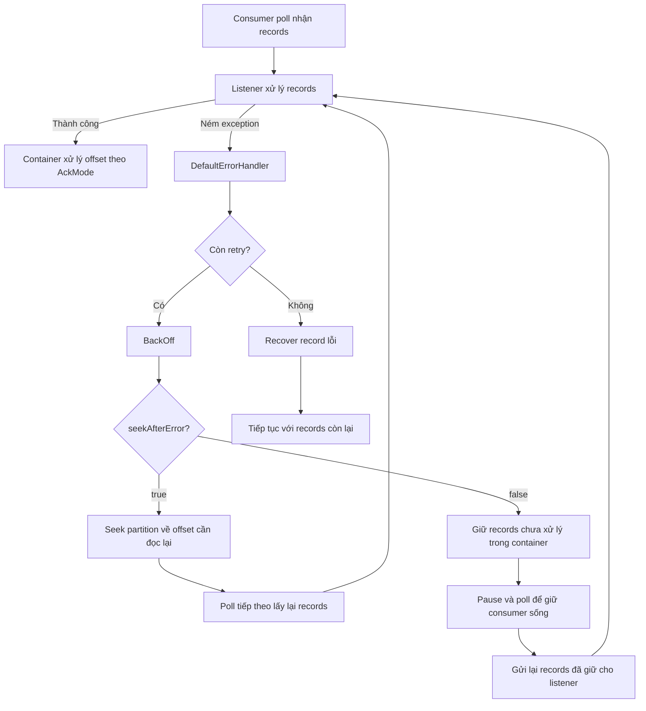

# SeekAfterError và cơ chế đọc lại

Khi một listener xử lý record rồi ném exception, Spring Kafka cần quyết định cách đưa record lỗi và những record chưa xử lý trở lại listener. Cách truyền thống là gọi `Consumer.seek()` để đưa vị trí đọc của từng partition về offset cần phát lại. Từ Spring Kafka 2.9, `DefaultErrorHandler` có thêm tùy chọn `seekAfterError = false`: container giữ các record chưa xử lý của lần `poll()` trước và gửi lại chúng cho listener mà không seek consumer.

Hai chế độ có cùng mục tiêu: retry record lỗi và tiếp tục xử lý phần dữ liệu còn lại theo chính sách retry/recovery. Điểm khác nhau nằm ở cách tạo lần giao lại. Hiểu rõ điểm này giúp lựa chọn cấu hình phù hợp với tải, thời gian backoff, bộ nhớ và hành vi của consumer group.

## 1. Seek là gì và vì sao cần đọc lại?

Kafka consumer đọc dữ liệu theo từng `TopicPartition`. Vị trí đọc của một partition là offset tiếp theo mà consumer sẽ lấy. Khi gọi `consumer.seek(partition, offset)`, ứng dụng đặt lại vị trí đọc của partition đó. Lần `poll()` tiếp theo có thể lấy lại record bắt đầu từ offset được chỉ định.

Ví dụ consumer nhận bốn record liên tiếp trong partition `orders-0`:

```text
Lần poll đầu:  offset 100   101   102   103
Xử lý:             OK    OK    FAIL  chưa xử lý
                                  |
                                  +-- exception
```

Listener đã xử lý 100 và 101, gặp lỗi ở 102 nên chưa xử lý 103. Với cơ chế seek mặc định, `DefaultErrorHandler` đưa vị trí đọc của partition về offset 102. Sau backoff, lần poll tiếp theo đọc lại từ phần dữ liệu chưa hoàn tất:

```text
consumer.seek(orders-0, 102)

Lần poll sau:  offset 102   103   ...
Xử lý lại:         retry   tiếp tục
```

Khi một lần poll chứa record từ nhiều partition, error handler phải xác định offset đầu tiên còn cần xử lý của từng partition và seek từng partition tương ứng. Do đó, việc đọc lại không nhất thiết đưa mọi partition về cùng một offset.

Offset của những record đã xử lý trước record lỗi được container commit theo `AckMode` và quy tắc commit đang cấu hình. Error handler tập trung đưa record lỗi cùng phần dữ liệu chưa hoàn tất trở lại luồng xử lý. Việc seek không tự commit offset; nó chỉ thay đổi vị trí đọc của consumer hiện tại.

## 2. `DefaultErrorHandler` và seek mặc định

Trong Spring Kafka hiện đại, `DefaultErrorHandler` là common error handler thay thế các implementation cũ như `SeekToCurrentErrorHandler`. Với record listener, khi listener thất bại, handler dùng backoff để retry. Nếu chưa hết retry, các record lỗi và chưa xử lý được seek để giao lại ở poll sau. Khi hết retry, recoverer có thể ghi log, gửi record sang dead-letter topic (DLT) hoặc thực hiện một hành động recovery khác.

Một cấu hình điển hình:

```java
@Bean
DefaultErrorHandler orderErrorHandler(
        KafkaTemplate<String, Order> kafkaTemplate) {

    var recoverer = new DeadLetterPublishingRecoverer(kafkaTemplate);
    var backOff = new FixedBackOff(1_000L, 2L);

    return new DefaultErrorHandler(recoverer, backOff);
}
```

`FixedBackOff(1_000L, 2L)` đặt khoảng nghỉ một giây giữa các lần retry và cho phép hai lần retry sau lần giao đầu tiên, tức tối đa ba lần listener nhận record. Khi retry hết, `DeadLetterPublishingRecoverer` gửi record lỗi sang DLT. Resolver mặc định dùng tên topic gốc cộng hậu tố `-dlt` và giữ partition nguồn; cần bảo đảm topic DLT có cấu hình partition phù hợp.

Gắn handler vào listener container factory:

```java
@Bean
ConcurrentKafkaListenerContainerFactory<String, Order> orderListenerFactory(
        ConsumerFactory<String, Order> consumerFactory,
        DefaultErrorHandler orderErrorHandler) {

    var factory = new ConcurrentKafkaListenerContainerFactory<String, Order>();
    factory.setConsumerFactory(consumerFactory);
    factory.setCommonErrorHandler(orderErrorHandler);
    return factory;
}
```

Với cấu hình mặc định `seekAfterError = true`, handler seek các partition để record lỗi và những record chưa xử lý được giao lại ở lần poll tiếp theo. Nếu recoverer xử lý thành công record lỗi, record đó được bỏ qua trong lần giao lại; các record phía sau vẫn được xử lý theo luồng bình thường. Nếu recovery thất bại, record lỗi vẫn cần được thử lại.

## 3. Chế độ không seek với `seekAfterError = false`

Từ Spring Kafka 2.9, có thể tắt thao tác seek bằng:

```java
DefaultErrorHandler errorHandler =
        new DefaultErrorHandler(recoverer, new FixedBackOff(1_000L, 2L));

errorHandler.setSeekAfterError(false);
```

Khi chế độ này được bật, Spring Kafka giữ lại các record lỗi và chưa xử lý từ `ConsumerRecords` của lần poll trước. Sau khi error handler kết thúc, container tạm pause consumer, thực hiện một lần `poll()` để duy trì hoạt động của consumer group, rồi gửi lại các record đã giữ cho listener. Nếu đang dùng `ContainerPausingBackOffHandler` hoặc non-blocking retry, khoảng pause có thể kéo dài qua nhiều lần poll.

Luồng xử lý:



Chế độ không seek không loại bỏ retry và cũng không có nghĩa là bỏ qua record lỗi. Record lỗi vẫn được retry theo `BackOff`; khi retry hết, recoverer vẫn quyết định cách xử lý record đó. Sự khác biệt là container dùng chính các record còn giữ trong bộ nhớ thay vì yêu cầu Kafka giao lại chúng thông qua vị trí đọc mới.

## 4. Cấu hình đầy đủ với chế độ không seek

Có thể kết hợp `seekAfterError = false` với cùng recoverer và backoff ở ví dụ trước:

```java
@Bean
DefaultErrorHandler orderErrorHandler(
        KafkaTemplate<String, Order> kafkaTemplate) {

    var recoverer = new DeadLetterPublishingRecoverer(kafkaTemplate);
    var backOff = new FixedBackOff(1_000L, 2L);
    var errorHandler = new DefaultErrorHandler(recoverer, backOff);

    errorHandler.setSeekAfterError(false);
    return errorHandler;
}
```

`setSeekAfterError(false)` chỉ thay đổi cơ chế đưa record chưa xử lý trở lại listener. Chính sách retry, backoff và recoverer vẫn do `DefaultErrorHandler` quản lý. Vì vậy, có thể chuyển từ seek sang giữ record mà không phải thay đổi quy tắc số lần retry hoặc đích DLT.

Khi đặt thuộc tính này thành `false`, Spring Kafka cũng bật hành vi reset trạng thái retry khi loại exception thay đổi. Ví dụ, nếu một lần giao thất bại do `TimeoutException` nhưng lần tiếp theo lại thất bại do `IllegalStateException`, chuỗi backoff được tính lại theo loại exception mới. Cần lưu ý hành vi này khi phân tích số lần retry trong log.

## 5. Retry và recovery diễn ra như thế nào?

Với record listener, có thể hình dung một record lỗi đi qua các bước sau:

1. Consumer poll một tập record từ một hoặc nhiều partition.
2. Listener xử lý record; nếu một record ném exception, container chuyển lỗi cho `DefaultErrorHandler`.
3. Handler xác định record lỗi, áp dụng `BackOff` và quyết định có retry hay đã hết số lần retry.
4. Nếu còn retry, handler chuẩn bị giao lại record lỗi và các record chưa xử lý bằng seek hoặc bằng tập record đang được container giữ.
5. Nếu đã hết retry, recoverer được gọi. Recoverer thành công thì record lỗi được xem là đã recovery; container tiếp tục với các record còn lại.
6. Nếu recoverer thất bại, record lỗi vẫn phải được giao lại theo chính sách của error handler; không nên coi việc gửi DLT là thành công khi thao tác publish thất bại.

Với batch listener, cách xác định record lỗi phụ thuộc exception mà listener ném ra. Nếu listener ném `BatchListenerFailedException` kèm record hoặc index lỗi, `DefaultErrorHandler` có thể commit các record đứng trước vị trí lỗi, retry record lỗi cùng các record phía sau, rồi recovery riêng record lỗi khi retry hết. Nếu listener ném exception thông thường không chỉ ra record lỗi, handler dùng fallback batch behavior và có thể retry toàn bộ batch. `seekAfterError = false` chỉ thay cách giao lại phần cần retry; nó không biến một batch exception không xác định vị trí thành lỗi có thể recovery riêng từng record.

Ví dụ xác định record lỗi trong batch:

```java
@KafkaListener(topics = "orders", containerFactory = "batchFactory")
public void consume(List<ConsumerRecord<String, Order>> records) {
    for (ConsumerRecord<String, Order> record : records) {
        try {
            orderService.apply(record.value());
        }
        catch (Exception ex) {
            throw new BatchListenerFailedException(
                    "Không xử lý được đơn hàng", ex, record);
        }
    }
}
```

Nếu dùng POJO batch listener như `List<Order>` và không có `ConsumerRecord`, có thể truyền index của phần tử lỗi vào `BatchListenerFailedException`. Dù dùng seek hay giữ record, listener phải chỉ ra đúng vị trí lỗi nếu muốn error handler áp dụng cách xử lý theo từng record.

## 6. Chọn seek hay giữ record?

| Tiêu chí | `seekAfterError = true` | `seekAfterError = false` |
|---|---|---|
| Cách giao lại | Seek từng partition về offset cần đọc lại; poll sau lấy record từ Kafka | Container giữ record lỗi và phần chưa xử lý từ poll trước rồi gửi lại |
| Mặc định | Có | Không |
| Phiên bản hỗ trợ | Cơ chế seek mặc định | Từ Spring Kafka 2.9 |
| Tác động chính | Thay đổi vị trí đọc của consumer | Giữ record trong bộ nhớ của container, không seek |
| Retry và recoverer | Dùng `BackOff` và recoverer đã cấu hình | Vẫn dùng cùng `BackOff` và recoverer |
| Cân nhắc vận hành | Kafka giao lại dữ liệu ở poll sau | Consumer phải được pause/poll đúng cách; tập record chưa xử lý được giữ trong bộ nhớ |

Chọn chế độ seek mặc định khi muốn consumer đọc lại từ broker theo offset đã đặt và muốn giữ cơ chế quen thuộc của Kafka consumer. Chọn chế độ không seek khi muốn container tái sử dụng tập record vừa poll và tránh thực hiện thao tác seek cho mỗi lần retry. Không có chế độ nào tự động làm cho nghiệp vụ idempotent; listener vẫn có thể chạy lại record sau lỗi.

## 7. Backoff dài và sức khỏe consumer group

Retry có khoảng chờ dài cần được tính cùng `max.poll.interval.ms`. Nếu consumer không gọi `poll()` đủ lâu, broker có thể xem consumer là không còn hoạt động và việc phân phối partition trong group có thể thay đổi. Backoff mặc định thường giữ thread listener trong thời gian chờ. Với thời gian chờ dài hơn `max.poll.interval.ms`, cân nhắc `ContainerPausingBackOffHandler` để pause container và tiếp tục poll trong thời gian chờ.

Ví dụ tạo handler với pausing backoff:

```java
var backOffHandler = new ContainerPausingBackOffHandler();
var errorHandler = new DefaultErrorHandler(
        recoverer,
        new FixedBackOff(60_000L, 2L),
        backOffHandler);

errorHandler.setSeekAfterError(false);
```

Thời gian pause thực tế chịu ảnh hưởng của `pollTimeout`. Khi dùng chế độ không seek, container còn phải duy trì tập record chờ xử lý trong suốt thời gian retry. Vì vậy, cần chọn `max.poll.records`, kích thước batch và backoff sao cho lượng dữ liệu được giữ cùng thời gian xử lý nằm trong giới hạn tài nguyên của ứng dụng.

## 8. Những điểm cần theo dõi

- **Delivery attempt:** theo dõi số lần giao lại để nhận biết record bị kẹt ở retry. `DefaultErrorHandler` hỗ trợ delivery attempt header và `RetryListener` để quan sát quá trình retry/recovery.
- **Tỷ lệ recovery và DLT:** đo số record được recover, số lần publish DLT thất bại và tuổi của record cũ nhất chưa xử lý.
- **Thời gian xử lý và backoff:** theo dõi thời gian listener, thời gian chờ và khoảng cách giữa các lần giao để phát hiện retry đang làm giảm throughput.
- **Consumer group:** theo dõi rebalance, lag, thời gian giữa các lần poll và tình trạng pause/resume.
- **Tính idempotent:** record có thể được xử lý lại sau khi lỗi, restart hoặc rebalance. Dùng event ID hoặc business key để tránh áp dụng cùng một nghiệp vụ nhiều lần.

Nếu listener container đang dùng Kafka transaction, cần phân biệt `DefaultErrorHandler` với `DefaultAfterRollbackProcessor`. `seekAfterError` là tùy chọn của `DefaultErrorHandler` trong common error handling; luồng transaction rollback có cơ chế sau rollback riêng để xử lý offset và phát lại record. Không nên thay `AfterRollbackProcessor` bằng cấu hình `seekAfterError` khi mục tiêu là xử lý lỗi sau khi Kafka transaction rollback.

## 9. Ghi nhớ

- `seek()` thay đổi offset tiếp theo mà consumer sẽ đọc; Spring Kafka dùng seek để giao lại record lỗi và record chưa xử lý.
- `DefaultErrorHandler` mặc định dùng `seekAfterError = true`.
- Từ Spring Kafka 2.9, `setSeekAfterError(false)` cho phép container giữ record chưa xử lý và gửi lại sau một lần poll có pause, không cần seek.
- Hai chế độ vẫn dùng chung retry, `BackOff` và recoverer; chế độ không seek không có nghĩa là bỏ qua lỗi.
- Với batch listener, cần dùng `BatchListenerFailedException` để chỉ ra record hoặc index lỗi nếu muốn retry/recovery theo từng record.
- Backoff dài cần phối hợp với `max.poll.interval.ms`, `pollTimeout` và `ContainerPausingBackOffHandler`; mọi lần giao lại đều đòi hỏi listener có khả năng xử lý lặp an toàn.

## Tài liệu tham khảo

- [Spring for Apache Kafka — Handling Exceptions, mục DefaultErrorHandler](https://docs.spring.io/spring-kafka/reference/kafka/annotation-error-handling.html)
- [Spring for Apache Kafka 3.2 API — FailedRecordProcessor.setSeekAfterError](https://docs.spring.io/spring-kafka/docs/3.2.10/api/org/springframework/kafka/listener/FailedRecordProcessor.html)
- [Spring for Apache Kafka — Listener Container Properties](https://docs.spring.io/spring-kafka/reference/kafka/container-props.html)
