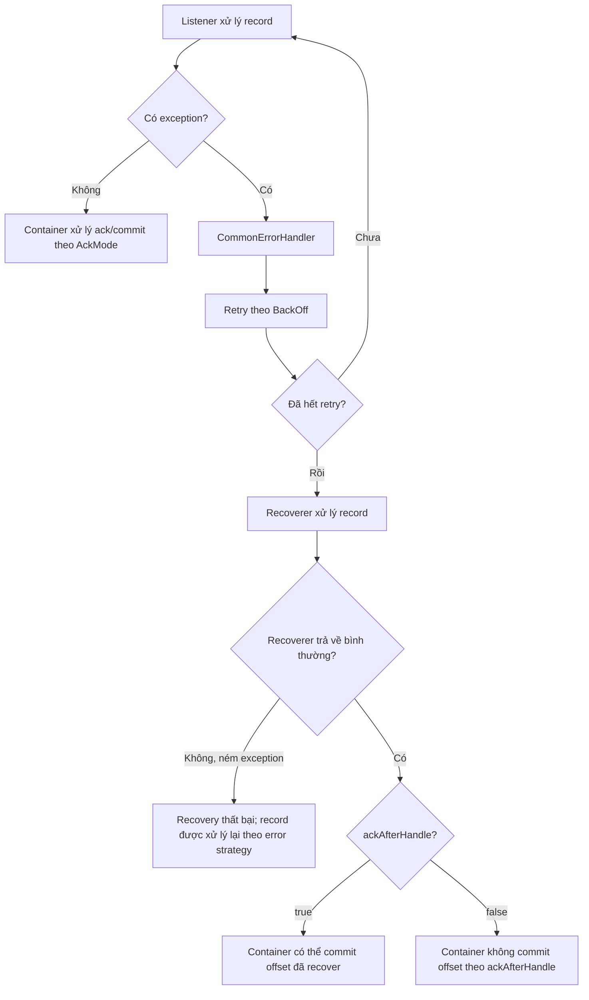

# AckAfterHandle trong Spring Kafka

`ackAfterHandle` quyết định container có commit offset sau khi `CommonErrorHandler` xử lý lỗi và trả về bình thường hay không. Với `DefaultErrorHandler`, giá trị mặc định là `true`: khi record được xem là đã xử lý xong sau retry/recovery và error handler không ném exception tiếp, container có thể commit offset để không giao lại record đó.

Thiết lập này đặc biệt quan trọng khi dùng recoverer để ghi log, bỏ qua record lỗi hoặc gửi record sang dead-letter topic (DLT). Nếu recovery thành công và `ackAfterHandle=true`, consumer tiến qua record lỗi. Nếu đặt `false`, container không commit offset của record được recover theo cơ chế này; record có thể được giao lại khi consumer khởi động lại hoặc partition được gán lại, tùy trạng thái offset và cách handler seek.

## 1. AckAfterHandle giải quyết vấn đề gì?

Listener có thể ném exception khi xử lý record. Container chuyển exception cho `CommonErrorHandler`, ví dụ `DefaultErrorHandler`. Error handler có thể retry, gọi recoverer hoặc quyết định để lỗi tiếp tục được ném ra.

Khi error handler đã xử lý xong và trả về bình thường, container cần biết có nên ghi nhận offset của record đã được xử lý lỗi đó hay không. `isAckAfterHandle()` cung cấp quyết định này. `DefaultErrorHandler` có `setAckAfterHandle(boolean)` để điều khiển.



Điểm mấu chốt: `ackAfterHandle` chỉ quyết định việc commit sau khi error handler trả về bình thường. Nếu error handler ném exception, đường xử lý lỗi vẫn tiếp tục theo retry, seek, redelivery hoặc transaction strategy; không có một lần commit thành công chỉ vì đã gọi error handler.

## 2. Hành vi mặc định của DefaultErrorHandler

`DefaultErrorHandler` mặc định có `ackAfterHandle = true`. Sau khi retry hết và recoverer hoàn thành mà không ném exception, container được phép commit offset của record đã recover.

Nếu không truyền recoverer, `DefaultErrorHandler` dùng recoverer mặc định ghi log record sau khi số lần delivery thất bại đạt ngưỡng. Với `ackAfterHandle=true`, record đã được log có thể được xem là đã recover và offset được commit. Vì vậy, cấu hình mặc định có thể khiến record lỗi bị bỏ qua sau khi retry hết.

Ví dụ:

```java
DefaultErrorHandler errorHandler = new DefaultErrorHandler(
        new FixedBackOff(1_000L, 2L));

// true là mặc định; có thể gọi tường minh để làm rõ ý định.
errorHandler.setAckAfterHandle(true);
```

`FixedBackOff(1_000L, 2L)` nghĩa là hai lần retry sau lần giao đầu tiên, với khoảng nghỉ một giây giữa các lần retry. Khi hết retry, recoverer mặc định ghi log. Vì handler trả về bình thường sau khi recover và `ackAfterHandle` bật, container có thể commit offset để tiếp tục record kế tiếp.

Nếu nghiệp vụ không cho phép bỏ qua record sau khi chỉ ghi log, cần cấu hình recoverer và chính sách xử lý rõ ràng. Không nên dựa vào log như một nơi lưu trữ thay thế DLT hoặc kho dữ liệu có thể phát lại.

## 3. Cấu hình AckAfterHandle trên DefaultErrorHandler

Có thể cấu hình error handler trong bean rồi gắn vào listener container factory:

```java
@Configuration
public class KafkaErrorHandlingConfiguration {

    @Bean
    public DefaultErrorHandler ordersErrorHandler() {
        DefaultErrorHandler handler = new DefaultErrorHandler(
                new FixedBackOff(1_000L, 2L));

        handler.setAckAfterHandle(true);
        return handler;
    }

    @Bean
    public ConcurrentKafkaListenerContainerFactory<String, OrderCreated>
            kafkaListenerContainerFactory(
                    ConsumerFactory<String, OrderCreated> consumerFactory,
                    DefaultErrorHandler ordersErrorHandler) {

        var factory = new ConcurrentKafkaListenerContainerFactory<String, OrderCreated>();
        factory.setConsumerFactory(consumerFactory);
        factory.setCommonErrorHandler(ordersErrorHandler);
        return factory;
    }
}
```

Với Spring Boot, nếu sử dụng factory auto-configured, có thể khai báo `DefaultErrorHandler` thành bean để Boot đưa handler vào factory tự cấu hình, theo điều kiện auto-configuration của phiên bản đang dùng. Nếu tự tạo factory, hãy gọi `setCommonErrorHandler(...)` trên đúng factory mà listener sử dụng.

Đặt `ackAfterHandle` trên instance `DefaultErrorHandler` được chia sẻ bởi factory. Nếu nhiều factory dùng chung một handler instance, thay đổi thuộc tính sẽ ảnh hưởng tất cả factory đó. Khi cần chính sách commit khác nhau, tạo các handler instance riêng.

## 4. Khi nào đặt ackAfterHandle=false?

Đặt `false` khi muốn container không tự commit offset của record đã được error handler recover sau khi handler trả về bình thường.

```java
@Bean
public DefaultErrorHandler ordersErrorHandler() {
    DefaultErrorHandler handler = new DefaultErrorHandler(
            new FixedBackOff(1_000L, 2L));

    handler.setAckAfterHandle(false);
    return handler;
}
```

Đây là lựa chọn cần cân nhắc kỹ. Ví dụ recoverer đã gửi record sang DLT thành công nhưng `ackAfterHandle=false`, container không commit offset theo cơ chế này. Nếu committed offset của partition vẫn đứng trước record lỗi khi consumer restart hoặc partition được gán lại, record có thể được đọc lại và gửi DLT lần nữa. Hệ quả là DLT có thể chứa bản ghi trùng. Nếu các record tiếp theo trong cùng partition được xử lý và commit, committed offset có thể tiến qua vị trí đó; vì vậy không thể kết luận record sẽ luôn được giao lại ngay.

`false` không có nghĩa record lập tức được gọi lại ngay trong mọi tình huống. Hành vi tiếp theo còn phụ thuộc error handler có seek hay không, consumer còn giữ các record trong memory hay không, committed offset hiện tại, việc các record tiếp theo có làm offset tiến qua vị trí đó không, AckMode và thời điểm rebalance/restart.

Chỉ chọn `false` khi ứng dụng có kế hoạch rõ ràng cho việc replay hoặc có cơ chế idempotency/deduplication cho recovery. Nếu mục tiêu là DLT rồi tiếp tục luồng, thường cần commit offset sau khi DLT publish thành công.

## 5. Phân biệt ackAfterHandle với commitRecovered

Hai thuộc tính đều liên quan offset của record đã recover nhưng được dùng ở những đường xử lý khác nhau:

| Thuộc tính | Ý nghĩa | Điều kiện/Phạm vi |
|---|---|---|
| `ackAfterHandle` | Cho container biết có commit offset khi error handler trả về bình thường hay không | Thuộc `CommonErrorHandler`; `DefaultErrorHandler` mặc định `true` |
| `commitRecovered` | Yêu cầu `DefaultErrorHandler` commit offset của record đã recover | Dùng với `AckMode.MANUAL_IMMEDIATE` |
| `Acknowledgment.acknowledge()` | Listener chủ động xác nhận record đã xử lý | Dùng với các `AckMode.MANUAL`/`MANUAL_IMMEDIATE` |

Ví dụ với `MANUAL_IMMEDIATE`:

```java
@Bean
public ConcurrentKafkaListenerContainerFactory<String, OrderCreated>
        manualKafkaListenerContainerFactory(
                ConsumerFactory<String, OrderCreated> consumerFactory,
                DefaultErrorHandler manualErrorHandler) {

    var factory = new ConcurrentKafkaListenerContainerFactory<String, OrderCreated>();
    factory.setConsumerFactory(consumerFactory);
    factory.getContainerProperties().setAckMode(ContainerProperties.AckMode.MANUAL_IMMEDIATE);
    factory.setCommonErrorHandler(manualErrorHandler);
    return factory;
}

@Bean
public DefaultErrorHandler manualErrorHandler() {
    DefaultErrorHandler handler = new DefaultErrorHandler(
            new FixedBackOff(1_000L, 2L));
    handler.setCommitRecovered(true);
    return handler;
}
```

`setCommitRecovered(true)` yêu cầu `AckMode.MANUAL_IMMEDIATE`; commit có thể synchronous hoặc asynchronous tùy `syncCommits` của container. Không bật thuộc tính này như thể nó là một alias cho `ackAfterHandle`.

Với `MANUAL_IMMEDIATE`, listener cũng có trách nhiệm acknowledge những record xử lý thành công. Cần thiết kế riêng luồng record thành công và record được error handler recover để tránh commit nhầm hoặc bỏ sót offset.

## 6. AckAfterHandle và các AckMode

`AckMode` xác định container commit offset của các record xử lý bình thường như thế nào. `ackAfterHandle` bổ sung quyết định cho trường hợp error handler xử lý lỗi và trả về bình thường.

| AckMode | Hành vi thường dùng cho record thành công | Liên hệ với record được recover |
|---|---|---|
| `RECORD` | Commit sau khi listener xử lý từng record thành công | Container có thể commit record đã được handler xử lý nếu `ackAfterHandle=true` |
| `BATCH` | Commit các offset sau khi xử lý batch/poll theo quy tắc container | Handler có thể commit phần đã xử lý trước lỗi; record recover chịu ảnh hưởng của ack-after-handle |
| `TIME` / `COUNT` / `COUNT_TIME` | Commit theo thời gian, số record hoặc kết hợp | Không đồng nghĩa handler luôn commit ngay tại thời điểm recover |
| `MANUAL` | Listener acknowledge; container commit theo chu kỳ/batch | Cần phân biệt acknowledgment của listener với recovery của handler |
| `MANUAL_IMMEDIATE` | Acknowledge trên consumer thread có thể commit ngay | Dùng `commitRecovered=true` nếu muốn handler commit record đã recover |

Chi tiết commit còn phụ thuộc record listener hay batch listener, cấu hình sync/async commit, transaction và cách error handler seek các partition. Không nên suy luận rằng `ackAfterHandle=true` có nghĩa mọi offset trong poll đều được commit ngay bất kể AckMode.

## 7. Ví dụ recovery bằng DeadLetterPublishingRecoverer

Một cách dùng phổ biến là retry một số lần, sau đó publish record lỗi sang DLT. Nếu publish thành công và recoverer trả về bình thường, `ackAfterHandle=true` cho phép container commit offset để group tiếp tục.

```java
@Bean
public DefaultErrorHandler ordersErrorHandler(
        KafkaTemplate<Object, Object> kafkaTemplate) {

    DeadLetterPublishingRecoverer recoverer = new DeadLetterPublishingRecoverer(
            kafkaTemplate,
            (record, exception) -> new TopicPartition(
                    record.topic() + ".DLT",
                    record.partition()));

    DefaultErrorHandler handler = new DefaultErrorHandler(
            recoverer,
            new FixedBackOff(1_000L, 2L));

    handler.setAckAfterHandle(true);
    return handler;
}
```

Trong ví dụ, record lỗi được retry hai lần sau lần giao đầu. Khi hết retry, recoverer publish sang topic có hậu tố `.DLT`. Sau khi recovery hoàn tất bình thường, container được phép commit offset của record đã recover.

Khi cấu hình DLT production, cần bảo đảm topic đích tồn tại, serializer tương thích với payload, partition mapping hợp lệ và producer có quyền ghi. Cũng cần kiểm tra kết quả gửi DLT; nếu recoverer ném exception khi publish thất bại, recovery chưa hoàn tất và record không nên được xem là đã xử lý xong.

## 8. Điều gì xảy ra khi recoverer thất bại?

Recoverer được xem là thành công khi nó hoàn thành và trả về bình thường. Nếu recoverer ném exception, error handler không thể coi record đã được recover thành công. Với `DefaultErrorHandler`, record sẽ được đưa lại vào đường retry/seek theo cấu hình; trạng thái backoff có thể được reset khi recovery thất bại.

Ví dụ các nguyên nhân:

- DLT broker không khả dụng.
- Producer không serialize được payload.
- Topic DLT chưa tồn tại hoặc ACL từ chối ghi.
- Timeout khi gửi DLT.
- Lỗi ứng dụng bên trong recoverer.

Không đặt `ackAfterHandle=true` với suy nghĩ nó sẽ commit bất kể recoverer có thành công hay không. Thuộc tính này chỉ có tác dụng khi error handler kết thúc bình thường. Nếu recovery thất bại và handler ném exception, container xử lý theo đường lỗi thay vì commit như một record đã được xử lý.

Đối với DLT, hãy giám sát cả lỗi listener lẫn lỗi publish DLT. Nếu DLT publish thất bại kéo dài, consumer có thể tiếp tục retry record gốc và làm tăng lag; đây là hành vi cần quan sát, không nên che giấu bằng cách commit bỏ qua.

## 9. Error handler tùy chỉnh và isAckAfterHandle()

`CommonErrorHandler` (từ Spring Kafka 2.8) cung cấp `isAckAfterHandle()` và `setAckAfterHandle(boolean)`. Nếu tự triển khai interface, có thể override phương thức quyết định commit:

```java
@Override
public boolean isAckAfterHandle() {
    return false; // Không yêu cầu container commit record đã được handler xử lý.
}
```

Giá trị trả về `true` nói với container rằng offset có thể được commit khi error handler trả về bình thường. `false` yêu cầu container không commit offset theo cơ chế ack-after-handle.

Phương thức trên chỉ thể hiện chính sách commit, không phải toàn bộ error handler. Cần triển khai các callback phù hợp như `handleOne`, `handleRemaining`, `handleBatch` hoặc `handleOtherException` theo mô hình `CommonErrorHandler` và kiểu listener. Nếu handler muốn lỗi tiếp tục được retry/redeliver, phải thực hiện seek hoặc trả kết quả đúng theo contract của callback và `seeksAfterHandling()`.

Với `DefaultErrorHandler`, dùng `setAckAfterHandle(...)` thay vì tạo subclass chỉ để thay đổi một boolean.

## 10. Tương tác với seekAfterError và redelivery

`DefaultErrorHandler` có thể seek consumer về offset cần xử lý lại hoặc dùng chế độ không seek, giữ lại các record chưa xử lý trong container rồi resubmit sau đó. `ackAfterHandle` không thay thế cơ chế này.

| Tình huống | Kết quả chính |
|---|---|
| Retry chưa hết | Record được giao lại theo BackOff/seek hoặc resubmit strategy |
| Recoverer thành công, `ackAfterHandle=true` | Container có thể commit offset của record đã recover |
| Recoverer thành công, `ackAfterHandle=false` | Container không commit offset theo ack-after-handle; có thể replay khi offset chưa được commit và consumer thay đổi vòng đời |
| Recoverer thất bại và ném exception | Recovery chưa hoàn tất; record tiếp tục theo đường retry/redelivery |

Với `seekAfterError=false`, container giữ các record chưa xử lý trong memory và resubmit sau error handler. Đây là lựa chọn về cách xử lý record còn lại sau lỗi, không phải cờ bật/tắt commit. Đừng nhầm `seekAfterError` với `ackAfterHandle`.

## 11. Batch listener và commit sau recovery

Với batch listener, container và error handler cần biết record nào trong batch thất bại. `DefaultErrorHandler` hỗ trợ `BatchListenerFailedException` để xác định record hoặc index lỗi. Các record trước record lỗi có thể được commit; record lỗi được retry; sau khi recover thành công, offset của record đó có thể được commit và các record còn lại được xử lý tiếp.

Ví dụ:

```java
@KafkaListener(topics = "orders", containerFactory = "batchFactory")
public void onOrders(List<OrderCreated> events) {
    for (int i = 0; i < events.size(); i++) {
        try {
            orderService.process(events.get(i));
        }
        catch (Exception exception) {
            throw new BatchListenerFailedException(
                    "Cannot process order at index " + i,
                    exception,
                    i);
        }
    }
}
```

Với batch listener, không nên chỉ ném exception chung nếu cần recovery theo từng record; container có thể phải retry toàn bộ batch theo fallback strategy. Cần đọc đúng hành vi batch của phiên bản Spring Kafka và cấu hình AckMode.

Nếu dùng `MANUAL_IMMEDIATE`, `commitRecovered=true` là tùy chọn liên quan việc commit record đã recover. Đừng suy ra từ `ackAfterHandle` rằng từng record trong batch được commit ngay lập tức.

## 12. Transaction và AckAfterHandle

Khi listener container sử dụng Kafka transaction, đường xử lý lỗi khác với consumer không transaction. Mặc định, Spring Kafka không cấu hình error handler thông thường cho transactional container để exception có thể làm transaction rollback. `DefaultAfterRollbackProcessor` chịu trách nhiệm xử lý record sau rollback.

Nếu gắn custom error handler cho transactional listener và handler bắt exception rồi trả về bình thường, transaction có thể không rollback như mong muốn. Nếu muốn rollback, handler phải ném exception tiếp để transaction manager nhận được lỗi.

Vì vậy, không dùng `ackAfterHandle=true` như một cách thay thế cho transaction rollback hoặc như cam kết exactly-once. Hãy thiết kế rõ recovery sau rollback bằng `AfterRollbackProcessor` và kiểm tra commit offset trong transaction theo cấu hình thực tế.

## 13. Tác động tới at-least-once và xử lý trùng

Commit offset sau khi recover có nghĩa consumer group tiến qua record lỗi. Nếu recoverer đã publish record sang DLT rồi container commit offset, record gốc sẽ không được giao lại chỉ vì lỗi listener đó. Tuy nhiên, sự cố giữa publish DLT và commit offset vẫn có thể tạo bản sao DLT: DLT publish thành công nhưng offset commit chưa hoàn tất, consumer khởi động lại và xử lý record gốc lần nữa.

Vì vậy, DLT consumer và quy trình recovery vẫn cần idempotency. Có thể dùng `eventId`, topic-partition-offset hoặc khóa nghiệp vụ để deduplicate, tùy contract và mục tiêu replay.

Nếu đặt `ackAfterHandle=false`, khả năng record được giao lại tăng lên khi offset chưa được commit. Đây không tự động tạo exactly-once; nó chỉ thay đổi chính sách commit của container sau recovery.

## 14. Kiểm thử AckAfterHandle

Nên kiểm tra cả cấu hình và hành vi offset thực tế. Có thể dùng `@EmbeddedKafka` hoặc Testcontainers để tạo topic, gửi record và theo dõi consumer group offset.

Các kịch bản cần có:

1. Listener ném exception; retry chưa hết; xác nhận record được giao lại theo BackOff.
2. Retry hết; recoverer trả về bình thường; với `ackAfterHandle=true`, xác nhận group tiến qua offset record đã recover.
3. Retry hết; recoverer trả về bình thường; với `ackAfterHandle=false`, xác nhận container không commit offset theo cơ chế này và kiểm tra hành vi khi restart/rebalance.
4. Recoverer ném exception; xác nhận record không bị đánh dấu recover thành công và tiếp tục retry/recovery theo cấu hình.
5. DLT publish thành công nhưng offset commit thất bại; xác nhận quy trình có thể tạo bản sao và deduplication xử lý được.
6. Với `MANUAL_IMMEDIATE`, kiểm tra `commitRecovered=true` riêng biệt với `ackAfterHandle`.
7. Với transactional listener, xác nhận exception được ném tiếp và transaction rollback theo mong muốn.

Không chỉ assert phương thức recoverer đã được gọi. Hãy đọc committed offset bằng `KafkaConsumer`/Admin API hoặc quan sát record được giao lại sau restart để chứng minh hành vi commit. Dùng timeout hữu hạn và group ID riêng cho từng test để tránh trạng thái cũ ảnh hưởng kết quả.

## 15. Lỗi thường gặp

**Nghĩ ackAfterHandle là acknowledgment trong listener:** đây là quyết định của container sau khi error handler trả về bình thường, không phải `Acknowledgment.acknowledge()`.

**Nghĩ false nghĩa là retry ngay lập tức:** `false` ngăn container commit theo ack-after-handle; thời điểm redelivery còn phụ thuộc seek, in-memory resubmit, committed offset và vòng đời consumer.

**Nhầm với commitRecovered:** `commitRecovered` dùng cho `DefaultErrorHandler` với `AckMode.MANUAL_IMMEDIATE`; không phải tên khác của `ackAfterHandle`.

**Recoverer chỉ ghi log nhưng tưởng record vẫn được giữ lại:** nếu recoverer trả về bình thường và ack-after-handle bật, record có thể bị bỏ qua sau khi commit.

**DLT publish thất bại nhưng vẫn muốn commit:** recoverer cần báo lỗi khi publish thất bại; không coi record đã recover nếu DLT chưa được ghi thành công.

**Tắt ackAfterHandle nhưng không chuẩn bị deduplication:** record có thể được xử lý/recover lại sau restart hoặc rebalance.

**Dùng chung handler có cấu hình khác nhau cho nhiều factory:** một instance handler mang cùng một chính sách cho các container dùng nó. Tạo handler riêng khi cần hành vi khác.

**Nuốt exception trong custom CommonErrorHandler:** container có thể coi lỗi đã được xử lý và commit nếu `isAckAfterHandle()` trả true. Chỉ trả về bình thường khi thực sự muốn đánh dấu lỗi đã được xử lý.

**Dùng ackAfterHandle để điều khiển transaction rollback:** transactional container cần exception được truyền tiếp và cơ chế `AfterRollbackProcessor` phù hợp.

## 16. Checklist production

- Đã xác định lỗi được retry, recover, gửi DLT hay dừng container.
- Hiểu rằng `ackAfterHandle` mặc định của `DefaultErrorHandler` là `true`.
- Recoverer chỉ trả về bình thường sau khi recovery hoàn tất theo contract.
- Nếu dùng DLT, đã kiểm tra publish result, topic, serializer, ACL và partition mapping.
- Đã chọn `ackAfterHandle=true/false` theo chính sách commit mong muốn.
- Nếu dùng `MANUAL_IMMEDIATE`, đã đánh giá `commitRecovered=true` riêng.
- AckMode và batch/record listener được kiểm tra cùng hành vi commit.
- Nếu recovery có thể lặp, đã có idempotency/deduplication.
- Nếu dùng transaction, exception được truyền tiếp khi cần rollback và có `AfterRollbackProcessor` phù hợp.
- Có metric/log cho retry, recovery success/failure, DLT publish và committed offset.
- Có integration test chứng minh offset sau recovery và hành vi restart/rebalance.

`ackAfterHandle` là quyết định commit sau khi error handler đã xử lý lỗi và trả về bình thường. Với `DefaultErrorHandler`, mặc định `true` giúp container commit offset của record được recover để luồng tiếp tục. Đặt `false` khi có lý do rõ ràng muốn giữ khả năng đọc lại record, đồng thời phải tính tới replay và bản sao DLT. Luôn phân biệt thuộc tính này với `commitRecovered`, acknowledgment mode và transaction rollback.

## Tài liệu tham khảo

- [Spring Kafka – Handling Exceptions](https://docs.spring.io/spring-kafka/reference/kafka/annotation-error-handling.html)
- [DefaultErrorHandler API](https://docs.spring.io/spring-kafka/docs/current/api/org/springframework/kafka/listener/DefaultErrorHandler.html)
- [CommonErrorHandler API](https://docs.spring.io/spring-kafka/docs/current/api/org/springframework/kafka/listener/CommonErrorHandler.html)
