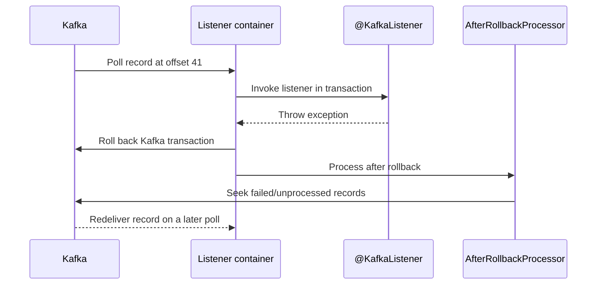
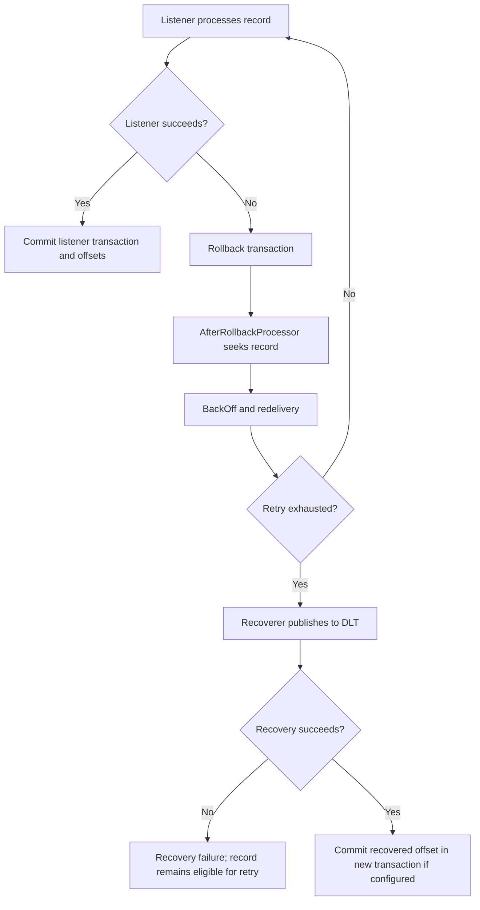

# AfterRollbackProcessor

Trong Spring Kafka, `AfterRollbackProcessor` xử lý các record sau khi giao dịch của listener container bị rollback. Với listener chạy trong Kafka transaction, nếu xử lý record thất bại và transaction rollback, container cần đưa các record chưa xử lý trở lại vị trí đọc phù hợp để thử lại. `DefaultAfterRollbackProcessor` là implementation mặc định, hỗ trợ seek, retry/backoff và recovery record lỗi sau khi số lần thử lại đã hết.

Trong module `SPRING_KAFKA_MESSAGING`, producer gửi event bằng `KafkaTemplate`, consumer nhận event bằng `@KafkaListener`. `AfterRollbackProcessor` thuộc phần điều phối lỗi ở phía consumer khi sử dụng transactional listener. Nó giúp xác định cách xử lý record sau rollback, bao gồm retry, chuyển record lỗi sang dead-letter topic và commit offset đã recovery theo transaction mới khi được cấu hình.

Các ví dụ trong bài dùng event và application service sau:

```java
import java.math.BigDecimal;
import java.util.List;

public record OrderCreatedEvent(
        String eventId,
        String orderId,
        BigDecimal total
) {}

public interface OrderApplicationService {
    void apply(OrderCreatedEvent event);
    void applyBatch(List<OrderCreatedEvent> events);
}
```

## 1. Vì sao cần `AfterRollbackProcessor`?

Với transactional listener, Spring Kafka có thể chạy việc nhận record và xử lý listener trong một Kafka transaction. Nếu listener hoàn tất, container commit transaction; nếu listener ném exception, container rollback transaction.

Sau rollback, consumer cần xử lý lại record chưa được xác nhận. `AfterRollbackProcessor` được gọi để điều phối việc này. Mặc định, processor seek consumer về vị trí của record lỗi và các record chưa xử lý tiếp theo để chúng có thể được poll lại.



`AfterRollbackProcessor` không phải nơi xử lý mọi exception của mọi listener. Nó gắn với luồng rollback của transactional container. Với listener không dùng transaction, cơ chế xử lý lỗi thông thường là `CommonErrorHandler`, chẳng hạn `DefaultErrorHandler`.

## 2. Phân biệt rollback, retry và recovery

Ba khái niệm có vai trò khác nhau:

| Khái niệm | Ý nghĩa | Thành phần thường đảm nhiệm |
|---|---|---|
| Rollback | Hủy transaction đang xử lý khi listener thất bại | Kafka transaction manager và listener container |
| Retry | Đưa record chưa xử lý trở lại để listener thử lại sau một khoảng nghỉ | `AfterRollbackProcessor` cùng `BackOff` |
| Recovery | Xử lý record sau khi retry đã cạn, ví dụ publish sang DLT hoặc lưu vào kho lỗi | Recoverer, thường là `DeadLetterPublishingRecoverer` |

Rollback không tự động có nghĩa là record đã được gửi sang DLT. Thông thường, processor thử lại theo backoff; chỉ khi đạt điều kiện recovery mới gọi recoverer. Nếu recovery thất bại, ứng dụng cần giữ được khả năng thử lại hoặc báo lỗi rõ ràng thay vì âm thầm bỏ record.

## 3. Cấu hình Kafka transaction cho listener container

Để listener chạy trong Kafka transaction, producer factory phải được cấu hình transaction ID prefix. Mỗi application instance cần prefix duy nhất để tránh xung đột producer transaction ID.

Ví dụ cấu hình Spring Boot:

```yaml
spring:
  kafka:
    bootstrap-servers: ${KAFKA_BOOTSTRAP_SERVERS:localhost:9092}
    producer:
      transaction-id-prefix: ${INSTANCE_ID:orders-app-}
      acks: all
      properties:
        enable.idempotence: true
    consumer:
      group-id: orders-projection
      enable-auto-commit: false
      auto-offset-reset: earliest
```

Khi cấu hình transaction ID prefix, Spring Boot có thể tạo producer factory hỗ trợ transaction. Nếu tự tạo `ProducerFactory`, cần cấu hình transaction ID prefix trên `DefaultKafkaProducerFactory` và dùng factory đó cho `KafkaTransactionManager`.

Ví dụ khai báo transaction manager:

```java
import org.springframework.context.annotation.Bean;
import org.springframework.context.annotation.Configuration;
import org.springframework.kafka.core.ProducerFactory;
import org.springframework.kafka.transaction.KafkaTransactionManager;

@Configuration
public class KafkaTransactionConfiguration {

    @Bean
    public KafkaTransactionManager<String, OrderCreatedEvent>
            kafkaTransactionManager(
                    ProducerFactory<String, OrderCreatedEvent> producerFactory) {

        return new KafkaTransactionManager<>(producerFactory);
    }
}
```

`KafkaTransactionManager` phải dùng producer factory đã được cấu hình transaction. Khi nhiều template hoặc producer factory cùng tồn tại, cần bảo đảm listener transaction manager và template phát output event dùng đúng transactional producer factory tương ứng.

## 4. Gắn transaction manager vào listener container

Có thể cấu hình `ConcurrentKafkaListenerContainerFactory` để listener container bắt đầu Kafka transaction cho mỗi lần xử lý:

```java
import org.springframework.context.annotation.Bean;
import org.springframework.context.annotation.Configuration;
import org.springframework.kafka.config.ConcurrentKafkaListenerContainerFactory;
import org.springframework.kafka.core.ConsumerFactory;
import org.springframework.kafka.transaction.KafkaTransactionManager;

@Configuration
public class TransactionalListenerConfiguration {

    @Bean
    public ConcurrentKafkaListenerContainerFactory<String, OrderCreatedEvent>
            transactionalKafkaListenerContainerFactory(
                    ConsumerFactory<String, OrderCreatedEvent> consumerFactory,
                    KafkaTransactionManager<String, OrderCreatedEvent> transactionManager) {

        var factory = new ConcurrentKafkaListenerContainerFactory<
                String, OrderCreatedEvent>();
        factory.setConsumerFactory(consumerFactory);
        factory.getContainerProperties().setKafkaAwareTransactionManager(
                transactionManager
        );
        return factory;
    }
}
```

Listener sử dụng factory này:

```java
import org.springframework.kafka.annotation.KafkaListener;
import org.springframework.stereotype.Component;

@Component
public class OrderCreatedListener {

    private final OrderApplicationService orderService;

    public OrderCreatedListener(OrderApplicationService orderService) {
        this.orderService = orderService;
    }

    @KafkaListener(
            topics = "orders.created",
            groupId = "orders-projection",
            containerFactory = "transactionalKafkaListenerContainerFactory"
    )
    public void onMessage(OrderCreatedEvent event) {
        orderService.apply(event);
    }
}
```

Khi method trả về bình thường, container có thể commit Kafka transaction cùng offset của record đã xử lý. Khi exception thoát khỏi listener, transaction rollback và `AfterRollbackProcessor` được gọi. Nếu listener bắt exception rồi trả về bình thường, container có thể coi lần xử lý là thành công; hãy ném lại exception hoặc đánh dấu transaction rollback-only khi muốn rollback.

## 5. `AfterRollbackProcessor` và `DefaultAfterRollbackProcessor`

`AfterRollbackProcessor<K, V>` là contract mà listener container sử dụng sau khi transaction rollback. `DefaultAfterRollbackProcessor<K, V>` cung cấp implementation phổ biến với các khả năng:

- Seek record lỗi và các record chưa xử lý để chúng được poll lại.
- Dùng `BackOff` để quyết định khoảng nghỉ và số lần retry.
- Gọi recoverer sau khi retry đã hết.
- Có thể commit offset của record đã recovery trong một transaction mới khi cấu hình phù hợp.
- Hỗ trợ tùy biến backoff theo record/exception ở các phiên bản có API tương ứng.

Thông thường, ứng dụng chỉ cần dùng `DefaultAfterRollbackProcessor` và cấu hình recoverer/backoff. Chỉ triển khai `AfterRollbackProcessor` riêng khi cần semantics seek, retry hoặc recovery đặc thù mà implementation mặc định không đáp ứng.

## 6. Cấu hình retry và backoff

`BackOff` quyết định thời gian chờ giữa các lần thử lại. Ví dụ dùng `FixedBackOff`:

```java
import org.springframework.kafka.listener.DefaultAfterRollbackProcessor;
import org.springframework.util.backoff.FixedBackOff;
import org.springframework.util.backoff.BackOff;

BackOff retryBackOff = new FixedBackOff(1_000L, 2L);
DefaultAfterRollbackProcessor<String, OrderCreatedEvent> processor =
        new DefaultAfterRollbackProcessor<>(recoverer, retryBackOff);
```

Đây là đoạn cấu hình rút gọn sử dụng `recoverer` đã tạo ở phần trước. Ví dụ minh họa khoảng nghỉ cố định một giây và giới hạn retry theo semantics của `FixedBackOff`. `FixedBackOff` phù hợp khi muốn thời gian chờ không đổi; nếu cần tăng dần thời gian chờ, có thể dùng `ExponentialBackOff` hoặc một `BackOff` phù hợp khác.

Retry không nên vô hạn cho mọi exception. Lỗi tạm thời như dependency chưa sẵn sàng có thể retry; lỗi dữ liệu hoặc schema không hợp lệ thường cần recovery/DLT hoặc xử lý thủ công. Hãy phân loại lỗi theo bản chất nghiệp vụ và tránh giữ partition bị chặn quá lâu bởi một record không thể xử lý.

## 7. Recovery bằng `DeadLetterPublishingRecoverer`

Sau khi retry cạn, recoverer có thể publish record lỗi sang dead-letter topic. Spring Kafka cung cấp `DeadLetterPublishingRecoverer` để tạo record DLT và bổ sung metadata về record gốc cùng exception.

```java
import org.apache.kafka.common.TopicPartition;
import org.springframework.context.annotation.Bean;
import org.springframework.context.annotation.Configuration;
import org.springframework.kafka.listener.DeadLetterPublishingRecoverer;
import org.springframework.kafka.core.KafkaTemplate;

@Configuration
public class DeadLetterConfiguration {

    @Bean
    public DeadLetterPublishingRecoverer deadLetterPublishingRecoverer(
            KafkaTemplate<String, OrderCreatedEvent> kafkaTemplate) {

        return new DeadLetterPublishingRecoverer(
                kafkaTemplate,
                (record, exception) -> new TopicPartition(
                        record.topic() + ".DLT",
                        record.partition()
                )
        );
    }
}
```

Ví dụ định tuyến record từ `orders.created` sang `orders.created.DLT` và giữ chỉ số partition. Topic DLT cần được tạo trước và có số partition đủ để nhận partition tương ứng; nếu DLT ít partition hơn topic gốc, việc publish có thể thất bại. Cũng cần cấu hình serializer/template hỗ trợ kiểu payload thực tế của record lỗi.

`DeadLetterPublishingRecoverer` có thể thêm các header như topic, partition, offset gốc, consumer group và thông tin exception. Các header này giúp điều tra và replay. DLT không phải nơi tự động sửa dữ liệu; cần có quy trình theo dõi, phân loại, sửa nguyên nhân và replay có kiểm soát.

## 8. Gắn processor vào listener container factory

Sau khi tạo recoverer và processor, gắn processor vào factory:

```java
import org.springframework.context.annotation.Bean;
import org.springframework.context.annotation.Configuration;
import org.springframework.kafka.config.ConcurrentKafkaListenerContainerFactory;
import org.springframework.kafka.core.ConsumerFactory;
import org.springframework.kafka.core.KafkaTemplate;
import org.springframework.kafka.listener.DeadLetterPublishingRecoverer;
import org.springframework.kafka.listener.DefaultAfterRollbackProcessor;
import org.springframework.kafka.transaction.KafkaTransactionManager;
import org.springframework.util.backoff.FixedBackOff;

@Configuration
public class AfterRollbackProcessorConfiguration {

    @Bean
    public DefaultAfterRollbackProcessor<String, OrderCreatedEvent>
            orderAfterRollbackProcessor(
                    DeadLetterPublishingRecoverer recoverer,
                    KafkaTemplate<String, OrderCreatedEvent> kafkaTemplate) {

        var processor = new DefaultAfterRollbackProcessor<String, OrderCreatedEvent>(
                recoverer,
                new FixedBackOff(1_000L, 2L)
        );
        processor.setCommitRecovered(true);
        processor.setKafkaTemplate(kafkaTemplate);
        return processor;
    }

    @Bean
    public ConcurrentKafkaListenerContainerFactory<String, OrderCreatedEvent>
            orderTransactionalListenerFactory(
                    ConsumerFactory<String, OrderCreatedEvent> consumerFactory,
                    KafkaTransactionManager<String, OrderCreatedEvent> transactionManager,
                    DefaultAfterRollbackProcessor<String, OrderCreatedEvent>
                            orderAfterRollbackProcessor) {

        var factory = new ConcurrentKafkaListenerContainerFactory<
                String, OrderCreatedEvent>();
        factory.setConsumerFactory(consumerFactory);
        factory.getContainerProperties().setKafkaAwareTransactionManager(
                transactionManager
        );
        factory.setAfterRollbackProcessor(orderAfterRollbackProcessor);
        return factory;
    }
}
```

`setCommitRecovered(true)` yêu cầu processor commit offset của record đã recovery. Với transactional container, processor có thể thực hiện việc publish DLT và gửi offset đã recovery trong transaction mới. `KafkaTemplate` truyền vào processor phải dùng transactional producer factory phù hợp với transaction manager của container. Cần kiểm tra cấu hình và phiên bản Spring Kafka đang dùng vì các overload/constructor có thể khác giữa các phiên bản.

Nếu không bật `commitRecovered` hoặc không cấu hình template/transaction tương ứng, đừng giả định offset của record đã recovery được commit theo transaction mới. Hãy xác định rõ hành vi recovery và kiểm thử committed offset sau khi record được chuyển DLT.

## 9. Điều gì xảy ra sau khi recovery thành công?

Luồng recovery điển hình:



Khi recoverer publish DLT thành công và processor được cấu hình commit recovered offset, offset của record lỗi được commit trong transaction mới. Nhờ đó consumer có thể tiếp tục với record kế tiếp mà không xử lý lặp vô hạn record đã được chuyển sang DLT.

Nếu publish DLT thất bại, ví dụ do broker không sẵn sàng hoặc serializer không hỗ trợ payload, recovery chưa hoàn tất. Không nên commit offset gốc trong trường hợp này; cần để record có cơ hội được xử lý lại hoặc đưa ra cảnh báo vận hành.

## 10. Record listener và batch listener

Với record listener, processor có thể xác định record gây lỗi và seek record đó cùng các record chưa xử lý tiếp theo. Các record trước đó trong cùng poll đã được xử lý thành công có thể được giữ tiến độ theo transaction/offset semantics của container.

Với batch listener, mặc định một exception có thể khiến cả batch được xử lý lại. Nếu listener ném `BatchListenerFailedException` và chỉ rõ record/index thất bại, Spring Kafka có thể xử lý phần trước record lỗi và retry/recover từ vị trí tương ứng, tùy phiên bản và cấu hình.

Ví dụ batch listener xác định record lỗi:

```java
import java.util.List;

import org.springframework.kafka.annotation.KafkaListener;
import org.springframework.kafka.listener.BatchListenerFailedException;
import org.springframework.stereotype.Component;

@Component
public class OrderBatchListener {

    private final OrderApplicationService orderService;

    public OrderBatchListener(OrderApplicationService orderService) {
        this.orderService = orderService;
    }

    @KafkaListener(
            topics = "orders.created",
            groupId = "orders-batch",
            containerFactory = "transactionalBatchListenerFactory"
    )
    public void onMessages(List<OrderCreatedEvent> events) {
        for (int index = 0; index < events.size(); index++) {
            try {
                orderService.apply(events.get(index));
            } catch (RuntimeException exception) {
                throw new BatchListenerFailedException(
                        "Failed to process order event",
                        exception,
                        index
                );
            }
        }
    }
}
```

Để dùng batch listener, factory cần `setBatchListener(true)`. Hãy kiểm tra overload constructor của `BatchListenerFailedException` theo version Spring Kafka trong dự án. Batch processing cần kiểm thử riêng vì semantics seek/retry khác record listener.

## 11. Phân biệt `AfterRollbackProcessor` và `DefaultErrorHandler`

Hai thành phần đều liên quan đến retry và recovery nhưng thuộc những luồng điều phối khác nhau:

| Tiêu chí | `AfterRollbackProcessor` | `DefaultErrorHandler` |
|---|---|---|
| Bối cảnh chính | Listener container dùng transaction và đã rollback | Listener container xử lý lỗi theo error handler thông thường |
| Thời điểm | Sau khi transaction rollback | Khi listener/record processing phát sinh exception trong luồng container |
| Vai trò | Seek và xử lý record sau rollback, retry/recover | Retry/backoff/recover trong error handling không dựa trên after-rollback flow |
| Implementation | `DefaultAfterRollbackProcessor` | `DefaultErrorHandler` |
| DLT | Có thể dùng `DeadLetterPublishingRecoverer` | Có thể dùng `DeadLetterPublishingRecoverer` |

Không cấu hình hai thành phần như thể chúng là một cơ chế duy nhất. Với transactional listener, hãy hiểu processor được gọi sau rollback. Với listener không transactional, cấu hình `CommonErrorHandler` phù hợp. Cách kết hợp transaction và error handler cần dựa trên mục tiêu xử lý, không chỉ thêm cả hai bean vào ứng dụng.

## 12. Phân loại lỗi và tùy biến backoff

Không phải exception nào cũng nên retry cùng một cách. Ví dụ:

| Loại lỗi | Hướng xử lý gợi ý |
|---|---|
| Dependency tạm thời unavailable | Retry với backoff tăng dần và giới hạn số lần |
| Timeout ngắn hạn | Retry có giới hạn, quan sát latency và dependency health |
| Payload sai schema hoặc malformed | Thường chuyển DLT sau ít hoặc không retry |
| Vi phạm quy tắc nghiệp vụ vĩnh viễn | Recovery/DLT hoặc quy trình xử lý nghiệp vụ riêng |
| Lỗi cấu hình/authorization | Cảnh báo và dừng/khắc phục cấu hình; retry vô hạn thường không hữu ích |

`DefaultAfterRollbackProcessor` hỗ trợ cấu hình `BackOff` và trong các phiên bản có API tương ứng có thể dùng `setBackOffFunction` để chọn backoff theo record và exception. Ví dụ ý tưởng:

```java
processor.setBackOffFunction((record, exception) -> {
    if (exception instanceof TemporaryDependencyException) {
        return new FixedBackOff(2_000L, 3L);
    }
    return new FixedBackOff(0L, 0L);
});
```

Đoạn code minh họa lựa chọn retry theo loại lỗi; cần bảo đảm exception thực tế được phân loại đúng và API tồn tại trong version Spring Kafka của dự án. Không dựa vào tên class exception một cách tùy tiện nếu exception bị bọc nhiều tầng; có thể cần kiểm tra cause chain.

## 13. Idempotency và transaction boundary

Giả sử listener cập nhật database rồi sau đó Kafka transaction rollback. Database không tự rollback theo Kafka transaction, trừ khi ứng dụng đã cấu hình một cơ chế phối hợp transaction cụ thể. Nếu record được giao lại, database có thể nhận cùng event lần thứ hai.

Do đó:

- Dùng `eventId` duy nhất và lưu dấu đã xử lý với unique constraint.
- Cập nhật dữ liệu nghiệp vụ và inbox/idempotency record trong cùng database transaction.
- Giữ handler idempotent để retry không nhân đôi side effect.
- Với Kafka-to-Kafka, dùng Kafka transaction để đồng bộ output records và input offsets trong cùng Kafka transaction.
- Với database và Kafka, đánh giá outbox/inbox hoặc mô hình eventual consistency; không giả định Kafka transaction bao trùm database.

`AfterRollbackProcessor` điều phối retry sau rollback, không thay thế transaction design của application service.

## 14. Kiểm thử `AfterRollbackProcessor`

Kiểm thử nên bao gồm đường xử lý thành công, rollback, retry và recovery:

- **Transactional integration test:** listener xử lý thành công; xác minh output records và consumer offset được commit theo transaction.
- **Rollback test:** listener ném exception; xác minh output Kafka trong transaction bị rollback và input record được giao lại.
- **Backoff test:** cấu hình số lần retry nhỏ và xác minh listener được gọi đúng số lần theo chính sách.
- **Recovery/DLT test:** làm record lỗi lặp lại đến khi recoverer publish sang DLT; kiểm tra topic, partition và DLT headers.
- **Recovered offset test:** khi bật `commitRecovered`, xác minh offset được commit trong transaction mới sau recovery thành công.
- **Recovery failure test:** làm DLT publish thất bại; xác minh offset gốc chưa bị commit ngoài ý muốn.
- **Batch test:** xác minh `BatchListenerFailedException` định vị record lỗi và hành vi seek/retry phù hợp.
- **Restart test:** dừng ứng dụng trong khoảng rollback/recovery và xác minh record không bị mất.

Dùng Embedded Kafka hoặc Testcontainers với broker hỗ trợ transaction. Tạo topic DLT có partition count phù hợp topic gốc. Khi kiểm tra transaction, consumer test nên dùng `isolation.level=read_committed` nếu mục tiêu là chỉ quan sát record đã commit.

## 15. Những lỗi thường gặp

- **Dùng `AfterRollbackProcessor` cho listener không transactional:** đây không phải thay thế chung cho `CommonErrorHandler`.
- **Producer factory không có transaction ID prefix:** transaction manager không thể tạo transactional producer đúng cấu hình.
- **Transaction ID prefix bị trùng giữa các instance:** gây xung đột producer transaction ID.
- **Nuốt exception trong listener:** container có thể commit transaction thay vì rollback.
- **Cho rằng rollback tự động gửi DLT:** retry và recovery là các bước riêng; cần recoverer được cấu hình.
- **Bật `commitRecovered` nhưng không cấu hình KafkaTemplate phù hợp:** offset recovered không được commit theo transaction như mong muốn.
- **DLT thiếu partition tương ứng:** publish cùng partition index có thể thất bại.
- **Serializer của DLT template không hỗ trợ payload lỗi:** recovery thất bại trước khi record được lưu vào DLT.
- **Retry vô hạn lỗi dữ liệu vĩnh viễn:** partition có thể bị chặn và consumer lag tăng.
- **Database side effect không idempotent:** record được giao lại sau rollback có thể tạo dữ liệu trùng.
- **Không kiểm thử batch listener:** semantics retry/seek khác record listener.
- **Nhầm `AfterRollbackProcessor` với `DefaultErrorHandler`:** hai cơ chế chạy trong những luồng điều phối lỗi khác nhau.

## 16. Checklist triển khai

- [ ] Listener container thực sự dùng Kafka transaction manager.
- [ ] Producer factory có transaction ID prefix duy nhất cho từng instance.
- [ ] Listener để exception thoát ra khi cần rollback.
- [ ] `DefaultAfterRollbackProcessor` được gắn vào đúng container factory.
- [ ] Backoff và retry count phù hợp từng loại exception.
- [ ] Recoverer được cấu hình rõ ràng cho record không thể xử lý.
- [ ] DLT tồn tại, đủ partition và dùng serializer phù hợp.
- [ ] `commitRecovered` và `KafkaTemplate` được cấu hình cùng transactional producer factory khi cần commit offset sau recovery.
- [ ] Handler idempotent hoặc có inbox/deduplication strategy.
- [ ] Batch listener có kiểm thử riêng nếu được sử dụng.
- [ ] Có metric/log cho rollback, retry, recovery, DLT publish failure và consumer lag.
- [ ] Integration test xác minh transaction, offset commit và restart behavior.

`AfterRollbackProcessor` là điểm điều phối quan trọng sau khi transactional listener thất bại. Khi kết hợp đúng Kafka transaction, backoff, recoverer và chính sách commit recovered offset, ứng dụng có thể retry có kiểm soát, đưa record lỗi sang DLT và tiếp tục xử lý mà vẫn giữ tiến độ consumer rõ ràng. Hãy bổ sung idempotency cho side effect bên ngoài Kafka và kiểm thử cả rollback lẫn recovery trước khi vận hành.
