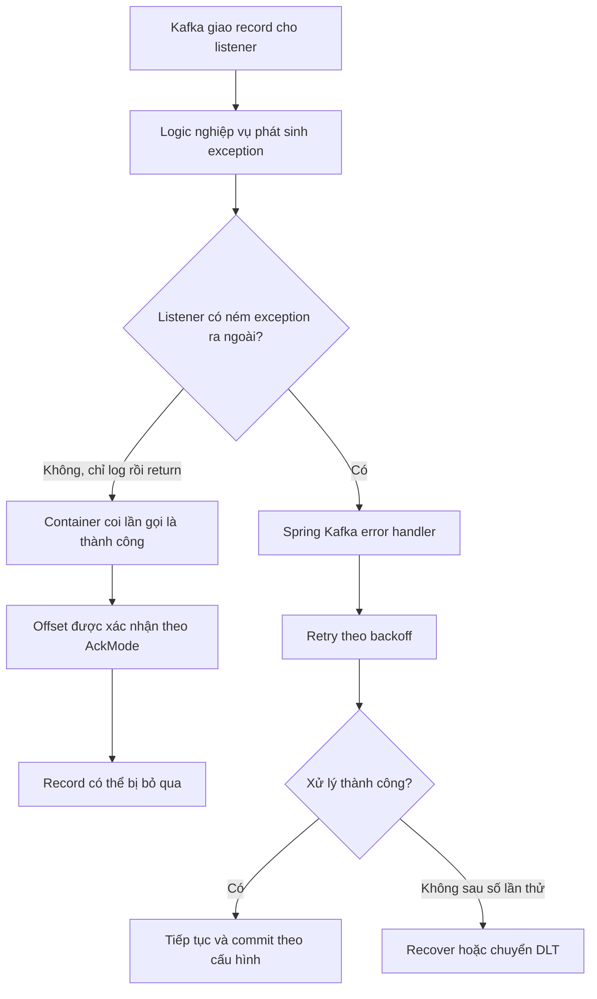

# Không nuốt lỗi một cách mù quáng

Trong một luồng Kafka, một record chỉ được xem là xử lý thành công khi logic nghiệp vụ đã hoàn tất theo chính sách của ứng dụng và offset được xác nhận phù hợp. Nếu listener bắt exception, chỉ ghi log rồi trả về bình thường, Spring Kafka thường xem lần gọi listener đó là thành công. Container tiếp tục xử lý và commit offset theo `AckMode` đang dùng; record lỗi có thể bị bỏ qua mà không đi qua retry hoặc dead-letter topic (DLT).

Đây là một lỗi thiết kế nguy hiểm vì hệ thống vẫn chạy, consumer lag có thể giảm và log có thể ghi nhận exception, trong khi nghiệp vụ đã mất một sự kiện. Bài học này giúp phân biệt lỗi cần retry, lỗi không thể retry, cách để exception đi tới error handler và cách xác nhận offset sau khi xử lý thành công.

## 1. Điều gì xảy ra khi listener nuốt exception?

Xét listener sau:

```java
@KafkaListener(topics = "orders", groupId = "order-service")
public void consume(OrderEvent event) {
    try {
        orderService.process(event);
    }
    catch (Exception ex) {
        log.error("Cannot process order event", ex);
    }
}
```

Nếu `orderService.process()` thất bại, exception bị giữ lại trong `catch`. Phương thức `consume()` kết thúc bình thường nên container không nhận được tín hiệu thất bại từ listener. Error handler không có exception để thực hiện retry hoặc chuyển record sang DLT.

Offset có được commit ngay hay không còn phụ thuộc `AckMode`, transaction và cấu hình container. Nhưng container đã coi lần gọi listener là thành công; với chế độ commit tự động theo quá trình xử lý của container, record có thể được xác nhận và lần tiêu thụ sau sẽ bắt đầu từ offset tiếp theo. Khi đó, việc chỉ ghi log không giúp record được xử lý lại.



Vì vậy, cần phân biệt hai việc: ghi nhận exception để chẩn đoán và truyền trạng thái thất bại cho cơ chế xử lý lỗi. Log chỉ phục vụ quan sát; bản thân log không làm Kafka retry record.

## 2. Để exception truyền tới container

Nếu listener không cần bổ sung ngữ cảnh, cách đơn giản nhất là để exception truyền ra ngoài:

```java
@KafkaListener(topics = "orders", groupId = "order-service")
public void consume(OrderEvent event) {
    orderService.process(event);
}
```

Spring Kafka nhận exception từ listener và chuyển nó tới error handler của container. Nếu cần ghi log hoặc bổ sung thông tin nghiệp vụ, hãy ném lại exception hoặc bọc nó trong một exception có nguyên nhân gốc:

```java
@KafkaListener(topics = "orders", groupId = "order-service")
public void consume(OrderEvent event) {
    try {
        orderService.process(event);
    }
    catch (TransientDataAccessException ex) {
        log.warn("Temporary database failure for order {}", event.orderId(), ex);
        throw new OrderProcessingException(
                "Cannot process order " + event.orderId(), ex);
    }
}
```

`OrderProcessingException` trong ví dụ là exception nghiệp vụ do ứng dụng định nghĩa và giữ `ex` làm cause. Nếu chỉ cần truyền lỗi, có thể bỏ `try/catch` hoàn toàn. Tránh bắt `Exception` hoặc `Throwable` trên toàn bộ listener rồi tiếp tục chạy, vì cách đó che khuất cả lỗi lập trình, lỗi hạ tầng và lỗi nghiệp vụ.

Chỉ bắt exception khi có hành động cụ thể và an toàn, chẳng hạn thêm ngữ cảnh, chuyển đổi sang kiểu exception đã được phân loại, hoặc xử lý một trường hợp có thể bỏ qua theo yêu cầu nghiệp vụ. Nếu một lỗi được phép bỏ qua, hãy thể hiện quyết định đó rõ ràng bằng log có định danh record, metric hoặc audit phù hợp; đừng vô tình biến mọi lỗi thành thành công.

## 3. Phân loại lỗi trước khi chọn retry

Retry phù hợp với lỗi có khả năng tự hết sau một khoảng thời gian. Ví dụ: database tạm thời không kết nối được, dịch vụ HTTP timeout, giới hạn tốc độ hoặc broker/service phụ thuộc đang gián đoạn. Ngược lại, retry liên tục không sửa được dữ liệu sai định dạng, thiếu trường bắt buộc hay vi phạm quy tắc nghiệp vụ cố định.

| Loại lỗi | Ví dụ | Cách xử lý thường phù hợp |
|---|---|---|
| Lỗi tạm thời | Timeout, mất kết nối ngắn hạn, database tạm unavailable | Retry có giới hạn và backoff; sau khi hết lượt thì recover hoặc đưa vào DLT. |
| Lỗi dữ liệu hoặc nghiệp vụ | Mã đơn hàng không hợp lệ, thiếu thông tin bắt buộc, trạng thái không cho phép | Không retry nhiều lần; ghi nhận nguyên nhân và chuyển DLT hoặc luồng xử lý nghiệp vụ riêng. |
| Lỗi cấu hình hoặc lập trình | Sai schema mapping, thiếu cấu hình, bug gây `NullPointerException` | Cảnh báo và điều tra; không tạo vòng retry vô hạn. Tùy loại lỗi có thể đánh dấu không retry để chuyển DLT. |
| Lỗi deserialize | Payload không thể chuyển thành object | Xử lý ở tầng deserializer/container; listener có thể chưa được gọi nên `try/catch` trong listener không bắt được. |

Một chiến lược hữu ích là xác định rõ hai nhóm: lỗi retry được và lỗi không retry. Spring Kafka `DefaultErrorHandler` cho phép khai báo các exception không retry bằng `addNotRetryableExceptions(...)`, hoặc khai báo nhóm retry được bằng `addRetryableExceptions(...)`. Hãy dựa vào exception thực tế và chính sách nghiệp vụ của hệ thống; không phân loại chỉ dựa trên tên exception chung chung.

Ví dụ, lỗi đầu vào không hợp lệ có thể được đánh dấu không retry, còn lỗi truy cập dữ liệu tạm thời được retry:

```java
DefaultErrorHandler errorHandler = new DefaultErrorHandler(
        recoverer,
        new FixedBackOff(1_000L, 2L));

errorHandler.addNotRetryableExceptions(InvalidOrderException.class);
errorHandler.addRetryableExceptions(TransientDataAccessException.class);
```

Với `FixedBackOff(1_000L, 2L)`, handler chờ một giây giữa các lần retry và cho phép hai lần retry sau lần xử lý ban đầu. Tổng số lần listener có thể nhận record trong ví dụ là tối đa ba, nếu không có chính sách khác thay đổi quá trình xử lý. Backoff giúp giảm áp lực lên dịch vụ đang gặp sự cố; số lần thử vẫn phải có giới hạn để tránh giữ record lỗi quá lâu.

## 4. Cấu hình retry và dead-letter topic

Khi lỗi tạm thời không hết sau số lần retry, ứng dụng cần một quyết định phục hồi rõ ràng. Với record listener, `DefaultErrorHandler` có thể kết hợp `DeadLetterPublishingRecoverer` để gửi record không phục hồi được sang một DLT.

```java
@Configuration
public class KafkaErrorHandlingConfiguration {

    @Bean
    public DefaultErrorHandler kafkaErrorHandler(
            KafkaTemplate<Object, Object> kafkaTemplate) {

        DeadLetterPublishingRecoverer recoverer =
                new DeadLetterPublishingRecoverer(
                        kafkaTemplate,
                        (record, exception) -> new TopicPartition(
                                record.topic() + ".DLT",
                                record.partition()));

        DefaultErrorHandler handler = new DefaultErrorHandler(
                recoverer,
                new FixedBackOff(1_000L, 2L));

        handler.addNotRetryableExceptions(InvalidOrderException.class);
        handler.addRetryableExceptions(TransientDataAccessException.class);
        return handler;
    }

    @Bean
    public ConcurrentKafkaListenerContainerFactory<String, OrderEvent>
            orderListenerFactory(
                    ConsumerFactory<String, OrderEvent> consumerFactory,
                    DefaultErrorHandler kafkaErrorHandler) {

        ConcurrentKafkaListenerContainerFactory<String, OrderEvent> factory =
                new ConcurrentKafkaListenerContainerFactory<>();
        factory.setConsumerFactory(consumerFactory);
        factory.setCommonErrorHandler(kafkaErrorHandler);
        return factory;
    }
}
```

Trong ví dụ, record từ topic `orders` được chuyển tới `orders.DLT` sau khi hết retry hoặc thuộc nhóm không retry. Recoverer giữ nguyên partition nguồn khi chọn partition đích. Vì vậy, topic DLT cần có ít nhất số partition tương ứng với topic nguồn; nếu không, hãy chọn một chiến lược ánh xạ partition phù hợp với cấu trúc DLT của hệ thống.

Đây là cấu hình minh họa cho Spring Kafka hiện đại có `DefaultErrorHandler` và `setCommonErrorHandler`. Ứng dụng cần khai báo các bean, import đúng lớp và tạo topic DLT trước khi chạy. Nếu DLT cũng không gửi được, cần coi đây là lỗi phục hồi cần giám sát và xử lý; không được xem việc ghi log là bằng chứng record đã được lưu an toàn.

DLT không phải nơi để quên dữ liệu. Cần theo dõi số lượng record vào DLT, lưu exception gốc và thông tin nguồn như topic, partition, offset, key, timestamp. Xây dựng quy trình kiểm tra nguyên nhân, sửa dữ liệu hoặc code, rồi phát lại có kiểm soát. Nếu không có người hoặc quy trình theo dõi DLT, việc chuyển record sang đó chỉ chuyển nơi thất lạc dữ liệu.

## 5. Offset và acknowledgment phải phản ánh kết quả xử lý

Offset là vị trí tiêu thụ tiếp theo mà consumer group đã xác nhận. Thời điểm commit phụ thuộc `AckMode`, transaction và cách container xử lý record. Một số chế độ thường gặp:

| `AckMode` | Ý nghĩa ở mức khái quát | Lưu ý khi xử lý lỗi |
|---|---|---|
| `RECORD` | Commit sau khi từng record được listener xử lý thành công | Exception truyền ra ngoài giúp error handler can thiệp trước khi record được coi là hoàn tất. |
| `BATCH` | Commit sau khi các record của lần poll được xử lý thành công | Với batch listener, trả về bình thường sau khi nuốt exception có thể khiến cả batch được xem là thành công. |
| `MANUAL` | Ứng dụng gọi `Acknowledgment.acknowledge()`; container áp dụng commit theo quy tắc của chế độ manual | Chỉ acknowledge sau khi công việc cần bảo đảm đã hoàn tất. |
| `MANUAL_IMMEDIATE` | Commit được yêu cầu ngay khi acknowledge trên consumer thread | Không acknowledge trước khi xác nhận thành công; hiểu rõ thread và transaction đang dùng. |

Không gọi `acknowledge()` trước khi công việc nghiệp vụ hoàn tất chỉ để tránh retry. Làm vậy có thể xác nhận offset trong khi dữ liệu chưa được ghi thành công. Ngược lại, nếu nghiệp vụ đã ghi database xong nhưng ứng dụng lỗi trước khi commit offset, Kafka có thể giao lại record. Vì thế, consumer cần thiết kế idempotent hoặc dùng cơ chế phối hợp transaction phù hợp để xử lý việc giao lại.

Với batch listener, lỗi ở một record có thể ảnh hưởng các record khác trong batch. Nếu cần chỉ rõ vị trí record lỗi để error handler xử lý phần đã thành công và phần cần retry, Spring Kafka hỗ trợ `BatchListenerFailedException` với chỉ số record thất bại. Chỉ sử dụng cơ chế này khi ứng dụng xác định chính xác record nào đã hoàn tất; nếu không, hãy để exception truyền ra và áp dụng chính sách xử lý toàn batch phù hợp.

## 6. Lỗi deserialize và lỗi trước khi vào listener

Không phải mọi exception đều phát sinh bên trong phương thức `@KafkaListener`. Kafka consumer phải deserialize key/value trước khi Spring gọi listener. Nếu payload không đúng định dạng, listener có thể chưa được gọi nên `try/catch` trong listener không thể bắt lỗi đó.

Trong Spring Kafka, `ErrorHandlingDeserializer` có thể bọc deserializer thực tế để giữ thông tin lỗi deserialize trong header của record và cho phép cơ chế xử lý lỗi của container tiếp nhận. Ví dụ cấu hình:

```yaml
spring:
  kafka:
    consumer:
      key-deserializer: org.springframework.kafka.support.serializer.ErrorHandlingDeserializer
      value-deserializer: org.springframework.kafka.support.serializer.ErrorHandlingDeserializer
      properties:
        "[spring.deserializer.key.delegate.class]": org.apache.kafka.common.serialization.StringDeserializer
        "[spring.deserializer.value.delegate.class]": com.example.kafka.OrderEventDeserializer
```

Hãy cấu hình delegate đúng với định dạng thực tế của topic. Với lỗi deserialize, cần quyết định rõ có thể sửa dữ liệu để phát lại hay phải cách ly record vào DLT. Đừng giả định rằng mọi lỗi đều có thể bắt trong listener hoặc rằng đặt `try/catch` quanh logic nghiệp vụ sẽ bảo vệ toàn bộ đường đi của message.

## 7. Tránh tạo bản ghi trùng khi retry hoặc giao lại

Retry có thể khiến cùng một record được xử lý nhiều lần. Ví dụ, ứng dụng đã trừ tồn kho trong database nhưng gặp lỗi trước khi offset được commit. Kafka giao lại record, listener chạy lần nữa và có thể trừ tồn kho lần thứ hai.

Một số cách giảm tác động:

1. Dùng event ID hoặc business key ổn định và lưu dấu đã xử lý trong cùng transaction database với cập nhật nghiệp vụ.
2. Thiết kế thao tác có tính idempotent, nghĩa là thực hiện lại cùng một sự kiện không tạo thêm tác động ngoài ý muốn.
3. Dùng unique constraint hoặc bảng inbox để phát hiện sự kiện đã được xử lý.
4. Nếu cần phối hợp việc ghi database và phát sự kiện, xem xét transactional outbox hoặc cơ chế transaction phù hợp thay vì giả định commit offset và database luôn nguyên tử cùng nhau.
5. Giữ nguyên thông tin exception và metadata của record để điều tra được lần xử lý thất bại và lần phát lại.

Không nên tăng số lần retry để bù cho thao tác không idempotent. Retry giải quyết lỗi tạm thời; idempotency giải quyết hậu quả của việc xử lý lặp. Hai cơ chế bổ trợ cho nhau.

## 8. Kiểm tra để chắc chắn lỗi không bị che giấu

Khi kiểm thử error handling, cần kiểm tra hành vi quan sát được chứ không chỉ xác nhận log đã xuất hiện:

- Khi listener ném lỗi tạm thời, record được thử lại đúng số lần và theo backoff đã cấu hình.
- Khi listener ném lỗi không retry, record đi tới recoverer/DLT theo chính sách.
- Khi xử lý thành công, offset tiến lên và record không bị xử lý lại ngoài dự kiến.
- Khi DLT không sẵn sàng hoặc việc publish thất bại, hệ thống phát tín hiệu lỗi phục hồi và không âm thầm coi record đã được lưu.
- Khi listener bắt exception, chỉ log rồi trả về, bài kiểm thử phải thể hiện rõ container coi lần gọi là thành công; đây là hành vi cần tránh cho lỗi nghiệp vụ chưa được xử lý.
- Với batch listener, xác minh chính xác offset của record trước, tại và sau vị trí lỗi.
- Với lỗi deserialize, xác minh listener có thể không được gọi và error handler vẫn nhận được thông tin lỗi qua cấu hình deserializer.

Các metric nên theo dõi gồm số lần retry, số record vào DLT, số lần recover thất bại, consumer lag, thời gian xử lý và tỷ lệ lỗi theo loại exception. Log cần có topic, partition, offset và event ID để truy vết; tránh chỉ ghi một dòng thông báo chung chung không xác định được record.

Một listener an toàn phải thể hiện trung thực kết quả nghiệp vụ: thành công thì container được phép xác nhận theo cấu hình; thất bại thì exception phải tới cơ chế xử lý lỗi, hoặc ứng dụng phải thực hiện một quyết định bỏ qua có chủ đích và có thể kiểm toán. Đừng biến một record thất bại thành thành công chỉ bằng cách bắt exception rồi trả về bình thường.
