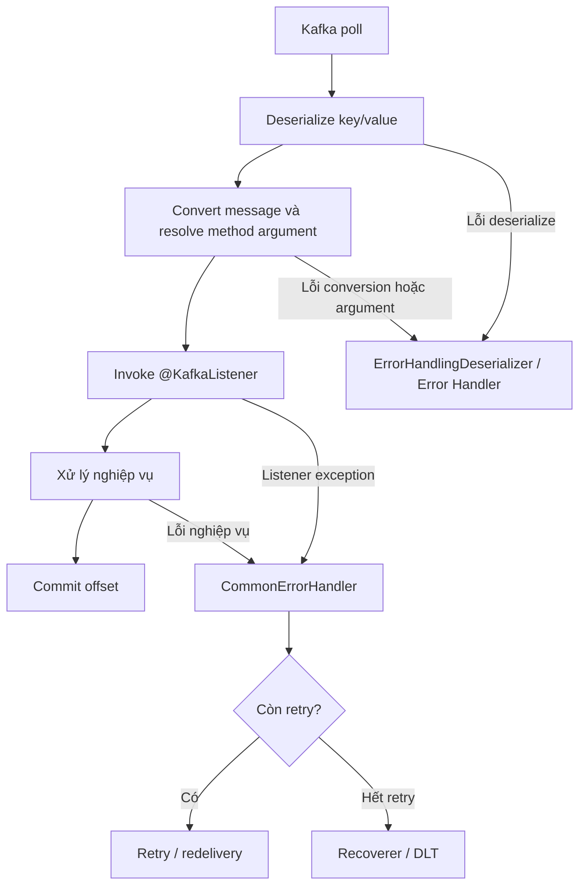

# Ghi log lỗi có đủ context

Khi một Kafka listener thất bại, chỉ ghi `"Processing failed"` và stack trace thường chưa đủ để tìm ra record nào gây lỗi, consumer group nào đang xử lý, lỗi xảy ra ở lần giao thứ mấy và record đã được retry hay chuyển sang dead-letter topic (DLT).

Một log hữu ích cần kết nối được **lỗi ứng dụng**, **Kafka record** và **lần xử lý cụ thể**. Spring Kafka cung cấp metadata từ `ConsumerRecord`, Spring `MessageHeaders`, error handler và retry listener để tạo context này.

Bài học tập trung vào record listener dùng Spring Kafka. Với batch listener, cần bổ sung index của record lỗi và metadata của từng phần tử trong batch.

## 1. Vì sao log lỗi cần context?

Giả sử log chỉ có:

```text
ERROR Order processing failed
java.lang.IllegalStateException: Inventory service unavailable
    at ...
```

Stack trace cho biết vị trí code lỗi nhưng chưa trả lời được:

- Record đến từ topic nào, partition nào và offset bao nhiêu?
- Consumer group và listener nào đang xử lý?
- Key hoặc event ID nào liên quan?
- Đây là lần giao đầu hay lần retry thứ ba?
- Trace ID nào nối được log giữa producer, consumer và service downstream?
- Error handler sẽ retry tiếp, recover hay gửi record sang DLT?
- Lỗi xảy ra khi deserialize, convert message, chạy nghiệp vụ hay publish DLT?

Nếu thiếu các trường này, người vận hành phải tìm thủ công qua nhiều log và đôi khi không thể xác định đúng record.

Một log có context nên giúp trả lời nhanh ba câu hỏi: **record nào lỗi, lỗi ở đâu và bước xử lý tiếp theo là gì**.

## 2. Những nhóm context nên ghi

Không phải log nào cũng cần mọi trường. Hãy chọn các trường phù hợp với điểm ghi log.

| Nhóm | Trường gợi ý | Mục đích |
|---|---|---|
| Định danh record | `topic`, `partition`, `offset` | Tìm chính xác record trong Kafka |
| Định danh nghiệp vụ | `eventId`, `aggregateId`, `recordKey` đã che/mã hóa | Tìm event và thực thể liên quan |
| Consumer | `consumerGroup`, `listenerId`, `clientId` | Xác định consumer đang xử lý |
| Retry | `deliveryAttempt`, `retryCount`, `recovered` | Biết tiến trình retry/recovery |
| Correlation | `traceId`, `correlationId`, `causationId` | Nối log giữa các service |
| Phân loại | `eventType`, `schemaVersion`, `failureStage` | Nhận biết loại dữ liệu và giai đoạn lỗi |
| Exception | `exceptionType`, `message`, `rootCause`, stack trace | Chẩn đoán nguyên nhân |
| Runtime | `service`, `environment`, `version`, `host`, `thread` | Xác định instance và môi trường |

### Context tối thiểu cho một lỗi listener

Trong phần lớn ứng dụng, nên có ít nhất:

- `topic`
- `partition`
- `offset`
- `consumerGroup`
- `listenerId`
- `eventId` hoặc key đã được xử lý an toàn
- `traceId` nếu có
- `deliveryAttempt` nếu đang retry
- exception và stack trace

`topic + partition + offset` là bộ định danh kỹ thuật quan trọng để tìm lại record. Key không thay thế bộ ba này: nhiều record khác nhau có thể dùng cùng key.

## 3. Lấy context từ ConsumerRecord

Khi listener nhận `ConsumerRecord<K,V>`, ứng dụng truy cập trực tiếp metadata Kafka:

```java
import java.nio.charset.StandardCharsets;

import org.apache.kafka.clients.consumer.ConsumerRecord;
import org.apache.kafka.common.header.Header;
import org.springframework.kafka.annotation.KafkaListener;

@KafkaListener(
    id = "order-listener",
    topics = "order-events",
    groupId = "billing-service"
)
public void consume(ConsumerRecord<String, OrderCreated> record) {
    OrderCreated event = record.value();

    String topic = record.topic();
    int partition = record.partition();
    long offset = record.offset();
    String key = record.key();
    long timestamp = record.timestamp();

    Header traceHeader = record.headers().lastHeader("trace-id");
    String traceId = traceHeader == null || traceHeader.value() == null
        ? null
        : new String(traceHeader.value(), StandardCharsets.UTF_8);

    // Xử lý nghiệp vụ bằng event và metadata.
}
```

`ConsumerRecord` cung cấp:

| API | Giá trị |
|---|---|
| `topic()` | Tên topic |
| `partition()` | Partition |
| `offset()` | Offset của record |
| `key()` | Key sau khi deserialize |
| `value()` | Value sau khi deserialize |
| `timestamp()` | Timestamp của record |
| `timestampType()` | Loại timestamp |
| `headers()` | Kafka headers gốc |

Consumer group và listener ID không phải lúc nào cũng có sẵn trong các trường cơ bản của `ConsumerRecord`. Hãy đưa chúng từ cấu hình listener, `ListenerExecutionFailedException`, listener info hoặc context của container tùy điểm ghi log.

Không nên suy ra group ID từ tên topic hoặc tên class listener.

`client.id` cũng không nằm trong `ConsumerRecord`; nếu cần trường này, lấy từ cấu hình consumer hoặc consumer metrics. `memberId` trong `consumer.groupMetadata()` là mã thành viên của group, không phải `client.id`.

## 4. Ghi log tại listener và giữ nguyên exception

Listener biết rõ event nghiệp vụ nên có thể ghi thêm `eventId`, loại event và trace ID. Khi xử lý lỗi, hãy ghi context rồi ném lại exception để container error handler thực hiện retry/recovery.

```java
import org.apache.kafka.clients.consumer.ConsumerRecord;
import org.slf4j.Logger;
import org.slf4j.LoggerFactory;
import org.springframework.kafka.annotation.KafkaListener;

public class OrderListener {

    private static final Logger log =
        LoggerFactory.getLogger(OrderListener.class);

    private final OrderService orderService;

    public OrderListener(OrderService orderService) {
        this.orderService = orderService;
    }

    @KafkaListener(
        id = "order-listener",
        topics = "order-events",
        groupId = "billing-service"
    )
    public void consume(ConsumerRecord<String, OrderCreated> record)
            throws Exception {

        OrderCreated event = record.value();

        try {
            orderService.process(event);
        }
        catch (Exception exception) {
            log.error(
                "Kafka listener failed topic={} partition={} offset={} " +
                "recordKey={} eventId={} listenerId={} consumerGroup={}",
                record.topic(),
                record.partition(),
                record.offset(),
                safeKey(record.key()),
                event == null ? null : event.eventId(),
                "order-listener",
                "billing-service",
                exception
            );

            throw exception;
        }
    }

    private String safeKey(String key) {
        if (key == null) {
            return null;
        }
        if (key.length() <= 4) {
            return "****";
        }
        return key.substring(0, 2) + "****" + key.substring(key.length() - 2);
    }
}
```

Trong ví dụ, exception được ném lại để Spring Kafka tiếp tục áp dụng error handler. Không bắt exception rồi chỉ ghi log và kết thúc method, vì container có thể xem listener đã xử lý thành công và commit offset theo ack mode.

Chỉ ghi log tại listener khi có context nghiệp vụ mà tầng container không biết, chẳng hạn `eventId`, `orderType` hoặc mã nghiệp vụ đã được che. Nếu chỉ lặp lại stack trace mà không thêm thông tin, log sẽ bị trùng với log của container/error handler.

Khi method có thể ném checked exception, khai báo `throws Exception` giúp giữ nguyên exception gốc. Tránh bọc mọi lỗi thành một loại exception chung nếu việc phân loại exception đang quyết định retry hay không retry.

## 5. Dùng structured logging thay vì ghép chuỗi

Log có cấu trúc giúp hệ thống log tìm kiếm theo từng trường. Hạn chế nối toàn bộ context thành một chuỗi tự do:

```java
// Khó truy vấn theo từng trường.
log.error("Failed: " + record.topic() + "-" +
    record.partition() + "-" + record.offset());
```

Dùng placeholder:

```java
log.error(
    "Kafka record failed topic={} partition={} offset={} eventId={}",
    record.topic(),
    record.partition(),
    record.offset(),
    eventId,
    exception
);
```

Nếu dự án dùng SLF4J 2.x, có thể dùng fluent logging API để gắn key-value:

```java
log.atError()
    .addKeyValue("topic", record.topic())
    .addKeyValue("partition", record.partition())
    .addKeyValue("offset", record.offset())
    .addKeyValue("consumerGroup", "billing-service")
    .addKeyValue("listenerId", "order-listener")
    .addKeyValue("eventId", eventId)
    .setCause(exception)
    .log("Kafka listener failed");
```

Fluent API yêu cầu SLF4J 2.x. Với SLF4J 1.7, dùng parameterized logging hoặc cấu hình encoder JSON tương thích với logging stack hiện có.

Structured logging chỉ phát huy tác dụng khi appender/encoder xuất các key-value thành field riêng. Nếu encoder chỉ xuất message text, các field vẫn có thể bị ghép thành chuỗi.

Không đưa offset, key, event ID hoặc trace ID thành label metric có cardinality cao. Các trường này phù hợp với log và trace; metric nên dùng nhãn có tập giá trị giới hạn như topic, consumer group, exception type hoặc outcome.

## 6. Dùng MDC để gắn context vào các log cùng luồng

Một nghiệp vụ có thể ghi log ở nhiều lớp:

- Kafka listener nhận event.
- Application service kiểm tra quy tắc.
- Repository lưu dữ liệu.
- HTTP client gọi dịch vụ khác.

Nếu mỗi log phải truyền lại `topic`, `partition`, `offset` và `traceId`, code sẽ dài. MDC (Mapped Diagnostic Context) cho phép gắn các trường vào thread hiện tại để logging pattern hoặc JSON encoder tự thêm vào log.

Ví dụ dùng `MDC.put` và dọn context trong `finally`:

```java
import org.slf4j.MDC;

public void consume(ConsumerRecord<String, OrderCreated> record)
        throws Exception {

    MDC.put("kafka.topic", record.topic());
    MDC.put("kafka.partition", Integer.toString(record.partition()));
    MDC.put("kafka.offset", Long.toString(record.offset()));
    MDC.put("kafka.group", "billing-service");
    MDC.put("kafka.listener", "order-listener");

    try {
        orderService.process(record.value());
    }
    finally {
        MDC.remove("kafka.topic");
        MDC.remove("kafka.partition");
        MDC.remove("kafka.offset");
        MDC.remove("kafka.group");
        MDC.remove("kafka.listener");
    }
}
```

Phải dọn MDC kể cả khi xử lý thành công hoặc thất bại. Consumer thread được tái sử dụng cho record tiếp theo; nếu không xóa, log của event sau có thể mang context của event trước.

Nếu cần giữ context trong `@Async`, executor hoặc reactive pipeline, MDC không tự truyền qua thread boundary. Cần dùng `TaskDecorator`, context propagation hoặc tracing instrumentation phù hợp. Không truyền nguyên MDC map vào một luồng không kiểm soát mà quên dọn context ở thread đích.

MDC chỉ là phương tiện gắn log context. Nó không thay thế trace context của OpenTelemetry hoặc hệ thống distributed tracing.

## 7. Lấy trace ID và correlation ID

Trace ID thường được tạo ở đầu luồng request và truyền qua Kafka bằng header. Consumer đọc lại header để liên kết log.

Ví dụ producer gửi header dạng UTF-8:

```java
record.headers().add(
    new RecordHeader(
        "trace-id",
        traceId.getBytes(StandardCharsets.UTF_8)
    )
);
```

Consumer đọc:

```java
Header traceHeader = record.headers().lastHeader("trace-id");

String traceId = traceHeader == null || traceHeader.value() == null
    ? null
    : new String(traceHeader.value(), StandardCharsets.UTF_8);
```

Có thể đưa trace ID vào log:

```java
if (traceId != null && !traceId.isBlank()) {
    MDC.put("traceId", traceId);
}
```

Hãy dọn giá trị này trong cùng `finally` với các trường MDC khác.

Không nhầm `traceId` với `correlationId`:

- `traceId` thường liên kết toàn bộ distributed trace.
- `correlationId` có thể liên kết một workflow hoặc yêu cầu nghiệp vụ.
- `eventId` định danh một event cụ thể.
- `causationId` chỉ ra event hoặc command tạo ra event hiện tại.

Một workflow có thể chứa nhiều event có `eventId` khác nhau nhưng cùng `correlationId`.

Nếu hệ thống dùng W3C Trace Context, ưu tiên instrumentation OpenTelemetry và propagation chuẩn thay vì tự tạo trace ID không tương thích. Header tùy chỉnh vẫn có thể được dùng cho correlation nghiệp vụ.

## 8. Ghi nhận delivery attempt và retry

Khi `DefaultErrorHandler` retry record, cần biết listener đã nhận record bao nhiêu lần. Spring Kafka cung cấp `RetryListener` với callback:

- `failedDelivery(record, exception, deliveryAttempt)`
- `recovered(record, exception)`
- `recoveryFailed(record, original, failure)`

Ví dụ:

```java
import org.apache.kafka.clients.consumer.ConsumerRecord;
import org.slf4j.Logger;
import org.slf4j.LoggerFactory;
import org.springframework.kafka.listener.RetryListener;

public class KafkaRetryLogListener implements RetryListener {

    private static final Logger log =
        LoggerFactory.getLogger(KafkaRetryLogListener.class);

    @Override
    public void failedDelivery(
            ConsumerRecord<?, ?> record,
            Exception exception,
            int deliveryAttempt) {

        log.warn(
            "Kafka delivery failed topic={} partition={} offset={} attempt={}",
            record.topic(),
            record.partition(),
            record.offset(),
            deliveryAttempt,
            exception
        );
    }

    @Override
    public void recovered(
            ConsumerRecord<?, ?> record,
            Exception exception) {

        log.info(
            "Kafka record recovered topic={} partition={} offset={}",
            record.topic(),
            record.partition(),
            record.offset()
        );
    }

    @Override
    public void recoveryFailed(
            ConsumerRecord<?, ?> record,
            Exception original,
            Exception failure) {

        log.error(
            "Kafka record recovery failed topic={} partition={} offset={} originalType={}",
            record.topic(),
            record.partition(),
            record.offset(),
            original.getClass().getName(),
            failure
        );
    }
}
```

Đăng ký listener với `DefaultErrorHandler`:

```java
import org.springframework.context.annotation.Bean;
import org.springframework.context.annotation.Configuration;
import org.springframework.kafka.listener.DefaultErrorHandler;
import org.springframework.util.backoff.FixedBackOff;

@Configuration
public class KafkaErrorConfiguration {

    @Bean
    DefaultErrorHandler kafkaErrorHandler() {
        DefaultErrorHandler handler =
            new DefaultErrorHandler(new FixedBackOff(1_000L, 2L));

        handler.setRetryListeners(new KafkaRetryLogListener());

        return handler;
    }
}
```

Trong ví dụ, `FixedBackOff(1_000L, 2L)` có hai lần retry sau lần giao đầu, tức tối đa ba lần listener nhận record trước khi recovery được thực hiện.

Đưa handler vào container factory:

```java
factory.setCommonErrorHandler(kafkaErrorHandler);
```

`RetryListener` phù hợp để ghi nhận trạng thái retry/recovery ở một điểm tập trung. Nó nhận trực tiếp delivery attempt, nên không cần tự đếm số lần listener bị gọi bằng biến instance hoặc map dùng chung giữa các consumer thread.

Delivery attempt bắt đầu từ `1` ở lần giao đầu tiên. Mỗi lần retry/redelivery tiếp theo sẽ tăng giá trị này.

Nên phân cấp log:

- `WARN` cho lần giao thất bại còn có thể retry.
- `INFO` cho record được recovery thành công nếu cần audit.
- `ERROR` cho recovery thất bại hoặc record không thể xử lý sau chính sách retry.

Không nhất thiết ghi full stack trace ở mọi lần retry. Có thể ghi stack trace đầy đủ ở lần cuối để giảm log volume, nhưng vẫn phải giữ exception class và attempt ở các lần trước.

## 9. Delivery attempt header

Với record listener, có thể yêu cầu Spring Kafka thêm `KafkaHeaders.DELIVERY_ATTEMPT` vào record khi error handler hỗ trợ `DeliveryAttemptAware`.

Bật trong container properties:

```java
factory.getContainerProperties().setDeliveryAttemptHeader(true);
```

Khi listener nhận header qua Spring message conversion, có thể khai báo:

```java
import org.springframework.kafka.annotation.KafkaListener;
import org.springframework.kafka.support.KafkaHeaders;
import org.springframework.messaging.handler.annotation.Header;
import org.springframework.messaging.handler.annotation.Payload;

@KafkaListener(topics = "order-events")
public void consume(
        @Payload OrderCreated event,
        @Header(KafkaHeaders.DELIVERY_ATTEMPT) int deliveryAttempt) {

    // Dùng attempt trong log.
}
```

Khi đọc raw `ConsumerRecord`, giá trị delivery attempt được mã hóa thành 4 byte:

```java
import java.nio.ByteBuffer;

import org.apache.kafka.common.header.Header;
import org.springframework.kafka.support.KafkaHeaders;

Header attemptHeader =
    record.headers().lastHeader(KafkaHeaders.DELIVERY_ATTEMPT);

Integer deliveryAttempt = null;

if (attemptHeader != null
        && attemptHeader.value() != null
        && attemptHeader.value().length == Integer.BYTES) {

    deliveryAttempt = ByteBuffer
        .wrap(attemptHeader.value())
        .getInt();
}
```

Header này chỉ có khi tính năng được bật và error handler hỗ trợ. Đừng giả định nó luôn tồn tại hoặc dùng nó thay cho `RetryListener`.

Với batch listener, cách thêm delivery attempt vào từng `ConsumerRecord` khác record listener. Từ Spring Kafka 3.3, có `DeliveryAttemptAwareRetryListener` để bổ sung header này cho batch record; hãy kiểm tra version trước khi áp dụng.

## 10. Phân biệt lỗi ở các giai đoạn xử lý

Không phải lỗi nào cũng xảy ra bên trong method `@KafkaListener`. Nếu log chỉ đặt trong listener, một số lỗi sẽ không có log nghiệp vụ.



| Giai đoạn | Context có thể lấy | Điểm ghi log phù hợp |
|---|---|---|
| Poll/consumer client | Consumer group, client, exception Kafka; có thể không có record | Container error handler hoặc log của Kafka client |
| Deserialization | Topic/partition/offset và exception deserialize; payload có thể chưa thành object | `ErrorHandlingDeserializer` và error handler |
| Message conversion | Record, conversion exception, headers | Container error handler hoặc listener error handler nếu message đã được tạo |
| Listener method | Payload và metadata đầy đủ | Listener, `RecordInterceptor.failure` |
| Retry/recovery | Record, exception và delivery attempt | `RetryListener`, recoverer |
| Publish DLT | Record gốc, exception và đích DLT | `DeadLetterPublishingRecoverer` hoặc wrapper recoverer |

Khi deserialize thất bại, listener có thể chưa được gọi. Không chờ log trong listener để phát hiện lỗi này. Cấu hình `ErrorHandlingDeserializer` để Spring Kafka có thể chuyển lỗi deserialize cho error handler xử lý.

Một số exception như `DeserializationException`, `MessageConversionException`, `ConversionException`, `MethodArgumentResolutionException`, `NoSuchMethodException` và `ClassCastException` được `DefaultErrorHandler` phân loại không retry mặc định vì retry thường không sửa được dữ liệu sai.


## 11. Dùng RecordInterceptor để ghi context tập trung

`RecordInterceptor` có callback `failure(record, exception, consumer)` sau khi listener ném exception. Nó phù hợp khi muốn tập trung log lỗi record mà không sửa từng listener.

Ví dụ:

```java
import org.apache.kafka.clients.consumer.Consumer;
import org.apache.kafka.clients.consumer.ConsumerRecord;
import org.slf4j.Logger;
import org.slf4j.LoggerFactory;
import org.springframework.kafka.listener.RecordInterceptor;

public class KafkaFailureInterceptor<K, V>
        implements RecordInterceptor<K, V> {

    private static final Logger log =
        LoggerFactory.getLogger(KafkaFailureInterceptor.class);

    @Override
    public ConsumerRecord<K, V> intercept(
            ConsumerRecord<K, V> record,
            Consumer<K, V> consumer) {
        return record;
    }

    @Override
    public void failure(
            ConsumerRecord<K, V> record,
            Exception exception,
            Consumer<K, V> consumer) {

        log.error(
            "Listener invocation failed topic={} partition={} offset={} " +
            "group={} memberId={}",
            record.topic(),
            record.partition(),
            record.offset(),
            consumer.groupMetadata().groupId(),
            consumer.groupMetadata().memberId(),
            exception
        );
    }
}
```

Đăng ký interceptor với factory:

```java
factory.setRecordInterceptor(
    new KafkaFailureInterceptor<String, OrderCreated>()
);
```

`RecordInterceptor.failure` chỉ quan sát lỗi sau khi listener được gọi và ném exception. Nó không thay thế error handler, không quyết định retry/DLT và không bao phủ mọi lỗi xảy ra trước listener như lỗi poll hoặc một số lỗi deserialize.

Khi dùng cả listener log và interceptor log, hãy quy định rõ trách nhiệm để tránh ghi cùng một stack trace hai lần. Có thể dùng listener log cho context nghiệp vụ, interceptor log cho context kỹ thuật, hoặc chỉ chọn một nơi làm log lỗi chính.

## 12. Listener-specific error handler

`@KafkaListener` hỗ trợ thuộc tính `errorHandler` để chỉ định `KafkaListenerErrorHandler` cho listener đó. Handler nhận Spring `Message<?>` và `ListenerExecutionFailedException`.

Ví dụ:

```java
import org.slf4j.Logger;
import org.slf4j.LoggerFactory;
import org.springframework.kafka.listener.KafkaListenerErrorHandler;
import org.springframework.kafka.listener.ListenerExecutionFailedException;
import org.springframework.messaging.Message;

public class OrderListenerErrorHandler
        implements KafkaListenerErrorHandler {

    private static final Logger log =
        LoggerFactory.getLogger(OrderListenerErrorHandler.class);

    @Override
    public Object handleError(
            Message<?> message,
            ListenerExecutionFailedException exception) throws Exception {

        log.error(
            "Order listener failed group={} cause={}",
            exception.getGroupId(),
            exception.getCause() == null
                ? exception.getClass().getName()
                : exception.getCause().getClass().getName(),
            exception
        );

        throw exception;
    }
}
```

Khai báo handler:

```java
@KafkaListener(
    id = "order-listener",
    topics = "order-events",
    groupId = "billing-service",
    errorHandler = "orderListenerErrorHandler"
)
public void consume(OrderCreated event) {
    orderService.process(event);
}
```

Handler cấp listener hữu ích khi cần context từ Spring `Message<?>` và muốn áp dụng logic log riêng cho một listener. `ListenerExecutionFailedException` cung cấp group ID của listener trong các version hỗ trợ thuộc tính này.

Nếu muốn lấy raw `ConsumerRecord` từ message trong listener error handler, đặt `rawRecordHeader=true` trên `MessagingMessageConverter` hoặc `BatchMessagingMessageConverter`. Khi đó converter thêm record gốc vào `KafkaHeaders.RAW_DATA`.

Ví dụ cấu hình converter cho record listener:

```java
@Bean
MessagingMessageConverter kafkaMessageConverter() {
    MessagingMessageConverter converter = new MessagingMessageConverter();
    converter.setRawRecordHeader(true);
    return converter;
}

// Khi tạo container factory:
factory.setRecordMessageConverter(kafkaMessageConverter);
```

Trong listener error handler, lấy record gốc để ghi topic/partition/offset:

```java
import org.apache.kafka.clients.consumer.ConsumerRecord;
import org.springframework.kafka.support.KafkaHeaders;

ConsumerRecord<?, ?> record = message.getHeaders().get(
    KafkaHeaders.RAW_DATA,
    ConsumerRecord.class
);
```

Dù dùng listener-specific handler, vẫn cần ném lại exception nếu muốn container error handler thực hiện retry hoặc recovery. Không tự seek consumer trong `KafkaListenerErrorHandler`; container không biết về seek được thực hiện bên trong handler.

## 13. Log recovery và dead-letter topic

Khi retry hết, ứng dụng thường gửi record sang DLT. Log ở thời điểm này nên có:

- Topic, partition, offset của record gốc.
- Consumer group đã thất bại.
- Topic/partition đích DLT.
- Exception type, root cause và delivery attempt cuối.
- Kết quả publish DLT: thành công hay thất bại.

Ví dụ cấu hình `DeadLetterPublishingRecoverer`:

```java
import org.springframework.kafka.core.KafkaTemplate;
import org.springframework.kafka.listener.DeadLetterPublishingRecoverer;
import org.springframework.kafka.listener.DefaultErrorHandler;
import org.springframework.util.backoff.FixedBackOff;

@Bean
DefaultErrorHandler kafkaErrorHandler(
        KafkaTemplate<Object, Object> kafkaTemplate) {

    DeadLetterPublishingRecoverer recoverer =
        new DeadLetterPublishingRecoverer(kafkaTemplate);

    return new DefaultErrorHandler(
        recoverer,
        new FixedBackOff(1_000L, 2L)
    );
}
```

`DeadLetterPublishingRecoverer` mặc định gửi record tới topic có hậu tố `-dlt` và cùng partition với record gốc. DLT phải có đủ partition tương ứng nếu dùng cách định tuyến mặc định.

Record DLT được giữ các header gốc và bổ sung header exception/original record, ví dụ:

| Header | Ý nghĩa |
|---|---|
| `KafkaHeaders.DLT_EXCEPTION_FQCN` | Tên class exception |
| `KafkaHeaders.DLT_EXCEPTION_CAUSE_FQCN` | Tên class của nguyên nhân gốc nếu có |
| `KafkaHeaders.DLT_EXCEPTION_MESSAGE` | Thông điệp exception |
| `KafkaHeaders.DLT_EXCEPTION_STACKTRACE` | Stack trace |
| `KafkaHeaders.DLT_ORIGINAL_TOPIC` | Topic gốc |
| `KafkaHeaders.DLT_ORIGINAL_PARTITION` | Partition gốc |
| `KafkaHeaders.DLT_ORIGINAL_OFFSET` | Offset gốc |
| `KafkaHeaders.DLT_ORIGINAL_TIMESTAMP` | Timestamp gốc |
| `KafkaHeaders.DLT_ORIGINAL_TIMESTAMP_TYPE` | Loại timestamp gốc |
| `KafkaHeaders.DLT_ORIGINAL_CONSUMER_GROUP` | Consumer group gốc |

Khi DLT publish thất bại, phải ghi riêng lỗi recovery. Đây là lỗi vận hành khác với lỗi xử lý event ban đầu: record chưa được chuyển thành công tới nơi lưu trữ lỗi.

Header stack trace có thể làm record lớn, đặc biệt khi record bị republish qua nhiều tầng retry/DLT. Có thể loại stack trace header nếu hệ thống đã lưu đầy đủ exception ở log:

```java
import org.springframework.kafka.listener.DeadLetterPublishingRecoverer.HeaderNames;

recoverer.excludeHeader(HeaderNames.HeadersToAdd.EX_STACKTRACE);
```

Hãy kiểm tra API header exclusion của đúng version Spring Kafka đang dùng. Không bỏ các metadata gốc cần cho việc điều tra và replay.

## 14. Tránh log trùng lặp và log quá nhiều

Một record có thể phát sinh log ở nhiều tầng:

1. Listener ghi lỗi nghiệp vụ.
2. `RecordInterceptor.failure` ghi lỗi kỹ thuật.
3. `RetryListener.failedDelivery` ghi mỗi lần retry.
4. Container/error handler ghi exception.
5. Recoverer ghi kết quả cuối.

Nếu tất cả cùng ghi stack trace ở mức ERROR, một lỗi đơn lẻ có thể tạo ra hàng chục dòng log giống nhau.

Nên phân công:

| Điểm log | Nội dung chính | Mức log gợi ý |
|---|---|---|
| Listener | Event ID, nghiệp vụ và context bổ sung | ERROR khi có thông tin mới |
| RetryListener | Attempt, topic/partition/offset, exception type | WARN |
| Recoverer | Recovery thành công hoặc thất bại, DLT đích | INFO/ERROR |
| Container error handler | Lỗi kỹ thuật và trạng thái xử lý của container | Theo cấu hình |
| DLT consumer | Thông tin record lỗi và kết quả điều tra/replay | ERROR/WARN |

Các nguyên tắc:

- Không log toàn bộ payload ở mọi lần retry.
- Không log full stack trace lặp lại nếu cùng một exception đã được ghi đầy đủ.
- Dùng `setLogLevel(...)` trên error handler khi cần điều chỉnh mức log exception do handler ném ra.
- Dùng `RetryListener` để ghi nhận attempt thay vì tự tăng biến toàn cục.
- Chỉ log terminal failure ở mức ERROR khi record đã hết retry hoặc recovery thất bại.
- Dùng sampling hoặc giảm chi tiết cho các lỗi lặp lại với tần suất rất cao.

Ví dụ điều chỉnh log level của exception do `DefaultErrorHandler` ném ra:

```java
import org.springframework.kafka.KafkaException;

handler.setLogLevel(KafkaException.Level.WARN);
```

Thiết lập này điều chỉnh mức log của exception do error handler ném ra. Nó không tự thay đổi log do listener hoặc `RetryListener` phát ra.

## 15. Những thông tin không nên ghi

Log có context không có nghĩa là ghi toàn bộ message. Kafka payload hoặc header có thể chứa thông tin nhạy cảm.

Tránh ghi:

- Password, access token, refresh token, API key.
- Thông tin định danh cá nhân, email hoặc số điện thoại nếu không cần.
- Toàn bộ payload JSON khi chỉ cần `eventId`.
- Giá trị header xác thực hoặc cookie.
- Key nguyên bản nếu key chứa dữ liệu nhạy cảm.
- Nội dung exception có thể chứa SQL, URL hoặc dữ liệu request nhạy cảm.

Nên dùng allowlist các trường được phép ghi. Nếu key cần để tra cứu nhưng có thể chứa dữ liệu cá nhân, hãy mask hoặc hash trước khi log.

Ví dụ:

```java
private String safeKey(String key) {
    if (key == null) {
        return null;
    }

    if (key.length() <= 4) {
        return "****";
    }

    return key.substring(0, 2)
        + "****"
        + key.substring(key.length() - 2);
}
```

Không nên tự ghi payload vào log khi có thể truy vấn record bằng topic/partition/offset từ Kafka tooling hoặc hệ thống lưu trữ phù hợp.

## 16. Context cho batch listener

Với batch listener, một lần gọi method có thể chứa record từ nhiều partition. Vì vậy, không thể gắn một partition/offset duy nhất cho toàn bộ batch.

Nếu listener nhận `List<ConsumerRecord<K,V>>`, hãy log metadata của từng record lỗi:

```java
import java.util.List;

import org.apache.kafka.clients.consumer.ConsumerRecord;
import org.springframework.kafka.annotation.KafkaListener;
import org.springframework.kafka.listener.BatchListenerFailedException;

@KafkaListener(
    topics = "order-events",
    containerFactory = "batchKafkaListenerContainerFactory"
)
public void consume(List<ConsumerRecord<String, OrderCreated>> records) {
    for (int index = 0; index < records.size(); index++) {
        ConsumerRecord<String, OrderCreated> record = records.get(index);

        try {
            orderService.process(record.value());
        }
        catch (RuntimeException exception) {
            log.error(
                "Batch record failed batchIndex={} topic={} partition={} offset={}",
                index,
                record.topic(),
                record.partition(),
                record.offset(),
                exception
            );

            throw new BatchListenerFailedException(
                "Failed to process batch record",
                exception,
                index
            );
        }
    }
}
```

`BatchListenerFailedException` cho error handler biết index của record lỗi trong batch hiện tại. Index này bắt đầu từ 0 và không phải Kafka offset.

Nếu listener nhận `List<DTO>` thay vì raw record, hãy nhận thêm các header list tương ứng hoặc chuyển sang cấu trúc có metadata. Nếu chỉ có payload list mà không có record metadata, không thể suy ra chính xác partition/offset của một DTO từ vị trí index.

Với batch, `RetryListener` có overload nhận `ConsumerRecords<?,?>`. Khi log batch-level, ghi số record và danh sách topic-partition liên quan; khi log record-level, ghi rõ index và metadata của record lỗi.

## 17. Log trong lỗi deserialization

Khi value không thể deserialize, listener không nhận được DTO như mong đợi. Vì vậy, đoạn log trong `@KafkaListener` không thể ghi event ID hoặc các field từ payload.

Cấu hình `ErrorHandlingDeserializer` để Spring Kafka đưa thông tin lỗi deserialize vào header và error handler có thể xử lý:

```yaml
spring:
  kafka:
    consumer:
      key-deserializer: org.springframework.kafka.support.serializer.ErrorHandlingDeserializer
      value-deserializer: org.springframework.kafka.support.serializer.ErrorHandlingDeserializer
      properties:
        spring.deserializer.key.delegate.class: org.apache.kafka.common.serialization.StringDeserializer
        spring.deserializer.value.delegate.class: org.apache.kafka.common.serialization.JsonDeserializer
```

`JsonDeserializer` trong ví dụ cần nhận type information từ record header hoặc được cấu hình default target type/trusted packages phù hợp với DTO thực tế. Ví dụ chỉ minh họa cách bọc deserializer bằng `ErrorHandlingDeserializer`.

Ở giai đoạn này, ưu tiên log metadata record có thể truy cập, exception type và vị trí lỗi. Không log raw bytes hoặc payload lỗi nếu chưa có chính sách bảo mật rõ ràng.

Các lỗi deserialize thường không có ích khi retry cùng một bytes. `DefaultErrorHandler` phân loại một số lỗi deserialize/conversion là fatal và chuyển sang recovery mà không retry theo mặc định. Hãy ghi rõ `failureStage=DESERIALIZATION` để người vận hành không nhầm với lỗi nghiệp vụ.

## 18. Kiểm thử log context

Không chỉ kiểm tra rằng listener ném exception. Hãy kiểm tra log hoặc callback có đủ trường để truy vết.

Một số test hữu ích:

| Test case | Điều cần xác minh |
|---|---|
| Listener ném exception | Log có topic, partition, offset, key/event ID và exception |
| Header trace ID có mặt | Log có trace ID đúng |
| Header trace ID vắng mặt | Listener vẫn hoạt động theo chính sách |
| Retry nhiều lần | Attempt tăng đúng và không tạo log payload nhạy cảm |
| Recovery thành công | Log ghi rõ record được recover |
| DLT publish thất bại | Có log riêng cho lỗi publish DLT |
| Batch listener lỗi | Log có batch index và metadata của record lỗi |
| Deserialize thất bại | Có log từ error path dù listener không được gọi |
| Consumer thread xử lý record tiếp theo | MDC không còn context của record trước |

Với Logback, có thể dùng `ListAppender` trong unit test để thu log event và kiểm tra message, argument hoặc MDC property. Với Embedded Kafka, gửi record có header `trace-id`, tạo listener thất bại và xác minh retry callback nhận đúng record metadata.

Đừng kiểm thử bằng cách chỉ so sánh nguyên văn toàn bộ stack trace; stack trace phụ thuộc line number, runtime và version thư viện. Hãy kiểm tra các field có ý nghĩa vận hành.

## 19. Ví dụ cấu hình tổng hợp

Ví dụ sau kết hợp `DefaultErrorHandler`, `RetryListener` và DLT recoverer. Đây là cấu hình record listener; các serializer, consumer factory và `KafkaTemplate` cần khớp kiểu key/value thực tế của ứng dụng.

```java
import org.springframework.context.annotation.Bean;
import org.springframework.context.annotation.Configuration;
import org.springframework.kafka.core.KafkaTemplate;
import org.springframework.kafka.listener.DeadLetterPublishingRecoverer;
import org.springframework.kafka.listener.DefaultErrorHandler;
import org.springframework.util.backoff.FixedBackOff;

@Configuration
public class KafkaErrorHandlingConfiguration {

    @Bean
    KafkaRetryLogListener kafkaRetryLogListener() {
        return new KafkaRetryLogListener();
    }

    @Bean
    DefaultErrorHandler kafkaErrorHandler(
            KafkaTemplate<Object, Object> kafkaTemplate,
            KafkaRetryLogListener retryLogListener) {

        DeadLetterPublishingRecoverer recoverer =
            new DeadLetterPublishingRecoverer(kafkaTemplate);

        DefaultErrorHandler handler =
            new DefaultErrorHandler(
                recoverer,
                new FixedBackOff(1_000L, 2L)
            );

        handler.setRetryListeners(retryLogListener);
        return handler;
    }
}
```

Gắn error handler vào listener container factory:

```java
import org.springframework.kafka.config.ConcurrentKafkaListenerContainerFactory;
import org.springframework.kafka.core.ConsumerFactory;

@Bean
ConcurrentKafkaListenerContainerFactory<String, OrderCreated>
orderKafkaListenerContainerFactory(
        ConsumerFactory<String, OrderCreated> consumerFactory,
        DefaultErrorHandler kafkaErrorHandler) {

    var factory =
        new ConcurrentKafkaListenerContainerFactory<String, OrderCreated>();

    factory.setConsumerFactory(consumerFactory);
    factory.setCommonErrorHandler(kafkaErrorHandler);
    factory.getContainerProperties().setDeliveryAttemptHeader(true);

    return factory;
}
```

Listener nhận record và ghi context nghiệp vụ:

```java
import org.apache.kafka.clients.consumer.ConsumerRecord;
import org.springframework.kafka.annotation.KafkaListener;

@KafkaListener(
    id = "order-listener",
    topics = "order-events",
    groupId = "billing-service",
    containerFactory = "orderKafkaListenerContainerFactory"
)
public void consume(ConsumerRecord<String, OrderCreated> record)
        throws Exception {

    try {
        orderService.process(record.value());
    }
    catch (Exception exception) {
        log.error(
            "Order event failed topic={} partition={} offset={} eventId={}",
            record.topic(),
            record.partition(),
            record.offset(),
            record.value() == null ? null : record.value().eventId(),
            exception
        );

        throw exception;
    }
}
```

Ở cấu hình này:

1. Listener ghi context nghiệp vụ và ném lại exception.
2. `DefaultErrorHandler` thực hiện backoff và retry.
3. `RetryListener` ghi từng lần delivery thất bại.
4. Khi retry hết, `DeadLetterPublishingRecoverer` gửi record sang DLT.
5. Nếu recovery thất bại, `RetryListener.recoveryFailed` ghi log để điều tra.

Không cần log full payload trong bất kỳ bước nào. Có thể thêm `listenerId`, `consumerGroup`, `traceId` và `serviceVersion` vào log context theo chuẩn chung của hệ thống.

## 20. Lỗi thường gặp

| Hiện tượng | Nguyên nhân có thể | Cách xử lý |
|---|---|---|
| Log chỉ có stack trace | Không ghi metadata record | Ghi topic, partition, offset và event ID |
| Không biết consumer group nào lỗi | Chỉ log ConsumerRecord | Bổ sung group ID từ listener/error exception |
| Không tìm thấy record trong Kafka | Log key nhưng thiếu partition/offset | Ghi đủ topic-partition-offset |
| Retry tạo hàng trăm log ERROR | Ghi full stack ở mỗi attempt | Dùng WARN cho retry, ERROR cho terminal failure |
| Trace ID bị lẫn giữa các event | Không dọn MDC | Xóa MDC trong finally |
| Listener log lỗi nhưng record không retry | Exception bị catch và không ném lại | Ném lại exception để container xử lý |
| Không có log từ listener khi JSON sai | Listener chưa được gọi | Log ở ErrorHandlingDeserializer/error handler |
| DLT publish thất bại nhưng không rõ lý do | Chỉ log lỗi nghiệp vụ ban đầu | Log riêng recovery exception và DLT destination |
| Batch log sai partition | Gắn một partition cho cả batch | Ghi metadata từng record hoặc danh sách topic-partition |
| Log chứa dữ liệu nhạy cảm | In nguyên payload/key/header | Mask, hash hoặc dùng allowlist |
| Context xuất hiện ở record kế tiếp | MDC không được cleanup | Dọn mọi key trong finally |

## 21. Checklist log lỗi trước khi vận hành

- Log có topic, partition và offset của record lỗi.
- Có consumer group và listener ID.
- Có event ID hoặc business key đã được che an toàn.
- Có trace ID/correlation ID nếu luồng sự kiện hỗ trợ.
- Có delivery attempt hoặc retry state.
- Có exception class, root cause và stack trace ở điểm cần thiết.
- Phân biệt lỗi deserialize, conversion, listener, retry và recovery.
- Không bắt exception rồi nuốt lỗi.
- MDC được cleanup sau mỗi record.
- Không log payload, token hoặc dữ liệu nhạy cảm không cần thiết.
- Không ghi stack trace trùng lặp ở mọi tầng.
- DLT log có topic/partition/offset gốc và đích recovery.
- Batch log có index và metadata của record lỗi.
- Metric không dùng offset, key, event ID hoặc trace ID làm label.

## 22. Ghi nhớ

- `topic + partition + offset` xác định chính xác vị trí record trong Kafka.
- `ConsumerRecord` cung cấp metadata kỹ thuật; payload cung cấp context nghiệp vụ.
- `@Header`, `MessageHeaders` và Kafka headers giúp lấy trace ID, correlation ID và delivery attempt.
- `RetryListener` ghi nhận delivery thất bại, recovery thành công và recovery thất bại.
- `RecordInterceptor.failure` quan sát lỗi sau khi listener được gọi; nó không thay thế error handler.
- `KafkaListenerErrorHandler` phù hợp với context của một listener; `CommonErrorHandler` điều khiển retry/recovery ở container.
- Dùng MDC để gắn context vào log cùng thread và luôn cleanup.
- Log retry có mức độ phù hợp; giữ full stack trace cho điểm chẩn đoán cần thiết.
- DLT cần giữ metadata record gốc và ghi nhận lỗi khi publish recovery thất bại.
- Log đủ context nhưng chỉ ghi những dữ liệu được phép.

Ghi log lỗi có đủ context giúp đội vận hành tìm đúng record, xác định listener và consumer group gặp sự cố, biết lần retry hiện tại và phân biệt lỗi nghiệp vụ với lỗi hạ tầng. Khi kết hợp metadata Kafka, trace context, retry callback và chính sách log có cấu trúc, việc điều tra sự cố và replay record trở nên rõ ràng hơn.


