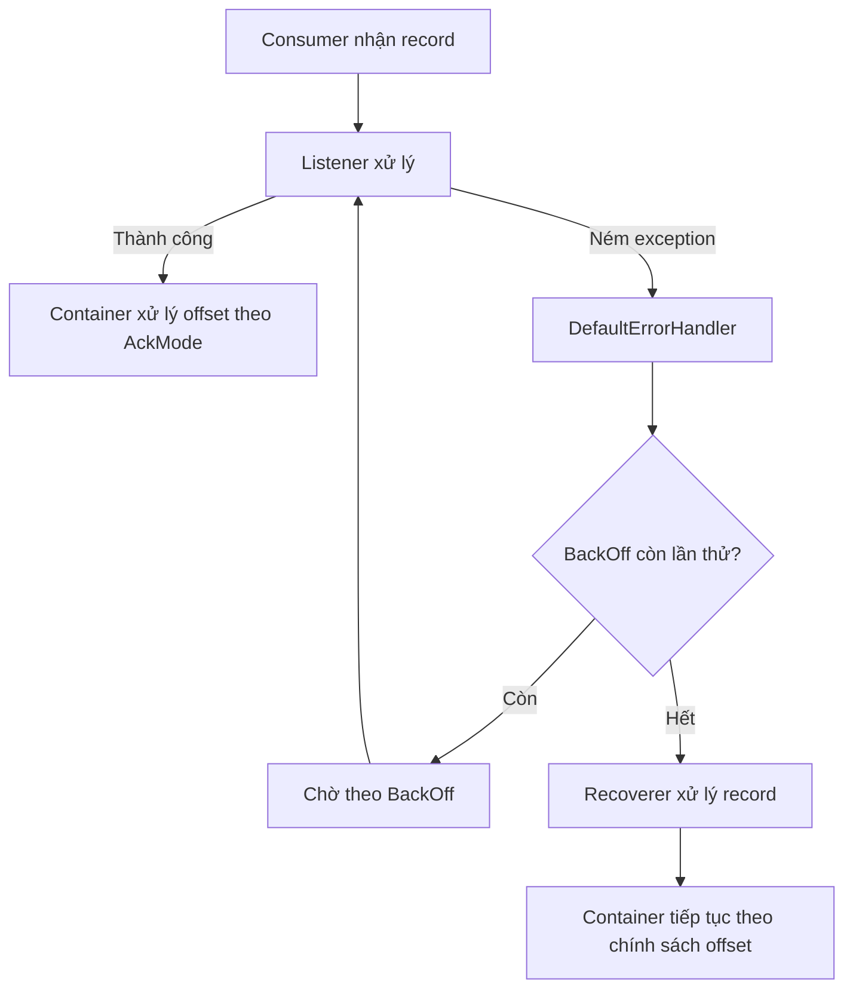

# FixedBackOff và ExponentialBackOff

Khi một Kafka message gặp lỗi tạm thời, consumer thường cần thử xử lý lại sau một khoảng chờ. Ví dụ, cơ sở dữ liệu đang khởi động lại, một API phụ thuộc trả về HTTP 503 hoặc kết nối mạng vừa bị gián đoạn. Thử lại ngay lập tức có thể làm dịch vụ đang quá tải càng quá tải hơn; chờ quá lâu lại kéo dài thời gian xử lý message.

Spring Kafka cho phép cấu hình khoảng chờ retry thông qua các triển khai của Spring Framework `BackOff`. Hai lựa chọn thường gặp là `FixedBackOff`, chờ một khoảng cố định giữa các lần thử, và `ExponentialBackOff`, tăng dần khoảng chờ sau mỗi lần thất bại. Chúng thường được dùng cùng `DefaultErrorHandler` để điều khiển việc xử lý lại record trong listener container.

## 1. Retry và BackOff nằm ở đâu trong luồng xử lý?

Với record listener, luồng cơ bản khi một listener ném exception có thể hình dung như sau:



Listener chỉ cần ném exception khi xử lý thất bại. Container chuyển lỗi cho error handler. `DefaultErrorHandler` sử dụng một `BackOff` để quyết định khoảng chờ và số lần tiếp tục thử. Khi chính sách retry đã hết, recoverer được gọi để xử lý record không thể khôi phục, chẳng hạn ghi log hoặc gửi sang dead-letter topic (DLT).

Một số khái niệm cần phân biệt:

- **Lần xử lý ban đầu (initial delivery):** lần listener nhận record trước khi retry.
- **Retry:** một lần xử lý lại sau lần ban đầu thất bại.
- **Backoff interval:** khoảng chờ trước lần retry kế tiếp.
- **Recoverer:** thành phần xử lý record sau khi retry đã hết hoặc khi error handler quyết định phục hồi.
- **Offset:** vị trí consumer đã xử lý trong partition; retry không có nghĩa offset của record lỗi đã được commit ngay.

BackOff chỉ quyết định nhịp thử lại. Nó không tự phân loại lỗi, không tự tạo DLT và không bảo đảm thao tác nghiệp vụ chạy đúng một lần.

## 2. FixedBackOff: khoảng chờ cố định

`FixedBackOff` dùng cùng một khoảng chờ cho mọi lần retry. Constructor nhận hai tham số:

```java
new FixedBackOff(interval, maxAttempts)
```

Trong đó:

- `interval`: số mili giây chờ giữa hai lần xử lý.
- `maxAttempts`: số lần retry tối đa sau lần xử lý ban đầu.

Ví dụ:

```java
FixedBackOff backOff = new FixedBackOff(1_000L, 3L);
```

Nếu listener thất bại liên tục, lịch xử lý tối đa sẽ là:

| Lần | Hành động | Khoảng chờ trước lần đó |
|---|---|---:|
| 1 | Xử lý ban đầu | Không có |
| 2 | Retry lần 1 | 1 giây |
| 3 | Retry lần 2 | 1 giây |
| 4 | Retry lần 3 | 1 giây |
| Sau lần 4 thất bại | Hết retry, chuyển sang recoverer | Không có retry tiếp theo |

Như vậy, `maxAttempts = 3` có nghĩa là ba lần retry, ngoài lần xử lý ban đầu. Nếu lần xử lý thứ hai thành công thì các lần sau không diễn ra.

Dùng `FixedBackOff(0L, 2L)` sẽ thử lại ngay hai lần, không có khoảng nghỉ. Cách này có thể hữu ích cho lỗi rất ngắn, nhưng không phù hợp nếu downstream đang quá tải hoặc mất kết nối trong thời gian dài.

### Khi nào nên dùng FixedBackOff?

Fixed delay phù hợp khi thời gian phục hồi dự kiến khá ổn định, chẳng hạn:

- Một lỗi tạm thời thường được khắc phục trong khoảng một vài giây.
- Muốn giới hạn rõ số lần thử và tổng thời gian chờ.
- Muốn hành vi retry dễ dự đoán khi vận hành và kiểm thử.
- Tác vụ có latency thấp và một khoảng chờ cố định không tạo tải dồn đáng kể.

Điểm yếu là các lần retry luôn đến theo nhịp đều. Nếu nhiều consumer cùng gặp lỗi, chúng có thể retry đồng thời theo chu kỳ giống nhau, tạo ra các đợt tải lặp lại lên dependency đang gặp sự cố.

## 3. ExponentialBackOff: tăng dần khoảng chờ

`ExponentialBackOff` tăng khoảng chờ theo cấp số nhân. Một cấu hình thường có ba giá trị quan trọng:

- `initialInterval`: khoảng chờ đầu tiên.
- `multiplier`: hệ số nhân sau mỗi lần thất bại.
- `maxInterval`: giới hạn trên của khoảng chờ.

Khoảng chờ ở lần retry thứ n có thể mô tả bằng:

```text
d_n = min(d_0 * m^(n-1), d_max)
```

Trong đó `d_0` là khoảng chờ ban đầu, `m` là hệ số nhân và `d_max` là giới hạn tối đa.

Ví dụ đặt khoảng chờ ban đầu là 1 giây, hệ số nhân là 2 và giới hạn là 8 giây:

| Retry | Khoảng chờ |
|---|---:|
| 1 | 1 giây |
| 2 | 2 giây |
| 3 | 4 giây |
| 4 | 8 giây |
| 5 trở đi | 8 giây |

Cấu hình bằng Spring Framework:

```java
import org.springframework.util.backoff.ExponentialBackOff;

ExponentialBackOff backOff =
        new ExponentialBackOff(1_000L, 2.0);

backOff.setMaxInterval(8_000L);
backOff.setMaxElapsedTime(60_000L);
```

`maxElapsedTime` giới hạn tổng khoảng thời gian mà BackOff cho phép tiếp tục phát sinh các lần chờ. Khác với `FixedBackOff`, cấu hình này không đặt trực tiếp một số lần retry cố định. Số lần thử thực tế phụ thuộc khoảng chờ, thời gian đã trôi qua và thời điểm BackOff kết thúc.

Nếu yêu cầu nghiệp vụ cần giới hạn chính xác số lần retry theo cấp số nhân, có thể dùng `ExponentialBackOffWithMaxRetries` trong các phiên bản Spring Kafka có cung cấp lớp này:

```java
import org.springframework.kafka.support.ExponentialBackOffWithMaxRetries;

ExponentialBackOffWithMaxRetries backOff =
        new ExponentialBackOffWithMaxRetries(5);

backOff.setInitialInterval(1_000L);
backOff.setMultiplier(2.0);
backOff.setMaxInterval(10_000L);
```

Lớp này biểu đạt số lần retry trực tiếp. Hãy kiểm tra phiên bản Spring Kafka của ứng dụng trước khi sử dụng API này; `ExponentialBackOff` thuộc Spring Framework là lựa chọn tổng quát hơn khi cần giới hạn theo thời gian.

### Vì sao exponential backoff hữu ích?

Khi một dependency ngừng hoạt động, retry liên tục có thể tạo thêm tải đúng lúc hệ thống cần giảm tải để phục hồi. Exponential backoff tạo khoảng nghỉ dài hơn sau mỗi lần thất bại:

- Lỗi ngắn có thể được khắc phục nhanh vì lần retry đầu đến sớm.
- Sự cố kéo dài không khiến consumer gọi dependency liên tục.
- Các request retry thưa dần, giúp hệ thống phía sau có thời gian phục hồi.
- Có thể giới hạn độ trễ lớn nhất bằng `maxInterval`.

Exponential backoff không làm lỗi tự biến mất. Nếu dependency hỏng lâu hơn giới hạn retry, record vẫn phải đi qua quy trình phục hồi sau khi hết retry.

## 4. So sánh FixedBackOff và ExponentialBackOff

| Tiêu chí | FixedBackOff | ExponentialBackOff |
|---|---|---|
| Khoảng chờ | Không đổi | Tăng theo hệ số nhân |
| Giới hạn retry | `maxAttempts` | Thường giới hạn bằng `maxElapsedTime`; có lớp hỗ trợ giới hạn số retry ở một số phiên bản |
| Khả năng dự đoán | Dễ tính tổng thời gian chờ | Số lần retry phụ thuộc cấu hình và thời gian |
| Áp lực lên dependency | Nhịp gọi đều | Giảm dần tần suất gọi khi lỗi kéo dài |
| Phù hợp | Lỗi ngắn, thời gian phục hồi tương đối ổn định | Dependency chập chờn hoặc có thể mất thời gian phục hồi |
| Rủi ro chính | Retry đồng loạt theo nhịp cố định | Tổng thời gian xử lý có thể kéo dài nếu giới hạn không hợp lý |

Không có chính sách nào tốt cho mọi loại lỗi. Một thao tác gọi cache nội bộ có thể chỉ cần vài lần retry ngắn. Một API bên ngoài có rate limit hoặc thời gian phục hồi khó dự đoán có thể phù hợp với exponential backoff và giới hạn trên.

## 5. Kết hợp BackOff với DefaultErrorHandler

Trong các phiên bản Spring Kafka sử dụng `DefaultErrorHandler` (được giới thiệu từ Spring Kafka 2.8), ta truyền một `BackOff` vào error handler. Ví dụ dưới đây dùng `FixedBackOff` và một recoverer gửi record hết retry sang DLT:

```java
import org.springframework.context.annotation.Bean;
import org.springframework.context.annotation.Configuration;
import org.springframework.kafka.core.KafkaTemplate;
import org.springframework.kafka.listener.DefaultErrorHandler;
import org.springframework.kafka.listener.DeadLetterPublishingRecoverer;
import org.springframework.util.backoff.FixedBackOff;

@Configuration
class KafkaErrorHandlingConfiguration {

    @Bean
    DefaultErrorHandler kafkaErrorHandler(
            KafkaTemplate<Object, Object> kafkaTemplate) {

        DeadLetterPublishingRecoverer recoverer =
                new DeadLetterPublishingRecoverer(kafkaTemplate);

        FixedBackOff backOff =
                new FixedBackOff(1_000L, 3L);

        DefaultErrorHandler errorHandler =
                new DefaultErrorHandler(recoverer, backOff);

        errorHandler.addNotRetryableExceptions(
                InvalidOrderException.class
        );

        return errorHandler;
    }
}
```

Gắn error handler vào listener container factory:

```java
@Bean
ConcurrentKafkaListenerContainerFactory<String, OrderEvent>
orderListenerFactory(
        ConsumerFactory<String, OrderEvent> consumerFactory,
        DefaultErrorHandler kafkaErrorHandler) {

    var factory =
            new ConcurrentKafkaListenerContainerFactory<String, OrderEvent>();

    factory.setConsumerFactory(consumerFactory);
    factory.setCommonErrorHandler(kafkaErrorHandler);

    return factory;
}
```

Listener sử dụng factory này:

```java
@KafkaListener(
        topics = "orders",
        groupId = "order-service",
        containerFactory = "orderListenerFactory")
public void consume(OrderEvent event) {
    orderService.process(event);
}
```

Khi `orderService.process(event)` ném exception có thể retry, `DefaultErrorHandler` sử dụng `FixedBackOff` để thử lại. Nếu retry hết, `DeadLetterPublishingRecoverer` gửi record sang DLT theo quy tắc định tuyến của recoverer.

Ví dụ dùng `KafkaTemplate<Object, Object>` để minh họa cấu hình chung. Trong ứng dụng thực tế, cần bảo đảm template và serializer có thể publish cả kiểu key/value của record gốc lẫn record được gửi sang DLT. Cũng cần cấu hình topic DLT và số partition phù hợp với chiến lược định tuyến.

Để đổi sang exponential backoff, thay đối tượng BackOff:

```java
ExponentialBackOff backOff =
        new ExponentialBackOff(1_000L, 2.0);

backOff.setMaxInterval(10_000L);
backOff.setMaxElapsedTime(60_000L);

DefaultErrorHandler errorHandler =
        new DefaultErrorHandler(recoverer, backOff);
```

Trong cấu hình trên, `recoverer` vẫn là `DeadLetterPublishingRecoverer`. Chính sách thời gian chờ thay đổi, còn hành động sau khi hết retry vẫn do recoverer quyết định.

## 6. Phân loại exception trước khi retry

Không phải lỗi nào cũng có thể khắc phục bằng cách thử lại. Ví dụ:

| Loại lỗi | Ví dụ | Hướng xử lý |
|---|---|---|
| Tạm thời | Timeout, kết nối DB mất ngắn hạn, HTTP 503 | Có thể retry với giới hạn |
| Giới hạn tốc độ | HTTP 429 | Retry theo chính sách phù hợp với thời gian server yêu cầu |
| Dữ liệu không hợp lệ | Thiếu trường bắt buộc, sai định dạng nghiệp vụ | Không retry vô hạn; phục hồi hoặc đưa DLT |
| Vi phạm nghiệp vụ | Đơn hàng ở trạng thái không cho phép chuyển tiếp | Thường không retry nếu dữ liệu không thể tự thay đổi |
| Lỗi lập trình | NullPointerException do bug | Cần sửa lỗi; retry thường chỉ lặp lại cùng thất bại |

Có thể đánh dấu exception không retry bằng `addNotRetryableExceptions`, hoặc khai báo các loại exception được retry bằng `addRetryableExceptions`. Cần hiểu phân loại mặc định của phiên bản Spring Kafka đang sử dụng, sau đó bổ sung các loại lỗi đặc thù của ứng dụng.

Ví dụ:

```java
DefaultErrorHandler errorHandler =
        new DefaultErrorHandler(recoverer, backOff);

errorHandler.addNotRetryableExceptions(
        InvalidOrderException.class,
        UnsupportedCurrencyException.class
);

errorHandler.addRetryableExceptions(
        TemporaryInventoryException.class
);
```

Không nên đánh dấu mọi exception là retryable. Một lỗi validation sẽ không tự hết khi chờ thêm một giây, trong khi timeout mạng có thể phục hồi sau một khoảng ngắn.

Nếu exception được bọc trong exception khác, hãy kiểm tra cách error handler phân loại cause trong phiên bản đang dùng. Nên viết test cho các exception thực tế mà listener có thể ném ra.

## 7. Tính tổng thời gian retry và ảnh hưởng đến consumer

Backoff không chỉ ảnh hưởng độ trễ của một record. Nó còn ảnh hưởng tiến độ xử lý của consumer group.

Với fixed backoff, nếu có r lần retry và mỗi lần chờ d, tổng thời gian chờ tối đa xấp xỉ:

```text
T_wait = r * d
```

Với exponential backoff, tổng thời gian chờ là tổng các khoảng chờ được phát ra trước khi chính sách dừng:

```text
T_wait = sum(d_i), với i từ 1 đến r
```

Đây mới chỉ là thời gian chờ. Thời gian thực tế còn gồm thời gian listener chạy ở lần đầu và các lần retry, thời gian recoverer, chuyển đổi dữ liệu và chi phí khác.

Ví dụ, nếu một record mất 300 ms cho mỗi lần xử lý, có ba lần retry và mỗi lần chờ 2 giây, thời gian xử lý một record thất bại có thể gần:

```text
4 * 300ms + 3 * 2s = 7.2s
```

Con số này cần được tính vào giới hạn poll và thời gian xử lý của consumer. Nếu retry chặn consumer quá lâu, consumer có thể không gọi `poll()` kịp trong giới hạn `max.poll.interval.ms`, dẫn đến việc rời group và rebalance.

Với khoảng chờ dài, cần cân nhắc cơ chế backoff có khả năng pause container hoặc dùng retry topic/non-blocking retry phù hợp. Retry topic chuyển lần thử tiếp theo sang một topic khác, phù hợp với lịch retry dài nhưng có tác động đến thứ tự xử lý và kiến trúc topic. Đây là quyết định kiến trúc riêng, không thể giải quyết chỉ bằng tăng `max.poll.interval.ms`.

## 8. Retry, offset và xử lý trùng

Khi listener ném exception, record chưa được coi là xử lý thành công. Error handler có thể seek để record được giao lại hoặc dùng cơ chế giữ và phát lại record tùy cấu hình và phiên bản. Vì thế, một record đã chạy qua một phần logic vẫn có thể được nhận lại.

Ví dụ listener đã ghi dữ liệu vào cơ sở dữ liệu, nhưng lỗi xảy ra trước khi hoàn tất. Lần retry tiếp theo có thể ghi lại cùng dữ liệu. Do đó:

- Dùng `eventId` hoặc khóa nghiệp vụ duy nhất để nhận diện event.
- Thiết kế thao tác ghi theo hướng idempotent, chẳng hạn upsert hoặc kiểm tra event đã áp dụng.
- Không commit offset thủ công trước khi công việc nghiệp vụ hoàn tất.
- Đảm bảo lỗi được ném trở lại listener container; nếu bắt exception rồi bỏ qua, error handler sẽ không biết cần retry.
- Phân biệt commit offset của Kafka với transaction của cơ sở dữ liệu. Retry không tự tạo transaction phân tán giữa hai hệ thống.

Khi recoverer gửi record sang DLT thành công, container xử lý offset theo cấu hình error handler và ack của listener. Hãy kiểm tra cấu hình commit và kiểm thử đường đi DLT để tránh vừa bỏ mất record vừa xử lý lặp ngoài dự kiến.

## 9. Chọn chính sách retry theo tình huống

Có thể dùng bảng sau làm điểm khởi đầu:

| Tình huống | Gợi ý |
|---|---|
| Timeout ngắn, thường phục hồi nhanh | FixedBackOff với vài lần retry và khoảng chờ ngắn |
| Dependency chập chờn, thời gian phục hồi khó đoán | ExponentialBackOff, có max interval và giới hạn tổng thời gian |
| API có rate limit | Tôn trọng thời gian chờ do API trả về nếu ứng dụng hỗ trợ; tránh retry dồn dập |
| Dữ liệu sai hoặc lỗi nghiệp vụ không thể tự hết | Đánh dấu non-retryable, chuyển recoverer/DLT |
| Thời gian retry kéo dài nhiều phút | Cân nhắc retry topic hoặc cơ chế trì hoãn riêng |
| Cần giới hạn chính xác số lần thử | FixedBackOff hoặc lớp exponential hỗ trợ max retries phù hợp phiên bản |

Một chính sách retry tốt phải trả lời được ba câu hỏi: loại lỗi nào được thử lại, thử lại bao nhiêu lần hoặc trong bao lâu, và điều gì xảy ra khi đã hết retry.

## 10. Kiểm thử chính sách BackOff

Không nên chỉ kiểm tra listener được gọi nhiều lần. Cần xác minh cả số lần thử, khoảng chờ và hành động khi hết retry.

Các tình huống nên có:

1. Listener thất bại một lần rồi thành công: record được xử lý lại và cuối cùng hoàn tất.
2. Listener luôn thất bại: số lần retry dừng đúng giới hạn, recoverer được gọi.
3. Exception non-retryable: không tiêu tốn các lần retry đã cấu hình.
4. FixedBackOff: các khoảng chờ giữ nguyên.
5. ExponentialBackOff: khoảng chờ tăng và không vượt max interval.
6. Record được gửi DLT: kiểm tra payload, key, headers và topic đích.
7. Retry sau khi một phần tác vụ đã ghi dữ liệu: xác nhận thao tác nghiệp vụ không tạo tác dụng phụ trùng.

Khi viết unit test cho logic xử lý, có thể dùng mock để đếm số lần gọi service. Khi kiểm tra tích hợp với Kafka, dùng broker thử nghiệm để xác minh record được giao lại, recoverer gửi DLT và offset được xử lý đúng. Không nên dùng test thời gian thực quá dài nếu có thể kiểm tra BackOff riêng hoặc dùng thời gian chờ ngắn trong cấu hình test.

## 11. Những lỗi cấu hình thường gặp

| Vấn đề | Nguyên nhân | Cách xử lý |
|---|---|---|
| Retry quá nhiều lần | `maxAttempts` hoặc `maxElapsedTime` quá lớn | Đặt giới hạn theo SLA và khả năng phục hồi |
| Retry không xảy ra | Listener nuốt exception hoặc lỗi bị phân loại non-retryable | Để lỗi truyền về container và kiểm tra classification |
| Consumer lag tăng | Backoff dài làm giảm tốc độ xử lý | Đo thời gian xử lý và cân nhắc retry topic |
| DLT không nhận record | Recoverer chưa được gắn hoặc topic/serializer sai | Kiểm tra recoverer, topic đích và serializer |
| DB bị ghi trùng | Logic xử lý không idempotent | Dùng event ID và ràng buộc duy nhất |
| Các consumer retry cùng lúc | Fixed delay đồng bộ sau cùng một sự cố | Cân nhắc exponential backoff và jitter ở tầng chính sách |
| Retry không dừng như mong muốn | Hiểu nhầm maxAttempts với tổng số lần giao | Tính cả lần xử lý ban đầu và các lần retry |

`FixedBackOff` và `ExponentialBackOff` đều là chính sách chờ; chúng không thay thế error classification, recoverer, idempotency hoặc quản lý offset. Hãy chọn khoảng chờ theo đặc tính dependency, giới hạn tổng thời gian theo yêu cầu vận hành và xác định rõ đường đi của record khi retry đã hết.

## 12. Checklist triển khai

- [ ] Đã phân loại exception tạm thời và exception không thể retry.
- [ ] Đã chọn FixedBackOff hoặc ExponentialBackOff theo hành vi phục hồi của dependency.
- [ ] Đã phân biệt số lần retry với lần xử lý ban đầu.
- [ ] Đã đặt max interval và giới hạn tổng thời gian hoặc số lần thử.
- [ ] Đã cấu hình recoverer cho trường hợp retry hết.
- [ ] Đã kiểm tra topic DLT, serializer, key và headers.
- [ ] Đã tính tổng thời gian retry vào giới hạn poll của consumer.
- [ ] Listener không nuốt exception khi muốn container retry.
- [ ] Tác vụ nghiệp vụ có khả năng xử lý lặp an toàn.
- [ ] Đã kiểm thử thành công, hết retry, lỗi non-retryable và gửi DLT.

Trong Spring Kafka, `DefaultErrorHandler` kết hợp với `BackOff` giúp kiểm soát nhịp xử lý lại record. Fixed delay dễ dự đoán; exponential delay giảm áp lực khi lỗi kéo dài. Chọn đúng chính sách và kết hợp với recoverer, phân loại exception, offset và idempotency sẽ giúp consumer phục hồi có kiểm soát khi dependency gặp sự cố.

