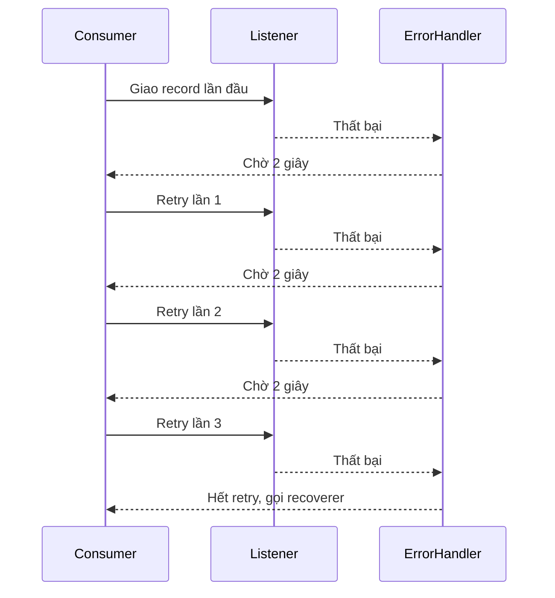

# Số lần thử và khoảng chờ

Khi một record Kafka thất bại, Spring Kafka có thể gọi lại listener theo chính sách retry trước khi chuyển record sang bước phục hồi, chẳng hạn gửi đến dead-letter topic (DLT). Hai tham số quyết định cách retry diễn ra là số lần thử lại và khoảng chờ giữa các lần thử. Chọn đúng hai tham số này giúp hệ thống chịu được lỗi tạm thời mà không làm consumer chờ quá lâu hoặc gọi dồn dập một dịch vụ đang gặp sự cố.

Trong Spring Kafka, `DefaultErrorHandler` nhận một `BackOff` để điều khiển thời gian và số lần retry. Cần phân biệt số lần retry với tổng số lần listener nhận record: lần xử lý đầu tiên không được tính là retry.

## 1. Phân biệt lần xử lý đầu và lần retry

Giả sử listener nhận một record và lần đầu xử lý thất bại. Nếu cấu hình cho phép ba lần retry, listener có thể được gọi lại thêm ba lần. Tổng cộng có tối đa bốn lần xử lý: một lần ban đầu và ba lần retry.

| Cấu hình | Lần xử lý tối đa |
| --- | ---: |
| `new FixedBackOff(1_000L, 0L)` | 1 lần, không retry |
| `new FixedBackOff(1_000L, 1L)` | 2 lần |
| `new FixedBackOff(1_000L, 3L)` | 4 lần |
| `new FixedBackOff(1_000L, 5L)` | 6 lần |

Tham số thứ nhất của `FixedBackOff` là khoảng chờ tính bằng mili giây. Tham số thứ hai là số lần retry tối đa sau lần đầu. Vì vậy, `FixedBackOff(2_000L, 3L)` có thể tạo ra ba khoảng chờ, mỗi khoảng hai giây; tổng thời gian chờ tối đa là sáu giây, chưa tính thời gian chạy listener và overhead của container.



Khi `BackOff` hết lượt, `DefaultErrorHandler` gọi recoverer. Nếu recoverer gửi record sang DLT thành công, container có thể tiếp tục theo chính sách acknowledgement và commit offset đang cấu hình. Nếu recovery thất bại, record có thể quay lại luồng xử lý lỗi; do đó cần quan sát cả lỗi publish DLT.

## 2. Cấu hình khoảng chờ cố định

`FixedBackOff` phù hợp khi muốn mỗi lần retry cách nhau cùng một khoảng thời gian và giới hạn chính xác số lần thử lại. Ví dụ, dịch vụ đối tác thường hồi phục nhanh sau một lỗi mạng ngắn:

```java
@Bean
public DefaultErrorHandler kafkaErrorHandler(
        ConsumerRecordRecoverer recoverer) {
    FixedBackOff backOff = new FixedBackOff(2_000L, 3L);
    return new DefaultErrorHandler(recoverer, backOff);
}
```

Với cấu hình trên, sau lần xử lý đầu tiên thất bại, container chờ hai giây rồi thử lại. Nếu ba lần retry tiếp theo vẫn thất bại, recoverer được gọi. Tổng số lần gọi listener tối đa là bốn.

Có thể dùng khoảng chờ bằng `0` nếu muốn retry ngay, nhưng retry liên tục có thể tạo vòng lặp nóng, tiêu thụ CPU và tăng tải lên dịch vụ phụ thuộc. Ngay cả khi lỗi có vẻ tạm thời, hãy cân nhắc một khoảng chờ ngắn để tránh tạo thêm áp lực.

## 3. Dùng exponential backoff khi lỗi kéo dài

Khoảng chờ cố định không phải lúc nào cũng phù hợp. Nếu dịch vụ phụ thuộc đang quá tải hoặc mất kết nối trong thời gian dài, retry liên tục mỗi giây có thể làm tình trạng nghiêm trọng hơn. Exponential backoff tăng dần khoảng chờ sau mỗi lần thất bại.

Ví dụ dùng `ExponentialBackOff` của Spring Framework:

```java
@Bean
public DefaultErrorHandler kafkaErrorHandler(
        ConsumerRecordRecoverer recoverer) {
    ExponentialBackOff backOff = new ExponentialBackOff();
    backOff.setInitialInterval(1_000L);
    backOff.setMultiplier(2.0);
    backOff.setMaxInterval(8_000L);
    backOff.setMaxElapsedTime(30_000L);

    return new DefaultErrorHandler(recoverer, backOff);
}
```

Với khoảng đầu một giây, hệ số nhân `2.0` và giới hạn tám giây, các khoảng chờ tăng theo chuỗi khoảng `1s, 2s, 4s, 8s, 8s...`. `maxInterval` chặn khoảng chờ ở mức tối đa; `maxElapsedTime` giới hạn tổng thời gian thực thi backoff. Vì số lần retry phụ thuộc vào thời gian đã trôi qua và chuỗi khoảng chờ, cách này phù hợp khi muốn giới hạn thời gian retry hơn là cần một số lần retry chính xác.

Nếu yêu cầu nghiệp vụ là “thử đúng ba lần sau lần đầu”, dùng `FixedBackOff` sẽ dễ đọc và dễ kiểm thử hơn. Nếu yêu cầu là “thử trong tối đa khoảng ba mươi giây, với khoảng chờ tăng dần”, `ExponentialBackOff` phù hợp hơn.

## 4. Chọn số lần thử theo loại lỗi

Số lần retry nên dựa trên khả năng tự phục hồi của nguyên nhân lỗi và thời gian nghiệp vụ cho phép:

- **Timeout hoặc lỗi mạng ngắn hạn:** có thể retry vài lần với khoảng chờ ngắn. Mục tiêu là vượt qua sự cố thoáng qua mà không làm tăng tải quá mức.
- **Dịch vụ phụ thuộc quá tải:** dùng exponential backoff và giới hạn tổng thời gian. Nếu lỗi kéo dài, chuyển record sang DLT để điều tra hoặc xử lý lại sau.
- **Dữ liệu sai hoặc vi phạm quy tắc nghiệp vụ:** retry thường không làm dữ liệu hợp lệ hơn. Phân loại exception là không retry để chuyển thẳng đến recoverer.
- **Lỗi lập trình:** retry nhiều lần thường chỉ lặp lại cùng lỗi. Cần log, cảnh báo và sửa nguyên nhân trong ứng dụng.

Số lần trong `BackOff` chỉ áp dụng cho exception được phân loại là có thể retry. Exception không retry sẽ đi đến recovery ngay cả khi cấu hình còn lượt. Hãy kết hợp chính sách backoff với phân loại exception trong `DefaultErrorHandler`, thay vì tăng số lần retry cho mọi lỗi.

## 5. Khoảng chờ ảnh hưởng đến partition và consumer như thế nào?

Với retry tại consumer của `DefaultErrorHandler`, record lỗi thường được đọc lại trong cùng partition. Các record đứng sau nó trong partition phải chờ cho đến khi record lỗi được xử lý thành công hoặc được recover. Vì vậy, tăng khoảng chờ hay số lần retry có thể kéo dài thời gian chờ của các record phía sau.

Ví dụ, partition `orders-0` có các record A, B, C. Nếu B lỗi và được retry với ba khoảng chờ hai giây, C có thể phải chờ trong lúc B được thử lại. Partition do consumer khác trong cùng group xử lý vẫn có thể tiếp tục tiến triển; các partition được gán cho cùng consumer đang chờ retry cũng có thể bị chậm.

Một khoảng chờ dài cũng cần được xem xét cùng `max.poll.interval.ms`. Nếu consumer thread bị chặn quá lâu mà không gọi `poll()`, Kafka có thể xem consumer là không còn hoạt động và kích hoạt rebalance. Với Spring Kafka 2.9 trở lên, có thể dùng `ContainerPausingBackOffHandler` để pause container trong thời gian chờ dài:

```java
DefaultErrorHandler handler = new DefaultErrorHandler(
    recoverer,
    new FixedBackOff(60_000L, 3L),
    new ContainerPausingBackOffHandler());
```

Container pausing backoff handler cho phép container tạm dừng nhận record trong thời gian chờ và tiếp tục duy trì vòng poll phù hợp. Hãy kiểm tra phiên bản Spring Kafka đang dùng và cấu hình consumer trước khi chọn khoảng chờ dài.

Nếu yêu cầu nghiệp vụ cần trì hoãn lâu và vẫn muốn các record sau tiếp tục được xử lý, cân nhắc non-blocking retry bằng `@RetryableTopic`. Cách này chuyển record qua các retry topic thay vì giữ nó ở partition nguồn; đổi lại, thứ tự xử lý giữa record lỗi và record đến sau có thể thay đổi.

## 6. Đừng nhầm retry count với số lần giao record trong toàn hệ thống

Số lần retry do `DefaultErrorHandler` điều khiển là số lần thử trong chu kỳ xử lý lỗi hiện tại. Restart ứng dụng, rebalance hoặc việc record được giao lại trước khi offset được commit có thể khiến listener nhận record thêm lần nữa. Vì vậy, không nên dùng số lần retry cấu hình làm bộ đếm duy nhất cho tổng số lần một sự kiện đã xuất hiện trong toàn bộ vòng đời hệ thống.

Nghiệp vụ vẫn cần idempotency, chẳng hạn lưu `eventId` với unique constraint hoặc ghi nhận trạng thái đã xử lý trong cùng transaction cơ sở dữ liệu. Retry là cơ chế phục hồi luồng messaging; nó không đảm bảo side effect bên ngoài chỉ xảy ra một lần.

## 7. Kiểm thử số lần thử và khoảng chờ

Một kiểm thử cho `FixedBackOff(2_000L, 3L)` nên mô phỏng listener thất bại liên tục và xác minh listener được gọi tối đa bốn lần trước recovery. Đồng thời kiểm tra record được chuyển sang DLT sau khi hết retry và offset chỉ tiến triển theo chính sách commit đã cấu hình.

Không nên để kiểm thử phải chờ toàn bộ khoảng thời gian dài nếu mục tiêu chỉ là xác minh số lần gọi. Có thể dùng backoff ngắn trong test hoặc kiểm tra riêng cấu hình `BackOff`; với kiểm thử tích hợp Kafka, dùng Awaitility để đợi điều kiện như số lần gọi listener hoặc record xuất hiện trên DLT.

Với exponential backoff, kiểm tra chuỗi khoảng chờ tăng dần, giới hạn `maxInterval` và thời điểm dừng theo `maxElapsedTime`. Cũng nên kiểm thử một exception không retry để xác minh recoverer được gọi ngay, không tiêu tốn các lượt retry.

## 8. Checklist khi cấu hình trong môi trường thật

- Xác định số lần xử lý tối đa bằng `1 + số lần retry` và ghi rõ con số này trong cấu hình.
- Ước lượng tổng thời gian chờ bằng tổng các khoảng backoff; cộng thêm thời gian xử lý listener và overhead.
- Đặt khoảng chờ và tổng thời gian retry theo timeout của dịch vụ phụ thuộc, SLA và `max.poll.interval.ms`.
- Dùng exponential backoff khi lỗi có thể kéo dài; dùng fixed backoff khi cần số lần và khoảng cách dễ dự đoán.
- Phân loại exception không thể tự phục hồi để chuyển sang DLT sớm.
- Theo dõi retry, recovery, DLT, consumer lag và lỗi rebalance để nhận biết chính sách retry quá dài.

Chọn số lần retry và khoảng chờ là một quyết định về khả năng phục hồi và độ trễ của cả partition. Cấu hình rõ ràng, có giới hạn và được kiểm thử sẽ giúp consumer xử lý lỗi tạm thời mà vẫn giữ được tiến độ và khả năng vận hành của luồng Kafka.
