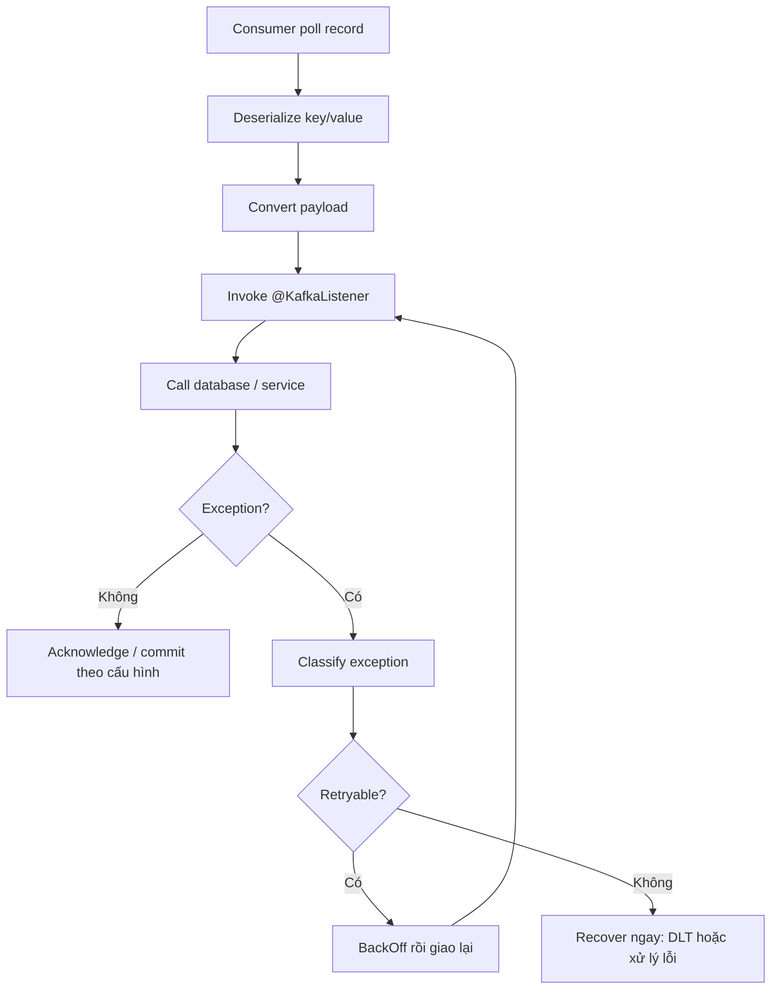

# Phân loại exception được retry

Không phải mọi lỗi khi xử lý Kafka record đều nên được retry. Một lỗi do database tạm thời mất kết nối có thể tự phục hồi sau vài giây; một event sai định dạng hoặc vi phạm quy tắc nghiệp vụ sẽ tiếp tục thất bại dù thử lại hàng trăm lần. Nếu không phân loại exception, consumer có thể lặp vô hạn trên một record lỗi, tăng consumer lag và trì hoãn toàn bộ partition.

Spring Kafka cho phép phân loại exception thành nhóm **retryable** và **non-retryable**. Với blocking retry, có thể cấu hình `DefaultErrorHandler`; với non-blocking retry, có thể khai báo `include` và `exclude` trong `@RetryableTopic`. Phân loại trả lời câu hỏi *có nên thử lại không*; `BackOff` và số lần thử trả lời câu hỏi *thử lại khi nào và bao nhiêu lần*.

## 1. Retryable và non-retryable exception

Một exception nên được retry khi nguyên nhân có khả năng biến mất theo thời gian và lần thử sau có cơ hội thành công mà không cần thay đổi payload hoặc logic. Ngược lại, exception không nên retry nếu record sẽ luôn thất bại với cùng dữ liệu hoặc cùng điều kiện.

| Nhóm lỗi | Ví dụ | Phân loại thường dùng | Lý do |
|---|---|---|---|
| Lỗi hạ tầng tạm thời | Database timeout, connection reset, broker/network tạm gián đoạn. | Retryable | Dependency có thể phục hồi sau một khoảng chờ. |
| Rate limit hoặc dịch vụ quá tải | HTTP 429, một số lỗi HTTP 5xx, circuit breaker đang mở. | Retryable có giới hạn | Có thể thành công khi tải giảm; cần backoff và giới hạn số lần thử. |
| Lỗi nghiệp vụ do payload | Thiếu trường bắt buộc, số tiền âm, trạng thái chuyển không hợp lệ. | Non-retryable | Payload không đổi nên thử lại không giải quyết được lỗi. |
| Lỗi schema/serialization cố định | JSON sai cú pháp, schema không tương thích, byte payload hỏng. | Thường non-retryable | Cần sửa producer hoặc dữ liệu trước khi xử lý lại. |
| Lỗi cấu hình hoặc quyền | Credential sai, thiếu quyền truy cập, endpoint cấu hình sai. | Thường non-retryable trong retry ngắn | Cần sửa cấu hình/quyền; retry liên tục chỉ tạo tải và log nhiễu. |
| Dữ liệu tham chiếu chưa sẵn sàng | Một entity chưa được đồng bộ nhưng có thể xuất hiện sau event khác. | Tùy nghiệp vụ | Có thể retry nếu sự kiện phụ thuộc được bảo đảm sẽ đến; nếu không cần quy trình reconcile. |

Không phân loại chỉ dựa trên tên exception hoặc mã HTTP. Ví dụ, HTTP 404 có thể là lỗi vĩnh viễn nếu resource không tồn tại, nhưng cũng có thể là trạng thái tạm thời nếu hệ thống dùng eventual consistency và resource sắp được tạo. Hãy dựa trên hợp đồng nghiệp vụ và khả năng phục hồi của nguyên nhân.

## 2. Quy tắc phân loại trong luồng xử lý

Một listener có thể thất bại ở nhiều giai đoạn:



Ví dụ:

- Database tạm thời không phản hồi: retry với backoff, sau số lần giới hạn thì chuyển DLT.
- `OrderValidationException`: không retry, chuyển thẳng DLT hoặc luồng xử lý lỗi nghiệp vụ.
- JSON không deserialize được: lỗi xảy ra trước khi listener nhận payload; thường được coi là fatal/non-retryable và cần `ErrorHandlingDeserializer` cùng error handler phù hợp.

Điểm phân loại phải phản ánh đúng nguyên nhân gốc. Nếu service bọc exception gốc trong một exception tổng quát, hãy kiểm tra cause chain để tránh mọi lỗi bị phân loại giống nhau.

## 3. Các exception mặc định được xem là fatal trong DefaultErrorHandler

`DefaultErrorHandler` có sẵn nhóm exception được xem là fatal (không retry theo mặc định), vì việc gọi listener lại với cùng record thường không thể sửa lỗi. Các loại tiêu biểu gồm:

| Exception | Nguyên nhân thường gặp |
|---|---|
| `DeserializationException` | Không thể chuyển byte key/value thành kiểu Java. |
| `MessageConversionException` | Không thể chuyển message sang kiểu listener yêu cầu. |
| `ConversionException` | Lỗi chuyển đổi dữ liệu trong quá trình dispatch. |
| `MethodArgumentResolutionException` | Không thể resolve tham số method listener. |
| `NoSuchMethodException` | Không tìm được method phù hợp cho handler. |
| `ClassCastException` | Kiểu dữ liệu thực tế không tương thích với kiểu mà listener xử lý. |

Đây là danh sách mặc định của error handler, không phải taxonomy đầy đủ cho mọi ứng dụng. Có thể bổ sung hoặc thay đổi classification theo nghiệp vụ. Khi dùng `ErrorHandlingDeserializer`, lỗi deserialize được đưa qua cơ chế xử lý lỗi của container thay vì để consumer liên tục thất bại trong `poll()`.

## 4. Tạo exception riêng cho nghiệp vụ

Nên định nghĩa exception theo ý nghĩa phục hồi thay vì gom mọi lỗi vào `RuntimeException` hoặc `KafkaException`. Ví dụ:

```java
public class RetryableInventoryException extends RuntimeException {
    public RetryableInventoryException(String message, Throwable cause) {
        super(message, cause);
    }
}

public class InvalidOrderEventException extends RuntimeException {
    public InvalidOrderEventException(String message) {
        super(message);
    }
}

public class OrderStateConflictException extends RuntimeException {
    public OrderStateConflictException(String message) {
        super(message);
    }
}
```

Quy ước:

- `RetryableInventoryException`: dịch vụ tồn kho tạm thời không truy cập được; có thể retry.
- `InvalidOrderEventException`: dữ liệu event vi phạm hợp đồng; không retry.
- `OrderStateConflictException`: xung đột trạng thái; cần xác định có thể retry sau khi tải lại state hay phải chuyển sang xử lý nghiệp vụ.

Không nên tạo exception class chỉ để phân loại nếu tên exception gốc đã thể hiện rõ semantics và được sử dụng nhất quán. Tuy nhiên, exception ở ranh giới application service giúp listener không phụ thuộc trực tiếp vào thư viện database hoặc HTTP cụ thể.

## 5. Phân loại exception với DefaultErrorHandler

`DefaultErrorHandler` dùng cho blocking retry: record được xử lý lại trong luồng listener container sau khoảng backoff. Có thể bổ sung exception cần retry hoặc không retry bằng `addRetryableExceptions(...)` và `addNotRetryableExceptions(...)`.

Ví dụ cấu hình:

```java
import org.springframework.context.annotation.Bean;
import org.springframework.context.annotation.Configuration;
import org.springframework.dao.TransientDataAccessException;
import org.springframework.kafka.core.KafkaTemplate;
import org.springframework.kafka.listener.DeadLetterPublishingRecoverer;
import org.springframework.kafka.listener.DefaultErrorHandler;
import org.springframework.util.backoff.FixedBackOff;

@Configuration
public class KafkaErrorHandlerConfiguration {

    @Bean
    DefaultErrorHandler kafkaErrorHandler(
            KafkaTemplate<Object, Object> dltKafkaTemplate) {

        var recoverer = new DeadLetterPublishingRecoverer(dltKafkaTemplate);

        // 2 lần retry sau lần giao đầu tiên, tổng cộng tối đa 3 lần giao.
        var handler = new DefaultErrorHandler(
                recoverer,
                new FixedBackOff(1_000L, 2L)
        );

        handler.addRetryableExceptions(
                RetryableInventoryException.class,
                TransientDataAccessException.class
        );

        handler.addNotRetryableExceptions(
                InvalidOrderEventException.class,
                IllegalArgumentException.class
        );

        return handler;
    }
}
```

Trong ví dụ:

- `FixedBackOff(1_000L, 2L)` chờ 1 giây giữa các lần retry và cho phép 2 lần retry sau lần giao ban đầu.
- `RetryableInventoryException` và `TransientDataAccessException` được đánh dấu retryable.
- `InvalidOrderEventException` và `IllegalArgumentException` được đánh dấu non-retryable.
- Khi retry đã hết hoặc exception được phân loại non-retryable, recoverer publish record sang DLT theo cấu hình destination.

Nếu không cấu hình recoverer tùy chỉnh, error handler có thể dùng recoverer mặc định để log record đã vượt quá số lần thử. Trong production, nên có chính sách rõ ràng cho record thất bại cuối cùng: DLT, lưu trữ lỗi hoặc một quy trình khôi phục khác.

Gắn handler vào listener container factory nếu tự tạo factory:

```java
factory.setCommonErrorHandler(kafkaErrorHandler);
```

Với Spring Boot auto-configuration, bean `CommonErrorHandler` phù hợp có thể được áp dụng vào factory mặc định. Nếu ứng dụng có nhiều factory, hãy kiểm tra từng factory để bảo đảm handler được gắn đúng listener.

## 6. Thay đổi classification mặc định

`DefaultErrorHandler` cho phép bổ sung exception vào nhóm retryable/non-retryable. Cần tránh đưa cùng một exception vào cả hai nhóm vì cấu hình chồng chéo khiến ý định vận hành không rõ ràng.

Ví dụ, nếu ứng dụng có một loại lỗi chuyển đổi dữ liệu mà muốn retry vì dữ liệu tham chiếu được đồng bộ chậm, có thể phân loại rõ exception riêng đó là retryable. Tuy nhiên, không nên bật retry đại trà cho toàn bộ `MessageConversionException` nếu đa số lỗi conversion là do payload sai cố định.

Khi cần một bảng phân loại hoàn toàn tường minh, có thể cấu hình classifications trên error handler theo API của phiên bản Spring Kafka đang dùng. Boolean `true` đại diện nhóm retryable, `false` đại diện nhóm không retry; giá trị mặc định cho các exception không có trong map cũng phải được chọn có chủ đích. Với phần lớn ứng dụng, `addRetryableExceptions` và `addNotRetryableExceptions` dễ đọc và dễ bảo trì hơn.

Exception có thể bị bọc bởi `ListenerExecutionFailedException` hoặc một wrapper khác. Hãy kiểm tra cách handler phân loại cause chain ở phiên bản framework đang dùng và viết test cho cả exception trực tiếp lẫn exception được bọc. Đừng giả định một custom exception luôn được nhận diện nếu nó chỉ xuất hiện sâu trong cause chain mà chưa xác minh.

## 7. Phân loại exception với @RetryableTopic

`@RetryableTopic` cấu hình non-blocking retry bằng cách chuyển record sang retry topic thay vì giữ consumer thread chờ backoff. Thuộc tính `include` xác định exception cần retry; `exclude` xác định exception không retry. Nếu exception bị loại khỏi retry, record có thể được chuyển thẳng đến DLT theo cấu hình.

Ví dụ:

```java
import org.springframework.dao.TransientDataAccessException;
import org.springframework.kafka.annotation.KafkaListener;
import org.springframework.kafka.annotation.RetryableTopic;
import org.springframework.retry.annotation.Backoff;
import org.springframework.stereotype.Component;

@Component
public class OrderEventListener {

    @RetryableTopic(
            attempts = "4",
            backoff = @Backoff(
                    delay = 1_000,
                    multiplier = 2.0,
                    maxDelay = 10_000
            ),
            include = {
                    TransientDataAccessException.class,
                    RetryableInventoryException.class
            },
            exclude = {
                    InvalidOrderEventException.class
            }
    )
    @KafkaListener(
            topics = "orders.events",
            groupId = "order-projection"
    )
    public void onOrderEvent(OrderEvent event) {
        orderService.apply(event);
    }
}
```

Trong ví dụ, `attempts = "4"` là tổng số lần xử lý, bao gồm lần đầu tiên; tức tối đa ba lần retry sau lần đầu. Backoff tăng theo hệ số 2 và bị giới hạn ở 10 giây. Chỉ những exception trong nhóm được cấu hình retry mới đi qua retry topics; exception nghiệp vụ bị exclude sẽ không tiêu tốn các lần retry.

`@RetryableTopic` tạo các retry endpoint/topic và DLT theo quy tắc đặt tên/cấu hình. Cần bảo đảm topic có partition và replication factor phù hợp, consumer DLT có quy trình xử lý và việc retry topic không làm phá vỡ ordering mà nghiệp vụ yêu cầu.

## 8. Blocking retry và non-blocking retry khác nhau

Hai cơ chế có tác động vận hành khác nhau:

| Tiêu chí | `DefaultErrorHandler` | `@RetryableTopic` |
|---|---|---|
| Cách retry | Giao lại record trong luồng listener container sau backoff. | Publish record sang retry topic với thời điểm xử lý sau. |
| Consumer thread | Có thể bị giữ trong thời gian chờ retry/backoff. | Có thể tiếp tục xử lý record khác sau khi record được chuyển tiếp. |
| Ordering | Giữ luồng xử lý partition chặt hơn, nhưng record lỗi có thể chặn tiến trình partition trong thời gian retry. | Có thể thay đổi thứ tự tương đối giữa record lỗi và record đến sau vì retry được xử lý ở topic khác. |
| Cấu hình phân loại | `addRetryableExceptions`, `addNotRetryableExceptions` hoặc classifications. | `include`, `exclude` và cấu hình retry topic. |
| Phù hợp | Retry ngắn, cần giữ thứ tự xử lý trong partition. | Retry chậm hoặc không muốn giữ consumer thread chờ. |

Không nên dùng non-blocking retry nếu nghiệp vụ đòi hỏi mọi record của một partition phải được xử lý hoàn toàn theo thứ tự nghiêm ngặt. Record tiếp theo có thể được xử lý trước record đang chờ ở retry topic.

## 9. Phân loại exception theo cause chain

Trong ứng dụng nhiều tầng, exception thực tế thường bị bọc:

```text
ListenerExecutionFailedException
  └── OrderProcessingException
        └── TransientDataAccessResourceException
```

Nếu classifier chỉ nhìn wrapper ngoài cùng, nó có thể không nhận ra lỗi database tạm thời bên trong. Ngược lại, một wrapper chung có thể che mất lỗi nghiệp vụ vốn không nên retry.

Các nguyên tắc nên áp dụng:

1. Giữ nguyên cause khi bọc exception: `throw new OrderProcessingException("...", cause)`.
2. Không bắt `Exception` rồi ném lại một exception chung mà bỏ mất cause.
3. Dùng exception application-specific khi cần phân loại ổn định qua nhiều adapter.
4. Kiểm tra cause chain trong unit/integration test.
5. Xác minh tùy chọn traverse causes của `@RetryableTopic` hoặc classifier đang dùng trong phiên bản Spring Kafka cụ thể.

Ví dụ bọc lỗi nhưng giữ cause:

```java
try {
    inventoryClient.reserve(orderId);
}
catch (SocketTimeoutException exception) {
    throw new RetryableInventoryException(
            "Inventory service timeout for order " + orderId,
            exception
    );
}
```

Nhờ đó, application service thể hiện semantics retryable mà vẫn giữ exception gốc để logging và điều tra.

## 10. Deserialization và conversion error cần xử lý riêng

Lỗi deserialize xảy ra trước khi listener nhận payload. Ví dụ, consumer nhận byte không phải JSON hợp lệ nhưng đang dùng `JsonDeserializer`. Trong tình huống này, method listener không có cơ hội bắt lỗi hoặc ném exception nghiệp vụ.

Với Spring Kafka, `ErrorHandlingDeserializer` bọc deserializer thật và chuyển thông tin lỗi cho container error handler:

```yaml
spring:
  kafka:
    consumer:
      key-deserializer: org.springframework.kafka.support.serializer.ErrorHandlingDeserializer
      value-deserializer: org.springframework.kafka.support.serializer.ErrorHandlingDeserializer
      properties:
        spring.deserializer.key.delegate.class: org.apache.kafka.common.serialization.StringDeserializer
        spring.deserializer.value.delegate.class: org.springframework.kafka.support.serializer.JsonDeserializer
        spring.json.value.default.type: com.example.orders.OrderEvent
        spring.json.trusted.packages: com.example.orders
```

Vì payload sai định dạng thường không tự sửa sau một giây, lỗi deserialize thường nên được xử lý như non-retryable và chuyển raw bytes cùng metadata sang DLT để điều tra. Lỗi conversion phát sinh sau khi có record nhưng trước hoặc trong lúc gọi method cũng cần phân loại theo nguyên nhân tương tự.

Không retry vô hạn cho poison pill. Nếu dữ liệu cần được sửa, hãy giữ raw bytes và metadata nguồn để có thể phát lại sau khi producer hoặc quy trình migration đã khắc phục.

## 11. Thiết kế taxonomy exception cho ứng dụng

Một taxonomy nhỏ và rõ ràng giúp các service cùng hiểu quy tắc retry:

| Nhóm application exception | Ví dụ class | Retry? | Hành động khi hết retry |
|---|---|---|---|
| Dependency tạm thời | `RetryableInventoryException` | Có giới hạn | DLT và cảnh báo dependency. |
| Database tạm thời | `TransientDataAccessException` | Có giới hạn | DLT hoặc retry theo quy trình vận hành. |
| Payload không hợp lệ | `InvalidOrderEventException` | Không | DLT, phản hồi producer hoặc quy trình sửa dữ liệu. |
| Vi phạm trạng thái | `OrderStateConflictException` | Tùy semantics | Có thể retry ngắn nếu trạng thái sẽ hội tụ; nếu không, DLT/manual resolution. |
| Không đủ quyền/cấu hình | `AuthorizationException`, lỗi credential | Thường không retry ngắn | Alert và sửa cấu hình/quyền. |

Tránh tạo một exception `RetryableException` tổng quát rồi dùng cho mọi lỗi. Tên class nên mô tả nguyên nhân hoặc khả năng phục hồi để người vận hành hiểu tại sao record được retry.

## 12. Số lần retry và BackOff không thay thế classification

Classification quyết định record có được retry hay không. BackOff xác định thời gian chờ giữa các lần retry. Hai phần này cần được thiết kế riêng:

- **Fixed backoff:** khoảng chờ cố định, phù hợp dependency có thời gian phục hồi ngắn và ổn định.
- **Exponential backoff:** tăng thời gian chờ sau mỗi lần thất bại, giảm áp lực lên dependency đang quá tải.
- **Max attempts:** giới hạn số lần thử để record lỗi không chiếm tài nguyên vô hạn.
- **Jitter:** thêm độ ngẫu nhiên nếu nhiều consumer có thể retry cùng lúc, tránh tạo đợt request đồng loạt.

Ví dụ, retry database timeout sau 1 giây, 2 giây, 4 giây rồi tối đa 10 giây có thể hợp lý hơn retry liên tục không delay. Tuy nhiên, nếu exception là `InvalidOrderEventException`, dù backoff có tốt đến đâu cũng không giúp payload sai trở nên hợp lệ.

Với `FixedBackOff(interval, maxAttempts)` của Spring, `maxAttempts` là số lần retry sau lần giao ban đầu. Với `@RetryableTopic(attempts = "N")`, `attempts` là tổng số lần xử lý bao gồm lần đầu. Luôn ghi rõ semantics này trong cấu hình và test để tránh nhầm số lần giao.

## 13. Idempotency khi retry

Retry đồng nghĩa một event có thể được listener nhận nhiều lần. Ngoài ra, producer hoặc consumer có thể gặp tình huống kết quả không rõ ràng khi timeout/restart. Vì vậy, handler nghiệp vụ cần chịu được việc cùng event được xử lý lại.

Các cách thường dùng:

- Dùng `eventId` duy nhất và lưu bảng inbox/processed-events với unique constraint.
- Cập nhật trạng thái bằng câu lệnh có điều kiện, ví dụ chỉ chuyển từ `PENDING` sang `PAID` một lần.
- Dùng optimistic locking hoặc version để phát hiện cập nhật trùng/xung đột.
- Ghi side effect và dấu đã xử lý trong cùng database transaction.
- Không gửi email/thanh toán/chuyển tiền lặp lại chỉ vì consumer retry; dùng idempotency key ở dịch vụ downstream.

Kafka producer idempotence không thay thế idempotency của consumer. Idempotence của producer chủ yếu ngăn duplicate do retry nội bộ của producer trong session; nó không ngăn ứng dụng xử lý lại cùng record hoặc gửi lại event ở một producer session khác.

## 14. Kiểm thử phân loại exception

Nên kiểm thử theo bảng quyết định thay vì chỉ xác minh một lần retry thành công:

| Kịch bản | Kết quả mong đợi |
|---|---|
| Listener ném `RetryableInventoryException` lần đầu, thành công lần sau | Có retry theo backoff; side effect chỉ được áp dụng đúng theo idempotency contract. |
| Listener ném `InvalidOrderEventException` | Không chờ các lần retry; record được recover/DLT theo cấu hình. |
| Listener ném `IllegalArgumentException` | Hành vi đúng với classification đã cấu hình, kể cả khi class này được đánh dấu non-retryable. |
| Exception retryable nằm trong cause chain của wrapper | Được phân loại đúng theo cấu hình traverse causes. |
| JSON payload sai | Listener không được gọi; error handler xử lý deserialization failure và DLT giữ được raw bytes nếu cấu hình hỗ trợ. |
| Retry hết số lần | Recoverer được gọi; record không bị lặp vô hạn trên partition. |

Với integration test, dùng broker test/Embedded Kafka hoặc Testcontainers, latches để chờ các lần giao và DLT record, và timeout hữu hạn. Kiểm tra cả số lần gọi listener, topic/partition/offset nguồn trong DLT headers và trạng thái side effect. Không dùng `Thread.sleep` cố định để đoán thời điểm retry.

## 15. Lỗi thường gặp

| Biểu hiện | Nguyên nhân | Cách xử lý |
|---|---|---|
| Record bị retry liên tục dù payload sai | Exception validation chưa được phân loại non-retryable. | Thêm vào `addNotRetryableExceptions` hoặc `exclude` của retry topic. |
| Database tạm lỗi nhưng record chuyển DLT ngay | Exception bị phân loại fatal hoặc bị bọc thành class không được nhận diện. | Kiểm tra cause chain và thêm exception retryable cụ thể. |
| Mọi exception đều retry | Dùng default classification mà chưa bổ sung taxonomy nghiệp vụ. | Phân loại exception validation, schema và quyền truy cập. |
| Consumer lag tăng mạnh | Backoff/retry giữ consumer thread lâu hoặc poison record chặn partition. | Giới hạn attempts, phân loại non-retryable và cân nhắc retry topic. |
| Record đến DLT nhưng thiếu payload | Deserialization error không được cấu hình qua `ErrorHandlingDeserializer` hoặc DLT serializer không hỗ trợ raw bytes. | Cấu hình delegate deserializer và DLT template phù hợp. |
| Retry topic làm sai thứ tự | Record lỗi được chuyển sang retry topic trong khi record sau tiếp tục xử lý. | Chỉ dùng non-blocking retry khi nghiệp vụ chấp nhận thay đổi ordering. |
| Retry tạo side effect trùng | Listener không idempotent hoặc commit/ack chưa phù hợp. | Dùng event ID, inbox/unique constraint và transaction. |
| Retry quá dồn dập | Backoff cố định quá ngắn hoặc nhiều consumer retry cùng lúc. | Dùng exponential backoff, giới hạn tải và jitter nếu cần. |

## 16. Ghi nhớ

- Retry exception khi nguyên nhân có khả năng phục hồi; không retry lỗi payload hoặc nghiệp vụ không thể tự sửa.
- `DefaultErrorHandler` mặc định xem một số lỗi deserialize/conversion và lỗi dispatch là fatal; có thể bổ sung retryable/non-retryable exception.
- `addRetryableExceptions(...)` và `addNotRetryableExceptions(...)` giúp phân loại rõ cho blocking retry.
- `@RetryableTopic` dùng `include` và `exclude` để chọn exception đi qua retry topics.
- `FixedBackOff` tính số lần retry sau lần giao đầu; `@RetryableTopic.attempts` tính cả lần đầu.
- Cause chain và exception wrapper cần được kiểm thử để classification không bị sai.
- Deserialization error xảy ra trước listener; dùng `ErrorHandlingDeserializer` và DLT phù hợp để giữ raw bytes.
- Blocking retry giữ record trong luồng xử lý; non-blocking retry có thể làm record đến sau được xử lý trước.
- Retry yêu cầu consumer idempotent để bảo vệ side effect khi record được giao lại.

Khi thiết kế retry, hãy bắt đầu bằng câu hỏi nguyên nhân lỗi có thể tự phục hồi hay cần sửa dữ liệu/cấu hình. Xây dựng exception taxonomy rõ ràng, cấu hình classification ở đúng cơ chế retry, đặt backoff và giới hạn attempts, rồi kiểm thử cả đường retry thành công lẫn đường chuyển DLT. Nhờ vậy, record lỗi không làm tắc consumer group và lỗi tạm thời vẫn có cơ hội phục hồi.

## Tài liệu tham khảo

- [Spring for Apache Kafka — Handling Exceptions](https://docs.spring.io/spring-kafka/reference/kafka/annotation-error-handling.html)
- [Spring for Apache Kafka — Non-Blocking Retries](https://docs.spring.io/spring-kafka/reference/retrytopic.html)
- [Spring Kafka — DefaultErrorHandler API](https://docs.spring.io/spring-kafka/api/org/springframework/kafka/listener/DefaultErrorHandler.html)
- [Spring Kafka — RetryableTopic API](https://docs.spring.io/spring-kafka/api/org/springframework/kafka/annotation/RetryableTopic.html)
