# Blocking retry làm tăng thời gian poll

Blocking retry là cách thử xử lý lại một record ngay trong luồng consumer hiện tại. Khi listener ném exception, error handler chờ theo `BackOff`, sau đó record lỗi được giao lại trong lần `poll()` tiếp theo. Cách này đơn giản và thường giữ thứ tự xử lý trong partition, nhưng thời gian chờ cùng thời gian xử lý lại làm tăng khoảng thời gian từ lần `poll()` này đến lần `poll()` tiếp theo.

Điểm cần theo dõi là **khoảng cách giữa hai lần gọi `poll()`**, được giới hạn bởi `max.poll.interval.ms`. Blocking retry không nhất thiết làm một lần gọi API `poll()` kéo dài hơn; nó làm consumer thread bận xử lý và chờ retry trước khi quay lại poll. Nếu khoảng cách này vượt ngưỡng cấu hình, consumer có thể bị xem là không còn tiến triển và consumer group có thể rebalance.

## 1. Blocking retry diễn ra trong luồng consumer như thế nào?

Với record listener, luồng thông thường gồm các bước:

1. Consumer gọi `poll()` và nhận một tập record từ các partition được gán.
2. Listener xử lý từng record.
3. Nếu listener ném exception, `DefaultErrorHandler` áp dụng `BackOff`.
4. Khi hết thời gian chờ, handler kết thúc xử lý lỗi; lần `poll()` tiếp theo có thể giao lại record lỗi cho listener.
5. Khi record được xử lý thành công hoặc được recover, container tiếp tục xử lý phần record còn lại và quay lại `poll()`.

```mermaid
sequenceDiagram
    participant K as Kafka broker
    participant C as Consumer thread
    participant L as @KafkaListener
    participant E as DefaultErrorHandler
    C->>K: poll()
    K-->>C: Batch records
    C->>L: Xử lý record A
    L-->>C: Exception
    C->>E: Chuyển lỗi
    E->>E: Chờ BackOff
    E->>E: Seek offset cần retry
    E-->>C: Kết thúc xử lý lỗi
    C->>K: poll() tiếp theo
    K-->>C: Giao lại record A
    C->>L: Xử lý lại record A
    L-->>C: Thành công
    C->>L: Xử lý các record còn lại
    C->>K: poll() tiếp theo
```



Với `DefaultErrorHandler`, `BackOff` quyết định thời gian chờ và số lần giao lại. `BackOffHandler` quyết định cách container chờ. Mặc định, handler tạm dừng thread cho đến khi hết thời gian backoff hoặc container bị dừng. Vì thế, trong thời gian chờ, consumer thread không xử lý record tiếp theo và không gọi `poll()` như một chu kỳ bình thường.

Nếu một consumer thread được gán nhiều partition, lỗi của một record có thể làm chậm tiến độ xử lý các record khác do cùng thread phục vụ. Những consumer thread khác trong cùng ứng dụng vẫn có thể tiếp tục nếu chúng thuộc các container/consumer độc lập.

## 2. Vì sao thời gian giữa các lần poll tăng?

Kafka dùng `max.poll.interval.ms` để giới hạn khoảng thời gian tối đa giữa các lần consumer gọi `poll()`. Consumer phải xử lý tập record vừa nhận và quay lại poll trước khi hết khoảng này. Nếu vượt ngưỡng, group coordinator có thể xem consumer là không còn hoạt động và bắt đầu phân phối lại partition.

Với blocking retry, thời gian giữa hai lần poll có thể bao gồm:

- Thời gian xử lý các record trước record lỗi trong lần poll hiện tại.
- Thời gian chờ của mỗi lần backoff.
- Thời gian xử lý lại record lỗi ở từng attempt.
- Thời gian xử lý các record còn lại sau khi record lỗi được xử lý hoặc recovery.
- Chi phí commit offset, callback và điều phối của container.

Có thể ước lượng:

```text
T_between_polls
  ≈ T_processing_before_error
  + Σ(T_backoff + T_retry_processing)
  + T_processing_remaining_records
  + T_container_overhead
```

Ví dụ, cấu hình:

```java
new FixedBackOff(2_000L, 2L)
```

nghĩa là chờ 2 giây giữa các lần retry và cho phép 2 lần retry sau lần giao đầu tiên, tổng cộng tối đa 3 lần listener nhận record. Riêng backoff đã cộng thêm khoảng 4 giây. Nếu mỗi lần listener xử lý mất 300 ms, record lỗi có thể chiếm khoảng 4,9 giây gồm ba lần xử lý và hai khoảng chờ, chưa tính thời gian xử lý các record khác và overhead.

Nếu `max.poll.interval.ms` được cấu hình thấp hơn tổng thời gian cần thiết, consumer có nguy cơ vượt giới hạn trước khi quay lại poll. Khi partition được gán cho consumer khác, record chưa commit có thể được giao lại. Vì vậy, retry không chỉ ảnh hưởng latency mà còn có thể làm tăng duplicate processing sau rebalance.

## 3. Cấu hình blocking retry với `DefaultErrorHandler`

Ví dụ dưới đây cấu hình hai lần retry, mỗi lần cách nhau một giây. Khi hết retry, `DeadLetterPublishingRecoverer` gửi record lỗi sang dead-letter topic (DLT):

```java
@Bean
DefaultErrorHandler orderErrorHandler(
        KafkaTemplate<Object, Object> kafkaTemplate) {

    var recoverer = new DeadLetterPublishingRecoverer(kafkaTemplate);
    var backOff = new FixedBackOff(1_000L, 2L);

    return new DefaultErrorHandler(recoverer, backOff);
}
```

Gắn handler vào listener container factory:

```java
@Bean
ConcurrentKafkaListenerContainerFactory<String, Order> orderListenerFactory(
        ConsumerFactory<String, Order> consumerFactory,
        DefaultErrorHandler orderErrorHandler) {

    var factory = new ConcurrentKafkaListenerContainerFactory<String, Order>();
    factory.setConsumerFactory(consumerFactory);
    factory.setCommonErrorHandler(orderErrorHandler);
    return factory;
}
```

Với cấu hình này, `DefaultErrorHandler` sử dụng backoff handler mặc định, tức thread chờ trong thời gian backoff. `FixedBackOff(1_000L, 2L)` có hai lần retry, không phải hai lần giao tổng cộng. Nếu DLT dùng resolver mặc định, tên topic đích là topic gốc cộng hậu tố `-dlt` và partition nguồn được giữ lại; cần tạo DLT có số partition phù hợp và cấu hình serializer tương thích.

Chỉ nên retry lỗi có khả năng tự hết như timeout hoặc lỗi kết nối tạm thời. Lỗi dữ liệu không hợp lệ thường không thay đổi sau khi chờ; có thể thêm chúng vào nhóm không retry để recover ngay:

```java
orderErrorHandler.addNotRetryableExceptions(ValidationException.class);
```

`DefaultErrorHandler` cũng mặc định xem một số lỗi deserialization và message conversion là không retryable. Phân loại đúng exception giúp tránh tiêu tốn thời gian poll vào những lần thử lại không thể thành công.

Không nên đặt retry vô hạn cho lỗi kéo dài mà không có cảnh báo và phương án recovery. Một record lỗi có thể giữ consumer thread ở trạng thái retry lâu dài, làm tăng lag và chặn tiến độ xử lý những record khác được gán cho consumer đó.

## 4. Giảm nguy cơ vượt `max.poll.interval.ms` bằng ContainerPausingBackOffHandler

Từ Spring Kafka 2.9, có thể chọn `ContainerPausingBackOffHandler`. Thay vì giữ thread trong một lần sleep liên tục, handler pause listener container trong khoảng backoff rồi resume container khi đến thời điểm retry. Cách này hữu ích khi thời gian chờ dài hơn `max.poll.interval.ms` vì container có thể tiếp tục các lần poll trong thời gian pause để duy trì hoạt động của consumer.

```java
@Bean
DefaultErrorHandler orderErrorHandler(
        KafkaTemplate<Object, Object> kafkaTemplate) {

    var recoverer = new DeadLetterPublishingRecoverer(kafkaTemplate);
    var backOff = new FixedBackOff(360_000L, 2L);
    var backOffHandler = new ContainerPausingBackOffHandler();

    return new DefaultErrorHandler(recoverer, backOff, backOffHandler);
}
```

Thời gian pause thực tế có độ phân giải phụ thuộc `pollTimeout` của container. Ví dụ, nếu `pollTimeout` là một giây, thời điểm retry có thể lệch theo nhịp poll đó. Cần chọn `pollTimeout` phù hợp với yêu cầu độ chính xác của backoff và chi phí poll.

Pause container giúp consumer tiếp tục poll và tránh bị loại khỏi group chỉ vì thời gian chờ retry dài. Tuy nhiên, container đang pause sẽ không xử lý các record mới trong thời gian đó. Cách này bảo vệ sức khỏe consumer group và giữ retry tại consumer hiện tại, nhưng không biến blocking retry thành xử lý song song.

## 5. Chọn `max.poll.interval.ms`, `max.poll.records` và concurrency

Bốn cấu hình này có liên quan đến thời gian hoàn thành một chu kỳ poll:

| Cấu hình | Tác động | Cách cân nhắc |
|---|---|---|
| `max.poll.interval.ms` | Giới hạn thời gian giữa các lần gọi `poll()` | Đặt đủ lớn cho thời gian xử lý và retry dự kiến nếu dùng thread-sleep backoff |
| `max.poll.records` | Giới hạn số record trả về trong một lần poll | Giảm khi một poll chứa quá nhiều record và thời gian xử lý vượt ngân sách |
| `concurrency` | Số consumer/container thread được tạo bởi listener container | Tăng để phân tán partition khi có đủ partition và tài nguyên |
| `pollTimeout` | Thời gian chờ tối đa trong một lần poll của container | Ảnh hưởng độ phân giải của `ContainerPausingBackOffHandler` |

Không nên chỉ tăng `max.poll.interval.ms` để che một chuỗi retry quá dài. Giá trị lớn hơn có thể trì hoãn việc phát hiện consumer thực sự bị treo và làm rebalance diễn ra muộn hơn. Trước tiên hãy đo thời gian xử lý thực tế, số lần retry và thời gian backoff; sau đó chọn giới hạn phù hợp với SLA.

Giảm `max.poll.records` có thể giảm số record phải xử lý trong một chu kỳ, nhưng cũng có thể làm giảm hiệu suất khi overhead mỗi lần poll lớn. Tăng concurrency có ích khi topic có đủ partition để phân phối cho nhiều consumer. Nếu chỉ có một partition, tăng concurrency không làm partition đó được xử lý bởi nhiều consumer trong cùng consumer group.

## 6. Khi nào nên dùng non-blocking retry?

Blocking retry thích hợp khi lỗi có khả năng hết nhanh, ví dụ một lần timeout ngắn của dịch vụ phụ thuộc, và việc giữ thứ tự trong partition quan trọng. Nếu thời gian phục hồi không chắc chắn hoặc chờ lâu sẽ chặn luồng chính, có thể cân nhắc non-blocking retry bằng `@RetryableTopic`.

Với non-blocking retry, record lỗi được chuyển sang retry topic cùng thông tin thời điểm được phép thử lại. Consumer của retry topic kiểm tra timestamp; nếu chưa đến hạn, partition retry được pause. Khi đến hạn, record được xử lý lại. Consumer của topic chính có thể tiếp tục nhận các record khác thay vì phải chờ record lỗi.

```java
@RetryableTopic(attempts = "4")
@KafkaListener(topics = "orders")
public void consume(Order order) {
    orderService.process(order);
}
```

Non-blocking retry có đánh đổi về thứ tự. Record phía sau có thể được xử lý trước record lỗi đang nằm trong retry topic. Cơ chế này cũng không hỗ trợ batch listener và không thể kết hợp với container transactions. Nếu nghiệp vụ yêu cầu thứ tự nghiêm ngặt trong partition hoặc cần transaction của listener container, hãy đánh giá kỹ trước khi chuyển sang retry topic.

Từ Spring Kafka 2.8.4, có thể kết hợp blocking retry và non-blocking retry. Một số exception có thể được thử lại ngay vài lần trước khi chuyển sang retry topic. Ví dụ cấu hình blocking retry cho exception tạm thời:

```java
@EnableKafka
@Configuration
class OrderRetryConfiguration extends RetryTopicConfigurationSupport {

    @Override
    protected void configureBlockingRetries(BlockingRetriesConfigurer blockingRetries) {
        blockingRetries
                .retryOn(TemporaryDatabaseException.class)
                .backOff(new FixedBackOff(500L, 2L));
    }
}
```

Đặt `@RetryableTopic` trên listener để khai báo luồng retry topic. `configureBlockingRetries()` dùng allowlist: chỉ những exception được khai báo bằng `retryOn()` mới đi qua các lần blocking retry đã cấu hình. Sau đó record có tiếp tục qua retry topic hay đi DLT còn phụ thuộc phân loại exception và cấu hình retry topic. Cách kết hợp này hữu ích khi muốn retry nhanh lỗi có khả năng hết ngay, rồi chuyển sang lịch retry dài hơn nếu lỗi vẫn tồn tại.

## 7. Blocking retry trong listener transaction

Khi listener container dùng Kafka transaction, Spring Kafka mặc định không cài `DefaultErrorHandler`; exception được ném lên để transaction rollback. Việc retry sau rollback do `AfterRollbackProcessor` xử lý. Vì vậy, cần phân biệt cấu hình blocking retry của `DefaultErrorHandler` trong luồng không transaction với cơ chế retry sau rollback trong luồng transaction.

Non-blocking retry topic không thể kết hợp với container transactions. Nếu cần vừa duy trì Kafka transaction vừa retry, hãy thiết kế `AfterRollbackProcessor`, backoff, recovery và DLT phù hợp; không giả định `@RetryableTopic` có thể thay thế trực tiếp cơ chế đó.

## 8. Đo lường tác động của blocking retry

Để biết blocking retry có làm poll cycle vượt giới hạn hay không, theo dõi các tín hiệu sau:

- **Thời gian giữa các lần poll:** đo khoảng thời gian giữa các lần container gọi `poll()` và so sánh với `max.poll.interval.ms`.
- **Listener duration:** đo thời gian xử lý mỗi record và toàn bộ batch, bao gồm thời gian gọi dịch vụ ngoài.
- **Retry count và backoff duration:** ghi nhận exception type, delivery attempt, thời gian chờ và kết quả recovery.
- **Consumer lag:** quan sát lag theo partition; lag tăng liên tục có thể cho thấy retry đang chặn tiến độ.
- **Rebalance và duplicate processing:** theo dõi số lần rebalance, record được giao lại và lỗi commit offset.
- **DLT rate:** theo dõi số record đi vào DLT và thời gian từ lần lỗi đầu đến recovery.

`DefaultErrorHandler` hỗ trợ `RetryListener` để nhận callback khi delivery thất bại, recovery thành công hoặc recovery thất bại. Với blocking delivery attempt header, cần bật `deliveryAttemptHeader` trên `ContainerProperties` nếu muốn đưa số lần giao vào header của message. Những chỉ số này giúp xác định lỗi tạm thời đang được retry thành công hay một record đang giữ consumer ở trạng thái chờ quá lâu.

## 9. Ví dụ chọn chiến lược

Một consumer xử lý đơn hàng cần gọi dịch vụ định giá. Dịch vụ thỉnh thoảng timeout trong khoảng 200–500 ms, nhưng có lúc mất kết nối vài phút.

1. Với timeout ngắn, thực hiện một vài blocking retry có backoff ngắn để tránh tạo retry topic cho lỗi thoáng qua.
2. Nếu vẫn thất bại, chuyển record sang retry topic với delay dài hơn để consumer chính tiếp tục xử lý đơn hàng khác, nếu nghiệp vụ chấp nhận thay đổi thứ tự.
3. Nếu thứ tự trong partition là bắt buộc, giữ retry tại luồng blocking hoặc thiết kế partition/luồng xử lý riêng để không cho phép record sau vượt qua record trước.
4. Đặt giới hạn retry và DLT để record lỗi không giữ consumer vô hạn.
5. Bảo đảm thao tác xử lý đơn hàng có tính idempotent vì record có thể được giao lại sau retry, rebalance hoặc restart.

## 10. Ghi nhớ

- Blocking retry chờ và xử lý lại trên luồng consumer hiện tại; thời gian backoff làm tăng khoảng cách giữa hai lần gọi `poll()`.
- `max.poll.interval.ms` giới hạn khoảng thời gian giữa các lần poll; nếu vượt ngưỡng, consumer có thể bị loại khỏi group và partition được phân phối lại.
- `DefaultErrorHandler` mặc định dùng handler tạm dừng thread trong backoff.
- Từ Spring Kafka 2.9, `ContainerPausingBackOffHandler` cho phép pause container trong lúc chờ; độ chính xác backoff phụ thuộc `pollTimeout`.
- `max.poll.records`, thời gian xử lý listener, số lần retry và backoff cùng quyết định thời gian hoàn thành một poll cycle.
- Non-blocking retry dùng retry topic để trì hoãn record lỗi mà không chặn consumer topic chính, nhưng làm mất bảo đảm thứ tự của topic; không hỗ trợ batch listener hoặc container transactions.
- Từ Spring Kafka 2.8.4, có thể kết hợp một số blocking retry ngắn với non-blocking retry theo phân loại exception.

## Tài liệu tham khảo

- [Spring for Apache Kafka — Handling Exceptions, mục Back Off Handlers và DefaultErrorHandler](https://docs.spring.io/spring-kafka/reference/kafka/annotation-error-handling.html)
- [Spring for Apache Kafka — Non-Blocking Retries](https://docs.spring.io/spring-kafka/reference/retrytopic.html)
- [Spring for Apache Kafka — How the Retry Topic Pattern Works](https://docs.spring.io/spring-kafka/reference/retrytopic/how-the-pattern-works.html)
- [Spring for Apache Kafka — Combining Blocking and Non-Blocking Retries](https://docs.spring.io/spring-kafka/reference/retrytopic/retry-topic-combine-blocking.html)
