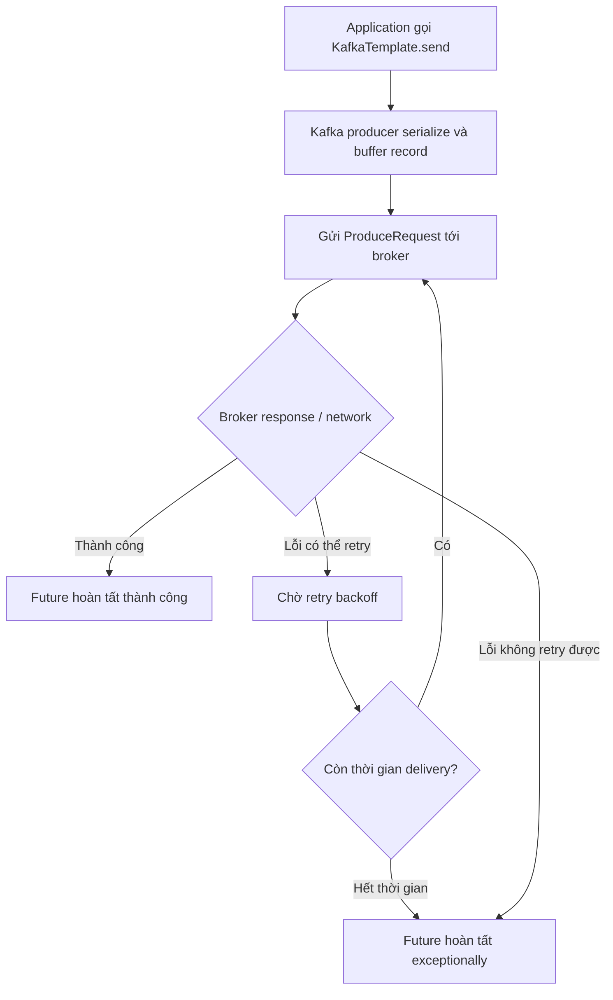

# Retry ở producer bằng cấu hình client

Kafka producer có cơ chế retry nội bộ để gửi lại request khi gặp lỗi tạm thời từ broker hoặc mạng. Với Spring Kafka, `KafkaTemplate` sử dụng Kafka producer bên dưới, vì vậy các thuộc tính như `retries`, `retry.backoff.ms`, `request.timeout.ms` và `delivery.timeout.ms` được cấu hình ở Kafka producer client.

Retry nội bộ giúp producer xử lý lỗi transient mà không yêu cầu code nghiệp vụ gọi `send()` lại. Tuy nhiên, retry có giới hạn thời gian, chỉ áp dụng cho lỗi mà Kafka client xem là có thể retry và không thay thế xử lý lỗi ở application. Để hạn chế duplicate do retry, nên bật idempotent producer cùng `acks=all` và cấu hình `max.in.flight.requests.per.connection` phù hợp.

## 1. Producer retry hoạt động ở đâu?

Khi ứng dụng gọi `KafkaTemplate.send(...)`, Spring Kafka chuyển yêu cầu tới Kafka producer. Producer serialize key/value, lấy metadata topic-partition, đưa record vào buffer và gửi request tới broker. Nếu request gặp lỗi tạm thời, Kafka client có thể retry theo cấu hình producer.



Retry do Kafka producer thực hiện ở tầng client, bất đồng bộ trong nền. Trong khoảng thời gian retry, lời gọi `send()` thường đã trả về future cho ứng dụng. Ứng dụng có thể tiếp tục công việc khác và nhận kết quả qua callback/future.

Nếu retry thành công, future hoàn tất bình thường với `SendResult`. Nếu retry hết thời gian hoặc gặp lỗi không retry được, future hoàn tất exceptionally. Vì vậy, không được coi việc gọi `send()` thành công là record đã được broker ghi nhận.

## 2. Các thuộc tính producer liên quan đến retry

| Thuộc tính | Vai trò | Ý nghĩa vận hành |
|---|---|---|
| `retries` | Số lần retry tối đa | Giới hạn số lần Kafka producer thử gửi lại request |
| `retry.backoff.ms` | Khoảng nghỉ retry ban đầu | Thời gian chờ giữa các lần thử lại |
| `retry.backoff.max.ms` | Khoảng nghỉ retry tối đa | Giới hạn backoff khi client tăng thời gian chờ giữa các lần retry; có trên các phiên bản Kafka hỗ trợ |
| `request.timeout.ms` | Timeout của một request | Thời gian producer chờ broker phản hồi một request |
| `delivery.timeout.ms` | Tổng thời gian gửi record | Giới hạn thời gian từ lúc `send()` tới khi kết quả thành công hoặc thất bại, bao gồm batching, request và retry |
| `max.in.flight.requests.per.connection` | Số request chưa nhận response trên một connection | Ảnh hưởng throughput và ordering khi retry |
| `enable.idempotence` | Bật idempotent producer | Hạn chế duplicate do retry request của producer |
| `acks` | Mức xác nhận từ broker | Quyết định điều kiện producer xem request là thành công |

`retries` và `delivery.timeout.ms` cần được hiểu cùng nhau. Đặt số lần retry rất lớn không làm producer retry vô hạn; `delivery.timeout.ms` vẫn giới hạn tổng thời gian gửi một record. Ngược lại, delivery timeout dài cũng không bảo đảm retry mọi loại lỗi.

## 3. Cấu hình retry trong application.yml

Với Spring Boot, có thể đặt các thuộc tính producer trong `spring.kafka.producer`:

```yaml
spring:
  kafka:
    bootstrap-servers: ${KAFKA_BOOTSTRAP_SERVERS:localhost:9092}
    producer:
      key-serializer: org.apache.kafka.common.serialization.StringSerializer
      value-serializer: org.springframework.kafka.support.serializer.JsonSerializer
      acks: all
      retries: 2147483647
      properties:
        "[enable.idempotence]": true
        "[max.in.flight.requests.per.connection]": 5
        "[request.timeout.ms]": 30000
        "[delivery.timeout.ms]": 120000
        "[retry.backoff.ms]": 200
        "[retry.backoff.max.ms]": 1000
```

Ý nghĩa cấu hình:

- `acks: all`: broker chỉ xác nhận sau khi các replica trong ISR đã đáp ứng yêu cầu ghi theo cấu hình replication.
- `retries: 2147483647`: cho phép số lần thử lại rất lớn; tổng thời gian thực tế vẫn bị giới hạn bởi delivery timeout.
- `enable.idempotence: true`: dùng producer ID và sequence number để broker nhận diện retry của cùng một batch, tránh ghi duplicate do retry nội bộ.
- `max.in.flight.requests.per.connection: 5`: giới hạn số request chưa nhận response; giá trị này tương thích với idempotence trên các phiên bản Kafka hiện hành.
- `request.timeout.ms: 30000`: chờ tối đa 30 giây cho một request.
- `delivery.timeout.ms: 120000`: giới hạn khoảng hai phút cho toàn bộ quá trình gửi record.
- `retry.backoff.ms` và `retry.backoff.max.ms`: điều chỉnh khoảng chờ giữa các lần retry.

Các key trong `producer.properties` được đặt trong ngoặc vuông để giữ nguyên tên Kafka property có dấu chấm khi Spring Boot bind map. Kiểm tra phiên bản Spring Boot/Kafka client đang dùng vì các default và property được hỗ trợ có thể thay đổi theo version.

Kafka yêu cầu `delivery.timeout.ms` không nhỏ hơn tổng `request.timeout.ms` và `linger.ms`. Trong ví dụ, `delivery.timeout.ms=120000` lớn hơn `request.timeout.ms=30000` cộng `linger.ms` mặc định. Nếu tăng batching bằng `linger.ms`, hãy đánh giá lại timeout.

## 4. Cấu hình bằng Java ProducerFactory

Nếu tự tạo `ProducerFactory`, có thể khai báo các Kafka producer properties trực tiếp:

```java
@Configuration
public class KafkaProducerConfiguration {

    @Bean
    public ProducerFactory<String, OrderCreated> orderProducerFactory() {
        Map<String, Object> properties = new HashMap<>();
        properties.put(ProducerConfig.BOOTSTRAP_SERVERS_CONFIG, "localhost:9092");
        properties.put(ProducerConfig.KEY_SERIALIZER_CLASS_CONFIG, StringSerializer.class);
        properties.put(ProducerConfig.VALUE_SERIALIZER_CLASS_CONFIG, JsonSerializer.class);
        properties.put(ProducerConfig.ACKS_CONFIG, "all");
        properties.put(ProducerConfig.ENABLE_IDEMPOTENCE_CONFIG, true);
        properties.put(ProducerConfig.RETRIES_CONFIG, Integer.MAX_VALUE);
        properties.put(ProducerConfig.MAX_IN_FLIGHT_REQUESTS_PER_CONNECTION, 5);
        properties.put(ProducerConfig.REQUEST_TIMEOUT_MS_CONFIG, 30_000);
        properties.put(ProducerConfig.DELIVERY_TIMEOUT_MS_CONFIG, 120_000);
        properties.put(ProducerConfig.RETRY_BACKOFF_MS_CONFIG, 200L);
        properties.put("retry.backoff.max.ms", 1_000L);

        return new DefaultKafkaProducerFactory<>(properties);
    }

    @Bean
    public KafkaTemplate<String, OrderCreated> orderKafkaTemplate(
            ProducerFactory<String, OrderCreated> orderProducerFactory) {
        return new KafkaTemplate<>(orderProducerFactory);
    }
}
```

Khi tự tạo factory, ứng dụng chịu trách nhiệm cung cấp đầy đủ bootstrap server, serializer, security và các thuộc tính producer cần thiết. Không giả định factory tự tạo sẽ tự động nhận toàn bộ cấu hình `spring.kafka.producer` của Spring Boot.

`retry.backoff.max.ms` là property của Kafka client ở các phiên bản có hỗ trợ. Nếu client version của dự án chưa có property này, bỏ cấu hình đó và dùng `retry.backoff.ms`.

## 5. retries không phải số lần gửi lại vô hạn

`retries` quy định giới hạn số lần producer thử lại request có thể retry. Nhưng một record còn phải đáp ứng giới hạn `delivery.timeout.ms`. Khi hết thời gian giao hàng, producer báo lỗi dù giá trị `retries` vẫn còn.

Ví dụ:

```text
send() được gọi
  |
  +-- serialize và chờ buffer
  |
  +-- request lần 1 -> timeout
  |
  +-- backoff -> request lần 2 -> broker tạm lỗi
  |
  +-- backoff -> request lần 3 -> timeout
  |
  +-- ...
  |
  +-- delivery.timeout.ms hết hạn -> future thất bại
```

Producer cũng phải dành thời gian cho `linger.ms` và chờ metadata/buffer. Do đó, không thể tính số lần retry thực tế chỉ bằng `retries` chia cho `retry.backoff.ms`.

Trong môi trường production, nên chọn delivery timeout theo SLA publish và thời gian gián đoạn broker có thể chấp nhận. Timeout quá ngắn làm producer thất bại khi broker chỉ gián đoạn ngắn; timeout quá dài khiến ứng dụng chờ kết quả lâu và backlog trong producer buffer tăng.

## 6. Phân biệt request.timeout.ms và delivery.timeout.ms

Hai timeout có phạm vi khác nhau:

| Timeout | Phạm vi | Ví dụ lỗi |
|---|---|---|
| `request.timeout.ms` | Một request gửi tới broker | Broker phản hồi chậm hoặc response không đến đúng hạn |
| `delivery.timeout.ms` | Toàn bộ vòng đời gửi một record sau khi gọi `send()` | Record chưa được broker xác nhận thành công sau thời gian cho phép |

`request.timeout.ms` có thể hết hạn nhiều lần trong một lần gửi record nếu producer còn thời gian và số lần retry. `delivery.timeout.ms` là giới hạn tổng thể cho việc gửi record, gồm thời gian chờ batching, request và retry.

Ví dụ:

```yaml
spring:
  kafka:
    producer:
      properties:
        "[request.timeout.ms]": 20000
        "[delivery.timeout.ms]": 90000
        "[linger.ms]": 5
```

Delivery timeout phải đủ lớn để bao phủ request timeout cộng linger. Hãy dùng đơn vị millisecond và kiểm tra quan hệ timeout khi thay đổi một trong các giá trị.

## 7. retry.backoff.ms và retry.backoff.max.ms

`retry.backoff.ms` đặt khoảng chờ cơ sở giữa các lần retry. `retry.backoff.max.ms`, nếu được Kafka client version hỗ trợ, đặt mức trần cho backoff khi thời gian chờ tăng dần.

Ví dụ:

```yaml
spring:
  kafka:
    producer:
      properties:
        "[retry.backoff.ms]": 200
        "[retry.backoff.max.ms]": 2000
```

Backoff giúp producer không gửi request liên tục khi broker đang gặp sự cố. Một số phiên bản client áp dụng tăng backoff có jitter để giảm tình trạng nhiều producer cùng retry đúng một thời điểm.

Không nên đặt backoff quá lớn nếu SLA publish yêu cầu độ trễ thấp. Ngược lại, backoff quá nhỏ có thể tạo áp lực request liên tục lên broker đang quá tải.

## 8. Idempotent producer và duplicate do retry

Khi producer gửi request nhưng không nhận được response, nó có thể không biết broker đã ghi record hay chưa. Nếu gửi lại mà broker đã append request trước đó, cùng một record có nguy cơ xuất hiện hai lần nếu không có cơ chế nhận diện retry.

Idempotent producer dùng producer ID và sequence number để broker nhận biết batch được gửi lại. Khi retry cùng batch, broker có thể loại bản ghi trùng phát sinh từ lần gửi lại đó.

```yaml
spring:
  kafka:
    producer:
      acks: all
      retries: 2147483647
      properties:
        "[enable.idempotence]": true
        "[max.in.flight.requests.per.connection]": 5
```

Các điều kiện cấu hình quan trọng cho idempotence gồm:

- `enable.idempotence=true`.
- `acks=all`.
- `retries` lớn hơn 0.
- `max.in.flight.requests.per.connection` không vượt quá 5.

Các Kafka client hiện đại thường bật idempotence mặc định nếu không có cấu hình xung đột. Khai báo tường minh giúp ý định vận hành dễ review và tránh phụ thuộc vào default của version.

Idempotence bảo vệ retry ở cùng producer session theo sequence của Kafka. Nó không tự loại duplicate do ứng dụng gọi `send()` hai lần như hai lần gửi độc lập, không deduplicate giữa hai producer khác nhau và không tạo exactly-once cho side effect ở database hoặc HTTP service.

## 9. max.in.flight.requests.per.connection và ordering

`max.in.flight.requests.per.connection` giới hạn số request producer gửi mà chưa nhận response trên một connection. Giá trị cao có thể cải thiện throughput, nhưng nếu idempotence tắt và request trước lỗi rồi retry trong khi request sau thành công, thứ tự ghi có thể khác thứ tự gửi ban đầu.

Khi bật idempotence, Kafka hỗ trợ giữ thứ tự cho tối đa năm request in-flight trên một connection theo các ràng buộc cấu hình hiện hành. Nếu tắt idempotence và cần ordering khi retry, có thể giới hạn in-flight xuống `1`, nhưng điều này thường giảm throughput.

Ví dụ cấu hình ưu tiên idempotence:

```yaml
spring:
  kafka:
    producer:
      properties:
        "[enable.idempotence]": true
        "[max.in.flight.requests.per.connection]": 5
```

Ordering toàn cục giữa nhiều partition vẫn không được Kafka bảo đảm. Nếu cần thứ tự cho một aggregate, hãy dùng cùng key để các event của aggregate đi vào cùng partition.

## 10. acks và min.insync.replicas

Retry giúp gửi lại request thất bại, nhưng độ bền của dữ liệu còn phụ thuộc acknowledgment và replication.

| `acks` | Ý nghĩa |
|---|---|
| `0` | Producer không chờ broker xác nhận; không phù hợp nếu cần xác nhận ghi đáng tin cậy |
| `1` | Leader xác nhận sau khi append vào local log |
| `all` hoặc `-1` | Leader chờ các replica trong ISR đáp ứng điều kiện xác nhận |

Với `acks=all`, cấu hình topic/broker `min.insync.replicas` quyết định số replica tối thiểu cần có trong ISR để ghi thành công. Ví dụ replication factor là `3` và `min.insync.replicas=2`; nếu ISR giảm dưới `2`, producer có thể nhận `NotEnoughReplicasException` và retry trong giới hạn delivery timeout.

Retry không thể tạo thêm replica hoặc khôi phục broker đã mất. Nếu cụm không đạt điều kiện ISR trong thời gian delivery timeout, future cuối cùng vẫn thất bại. Cần thiết kế replication factor, min ISR và SLA phục hồi cùng nhau.

## 11. Gọi KafkaTemplate.send và nhận kết quả retry

Từ Spring Kafka 3.0, `KafkaTemplate.send(...)` trả về `CompletableFuture<SendResult<K,V>>`; các phiên bản cũ dùng `ListenableFuture`. Producer client thực hiện retry nội bộ trước khi future hoàn tất. Lưu ý `send()` vẫn có thể ném exception đồng bộ trước khi trả future, chẳng hạn lỗi serialize, producer đã đóng hoặc chờ metadata/buffer vượt `max.block.ms`. Các lỗi giao hàng xảy ra sau khi record được nhận vào producer thường được báo qua future.

```java
@Service
public class OrderEventPublisher {

    private final KafkaTemplate<String, OrderCreated> kafkaTemplate;

    public OrderEventPublisher(
            KafkaTemplate<String, OrderCreated> kafkaTemplate) {
        this.kafkaTemplate = kafkaTemplate;
    }

    public CompletableFuture<SendResult<String, OrderCreated>> publish(
            OrderCreated event) {

        return kafkaTemplate.send(
                "orders.created.v1",
                event.orderId(),
                event);
    }
}
```

Không cần tự gọi lại `send()` cho từng lần retry broker/network mà Kafka producer đã quản lý. Hãy quan sát future để biết kết quả cuối cùng:

```java
publish(event).whenComplete((result, exception) -> {
    if (exception != null) {
        log.error("Publish order event failed: eventId={}", event.eventId(), exception);
        return;
    }

    RecordMetadata metadata = result.getRecordMetadata();
    log.info("Published eventId={} topic={} partition={} offset={}",
            event.eventId(),
            metadata.topic(),
            metadata.partition(),
            metadata.offset());
});
```

Callback chỉ chạy khi producer hoàn tất thành công hoặc thất bại. Không block thread request bằng `get()` hoặc `join()` nếu không có lý do rõ ràng; dùng callback/future và thiết kế timeout ở tầng gọi phù hợp.

## 12. Phân biệt lỗi retry được và lỗi không retry được

Kafka producer quyết định retry dựa trên loại lỗi do client/broker trả về. Một số lỗi tạm thời có thể retry, ví dụ lỗi mạng, request timeout, leader chưa sẵn sàng hoặc replica tạm thời không đáp ứng.

Một số lỗi thường không được giải quyết bằng retry như:

- Serialization lỗi do object không thể chuyển thành bytes.
- Topic hoặc partition không hợp lệ.
- Record vượt giới hạn kích thước được broker/topic chấp nhận.
- Lỗi cấu hình producer.
- Lỗi authentication/authorization cần sửa credential hoặc ACL.

Danh sách chính xác phụ thuộc exception và phiên bản Kafka client. Không nên tự phân loại mọi exception theo tên đơn giản; hãy kiểm tra cause chain và cờ retriable của Kafka exception khi cần.

Nếu lỗi không retry được, producer có thể hoàn tất future exceptionally ngay mà không chờ hết `delivery.timeout.ms`. Tăng `retries` không sửa được schema serialization sai, quyền ghi thiếu hoặc topic cấu hình không hợp lệ.

## 13. Phân biệt producer retry với application retry

Hai cơ chế này khác nhau:

| Cơ chế | Ai thực hiện? | Phạm vi |
|---|---|---|
| Kafka producer retry | Kafka client | Gửi lại request transient trong giới hạn retry và delivery timeout |
| Application retry | Code nghiệp vụ/framework retry | Gọi lại thao tác publish sau khi future thất bại hoặc sau một quyết định nghiệp vụ |

Ví dụ không nên tự động làm một cách mù quáng:

```java
kafkaTemplate.send("orders", event)
        .whenComplete((result, exception) -> {
            if (exception != null) {
                // Gọi send() lại ngay có thể tạo một lần gửi độc lập.
                kafkaTemplate.send("orders", event);
            }
        });
```

Khi future báo lỗi, producer có thể đã hết delivery timeout mà không xác định được ứng dụng ngoài Kafka có ghi nhận side effect nào khác hay không. Nếu ứng dụng gửi lại, lần gửi đầu có thể đã được broker append nhưng response bị mất; lần gửi mới là một logical send độc lập và có thể tạo duplicate.

Nếu cần application retry, hãy dùng event ID ổn định, idempotent consumer, outbox hoặc cơ chế deduplication. Áp dụng backoff và giới hạn số lần thử ở tầng nghiệp vụ; không retry liên tục trong callback gây vòng lặp nóng.

## 14. max.block.ms và buffer.memory không phải delivery timeout

Producer có buffer để gom record trước khi gửi. Nếu metadata chưa sẵn sàng hoặc buffer đầy, `send()` có thể block trước khi trả future.

| Thuộc tính | Ý nghĩa |
|---|---|
| `buffer.memory` | Tổng bộ nhớ producer dùng cho record chờ gửi |
| `max.block.ms` | Thời gian tối đa `send()` có thể block khi chờ metadata hoặc buffer allocation |
| `delivery.timeout.ms` | Thời gian tối đa cho record được broker xác nhận sau khi gọi send |

Nếu producer bị backpressure vì broker chậm, buffer có thể đầy và lời gọi `send()` block tới `max.block.ms`. Đây không phải một lần retry request tới broker và không nên nhầm với `delivery.timeout.ms`.

Ví dụ:

```yaml
spring:
  kafka:
    producer:
      properties:
        "[buffer.memory]": 33554432
        "[max.block.ms]": 60000
        "[delivery.timeout.ms]": 120000
```

Tăng buffer có thể hấp thụ burst ngắn nhưng không giải quyết broker outage kéo dài. Cần theo dõi producer buffer availability, send latency và số lỗi timeout.

## 15. Theo dõi retry và lỗi publish

Producer retry diễn ra nội bộ nên ứng dụng không nhất thiết nhận callback cho từng lần thử. Thường ứng dụng chỉ thấy kết quả cuối cùng của future. Để quan sát, có thể kết hợp producer metrics, client logs và metric của Spring Kafka.

Các tín hiệu hữu ích:

- `record-retry-rate`: tỷ lệ record batch được retry.
- `record-error-rate`: tỷ lệ record batch gặp lỗi.
- `record-send-rate`: tốc độ gửi record.
- `request-latency-avg` và `request-latency-max`: độ trễ request.
- `record-queue-time-avg`: thời gian record nằm trong producer accumulator.
- `buffer-available-bytes`: dung lượng buffer còn trống.
- `requests-in-flight`: số request đang chờ response.
- Tỷ lệ future hoàn tất exceptionally ở ứng dụng.

Tên metric chính xác có thể khác theo Kafka client version và metrics reporter. Khi log lỗi, ghi event ID, topic, key nghiệp vụ và exception; tránh ghi toàn bộ payload nhạy cảm.

## 16. Kiểm thử producer retry

Không nên chỉ kiểm tra giá trị YAML. Cần kiểm thử cả cấu hình được bind và hành vi khi broker tạm thời lỗi.

Các tình huống nên kiểm tra:

1. Broker hoạt động bình thường: future hoàn tất thành công và trả `RecordMetadata`.
2. Broker tạm gián đoạn: producer retry trong thời gian delivery timeout và có thể gửi thành công sau khi broker phục hồi.
3. Broker không phục hồi trước delivery timeout: future hoàn tất exceptionally.
4. Lỗi serialization: future hoặc lời gọi send báo lỗi mà không chờ retry broker vô ích.
5. Idempotence bật: retry request không tạo duplicate do retry nội bộ.
6. Application gọi send lần thứ hai: xác minh đây là logical send riêng và deduplication nghiệp vụ xử lý được nếu cần.
7. `acks=all` kết hợp replication/min ISR: kiểm tra producer phản ứng đúng khi ISR không đạt yêu cầu.

Có thể dùng Testcontainers Kafka và điều khiển broker/container để mô phỏng gián đoạn. Với integration test, dùng group/topic/event ID riêng và timeout hữu hạn. Test không nên dựa vào sleep cố định; hãy chờ future, broker health hoặc điều kiện metric bằng polling có timeout.

## 17. Các lỗi thường gặp

**Đặt retries rất lớn nhưng record vẫn thất bại:** `delivery.timeout.ms` đã hết hoặc lỗi không retry được. Kiểm tra exception và timeout tổng.

**Tăng request timeout nhưng quên delivery timeout:** delivery timeout có thể nhỏ hơn tổng request timeout và linger, làm cấu hình không hợp lệ hoặc không đạt mục tiêu.

**Tắt idempotence khi tăng max in-flight:** retry có thể làm đảo thứ tự record trong một số tình huống. Bật idempotence và giữ in-flight không vượt giới hạn hỗ trợ nếu cần ordering.

**Nghĩ idempotence loại bỏ mọi duplicate:** nó bảo vệ retry nội bộ của producer; application gửi lại độc lập vẫn có thể tạo duplicate.

**Dùng acks=1 rồi kỳ vọng durability như acks=all:** leader có thể xác nhận trước khi replica khác ghi nhận. Chọn acks và min ISR theo yêu cầu mất dữ liệu chấp nhận được.

**Retry lỗi serialization hoặc ACL:** những lỗi này cần sửa payload, serializer, credential hoặc quyền; tăng retries không giải quyết được.

**Gọi send lại ngay trong callback:** có thể tạo vòng retry application không giới hạn và duplicate. Dùng backoff, giới hạn số lần và idempotency.

**Không quan sát future:** ứng dụng tưởng record đã gửi vì `send()` trả về, trong khi future cuối cùng có thể thất bại.

**Nhầm max.block.ms với delivery.timeout.ms:** một giá trị điều khiển thời gian chờ trước khi future được trả về; giá trị kia giới hạn vòng đời gửi record.

## 18. Checklist production

- Đã chọn `acks` theo yêu cầu durability và replication.
- Idempotent producer được bật nếu cần tránh duplicate do retry nội bộ.
- `retries` và `delivery.timeout.ms` được cấu hình theo SLA publish.
- `request.timeout.ms`, `delivery.timeout.ms` và `linger.ms` có quan hệ hợp lệ.
- `retry.backoff.ms` và `retry.backoff.max.ms` phù hợp với khả năng phục hồi broker.
- `max.in.flight.requests.per.connection` tương thích với idempotence và ordering.
- Serializer/key/value type đã được kiểm thử; lỗi serialization không bị retry vô ích.
- Application quan sát future và xử lý lỗi cuối cùng.
- Nếu có application retry, đã có backoff, giới hạn lần thử, event ID và deduplication/outbox phù hợp.
- Đã phân biệt `max.block.ms`, `buffer.memory` và `delivery.timeout.ms`.
- Có metric retry, request latency, buffer pressure và publish failure.
- Đã kiểm thử broker outage, timeout, ISR thiếu và duplicate do application resend.

Retry ở producer bằng cấu hình client giúp Kafka producer tự phục hồi trước lỗi transient trong giới hạn thời gian giao hàng. Hãy cấu hình `retries`, backoff và timeout cùng nhau, bật idempotence khi cần chống duplicate do retry nội bộ, đồng thời quan sát future để xử lý thất bại cuối cùng. Nếu ứng dụng phải gửi lại ở tầng nghiệp vụ, cần thêm idempotency hoặc outbox vì một lần `send()` mới không phải là retry cùng request của Kafka client.
