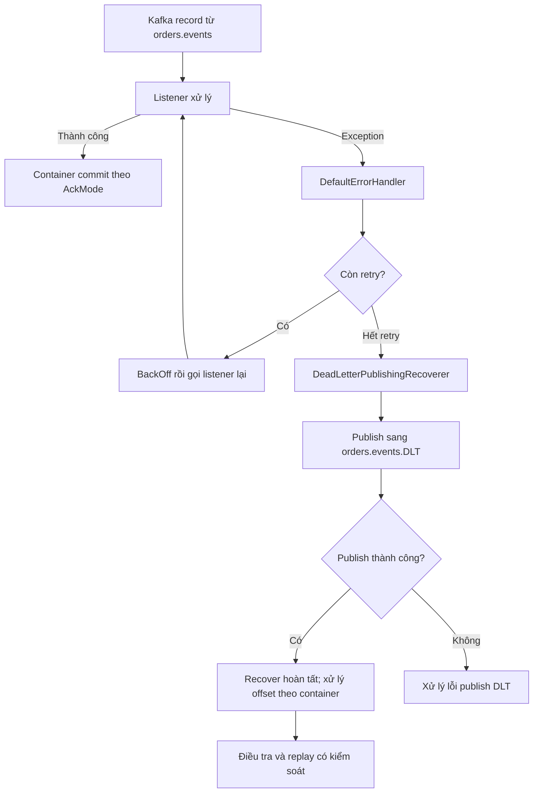

# DeadLetterPublishingRecoverer

`DeadLetterPublishingRecoverer` là thành phần của Spring Kafka dùng để gửi một record không thể xử lý sang dead-letter topic (DLT). Nó thường được gọi bởi error handler sau khi listener đã thử lại theo chính sách nhưng vẫn thất bại. Recoverer tạo một Kafka record mới, giữ payload/key cùng metadata gốc cần thiết, bổ sung các header mô tả nguồn và exception, rồi gửi record đến topic đích.

Trong một luồng xử lý điển hình, `DefaultErrorHandler` chịu trách nhiệm retry và quyết định khi nào chuyển sang recover; `DeadLetterPublishingRecoverer` thực hiện việc publish record lỗi. Hai thành phần có vai trò khác nhau và thường được cấu hình cùng nhau.

DLT giúp tách record lỗi khỏi luồng chính để consumer tiếp tục xử lý các record khác, đồng thời giữ dữ liệu phục vụ điều tra và replay. Tuy nhiên, publish sang DLT cũng là một thao tác Kafka có thể thất bại. Cần thiết kế topic đích, partition, serializer, quyền truy cập, commit offset và quy trình replay một cách rõ ràng.

## 1. DeadLetterPublishingRecoverer giải quyết vấn đề gì?

Giả sử service Billing nhận event từ topic `orders.events`. Một record có payload sai hoặc dữ liệu nghiệp vụ không hợp lệ khiến listener liên tục ném exception. Nếu consumer cứ dừng ở record đó, partition có thể bị chặn và các record sau phải chờ.

Một quy trình thường dùng:

1. Listener nhận record và thử xử lý.
2. Nếu thất bại, `DefaultErrorHandler` thực hiện retry theo `BackOff`.
3. Khi hết retry, error handler gọi recoverer.
4. `DeadLetterPublishingRecoverer` gửi record sang `orders.events.DLT` hoặc topic do ứng dụng chỉ định.
5. Nếu recover thành công, error handler/container xử lý tiến độ offset theo cấu hình.
6. Một quy trình vận hành riêng điều tra, sửa dữ liệu hoặc replay record từ DLT.



DLT không phải nơi tự động sửa lỗi. Nó là nơi lưu record không thể xử lý trên luồng chính, giúp hệ thống tiếp tục tiến triển và cho phép xử lý lỗi sau đó.

## 2. Vai trò của DeadLetterPublishingRecoverer và DefaultErrorHandler

Hai thành phần thường được cấu hình cùng nhau:

| Thành phần | Trách nhiệm |
| --- | --- |
| Listener method | Thực hiện nghiệp vụ và ném exception khi xử lý thất bại |
| `DefaultErrorHandler` | Phân loại lỗi, áp dụng retry/backoff, quyết định recover khi hết retry |
| `DeadLetterPublishingRecoverer` | Tạo và publish record sang DLT, thêm metadata về record gốc và exception |
| DLT consumer/tool | Điều tra, sửa, replay hoặc đưa record vào quy trình xử lý thủ công |

`DeadLetterPublishingRecoverer` không tự quyết định số lần retry. Số lần thử và backoff nằm ở error handler. Recoverer cũng không tự bảo đảm nghiệp vụ được thực hiện đúng một lần; consumer vẫn phải có idempotency vì record có thể được giao lại nếu publish DLT hoặc commit offset gặp sự cố.

## 3. Tạo DLT topic

Một quy ước phổ biến là thêm hậu tố `.DLT` vào tên topic gốc:

| Topic chính | Dead-letter topic |
| --- | --- |
| `orders.events` | `orders.events.DLT` |
| `payments.events` | `payments.events.DLT` |
| `inventory.events` | `inventory.events.DLT` |

Có thể tạo DLT bằng Kafka CLI:

```bash
kafka-topics.sh \
  --bootstrap-server localhost:9092 \
  --create \
  --topic orders.events.DLT \
  --partitions 6 \
  --replication-factor 3
```

Số partition DLT cần phù hợp với chiến lược định tuyến. Nếu recoverer gửi record vào cùng partition number như topic gốc, DLT phải có ít nhất số partition tương ứng. Ví dụ topic gốc có sáu partition thì DLT cần có ít nhất sáu partition để nhận được mọi partition number từ 0 đến 5.

Không nên phụ thuộc vào auto topic creation trong production. Nếu DLT chưa tồn tại và broker tự tạo topic với số partition mặc định nhỏ hơn topic gốc, việc gửi vào partition không tồn tại có thể thất bại. Hãy provision DLT trước, kiểm tra replication factor, retention, ACL và partition assignment.

## 4. Cấu hình DeadLetterPublishingRecoverer cơ bản

Ví dụ dùng `KafkaTemplate` và resolver tường minh để gửi record vào topic có hậu tố `.DLT`, giữ nguyên partition number của record gốc:

```java
package com.example.messaging.config;

import org.apache.kafka.common.TopicPartition;
import org.springframework.context.annotation.Bean;
import org.springframework.context.annotation.Configuration;
import org.springframework.kafka.core.KafkaTemplate;
import org.springframework.kafka.listener.DeadLetterPublishingRecoverer;

@Configuration
public class DeadLetterConfiguration {

    @Bean
    public DeadLetterPublishingRecoverer deadLetterPublishingRecoverer(
            KafkaTemplate<Object, Object> kafkaTemplate
    ) {
        return new DeadLetterPublishingRecoverer(
                kafkaTemplate,
                (record, exception) -> new TopicPartition(
                        record.topic() + ".DLT",
                        record.partition()
                )
        );
    }
}
```

Resolver nhận record gốc và exception. Nó trả về `TopicPartition` chỉ định nơi record được publish. Ở ví dụ trên:

- `record.topic()` là topic gốc.
- `record.partition()` là partition gốc.
- `record.topic() + ".DLT"` là topic đích.
- Partition đích bằng partition gốc để dễ đối chiếu log và giữ cách phân vùng tương ứng.

Constructor mặc định của `DeadLetterPublishingRecoverer` cũng cung cấp quy ước destination phổ biến là topic gốc cộng hậu tố `.DLT` và partition gốc. Việc khai báo resolver tường minh giúp người đọc thấy rõ routing contract và dễ mở rộng khi cần nhiều DLT khác nhau.

`KafkaTemplate<Object,Object>` trong ví dụ là lựa chọn tổng quát. Trong ứng dụng thực tế, kiểu generic và serializer của template phải hỗ trợ các kiểu key/value thực sự được gửi vào DLT, bao gồm cả `byte[]` nếu xử lý lỗi deserialize.

## 5. Kết hợp với DefaultErrorHandler

`DefaultErrorHandler` nhận recoverer và một `BackOff`. Ví dụ sau thực hiện hai lần retry, mỗi lần cách nhau một giây; sau lần xử lý ban đầu và hai retry mà vẫn thất bại, record được chuyển sang DLT:

```java
package com.example.messaging.config;

import org.springframework.context.annotation.Bean;
import org.springframework.context.annotation.Configuration;
import org.springframework.kafka.listener.DefaultErrorHandler;
import org.springframework.kafka.listener.DeadLetterPublishingRecoverer;
import org.springframework.util.backoff.FixedBackOff;

@Configuration
public class KafkaErrorHandlerConfiguration {

    @Bean
    public DefaultErrorHandler kafkaErrorHandler(
            DeadLetterPublishingRecoverer recoverer
    ) {
        FixedBackOff backOff = new FixedBackOff(1_000L, 2L);
        return new DefaultErrorHandler(recoverer, backOff);
    }
}
```

`FixedBackOff(interval, maxAttempts)` nhận khoảng nghỉ tính bằng mili giây và số lần retry sau lần gọi listener đầu tiên. Vì vậy, `new FixedBackOff(1_000L, 2L)` có nghĩa là một lần thử ban đầu cộng hai lần retry, tối đa ba lần gọi listener nếu mỗi lần đều thất bại.

Spring Boot/Spring Kafka có thể dùng bean `CommonErrorHandler` hoặc `DefaultErrorHandler` để cấu hình listener container factory. Nếu tự tạo factory, có thể gắn handler:

```java
factory.setCommonErrorHandler(kafkaErrorHandler);
```

Hãy bảo đảm factory thực sự được listener sử dụng. Nếu ứng dụng có nhiều factory, cấu hình error handler cho đúng factory được tham chiếu bởi `containerFactory` của `@KafkaListener`.

## 6. Phân loại exception để quyết định retry

Không phải lỗi nào cũng nên retry. Lỗi tạm thời như timeout database hoặc lỗi mạng có thể tự phục hồi; lỗi dữ liệu không hợp lệ thường không thay đổi khi thử lại.

Có thể khai báo exception không retry:

```java
@Bean
public DefaultErrorHandler kafkaErrorHandler(
        DeadLetterPublishingRecoverer recoverer
) {
    DefaultErrorHandler handler = new DefaultErrorHandler(
            recoverer,
            new FixedBackOff(1_000L, 3L)
    );

    handler.addNotRetryableExceptions(
            InvalidOrderEventException.class,
            UnsupportedEventVersionException.class
    );

    return handler;
}
```

Trong ví dụ, hai exception nghiệp vụ (được khai báo trong package ứng dụng) được recover ngay thay vì chờ các lần retry. Các exception khác vẫn dùng backoff đã cấu hình, trừ khi được phân loại riêng.

Hãy chọn chính sách theo khả năng phục hồi của lỗi:

| Loại lỗi | Ví dụ | Hướng xử lý thường dùng |
| --- | --- | --- |
| Tạm thời | Database timeout, network reset | Retry có giới hạn và backoff |
| Dữ liệu không hợp lệ | Thiếu field bắt buộc, số tiền âm | Không retry hoặc retry rất hạn chế, sau đó DLT |
| Không hỗ trợ phiên bản | Event schema version chưa được consumer hiểu | DLT/quarantine và nâng cấp consumer |
| Hạ tầng kéo dài | Database mất kết nối nhiều phút | Backoff phù hợp, alert; cân nhắc dừng container nếu tiếp tục sẽ gây quá tải |

Không nên retry vô hạn một record độc hại hoặc không thể xử lý. Nó có thể giữ partition và làm consumer lag tăng liên tục.

## 7. Chọn destination bằng DestinationResolver

`DeadLetterPublishingRecoverer` cho phép quyết định DLT dựa trên record và exception. Có thể route lỗi validation và lỗi kỹ thuật sang các topic khác nhau:

```java
@Bean
public DeadLetterPublishingRecoverer deadLetterPublishingRecoverer(
        KafkaTemplate<Object, Object> kafkaTemplate
) {
    return new DeadLetterPublishingRecoverer(kafkaTemplate, (record, exception) -> {
        String suffix = exception instanceof InvalidOrderEventException
                ? ".DLT.validation"
                : ".DLT.processing";

        return new TopicPartition(
                record.topic() + suffix,
                record.partition()
        );
    });
}
```

Ví dụ:

| Exception | Topic gốc | DLT đích |
| --- | --- | --- |
| `InvalidOrderEventException` | `orders.events` | `orders.events.DLT.validation` |
| Lỗi xử lý còn lại | `orders.events` | `orders.events.DLT.processing` |

Mỗi DLT đích cần được tạo trước và có partition tương thích với partition number resolver trả về. Nếu hai DLT dùng cùng số partition như topic gốc, có thể giữ nguyên partition để điều tra theo từng luồng nguồn.

Resolver cũng có thể dựa trên topic, tenant hoặc exception cause. Tuy nhiên, routing phải xác định và dễ vận hành. Tránh tạo vô hạn topic theo exception message hoặc dữ liệu không được kiểm soát từ payload.

## 8. Giữ partition gốc hay dùng partitioner cho DLT?

Có hai chiến lược phổ biến:

| Chiến lược | Cách làm | Ưu điểm | Điều cần lưu ý |
| --- | --- | --- | --- |
| Giữ partition gốc | Gửi vào partition có cùng số với record gốc | Dễ đối chiếu, giữ phân vùng tương ứng | DLT phải có đủ partition; không tự bảo đảm thứ tự toàn cục giữa topic gốc và DLT |
| Để broker/partitioner chọn | Resolver trả partition theo chiến lược phù hợp hoặc không chỉ định partition theo API hỗ trợ | Có thể dùng DLT ít partition hơn hoặc phân phối theo key | Cần kiểm tra overload/API phiên bản và không còn ánh xạ 1:1 với partition gốc |

Nếu cần giữ partition gốc, DLT phải có số partition bằng hoặc lớn hơn topic nguồn. Nếu muốn DLT có partition count khác, hãy chọn routing rõ ràng và lưu metadata gốc để biết record đến từ partition nào.

Kafka không bảo đảm thứ tự giữa topic chính và DLT. Khi một event của aggregate bị chuyển sang DLT, event tiếp theo cùng aggregate vẫn có thể tiếp tục trên topic chính tùy error handling và retry strategy. Nếu nghiệp vụ cần dừng xử lý aggregate đó cho đến khi sửa lỗi, cần thêm cơ chế pause, sequencing hoặc trạng thái nghiệp vụ; chỉ chuyển record sang DLT không tự chặn event tiếp theo.

## 9. Các header mà recoverer bổ sung

`DeadLetterPublishingRecoverer` thêm các header giúp điều tra record gốc và lỗi đã xảy ra. Những header thường dùng gồm:

| Header constant | Thông tin |
| --- | --- |
| `KafkaHeaders.DLT_ORIGINAL_TOPIC` | Topic gốc |
| `KafkaHeaders.DLT_ORIGINAL_PARTITION` | Partition gốc |
| `KafkaHeaders.DLT_ORIGINAL_OFFSET` | Offset gốc |
| `KafkaHeaders.DLT_ORIGINAL_TIMESTAMP` | Timestamp gốc |
| `KafkaHeaders.DLT_EXCEPTION_FQCN` | Tên đầy đủ class exception |
| `KafkaHeaders.DLT_EXCEPTION_MESSAGE` | Message của exception |
| `KafkaHeaders.DLT_EXCEPTION_STACKTRACE` | Stack trace được gắn vào header |

Các header này cho phép DLT consumer biết record đến từ topic/partition/offset nào và vì sao nó bị recover. Tên hằng số cụ thể có thể bổ sung theo phiên bản Spring Kafka; hãy dùng `KafkaHeaders` của phiên bản ứng dụng thay vì tự gõ tên chuỗi nếu có thể.

Ngoài các header DLT, recoverer thường giữ lại key, value và headers gốc. Nếu record đã qua retry topic hoặc đã có metadata DLT từ lần xử lý trước, cần hiểu cách append/strip các header lặp theo cấu hình và phiên bản đang dùng.

Stack trace có thể rất dài và chứa thông tin nội bộ. Cân nhắc giới hạn kích thước hoặc loại bỏ header exception nhạy cảm theo chính sách bảo mật và dung lượng record.

## 10. Đọc metadata từ DLT

DLT consumer có thể nhận `ConsumerRecord` để đọc payload và các header nguồn:

```java
package com.example.messaging.dlt;

import java.nio.ByteBuffer;
import java.nio.charset.StandardCharsets;
import org.apache.kafka.clients.consumer.ConsumerRecord;
import org.apache.kafka.common.header.Header;
import org.slf4j.Logger;
import org.slf4j.LoggerFactory;
import org.springframework.kafka.annotation.KafkaListener;
import org.springframework.kafka.support.KafkaHeaders;
import org.springframework.stereotype.Component;

@Component
public class OrderDltListener {

    private static final Logger log =
            LoggerFactory.getLogger(OrderDltListener.class);

    @KafkaListener(topics = "orders.events.DLT", groupId = "orders-dlt-inspector")
    public void inspect(ConsumerRecord<String, Object> record) {
        Integer originalPartition = headerAsInt(
                record, KafkaHeaders.DLT_ORIGINAL_PARTITION);
        Long originalOffset = headerAsLong(
                record, KafkaHeaders.DLT_ORIGINAL_OFFSET);

        Header exceptionHeader = record.headers().lastHeader(
                KafkaHeaders.DLT_EXCEPTION_MESSAGE);
        String exceptionMessage = exceptionHeader == null
                ? null
                : new String(exceptionHeader.value(), StandardCharsets.UTF_8);

        log.error(
                "DLT record: originalTopic={}, originalPartition={}, "
                        + "originalOffset={}, exception={}, key={}",
                headerAsString(record, KafkaHeaders.DLT_ORIGINAL_TOPIC),
                originalPartition,
                originalOffset,
                exceptionMessage,
                record.key()
        );
    }

    private static String headerAsString(
            ConsumerRecord<?, ?> record, String name) {
        Header header = record.headers().lastHeader(name);
        return header == null ? null
                : new String(header.value(), StandardCharsets.UTF_8);
    }

    private static Integer headerAsInt(
            ConsumerRecord<?, ?> record, String name) {
        Header header = record.headers().lastHeader(name);
        return header == null || header.value().length != Integer.BYTES
                ? null
                : ByteBuffer.wrap(header.value()).getInt();
    }

    private static Long headerAsLong(
            ConsumerRecord<?, ?> record, String name) {
        Header header = record.headers().lastHeader(name);
        return header == null || header.value().length != Long.BYTES
                ? null
                : ByteBuffer.wrap(header.value()).getLong();
    }
}
```

Topic gốc là UTF-8 string; partition và offset gốc được mã hóa thành số nguyên 4/8 byte trong các header chuẩn. Trong code production, nên kiểm tra độ dài byte array trước khi đọc và bọc parse bằng xử lý lỗi vì record DLT có thể được tạo từ producer khác hoặc thiếu header mong đợi.

## 11. Serializer của DLT phải hỗ trợ kiểu dữ liệu thực tế

Một lỗi thường gặp là listener không deserialize được value. Khi dùng `ErrorHandlingDeserializer`, Spring Kafka có thể chuyển raw bytes và thông tin lỗi cho error handler để recover. Khi đó DLT publisher có thể nhận value là `byte[]`, không phải POJO như `OrderCreated`.

Nếu DLT `KafkaTemplate` chỉ dùng `JsonSerializer` cho mọi value, việc publish `byte[]` có thể không tạo record theo cách mong muốn hoặc gây lỗi kiểu/serialization. Serializer của DLT phải hỗ trợ mọi loại dữ liệu có thể được recover.

Ví dụ về các kiểu value có thể xuất hiện:

| Tình huống | Value recoverer có thể nhận |
| --- | --- |
| Listener ném exception sau deserialize thành công | Object Java như `OrderCreated` |
| Value deserialization thất bại với `ErrorHandlingDeserializer` | Raw `byte[]` gốc cùng header mô tả exception deserialize |
| Key deserialization thất bại | Key có thể là raw `byte[]` thay vì kiểu key thông thường |

Có thể dùng `DelegatingByTypeSerializer` để chọn serializer theo runtime type. Ví dụ sau minh họa value serializer cho POJO và raw bytes; key serializer được giả định là `StringSerializer` vì key đã deserialize thành String trong luồng này:

```java
import java.util.LinkedHashMap;
import java.util.Map;
import org.apache.kafka.common.serialization.ByteArraySerializer;
import org.apache.kafka.common.serialization.Serializer;
import org.apache.kafka.common.serialization.StringSerializer;
import org.springframework.kafka.support.serializer.DelegatingByTypeSerializer;
import org.springframework.kafka.support.serializer.JsonSerializer;

Map<Class<?>, Serializer<?>> valueDelegates = new LinkedHashMap<>();
valueDelegates.put(byte[].class, new ByteArraySerializer());
valueDelegates.put(Object.class, new JsonSerializer<>());

DelegatingByTypeSerializer valueSerializer =
        new DelegatingByTypeSerializer(valueDelegates);

// Dùng StringSerializer cho key nếu key luôn deserialize thành String.
// Nếu key có thể là byte[] do lỗi deserialize, cần cấu hình key serializer
// theo cùng nguyên tắc DelegatingByTypeSerializer.
```

Đây là phần serializer cốt lõi; cần đưa `valueSerializer` và key serializer tương ứng vào `DefaultKafkaProducerFactory` dùng bởi DLT `KafkaTemplate`. Kiểm tra generic type và constructor theo Spring Kafka version của project. Nếu consumer dùng nhiều POJO type, `Object.class` delegate có thể dùng `JsonSerializer` cho các object còn lại; các kiểu đặc biệt như `byte[]` phải được đặt mapping cụ thể.

### 11.1. Cấu hình ErrorHandlingDeserializer

Ví dụ consumer delegate deserializer cho key/value:

```yaml
spring:
  kafka:
    consumer:
      key-deserializer: org.springframework.kafka.support.serializer.ErrorHandlingDeserializer
      value-deserializer: org.springframework.kafka.support.serializer.ErrorHandlingDeserializer
      properties:
        "[spring.deserializer.key.delegate.class]": org.apache.kafka.common.serialization.StringDeserializer
        "[spring.deserializer.value.delegate.class]": org.springframework.kafka.support.serializer.JsonDeserializer
        "[spring.json.trusted.packages]": com.example.messaging.event
        "[spring.json.value.default.type]": com.example.messaging.event.OrderCreated
```

`ErrorHandlingDeserializer` bọc delegate và cho phép container error handling xử lý lỗi deserialize. Nếu không dùng cơ chế này, lỗi xảy ra trước listener invocation có thể không đi qua cùng luồng xử lý như exception do listener ném.

## 12. Xử lý lỗi khi publish sang DLT

Publish sang DLT cũng là một lần gửi Kafka. Nó có thể thất bại vì:

- Topic DLT không tồn tại hoặc partition đích không hợp lệ.
- Producer không có quyền ghi DLT.
- Broker mất kết nối hoặc timeout.
- Serializer không hỗ trợ kiểu key/value được recover.
- Record quá lớn hoặc vượt giới hạn broker/topic.
- Quota hoặc broker capacity bị vượt.

Nếu DLT publish thất bại, không nên coi record đã được recover thành công. Cần để lỗi publish được quan sát và xử lý theo chính sách container/version đang dùng; nếu error handler xem recoverer thất bại là lỗi, record có thể tiếp tục được xử lý lại thay vì commit tiến độ như đã recover.

Spring Kafka cung cấp tùy chọn để recoverer ném exception khi send result báo lỗi (`failIfSendResultIsError`) ở các phiên bản hỗ trợ. Khi dùng tùy chọn này, cần chọn timeout chờ send phù hợp và kiểm tra API của phiên bản Spring Kafka trong project. Không giả định một lần gọi `KafkaTemplate.send()` đồng nghĩa broker đã lưu DLT thành công.

Nên có metric/log riêng cho:

- Số lần recoverer được gọi.
- Số lần publish DLT thành công/thất bại.
- Lỗi serialization của DLT producer.
- Topic/partition đích không hợp lệ.
- Số record đang chờ xử lý hoặc replay trong DLT.

## 13. Offset commit sau khi recover

Sau khi recoverer publish record sang DLT, listener container/error handler vẫn phải quyết định offset của record gốc được commit thế nào. Điều này phụ thuộc AckMode, loại listener, error handler và transaction configuration.

Với record listener non-transactional dùng `DefaultErrorHandler`, khi recover thành công, error handler/container có thể coi record đã được xử lý theo chính sách recover và tiến offset. Nếu DLT publish thất bại, không nên tiến offset như thể record đã được lưu an toàn vào DLT.

Một số cấu hình manual yêu cầu lưu ý riêng:

- Với `AckMode.MANUAL_IMMEDIATE`, tùy chọn commit recovered record và semantics của container cần được cấu hình nhất quán nếu ứng dụng yêu cầu commit ngay.
- Với `AckMode.MANUAL` hoặc các mode khác, không suy ra offset đã commit chỉ từ việc recoverer được gọi; hãy kiểm tra behavior của `DefaultErrorHandler` và container version.
- Với batch listener, việc commit/recover có thêm semantics theo batch và vị trí record lỗi.
- Với transactional listener, đường xử lý rollback/recovery có thể dùng `DefaultAfterRollbackProcessor` và transaction boundary riêng.

Hãy kiểm thử offset group sau khi DLT publish thành công và sau khi publish thất bại. DLT là bản sao record lỗi ở topic khác; việc gửi thành công và commit offset nguồn là hai thao tác có thể có khoảng lỗi giữa chúng.

## 14. Dead-letter với Kafka transaction

Trong ứng dụng dùng Kafka transaction, cần quyết định DLT publish nằm trong transaction nào. Với transactional listener, lỗi thường dẫn đến rollback transaction; Spring Kafka có thể dùng `DefaultAfterRollbackProcessor` để retry và recover sau rollback. `DeadLetterPublishingRecoverer` có thể được dùng làm recoverer cho quy trình đó, nhưng cần cấu hình transaction manager, producer factory và offset handling phù hợp.

Không nên gắn một `DefaultErrorHandler` non-transactional vào transactional listener mà không xem xét transaction flow. Hãy theo tài liệu của phiên bản Spring Kafka đang dùng để cấu hình `DefaultAfterRollbackProcessor`, `KafkaTransactionManager` và recoverer.

Kafka transaction có thể phối hợp DLT output và offset của consumer trong transaction Kafka nếu được cấu hình phù hợp. Nó không tự động bao trùm database hoặc HTTP side effect. Nếu listener đã cập nhật database trước khi rollback Kafka, database transaction cần được phối hợp riêng hoặc dùng inbox/outbox.

## 15. Replay record từ DLT

Sau khi lỗi được sửa, record trong DLT có thể được replay. Replay nên là thao tác có kiểm soát, không phải vòng lặp tự động vô hạn.

Một quy trình replay an toàn:

1. Đọc DLT record và metadata gốc: topic, partition, offset, event ID, exception.
2. Xác định nguyên nhân lỗi đã được sửa hay chưa.
3. Kiểm tra schema/payload và điều kiện nghiệp vụ hiện tại.
4. Chọn topic đích: topic gốc, retry topic hoặc một topic replay riêng.
5. Giữ key và metadata nghiệp vụ cần thiết; thêm replay marker/correlation ID nếu phù hợp.
6. Kiểm tra idempotency để tránh áp dụng side effect đã thành công trước lần crash.
7. Ghi nhận ai/tiến trình nào replay, thời điểm và kết quả.
8. Theo dõi consumer lag, retry và DLT mới phát sinh.

Khi replay về topic gốc, không mặc định offset gốc còn có thể dùng lại. Record replay là một record mới và nhận offset mới. Header original topic/partition/offset giúp truy vết, nhưng consumer group xử lý theo offset mới của topic đích.

Tránh replay record sang chính DLT mà recoverer đang sử dụng nếu listener của DLT cũng có thể chuyển nó trở lại DLT theo cùng quy tắc; điều đó tạo vòng lặp. Hãy tách topic replay hoặc dùng group/handler chuyên biệt.

## 16. Kiểm thử DeadLetterPublishingRecoverer

Integration test nên xác nhận cả việc record được gửi vào DLT và metadata gốc được giữ đúng.

Một kịch bản với `@EmbeddedKafka` hoặc Testcontainers:

1. Tạo topic `orders.events` và `orders.events.DLT` có cùng số partition.
2. Cấu hình producer gửi event hợp lệ vào topic nguồn.
3. Cấu hình listener cố tình ném exception cho một event nhất định.
4. Cấu hình `DefaultErrorHandler` với backoff nhỏ và số retry hữu hạn.
5. Chờ recoverer publish record vào DLT.
6. Dùng consumer test đọc DLT và kiểm tra key, value, topic, partition cùng DLT headers.
7. Xác minh số lần listener được gọi đúng với số lần thử ban đầu cộng retry.
8. Kiểm tra committed offset của group nguồn sau recover thành công.
9. Mô phỏng DLT publish failure (topic/partition/serializer/ACL) và xác minh lỗi được quan sát, record nguồn không bị coi là recovered thành công.
10. Kiểm tra đường đi deserialization failure nếu ứng dụng dùng `ErrorHandlingDeserializer` và DLT serializer phải nhận `byte[]`.

Ví dụ assertion metadata sau khi consumer test nhận DLT record:

```java
assertThat(dltRecord.topic()).isEqualTo("orders.events.DLT");
assertThat(dltRecord.partition()).isEqualTo(sourcePartition);
assertThat(dltRecord.headers().lastHeader(KafkaHeaders.DLT_ORIGINAL_TOPIC))
        .isNotNull();
assertThat(dltRecord.headers().lastHeader(KafkaHeaders.DLT_ORIGINAL_OFFSET))
        .isNotNull();
```

Test cần dùng group ID riêng và đồng bộ bằng `BlockingQueue`, `CountDownLatch` hoặc polling assertion có timeout. Tránh dùng `Thread.sleep()` cố định làm bằng chứng DLT đã được publish.

## 17. Lỗi thường gặp

| Hiện tượng | Nguyên nhân thường gặp | Cách xử lý |
| --- | --- | --- |
| Record không xuất hiện trong DLT | Recoverer chưa được gắn vào error handler hoặc retry chưa hết | Kiểm tra factory và BackOff |
| Publish DLT báo invalid partition | DLT có ít partition hơn topic nguồn nhưng resolver giữ partition gốc | Tạo đủ partition hoặc đổi resolver có chủ đích |
| DLT topic không tồn tại | Chưa provision topic hoặc auto creation bị tắt | Tạo DLT trước khi triển khai listener |
| DLT publish serialization error | Template không hỗ trợ kiểu value gốc hoặc `byte[]` | Dùng serializer phù hợp, có thể là `DelegatingByTypeSerializer` |
| Không đọc được exception header | Header thiếu, bị strip hoặc code dùng sai tên | Dùng `KafkaHeaders` đúng phiên bản và kiểm tra record raw |
| Record deserialize lỗi không vào DLT | Chưa dùng `ErrorHandlingDeserializer` hoặc delegate config sai | Bọc key/value deserializer và kiểm thử đường lỗi deserialize |
| Record nguồn bị đọc lại sau khi đã gửi DLT | Publish DLT và commit offset nguồn có khoảng lỗi; commit/recovery config chưa phù hợp | Kiểm tra send result, error handler, AckMode và idempotency |
| DLT tăng nhanh liên tục | Lỗi nghiệp vụ/hạ tầng chưa được xử lý hoặc retry policy quá ngắn | Phân loại exception, điều chỉnh backoff và cảnh báo |
| Replay tạo side effect trùng | Consumer không idempotent hoặc replay không có kiểm soát | Dùng event ID/inbox và replay marker |
| Event cùng aggregate sai thứ tự | Retry/DLT tách record khỏi luồng partition gốc | Thiết kế sequencing/pause hoặc xử lý theo aggregate version |

## 18. Checklist triển khai

Trước khi bật DLT trong production, hãy xác nhận:

1. `DefaultErrorHandler` được gắn vào đúng listener container factory.
2. Backoff và số retry phù hợp với loại lỗi.
3. Exception không retry được phân loại rõ ràng.
4. DLT topic đã được tạo trước, có partition count và replication phù hợp.
5. Destination resolver có quy tắc rõ ràng, không tạo topic động không kiểm soát.
6. DLT producer có serializer cho key/value bình thường và raw bytes khi cần.
7. ACL cho phép producer ghi DLT và consumer/tool đọc DLT.
8. DLT headers được giữ đủ để truy vết record nguồn và exception.
9. Publish failure được log/metric và không bị xem như recover thành công.
10. Offset commit sau recovery được kiểm thử với AckMode thực tế.
11. Transactional listener dùng recovery flow phù hợp với transaction manager.
12. Có quy trình điều tra, sửa và replay DLT có kiểm soát.
13. Consumer idempotent để chịu được redelivery và replay.
14. Có cảnh báo cho DLT rate, publish failure, retry rate và consumer lag.

`DeadLetterPublishingRecoverer` cung cấp cơ chế đưa record lỗi sang một topic riêng và bổ sung metadata để điều tra. Khi kết hợp đúng với `DefaultErrorHandler`, DLT topic, serializer và offset handling, service có thể tiếp tục xử lý luồng chính trong khi giữ lại dữ liệu lỗi cho quy trình phục hồi. Độ tin cậy cuối cùng còn phụ thuộc vào việc publish DLT có được xác nhận, offset nguồn được commit đúng thời điểm và nghiệp vụ có chịu được xử lý lặp hay không.

## 19. Tự kiểm tra

1. `DeadLetterPublishingRecoverer` khác `DefaultErrorHandler` ở trách nhiệm nào?
2. Với `new FixedBackOff(1000L, 2L)`, listener được gọi tối đa bao nhiêu lần nếu lần nào cũng lỗi?
3. Vì sao DLT giữ partition gốc cần có ít nhất số partition bằng topic nguồn?
4. `DestinationResolver` dùng record và exception để quyết định điều gì?
5. Những DLT header nào giúp xác định topic, partition và offset gốc?
6. Vì sao DLT serializer cần hỗ trợ `byte[]` khi xử lý lỗi deserialize?
7. Điều gì cần xảy ra nếu publish sang DLT thất bại?
8. Vì sao gửi DLT thành công và commit offset nguồn là hai thao tác cần kiểm tra riêng?
9. Khi nào transactional listener cần `DefaultAfterRollbackProcessor` thay cho luồng `DefaultErrorHandler` thông thường?
10. Những bước nào giúp replay DLT mà không tạo side effect trùng hoặc vòng lặp vô hạn?
