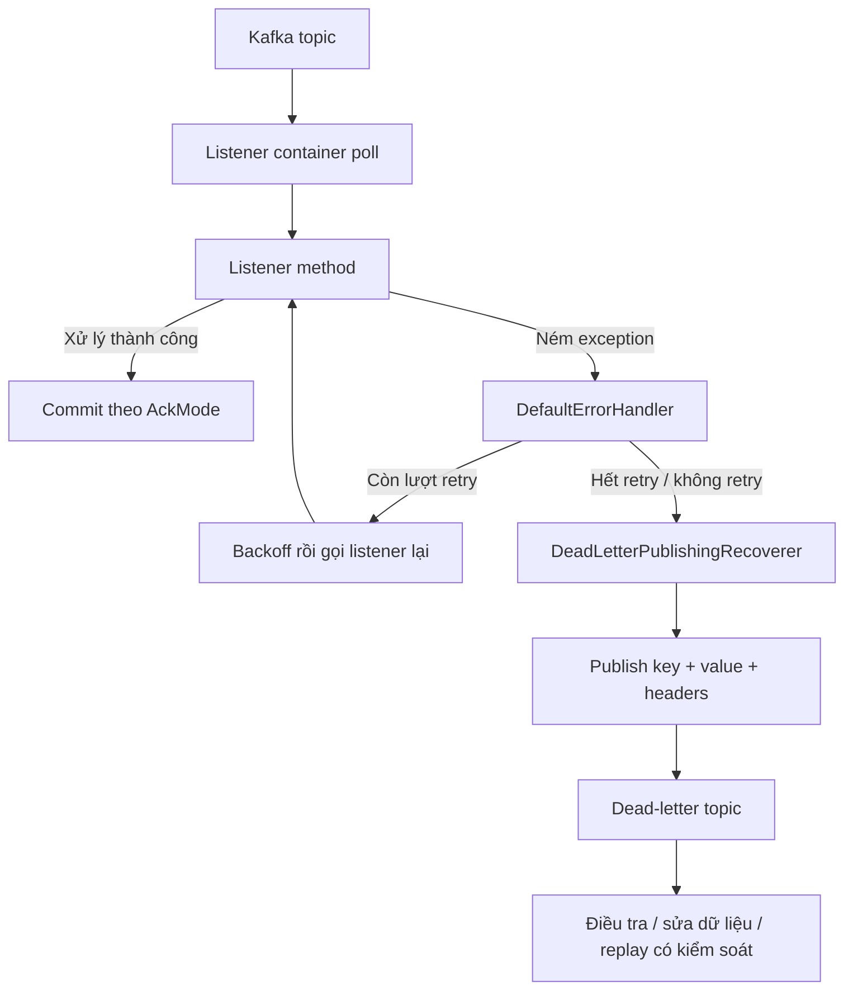

# Giữ lại key và payload lỗi

Khi một record không thể xử lý sau số lần retry đã định, Spring Kafka có thể chuyển record đó sang dead-letter topic (DLT). Việc chuyển record chỉ hữu ích khi đội vận hành còn đủ dữ liệu để điều tra và phục hồi. DLT cần giữ được key, payload và metadata nguồn để biết record thuộc entity nào, nội dung ban đầu là gì, đến từ topic/partition/offset nào và lỗi xảy ra ở đâu.

`DeadLetterPublishingRecoverer` hỗ trợ xuất bản record lỗi sang DLT. Trong trường hợp thông thường, recoverer giữ key và value của record đầu vào, đồng thời bổ sung các header mô tả nguồn gốc và exception. Tuy nhiên, “giữ payload” có thể mang hai ý nghĩa khác nhau: giữ nguyên object sau deserialize hay giữ nguyên từng byte đã được producer gửi. Cần chọn serializer/deserializer và cách lưu raw bytes phù hợp với yêu cầu recovery.

## 1. Một record lỗi cần giữ những gì?

Một Kafka record có key, value, headers, topic, partition, offset và timestamp. Khi chuyển record lỗi sang DLT, các thành phần này phục vụ những mục đích khác nhau:

| Thành phần | Ý nghĩa khi lưu vào DLT |
|---|---|
| Key | Xác định entity, hỗ trợ partitioning và replay về đúng luồng |
| Value/payload | Nội dung sự kiện cần điều tra hoặc xử lý lại |
| Original headers | Correlation ID, trace ID, event type, schema version và metadata do producer gửi |
| Original topic | Topic ban đầu của record |
| Original partition | Partition đã chứa record |
| Original offset | Vị trí record trong partition nguồn |
| Original timestamp | Thời điểm được gắn cho record ban đầu |
| Exception headers | Loại lỗi, thông điệp lỗi và stack trace phục vụ điều tra |
| Consumer group | Nhóm consumer đã xử lý record lỗi |

Ví dụ record đầu vào:

```text
topic      = orders
partition  = 2
offset     = 184
key        = order-1024
value      = {"orderId":"order-1024","total":250000}
headers    = trace-id=abc-123, event-type=OrderCreated
```

Sau khi recoverer gửi sang DLT, record có thể nằm tại:

```text
topic      = orders.DLT
partition  = 2
key        = order-1024
value      = {"orderId":"order-1024","total":250000}

headers:
  trace-id
  event-type
  kafka_dlt-original-topic       = orders
  kafka_dlt-original-partition  = 2
  kafka_dlt-original-offset     = 184
  kafka_dlt-exception-fqcn
  kafka_dlt-exception-message
  kafka_dlt-exception-stacktrace
```

Tên header thực tế được Spring Kafka cung cấp qua các constant trong `KafkaHeaders`, chẳng hạn `DLT_ORIGINAL_TOPIC`, `DLT_ORIGINAL_PARTITION`, `DLT_ORIGINAL_OFFSET`, `DLT_ORIGINAL_TIMESTAMP`, `DLT_ORIGINAL_CONSUMER_GROUP`, `DLT_EXCEPTION_FQCN`, `DLT_EXCEPTION_MESSAGE` và `DLT_EXCEPTION_STACKTRACE`. Hãy dùng constant tương ứng với phiên bản Spring Kafka thay vì tự viết chuỗi header rải rác.

Key và payload giúp phục hồi dữ liệu; original metadata giúp định vị record nguồn; exception headers giải thích vì sao record bị chuyển sang DLT. Không nên chỉ lưu stack trace mà bỏ mất key hoặc payload vì khi đó khó xác định entity và không thể replay đúng nội dung.

## 2. Luồng xử lý từ listener đến DLT

Một cấu hình phổ biến kết hợp `DefaultErrorHandler` với `DeadLetterPublishingRecoverer`:



`DefaultErrorHandler` quyết định retry và thời gian backoff. Khi record được xem là đã phục hồi bằng cách chuyển sang DLT, `DeadLetterPublishingRecoverer` tạo `ProducerRecord` mới và gửi qua Kafka producer.

Hai thành phần có trách nhiệm khác nhau:

- Error handler xác định record được retry bao nhiêu lần, exception nào không retry và khi nào gọi recoverer.
- Recoverer chọn topic/partition đích, tạo record DLT, giữ key/value và gắn metadata lỗi.
- DLT producer serialize key/value để broker có thể lưu record mới.
- DLT consumer đọc record lỗi để điều tra hoặc thực hiện quy trình replay.

Chuyển record sang DLT không đồng nghĩa nghiệp vụ đã thành công. Đó là một kết quả phục hồi kỹ thuật: record đã được đưa vào nơi lưu lỗi và cần một quy trình riêng để xử lý tiếp.

## 3. Cấu hình ErrorHandlingDeserializer để không mất raw payload khi deserialize lỗi

Nếu key hoặc value không deserialize được, listener có thể chưa được gọi. Ví dụ producer gửi JSON sai định dạng, schema không tương thích hoặc byte payload bị hỏng. Nếu chỉ dùng `JsonDeserializer` trực tiếp, lỗi xảy ra trước listener và ứng dụng khó lấy lại byte gốc từ một object đã deserialize.

`ErrorHandlingDeserializer` bọc deserializer thật. Khi delegate deserialize thất bại, nó ghi thông tin exception cùng raw bytes vào header của record và trả về giá trị null cho phần bị lỗi. Spring Kafka error handling có thể sử dụng metadata này khi chuyển record sang DLT.

Ví dụ cấu hình:

```yaml
spring:
  kafka:
    bootstrap-servers: localhost:9092
    consumer:
      group-id: orders-service
      enable-auto-commit: false
      key-deserializer: org.springframework.kafka.support.serializer.ErrorHandlingDeserializer
      value-deserializer: org.springframework.kafka.support.serializer.ErrorHandlingDeserializer
      properties:
        "[spring.deserializer.key.delegate.class]": org.apache.kafka.common.serialization.StringDeserializer
        "[spring.deserializer.value.delegate.class]": org.springframework.kafka.support.serializer.JsonDeserializer
        "[spring.json.value.default.type]": com.example.orders.OrderEvent
        "[spring.json.trusted.packages]": com.example.orders
```

Trong cấu hình này:

- `ErrorHandlingDeserializer` là lớp ngoài cho cả key và value.
- Key delegate là `StringDeserializer`.
- Value delegate là `JsonDeserializer`.
- Khi deserialize thành công, listener nhận kiểu key/value bình thường.
- Khi delegate lỗi, raw bytes và exception được đưa vào header để error handler/recoverer xử lý.

Đối với record có key deserialize thành công nhưng value lỗi, key vẫn có thể được giữ ở dạng `String`, còn raw value bytes được chuyển vào DLT. Nếu key deserialize lỗi, key ở record mà listener/error handler quan sát có thể là null; raw key bytes được giữ trong exception header để recoverer có thể xuất bản lại dữ liệu gốc.

Đây là lý do cấu hình `ErrorHandlingDeserializer` quan trọng khi yêu cầu DLT phải giữ payload lỗi ngay cả khi payload chưa thể chuyển thành object Java.

## 4. Dùng DeadLetterPublishingRecoverer với DefaultErrorHandler

`DeadLetterPublishingRecoverer` thường được dùng làm recoverer sau khi `DefaultErrorHandler` hết lượt retry. Ví dụ sau gửi record lỗi sang topic có hậu tố `.DLT` và giữ số partition nguồn:

```java
import org.apache.kafka.common.TopicPartition;
import org.springframework.kafka.core.KafkaTemplate;
import org.springframework.kafka.listener.DeadLetterPublishingRecoverer;
import org.springframework.kafka.listener.DefaultErrorHandler;
import org.springframework.util.backoff.FixedBackOff;
import org.springframework.context.annotation.Bean;
import org.springframework.context.annotation.Configuration;

@Configuration
class DeadLetterConfiguration {

    @Bean
    DeadLetterPublishingRecoverer deadLetterPublishingRecoverer(
            KafkaTemplate<Object, Object> dltKafkaTemplate) {

        DeadLetterPublishingRecoverer recoverer =
                new DeadLetterPublishingRecoverer(
                        dltKafkaTemplate,
                        (record, exception) -> new TopicPartition(
                                record.topic() + ".DLT",
                                record.partition()
                        )
                );

        recoverer.setFailIfSendResultIsError(true);
        return recoverer;
    }

    @Bean
    DefaultErrorHandler kafkaErrorHandler(
            DeadLetterPublishingRecoverer recoverer) {

        return new DefaultErrorHandler(
                recoverer,
                new FixedBackOff(1_000L, 2L)
        );
    }
}
```

Trong ví dụ, record được retry hai lần với backoff một giây sau lần xử lý đầu tiên. Khi vẫn thất bại, recoverer gửi record đến topic như `orders.DLT`. Phương thức `setFailIfSendResultIsError(true)` yêu cầu recoverer xem lỗi gửi DLT là lỗi phục hồi; nếu broker không nhận được DLT record, ứng dụng không nên coi record nguồn đã được xử lý thành công. API này có từ các phiên bản Spring Kafka hỗ trợ kiểm tra send result; hãy đối chiếu dependency của dự án.

Gắn error handler vào listener container factory:

```java
import org.springframework.boot.autoconfigure.kafka.ConcurrentKafkaListenerContainerFactoryConfigurer;
import org.springframework.context.annotation.Bean;
import org.springframework.kafka.config.ConcurrentKafkaListenerContainerFactory;
import org.springframework.kafka.core.ConsumerFactory;

@Bean
ConcurrentKafkaListenerContainerFactory<String, OrderEvent> ordersListenerFactory(
        ConcurrentKafkaListenerContainerFactoryConfigurer configurer,
        ConsumerFactory<String, OrderEvent> consumerFactory,
        DefaultErrorHandler kafkaErrorHandler) {

    var factory =
            new ConcurrentKafkaListenerContainerFactory<String, OrderEvent>();

    configurer.configure(factory, consumerFactory);
    factory.setCommonErrorHandler(kafkaErrorHandler);
    return factory;
}
```

Listener dùng factory này:

```java
import org.springframework.kafka.annotation.KafkaListener;

@KafkaListener(
        topics = "orders",
        groupId = "orders-service",
        containerFactory = "ordersListenerFactory"
)
public void onOrder(OrderEvent event) {
    orderService.process(event);
}
```

Khi xử lý thành công, container commit theo acknowledgement mode. Khi listener ném exception, error handler áp dụng retry/backoff; khi recoverer gửi DLT thành công, error handler có thể xem record đã được recover theo cấu hình container. Hãy kiểm tra acknowledgement mode, transaction và semantics của error handler trong phiên bản Spring Kafka đang dùng.

Nếu DLT publish thất bại, recoverer nên ném lỗi để record nguồn chưa bị xem là đã phục hồi. Cần giám sát lỗi publish DLT, vì một DLT broker/topic không sẵn sàng có thể khiến partition tiếp tục bị chặn hoặc retry tùy cấu hình.

## 5. DLT producer phải serialize được cả object và raw byte[]

Đây là điểm quan trọng nhất khi muốn giữ payload. Sau khi listener deserialize thành công, value có thể là `OrderEvent`. Khi deserialize thất bại, recoverer có thể cần gửi raw `byte[]` lấy từ exception header. Vì vậy DLT producer phải xử lý được cả hai kiểu.

Nếu producer factory của DLT chỉ cấu hình `JsonSerializer`, việc gửi một raw `byte[]` có thể thất bại. Nếu chỉ dùng `ByteArraySerializer`, object `OrderEvent` đã deserialize cũng không gửi được. Hãy cấu hình serializer theo kiểu dữ liệu thực tế mà recoverer có thể xuất bản.

Một lựa chọn là `DelegatingByTypeSerializer`, ánh xạ từng kiểu Java sang serializer phù hợp. Ví dụ dưới đây minh họa key có thể là String hoặc raw bytes, còn value có thể là `OrderEvent`, String hoặc raw bytes:

```java
import java.util.HashMap;
import java.util.LinkedHashMap;
import java.util.Map;

import org.apache.kafka.clients.producer.ProducerConfig;
import org.apache.kafka.common.serialization.ByteArraySerializer;
import org.apache.kafka.common.serialization.Serializer;
import org.apache.kafka.common.serialization.StringSerializer;
import org.springframework.kafka.core.DefaultKafkaProducerFactory;
import org.springframework.kafka.core.ProducerFactory;
import org.springframework.kafka.support.serializer.DelegatingByTypeSerializer;
import org.springframework.kafka.support.serializer.JsonSerializer;

Map<String, Object> producerProperties = new HashMap<>();
producerProperties.put(
        ProducerConfig.BOOTSTRAP_SERVERS_CONFIG,
        "localhost:9092"
);

Map<Class<?>, Serializer<?>> keyDelegates = new LinkedHashMap<>();
keyDelegates.put(byte[].class, new ByteArraySerializer());
keyDelegates.put(String.class, new StringSerializer());

Map<Class<?>, Serializer<?>> valueDelegates = new LinkedHashMap<>();
valueDelegates.put(byte[].class, new ByteArraySerializer());
valueDelegates.put(String.class, new StringSerializer());
valueDelegates.put(OrderEvent.class, new JsonSerializer<>());

Serializer<Object> keySerializer =
        new DelegatingByTypeSerializer(keyDelegates, true);

Serializer<Object> valueSerializer =
        new DelegatingByTypeSerializer(valueDelegates, true);

ProducerFactory<Object, Object> dltProducerFactory =
        new DefaultKafkaProducerFactory<>(
                producerProperties,
                keySerializer,
                valueSerializer
        );
```

Trong ứng dụng thực tế, `producerProperties` cần thêm các thiết lập bảo mật và serializer cho mọi kiểu key/value hợp lệ như UUID, Long hoặc các event type khác. Đặt các delegate cụ thể trước delegate tổng quát để tránh một kiểu cha khớp trước kiểu con.

`DelegatingByTypeSerializer` có constructor và hành vi chọn delegate tùy phiên bản Spring Kafka; hãy đối chiếu API của dependency đang dùng. Mục tiêu cấu hình là: byte array đi qua `ByteArraySerializer`, String đi qua `StringSerializer`, object nghiệp vụ đi qua serializer phù hợp schema. Đừng ép raw bytes thành JSON String vì như vậy sẽ thay đổi payload ban đầu. Cũng cần kiểm thử trường hợp key/value null, vì tombstone có value null và một số serializer dispatch cần được cấu hình để xử lý null đúng cách.

Tạo template dành cho DLT:

```java
@Bean
KafkaTemplate<Object, Object> dltKafkaTemplate(
        ProducerFactory<Object, Object> dltProducerFactory) {
    return new KafkaTemplate<>(dltProducerFactory);
}
```

Trong ứng dụng có nhiều kiểu event, có thể dùng nhiều template hoặc một producer factory với serializer dispatch theo kiểu. Điều quan trọng là mọi kiểu dữ liệu mà recoverer có thể gửi đều phải được hỗ trợ, bao gồm raw bytes khi deserialize lỗi và null value khi record là tombstone.

## 6. Key lỗi và payload lỗi được giữ như thế nào?

Có hai trường hợp chính:

| Tình huống | Giá trị mà listener/error handler thấy | Dữ liệu recoverer cần gửi |
|---|---|---|
| Deserialize thành công, listener xử lý lỗi | Key/value đã deserialize | Key/value object, được DLT producer serialize lại |
| Value deserialize lỗi | Value có thể là null, exception header chứa raw value bytes | Raw value bytes và key nếu key deserialize thành công |
| Key deserialize lỗi | Key có thể là null, exception header chứa raw key bytes | Raw key bytes và value nếu value deserialize thành công |
| Cả key và value deserialize lỗi | Cả hai field có thể null | Raw key bytes và raw value bytes từ các exception header tương ứng |
| Listener xử lý tombstone thất bại | Key có thể hợp lệ, value null | Key và null value |

Với `ErrorHandlingDeserializer`, Spring Kafka đặt exception header chứa thông tin deserialize và raw bytes. `DeadLetterPublishingRecoverer` có thể nhận diện header này để dùng lại raw bytes cho key/value tương ứng khi xuất bản DLT.

Vì thế, không nên viết một recoverer tùy chỉnh chỉ lấy `record.key()` và `record.value()` rồi bỏ qua exception headers. Làm vậy có thể biến payload deserialize lỗi thành null và làm mất byte gốc. Nếu cần custom recoverer, phải xử lý cả metadata `DeserializationException` được lưu trong headers hoặc tái sử dụng `DeadLetterPublishingRecoverer`.

### Giữ object hay giữ byte gốc?

Khi deserialize thành công, recoverer thường xuất bản lại object key/value đã deserialize và DLT producer serialize chúng lần nữa. Nội dung logic được giữ, nhưng byte representation có thể khác do JSON field order, whitespace, serializer version, type headers hoặc schema encoding.

Nếu yêu cầu pháp lý/đối soát đòi hỏi byte-for-byte retention, không thể mặc định rằng object deserialize rồi serialize lại sẽ giống hệt payload ban đầu. Hãy cân nhắc một trong các cách:

- Dùng `ByteArrayDeserializer` và tự deserialize ở tầng ứng dụng sau khi đã lưu raw payload.
- Giữ raw bytes trong một envelope riêng trước khi chuyển đổi sang domain object.
- Dùng custom deserializer/recoverer có chủ đích lưu raw bytes cùng object.
- Lưu raw payload vào kho lưu trữ bất biến và ghi reference vào DLT nếu payload quá lớn.

`ErrorHandlingDeserializer` giúp giữ raw bytes khi chính quá trình deserialize thất bại. Nó không có nghĩa listener luôn nhận được raw bytes cho mọi lỗi nghiệp vụ xảy ra sau khi deserialize thành công.
## 7. Giữ original headers và metadata nguồn

`DeadLetterPublishingRecoverer` tạo record mới cho DLT. Record mới có topic/partition/offset riêng do broker cấp; vị trí nguồn được lưu trong các DLT headers để có thể truy ngược. Các header do producer gửi như trace ID hoặc event type cũng cần được giữ nếu chúng phục vụ điều tra và replay.

Các header nguồn thường hữu ích:

| Header | Dùng để làm gì? |
|---|---|
| `trace-id` / `correlation-id` | Tìm log và trace xuyên service |
| `event-type` | Xác định loại sự kiện |
| `schema-version` | Chọn parser hoặc schema phù hợp |
| `tenant-id` | Xác định tenant nếu được phép lưu |
| `content-type` | Hiểu định dạng payload |
| `idempotency-key` | Nhận diện lần xử lý nghiệp vụ |

Các DLT header do Spring Kafka thêm thường chứa:

- Topic, partition, offset và timestamp gốc.
- Consumer group đã xử lý record.
- Class name và message của exception.
- Stack trace của exception.

Không nên giả định mọi header luôn được giữ nguyên trong mọi cấu hình. Header có thể bị thay đổi bởi header mapper, custom recoverer hoặc chính sách loại bỏ header. Nếu ứng dụng có retry nhiều lần, hãy xem xét việc tránh tích lũy nhiều bản stack trace hoặc header exception trùng lặp. Kiểm tra các tùy chọn quản lý original/exception headers trong đúng phiên bản Spring Kafka đang dùng.

Nếu cần bổ sung metadata riêng lúc chuyển DLT, có thể dùng header function của recoverer:

```java
import java.nio.charset.StandardCharsets;

import org.apache.kafka.common.header.internals.RecordHeaders;

recoverer.setHeadersFunction((record, exception) -> {
    RecordHeaders headers = new RecordHeaders();

    headers.add(
            "recovery-source",
            "orders-service".getBytes(StandardCharsets.UTF_8)
    );

    headers.add(
            "failure-category",
            exception.getClass().getSimpleName()
                    .getBytes(StandardCharsets.UTF_8)
    );

    return headers;
});
```

Ví dụ trên minh họa việc thêm header chẩn đoán. Hãy kiểm tra chữ ký và hành vi merge header của phiên bản đang dùng; không thay thế các original headers quan trọng bằng một bộ header mới nếu mục tiêu là giữ nguồn gốc record.

## 8. Chọn partition cho DLT

Một chiến lược phổ biến là giữ partition number của record nguồn:

```java
(record, exception) -> new TopicPartition(
        record.topic() + ".DLT",
        record.partition()
)
```

Cách này giúp DLT partition tương ứng với partition nguồn, thuận tiện cho điều tra theo luồng. Tuy nhiên, DLT topic phải có đủ partition. Nếu topic nguồn có 12 partition mà DLT chỉ có 3, việc gửi record nguồn ở partition 8 sang partition 8 của DLT sẽ thất bại.

Có hai hướng:

1. Tạo DLT có số partition bằng hoặc lớn hơn topic nguồn, nếu cần giữ partition mapping.
2. Trả về partition `-1` trong `TopicPartition` để producer tự chọn partition đích, nếu không cần giữ partition number. Original partition vẫn được ghi trong DLT header.

Ví dụ để producer chọn partition:

```java
(record, exception) -> new TopicPartition(
        record.topic() + ".DLT",
        -1
)
```

Dù chọn cách nào, key của record vẫn nên được giữ để phục vụ tra cứu và replay. Lưu ý rằng DLT partition/offset là vị trí mới; đừng nhầm chúng với original partition/offset được lưu trong headers.

## 9. Tombstone và null payload

Kafka cho phép record có key nhưng value null. Với compacted topic, record như vậy thường là tombstone biểu thị xóa trạng thái của key. Khi tombstone gây lỗi xử lý, DLT cần giữ được key và null value.

Không nên biến null value thành chuỗi `"null"` hoặc JSON object rỗng. Những giá trị đó mang ý nghĩa khác với tombstone và có thể khiến replay thay đổi nghiệp vụ.

Các điểm cần kiểm tra:

- DLT producer/serializer phải chấp nhận null value và không tự thay bằng payload giả.
- DLT consumer phải phân biệt null value với deserialize failure.
- Nếu cần lưu tombstone để điều tra lâu dài, tránh dùng compacted cleanup policy cho DLT vì tombstone có thể xóa record cùng key sau quá trình compaction.
- Với DLT cần lưu lịch sử lỗi, thường chọn retention theo thời gian (`cleanup.policy=delete`) và đặt thời gian lưu phù hợp quy trình xử lý.

Ví dụ consumer nhận DLT record có thể kiểm tra null:

```java
@KafkaListener(
        topics = "orders.DLT",
        groupId = "orders-dlt-audit",
        containerFactory = "dltListenerFactory"
)
public void inspect(ConsumerRecord<byte[], byte[]> record) {
    if (record.value() == null) {
        log.warn(
                "DLT tombstone: keyBytes={}",
                record.key() == null ? 0 : record.key().length
        );
        return;
    }

    inspectPayload(record.key(), record.value());
}
```

Listener này dùng container factory đã cấu hình `ByteArrayDeserializer` cho key/value. Phần đọc original topic, partition và offset được minh họa đầy đủ ở mục kế tiếp.

## 10. Đọc DLT headers để điều tra

DLT có thể chứa cả payload đã được serialize từ object nghiệp vụ lẫn raw bytes lấy từ lỗi deserialize. Nếu dùng một `JsonDeserializer` cho toàn bộ DLT, các raw bytes không phải JSON hợp lệ có thể khiến chính DLT consumer deserialize thất bại. Với consumer điều tra, một lựa chọn chắc chắn là dùng `ByteArrayDeserializer` cho cả key và value, sau đó parse payload theo `event-type`, `content-type` hoặc `schema-version`.

Ví dụ cấu hình consumer factory cho DLT:

```java
import java.util.HashMap;
import java.util.Map;

import org.apache.kafka.clients.consumer.ConsumerConfig;
import org.apache.kafka.common.serialization.ByteArrayDeserializer;
import org.springframework.kafka.core.ConsumerFactory;
import org.springframework.kafka.core.DefaultKafkaConsumerFactory;

Map<String, Object> dltConsumerProperties = new HashMap<>();
dltConsumerProperties.put(
        ConsumerConfig.BOOTSTRAP_SERVERS_CONFIG,
        "localhost:9092"
);
dltConsumerProperties.put(
        ConsumerConfig.GROUP_ID_CONFIG,
        "orders-dlt-audit"
);
dltConsumerProperties.put(
        ConsumerConfig.KEY_DESERIALIZER_CLASS_CONFIG,
        ByteArrayDeserializer.class
);
dltConsumerProperties.put(
        ConsumerConfig.VALUE_DESERIALIZER_CLASS_CONFIG,
        ByteArrayDeserializer.class
);

ConsumerFactory<byte[], byte[]> dltConsumerFactory =
        new DefaultKafkaConsumerFactory<>(dltConsumerProperties);
```

Gắn `dltConsumerFactory` vào listener container factory dành riêng cho DLT. Cách đọc byte này giữ nguyên dữ liệu wire của DLT consumer; ứng dụng có thể giải mã key String hoặc JSON payload sau khi đã kiểm tra metadata. Với tombstone, `record.value()` vẫn là null.

Ví dụ đọc key, value và original location:

```java
import java.nio.ByteBuffer;
import java.nio.charset.StandardCharsets;

import org.apache.kafka.clients.consumer.ConsumerRecord;
import org.apache.kafka.common.header.Header;
import org.springframework.kafka.annotation.KafkaListener;
import org.springframework.kafka.support.KafkaHeaders;
import org.springframework.stereotype.Component;

@Component
class DeadLetterAuditListener {

    @KafkaListener(
            topics = "orders.DLT",
            groupId = "orders-dlt-audit",
            containerFactory = "dltListenerFactory"
    )
    public void onDeadLetter(ConsumerRecord<byte[], byte[]> record) {
        String originalTopic = readStringHeader(
                record, KafkaHeaders.DLT_ORIGINAL_TOPIC
        );
        Integer originalPartition = readIntegerHeader(
                record, KafkaHeaders.DLT_ORIGINAL_PARTITION
        );
        Long originalOffset = readLongHeader(
                record, KafkaHeaders.DLT_ORIGINAL_OFFSET
        );
        String exceptionMessage = readStringHeader(
                record, KafkaHeaders.DLT_EXCEPTION_MESSAGE
        );

        log.error(
                "Dead letter: keyBytes={}, valueBytes={}, source={}-{}@{}, error={}",
                record.key() == null ? 0 : record.key().length,
                record.value() == null
                        ? -1
                        : record.value().length,
                originalTopic,
                originalPartition,
                originalOffset,
                exceptionMessage
        );
    }

    private String readStringHeader(
            ConsumerRecord<?, ?> record,
            String headerName) {
        Header header = record.headers().lastHeader(headerName);
        return header == null
                ? null
                : new String(header.value(), StandardCharsets.UTF_8);
    }

    private Integer readIntegerHeader(
            ConsumerRecord<?, ?> record,
            String headerName) {
        Header header = record.headers().lastHeader(headerName);
        return header == null || header.value().length != Integer.BYTES
                ? null
                : ByteBuffer.wrap(header.value()).getInt();
    }

    private Long readLongHeader(
            ConsumerRecord<?, ?> record,
            String headerName) {
        Header header = record.headers().lastHeader(headerName);
        return header == null || header.value().length != Long.BYTES
                ? null
                : ByteBuffer.wrap(header.value()).getLong();
    }
}
```

Helper trên đọc topic và exception message dưới dạng UTF-8, còn partition/offset theo dạng số nguyên 4/8 byte. Hãy đối chiếu cách encode header của phiên bản Spring Kafka đang chạy trước khi dùng trong production; không ép mọi header thành UTF-8 nếu header có thể chứa dữ liệu nhị phân.

Đối với payload `byte[]`, log kích thước và hash thường an toàn hơn log toàn bộ nội dung. Có thể lưu raw bytes vào kho lưu trữ có kiểm soát và chỉ ghi storage reference vào log.

## 11. Replay record từ DLT về topic gốc

Sau khi sửa nguyên nhân, đội vận hành có thể replay DLT record. Replay cần giữ key và payload, nhưng phải xác định rõ topic đích, partition strategy, headers cần chuyển tiếp và cách chống xử lý trùng.

Một quy trình replay an toàn:

1. Đọc DLT record và kiểm tra original topic, key, payload, exception cùng thời điểm lỗi.
2. Xác nhận lỗi đã được sửa và schema/payload có thể xử lý.
3. Kiểm tra event có thể đã được xử lý một phần trước khi thất bại hay chưa.
4. Gửi lại key và payload đến topic đích theo partitioning strategy hiện hành.
5. Giữ event ID, correlation ID và schema version cần thiết; loại bỏ hoặc phân loại rõ DLT exception headers cũ.
6. Ghi audit cho thao tác replay: ai yêu cầu, thời điểm, record nguồn và kết quả.
7. Theo dõi consumer lag, kết quả xử lý và số record còn lại trong DLT.

Không nên replay toàn bộ DLT tự động mỗi khi service khởi động. Một số record có thể chứa payload độc hại, dữ liệu không hợp lệ hoặc lỗi chưa được khắc phục; replay vô hạn sẽ tạo vòng lặp lỗi.

Ví dụ một service replay thủ công theo yêu cầu đã được xác minh:

```java
import org.springframework.kafka.core.KafkaTemplate;
import org.springframework.stereotype.Service;

@Service
class DeadLetterReplayService {

    private final KafkaTemplate<Object, Object> kafkaTemplate;

    DeadLetterReplayService(
            KafkaTemplate<Object, Object> kafkaTemplate) {
        this.kafkaTemplate = kafkaTemplate;
    }

    void replay(
            String targetTopic,
            Object key,
            Object payload) {

        kafkaTemplate.send(targetTopic, key, payload);
    }
}
```

Ví dụ này chỉ minh họa thao tác gửi. Một công cụ replay production cần xác thực quyền, audit, kiểm tra duplicate, lựa chọn partition, xử lý headers và quan sát kết quả future. Nếu payload là raw bytes, template phải dùng serializer hỗ trợ `byte[]`; nếu payload là object, serializer phải tương thích với schema của topic đích.

Không nhất thiết replay về đúng partition number cũ. Nếu topic đã thay đổi số partition, nên để partitioner hiện tại chọn partition theo key hoặc dùng một resolver đã được thiết kế. Original partition/offset vẫn hữu ích để truy vết, nhưng không phải lúc nào cũng là partition đích hợp lệ.

## 12. Idempotency và nguy cơ xử lý trùng khi recovery

DLT không bảo đảm side effect trước khi lỗi chưa từng xảy ra. Listener có thể đã ghi database hoặc gọi service ngoài, sau đó thất bại trước khi offset được commit. Khi record được giao lại hoặc replay, side effect có thể lặp.

Để recovery an toàn:

- Dùng event ID ổn định trong payload hoặc header.
- Đặt unique constraint/idempotency key ở nơi lưu trạng thái nghiệp vụ.
- Kiểm tra aggregate version/sequence trước khi áp dụng event cũ.
- Nếu listener ghi database và phát event tiếp theo, cân nhắc transactional outbox.
- Ghi nhận trạng thái replay để tránh người vận hành gửi cùng record nhiều lần.
- Không dùng riêng DLT offset làm idempotency key toàn hệ thống; nó chỉ định vị record trong DLT partition.

Một record được gửi lại có thể có offset mới và timestamp mới trên topic đích. Event ID và aggregate version giúp nhận diện nghiệp vụ xuyên qua lần publish ban đầu, DLT và replay.

## 13. Bảo vệ dữ liệu trong DLT

Payload và exception headers có thể chứa thông tin nhạy cảm. Stack trace đôi khi chứa tên class, SQL, endpoint, dữ liệu đầu vào hoặc thông tin cấu hình. DLT thường tồn tại lâu hơn topic nghiệp vụ vì được giữ để điều tra.

Cần thiết kế:

- ACL giới hạn ai được đọc, ghi và replay DLT.
- Replication factor và `min.insync.replicas` phù hợp với mức độ quan trọng của dữ liệu lỗi.
- Retention phù hợp với thời hạn điều tra và chính sách dữ liệu.
- Encryption in transit và at rest theo yêu cầu hệ thống.
- Không ghi token, mật khẩu hoặc bí mật vào Kafka headers.
- Giới hạn việc log payload đầy đủ; ưu tiên event ID, key đã được phép log, payload size và hash.
- Xem xét xóa hoặc che dữ liệu nhạy cảm khi hết thời hạn lưu.
- Giới hạn kích thước stack trace/header để tránh record DLT quá lớn.

Nếu payload chứa dữ liệu cá nhân, DLT vẫn phải tuân thủ chính sách lưu trữ và quyền truy cập như topic gốc hoặc chặt hơn. Không coi DLT là nơi lưu trữ vô thời hạn.

## 14. Kiểm thử việc giữ key và payload

Kiểm thử nên xác nhận cả đường xử lý nghiệp vụ lỗi lẫn lỗi deserialize. Không chỉ kiểm tra rằng record xuất hiện trong DLT; phải xác nhận key, value, raw bytes và original metadata.

Các tình huống nên có:

| Kịch bản | Kết quả cần xác minh |
|---|---|
| Listener ném exception sau deserialize | DLT có key và payload logic tương ứng |
| Value JSON không hợp lệ | DLT giữ raw value bytes |
| Key không deserialize được | DLT giữ raw key bytes nếu có cấu hình `ErrorHandlingDeserializer` |
| Cả key và value lỗi | Cả hai raw byte payload có thể được recover |
| Tombstone có key, value null | DLT vẫn giữ key và null value |
| DLT producer không kết nối được | Recoverer báo lỗi, record nguồn không bị xem là đã recover |
| DLT partition không tồn tại | Test phát hiện partition routing sai |
| Replay record | Key, payload, event ID và headers cần thiết được giữ |
| Gửi lại cùng event | Consumer idempotent, không lặp side effect |

Ví dụ kiểm thử với Embedded Kafka hoặc Testcontainers nên:

1. Tạo topic nguồn và DLT có partition/retention phù hợp.
2. Gửi một record có key, JSON payload và trace header.
3. Cấu hình listener cố ý ném exception sau số retry đã định.
4. Đọc record từ DLT bằng consumer test.
5. So sánh key, payload, original topic/partition/offset và trace header.
6. Gửi payload JSON lỗi để xác nhận raw bytes được giữ nhờ `ErrorHandlingDeserializer`.
7. Kiểm thử tombstone riêng và xác nhận null không bị biến thành chuỗi `"null"`.

Nếu kiểm tra byte-for-byte, so sánh byte array trực tiếp. Không deserialize cả hai payload rồi so sánh object vì phép so sánh đó chỉ xác nhận ý nghĩa dữ liệu, không xác nhận bytes ban đầu.

## 15. Những lỗi thường gặp

| Hiện tượng | Nguyên nhân | Cách xử lý |
|---|---|---|
| DLT record có key nhưng value null | Deserialize thất bại và raw bytes không được recover, hoặc serializer không hỗ trợ byte[] | Dùng `ErrorHandlingDeserializer`, kiểm tra exception headers và DLT serializer |
| DLT publish lỗi `SerializationException` | Producer DLT chỉ hỗ trợ một kiểu value | Dùng serializer dispatch theo kiểu, hỗ trợ object và byte[] |
| Key bị null dù record nguồn có key | Key deserialize lỗi hoặc DLT serializer không hỗ trợ raw key bytes | Cấu hình key `ErrorHandlingDeserializer` và serializer cho byte[] |
| Payload DLT khác byte gốc | Payload đã deserialize rồi serialize lại | Dùng raw-byte strategy nếu cần byte-for-byte retention |
| Không tìm được topic/offset nguồn | DLT metadata headers bị loại bỏ hoặc custom recoverer không thêm chúng | Kiểm tra original headers và header mapper |
| DLT publish thất bại nhưng offset vẫn tiến | Recoverer không báo lỗi send result hoặc error handling cấu hình sai | Bật fail-on-send-error phù hợp và kiểm thử failure path |
| DLT gửi vào partition không tồn tại | DLT có ít partition hơn nguồn nhưng resolver giữ partition number | Tăng partition DLT hoặc để producer chọn partition |
| Tombstone biến mất sau một thời gian | DLT dùng compaction và null value bị hiểu là delete marker | Dùng retention delete nếu cần giữ lịch sử tombstone lỗi |
| Replay gây duplicate nghiệp vụ | Side effect trước lỗi đã xảy ra hoặc replay không có idempotency | Dùng event ID, unique constraint và audit replay |

## 16. Checklist giữ lại key và payload lỗi

1. Dùng `DefaultErrorHandler` để xác định retry/backoff và `DeadLetterPublishingRecoverer` để xuất bản DLT.
2. Bật `ErrorHandlingDeserializer` cho key/value nếu cần giữ raw bytes khi deserialize thất bại.
3. Dùng DLT producer có serializer hỗ trợ các kiểu key/value thực tế, gồm String, object và byte[].
4. Xác minh recoverer giữ key, value và original headers; không viết custom recoverer chỉ copy giá trị đã deserialize.
5. Lưu original topic, partition, offset, timestamp, consumer group và exception metadata.
6. Chọn partition routing phù hợp với số partition của DLT.
7. Giữ null value đúng nghĩa tombstone; tránh DLT compaction nếu cần lưu lịch sử lỗi.
8. Phân biệt giữ object logic với giữ nguyên từng byte payload.
9. Thiết kế replay có audit, idempotency và kiểm soát quyền.
10. Kiểm thử listener exception, deserialize failure, key failure, tombstone và DLT publish failure.

Một DLT hữu ích phải giữ được đủ thông tin để con người và hệ thống có thể điều tra, sửa nguyên nhân và replay an toàn. `DeadLetterPublishingRecoverer` cung cấp nền tảng giữ key/value và metadata nguồn; `ErrorHandlingDeserializer` bảo vệ raw bytes khi deserialize lỗi; DLT producer phải serialize được cả dữ liệu đã deserialize lẫn byte gốc.
