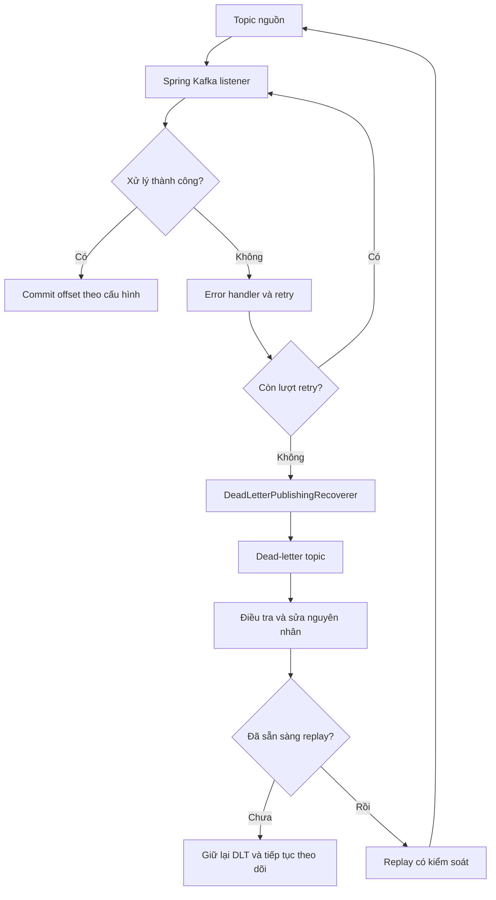

# Quy trình replay record lỗi

Dead-letter topic (DLT) lưu những record mà consumer không thể xử lý theo chính sách retry hiện tại. Đưa record vào DLT giúp luồng chính tiếp tục, nhưng không có nghĩa sự cố đã được giải quyết. Record vẫn cần được điều tra, sửa nguyên nhân và phát lại theo một quy trình có kiểm soát để hoàn tất nghiệp vụ.

Replay là việc đưa một record đã thất bại trở lại một luồng tiêu thụ để xử lý lại. Nếu replay thiếu kiểm soát, ứng dụng có thể tạo tác động nghiệp vụ trùng lặp, làm sai thứ tự sự kiện hoặc tạo vòng lặp giữa topic gốc và DLT. Bài học này trình bày cách quản lý vòng đời record trong DLT, lựa chọn đích replay, xác nhận gửi thành công và kiểm soát rủi ro khi phát lại.

## 1. Vòng đời của một record đi vào DLT

Với consumer dùng Spring Kafka, listener ném exception khi xử lý record. Error handler thực hiện retry theo backoff. Khi hết lượt retry hoặc record thuộc nhóm không retry, recoverer có thể publish record sang DLT. Sau khi publish thành công, offset nguồn được xử lý theo chính sách của error handler và container để partition tiếp tục.



Một DLT thường lưu payload, key và các header gốc, đồng thời bổ sung metadata về record nguồn và exception. Các metadata này giúp xác định record đến từ topic, partition, offset nào và vì sao xử lý thất bại. Tên header cụ thể phụ thuộc phiên bản Spring Kafka; các header thường gặp chứa original topic, partition, offset, consumer group, exception class, message và stack trace.

Ví dụ, nếu topic `orders` có record lỗi ở partition 2, offset 145, recoverer có thể gửi record sang `orders.DLT` ở partition tương ứng. Khi điều tra, cần ghi lại cả vị trí của record trong DLT và vị trí ban đầu trong `orders`. Hai vị trí này khác nhau: offset DLT xác định bản ghi trong kho lỗi, còn original offset giúp truy nguyên sự kiện trong luồng nguồn.

## 2. Điều tra trước khi replay

Không nên replay ngay khi thấy record trong DLT. Trước hết cần hiểu nguyên nhân và xác nhận lỗi đã được khắc phục. Nếu nguyên nhân chưa thay đổi, record sẽ thất bại lần nữa và quay lại DLT, làm tăng tải và gây nhiễu vận hành.

Quy trình điều tra nên trả lời các câu hỏi sau:

1. **Record nào thất bại?** Ghi nhận event ID, key, topic nguồn, partition, offset, timestamp và consumer group.
2. **Lỗi xảy ra ở đâu?** Xem exception class, message, stack trace và log tương quan từ listener, database hoặc dịch vụ phụ thuộc.
3. **Lỗi còn tồn tại không?** Kiểm tra dữ liệu, schema, quyền truy cập, cấu hình và trạng thái hệ thống phụ thuộc.
4. **Sửa lỗi ở đâu?** Có thể cần sửa dữ liệu, triển khai bản vá ứng dụng, khôi phục dịch vụ hoặc cập nhật cấu hình.
5. **Record có thể chạy lại an toàn không?** Xác minh event chưa tạo tác động nghiệp vụ một phần hoặc có cơ chế idempotency để chống xử lý trùng.
6. **Replay tới đâu và với tốc độ nào?** Chọn topic đích, partition, batch size, giới hạn tốc độ và khoảng thời gian vận hành.

| Dấu hiệu trong DLT | Hướng điều tra | Điều kiện trước khi replay |
|---|---|---|
| Timeout hoặc lỗi kết nối | Kiểm tra tình trạng dịch vụ phụ thuộc, connection pool và thời gian phản hồi | Dịch vụ đã phục hồi và chịu được tải replay. |
| Dữ liệu không hợp lệ | Kiểm tra payload, schema, event version và quy tắc nghiệp vụ | Dữ liệu đã được sửa hoặc ứng dụng đã hỗ trợ định dạng đó. |
| Lỗi deserialize | Kiểm tra byte payload, serializer/deserializer và schema registry nếu có | Consumer đích có thể deserialize payload; nếu cần, giữ nguyên byte để phát lại sau khi sửa cấu hình. |
| Lỗi lập trình | Đối chiếu phiên bản ứng dụng và stack trace | Bản sửa đã triển khai và được kiểm chứng. |
| Lỗi do downstream quá tải | Kiểm tra lag, giới hạn rate, connection pool và năng lực phục vụ | Có hạn mức replay phù hợp với năng lực hiện tại. |

Không chỉnh sửa payload trong DLT một cách tùy tiện. Nếu cần sửa dữ liệu, lưu lại giá trị gốc, giá trị đã sửa, người thực hiện, lý do và thời điểm. Điều này tạo dấu vết kiểm toán để có thể giải thích vì sao một sự kiện được phát lại với nội dung khác ban đầu.

## 3. Chọn chiến lược replay

Có ba cách phổ biến để đưa record lỗi trở lại quy trình xử lý. Mỗi cách phù hợp với một mục đích khác nhau.

| Chiến lược | Cách thực hiện | Khi phù hợp | Điểm cần kiểm soát |
|---|---|---|---|
| Replay về topic nguồn | Publish record vào lại topic gốc | Muốn record đi qua đúng listener và pipeline nghiệp vụ ban đầu | Record mới có offset mới; có thể đứng sau sự kiện mới hơn và ảnh hưởng thứ tự. |
| Replay vào recovery topic riêng | Publish vào topic chuyên xử lý sự kiện đã phục hồi | Muốn có luồng kiểm soát riêng, kiểm tra hoặc xử lý bù trước khi cập nhật hệ thống | Cần listener, schema và quy trình vận hành cho recovery topic. |
| Xử lý thủ công có kiểm soát | Công cụ hoặc người vận hành chọn record, xác nhận nội dung và phát lại | Số record ít, lỗi nhạy cảm hoặc cần phê duyệt nghiệp vụ | Phải lưu audit log, tránh gửi trùng và giới hạn quyền thao tác. |

Replay về topic nguồn thường đơn giản vì record đi qua cùng consumer group và logic hiện tại. Tuy nhiên, Kafka append record mới ở cuối partition. Nếu offset cũ đã được xử lý tiếp và các sự kiện mới hơn đã cập nhật trạng thái nghiệp vụ, record cũ khi replay có thể được xử lý sau chúng. Với nghiệp vụ phụ thuộc thứ tự, cần có cách kiểm tra version, sequence hoặc trạng thái hiện tại trước khi áp dụng sự kiện cũ.

Recovery topic phù hợp khi cần tách replay khỏi luồng phát sinh sự kiện mới. Nó cũng giúp giới hạn quyền publish vào topic nguồn. Nhưng thêm topic không tự giải quyết thứ tự hay duplicate; consumer recovery vẫn cần kiểm tra event ID và quy tắc nghiệp vụ.

## 4. Giữ metadata và định danh sự kiện

Khi replay, hãy giữ định danh nghiệp vụ ổn định như `eventId`, `orderId` hoặc `aggregateId`. Không tạo event ID mới cho cùng một sự kiện chỉ vì nó được gửi lại. Consumer có thể dùng event ID để phát hiện sự kiện đã xử lý và tránh thực hiện lại thao tác ghi, trừ hoặc thanh toán.

Ngoài metadata nghiệp vụ, cần giữ dấu vết nguồn trong các header riêng, chẳng hạn:

- `replay-source-topic`: topic DLT chứa record được chọn.
- `replay-source-partition` và `replay-source-offset`: vị trí của record trong DLT.
- `replay-original-topic`, `replay-original-partition`, `replay-original-offset`: vị trí ban đầu trong topic nguồn.
- `replay-request-id`, `replay-by` và `replay-at`: định danh yêu cầu, người hoặc tiến trình thực hiện và thời điểm replay.
- `replay-reason`: nguyên nhân đã khắc phục hoặc ticket điều tra liên quan.

Không nên sao chép mù quáng mọi header kỹ thuật của DLT sang topic nguồn. Header exception cũ có thể khiến lần xử lý mới bị hiểu nhầm là vẫn đang mang lỗi cũ; một số header có thể có nhiều giá trị sau nhiều lần dead-letter. Chỉ chuyển các header nghiệp vụ cần thiết và thêm metadata replay có namespace riêng. Giữ bản ghi nguồn hoặc audit log đầy đủ để điều tra.

## 5. Ví dụ publish lại record bằng KafkaTemplate

Ví dụ sau minh họa một dịch vụ replay nhận sự kiện đã được đọc và kiểm tra từ DLT, rồi gửi nó vào topic nguồn. Ví dụ giả định payload đã deserialize thành `OrderEvent`; phần đọc DLT và xác minh quyền replay được thực hiện ở lớp gọi dịch vụ.

```java
@Service
public class OrderReplayService {

    private final KafkaTemplate<String, OrderEvent> kafkaTemplate;

    public OrderReplayService(
            KafkaTemplate<String, OrderEvent> kafkaTemplate) {
        this.kafkaTemplate = kafkaTemplate;
    }

    public void replay(
            OrderEvent event,
            String originalTopic,
            Integer originalPartition,
            String sourceDlt,
            long sourceDltOffset,
            String replayRequestId) throws Exception {

        ProducerRecord<String, OrderEvent> record = new ProducerRecord<>(
                originalTopic,
                originalPartition,
                event.eventId(),
                event);

        record.headers().add(new RecordHeader(
                "replay-source-topic",
                sourceDlt.getBytes(StandardCharsets.UTF_8)));
        record.headers().add(new RecordHeader(
                "replay-source-offset",
                Long.toString(sourceDltOffset).getBytes(StandardCharsets.UTF_8)));
        record.headers().add(new RecordHeader(
                "replay-request-id",
                replayRequestId.getBytes(StandardCharsets.UTF_8)));

        kafkaTemplate.send(record).get(10, TimeUnit.SECONDS);
    }
}
```

Trong ví dụ:

- `event.eventId()` được dùng làm key để giữ cách định tuyến theo key nếu producer và topic có cùng partitioning strategy.
- `originalPartition` được truyền vào khi muốn gửi lại đúng partition nguồn và partition đó vẫn tồn tại. Nếu cấu trúc partition đã thay đổi, cần xác định partition đích hợp lệ hoặc để producer chọn partition theo key.
- Header `replay-*` ghi lại nguồn và yêu cầu replay để truy vết.
- `send(...).get(...)` chờ kết quả gửi trong giới hạn thời gian. Chỉ ghi nhận publish thành công khi broker xác nhận theo cấu hình producer; timeout hoặc exception cần được xử lý như kết quả chưa xác định và kiểm tra trước khi gửi lại.

Các import cần thiết trong ví dụ gồm `ProducerRecord`, `RecordHeader`, `StandardCharsets`, `TimeUnit` và các lớp Spring Kafka tương ứng. Chọn kiểu `KafkaTemplate` và serializer khớp với topic đích.

Nếu publish thất bại hoặc timeout, không nên lập tức đánh dấu DLT record đã replay. Một timeout có thể xảy ra sau khi broker đã nhận record nhưng client chưa nhận được acknowledgment. Khi thử lại, có thể tạo bản sao. Dùng event ID ổn định và cơ chế chống duplicate ở consumer để xử lý tình huống không xác định này.

## 6. Xử lý replay khi lỗi deserialize

Record lỗi deserialize là trường hợp đặc biệt: listener có thể chưa được gọi vì consumer không chuyển được byte payload thành object. DLT có thể giữ dữ liệu gốc cùng header chứa thông tin lỗi deserialize, tùy cấu hình `ErrorHandlingDeserializer` và recoverer.

Nếu cần replay loại record này, không nên đọc DLT bằng một consumer bắt buộc deserialize payload thành `OrderEvent` khi deserializer vẫn đang lỗi. Có thể dùng `ByteArrayDeserializer` để đọc payload dạng byte, điều tra định dạng gốc, sau đó gửi lại byte nguyên vẹn khi consumer nguồn đã được sửa để đọc được.

```yaml
spring:
  kafka:
    consumer:
      key-deserializer: org.apache.kafka.common.serialization.ByteArrayDeserializer
      value-deserializer: org.apache.kafka.common.serialization.ByteArrayDeserializer
```

Đây là cấu hình cho một consumer đọc DLT thô; không nhất thiết là cấu hình consumer nghiệp vụ của topic nguồn. Khi publish lại byte, producer phải dùng `ByteArraySerializer` và chuyển các header nghiệp vụ cần thiết. Tránh serialize lại một chuỗi JSON đã deserialize nếu mục tiêu là giữ nguyên byte gốc, vì định dạng, encoding hoặc type header có thể thay đổi.

## 7. Tránh replay trùng và sai thứ tự

Replay là một lần publish mới, không phải tua ngược offset của topic nguồn. Vì thế, record được replay có thể được giao thêm lần nữa và không thể giả định consumer sẽ chỉ thấy nó một lần.

Các biện pháp kiểm soát quan trọng:

1. **Idempotency theo event ID.** Lưu dấu event đã xử lý cùng transaction với cập nhật nghiệp vụ. Nếu event ID đã tồn tại, không thực hiện lại tác động nghiệp vụ.
2. **Replay ledger.** Ghi DLT topic/partition/offset, event ID, request ID, trạng thái `PENDING`, `SENT`, `FAILED` và thời điểm xử lý. Đặt unique key phù hợp để ngăn hai yêu cầu replay đồng thời cho cùng một record.
3. **Giới hạn tốc độ và số lượng.** Replay theo lô nhỏ, có thể tạm dừng và tiếp tục. Không đẩy toàn bộ DLT vào topic nguồn khi downstream vừa phục hồi.
4. **Kiểm tra version nghiệp vụ.** Với aggregate có sequence hoặc version, chỉ áp dụng sự kiện nếu nó hợp lệ so với trạng thái hiện tại. Cách này giúp phát hiện record cũ đến muộn.
5. **Kiểm tra partition.** Chỉ gửi về partition cũ nếu partition đó vẫn tồn tại và chính sách key/ordering cho phép. Thay đổi số partition có thể thay đổi ánh xạ key của các record mới.
6. **Tách quyền replay.** Chỉ công cụ hoặc service được cấp quyền phù hợp mới được publish vào topic nguồn hay recovery topic.

Nếu replay service đọc DLT bằng consumer và publish sang topic nguồn, thứ tự thao tác thường là publish trước, rồi mới xác nhận offset DLT. Nếu ứng dụng chết sau khi publish nhưng trước khi commit offset DLT, record sẽ được đọc lại và có thể publish lần nữa. Nếu commit offset DLT trước khi publish, sự cố ở giữa có thể làm mất cơ hội replay. Do đó, thứ tự publish rồi commit thường tránh mất record nhưng cần idempotency hoặc ledger để xử lý duplicate.

Trong cùng một Kafka cluster, có thể dùng Kafka transaction để phối hợp việc publish record replay và commit offset của consumer DLT trong một transaction Kafka. Cách này giúp hai thao tác Kafka cùng commit hoặc cùng abort. Nó không bao gồm transaction database hay side effect của dịch vụ bên ngoài; consumer đích vẫn cần idempotency cho nghiệp vụ ngoài Kafka.

## 8. Quy trình vận hành replay

Một quy trình có thể triển khai trong môi trường thật:

1. **Phát hiện và phân loại.** Alert khi số record DLT hoặc tuổi record cũ nhất vượt ngưỡng. Nhóm vận hành phân loại theo exception, topic nguồn và loại sự kiện.
2. **Điều tra.** Đối chiếu metadata DLT với log, trace và hệ thống phụ thuộc. Xác định nguyên nhân gốc và phạm vi record bị ảnh hưởng.
3. **Khắc phục.** Sửa code, cấu hình hoặc dữ liệu. Kiểm thử với một record đại diện và xác nhận consumer nguồn đã hoạt động bình thường.
4. **Lập kế hoạch replay.** Chọn tập record, topic đích, partition, tốc độ, số lượng mỗi lô, cửa sổ chạy và người chịu trách nhiệm. Với sự kiện nhạy cảm, yêu cầu xác nhận nghiệp vụ trước khi gửi.
5. **Chạy thử một nhóm nhỏ.** Replay một vài record, kiểm tra acknowledgment của producer, kết quả consumer, event ID và trạng thái nghiệp vụ cuối cùng.
6. **Mở rộng có giám sát.** Tăng dần batch hoặc tốc độ nếu downstream còn dư năng lực. Theo dõi consumer lag, lỗi mới, duplicate và record quay lại DLT.
7. **Đối soát và đóng sự cố.** So sánh số record được chọn, gửi thành công, xử lý thành công, còn pending và thất bại. Lưu audit log và cập nhật nguyên nhân gốc.

Một bảng đối soát đơn giản có thể có các cột sau:

| Trường | Mục đích |
|---|---|
| `replayRequestId` | Nhóm các record thuộc cùng một lần chạy replay. |
| `eventId` | Định danh nghiệp vụ ổn định để phát hiện duplicate. |
| `dltTopic`, `dltPartition`, `dltOffset` | Xác định record nguồn trong DLT. |
| `originalTopic`, `originalPartition`, `originalOffset` | Truy nguyên vị trí ban đầu. |
| `status` | Theo dõi `PENDING`, `SENT`, `PROCESSED` hoặc `FAILED`. |
| `attemptedAt`, `completedAt` | Xác định thời gian chạy và thời gian hoàn tất. |
| `reason`, `operator` | Ghi lại lý do và chủ thể yêu cầu replay. |

## 9. Kiểm thử quy trình replay

Không chỉ kiểm tra rằng producer gửi được message. Cần xác minh toàn bộ đường đi từ DLT tới trạng thái nghiệp vụ:

- Record được replay giữ nguyên event ID, key và payload theo chính sách.
- Header replay chứa thông tin nguồn và request ID, không mang theo exception header cũ một cách vô ý.
- Producer send thất bại hoặc timeout không làm hệ thống đánh dấu record đã hoàn tất.
- Replay lặp cùng một DLT record không tạo tác động nghiệp vụ trùng.
- Nếu tiến trình dừng sau publish nhưng trước commit offset DLT, lần chạy tiếp theo xử lý an toàn.
- Replay đúng partition khi partition còn tồn tại; hành vi được xác định rõ khi số partition thay đổi.
- Record deserialize lỗi có thể được đọc dạng byte và gửi lại sau khi serializer/deserializer được sửa.
- Tốc độ replay không làm downstream quá tải hoặc khiến consumer lag tăng ngoài ngưỡng.
- Audit log cho phép truy nguyên ai đã replay record nào, vì sao và kết quả ra sao.

Replay hoàn tất khi record đã được gửi, consumer đích xử lý thành công và trạng thái nghiệp vụ được đối soát. Chỉ có acknowledgment từ `KafkaTemplate` chứng minh broker đã nhận bản ghi theo cấu hình producer; nó không chứng minh listener đã hoàn tất nghiệp vụ. Cần theo dõi cả hai giai đoạn và lưu trạng thái tương ứng.

DLT là vùng cách ly để điều tra và phục hồi, không phải nơi kết thúc vòng đời sự kiện. Khi giữ được metadata nguồn, sửa đúng nguyên nhân, replay có giới hạn và chống duplicate, hệ thống Spring Kafka có thể khôi phục record lỗi mà vẫn duy trì khả năng truy vết và tính nhất quán nghiệp vụ.
