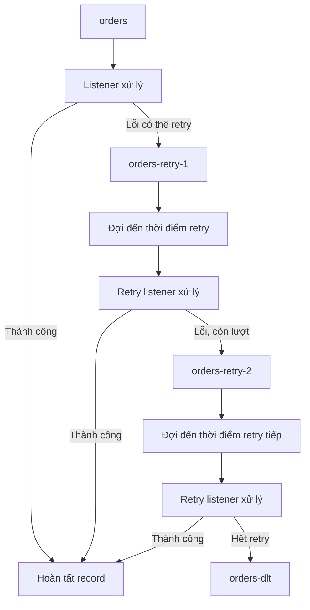

# @RetryableTopic và cách khai báo

Khi một record Kafka gặp lỗi tạm thời, ứng dụng thường muốn thử lại sau một khoảng chờ. Với retry đồng bộ (*blocking retry*), consumer giữ việc xử lý record hiện tại và chờ các lần thử hoàn tất trước khi tiếp tục. Cách này phù hợp với một số luồng cần giữ thứ tự, nhưng một record lỗi kéo dài có thể làm chậm cả partition.

Spring Kafka cung cấp cơ chế *non-blocking retry* dựa trên retry topic. Thay vì giữ record ở consumer ban đầu, framework chuyển record lỗi sang một topic retry, gắn thông tin thời điểm được phép thử lại và để luồng tiêu thụ topic gốc tiếp tục. Khi đến hạn, retry listener nhận record và thử xử lý; nếu tiếp tục thất bại, record được chuyển sang retry topic tiếp theo hoặc dead-letter topic (DLT).

Annotation `@RetryableTopic` giúp khai báo topology và chính sách này ngay cạnh `@KafkaListener`. Bài học tập trung vào cách khai báo, cách framework định tuyến record và những đánh đổi cần biết khi đưa non-blocking retry vào ứng dụng Spring Kafka.

## 1. Non-blocking retry hoạt động như thế nào?

Giả sử service tiêu thụ topic `orders`. Một đơn hàng không thể xử lý do dịch vụ kho tạm thời không phản hồi. Với retry topic, record có thể đi theo luồng:



Tên topic trong sơ đồ chỉ mang tính minh họa; tên thực tế được tạo theo suffix và chiến lược đặt tên đã cấu hình.

Luồng có các đặc điểm sau:

1. Consumer nhận record từ topic gốc và gọi listener.
2. Nếu listener thành công, record được xử lý theo cơ chế offset bình thường.
3. Nếu listener ném exception thuộc nhóm được retry, framework publish record sang retry topic tương ứng.
4. Sau khi việc chuyển tiếp được xử lý, consumer của topic gốc có thể tiếp tục nhận các record tiếp theo.
5. Retry listener chỉ xử lý record khi thời điểm backoff đã đến.
6. Nếu retry thành công, luồng kết thúc. Nếu thất bại, record chuyển sang mức retry tiếp theo hoặc DLT khi hết số lần thử.

Retry topic là topic Kafka thực sự. Việc trì hoãn được điều phối bởi cơ chế retry của Spring Kafka và metadata thời gian trong record; broker không tự biến topic thành một hàng đợi có bộ hẹn giờ chung.

## 2. Blocking retry và non-blocking retry

Hai cách retry giải quyết những nhu cầu khác nhau:

| Tiêu chí | Blocking retry | Non-blocking retry |
|---|---|---|
| Cách thử lại | Error handler thử lại trong luồng xử lý của container | Chuyển record sang retry topic |
| Consumer topic gốc | Có thể bị giữ lại bởi record đang lỗi | Có thể tiếp tục xử lý record tiếp theo sau khi chuyển record lỗi |
| Độ trễ dài | Có thể giữ consumer/partition chờ lâu | Phù hợp hơn với các khoảng chờ dài |
| Thứ tự | Có thể giữ thứ tự trong partition nếu xử lý tuần tự | Record đến sau có thể được xử lý trước record đang retry |
| Hạ tầng | Chủ yếu cần error handler | Cần các retry topic và DLT tương ứng |
| Giới hạn quan trọng | Tổng thời gian retry ảnh hưởng thời gian poll | Không hỗ trợ batch listener và container transaction |

Ví dụ, partition có ba record theo thứ tự A, B, C. Nếu A lỗi và được chuyển sang retry topic, consumer topic gốc có thể xử lý B rồi C trong khi A đang chờ. Khi A quay lại, thứ tự xử lý thực tế có thể là B, C, A.

Do đó, non-blocking retry phù hợp khi khả năng tiếp tục xử lý các record khác quan trọng hơn thứ tự tuyệt đối. Nếu các event của cùng một aggregate phải được áp dụng tuần tự, hãy cân nhắc blocking retry, thiết kế lại key/partition hoặc một quy trình nghiệp vụ có khả năng kiểm soát thứ tự.

## 3. Khai báo @RetryableTopic cơ bản

`@RetryableTopic` được đặt cùng phương thức `@KafkaListener`. Ví dụ sau khai báo bốn lần thử tổng cộng, với khoảng chờ tăng dần:

```java
import org.springframework.kafka.annotation.Backoff;
import org.springframework.kafka.annotation.KafkaListener;
import org.springframework.kafka.annotation.RetryableTopic;
import org.springframework.kafka.annotation.DltHandler;
import org.springframework.kafka.annotation.Header;
import org.springframework.kafka.support.KafkaHeaders;

@Component
public class OrderListener {

    private final OrderService orderService;

    public OrderListener(OrderService orderService) {
        this.orderService = orderService;
    }

    @RetryableTopic(
            attempts = "4",
            backoff = @Backoff(
                    delay = 1_000,
                    multiplier = 2.0,
                    maxDelay = 10_000
            ),
            retryTopicSuffix = "-retry",
            dltTopicSuffix = "-dlt"
    )
    @KafkaListener(
            topics = "orders",
            groupId = "order-service"
    )
    public void consume(OrderEvent event) {
        orderService.process(event);
    }

    @DltHandler
    public void handleDlt(OrderEvent event) {
        // Ghi nhận để điều tra hoặc đưa vào quy trình xử lý thủ công.
    }
}
```

Trong ví dụ:

- `attempts = "4"` là tổng số lần xử lý, bao gồm lần đầu trên topic gốc. Nghĩa là tối đa ba lần retry sau lần đầu.
- `delay = 1_000` đặt khoảng chờ ban đầu là một giây.
- `multiplier = 2.0` tăng khoảng chờ theo hệ số hai.
- `maxDelay = 10_000` giới hạn mỗi khoảng chờ ở mức mười giây.
- `retryTopicSuffix` và `dltTopicSuffix` tùy chỉnh hậu tố tên topic.
- `@DltHandler` đánh dấu phương thức xử lý record đã đi đến DLT trong cùng lớp listener.

Với ví dụ này, các mức chờ có thể là 1, 2 và 4 giây trước ba lần retry. Nếu listener tiếp tục thất bại ở lần thử cuối, record được chuyển sang DLT. Khoảng chờ thực tế còn phụ thuộc cấu hình backoff và cách Spring Kafka tạo, tái sử dụng retry topic.

Các thuộc tính của annotation có kiểu chuỗi ở một số vị trí, chẳng hạn `attempts`. Hãy giữ đúng kiểu giá trị mà API yêu cầu khi cấu hình bằng annotation.

## 4. Chọn số lần thử và backoff

Số lần thử và thời gian chờ quyết định thời gian tối đa record có thể nằm trong luồng retry. Chọn chúng theo thời gian phục hồi của dependency và yêu cầu nghiệp vụ.

Ví dụ với:

```java
@RetryableTopic(
        attempts = "4",
        backoff = @Backoff(
                delay = 1_000,
                multiplier = 2.0,
                maxDelay = 10_000
        )
)
```

Có thể hình dung lịch retry như sau:

| Lần xử lý | Nơi xử lý | Thời gian chờ trước lần đó |
|---|---|---:|
| 1 | Topic gốc | Không có |
| 2 | Retry topic mức 1 | 1 giây |
| 3 | Retry topic mức 2 | 2 giây |
| 4 | Retry topic mức 3 | 4 giây |
| Sau lần 4 thất bại | DLT | Không còn retry |

`attempts` tính cả lần đầu. Nếu đặt `attempts = "1"`, record chỉ được xử lý trên topic gốc; không có lần retry tiếp theo và record lỗi được xử lý theo chính sách DLT.

Một số lưu ý khi chọn chính sách:

- Khoảng chờ quá ngắn có thể khiến retry topic liên tục gọi một dependency vẫn đang hỏng.
- Khoảng chờ quá dài làm record tồn tại lâu trong retry flow và tăng độ trễ hoàn tất.
- Số lần thử quá lớn có thể khiến DLT nhận record rất muộn.
- Với exponential backoff, đặt giới hạn trên để khoảng chờ không tăng ngoài dự kiến.
- Nếu cần nhiều cấp thời gian chờ, hãy xác định rõ từng mức và kiểm tra topology topic mà framework tạo ra.

Không nên chọn số lần thử chỉ dựa trên một con số mặc định. Hãy đo thời gian phục hồi thực tế của dependency và đặt ngưỡng phù hợp với SLA của event.

## 5. Phân loại exception được retry

Không phải mọi exception đều nên đi qua retry topic. Lỗi mạng hoặc dependency tạm thời có thể tự hết; lỗi dữ liệu hoặc vi phạm nghiệp vụ thường không thể khắc phục chỉ bằng chờ.

Có thể dùng `include` để khai báo rõ các loại exception cần retry:

```java
@RetryableTopic(
        attempts = "4",
        backoff = @Backoff(delay = 1_000, multiplier = 2.0),
        include = {
                TemporaryInventoryException.class,
                RemoteServiceUnavailableException.class
        }
)
@KafkaListener(topics = "orders", groupId = "order-service")
public void consume(OrderEvent event) {
    orderService.process(event);
}
```

Có thể dùng `exclude` để loại trừ các lỗi không nên retry:

```java
@RetryableTopic(
        attempts = "4",
        backoff = @Backoff(delay = 1_000),
        exclude = {
                InvalidOrderException.class,
                UnsupportedCurrencyException.class
        }
)
@KafkaListener(topics = "orders", groupId = "order-service")
public void consume(OrderEvent event) {
    orderService.process(event);
}
```

Hãy chọn một chính sách phân loại dễ hiểu. `include` dùng để khai báo các loại exception được đưa vào nhóm retryable; `exclude` dùng để loại trừ các loại exception không nên retry. Hãy kiểm tra hành vi kết hợp và các mặc định của phiên bản Spring Kafka đang chạy, đặc biệt khi ứng dụng chỉ muốn retry một tập lỗi rất hẹp.

Một số lỗi xuất hiện dưới dạng exception bọc (cause). Khi phân loại, hãy kiểm tra cấu hình duyệt cause và bảo đảm exception thực tế listener ném ra được nhận diện đúng. Cũng cần kiểm tra các lỗi phát sinh trước khi listener chạy, chẳng hạn lỗi deserialize; chúng có thể đi theo cơ chế xử lý lỗi riêng tùy cấu hình container và phiên bản.

## 6. Xử lý record ở dead-letter topic

DLT là nơi nhận record đã hết số lần retry hoặc được định tuyến vào dead-letter theo chính sách exception. DLT cho phép hệ thống tách event lỗi khỏi luồng chính để điều tra, sửa dữ liệu hoặc phát lại sau này.

Một phương thức `@DltHandler` có thể lưu record và thông tin cần thiết:

```java
@DltHandler
public void handleDlt(
        OrderEvent event,
        @Header(KafkaHeaders.RECEIVED_TOPIC) String topic) {

    log.error("Order event moved to DLT topic {}", topic);
    dltService.saveForInvestigation(event);
}
```

Trong thực tế, cần lưu thêm metadata như topic gốc, partition, offset, key, thời điểm nhận và thông tin exception. Spring Kafka bổ sung các header mô tả nguồn gốc và lỗi khi chuyển record sang DLT; tên header và chi tiết có thể được kiểm tra theo phiên bản đang dùng.

Không nên chỉ ghi log rồi bỏ qua record nếu nghiệp vụ cần khôi phục. Hãy định nghĩa ai hoặc quy trình nào sẽ xem xét DLT, cách sửa dữ liệu, cách replay và cách tránh áp dụng cùng event hai lần.

DLT cũng là một luồng Kafka có thể gặp lỗi. Nếu phương thức DLT handler thất bại, cần có chính sách giám sát và phục hồi riêng. Không giả định record trong DLT luôn được xử lý thành công chỉ vì nó đã ra khỏi retry flow.

## 7. Tên topic và topology retry

Spring Kafka tạo các retry topic theo backoff và chiến lược suffix. Có thể tùy chỉnh suffix của retry topic và DLT:

```java
@RetryableTopic(
        attempts = "4",
        retryTopicSuffix = "-retry",
        dltTopicSuffix = "-dlt"
)
@KafkaListener(topics = "orders")
public void consume(OrderEvent event) {
    orderService.process(event);
}
```

Về mặt khái niệm, topology có thể gồm:

| Vai trò | Ví dụ tên |
|---|---|
| Topic gốc | `orders` |
| Retry topic cho lần chờ đầu | `orders-retry-...` |
| Retry topic cho lần chờ tiếp theo | `orders-retry-...` |
| Dead-letter topic | `orders-dlt` |

Phần hậu tố cụ thể phụ thuộc `TopicSuffixingStrategy` và cách tái sử dụng topic cùng khoảng chờ. Không nên hardcode tên retry topic vào producer hoặc consumer nghiệp vụ; hãy để framework quản lý việc định tuyến hoặc cấu hình tên topic nhất quán.

Trong production, có thể để framework tạo topic nếu môi trường cho phép, hoặc chủ động provision topic qua quy trình hạ tầng. Khi tự tạo topic, cần tính số partition, replication factor, retention và quyền publish/consume cho các service liên quan. Tắt auto-create mà chưa tạo đủ topic sẽ khiến retry flow không hoạt động như mong đợi.

## 8. Partition, key và thứ tự xử lý

Retry topic là topic khác với topic gốc, vì vậy cần xem xét partition mapping. Nếu record gốc ở partition 3, framework thường cần chuyển nó sang partition tương ứng ở retry topic để giữ cách phân phối theo partition. Vì vậy, retry topic nên có số partition tương thích, thường bằng hoặc lớn hơn topic gốc theo chiến lược định tuyến đang dùng.

Nếu topic gốc có sáu partition, hãy thiết kế các retry topic với ít nhất sáu partition khi cần giữ mapping partition ban đầu. Cấu hình số partition phải đồng bộ với topology thực tế; không giả định giá trị mặc định của auto-create phù hợp với topic gốc.

Key của record cũng rất quan trọng. Cùng một key thường được hash vào cùng partition trong một topic, nhưng việc đi qua retry topic vẫn không khôi phục thứ tự toàn cục giữa record đang retry và record đã tiếp tục trên topic gốc.

Ví dụ:

1. Event A của đơn hàng 101 bị lỗi và chuyển sang retry topic.
2. Event B của đơn hàng 101 đến sau nhưng được xử lý ngay trên topic gốc.
3. Event A được retry thành công sau đó.

Nếu nghiệp vụ yêu cầu A phải hoàn tất trước B, non-blocking retry có thể phá vỡ yêu cầu này. Có thể dùng blocking retry, tách luồng theo aggregate, lưu trạng thái version hoặc thiết kế consumer kiểm tra thứ tự trước khi áp dụng event.

## 9. Các giới hạn cần biết

Non-blocking retry có một số giới hạn kiến trúc quan trọng:

- Không hỗ trợ batch listener trong cơ chế non-blocking retry.
- Không thể kết hợp với container transaction.
- Không bảo đảm thứ tự xử lý giữa record được chuyển sang retry topic và các record tiếp theo trên topic gốc.
- Làm tăng số lượng topic, consumer flow, cấu hình ACL và nhu cầu quan sát.
- Độ trễ hoàn tất event tăng theo lịch retry.
- DLT cần quy trình xử lý và replay riêng.

Nếu ứng dụng cần Kafka transaction cho listener container, hoặc cần xử lý cả batch như một đơn vị transaction, hãy dùng chiến lược blocking retry phù hợp. Đừng bật `@RetryableTopic` rồi giả định transaction của listener vẫn bảo vệ toàn bộ chuỗi chuyển tiếp qua retry topic.

Non-blocking retry cũng không biến hệ thống thành exactly-once cho các tác dụng phụ nghiệp vụ. Một event có thể được xử lý lại do publish, consumer restart hoặc replay. Các thao tác ghi database, gọi API hoặc phát event tiếp theo vẫn cần idempotency và cơ chế phối hợp phù hợp.

## 10. Cấu hình topic và listener trong ứng dụng

Trong ứng dụng Spring Boot, cần bảo đảm listener dùng cấu hình Kafka đúng và retry topic được cấp quyền truy cập. Nếu khai báo bằng annotation, framework xử lý phần lớn topology; nếu cấu hình theo chương trình, Spring Kafka cung cấp `RetryTopicConfigurationBuilder` để xây dựng chính sách retry cho các topic được chọn.

Ví dụ một số nội dung cần thống nhất giữa môi trường:

| Thành phần | Điều cần cấu hình |
|---|---|
| Topic gốc | Số partition, replication, retention |
| Retry topic | Số partition tương thích, retention đủ dài cho backoff |
| DLT | Quyền ghi, retention, người/tiến trình xử lý |
| Producer | Serializer tương thích với record gốc và record retry/DLT |
| Consumer | Group ID, concurrency và quyền đọc các topic |
| ACL | Quyền read/write cho topic gốc, retry và DLT |
| Monitoring | Consumer lag, số record retry, DLT rate và lỗi publish |

Đặc biệt, retention của retry topic phải đủ dài để record không bị xóa trước khi tới thời điểm retry. Hãy kiểm tra giới hạn kích thước message và serializer cho cả payload lẫn headers.

## 11. Khi nào nên dùng @RetryableTopic?

Có thể cân nhắc `@RetryableTopic` khi:

- Một event có thể cần chờ nhiều giây hoặc lâu hơn để dependency phục hồi.
- Consumer cần tiếp tục xử lý record khác trong topic gốc.
- Nghiệp vụ chấp nhận record đến sau được xử lý trước record đang retry.
- Có thể vận hành thêm retry topic và DLT.
- Không phụ thuộc batch listener hoặc container transaction cho luồng đó.

Nên chọn blocking retry khi:

- Giữ thứ tự trong partition là yêu cầu bắt buộc.
- Retry cần diễn ra ngay và chỉ kéo dài trong một khoảng ngắn.
- Luồng listener cần container transaction.
- Ứng dụng tiêu thụ batch và muốn xử lý lỗi ở cấp batch/record theo error handler.

## 12. Kiểm thử non-blocking retry

Một bài kiểm thử chỉ xác nhận listener nhận event một lần là chưa đủ. Hãy xác minh đường đi qua các topic:

1. Listener nhận record từ topic gốc và ném exception có thể retry.
2. Record xuất hiện ở retry topic đúng theo chính sách.
3. Header backoff và metadata nguồn gốc được giữ phù hợp.
4. Listener retry nhận lại record sau thời gian chờ.
5. Nếu xử lý thành công, record không đi tiếp sang retry topic khác.
6. Nếu thất bại hết số lần thử, record được gửi tới DLT.
7. Exception không retry được đi thẳng tới DLT theo chính sách.
8. DLT handler lưu được payload và metadata để điều tra.
9. Consumer group tiếp tục xử lý record mới trong topic gốc trong lúc record cũ chờ retry.
10. Partition mapping, key và quyền truy cập hoạt động trên tất cả retry topic.

Có thể dùng Embedded Kafka hoặc Testcontainers để kiểm tra tích hợp với broker. Dùng thời gian backoff ngắn trong test để tránh chờ lâu, nhưng vẫn xác nhận thứ tự chuyển topic và số lần thử. Đối với hành vi ordering, tạo nhiều record cùng key và quan sát thứ tự thực tế sau khi một record bị retry.

## 13. Những lỗi triển khai thường gặp

| Hiện tượng | Nguyên nhân có thể | Cách xử lý |
|---|---|---|
| Không thấy retry topic | Topic chưa được tạo hoặc auto-create không được phép | Provision topic và kiểm tra cấu hình tạo topic |
| Record đi DLT ngay | Exception không nằm trong nhóm retry | Kiểm tra include/exclude và exception cause |
| Retry topic không nhận record | Producer/ACL/serializer lỗi khi chuyển tiếp | Kiểm tra log publish và quyền ghi |
| Record không quay lại đúng lúc | Backoff timestamp hoặc consumer retry topic gặp vấn đề | Kiểm tra header, lag và trạng thái listener container |
| Consumer lag tăng ở retry topic | Dependency vẫn lỗi hoặc lịch retry quá dài | Điều chỉnh backoff và theo dõi dependency |
| Mất thứ tự event | Record lỗi được tách khỏi topic gốc | Chọn blocking retry hoặc kiểm soát version nghiệp vụ |
| DLT tăng liên tục | Lỗi dữ liệu hoặc dependency kéo dài | Phân loại exception, cảnh báo và điều tra DLT |
| Retry topic bị xóa record sớm | Retention thấp hơn thời gian chờ | Tăng retention theo chính sách retry |

## 14. Checklist trước khi đưa vào production

- [ ] Đã xác nhận luồng có thể chấp nhận việc record sau được xử lý trước record retry.
- [ ] Listener dùng record listener, không dùng batch listener cho non-blocking retry.
- [ ] Luồng không phụ thuộc container transaction.
- [ ] `attempts` đã tính cả lần xử lý ban đầu.
- [ ] Backoff có delay, multiplier và giới hạn phù hợp.
- [ ] Exception được phân loại rõ bằng include/exclude hoặc chính sách tương ứng.
- [ ] Retry topic và DLT đã được tạo, có partition tương thích và retention đủ dài.
- [ ] Producer, consumer và ACL có quyền cần thiết trên toàn bộ topic.
- [ ] DLT handler và quy trình điều tra/replay đã được xác định.
- [ ] Tác dụng phụ nghiệp vụ có thể chịu được xử lý lặp.
- [ ] Có metric và cảnh báo cho retry rate, DLT rate, lag và lỗi publish.
- [ ] Đã kiểm thử thành công, retry, hết retry, exception không retry và ordering.

`@RetryableTopic` giúp Spring Kafka triển khai non-blocking retry bằng cách chuyển record lỗi qua các retry topic trước khi đưa vào DLT. Cách này giải phóng luồng topic gốc để xử lý các record tiếp theo, đổi lại cần quản lý topology topic và chấp nhận khả năng thay đổi thứ tự. Hãy chọn nó khi nghiệp vụ phù hợp với xử lý bất đồng bộ, khai báo số lần thử và backoff rõ ràng, đồng thời thiết kế DLT, partition, idempotency và monitoring ngay từ đầu.

