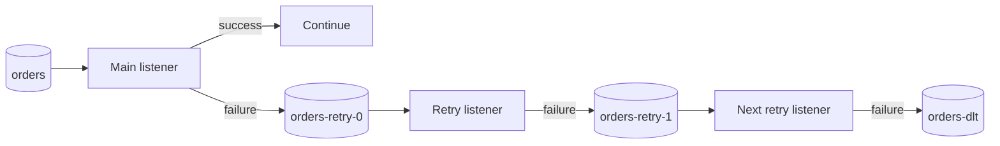

# Tên và số lượng retry topic

Spring Kafka non-blocking retry chuyển record lỗi sang các retry topic để consumer có thể tiếp tục xử lý những record khác trong topic gốc. Các retry topic được tạo theo lịch backoff và quy tắc đặt tên; sau khi hết số lần thử, record có thể được chuyển sang dead-letter topic (DLT). Khi thiết kế luồng này, cần phân biệt **số lần thử**, **số lần retry** và **số retry topic** vì ba con số không nhất thiết bằng nhau.

Trong module `SPRING_KAFKA_MESSAGING`, producer gửi event bằng `KafkaTemplate`, consumer xử lý bằng `@KafkaListener`. `@RetryableTopic` giúp Spring Kafka tạo topology gồm topic gốc, retry topic và DLT. Tên và số lượng topic ảnh hưởng trực tiếp đến số partition, replication, tài nguyên broker, ACL, monitoring và cách vận hành khi triển khai nhiều phiên bản ứng dụng.

Các ví dụ listener trong bài sử dụng event và service contract sau:

```java
public record OrderCreatedEvent(
        String eventId,
        String orderId
) {}

public interface OrderApplicationService {
    void handle(OrderCreatedEvent event);
    void recordFailedEvent(OrderCreatedEvent event);
}
```

## 1. Retry topic trong non-blocking retry

Với blocking retry, consumer giữ luồng xử lý tại record lỗi và thử lại trước khi chuyển sang record tiếp theo. Với non-blocking retry, record lỗi được chuyển sang retry topic; consumer của topic gốc có thể tiếp tục xử lý các record khác.



Retry topic là Kafka topic thật. Nó có partition, replication factor, retention, ACL và listener/consumer xử lý trong topology retry. Tên topic không chỉ là nhãn hiển thị; nó là một phần cấu trúc vận hành của luồng retry.

## 2. Phân biệt attempts, retries và retry topics

`attempts` trong `@RetryableTopic` biểu thị tổng số lần xử lý tối đa, bao gồm lần xử lý đầu tiên trên topic gốc.

| Cấu hình | Số lần xử lý tối đa | Số lần retry sau lần đầu |
|---|---:|---:|
| `attempts = "1"` | 1 | 0 |
| `attempts = "2"` | 2 | 1 |
| `attempts = "3"` | 3 | 2 |
| `attempts = "4"` | 4 | 3 |
| `attempts = "5"` | 5 | 4 |

Ví dụ `attempts = "4"` nghĩa là listener có tối đa bốn lần xử lý: một lần trên topic gốc và ba lần ở retry flow. Nếu tất cả lần xử lý đều thất bại, record được chuyển đến DLT theo cấu hình.

**Số lần retry không phải số retry topic.** Nhiều lần retry có thể dùng cùng một retry topic nếu delay giống nhau và chiến lược đặt tên/tái sử dụng cho phép. Ngược lại, một lịch backoff có nhiều delay khác nhau thường tạo nhiều retry destination.

## 3. Các thành phần tạo nên tên retry topic

Tên topic thường được tạo từ:

- Tên topic gốc, ví dụ `orders`.
- `retryTopicSuffix`, hậu tố chung của retry topic, ví dụ `-retry`.
- Phần suffix theo index hoặc delay, tùy `TopicSuffixingStrategy`.
- `dltTopicSuffix`, hậu tố của dead-letter topic, ví dụ `-dlt`.

Nên cấu hình suffix tường minh thay vì phụ thuộc vào giá trị mặc định của phiên bản thư viện. Ví dụ:

```java
@RetryableTopic(
        attempts = "4",
        retryTopicSuffix = "-retry",
        dltTopicSuffix = "-dlt"
)
```

Với topic gốc `orders`, phần tên cơ sở sẽ là `orders-retry...` cho retry topic và `orders-dlt` cho DLT. Phần sau `-retry` phụ thuộc chiến lược suffix.

## 4. Đặt tên theo index: `SUFFIX_WITH_INDEX`

`TopicSuffixingStrategy.SUFFIX_WITH_INDEX` thêm chỉ số retry vào tên topic. Ví dụ với `attempts = "4"`, có ba lần retry:

```text
Topic gốc: orders

orders
orders-retry-0
orders-retry-1
orders-retry-2
orders-dlt
```

Ưu điểm của suffix theo index:

- Nhìn tên có thể biết record đang ở bước retry thứ mấy trong topology.
- Các retry stage có topic riêng, thuận tiện quan sát lag và lưu lượng từng bước.
- Không cần dựa vào giá trị delay để suy ra tên topic.

Đổi lại, số retry topic có thể tăng theo số lần retry được cấu hình. Nếu dùng fixed backoff và nhiều lần retry, topology có thể có nhiều topic dù các lần thử có cùng khoảng nghỉ.

## 5. Đặt tên theo delay: `SUFFIX_WITH_DELAY`

`TopicSuffixingStrategy.SUFFIX_WITH_DELAY` dùng thời gian delay làm phần suffix. Ví dụ lịch exponential backoff có các khoảng nghỉ 1 giây, 2 giây và 4 giây:

```text
Topic gốc: orders

orders
orders-retry-1000
orders-retry-2000
orders-retry-4000
orders-dlt
```

Tên topic thể hiện delay tính bằng mili giây. Cách này dễ đối chiếu với lịch backoff và có thể dùng chung destination cho các lần retry có cùng delay.

Ví dụ cấu hình:

```java
import org.springframework.kafka.retrytopic.TopicSuffixingStrategy;
import org.springframework.retry.annotation.Backoff;
import org.springframework.kafka.retrytopic.RetryableTopic;

@RetryableTopic(
        attempts = "4",
        backoff = @Backoff(delay = 1_000, multiplier = 2.0),
        topicSuffixingStrategy = TopicSuffixingStrategy.SUFFIX_WITH_DELAY,
        retryTopicSuffix = "-retry",
        dltTopicSuffix = "-dlt"
)
```

Với lịch này, ba lần retry lần lượt có delay 1.000 ms, 2.000 ms và 4.000 ms. Tên topic tương ứng là `orders-retry-1000`, `orders-retry-2000` và `orders-retry-4000`.

## 6. Tính số retry topic từ backoff schedule

Hãy tính các lần retry trước, sau đó mới suy ra các destination. Với:

```java
@RetryableTopic(
        attempts = "5",
        backoff = @Backoff(
                delay = 1_000,
                multiplier = 2.0,
                maxDelay = 5_000
        ),
        topicSuffixingStrategy = TopicSuffixingStrategy.SUFFIX_WITH_DELAY
)
```

Số lần xử lý tối đa là năm, gồm một lần ban đầu và bốn lần retry. Lịch delay:

| Lần xử lý | Nơi xử lý | Delay trước lần xử lý |
|---|---|---:|
| 1 | Topic gốc `orders` | 0 ms |
| 2 | Retry topic | 1.000 ms |
| 3 | Retry topic | 2.000 ms |
| 4 | Retry topic | 4.000 ms |
| 5 | Retry topic | 5.000 ms (đạt `maxDelay`) |

Với suffix theo delay, các tên retry topic tương ứng là `orders-retry-1000`, `orders-retry-2000`, `orders-retry-4000` và `orders-retry-5000`. Sau lần thứ năm vẫn thất bại, record đi tới `orders-dlt`.

`maxDelay` giới hạn delay của backoff; nó không giới hạn số lần retry. `attempts` mới quyết định tổng số lần xử lý tối đa.

## 7. Fixed backoff và việc tái sử dụng topic cùng delay

Với fixed backoff, mọi lần retry có cùng khoảng nghỉ. Ví dụ `attempts = "4"` và `delay = 1_000` tạo ba lần retry đều có delay 1 giây.

Nếu dùng suffix theo delay, các lần retry cùng delay có thể trỏ tới cùng tên `orders-retry-1000`. Nếu dùng suffix theo index, topology có thể tạo các topic riêng như `orders-retry-0`, `orders-retry-1`, `orders-retry-2`.

Một số phiên bản Spring Kafka hỗ trợ `SameIntervalTopicReuseStrategy` để điều khiển việc tái sử dụng retry topic khi nhiều lần thử có cùng delay. Ví dụ:

```java
import org.springframework.kafka.retrytopic.SameIntervalTopicReuseStrategy;
import org.springframework.kafka.retrytopic.TopicSuffixingStrategy;

@RetryableTopic(
        attempts = "4",
        backoff = @Backoff(delay = 1_000),
        topicSuffixingStrategy = TopicSuffixingStrategy.SUFFIX_WITH_INDEX,
        sameIntervalTopicReuseStrategy = SameIntervalTopicReuseStrategy.SINGLE_TOPIC
)
```

`SINGLE_TOPIC` yêu cầu tái sử dụng một topic cho các lần retry có cùng delay; `MULTIPLE_TOPICS` giữ các destination riêng theo lần retry. Thuộc tính này phụ thuộc phiên bản Spring Kafka, vì vậy hãy xác minh API đang dùng trước khi áp dụng. Nếu muốn topology dễ dự đoán trên nhiều version, hãy khai báo rõ chiến lược suffix và kiểm tra danh sách topic được tạo trong integration test.

## 8. Ví dụ `@RetryableTopic` hoàn chỉnh

Ví dụ listener xử lý event đơn hàng với bốn lần thử tổng cộng, exponential backoff và suffix theo index:

```java
import org.springframework.kafka.annotation.DltHandler;
import org.springframework.kafka.annotation.KafkaListener;
import org.springframework.kafka.retrytopic.TopicSuffixingStrategy;
import org.springframework.retry.annotation.Backoff;
import org.springframework.kafka.annotation.RetryableTopic;
import org.springframework.stereotype.Component;

@Component
public class OrderEventListener {

    private final OrderApplicationService orderService;

    public OrderEventListener(OrderApplicationService orderService) {
        this.orderService = orderService;
    }

    @RetryableTopic(
            attempts = "4",
            backoff = @Backoff(delay = 1_000, multiplier = 2.0),
            topicSuffixingStrategy = TopicSuffixingStrategy.SUFFIX_WITH_INDEX,
            retryTopicSuffix = "-retry",
            dltTopicSuffix = "-dlt"
    )
    @KafkaListener(topics = "orders", groupId = "orders-service")
    public void listen(OrderCreatedEvent event) {
        orderService.handle(event);
    }

    @DltHandler
    public void handleDlt(OrderCreatedEvent event) {
        orderService.recordFailedEvent(event);
    }
}
```

Với `attempts = "4"`, listener có tối đa một lần ở topic gốc và ba lần ở retry flow. DLT handler nhận record sau khi các lần retry đã hết và recovery định tuyến record đến DLT. DLT handler cần có logging/alerting và quy trình xử lý phù hợp; không nên chỉ bỏ qua record.

Các kiểu import annotation có thể khác tùy version Spring Kafka; hãy dùng đúng package trong dependency của dự án. `@RetryableTopic` áp dụng cho non-blocking retry của record listener; không coi đây là cấu hình thay thế blocking retry cho batch listener hoặc transactional listener.

## 9. Ước lượng tổng số topic

Với một topology cho một topic gốc, cách ước lượng đơn giản:

```text
Tổng số topic = 1 topic gốc + số retry topic khác nhau + 1 DLT
```

Ví dụ:

| Backoff và suffix | Retry topic | Tổng topic gồm gốc + retry + DLT |
|---|---:|---:|
| 3 retry, exponential delay khác nhau, suffix theo delay | 3 | 5 |
| 3 retry, exponential delay khác nhau, suffix theo index | 3 | 5 |
| 3 retry cùng delay, suffix theo delay | 1 destination theo delay | 3 |
| 3 retry cùng delay, suffix theo index, reuse `SINGLE_TOPIC` | 1 | 3 |
| 3 retry cùng delay, suffix theo index, reuse `MULTIPLE_TOPICS` | 3 | 5 |

Đây là cách ước lượng cho một listener/topic retry topology. Số topic thực tế còn phụ thuộc cấu hình DLT, strategy reuse, các listener endpoint, retry destination được chia sẻ hay không và phiên bản Spring Kafka. Hãy xác minh topic thực tế sau khi application khởi động.

## 10. Số partition và replication của retry topic

Số lượng topic chỉ là một phần chi phí. Mỗi retry topic và DLT còn có partition và replica. Nếu topic gốc có `P` partition, mỗi retry topic cũng cần số partition phù hợp với chiến lược định tuyến và ordering của ứng dụng. Nếu recoverer hoặc retry topology giữ partition index của record, retry/DLT topic phải có partition tương ứng.

Ví dụ một topology có topic gốc 12 partition, ba retry topic và một DLT, tất cả cùng 12 partition:

```text
Topic count       = 1 + 3 + 1 = 5
Partition count   = 5 * 12 = 60
Replica count     = 60 * replication factor
```

Với replication factor bằng ba, cluster phải lưu khoảng 180 bản sao partition. Con số này chưa tính internal topic khác và có thể thay đổi theo cấu hình thực tế.

Khi tự provisioning retry topic, cần thống nhất partition count, replication factor, retention, cleanup policy và ACL. Nếu dùng auto-create topic của Spring Kafka, cấu hình số partition/replica phải phù hợp cluster; không để topic retry mặc định chỉ có một partition khi topic nguồn có nhiều partition mà routing cần giữ partition index.

## 11. Chọn tên topic ổn định và tránh xung đột

Tên retry topic là một phần hợp đồng vận hành. Khi thay đổi suffix, chiến lược naming hoặc backoff schedule, có thể phát sinh topic mới trong khi topic cũ vẫn còn record hoặc consumer đang xử lý.

Một số nguyên tắc:

- Chọn `retryTopicSuffix` và `dltTopicSuffix` nhất quán theo convention của hệ thống.
- Tránh để hai listener độc lập vô tình tạo cùng tên retry topic nhưng khác backoff hoặc DLT policy.
- Nếu nhiều listener cùng xử lý một topic gốc, xác định rõ có thể chia sẻ retry topology hay cần suffix riêng.
- Không đổi suffix tùy tiện trong rolling deployment; cần kế hoạch chuyển record đang nằm trong retry topic cũ.
- Đặt tên dễ tìm theo topic nguồn và stage retry.
- Ghi nhận topic name thực tế trong dashboard, ACL và runbook.

Ví dụ hai luồng xử lý độc lập có thể dùng suffix riêng:

```java
@RetryableTopic(
        attempts = "4",
        retryTopicSuffix = ".billing-retry",
        dltTopicSuffix = ".billing-dlt"
)
```

Chỉ dùng suffix riêng khi cần tách topology. Nếu hai consumer group có cùng policy và cùng mục tiêu vận hành, có thể dùng topology chia sẻ theo thiết kế được kiểm tra kỹ.

## 12. Thời gian delay không đồng nghĩa thời điểm xử lý chính xác

Backoff delay là thời gian tối thiểu/định hướng để record được đưa qua retry stage tiếp theo; thời điểm listener thực tế xử lý còn phụ thuộc consumer poll, lag, số partition, tải broker và scheduler nội bộ của retry mechanism.

Ví dụ delay 5 giây không có nghĩa listener chắc chắn chạy lại đúng tại giây thứ năm. Nếu retry topic đang có lag, record có thể được xử lý muộn hơn. Vì vậy:

- Không dùng retry delay làm bộ lập lịch thời gian chính xác cho nghiệp vụ.
- Theo dõi lag của từng retry topic.
- Chọn retention đủ dài để record không hết hạn trước khi được xử lý lại.
- Xem xét tổng thời gian retry và timeout của nghiệp vụ.
- Dùng scheduler/workflow engine chuyên dụng nếu cần lịch chạy chính xác hoặc retry kéo dài nhiều giờ/ngày.

## 13. Ordering và tác động của nhiều retry topic

Non-blocking retry giúp partition của topic gốc tiếp tục xử lý record tiếp theo trong khi record lỗi đang chờ ở retry topic. Điều này cải thiện throughput nhưng làm thay đổi thứ tự xử lý quan sát được.

Ví dụ:

```text
orders partition 0:
  offset 10: OrderCreated(order-1) -> chuyển retry
  offset 11: OrderUpdated(order-1) -> xử lý thành công

orders-retry-0:
  OrderCreated(order-1) -> xử lý lại sau delay
```

`OrderUpdated` có thể được xử lý trước khi `OrderCreated` hoàn tất retry. Nếu nghiệp vụ yêu cầu thứ tự theo aggregate, cần thiết kế event handler idempotent, sequence/version check hoặc cơ chế điều phối phù hợp. Không giả định dùng cùng key sẽ tự khôi phục thứ tự sau khi record đi qua retry topic.

## 14. Kiểm thử tên và số lượng retry topic

Integration test nên xác minh topology thực tế thay vì chỉ kiểm tra annotation:

- Khởi động application với topic gốc test có tên cố định.
- Cấu hình `attempts` và backoff đơn giản để dễ tính số stage.
- Dùng AdminClient liệt kê topic sau khi retry infrastructure khởi tạo.
- Kiểm tra tên topic theo `SUFFIX_WITH_INDEX` hoặc `SUFFIX_WITH_DELAY`.
- Kiểm tra số retry topic khi các delay khác nhau.
- Kiểm tra reuse strategy khi nhiều lần retry có cùng delay.
- Kiểm tra DLT suffix và partition count.
- Gửi record lỗi để xác minh record đi qua đúng retry stage và cuối cùng đến DLT.
- Kiểm tra rolling configuration không để record bị kẹt trong topic suffix cũ.

Trong test, dùng số lần retry nhỏ và delay ngắn. Không dựa vào sleep cố định nếu có thể dùng Awaitility hoặc cơ chế chờ điều kiện; test cần chờ topic/record thực sự xuất hiện.

## 15. Những lỗi thường gặp

- **Đếm `attempts` thành số retry:** `attempts` gồm cả lần xử lý đầu trên topic gốc.
- **Cho rằng một retry luôn tương ứng một retry topic:** topic count còn phụ thuộc delay, suffix strategy và reuse strategy.
- **Không phân biệt suffix theo index và delay:** hai chiến lược tạo tên khác nhau và có cách nhóm retry khác nhau.
- **Đổi suffix giữa các phiên bản mà không migration:** record có thể còn nằm trong topic cũ.
- **Không tính partition và replica:** vài retry topic có thể tạo ra nhiều partition replica hơn dự kiến.
- **DLT/retry topic thiếu partition:** routing theo partition index có thể thất bại.
- **Dùng cùng suffix cho listener có policy khác nhau:** có thể gây xung đột topology hoặc consumer configuration.
- **Giả định delay chính xác tuyệt đối:** lag và tải consumer có thể làm retry trễ hơn.
- **Giả định non-blocking retry giữ ordering:** record phía sau có thể được xử lý trước record đang chờ retry.
- **Không kiểm thử topic được tạo:** cấu hình annotation không chứng minh topology trên broker đúng như dự kiến.

## 16. Checklist thiết kế retry topic

- [ ] `attempts` đã tính cả lần xử lý ban đầu.
- [ ] Đã tính số retry thực tế là `attempts - 1`.
- [ ] Backoff schedule đã được liệt kê thành các delay cụ thể.
- [ ] Đã chọn `SUFFIX_WITH_INDEX` hoặc `SUFFIX_WITH_DELAY` có chủ đích.
- [ ] Đã quyết định cách tái sử dụng topic khi nhiều lần retry có cùng delay.
- [ ] `retryTopicSuffix` và `dltTopicSuffix` ổn định, không xung đột.
- [ ] Đã ước lượng tổng topic, partition và replica.
- [ ] Retry/DLT partition count tương thích với routing của topic nguồn.
- [ ] Retention, ACL, monitoring và ownership được cấu hình.
- [ ] Có kế hoạch migration nếu thay đổi suffix hoặc backoff topology.
- [ ] Đã đánh giá ảnh hưởng non-blocking retry đến ordering theo key/aggregate.
- [ ] Integration test xác minh tên, số lượng topic và luồng chuyển record thực tế.

Thiết kế retry topic bắt đầu từ số lần thử và lịch backoff, sau đó mới chọn cách đặt tên và tái sử dụng destination. Khi hiểu `attempts` bao gồm lần đầu, phân biệt suffix theo index/delay và tính cả partition cùng replica, bạn có thể dự đoán quy mô topology, tránh tạo topic dư thừa và vận hành non-blocking retry ổn định hơn.
