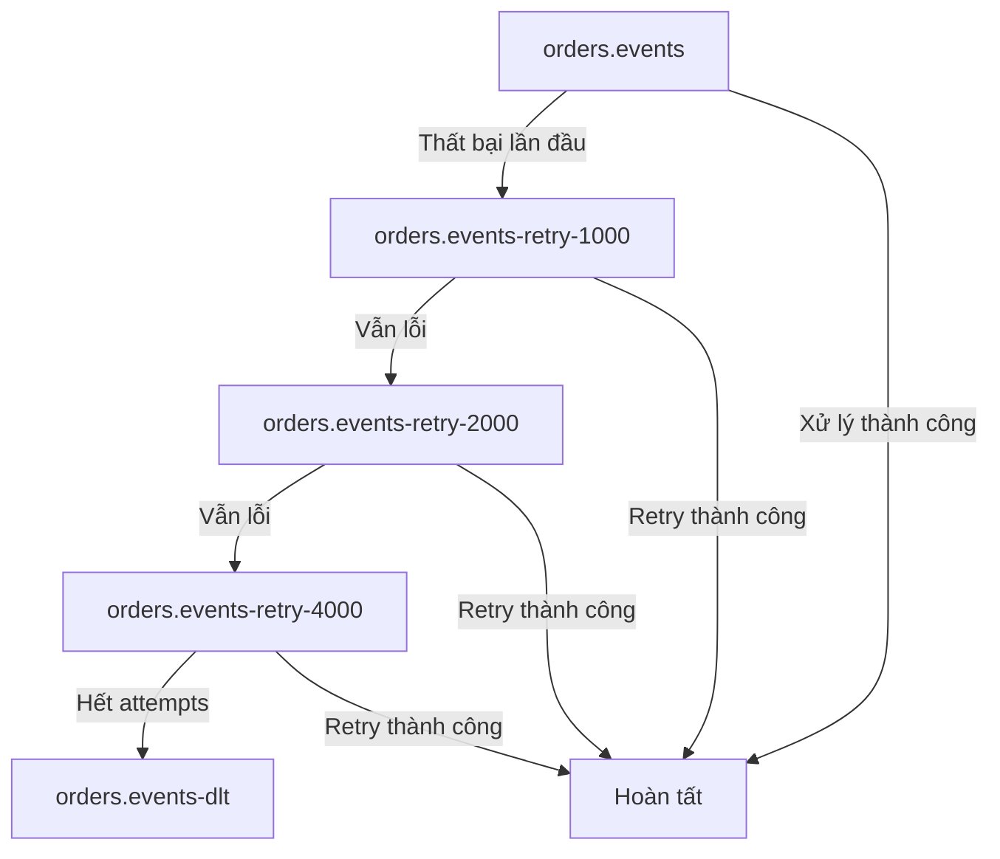

# Dead-letter topic của non-blocking retry

Trong Spring Kafka, non-blocking retry chuyển record thất bại sang một hoặc nhiều retry topic thay vì giữ consumer ở topic gốc để chờ hết thời gian backoff. Nếu record vẫn thất bại sau tổng số lần thử đã cấu hình, record được chuyển đến **dead-letter topic (DLT)**. DLT là điểm kết thúc của luồng retry tự động, nơi ứng dụng có thể điều tra, sửa nguyên nhân và replay có kiểm soát.

`@RetryableTopic` là cách khai báo phổ biến để Spring Kafka tạo retry infrastructure, các listener cho retry topic và DLT. Có thể tùy chỉnh tên topic, số lần thử, backoff, exception được retry, partition và replication. DLT không tự sửa record; nó lưu record đã cạn retry để luồng chính tiếp tục tiến triển.

## 1. Non-blocking retry đưa record đi đâu?

Với blocking retry, listener container thử lại record trong luồng xử lý hiện tại và chờ theo backoff. Trong thời gian đó, partition có thể không tiếp tục xử lý các record sau theo thứ tự thông thường.

Với non-blocking retry, khi listener thất bại, record được publish sang retry topic. Consumer của topic gốc có thể tiếp tục xử lý record tiếp theo; retry listener nhận record ở retry topic khi đến thời điểm thử lại. Nếu hết retry mà vẫn thất bại, record được publish sang DLT.

Ví dụ topic gốc `orders.events` có thể tạo topology:



Tên retry topic trong sơ đồ là ví dụ minh họa. Tên thực tế phụ thuộc suffix strategy và cấu hình của Spring Kafka. DLT thường dùng hậu tố `-dlt` theo cấu hình mặc định; ứng dụng có thể đặt suffix riêng.

Non-blocking retry phù hợp khi lỗi có thể tự phục hồi sau một khoảng thời gian và hệ thống muốn tiếp tục xử lý các record khác trong topic gốc. Đổi lại, record thất bại có thể được xử lý muộn hơn record đến sau nó.

## 2. DLT khác retry topic như thế nào?

Retry topic là chặng trung gian để thử lại sau một khoảng backoff. DLT là đích cuối khi retry policy đã hết hoặc record được phân loại là không thể retry theo cấu hình.

| Thành phần | Vai trò | Consumer thường dùng |
| --- | --- | --- |
| Topic gốc | Nhận event mới từ producer | Listener nghiệp vụ chính |
| Retry topic | Giữ record chờ lần thử tiếp theo | Retry listener do Spring Kafka tạo |
| DLT | Lưu record không xử lý thành công sau retry | DLT handler, công cụ điều tra hoặc quy trình replay |

Một record có thể đi qua nhiều retry topic theo lịch backoff. Khi lần thử cuối vẫn thất bại, recoverer publish record đến DLT. Record đã vào DLT không tự quay lại topic gốc; cần một quy trình replay riêng sau khi nguyên nhân lỗi được xử lý.

Không nên dùng DLT làm retry queue vô hạn. Nếu DLT consumer cứ ném exception và lại chuyển record về cùng DLT, hệ thống có thể tạo vòng lặp và tăng tải không kiểm soát.

## 3. Khai báo non-blocking retry bằng @RetryableTopic

Spring Kafka hỗ trợ khai báo retry topic ngay trên listener bằng `@RetryableTopic`. Ví dụ dưới đây cho phép tổng cộng bốn lần xử lý, gồm lần đầu trên topic gốc và ba lần thử tiếp theo trên retry topic:

```java
package com.example.orders.consumer;

import com.example.orders.event.OrderCreated;
import com.example.orders.service.BillingService;
import org.slf4j.Logger;
import org.slf4j.LoggerFactory;
import org.springframework.kafka.annotation.KafkaListener;
import org.springframework.kafka.annotation.RetryableTopic;
import org.springframework.kafka.annotation.DltHandler;
import org.springframework.retry.annotation.Backoff;
import org.springframework.stereotype.Component;

@Component
public class OrderCreatedListener {

    private static final Logger log =
            LoggerFactory.getLogger(OrderCreatedListener.class);

    private final BillingService billingService;

    public OrderCreatedListener(BillingService billingService) {
        this.billingService = billingService;
    }

    @RetryableTopic(
            attempts = "4",
            backoff = @Backoff(
                    delay = 1_000,
                    multiplier = 2.0,
                    maxDelay = 10_000
            ),
            retryTopicSuffix = "-retry",
            dltTopicSuffix = "-dlt"
    )
    @KafkaListener(
            topics = "orders.events",
            groupId = "billing-service"
    )
    public void onOrderCreated(OrderCreated event) {
        billingService.createInvoice(event);
    }

    @DltHandler
    public void onDlt(OrderCreated event) {
        billingService.recordFailedEvent(event);
    }
}
```

Trong ví dụ:

- `attempts = "4"` là tổng số lần xử lý tối đa, bao gồm lần đầu trên topic gốc.
- `delay = 1_000` đặt backoff ban đầu một giây.
- `multiplier = 2.0` tăng khoảng chờ theo cấp số nhân.
- `maxDelay = 10_000` giới hạn khoảng chờ tối đa mười giây.
- `retryTopicSuffix` và `dltTopicSuffix` xác định hậu tố tên topic.
- `@DltHandler` đánh dấu method xử lý record được chuyển vào DLT.

Với backoff trên, các khoảng chờ dự kiến là 1 giây, 2 giây và 4 giây (chưa chạm maxDelay). Lần thử đầu tiên diễn ra trên topic gốc; nếu cả bốn lần đều thất bại, record được chuyển đến DLT.

`@RetryableTopic` cần được dùng cùng `@KafkaListener`. Hãy kiểm tra API của phiên bản Spring Kafka trong project vì một số thuộc tính annotation và cách cấu hình topic có thể thay đổi giữa các phiên bản.

## 4. attempts là tổng số lần thử

Một nhầm lẫn phổ biến là coi `attempts` là số lần retry sau lần đầu. Với `@RetryableTopic`, `attempts` biểu thị tổng số lần xử lý, bao gồm lần đầu trên topic gốc.

| `attempts` | Lần đầu | Số lần retry tối đa | Tổng lần xử lý tối đa |
| ---: | ---: | ---: | ---: |
| 1 | 1 | 0 | 1 |
| 2 | 1 | 1 | 2 |
| 3 | 1 | 2 | 3 |
| 4 | 1 | 3 | 4 |
| 5 | 1 | 4 | 5 |

Ví dụ `attempts="4"` không có nghĩa listener được gọi bốn lần retry cộng thêm lần đầu. Nó có nghĩa tối đa bốn lần gọi listener tính cả lần đầu. Sau lần cuối thất bại, record đi vào DLT.

Điều này khác với `FixedBackOff` của `DefaultErrorHandler`, nơi `maxAttempts` là số lần retry sau lần gọi ban đầu. Khi chuyển từ blocking retry sang non-blocking retry, cần rà soát lại số lần thử để không vô tình tăng hoặc giảm retry budget.

## 5. Backoff và lịch retry

Backoff xác định khoảng chờ trước khi record được thử lại. Với exponential backoff:

\[
delay_n = \min(initialDelay \times multiplier^{n-1}, maxDelay)
\]

Ví dụ `initialDelay=1s`, `multiplier=2`, `maxDelay=10s`:

| Lần retry | Khoảng chờ trước lần thử |
| ---: | ---: |
| 1 | 1 giây |
| 2 | 2 giây |
| 3 | 4 giây |
| 4 | 8 giây |
| 5 trở đi | Tối đa 10 giây |

Spring Kafka dùng các retry topic tương ứng với những khoảng chờ được cấu hình. Cách nhóm các khoảng delay vào topic và suffix phụ thuộc topic suffixing strategy và same interval topic reuse strategy. Khi có nhiều lần thử với cùng một khoảng delay, có thể tái sử dụng topic theo cấu hình thay vì tạo một topic riêng cho mỗi attempt.

Hãy chọn backoff theo đặc tính lỗi:

- Timeout ngắn hoặc lỗi mạng thoáng qua: backoff ngắn có thể đủ.
- Hệ thống downstream đang quá tải: backoff tăng dần giúp tránh tạo thêm áp lực.
- Sự cố phụ thuộc kéo dài: cần khoảng chờ dài hơn, cảnh báo và có thể tạm dừng consumer theo chính sách vận hành.
- Lỗi dữ liệu không hợp lệ: retry thường không giúp ích; nên phân loại để chuyển DLT sớm.

## 6. Chỉ retry các exception phù hợp

Không nên retry mọi exception như nhau. Lỗi tạm thời có thể được giải quyết khi thử lại; lỗi validation hoặc event version không hỗ trợ thường cần được đưa đến DLT để điều tra.

Ví dụ chỉ định exception được retry:

```java
@RetryableTopic(
        attempts = "4",
        backoff = @Backoff(delay = 1_000, multiplier = 2.0),
        include = {TransientBillingException.class},
        exclude = {InvalidOrderEventException.class}
)
@KafkaListener(topics = "orders.events", groupId = "billing-service")
public void onOrderCreated(OrderCreated event) {
    billingService.createInvoice(event);
}
```

Ví dụ minh họa `TransientBillingException` được retry và `InvalidOrderEventException` không được retry. Exception không thuộc danh sách cần được xử lý theo quy tắc mặc định của cấu hình retry; hãy khai báo rõ include/exclude để tránh hiểu nhầm khi có nhiều loại lỗi.

Khi exception được xác định là non-retryable, record có thể được chuyển thẳng đến DLT mà không đi qua toàn bộ retry chain. Hãy kiểm thử riêng trường hợp này để xác nhận số lần gọi listener và topic đích.

## 7. DLT handler bằng @DltHandler

`@DltHandler` cho phép khai báo method xử lý record trong DLT. Method thường đặt cùng class với listener có `@RetryableTopic`, giúp gom logic của luồng event và lỗi vào một component.

```java
@DltHandler
public void onDlt(OrderCreated event) {
    log.error("Order event exhausted retry: eventId={}, orderId={}",
            event.eventId(), event.orderId());

    failedEventRepository.save(
            FailedEvent.from(event, "Retry attempts exhausted")
    );
}
```

DLT handler nên làm những việc có thể hoàn tất ổn định:

- Ghi nhận event ID, aggregate ID và thông tin lỗi.
- Lưu dấu vết phục vụ điều tra hoặc tạo ticket/alert qua một luồng riêng.
- Không thực hiện lại nghiệp vụ đã thất bại nếu nguyên nhân chưa được sửa.
- Không nuốt lỗi một cách im lặng khiến record DLT bị xác nhận mà không có dấu vết.

Nếu handler lưu vào database, cần thiết kế idempotent vì DLT record cũng có thể được giao lại sau restart. Có thể dùng event ID làm khóa duy nhất cho bản ghi failed-event.

Khi cần truy cập metadata đầy đủ, DLT handler có thể nhận `ConsumerRecord` hoặc các header Spring Kafka hỗ trợ. Hãy xác nhận chữ ký method tương thích với payload/deserializer của DLT listener.

Nếu một công cụ giám sát khác cũng cần đọc toàn bộ DLT, hãy dùng consumer group riêng. Nếu nó dùng cùng group ID với DLT listener, hai consumer sẽ chia record cho nhau thay vì mỗi bên nhận một bản sao đầy đủ.

## 8. Tạo DLT và retry topics chủ động

Spring Kafka có thể tự tạo retry topics khi `@RetryableTopic` được cấu hình cho phép. Trong production, nhiều đội vận hành muốn quản lý topic qua hạ tầng (Terraform, Helm hoặc quy trình AdminClient) để kiểm soát partition, replication, retention và ACL.

Ví dụ tắt auto-create topic trong annotation (kiểm tra kiểu thuộc tính theo phiên bản đang dùng):

```java
@RetryableTopic(
        attempts = "4",
        backoff = @Backoff(delay = 1_000, multiplier = 2.0),
        autoCreateTopics = "false",
        numPartitions = "6",
        replicationFactor = "3"
)
@KafkaListener(topics = "orders.events", groupId = "billing-service")
public void onOrderCreated(OrderCreated event) {
    billingService.createInvoice(event);
}
```

Khi không tự tạo topic, cần provision tất cả retry topic và DLT theo đúng tên mà Spring Kafka sinh ra từ suffix strategy. Cần đối chiếu tên thực tế với cấu hình backoff, suffix và strategy; không chỉ tạo topic gốc rồi giả định các topic còn lại sẽ tự xuất hiện.

Có thể khai báo DLT bằng Spring Kafka `KafkaAdmin`/`NewTopic`:

```java
import org.apache.kafka.clients.admin.NewTopic;
import org.springframework.context.annotation.Bean;
import org.springframework.context.annotation.Configuration;
import org.springframework.kafka.config.TopicBuilder;

@Configuration
public class DeadLetterTopicProvisioning {

    @Bean
    NewTopic ordersDltTopic() {
        return TopicBuilder.name("orders.events-dlt")
                .partitions(6)
                .replicas(3)
                .build();
    }
}
```

Ví dụ tạo DLT sáu partition và replication factor ba. Các retry topic cũng phải được provision theo đúng tên do suffix strategy sinh ra và có partition count phù hợp. `numPartitions` trong `@RetryableTopic` là cấu hình số partition cho các topic do retry infrastructure tạo; nếu nguồn có nhiều partition và routing giữ partition number gốc, đừng để retry/DLT topic ít partition hơn nguồn.

Một chiến lược suffix phổ biến gắn delay vào tên retry topic, chẳng hạn `orders.events-retry-1000`, `orders.events-retry-2000`; DLT dùng suffix riêng như `orders.events-dlt`. `TopicSuffixingStrategy` và `SameIntervalTopicReuseStrategy` điều khiển cách đặt tên và tái sử dụng topic cho các lần thử có cùng delay. Hãy xác nhận tên topic được tạo trong đúng version Spring Kafka trước khi khai báo thủ công.

### 8.1. Partition count của DLT

Retry topic và DLT cần có partition phù hợp với cách framework định tuyến record. Một số cấu hình giữ partition number của record nguồn; khi đó retry topic/DLT phải có đủ partition tương ứng. Nếu topic được tạo với ít partition hơn, publish có thể lỗi `InvalidPartitionException` hoặc lỗi tương tự.

Nếu dùng một partition count chung, ví dụ sáu partition cho topic gốc, retry topics và DLT, việc đối chiếu partition dễ hơn. Tuy nhiên, số partition cũng ảnh hưởng concurrency, metadata và chi phí broker.

### 8.2. Replication factor và retention

Không nên mặc định retry topic/DLT có cùng retention với topic gốc. Retry topic cần giữ record đủ lâu để chờ backoff và xử lý lag; DLT có thể cần retention dài hơn để điều tra và replay.

Hãy thiết lập:

- Replication factor phù hợp với độ sẵn sàng của cluster.
- `min.insync.replicas` phù hợp với producer `acks` nếu cần durability.
- Retention đủ dài cho thời gian chờ retry và thời gian xử lý sự cố.
- ACL cho producer retry/DLT và consumer retry/DLT.
- Alert khi disk usage, under-replicated partition hoặc DLT growth tăng bất thường.

## 9. Cấu hình bằng RetryTopicConfigurationBuilder

Nếu không muốn đặt annotation trên từng listener, có thể tạo `RetryTopicConfiguration` bằng builder:

```java
import com.example.orders.event.OrderCreated;
import org.springframework.context.annotation.Bean;
import org.springframework.context.annotation.Configuration;
import org.springframework.kafka.core.KafkaTemplate;
import org.springframework.kafka.retrytopic.RetryTopicConfiguration;
import org.springframework.kafka.retrytopic.RetryTopicConfigurationBuilder;
import com.example.orders.exception.InvalidOrderEventException;
import com.example.orders.exception.TransientBillingException;

@Configuration
public class OrdersRetryTopicConfig {

    @Bean
    public RetryTopicConfiguration ordersRetryConfiguration(
            KafkaTemplate<String, OrderCreated> kafkaTemplate
    ) {
        return RetryTopicConfigurationBuilder
                .newInstance()
                .exponentialBackoff(1_000, 2.0, 10_000)
                .maxAttempts(4)
                .retryOn(TransientBillingException.class)
                .notRetryOn(InvalidOrderEventException.class)
                .dltSuffix("-dlt")
                .includeTopic("orders.events")
                .create(kafkaTemplate);
    }
}
```

Builder hữu ích khi nhiều listener cần chia sẻ một retry policy hoặc khi muốn cấu hình tập trung. Kiểu trả về `RetryTopicConfiguration` nằm trong package `org.springframework.kafka.retrytopic`; imports và exception class trong ví dụ thuộc ứng dụng. Hãy kiểm tra tên method/overload của `RetryTopicConfigurationBuilder` trong Spring Kafka version của project; annotation và builder là hai cách khai báo cùng một retry infrastructure, không nên cấu hình chồng chéo cho cùng một endpoint.

## 10. Header trong retry topic và DLT

Spring Kafka gắn metadata vào record được chuyển qua retry chain. Metadata giúp xác định topic gốc, partition/offset gốc, thời điểm gửi ban đầu và số lần thử đã thực hiện.

Các thông tin cần quan sát thường gồm:

| Metadata | Mục đích |
| --- | --- |
| Original topic | Xác định topic nguồn của event |
| Original partition/offset | Truy vết vị trí record ban đầu |
| Original timestamp | Biết thời điểm record được tạo/gửi ban đầu |
| Attempt count | Biết record đã qua bao nhiêu lần thử |
| Backoff timestamp | Xác định thời điểm record đủ điều kiện thử lại |
| Exception type/message | Điều tra nguyên nhân thất bại |

Header names được Spring Kafka quản lý qua các lớp/hằng số retry topic của phiên bản tương ứng. Khi đọc thủ công, ưu tiên API/hằng số của version đang dùng thay vì hardcode chuỗi header theo một bài viết cũ.

Không nên ghi stack trace dài hoặc thông tin nhạy cảm vào log ứng dụng mà không kiểm soát. Header exception có thể làm tăng kích thước record; cần theo dõi giới hạn message size và chính sách dữ liệu nhạy cảm.

## 11. Non-blocking retry ảnh hưởng ordering như thế nào?

Non-blocking retry có một trade-off quan trọng: khi record lỗi được chuyển sang retry topic, consumer của topic gốc có thể tiếp tục xử lý record tiếp theo. Vì vậy, các event cùng key có thể được xử lý không theo thứ tự ban đầu.

Ví dụ một partition có các event:

```text
Offset 10: OrderCreated(ORD-100)  -> lỗi, chuyển sang retry topic
Offset 11: OrderPaid(ORD-100)     -> xử lý thành công ngay trên topic gốc
Retry:     OrderCreated(ORD-100)  -> xử lý thành công sau đó
```

Kết quả là `OrderPaid` có thể được áp dụng trước `OrderCreated`. Dùng cùng Kafka key chỉ bảo đảm các record đi vào cùng partition theo partitioner; nó không giữ thứ tự xử lý xuyên qua nhiều retry topic.

Non-blocking retry phù hợp khi event độc lập hoặc nghiệp vụ chịu được xử lý lệch thứ tự. Nếu phải giữ thứ tự tuyệt đối theo aggregate, cân nhắc blocking retry, pause partition, xử lý theo version/sequence hoặc một workflow có cơ chế tuần tự hóa riêng.

Spring Kafka non-blocking retry không hỗ trợ batch listener và không kết hợp với container transactions theo cách tương tự blocking retry. Hãy kiểm tra giới hạn tương thích của phiên bản framework và không bật cơ chế này cho luồng cần batch/transaction semantics mà nó không hỗ trợ.

## 12. Non-blocking retry và transaction

Non-blocking retry chuyển record giữa các topic bằng các lần publish riêng. Nó không phải một transaction nguyên tử bao trùm việc consume topic gốc, publish retry record và commit offset nguồn trong mọi cấu hình.

Vì vậy, có thể xuất hiện khoảng lỗi giữa publish retry topic và commit offset topic nguồn. Nếu record được publish sang retry topic nhưng offset nguồn chưa commit, record gốc có thể được giao lại sau restart. Điều đó có thể tạo duplicate trong retry chain.

Consumer và side effect nghiệp vụ cần idempotent. Dùng `eventId` ổn định, inbox table hoặc unique constraint để tránh áp dụng cùng event nhiều lần.

Nếu yêu cầu Kafka transaction/ exactly-once consume-transform-produce là bắt buộc, hãy xem xét blocking retry và transaction flow phù hợp thay vì giả định non-blocking retry tự cung cấp transaction đó. Kafka transaction cũng không tự bao gồm database hoặc HTTP call.

## 13. Chọn non-blocking retry hay blocking retry?

| Tiêu chí | Non-blocking retry | Blocking retry |
| --- | --- | --- |
| Cách chờ | Chuyển record sang retry topic | Consumer chờ backoff trong luồng xử lý |
| Topic bổ sung | Có retry topics và DLT | Thường chỉ cần topic gốc và có thể DLT |
| Luồng chính | Có thể tiếp tục xử lý record sau | Có thể bị giữ lại trong lúc retry |
| Ordering | Có thể lệch thứ tự giữa record lỗi và record đến sau | Dễ giữ thứ tự partition hơn khi retry tại chỗ |
| Phù hợp | Event độc lập, cần throughput và không muốn chặn partition lâu | Event cần thứ tự hoặc transaction container |
| Hạn chế | Không hỗ trợ batch listener/container transactions trong mô hình chuẩn | Backoff dài có thể giữ partition và tăng lag |

Không có một lựa chọn tốt cho mọi topic. Hãy xác định ordering requirement, thời gian lỗi có thể kéo dài, throughput, số retry và transaction semantics trước khi chọn.

## 14. DLT là điểm cuối của retry tự động

Khi record vào DLT, hệ thống nên có một quy trình xử lý rõ ràng. Một DLT không được giám sát có thể trở thành nơi lưu lỗi bị bỏ quên.

DLT handler hoặc consumer vận hành có thể:

- Lưu event ID, key, payload reference và metadata nguồn.
- Ghi exception class/message và thời điểm recover.
- Tạo cảnh báo theo loại lỗi và tỷ lệ DLT.
- Đưa record vào quarantine store nếu payload có dữ liệu nhạy cảm hoặc cần phân quyền.
- Chờ quyết định replay sau khi sửa lỗi.

Nếu DLT handler chỉ log rồi xác nhận record, cần bảo đảm log/metric đã đủ để phục hồi và record được lưu theo retention cần thiết. Với nghiệp vụ quan trọng, nên lưu một bản ghi failed-event bền vững thay vì chỉ dựa vào log.

## 15. Replay record từ DLT

Replay là thao tác publish record DLT trở lại topic gốc hoặc một topic replay riêng sau khi lỗi đã được sửa. Replay tạo một Kafka record mới với offset mới; offset gốc chỉ được giữ trong header để truy vết.

Quy trình replay nên gồm:

1. Đọc record DLT và xác định event ID, topic/partition/offset gốc, key và exception.
2. Sửa nguyên nhân gốc: dữ liệu, schema, consumer code hoặc dependency.
3. Xác nhận payload còn hợp lệ và không gây side effect sai với trạng thái hiện tại.
4. Chọn topic đích và giữ key để định tuyến theo hợp đồng nghiệp vụ.
5. Thêm replay marker/correlation ID nếu cần kiểm toán.
6. Gửi record và xác nhận publish thành công.
7. Theo dõi consumer, retry chain và DLT mới.
8. Đánh dấu record nguồn đã replay thành công trong kho quản lý nếu có.

Không replay tự động vô hạn một record cứ thất bại. Cần giới hạn số lần replay và lưu dấu vết từng lần để tránh tạo vòng lặp.

## 16. Kiểm thử DLT của non-blocking retry

Integration test nên xác minh topology, số lần thử, metadata và hành vi DLT handler.

Một kịch bản với `@EmbeddedKafka` hoặc Testcontainers:

1. Tạo topic gốc `orders.events`, các retry topics cần thiết và `orders.events-dlt`.
2. Cấu hình `@RetryableTopic` với số attempts nhỏ và backoff ngắn để test chạy nhanh.
3. Tạo listener test cố tình ném `TransientBillingException` cho một event nhất định.
4. Chờ record xuất hiện ở retry topic sau lần đầu.
5. Xác minh attempt count/backoff metadata và key/value được giữ.
6. Để tất cả attempts thất bại và xác minh record cuối cùng đến DLT.
7. Kiểm tra `@DltHandler` được gọi đúng một lần theo kỳ vọng của test và lưu được failed-event.
8. Tạo một event thành công ở lần retry sau để xác minh record không đi đến DLT.
9. Kiểm tra exception non-retryable được route thẳng đến DLT nếu cấu hình như vậy.
10. Restart consumer trong lúc retry để xác minh record trong retry topic vẫn được xử lý theo metadata và retention.

Test cần dùng group ID riêng, latch/queue và assertion có timeout. Tránh dựa vào `Thread.sleep()` cố định để kết luận retry đã đến hạn.

## 17. Quan sát retry topics và DLT trong production

Nên theo dõi các chỉ số:

| Chỉ số | Câu hỏi cần trả lời |
| --- | --- |
| Retry topic record rate | Có bao nhiêu record đang được chuyển sang retry? |
| DLT publish rate | Bao nhiêu record đã hết retry? |
| DLT consumer lag | Có record lỗi đang chờ điều tra/xử lý không? |
| Attempts distribution | Record thường thành công ở lần thử nào? |
| Backoff delay | Record chờ bao lâu trước khi thử lại? |
| Retry publish failure | Có lỗi khi gửi sang retry topic không? |
| Consumer processing latency | Listener mất bao lâu để xử lý một record? |
| Topic disk usage/retention | Retry và DLT có đang chiếm dung lượng bất thường không? |

Alert nên được tạo khi DLT rate vượt ngưỡng, retry topics tăng lag kéo dài, publish retry/DLT thất bại hoặc DLT không có consumer vận hành khi cần. DLT growth là tín hiệu chất lượng dữ liệu, tương thích schema hoặc sức khỏe dependency, không chỉ là vấn đề Kafka.

## 18. Lỗi thường gặp

| Hiện tượng | Nguyên nhân thường gặp | Cách xử lý |
| --- | --- | --- |
| Record không đến DLT | Attempts chưa hết hoặc exception được retry theo policy khác | Kiểm tra `attempts`, include/exclude và listener logs |
| Record vào DLT sớm hơn dự kiến | Exception bị phân loại non-retryable | Kiểm tra exception hierarchy và include/exclude |
| Retry topic không tồn tại | Tắt auto-create nhưng chưa provision đầy đủ topic | Tạo topic theo đúng suffix strategy và backoff |
| Publish retry/DLT lỗi invalid partition | Topic đích có ít partition hơn partition được chọn | Đồng bộ partition count hoặc điều chỉnh routing |
| DLT handler không chạy | DLT endpoint chưa được tạo hoặc listener config không khớp | Kiểm tra `@RetryableTopic`, `@DltHandler`, group và topic |
| Event cùng aggregate bị xử lý sai thứ tự | Non-blocking retry cho phép topic gốc tiếp tục | Dùng blocking retry hoặc version/sequence nếu ordering bắt buộc |
| DLT tăng nhanh | Lỗi dữ liệu hoặc downstream kéo dài, retry budget quá thấp | Phân loại lỗi, điều chỉnh backoff và alert |
| Replay tạo duplicate | Side effect không idempotent | Dùng event ID/inbox và replay marker |
| Retry topic chiếm nhiều disk | Retention dài, backlog hoặc backoff quá lớn | Theo dõi lag, retention và capacity |
| Listener không tương thích | Dùng batch listener hoặc container transaction | Chuyển sang record listener và mô hình không transaction, hoặc chọn blocking retry |

## 19. Checklist thiết kế DLT cho non-blocking retry

Trước khi triển khai, hãy xác nhận:

1. Topic gốc và group ID được định nghĩa ổn định.
2. `attempts` được hiểu là tổng số lần thử, bao gồm lần đầu.
3. Backoff, multiplier và max delay phù hợp với lỗi dự kiến.
4. Exception retryable/non-retryable được phân loại rõ.
5. Retry topic suffix và DLT suffix không xung đột với topic khác.
6. Retry topics và DLT đã được provision với partition/replication phù hợp nếu không auto-create.
7. Retention đủ dài cho thời gian chờ retry và thời gian xử lý sự cố.
8. DLT handler lưu metadata đủ để điều tra và idempotent.
9. Consumer chấp nhận ordering có thể lệch hoặc đã chọn cơ chế khác nếu cần thứ tự nghiêm ngặt.
10. Listener không dùng batch/container transaction trong mô hình non-blocking retry không hỗ trợ.
11. Replay có giới hạn, có audit và không tạo vòng lặp.
12. Có metric/alert cho retry rate, DLT rate, publish failure, lag và disk usage.
13. Integration test bao phủ thành công ở retry, hết retry, non-retryable exception và restart.

DLT của non-blocking retry là điểm cuối của retry chain, giúp lưu lại event không xử lý thành công sau các lần thử. Thiết kế tốt cần xác định chính xác attempts/backoff, topic naming, partition và retention, DLT handler, cách replay và giới hạn ordering. Khi kết hợp idempotency cùng monitoring, hệ thống có thể tiếp tục xử lý luồng chính mà vẫn giữ được dữ liệu lỗi để phục hồi.

## 20. Tự kiểm tra

1. Non-blocking retry khác blocking retry ở cách xử lý record thất bại như thế nào?
2. Retry topic và DLT có vai trò khác nhau ra sao?
3. `attempts="4"` tương ứng tối đa bao nhiêu lần gọi listener?
4. Backoff exponential với delay 1 giây và multiplier 2 tạo lịch thử lại thế nào?
5. `@DltHandler` dùng để làm gì?
6. Vì sao DLT/retry topics cần partition count tương thích với routing strategy?
7. Non-blocking retry có thể làm mất ordering theo aggregate bằng cách nào?
8. Vì sao non-blocking retry không nên được xem là transaction nguyên tử với offset nguồn?
9. Khi nào nên dùng blocking retry thay vì non-blocking retry?
10. Những thông tin nào cần lưu để replay record DLT an toàn?
